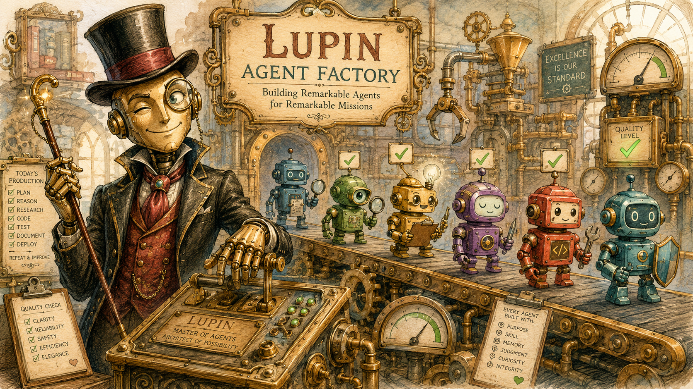
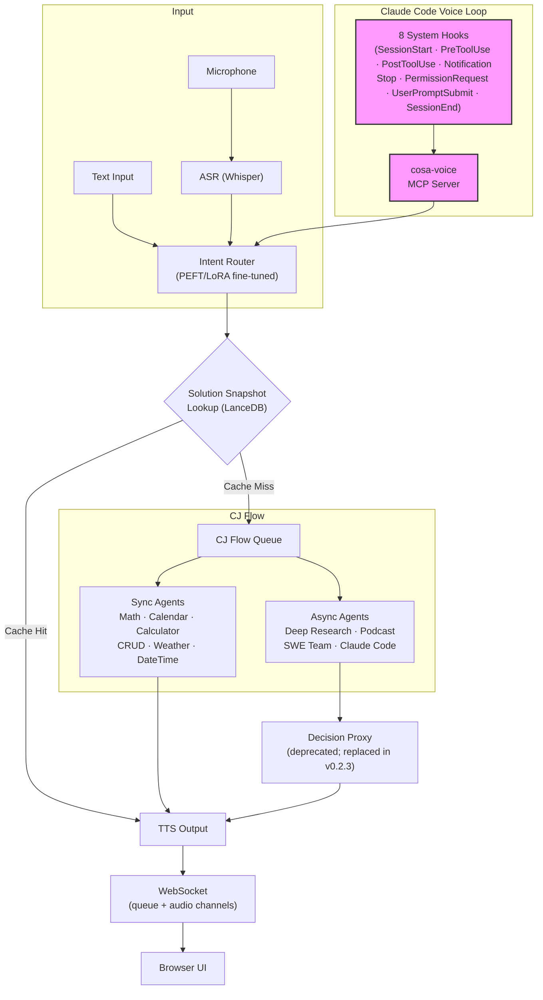

<p align="center">
  
</p>

# Lupin AF

*Named after Arsène Lupin, the gentleman thief. The **AF** is **Agent Factory** -- and, yes, the other thing too.*

> **Lupin AF (Agent Factory) is a voice-driven, human-in-the-loop harness that wraps Claude Code. A person who can't type can still drive an agentic coding session as a first-class UX citizen -- not just ride along as a passenger. And that's cool AF.**
>
> -- R. P. Ruiz, *[Prompt, Skim, Ship, and Hope](https://medium.com/@ricardo.felipe.ruiz/lupin-af-how-i-turned-claude-code-into-an-agent-factory-that-proves-itself-fc6f09bafadd)*

**A voice-first AI agent platform that closes the voice loop from browser UI through agent execution into developer tooling and back**. It has fine-tuned intent routing and solution caching built in.

`FastAPI` | `Voice I/O` | `PEFT/LoRA` | `PostgreSQL + pgvector` | `Claude Agent SDK` | `MCP Protocol`

Current version: **v0.2.2** (dev) | License: Apache 2.0 (the `LICENSE` file)

---

I can't type. That constraint is why this isn't a position paper. Since March 2025 I've put roughly a million lines of AI-generated code into production, and typed almost none of it.

---

## The series -- *Lupin AF*, on Medium

1. **[Prompt, Skim, Ship, and Hope](https://medium.com/@ricardo.felipe.ruiz/lupin-af-how-i-turned-claude-code-into-an-agent-factory-that-proves-itself-fc6f09bafadd)**
2. **[Your Plan Is a Work Queue, Not a Document](https://medium.com/@ricardo.felipe.ruiz/lupin-af-the-method-making-a-plan-defensible-not-just-hopeful-43858c68217b)**
3. **[Seventeen Agents Are Cheaper and Easier Than Twelve](https://medium.com/@ricardo.felipe.ruiz/seventeen-agents-are-cheaper-and-easier-than-twelve-57c20c9fc470)**

---

## Came here from the articles?

- **The workflow corpus** -- 51 canonical workflow documents in [planning-is-prompting](https://github.com/deepily/planning-is-prompting/tree/main/workflow), the methodology repo this one runs on. In-repo: [agentic-voice-workflow.md](src/workflow/agentic-voice-workflow.md).
- **The SWE team role definitions** -- `.claude/skills/spin-up-swe-team/SKILL.md` is the activation. The per-role charters it slices from are [workflow/swe-team-roles.md](https://github.com/deepily/planning-is-prompting/blob/main/workflow/swe-team-roles.md).
- **Escalation and human-in-the-loop** -- two different ladders. The agent one is the Decision Proxy's five trust levels, in the [Decision Proxy Admin Guide](src/docs/proxy-admin-guide.md) (deprecated; replaced in v0.2.3). The fleet one -- what a manager may do without asking me, and what it may never do -- is [workflow/manager-autonomy.md](https://github.com/deepily/planning-is-prompting/blob/main/workflow/manager-autonomy.md).
- **The cascade reviews** -- [plan-review-cascaded.md](.claude/commands/plan-review-cascaded.md) is the procedure; the transcripts of real cascades, findings and all, are in [src/rnd/v0.2.0/](src/rnd/v0.2.0/).

---

## Human in the loop, reimagined

Every agentic AI platform needs human oversight. Most implement it as a modal dialog: click approve, type feedback, wait. Lupin takes a fundamentally different approach -- **voice-first human-in-the-loop**.

Agents speak to you. You speak back. The result: human oversight that works **from across the room**, while you're multitasking, or even from your phone -- no screen required.

This is the missing piece in agentic AI: not just making agents smarter, but making **human oversight effortless**.

---

## The dream

Talk to the computer, and it tells you, or does, something useful.

### The problem

Currently, AI agents and chatbots are [slow and expensive](https://www.linkedin.com/pulse/langchains-dataframe-agent-why-you-so-slow-r-p-ruiz).
They [make silly mistakes](https://www.linkedin.com/pulse/meet-my-idiot-savant-intern-chatgpts-advanced-data-analysis-ruiz/).
They're forgetful. And they work too hard reinventing the wheel.

### What most people probably don't realize

Even the simplest vox-in and vox-out UX -- especially when coupled with agentic behaviors -- is **_hard_**. It's asynchronous, and usually frustratingly slow. It's a new way of interacting with computers, which requires a global rethinking of how different the UI control and display modalities interact.

### Lupin's approach

Fine-tune small models for cheap, fast intent routing -- not prompt engineering, actual PEFT/LoRA fine-tuning. Escalate to frontier models only when complexity demands it. Cache solutions via vector search so agents never solve the same problem twice. And voice-enable *everything*. That runs from the browser UI, through agent execution, into [Claude Code developer sessions](https://www.linkedin.com/pulse/slow-expensive-erratic-problem-whats-solution-r-p-ruiz/) via 8 system hooks and an MCP voice server. And back again.

---

## Architecture



Voice flows end-to-end: browser microphone through agent execution into Claude Code sessions and back via dual-channel WebSocket audio streaming.

---

## What's new in v0.2.2

v0.2.2 ran from 30 September to 3 November 2026. It asked one question: before a seat writes a new function, can it find out whether the code base already has one? It built a wiki of 696 capability pages written from the code, and lookup tools that search it. It also built a **reuse gate** that refuses a merge whose new definitions carry no lookup record. Enforcement began on 3 November. A daily duplicate check now files what it finds, and coverage reached 100% across the whole frame. A docstring sweep took 29,838 lint findings to 0 behind a new `doclint` gate. The measurements of the checker itself were reported as found, including the negative ones.

Full highlights: [WHATS-NEW.md](WHATS-NEW.md) · per-version summaries: [VERSION-HISTORY.md](VERSION-HISTORY.md) · per-feature detail: [CHANGELOG.md](CHANGELOG.md)

---

## Agent ecosystem

**23 specialized agent types**, from sub-second sync responders to long-running autonomous research pipelines. All routed through fine-tuned small models and unified by a single voice-first queue system.

One counting note, because the articles use a different unit. The 23 below are agent **types** -- classes in the codebase, counted from the four tables. When the articles talk about *seventeen agents*, they mean fleet **personas**. Those are the named seats a live Claude Code session sits in, each with its own voice. Types are what the system can do; personas are who is on shift. Neither number contradicts the other.

### Synchronous agents (respond in <1s via PEFT routing)

| Agent | Purpose |
|-------|---------|
| MathAgent | Symbolic math via LLM |
| CalendarAgent | Date-aware scheduling |
| DateTimeAgent | Time queries and conversions |
| WeatherAgent | Weather lookups |
| TodoListAgent | Persistent task management |
| CalculatorAgent | Natural language calculator (508 LoRA templates), MathAgent fallback |
| CRUDAgent | Voice-controlled DataFrame create/read/update/delete |
| ReceptionistAgent | Top-level intent router |
| RuntimeArgumentExpeditor | LLM-powered gap analysis -- asks for missing arguments via voice |

### Long-running agents (async via CJ Flow queue)

| Agent | Purpose |
|-------|---------|
| DeepResearchAgent | Background research with automatic report generation |
| PodcastGeneratorAgent | Convert documents to audio podcast format |
| ResearchToPodcastAgent | Chained research-to-podcast pipeline |
| PresentationGeneratorAgent | Multi-phase pipeline: outline → elaborate → render → deliver (eight phases) |
| ResearchToPresentationAgent | Chained research-to-presentation pipeline |
| ClaudeCodeAgent | Claude Agent SDK tasks (bounded or interactive mode) |
| SWETeamAgent | 4-phase dev team: Lead, Coder, Tester, Trust Proxy (the Trust Proxy phase is deprecated; replaced in v0.2.3) |

### Auto-recovery agents (self-healing via Claude Agent SDK + worktree isolation)

| Agent | Purpose |
|-------|---------|
| BugFixExpediter (BFE) | Dead-job auto-recovery: diagnose → propose → fix → git → retry |
| TestFixExpediter (TFE) | Test-failure auto-fix: cluster → diagnose → propose → fix → git → rerun |
| TestSuiteJob | Scheduled test-suite runs via CJ Flow with watchdog-triggered TFE handoff |

### Infrastructure agents

| Agent | Purpose |
|-------|---------|
| NotificationProxyAgent | Phi-4 fuzzy script matching for automated interactive testing |
| DecisionProxyAgent (deprecated; replaced in v0.2.3) | Bayesian trust decision proxy with five-level escalation and a circuit breaker |
| HeartbeatArbiter | Fleet liveness detectors — session staleness, tap-ACK, whole-fleet stall — with per-family advisory cooldown |
| DMQualityJudge | Scores peer-to-peer session messages to drive down cross-session token burn |

---

## Key capabilities

### Voice-first everywhere -- browser to agents to developer tooling

No other platform closes the voice loop this completely:

- **Browser to agents**: Dual-channel WebSocket architecture (queue events + audio streaming) with ASR (Whisper) to TTS pipeline, end to end
- **Agents to developer tools**: 8 Claude Code system hooks (`SessionStart`, `PreToolUse`, `PostToolUse`, `Notification`, `Stop`, `PermissionRequest`, `UserPromptSubmit`, `SessionEnd`) bridge voice into every coding session
- **Developer tools back to browser**: cosa-voice MCP server provides 41 tools, five of them voice tools (`notify`, `converse`, `ask_yes_no`, `ask_multiple_choice`, `ask_open_ended_batch`)
- **Session continuity**: Stable session IDs survive context clears via write-once atomic lockfile -- no identity drift
- **Stop hook gisting**: Ultra-short TTS summaries of completed work via frontier model distillation
- **Voice injection**: tmux-based voice input into idle Claude Code sessions -- speak and it types

### Intent routing via fine-tuned small models -- not prompt engineering

While most platforms route via system prompts or keyword matching, Lupin fine-tunes:

- 39,871 training examples across 35 command intents
- PEFT/LoRA on Mistral 8B with 8 bit AutoRound quantization -- local GPU inference, zero API calls for routing
- Sub-second classification with GSM8K-validated post-quantization math reasoning
- Result: routing that is faster, cheaper, and more reliable than prompt-based alternatives

### Solution snapshot memory -- agents that learn from their own work

When an agent solves a problem, the solution is embedded and cached in the vector store. Next time the same (or similar) question arrives, the answer comes from vector search -- not from re-running the agent.

**As of v0.1.9 the backend is PostgreSQL + pgvector** (~202,000 vectors backfilled, dual-engine equivalence proven, exact scan chosen over HNSW). The LanceDB path remains behind a one-flag rollback. The speedup numbers below are the original file-based → LanceDB benchmark that motivated a real vector store in the first place:

| Operation | File-Based | Vector store | Speedup |
|-----------|------------|--------------|---------|
| Search (exact) | 96 ms | 0.1 ms | **960x** |
| Add snapshot | 827 ms | 15 ms | **55x** |
| Search (fuzzy) | 120 ms | 0.3 ms | **400x** |

Local GPU embeddings (CodeRankEmbed + nomic-embed-text-v1.5) vs OpenAI API:

| Operation | Content | Local GPU | OpenAI API | Speedup |
|-----------|---------|-----------|------------|---------|
| Single embed | prose | 164 ms | 1,146 ms | **7x** |
| Single embed | code | 70 ms | 1,211 ms | **17x** |
| Batch (3) | prose | 8 ms | 2,989 ms | **374x** |
| Batch (3) | code | 8 ms | 3,183 ms | **398x** |

### Decision proxy -- deprecated

The Bayesian trust decision proxy is deprecated and is replaced in the v0.2.3 series. The code still ships in v0.2.2, and its admin guide is linked under [For operators](#for-operators).

### Coming Soon: Context-Aware Online Preference Learning

Lupin AF is evolving beyond memorizing past answers to learning the decision-making principles behind human preferences. Each human-in-the-loop decision is analyzed to extract its underlying rationale, constraints, and applicability. These are consolidated into structured preference memories and continuously refined through subsequent feedback. When similar questions arise, Lupin retrieves relevant preferences and uses LLM-based reasoning to generate contextually appropriate answers rather than parroting previous responses.

### Battle-tested -- 62,000+ automated tests

| Suite | Count | Coverage |
|-------|-------|----------|
| Unit tests (Python, `src/tests/unit`) | 43,822 | Core logic, hooks, credentials, agentic orchestrators, task store, arbiter, the reuse gate |
| Unit tests (Python, in-tree CoSA, `src/cosa/tests`) | 9,848 | The agent framework: queues, routers, agents, memory, config |
| Unit tests (TypeScript) | 6,345 | Multiplexer audio, transport, stores, render — behind a hard 100% c8 gate |
| E2E UI (Playwright) | 1,058 | Full browser-driven flows including visual regression |
| Integration tests | 519 | End-to-end API workflows against a dedicated dual-container test server |
| Smoke tests | 619 | Fast sanity sweeps: 581 in `src/tests/smoke` and 38 in the Lupin smoke suite |
| Parity oracle and other cross-cutting suites | 151 | Parity oracle, cutover E2E, targeted end-to-end checks |
| WebSocket multiplexer transport (pytest) | 6 | Handshake, reconnect, close codes |
| **Total test cases** | **62,368** | 56,023 Python + 6,345 TypeScript |
| WebSocket smoke runner | 50 | Connection, auth, event routing, session management; run by `src/scripts/run-websocket-smoke-tests.sh`, not counted above |
| Interactive proxy scenarios | 12 | Calculator, CRUD, and Expediter agents via auto-proxy (script-driven, not counted above) |

Python counts are `pytest --collect-only -q` over `src/tests` and `src/cosa/tests`, measured on 4 November 2026 at the v0.2.2 PR head. The collection reports 56,023 of 56,042 tests, with 19 deselected by the repo's own configuration. The cross-cutting row is the union minus the rows above it. The TypeScript count is a static count of `test(` calls in the 389 tracked `*.test.ts` files, all under `src/tests/unit`. It misses tests generated in a loop. The previous table counted `def test_*` with a grep. It was an older snapshot, so the rows are not comparable with it. **The suite figure is the one to quote.**

**Coverage: every merge must hold 100%** of lines, branches, and functions, across Python and TypeScript. The Python gate runs through `pytest --cov` with `--cov-fail-under=100`, and the TypeScript gate through `c8 --100`. Measured at the v0.2.2 head on 4 November 2026: 100.00% of 108,471 Python statements and 32,326 branches.

Built and maintained by a single engineer. Every PR must pass all tiers before merge, at 100% line, branch, and function coverage. A hash-chained attestation ledger records that each tier actually ran -- a green report that cannot prove it executed is not a green report.

**The rule behind all of it: the human is the designer and the user -- never the tester**. "Please try it and tell me if it works" is a prohibited sentence. That is not a preference. For a user who cannot type, manual QA is not an inconvenient fallback -- it is a fallback that does not exist. So the pyramid had to go all the way up. The test suite is an accessibility affordance: it is what lets one person who cannot manually click through a UI still know the software works.

---

## Quick start

```bash
# Prerequisites: Python 3.11+, GPU recommended, PostgreSQL
export LUPIN_ROOT=/path/to/lupin

# Configure credentials
src/scripts/lupin_config.py init

# Start the server
src/scripts/run-fastapi-lupin.sh          # FastAPI on port 7999

# Run tests
pytest src/tests/unit/                     # 43,822 unit tests (see the table above)
src/scripts/run-websocket-smoke-tests.sh   # 50 WebSocket tests
src/tests/run-integration-tests.sh --bg -v # Integration gate (dual-container, :8000)
src/scripts/run-e2e-ui-tests.sh --bg -v    # 1,058 Playwright tests incl. visual regression

# Install cosa-voice MCP server (for Claude Code voice I/O)
claude mcp add cosa-voice -- python ${LUPIN_ROOT}/src/lupin_mcp/cosa_voice_mcp.py
```

**Config**: `src/conf/lupin-app.ini` | **Docker**: `docker build -f docker/lupin/Dockerfile .` | **GSM8K**: `src/scripts/run-gsm8k.sh --help`

---

## Documentation

### For developers

- [REST API Reference](src/docs/rest-api-reference.md) — all HTTP and WebSocket endpoints
- [WebSocket Architecture](src/docs/websocket-architecture.md) — dual-session design and event system
- [Notification API](src/docs/notification-api.md) — comprehensive notification reference with Mermaid diagrams
- [CJ Flow Packaging Guide](src/rnd/v0.1.4/2026.02.12-cj-flow-bounded-job-packaging-guide.md) — how to add new QueueableJob types
- [cosa-voice MCP Server](src/lupin_mcp/README.md) — MCP server setup and tool reference
- [Agentic Voice Workflow](src/workflow/agentic-voice-workflow.md) — building new agents with voice I/O
- [Fleet Liveness & Task-Store Architecture](src/docs/fleet-liveness-and-task-store-architecture.md) — one store, three readers; heartbeat holds; the arbiter and how to bounce it
- [The Worker-Poke Flag Is On and Cannot Fire](src/rnd/v0.2.0/2026.08.15-worker-poke-flag-cannot-fire.md) — why enabling worker pokes changed nothing: `stuck` means repeated cap-reached, and the staleness tier is manager-only
- [Cost Model: Bounded CC vs Firewalled SDK](src/docs/cost-model-bounded-cc-vs-firewalled-sdk.md) — which LLM path an agent lands on, and why
- [Cascade §4 Findings](src/rnd/v0.2.0/2026.08.15-cascade-section4-findings.md) — Krishna's line-by-line trace of v1's argument interview against v2's `needs_input`
- [v2 as the Brain in the Todo Queue](src/rnd/v0.2.0/2026.08.15-v2-as-the-brain-in-todo-queue.md) — María's plan for v2 owning the todo queue; the document Clayton's three-round cascade reviewed
- [v2 Ask Slowdown Investigation](src/rnd/v0.2.0/2026.08.17-v2-ask-slowdown-investigation.md) — the calls that looked like a degrading model server are the todo agent's normal ~65s cost. Why the run died at the 120s read wall, and what the re-run actually costs
- [Review: the Secret Scanner as a Pre-Commit Control](src/rnd/v0.2.0/_archive/F/2026.08.17-review-of-the-secret-scanner-precommit-control.md) — the instrument is sound and the pasted-hash hole is already closed. What is left is that the standing scan reads a ref 645 commits behind the branch we commit to. The scanner and the doc-viewer detector also no longer agree on what a secret is

### Agentic jobs, recovery & test scheduling

Bug Fix Expediter (dead-job auto-recovery), Test Fix Expediter (test-failure auto-fix), and the TestSuiteJob scheduler share a common foundation in `src/cosa/agents/shared/`. See the **[Agents subsystem documentation](src/docs/agents/README.md)** for the full subsystem:

- [Bug Fix Expediter Guide](src/docs/agents/bug-fix-expediter-guide.md) — diagnose → propose → fix → git → retry pipeline
- [Test Fix Expediter Guide](src/docs/agents/test-fix-expediter-guide.md) — cluster → diagnose → propose → fix → git → rerun pipeline
- [Test-Suite Scheduling Guide](src/docs/agents/test-suite-scheduling-guide.md) — TestSuiteJob + `/schedule-tests` skill
- [Shared Fix Primitives Reference](src/docs/agents/shared-fix-primitives-reference.md) — PlanWriter, GitStrategist, FixExecutor

### For operators

- [Decision Proxy Admin Guide](src/docs/proxy-admin-guide.md) (deprecated; replaced in v0.2.3) — Trust Dashboard and ratification how-to
- [Automated Interactive Testing](src/docs/automated-interactive-testing.md) — proxy auto-answer testing guide
- [WebSocket Troubleshooting](src/docs/websocket-troubleshooting.md) — common issues and debugging procedures

### R&D archive

856 dated planning and research documents (Markdown files) in [`src/rnd/`](src/rnd/README.md).

**Codebase metrics**: the Lupin parent vs CoSA comparison was a snapshot of LoC distribution with a mermaid diagram and a 60/40 Python split. It also covered docstring-ratio observations and the operational implications of the CoSA-never-commit rule. Rick's R&D cut removed that document from the tree (the git history has it).

---

## Version history

**v0.2.0** (August 2026, in progress) — The demo that had to survive a real room. A vague spoken request ("make me a podcast about that thing I was researching") driven end to end through the Runtime Argument Expeditor. It came with first-turn document disambiguation, a shared keyword pre-filter and hard cap on the fuzzy matcher. The search-paths key was emptied after `/src` was found flooding the matcher with 6,670 candidates. Human approval gates for podcast and presentation now **fail open**. They wait 600 seconds, a timeout resolves the default, and the prompt discloses that silence continues. This was proven live on `:8000` in both the human-answered and silent-timeout directions. A floating in-tab podcast overlay ("Play Here") plays a finished episode without leaving presentation mode. Real playback is asserted under a genuine click gesture. Presentation gained an author-set slide-count override and up-front chunking of large decks behind a pinned progress bubble. It also gained a fix for a truncation detector that was failing open on an unknown `stop_reason`. Cross-session DM verbosity became its own experiment. It had a two-arm pilot, a quality judge, and a **literal freeze protocol** (extract → placehold → validate → restore). The protocol has 494 tests, a byte-exact identity round-trip across all 2,951 real messages, and every guard falsified by revert. Root causes were not where anyone looked. An empty podcast script came from a curly brace in the model's closing remarks. A demo crash was caused by that morning's own label fix. Spanish prosody was **refuted** as marker loss when it was a measurement bug. 24 ungated disambiguation tests were found and closed, and 33 stray heartbeat holds were swept. The second half of the branch turned the instruments on themselves. Every test tier now reports the sha it **started** on as well as the one it ended on. A run straddling a mid-run commit says so rather than averaging two trees. The coverage frame widened from `cosa` alone to six packages by directory path. It pulled **~40,581 previously invisible lines** into a denominator that had been passing green without them. They were the heartbeat/Stop-hook, the MCP server and the arbiter. A `--cov` run with no isolated data file is now **refused outright** after a shared file let one tier report 96.59% with ~28,000 statements missing. A conftest loading twice was found to have made **every network-access marker in the repo inert** on a directory run. Cancelled jobs were found resurrecting across a restart, including a metered 105-minute evaluation. V1 was excised in one deliberate pass. **29,167 tests, 98.46% coverage.**

*Earlier releases (v0.1.9 back to v0.1.3) have moved to [VERSION-HISTORY.md](VERSION-HISTORY.md).*

[Full changelog](CHANGELOG.md)

---

## Project status

Lupin is an active research platform at v0.2.2 (dev). Developed by a solo engineer, it combines voice-first agent orchestration and PEFT fine-tuning into a production-grade stack. The stack is backed by 62,368 automated tests across seven tiers (Python unit, TypeScript unit, WebSocket, smoke, integration, Playwright E2E, parity oracle). It has full CI discipline and a FastAPI + PostgreSQL + pgvector architecture. Lupin has evolved from single-user PoC sketches into a multi-user platform running on GCP. The refactorings were ambitious and were made possible by Claude Code and the [Planning is Prompting](https://github.com/deepily/planning-is-prompting) methodology.

---

## The wall of technologies

Fifteen months, two repositories, 1,577 research and design documents. This is not a
capability boast. It's a map of the talks that aren't being given.

**Every item on it is something that had to be learned, chosen, measured, or thrown away**.

Semantic Caching · Mimetic Drift · PEFT/LoRA fine-tuning. Synthetic Training Data Generation · Mistral 8B · Phi-4. Human in the Loop · vLLM · Whisper ASR · streaming TTS · dual-channel WebSockets · server-sent events (SSE). FastAPI · PostgreSQL · pgvector · LanceDB · CodeRankEmbed · nomic-embed. Claude Agent SDK · MCP servers · eight Claude Code system hooks · tmux orchestration · git worktree isolation. Playwright visual regression · Docker · Cloud Run. Cloud SQL · GCS · Terraform · GitHub Actions. Firebase push · Marp rendering · hash-chained attestation ledgers. Alembic migrations · JWT/OAuth · Phi-4 fuzzy script matching

**the automate-everything test pyramid**

### Breadth inventory

Each band below is a talk that could exist.

**Voice I/O foundations**

- WebSocket TTS streaming
- progressive TTS streaming
- TTS mode switching
- sequential audio chunk playback
- audio caching
- ASR via Whisper
- dual-channel WebSocket (queue events + audio)
- voice injection into idle developer sessions via tmux


**Notification and question architecture**

- Three-level question representation
- server-sent events
- sender-aware notification routing
- notification authentication
- progressive-disclosure job cards
- notification API with markdown and confidence rendering
- the interrogation framework (yes/no/neither, open-ended, multiple choice inclusive and exclusive, batched)


**Intent routing with small models**

- PEFT / LoRA fine-tuning on Mistral 8B with 8 bit AutoRound quantization
- 39,871 training examples across 35 command intents
- sub-second local-GPU classification with zero API calls
- GSM8K-validated post-quantization math reasoning
- vLLM latency analysis
- dual-quant multi-LLM trainer
- three-model comparative studies
- resume-from-merged and OOM allocator work


**Memory and retrieval**

- Solution snapshots, agents that cache their own solved problems
- file-based → LanceDB → PostgreSQL + pgvector migration (~202,000 vectors, dual-engine equivalence proven)
- local GPU embeddings vs. hosted API (7×–398× measured)
- CodeRankEmbed and nomic-embed for code vs. prose
- exact scan chosen over HNSW, with receipts


**The agentic job system**

- CJ Flow queue
- 23 specialized agent types
- synchronous sub-second responders (math, calendar, CRUD, calculator, weather, receptionist)
- long-running async agents (deep research, podcast generation, presentation generation, chained research-to-artifact pipelines)
- the Runtime Argument Expeditor, which notices what you didn't tell it and asks by voice
- scheduled jobs surviving server bounces


**Self-healing**

- Bug Fix Expediter (diagnose, propose, fix, commit, retry)
- Test Fix Expediter (cluster, diagnose, fix, rerun)
- git worktree isolation per repair
- watchdog-triggered handoff from a scheduled test run


**The multi-session fleet**

- Per-session voice personas, the named seats this README distinguishes from agent types
- solo and chorus TTS modes
- inter-session commons
- direct messages between sessions
- broadcasts
- the heartbeat arbiter and its liveness detectors
- the unified task store
- focus bar and multiplexer UI
- memento-and-respin continuity across context clears
- manager spawn/harvest autonomy
- proactive-manager mechanism


**Workflow as infrastructure** ([planning-is-prompting](https://github.com/deepily/planning-is-prompting))

- 51 canonical workflow documents
- cascaded plan review and cascaded plan authoring
- SWE-team spin-up
- post-game retrospectives
- session start / checkpoint / end rituals
- history archival with velocity forecasting
- bug-fix mode
- skills management
- the installation wizard
- the KISS brevity mandate

**The automate-everything test pyramid**

- 62,368 test cases across seven tiers
- Python unit
- TypeScript unit
- integration
- smoke
- end-to-end UI
- WebSocket
- parity oracle
- 100% line, branch, and function coverage gates
- Playwright with 12-page visual regression
- interactive proxy testing driven by a Phi-4 fuzzy script matcher
- hash-chained attestation ledger
- neutral-directory execution to defeat false greens
- revert-to-verify discipline (**an assertion isn't a guard until you delete what it guards and watch it go red**)
- self-healing repair agents that fix their own red tests


**Cloud and infrastructure**

- GCP migration
- Cloud Run
- Cloud SQL
- GCS-backed storage
- Docker non-root hardening
- CUDA/torch version pinning
- GPU model-server split
- CI/CD via GitHub Actions
- Firebase push provisioning


---

## License

Apache 2.0 (the `LICENSE` file)
