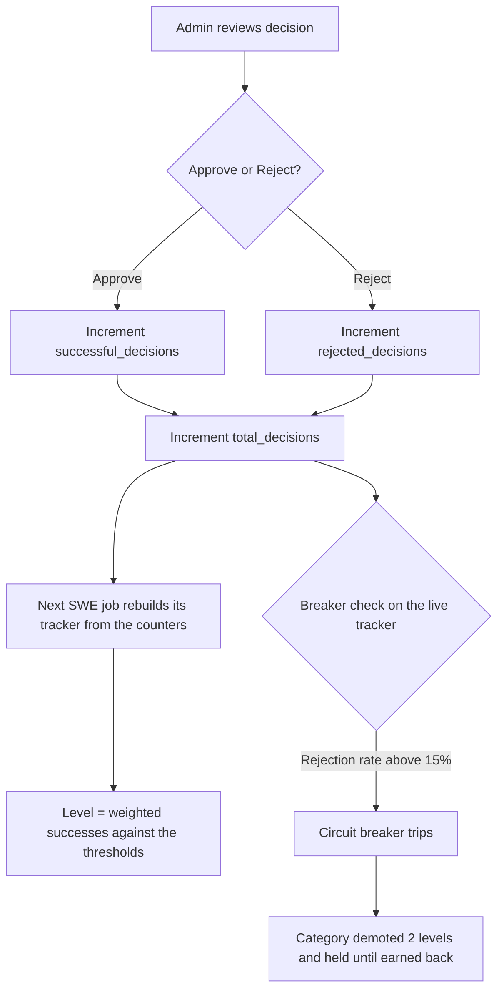

> Part 4 of 6 of the [Decision Proxy — Admin Guide](../proxy-admin-guide.md): trust feedback loop.

## 7. The Trust Feedback Loop

Every time you approve or reject a decision on the Ratification page, the system updates
the trust state for that category. This is the core learning mechanism.

### How Ratification Updates Trust States

### What Happens on Each Action

| Your Action | Effect on Trust State |
|-------------|----------------------|
| **Approve** | `total_decisions += 1`, `successful_decisions += 1`. Success rate goes up. |
| **Reject** | `total_decisions += 1`, `rejected_decisions += 1`. Earns nothing toward a level. A rejection rate above 15% (with 10 or more decisions) can trip the circuit breaker. |

Your click writes the counters only. It does not change a level directly: the level is worked out from the counters (see the table in part 1).

### How Approvals Drive Trust Progression

Levels come from **approved** decisions, each weighted by age (half-life 14 days).
The thresholds are 50, 200, 500 and 1000 for Levels 2 to 5.
The dashboard shows the success rate (`successful_decisions / total_decisions * 100`).
A high rate alone does not raise a level, because a category needs the volume.
A category with frequent rejections is held back by the breaker, not by a lower rate threshold.

### How Circuit Breakers Protect Against Failures

A category's breaker **trips** in either of two cases. Below, `...` stands for `swe team trust proxy circuit breaker`:

- the rejection rate is above **15%** (`... error rate threshold`) with at least 10 decisions recorded;
- the average classification confidence of the last 20 decisions is below **0.30**, with at least 5 recorded (`... confidence collapse threshold`).

1. **`TRIPPED`**: the category is demoted **2 levels** (`... auto demotion levels`) and the gate defers every decision in it to you.
2. **COOLDOWN**: after the cooldown (`... recovery cooldown seconds`, shipped as 3600) the `defer` ends by itself, with no manual reset.
3. **Closed (OK)**: normal operation resumes. The level stays capped at the demoted level until new approvals earn it back.

**The demotion does not end with the cooldown.** The tracker remembers the demoted level and the success count at the
trip. It holds the category at or below that level until new successes earn it back.
The gap is the next level's threshold minus the demoted level's own. Successes before the trip count for nothing.
The trip is stored, so a later job starts with the same cap.
For the Beta and BLR models a demotion also lowers the success count, so `demote(k)` lands exactly k levels down.
The BLR model is reset. The level comes from the Beta counters until it has 30 decisions of its own (`BLR_MIN_OBSERVATIONS`).

This prevents runaway automation — if the proxy makes bad decisions, it stops acting and waits for human guidance.

### Day-by-Day Example: Trust Progression

The counts are illustrative; they follow the shipped thresholds (Level 2 at 50 weighted approvals, Level 3 at 200).

| Day | Actions | Trust State (Testing Category) |
|-----|---------|-------------------------------|
| **Day 1** | Start in `SHADOW` mode. Proxy logs 8 shadow decisions overnight. | Level 1 Shadow, no approvals |
| **Day 2** | Switch to `SUGGEST` mode. Proxy queues 60 suggestions over the day. You approve all 60. | Level 1 → Level 2 Provisional, 60 approvals |
| **Day 3** | Switch to `ACTIVE` mode. At Level 2 the proxy still only suggests. You approve 150 more. | Level 2 → Level 3 Trusted, about 210 weighted approvals (older ones count slightly less) |
| **Day 4** | At Level 3 the proxy acts on decisions it classifies at 80% confidence or more and queues the rest. You approve the queued ones. | Level 3 |
| **Day 5** | 1 queued decision, you reject it (wrong test strategy). | Level 3, rejection rate under 1%. Circuit breaker: OK |
| **Day 7** | A burst of rejections takes the rate above 15%. | Breaker trips, category drops to Level 1 and defers to you for the cooldown |

---

### How a Yes/No Prediction Is Made

For a yes/no question the proxy looks up the most similar past questions and lets them vote. Each past answer counts 1.0. A thumbs-up answer counts more, and a thumbs-down answer counts against its value.

Answers are about 79% "yes" (527 of 664 answered rows, measured 5 Nov 2026). A plain majority said "no" too often and was right only 35% of the time. The proxy now predicts "no" only when the "no" tally beats the "yes" tally by at least a margin. Otherwise it predicts "yes".

| Setting (`lupin-app.ini`) | Default | Meaning |
|---|---|---|
| `prediction engine yes no no margin` | `1.35` | Lead the "no" tally needs over the "yes" tally. With the default 5 neighbours that is a lead of 2 or more. 1.35 is ln(527/137), the log-odds of the yes prior. `0` restores a plain majority. |

When the margin overturns a "no", the stored prediction carries `no_suppressed_by_prior: true` in its metadata. A "neither" answer still counts as "no" in the vote.
