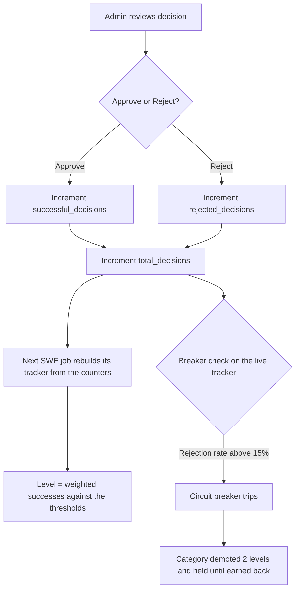

> Part 4 of 6 of the [Decision Proxy — Admin Guide](../proxy-admin-guide.md): trust feedback loop.

## 7. The Trust Feedback Loop

Every time you approve or reject a decision on the Ratification page, the system updates
the trust state for that category. This is the core learning mechanism.

### How Ratification Updates Trust States

### What Happens on Each Action

| Your Action | Effect on Trust State |
|-------------|----------------------|
| **Approve** | `total_decisions += 1`, `successful_decisions += 1`. Success rate goes up. |
| **Reject** | `total_decisions += 1`, `rejected_decisions += 1`. Earns nothing toward a level. A rejection rate above 15% (with 10 or more decisions) can trip the circuit breaker. |

Your click writes the counters only. It does not change a level directly: the level is worked out from the counters (see the table in part 1).

### How Approvals Drive Trust Progression

Levels come from **approved** decisions, each weighted by age (half-life 14 days).
The thresholds are 50, 200, 500 and 1000 for Levels 2 to 5.
The dashboard shows the success rate (`successful_decisions / total_decisions * 100`).
A high rate alone does not raise a level, because a category needs the volume.
A category with frequent rejections is held back by the breaker, not by a lower rate threshold.

### How Circuit Breakers Protect Against Failures

If a category's rejection rate rises above 15% (with at least 10 decisions), or its recent average confidence
falls below 0.30, the circuit breaker **trips**:

1. **`TRIPPED`**: the category is demoted 2 levels and the gate defers every decision in it to you.
2. **COOLDOWN**: after the cooldown (3600 seconds shipped) the `defer` ends by itself.
3. **Closed (OK)**: normal operation resumes. The level stays capped at the demoted level until new approvals earn it back.

This prevents runaway automation — if the proxy makes bad decisions, it stops acting and waits for human guidance.

### Day-by-Day Example: Trust Progression

The counts are illustrative; they follow the shipped thresholds (Level 2 at 50 weighted approvals, Level 3 at 200).

| Day | Actions | Trust State (Testing Category) |
|-----|---------|-------------------------------|
| **Day 1** | Start in `SHADOW` mode. Proxy logs 8 shadow decisions overnight. | Level 1 Shadow, no approvals |
| **Day 2** | Switch to `SUGGEST` mode. Proxy queues 60 suggestions over the day. You approve all 60. | Level 1 → Level 2 Provisional, 60 approvals |
| **Day 3** | Switch to `ACTIVE` mode. At Level 2 the proxy still only suggests. You approve 150 more. | Level 2 → Level 3 Trusted, about 210 weighted approvals (older ones count slightly less) |
| **Day 4** | At Level 3 the proxy acts on decisions it classifies at 80% confidence or more and queues the rest. You approve the queued ones. | Level 3 |
| **Day 5** | 1 queued decision, you reject it (wrong test strategy). | Level 3, rejection rate under 1%. Circuit breaker: OK |
| **Day 7** | A burst of rejections takes the rate above 15%. | Breaker trips, category drops to Level 1 and defers to you for the cooldown |

-----|---------|-------------------------------|
| **Day 1** | Start in `SHADOW` mode. Proxy logs 8 shadow decisions overnight. | Level 1 Shadow, 0 total, no success rate |
| **Day 2** | Switch to `SUGGEST` mode. Proxy queues 6 suggestions. You approve all 6. | Level 1 → Level 2 Provisional, 6 total, 100% rate |
| **Day 3** | Switch to `ACTIVE` mode. Proxy acts on 4 high-confidence decisions, queues 2 lower-confidence. You approve all 2 queued. | Level 2, 8 total, 100% rate |
| **Day 4** | Proxy acts on 5, queues 1. You approve it. | Level 2 → Level 3 Trusted, 9 total, 100% rate |
| **Day 5** | Proxy acts autonomously on 7 testing decisions. 1 queued, you reject it (wrong test strategy). | Level 3, 10 total, 90% rate. Circuit breaker: OK |
| **Day 7** | Continued high approval rate. | Level 3 stable, ready for Level 4 promotion |

---
