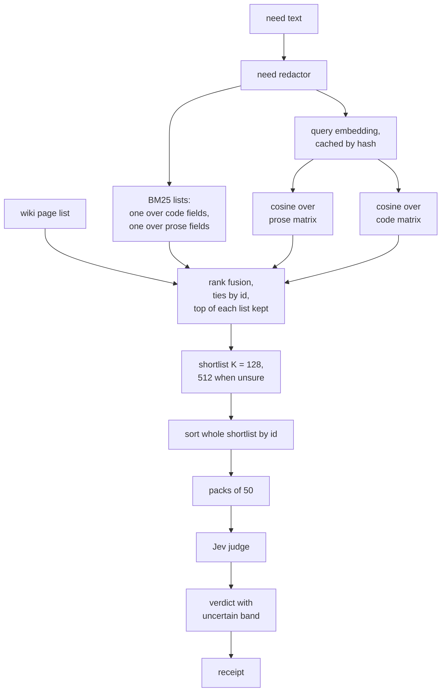

# Candidate stage for the reuse lookup: implementation plan

Drafted by Clayton for Rick. This plan is at the depth of the reuse-review implementation plan (Plan 2, `2026.09.30-reuse-review-implementation-plan.md`, same folder).

It builds a frozen, ranked candidate stage in front of Jev. Today Jev is asked about every entry in the index. Under this plan it is asked only about the top of a deterministic ranking.

## 0. Summary

- **What changes:** the lookup ranks the index by rank fusion over word search, prose vectors and code vectors. Jev then judges the top 128 entries, widened to 512 when unsure.
- **Expected effect:** judge calls per need fall from about 164 to between 3 and 11, because packs hold 50 entries. This is arithmetic on measured figures. It is not a measurement.
- **What it risks:** a true match that the ranking drops is never judged. The plan therefore measures recall offline, confirms on fresh needs, and keeps a shadow audit running.
- **What it costs:** nine phases counting Phase 0, two author seats and two reviewers. The only live spend is Phase 5, about 430 million tokens at the full-sweep rate. The candidate stage should make that spend smaller.
- **What is left open:** nothing. Rick's rulings are in section 3.
  Four points decided by Cheech are in section 11 for Rick to overrule.
  The rulings are rulings on options. Rick approved the plan itself separately, at about 20:12 EDT.
- **Order of events:** Pocholo and Cheech reviewed this plan, Rick reviewed and approved it, and María's sanity check is applied. Fleet seats under Cheech now build it, Phase 0 first.

## 1. Starting point: what the lookup does today

Everything below was read in a seat tree at commit `d300a0c33`. The measured figures come from the problem statement.

### 1.1 The path of one need

- `check_exists_impl` in `src/lupin_mcp/reuse_tools.py` calls `_need_impl`, which calls `run_question`, which calls `_run_question`.
- `prepare( ctx )` builds or finds the symbol index with `sx_build.ensure`, reads its symbols and passes them through `sendable()`. It also computes `index_sha` over the symbols, the wiki index lines and the page digest.
- `_route( ctx, need, entries, pages, flags )` is the only place that picks which entries Jev judges. With wiki pages present it first asks about each page, then sweeps the entries those pages cover. If that finds nothing at the threshold it sweeps every entry (route `pages_then_full`). Otherwise it sweeps every entry (route `full`).
- The sweep is `sweep_packed` in `src/lupin_mcp/reuse_pack.py` on the packed path. It builds packs of `ctx.pack_size` entries and sends them through `send_pack`.
- `vd.decide` in `src/cosa/repo/symindex/verdict.py` turns the answers into a verdict. `POLICY` holds threshold 0.5, confidence 0.9, floor 0.3 and shortlist 10. `POLICY_PROVIDES` holds threshold 0.5, reuse 0.7, floor 0.3 and coverage 0.5.
- `store_receipt` writes the receipt under a content hash. `receipt_id` hashes the tool, query, index sha, model, policy, template hash and request shape.

### 1.2 Facts that shape the plan

- **No candidate stage exists.** The page route is the only pruning step. It lost about a quarter of the shortlist hits on the old question, and it reaches Python entries only.
- **Packs are built from the cache misses, in index order.** In `sweep_packed`, `misses` collects the entries with no cached answer. It then cuts that list into chunks of `size`. A second run with a warm cache therefore packs different co-members than the first. The answers are cached per entry, so this changes only what is sent, but the co-members of a live request depend on cache state. Pocholo's first finding (P1) targets this.
- **The need goes to Jev as typed.** No function screens the need string. `sendable()` screens index entries only, and its path pattern names a fixed list of roots (`PATH_ROOTS`). The need redactor does not exist yet.
- **The index holds Python, TypeScript and JavaScript.** Rachel rebuilt it at commit `8420e8b0a`. It has 8,431 public entries: 6,301 Python and 2,130 TypeScript or JavaScript. Of the 2,130, 1,312 have no docstring. Dart is not indexed.
- **Local embedding engines exist.** `CodeEmbeddingEngine` and `ProseEmbeddingEngine` in `src/cosa/memory/local_embedding_engine.py` are lazy singletons. They read their model names, the one device key, dtype, dimensions and query prefixes from `ConfigurationManager`.
- **The weights are not on the host.** Rachel found no CodeRankEmbed or nomic model in the host's Hugging Face cache.
  A host process with `local_files_only` fails. The weights sit inside the images `lupin-rest-dev`, `lupin-rest-test` and `lupin-model-server`.
  The FastAPI process is the only one that uses the engines directly. Every other process fetches embeddings from it over HTTP.
- **The server already serves embeddings.** `src/cosa/rest/routers/embeddings.py` has `POST /api/embeddings/generate`, `POST /api/embeddings/batch` and `GET /api/embeddings/info`.
  They take an API key or a JWT, and a `content_type` of `prose` or `code`. They run the engines in a thread.
- **The endpoints pick the encoder, and not by role.** For `code`, `EmbeddingProvider` always calls `encode_code`, so a code query gets no query prefix.
  For `prose`, it always calls `encode_query`, so a prose document gets `search_query:` and not `search_document:`.
  The `info` endpoint reports only provider, dimensions and status. It does not report model ids, dtype, device or prefixes.
- **One device key serves both engines.** `local embedding device` is `cuda:0`. There is no per-engine key, and the plan makes no GPU choice (R9).
- **The cosa-voice server runs in a light venv.** `CC_VENV_REQS` in `src/scripts/install-cosa-voice.sh` lists `fastmcp`, `requests`, `pydantic`, `regex` and `pytz`. It holds no `numpy` and no `torch`. A query embedding therefore cannot be computed inside that process.
  It goes through the server's embeddings endpoints, or is read from a stored cache.
  Rick ruled that `numpy` goes in the Lupin environment and not here (R17).

### 1.3 Measured figures this plan rests on

| Figure | Value | Source |
|---|---|---|
| Full-sweep cost per search, new question | $0.10, 8.1 s median, 13.1 s slowest | problem statement, section 4 |
| Flip rate, default cut-offs | 10 of 30 needs, strict rule | same |
| Flip rate, candidate cut-offs | 3 of 30 needs, in-sample | same |
| Known-twin rank | first for 337 of 376 (89.6%) | same |
| Page route shortlist loss | about 25% | same |
| Free GPU memory | 3,841 MiB on `cuda:0`, 5,701 MiB on `cuda:1` | Rachel, a sample taken at 19:39 EDT on 14 October 2026 |

## 2. Options, and what the expert and addendum recommend

The problem statement names three options.

- **Option A:** ask Jev about every entry. This is what runs today.
- **Option B:** embeddings and word search pick the entries, and Jev judges them.
- **Option C:** a fixed ranking of index fields only, with no embedding model.

The expert recommends B built from frozen parts, with C as the measured floor. The addendum adds one choice inside B: one vector or two.

These points are adopted from the expert's response. Each carries a label so a later section can cite it.

- **D1:** The first stage ranks by rank fusion over several lists. It never mixes raw scores.
- **D2:** Purpose lines are written once per entry by a pinned model, keyed by the entry's pin. They are never regenerated on read.
- **D3:** Vectors are computed once and stored. Search is exact cosine over the whole matrix, with no approximate index.
- **D4:** The wiki page list becomes one ranked list in the fusion. It is no longer a gate that removes entries.
- **D5:** The shortlist is 128, widened to 512 when the top Jev score of the first 128 sits inside the uncertain band.
  The widened ids depend on Jev answers, so the receipt records them and a replay follows the recorded K.
- **D6:** The shortlist is sorted by id, then cut into packs of at most 50. The result is that a replay has the same co-members.
  On widening, the first 128 keep their packs. The extra 384 entries are sorted by id and packed separately, so a judged entry is never re-sent or re-packed.
- **D7:** Flips are handled by an uncertain band around each cut-off, set from measured repeat jitter, at least 0.05. The lookup does not ask again.
- **D8:** Every "write new" verdict carries a measured miss-rate bound from a shadow audit.
- **D9:** One vector or two is decided by measurement, using the addendum's rule.

## 3. Rulings so far

Rick ruled on seven questions on the evening of 14 October 2026, on the card "Candidate-stage plan: seven rulings". Each was answered, and no default was used. These are rulings on options. Rick approved the plan itself separately, at about 20:12 EDT.

- **R1:** Hold W-A's full-sweep confirmation run. Its spend moves to Phase 5.
- **R2:** Use whichever local embedding model is installed: `nomic-ai/CodeRankEmbed` for code and `nomic-ai/nomic-embed-text-v1.5` for prose.
- **R3:** A bounded Claude Code job writes the purpose lines, pinned by version.
- **R4:** The pack size is 50.
- **R5:** The flip-rate target for Phase 5 is about 10%, plus the uncertain band.
- **R6:** The shadow audit covers 1% of lookups.
- **R7:** Redact the need string and continue. The five `sendable()` patterns are blanked (email, URL, IP address, absolute path, credential-shaped token). The rest is sent, and the receipt records the redaction.

Cheech relayed two further rulings on 14 October 2026, at 19:58 EDT. They replace three open questions of the earlier draft.

- **R8:** The purpose-line job reads the tree itself and receives ids only.
- **R9:** The build and the queries both go through the FastAPI embeddings endpoints in `src/cosa/rest/routers/embeddings.py`. There is no GPU choice and no new job.

Rick ruled on the remaining questions on 14 October 2026, at 19:59 EDT, on a second card. Cheech relayed them.

- **R10:** The labelled set for Phase 3 is the known twins plus the existing negatives. The false-reuse rate is 5%.
- **R11:** Build the need redactor first, before the retrieval phases.
- **R12:** The vectors embed no function bodies: signatures, docstrings, names and paths only.
- **R13:** Dart stays out of this plan. A separate row covers it after lupin is proven.
- **R14:** Phase 5 runs the 30 fresh needs.
- **R15:** One vector set only, the current state of the repo, with no old sets and no fallbacks. It is rebuilt as code changes, possibly daily.
  A receipt records the manifest hash. Replay works until the next rebuild. After that it refuses with a named error and never recomputes silently.
- **R16:** The shortlist is 128, widened to 512. This is Rick's ruling on the K question, and D5 carries it.
- **R17:** `numpy` goes in the Lupin environment, not in the cosa-voice venv. The search runs in a Lupin process (section 4.4).
- **R18:** Known lupin endpoint routes stay unredacted. Rick said "That's not a state secret". Every other absolute path is redacted (section 6).

Pocholo reviewed the outline and made four findings. They are folded into this plan.

- **P1:** Sort and pack the whole shortlist by id, never only the cache misses.
- **P2:** The need redactor is a new function with its own specification and tests. It matches any absolute path, not only `PATH_ROOTS`.
- **P3:** With packs of 50, a shortlist of 128 is 3 requests and one of 512 is 11. The outline's "3 to 13" assumed packs of 10.
- **P4:** Replay pins the dtype, the device, the query prefixes and the score rounding, not only the model ids.

## 4. Architecture

### 4.1 Where each part lives

| Part | Home | Runs in |
|---|---|---|
| Identifier splitting, BM25, cosine search, rank fusion | `src/cosa/repo/symindex/candidates/` (new package) | a Lupin-environment process that holds `numpy` (section 4.4) |
| Purpose lines | the same package, written by a bounded Claude Code job | host, offline |
| Vector build | `src/cosa/repo/symindex/candidates/vector_build.py` | a host driver that posts batches to the server's embeddings endpoints; the GPU work runs in the server |
| Stored vector sets, query cache, purpose lines | three locations named by INI keys (section 4.2a) | disk, outside git |
| Need redactor | `src/lupin_mcp/reuse_redact.py` (new module) | the cosa-voice process, pure Python and standard library only |
| Wiring | `_route` and `_run_question` in `src/lupin_mcp/reuse_tools.py` | the cosa-voice process |

Receipts and the Jev answer cache already live under `paths.data_dir` in `src/cosa/repo/symindex/paths.py`, which returns `<fleet data root>/reuse-review`.
The new artifacts sit under the same fleet data root, in locations that INI keys name (section 4.2b).
Nothing here is committed to git.

### 4.2 Stored artifacts

- `purpose.jsonl`: one row per pin, `{ pin, purpose, prompt_hash, writer_version }`.
- `prose.f32`, `code.f32`, `concat.f32`: row-major float32 matrices, one row per entry, in entry-id order.
- `ids.txt`: the entry ids in matrix row order, sorted.
- `query-cache/` (outside the set, section 4.2a): one file per hash of the redacted need.
  Each file holds the three query vectors and the manifest hash they were computed under.
  A cached vector whose manifest hash differs is ignored.
- `manifest.json`: model ids and revisions, dtype, device class, query and document prefixes, and dimension.
  It also holds library versions, prompt hash, writer version, row counts, and a hash of every artifact file above.

The manifest hash is the vector-set hash that goes on the receipt.
It excludes `query-cache/`, which grows with every new need and would otherwise change the hash on every lookup.

### 4.2a One vector set, rebuilt as the code changes

- There is one vector set: the current state of the repo (R15). There are no per-hash folders, no pointer file, no old sets and no retention period.
- The three matrices are raw float32 files, loaded by memory map. Each is about 26 MB, and the three are about 78 MB.
- A rebuild writes the new set to a temporary directory beside the live one. It then renames the live directory aside, renames the new one in, and removes the old one.
  A rename onto a non-empty directory fails, so the swap is two renames.
  A lookup that lands between the two renames finds no set and answers `VECTOR_SET_UNAVAILABLE`. It never falls back and never reads a half-written set.
- The manifest hash identifies the set. A receipt records it.
- A replay checks the receipt's manifest hash against the set on disk. After a rebuild the hash differs, and the replay refuses with `VECTOR_SET_REPLACED`. It never recomputes silently.
- The query cache sits outside the set, at its own INI-named location. Each entry names the manifest hash it was computed under.
- A rebuild clears the entries of any other hash. Cached Jev answers are not part of the set and stay.

### 4.2b Storage locations come from the INI, never from code

Rick's rule: no storage path is hard-coded.
Today `data_dir` in `src/cosa/repo/symindex/paths.py` fixes the part below the fleet data root, the literal `reuse-review`.
Phase 1b removes that literal too, with a fourth key that `data_dir` reads. Its INI default is today's value, so existing receipts and caches stay where they are.
Every location is read at runtime through `ConfigurationManager`, with an environment variable that overrides the INI.
The base stays `fleet_data_root( root )`, which comes from `DEEPILY_DATA_DIR`.

| INI key | Holds | Default value in the INI | Override variable |
|---|---|---|---|
| `reuse review data subdir` | the reuse-review data directory: receipts, answer cache, call log | `reuse-review` | `LUPIN_REUSE_REVIEW_DATA_SUBDIR` |
| `reuse candidate vectors subdir` | vector sets | `vectors` | `LUPIN_REUSE_CANDIDATE_VECTORS_DIR` |
| `reuse candidate query cache subdir` | the query cache | `query-cache` | `LUPIN_REUSE_CANDIDATE_QUERY_CACHE_DIR` |
| `reuse candidate purpose lines subdir` | `purpose.jsonl` | `purpose-lines` | `LUPIN_REUSE_CANDIDATE_PURPOSE_DIR` |
| `reuse candidate search interpreter` | the interpreter that runs the search (section 4.4) | none, set at install | `LUPIN_REUSE_CANDIDATE_INTERPRETER` |

- The data subdirectory value is relative to the fleet data root. The three candidate values are relative to the data directory that `data_dir` returns.
- An override variable holds an absolute path and wins over the INI.
- The existing `LUPIN_REUSE_DATA_DIR` override in `context_from_environment` keeps working and takes precedence for a context.
- A key that is missing, or a value that is empty, is a named error (`STORAGE_KEY_MISSING`). The code never falls back to a path of its own.
- Each key gets a plain-English entry in `src/conf/lupin-app-splainer.ini`.
- The cosa-voice server can read the INI. Its registration passes `LUPIN_CONFIG_MGR_CLI_ARGS` to the subprocess (`install-cosa-voice.sh`).
  `fleet_cap_admission.py` already builds a `ConfigurationManager` from it, and `cosa.utils.util` needs only `regex`, which is in `CC_VENV_REQS`.
- `ConfigurationManager` is a process-lifetime singleton, so a changed value reaches the server on its next restart.
  A storage location is not a dial, so that is acceptable. The `fleet_cap_ini_io.read_value_from_disk` reader exists if a fresh read is wanted.
- If the manager cannot be built in a process, the stage answers `DEPENDENCY_MISSING`. It does not guess a location.

### 4.3 What is new on the query path

- The need is redacted. BM25 ranks on the need with the redacted spans removed, never on the placeholders.
  Only Jev receives the placeholder text.
- BM25 runs over two field sets inside the search process. Phase 1a measures its cost over about 8,400 entries.
- The need's query vectors come from the query cache, or from the server's embeddings endpoints on a miss. That is the only network step of the first stage, and it goes to this machine.
- Cosine is computed over the stored matrices. It is one `numpy` matrix-vector product per matrix over 8,431 rows of 768 values, in the search process. Phase 1a measures it.

### 4.4 Where the search runs, and how cosa-voice reaches it

R17 puts `numpy` in the Lupin environment. The cosa-voice process cannot import it, so the search runs in a separate Lupin process.

- **The search process:** `python -m cosa.repo.symindex.candidates.search`, run with the Lupin environment's interpreter.
  It reads one JSON request on standard input and writes one JSON answer on standard output. It holds no state between calls.
- **The request:** the `ranking_text` of the redacted need, the three query vectors, the wiki page list, K, and the vector-set location.
- **The answer:** the ranked ids, the rounded scores, the lists that fed the fusion, K, and the manifest hash it read.
- **The caller:** the cosa-voice process redacts the need and gets the query vectors from the cache or the embeddings endpoint.
  It then starts the search process and packs the answer.
  This follows the precedent of the index builder, which runs `node` as a child process.
- **The interpreter:** its path is a fifth INI key, `reuse candidate search interpreter`, with the override variable `LUPIN_REUSE_CANDIDATE_INTERPRETER`.
  The key is required. A missing key or a missing interpreter answers `DEPENDENCY_MISSING`, never a slower in-process fallback.
- **A failure:** a non-zero exit, a timeout or an answer that is not valid JSON gives `CANDIDATE_SEARCH_FAILED`. The lookup then reports `UNCERTAIN_READ_SOURCE` and does not fall back to a sweep.
- **Cost:** one process start per lookup. Phase 1a measures it, together with the search itself.

## 5. Replay and determinism design

A receipt must replay to the same shortlist and the same packs. Section 1.2 shows the lookup does not guarantee that today for packs. This section also covers P4.

### 5.1 What is pinned

- **Index:** `index_sha` as today, extended with the candidate manifest hash.
- **Embedding models:** both model ids and the Hugging Face revision of each, read from the loaded model's config at build time.
- **Numerics:** dtype (float16 on the device), the device class (for example "RTX 4090, sm_89"), the library versions of torch, transformers and sentence-transformers.
  These come from the `engines` block of the `info` endpoint, because the build never loads the engines itself.
  That block is added to the endpoint under X1.
- **Text:** the exact query and document prefixes from the INI file, the pooling mode, the maximum sequence length and the matryoshka dimension.
- **Purpose lines:** the prompt hash, the Claude Code version and the stored line itself.
- **Fusion:** the constant `k` in the fusion formula, the depth of each list, and the count of top hits always kept from each list.
  They are chosen in Phase 2, by the seat that runs it, on the in-sample needs. They are never tuned on the Phase 5 needs.
- **Score rounding:** every score is rounded to 6 decimals before any sort. Ties break on id, ascending.
  Rounding makes ties exact. It does not make a recomputed query vector safe, because a small move can change ranks near a boundary.
  The query cache is the guarantee (section 5.2). Phase 1b measures how often a 1e-4 perturbation of a query vector changes the top 128 on the 30 needs, and reports the rate. It asserts nothing about it.

### 5.2 How it stays deterministic

- **Stored vectors are float32 on disk.** The search never runs on a GPU. Two machines that read the same file and run the same `numpy` build get the same cosine. The manifest records the `numpy` version.
- **Query vectors are cached by the hash of the redacted need.** The replay reads the cached vector. The embedding model is not needed again.
  A lost cache entry makes the replay refuse with a named error, `QUERY_VECTOR_MISSING`. A fresh run after the loss is a new receipt, never a silent recompute.
- **The sort key is `( -rounded_score, id )`.** The final shortlist is then sorted by id for packing (P1). The ranking order is kept in the receipt separately.
- **Packs are cut from the whole shortlist, sorted by id.** Pack boundaries then depend only on the shortlist, never on which answers are cached.
  A widened run has two pack sets: the first 128 entries, and the extra 384 sorted by id and packed apart. The receipt records both.
- **A pack is sent whole or not at all.** When every member of a pack has a cached answer, no call is made. When any member is missing, the whole pack is sent, so the live body equals the cold-run body.
  Answers already cached are kept, because the cache is write-once. At most 11 calls are involved, so the cost is small.
- **Cached Jev answers are keyed as today.** The key includes the need and the candidate text. The pack's co-members are recorded in the receipt, so a replay can check them.

### 5.3 What a replay checks

- The manifest hash on the receipt equals the manifest on disk. If not, the replay refuses with `VECTOR_SET_REPLACED` (R15).
- The redacted need hashes to the value recorded in the receipt's id inputs.
- The recomputed shortlist equals the recorded one, byte for byte.
- The recomputed packs equal the recorded packs, both pack sets when the run widened.
- The recomputed K equals the recorded K. A widening is never recomputed, because it depends on Jev answers.
- Every answer is in the cache. A missing one is an error, as `sweep_packed` does when frozen.

A re-run at HEAD may differ from the frozen run. The receipt then reports which pin changed.
The window in which a receipt replays ends at the next rebuild. The stored Jev answers outlive it, and a fresh lookup makes a new receipt.

### 5.4 Known limits

- **Float16 on a GPU is not bit-stable across cards.** The build and every query come from the same server.
  They share one card, one dtype and one set of weights.
  A server that moves to another card or model is caught by `ENGINE_MISMATCH` (section 7, Phase 1b), and a rebuild is a new vector-set hash. It is not a replay failure.
- **Python floats are stable.** The plan does not rely on a library's reduction order. The search is one fixed `numpy` call per matrix, on float32 data, with scores rounded before any sort.

## 6. The need redactor

R7 rules that the need is redacted and the lookup continues. P2 says the redactor is new and matches any absolute path.
R11 has it built first, in Phase 1r.

### 6.1 Specification

`redact_need( text, known_routes )` returns `( redacted, ranking_text, hits )`.

Requires:
- `text` is a string, possibly empty.
- `known_routes` is a collection of route paths, possibly empty. A path template such as `/api/queue/{id}` is allowed.

Ensures:
- every email, URL, IPv4 or IPv6 address, absolute path and credential-shaped token is replaced by a fixed placeholder: `[email]`, `[url]`, `[ip]`, `[path]`, `[secret]`.
- an absolute path that is a known lupin route (R18) is not replaced. Every other absolute path is.
- `ranking_text` is the same text with each matched span replaced by one space, so no placeholder word reaches the ranker.
- the rest of the text is unchanged, byte for byte.
- `hits` is a sorted list of `{ kind, count }`, and is empty when nothing matched.
- the function is idempotent: `redact_need( redact_need( t )[0] )[0]` equals `redact_need( t )[0]`.
  Placeholders match none of the five kinds.
- the function never raises on any string.

### 6.2 What counts as an absolute path

- A POSIX path: a token that starts with `/` and holds a further segment.
  The `/` is not preceded by a word character, a dot, a colon or a hyphen.
  The test needs no list of roots.
- A home path: `~/`, `~user/`, `$HOME/` and `${HOME}/`.
- A Windows path: a drive letter, a colon and a separator, or a UNC path.

The existing `C1_PATTERNS["path"]` matches only the roots in `PATH_ROOTS`, plus `/app` and `/data` file paths. The redactor does not reuse it. It would miss `/projects/acme/secret.py`, which is an absolute path on some machine.

### 6.3 Credential and address shapes, and known false positives

The existing credential pattern has a last alternative that matches any 32-character run of letters, digits, `_` and `-` holding a digit and a letter.
Pocholo measured that `validate_and_normalize_user_input_v2` matches it. Needs describe code, so the redactor must keep identifiers.

- **Credential rule:** the known prefixes (`sk-`, `AKIA`, `ghp_` and its kin, `xox`, `eyJ`) always match.
  The generic rule matches a run of 32 or more characters of letters, digits, `_` and `-` that holds a digit and a letter.
  It does not match when every `_` or `-` segment is made of words, optionally followed by digits.
  A word is a run of lowercase letters or a capitalised word.
  So `validate_and_normalize_user_input_v2`, `v2` and a camelCase name such as `buildUserProfileIndexFromRows2` are kept.
- **Cost of that exemption:** an opaque token built only from words and digits in that shape is kept, so it reaches Jev.
  The residual is listed as a risk (K10).
- **IPv6 rule:** a candidate must parse with the standard library `ipaddress` module and hold `::` or exactly eight groups.
  So `10:30:45:20`, `a:b:c:d` and `Foo::bar` are not addresses. A name such as `abc::def` is still read as an address, and is redacted.
- **Routes (R18):** a token that equals a known lupin route, or a prefix of one that ends at a segment boundary, is kept. `/api/v2/submit` is kept.
  A `{parameter}` segment in a route matches any one segment. The source of the list is the index's own routes (`routes.md` of the current generation).
  When that list cannot be read, it is empty, so every absolute path is redacted, and the receipt says `routes_source: none`.
  A path that looks like a route but sits under an unknown root, such as `/home/rick/api/v2/submit`, is redacted.
  A kept route is still screened for the other four kinds. A `{parameter}` segment matches only a segment that holds no email, URL, IP address or credential.
  So `/api/queue/alice@example.com` and `/api/auth/sk-` followed by a token are not kept as routes.

### 6.4 What is stored

The receipt stores the redacted need as `query`. It adds `need_redactions`, the hit counts by kind, when the redactor changed the need.
It stores no hash of the raw text, because a hash of a need holding an email or address can be reversed by guessing.
Two callers whose needs differ only in a redacted token share one receipt, with one body. Jev saw the same text.

### 6.5 Tests

- Unit: one positive and one negative control per kind, and Windows and UNC paths.
  Positions: a path at the start, middle and end of a sentence, inside quotes, and as part of a URL.
  Negative cases: a string with `and/or`, a fraction such as `1/2`, unicode text and an empty string.
  Negative controls for the two measured false positives: `validate_and_normalize_user_input_v2`, a time such as `10:30:45:20`, `a:b:c:d` and `Foo::bar`.
  Identifier controls: `buildUserProfileIndexFromRows2` and `v2` are kept.
  Positive controls beside them: a 40-character mixed token with no word structure, and `fe80::1`.
- Routes: a segment that holds an email or a credential-shaped token in a templated route is redacted, one test for each. `/api/v2/submit` and a templated route are kept, `/etc/passwd` and `/home/rick/api/v2/submit` are redacted, and an empty route list redacts all of them.
- Ranking: a test that `ranking_text` holds no placeholder word, and that a need with a path ranks as the same need without it.
- Property: idempotence, and "no pattern of the five kinds survives" over generated strings.
- Census guard: every call that builds a Jev request body from a need goes through `redact_need`. The guard walks the callers of `build_request`, `pack_request` and `pair_key`.
- Integration: a captured outbound payload for a need that holds each kind contains none of them.

## 7. Phases

Phases run in this order. Each phase lists its scope, files, interfaces, data formats, tests, exit gate and size. Sizes are the author's estimates in lines of new source and new tests. They are not measurements.

### Phase 0: documents

- **Scope:** this plan, a decision record in `src/docs/decisions/` that records R1 to R18 and X1 to X3, and a capability page draft in `src/docs/wiki/capabilities/`.
  The page is marked planned and not built. README links point to all of them.
- **Files:** four new markdown files, edits to two README files and the wiki index.
- **Tests:** `md_lint` with 0 findings on every new file. The doc-lint gate and the census guards pass.
- **Exit gate:** the documents are reviewed by Pocholo, then landed by Cheech by merge. Nothing is coded before this.
- **Size:** about 600 lines of markdown.

### Phase 1r: the need redactor, first

Rick ruled that the redactor is built first (R11). It does not depend on retrieval, and it closes a gap in today's lookup, where the need goes to Jev as typed.

- **Scope:** `redact_need` as specified in section 6, wired into every path that sends a need to Jev, with the census guard.
- **Files:** `src/lupin_mcp/reuse_redact.py` (new), small edits in `src/lupin_mcp/reuse_tools.py` at the entry of `_need_impl`, `fetch_similar_impl` and the private-definition path, and the tests of section 6.5.
- **Interfaces:** `redact_need( text, known_routes )` returns `( redacted, ranking_text, hits )`.
  When the redactor changed the need, the receipt gains `need_redactions` (the hit counts by kind), `routes_source` and `need_sent`.
  An untouched need keeps the receipt bytes it had before, so the pinned receipt tests hold.
- **Cache effect:** a need that holds a redactable token is sent in redacted form from now on, so its cache key changes.
  Phase 2 replays the cached answers with the raw needs and does not use the redactor (section 7, Phase 2).
- **Tests:** the redactor tests of section 6.5 at every tier named there, and the existing reuse tests stay green.
- **Exit gate:** 100% lines, branches and functions on `reuse_redact.py` and on the touched parts of `reuse_tools.py`.
  The census guard passes, and a captured payload holds none of the five kinds.
- **Size:** about 150 lines of source and 400 of tests.

### Phase 1a: splitting, BM25, fusion and the replay check

- **Scope:** an identifier splitter, BM25 over two field sets, rank fusion with the always-kept head, the search process of section 4.4, and a replay harness. Offline, no judge calls.
  It measures the process start and the search time per lookup.
- **Files:** `identifier_split.py`, `bm25.py`, `rank_fusion.py` and `candidate_stage.py` in the new `candidates` package. Tests under `src/tests/unit/` with the `test_candidates_` prefix.
- **Interfaces:**
  - `split_identifier( text )` splits on underscores, capitals, digits and path separators, and lowercases.
  - `build_bm25( entries, fields )` returns a frozen index.
  - `rank( index, query )` returns ids ordered by `( -rounded_score, id )`.
  - `fuse( lists, k, depth, head )` returns the fused order.
  - `shortlist( need, stage, K )` returns the sorted shortlist and the ranking order.
- **Data formats:** the field sets are code fields (id, file path, signature, argument and return names) and prose fields (docstring, purpose line when present). The BM25 parameters are recorded in the manifest.
- **Tests:**
  - Unit: splitting of snake case, camel case, acronyms and digits, with a paraphrase case such as `getUserProfile` against "user profile".
  - Unit: BM25 against a hand-computed small corpus.
  - Unit: fusion tie-breaks, depth limits and the always-kept head.
  - Replay: two runs on one index give one shortlist, byte for byte.
  - A mutation proof for the tie-break and the rounding.
- **Exit gate:** 100% lines, branches and functions on the new package, and the replay check passing.
  The full per-lookup cost is measured and recorded: process start, `numpy` import, memory map of the matrices, and the search.
  X2 uses that figure.
- **Size:** about 450 lines of source and 900 of tests.

### Phase 1b: purpose lines and stored vectors

- **Scope:** purpose lines for every entry, three stored matrices, a manifest, and a query cache. Local only.
  The vectors embed no function bodies (R12). The purpose-line job still reads bodies from the tree (R8).
- **Files:** `purpose_lines.py`, `vector_build.py`, `vector_store.py` and `storage_paths.py` in the `candidates` package, and a driver under `src/cosa/repo/symindex/`.
  The endpoint change of X1 also lands here: `src/cosa/rest/routers/embeddings.py` and `src/cosa/memory/embedding_provider.py`, with `role` on `generate_embedding` and `generate_embeddings_batch`.
  Its documentation touchpoint is the API reference, regenerated with `src/scripts/generate-api-docs.sh`.
  It needs a `:7999` bounce with `bounce-dev-server.sh` to go live, because reload is off. The `:8000` container takes it at its next scheduled bounce.
  Also `paths.py`, which reads the data-subdirectory key, and the five INI keys of section 4.2b in `src/conf/lupin-app.ini`, each with an entry in `src/conf/lupin-app-splainer.ini`.
- **Interfaces:**
  - `write_purpose_lines( entries, writer )` sends screened entries to the bounded job and stores the result keyed by pin. Only pins with no stored line are sent.
  - `build_vectors( entries, purposes, client )` posts batches of texts to `POST /api/embeddings/batch` and writes the three matrices.
    It loads no model and makes no device choice. It runs as a manual driver against the dev server, not as a test.
    Batches go one at a time, with a pause between them, so live work on the server is not starved.
  - `load_vectors( manifest_dir )` reads and checks the manifest hash.
  - `query_vectors( redacted_need )` reads the query cache, or calls `POST /api/embeddings/generate` and stores the result.
  - `check_engines( manifest, info )` needs the `engines` block of X1.
    It compares that block with the manifest and answers `ENGINE_MISMATCH` on any difference in model id, revision, dtype, device class or prefix.
- **Data formats:** section 4.2.
- **Purpose-line prompt (proposed by Rachel):** one sentence of at most 25 words, starting with a verb.
  It says what the entry is for, in words a colleague would use to describe a need.
  It repeats no name, quotes no code and names no file.
  Output is JSON `{ id, purpose }`, 25 entries to a call. Input per entry is id, file, signature, docstring and a body capped at 60 lines.
  The job reads the body from the tree itself and receives ids only (R8).
  Body text is outside `sendable()`, which screens only the id, signature and first docstring line. The job reads this repo's own source, and X4 records that choice.
  The job's output is screened with `c1_hits` before it is stored or embedded. A line with a hit is dropped and its id listed.
- **Roles:** `build_vectors` always sends `role=document` and `query_vectors` always sends `role=query`. Neither relies on the endpoint's default.
  The manifest records the role used for each matrix, and `check_engines` refuses a mismatch.
- **Tests:**
  - Unit with a fake writer and a fake engine.
  - A unit test on each captured request that asserts its `role` field.
  - X1 endpoint tests: `generate` and `batch` each with `role` query, with `role` document, and with no `role`, where the last equals today's output.
    `info` carries the `engines` block with model, revision, dtype and device. An unknown `role` answers 422.
  - Credentials: the build driver and the query path use the provider's own HTTP path and its API key lookup (`_http_api_key`).
    No new credential is introduced.
  - Entries screened with `sendable()` are never sent, and dropped ids are listed.
  - A purpose line that holds an email, URL, IP address, path or credential is dropped and listed, one test for each kind.
  - A changed pin is rewritten and an unchanged pin is not.
  - The manifest hash changes when any file changes.
  - One fixture is captured from the real engines once, through the real loader.
  - A check that no cosine search touches a GPU.
  - Storage keys: each of the five keys is present in both INI files, an override variable beats the INI, and a missing key raises `STORAGE_KEY_MISSING`.
    The interpreter key has no default, so its absence is `DEPENDENCY_MISSING`.
  - `data_dir` with the default key returns the same path as today, checked against the value the unchanged code returned. Every existing caller's tests stay green.
  - A source guard: no literal `reuse-review`, `vectors`, `query-cache` or `purpose-lines` path appears in the `candidates` package or in `paths.py` outside the key defaults.
  - A test that builds the `ConfigurationManager` from the registered command's `LUPIN_CONFIG_MGR_CLI_ARGS` value and reads all five keys.
- **Exit gate:** 100% lines, branches and functions. A full build for the index at HEAD.
  Embedding latency for the 30 needs and the whole index through the endpoints, and peak GPU memory on the server's card, measured and recorded. Neither is known today. A purpose-line sample of 100 entries read by a person other than the author.
- **Size:** about 600 lines of source and 1,100 of tests.

### Phase 2: offline comparison of the arms

- **Scope:** rank the index with each arm and measure it against the cached full-sweep shortlist. No live judge calls. A seat that did not build Phase 1a or Phase 1b runs it.
- **The arms:**
  - **C0:** BM25 over split identifiers, path, signature and docstring.
  - **C1:** C0 plus purpose lines.
  - **B1:** C1 plus one concatenated vector.
  - **B2:** C1 plus a prose vector and a code vector.
  - **B2w:** B2 plus the wiki page list.
- **Measures:**
  - **T1:** recall of the cached full-sweep shortlist at K of 32, 64, 128, 256 and 512, over the 30 needs.
  - **T3:** where the known twin lands for the 376 known-twin members, by language.
  - **T2:** for the arms that survive, flip rate and verdict agreement, by replaying the cached Jev answers.
- **Rule:** keep two vectors only if B2 beats B1 on the T3 twin rank or on T1 recall at 128. Otherwise keep B1 (D9).
- **Fusion constants:** the same seat picks `k`, the list depths and the kept head on the 30 in-sample needs.
  The values are recorded with the results page. The 30 fresh needs of Phase 5 are never used to choose them.
- **Files:** `arms.py` and a report writer. The report goes to `src/rnd` as an authorized document, and the numbers go to the store.
- **Cache keys:** the cached answers are keyed by the raw need text. Phase 2 therefore replays with the raw needs and does not call `redact_need`.
  The report states how many of the 30 needs hold a redactable token, with a positive control that finds a planted one.
- **Tests:** unit tests for each arm's list wiring and for the metric functions, with hand-built tiny cases. A positive control: an arm that returns the full sweep order has recall 1.0.
- **Exit gate:** a results page naming the winning arm, with every number's run and sha. All of it is in-sample, so it ranks arms against each other. It is not a flip rate. The 30 fresh needs are not opened.
- **Size:** about 300 lines of source and 500 of tests.

### Phase 3: the verdict layer

- **Scope:** a held-out labelled set, cut-offs fitted on it, and the uncertain band.
  The set is the known twins plus the existing negatives, and the false-reuse rate is 5% (R10).
- **Files:** `labelled_set.py` and edits to `src/cosa/repo/symindex/verdict.py`. The existing `reuse_stage2_fit.py` is read first and reused where it fits.
- **Interfaces:**
  - `decide( answers, expected_ids, failed_ids, flags, policy )` gains a policy field `band`. A top score inside `band` of a cut-off reads `UNCERTAIN_READ_SOURCE` with the cause `NEAR_CUTOFF`.
  - The cause list in `CAUSES` gains `NEAR_CUTOFF`.
- **Data formats:** a JSONL file of `{ need, entry_id, label }` triples, label one of reuse, extend and new. It records its source and size in a header row.
- **Tests:** unit tests for the band at, just inside and just outside a cut-off, in both directions. A test that a verdict outside the band is unchanged from today's rule. Existing verdict tests stay green.
- **Exit gate:** cut-offs and band width recorded with the labelled set's size and source. The band width is at least 0.05, and is set from measured repeat jitter. A labelled set of too few triples blocks this gate.
  The touched `verdict.py` is at 100% lines, branches and functions as a whole file.
- **Size:** about 200 lines of source and 400 of tests.

### Phase 4: wire it into the lookup

- **Scope:** `_route` asks the candidate stage first, packs the whole shortlist by id, and fills the new receipt fields. The page route is removed, with no switch (X3), and the wiki list enters the fusion (D4). The redactor was built in Phase 1r and is already in place.
- **Files:** edits to `src/lupin_mcp/reuse_tools.py` and `src/lupin_mcp/reuse_pack.py`, and a new `ReuseContext` field for the candidate stage.
  If the per-lookup cost measured in Phase 1a exceeds 250 ms (X2), Phase 4 also adds a resident search endpoint on the Lupin server.
  Its scope then includes the bind mount of the data folder and a container recreate with `up -d --force-recreate`, not a restart.
- **Interfaces:**
  - `_route` takes the shortlist from `candidates.shortlist( need, stage, K )`, sorted by id, and passes it to the sweeper as `entries`. The sweeper receives the whole shortlist, and `sweep_packed` cuts packs from the sorted list (P1).
  - When the top Jev score of the first 128 is inside the band, K widens to 512.
    The first 128 keep their packs. The extra 384 are sorted by id and packed separately, and the sweeper runs over them.
  - The receipt records the widened ids, and a replay follows the recorded K.
  - The receipt gains `candidate_stage`: `{ arm, manifest_hash, embed_models, lists, K, widened, redactions, entries_total, entries_asked, entries_not_asked }`.
  - `receipt_id` includes the manifest hash and K, so a different stage is a different receipt.
- **A change in `sweep_packed` (P1):** the pack cut moves from the cache misses to the whole shortlist. A pack with any missing answer is sent whole, so pack boundaries and bodies no longer move with cache state. This changes request bodies for the same need. It must be a new `SHAPE` name, and old receipts stay readable.
- **Tests, per tier:**
  - Unit: the whole-shortlist packing with a warm and a cold cache gives the same boundaries and the same request bodies.
    A pack with one missing answer is sent whole. The receipt carries every new field. A frozen replay reads only cached answers.
  - Unit: a warm and a cold widened run give the same two pack sets and the same request bodies, and no judged entry is re-sent.
  - Integration: the seeded-miss exit-gate harness, as the exit gate of the earlier work required. It runs on the one remaining route, because the page route is gone.
  - Census: the guard tests that count request builders and receipt fields are updated and green.
  - E2E: a scheduled `:8000` run of the existing reuse tests that touch `check_exists`.
  - The pyramid in the merge-gate list, in order, ending with integration.
- **Exit gate:** the full pyramid green on main, including the seeded-miss harness on the one remaining route. A "no silent gaps" check: `entries_not_asked` plus `entries_asked` equals `entries_total` on every receipt in the harness.
  The touched `reuse_tools.py` and `reuse_pack.py` are at 100% lines, branches and functions as whole files.
- **Size:** about 450 lines of source and 1,200 of tests.

### Phase 5: confirmation on fresh needs

- **Scope:** the confirmation run on the 30 fresh needs, for the winning arm only. This is the run R1 moved from the full-sweep confirmation.
- **Method:**
  - **T4:** five repeats of each fresh need through the new lookup.
  - A full sweep on a sample of the same needs, for the miss count.
  - Flip rate with its interval, tokens, dollars and latency per need.
- **Files:** a driver in `src/lupin_mcp/` reusing the flip driver `reuse_flip_run.py`.
- **Tests:** the driver's unit tests with a fake transport. A check that the fresh-needs file is opened by this driver alone.
- **Exit gate:** the measured flip rate with its 95% Wilson interval, and the cost per need.
  R5's target of about 10% is met when the point estimate is at or under it, which is 3 flips in 30 needs.
  Thirty needs cannot show a bound under 5%. Even zero flips has an upper bound near 11%, and a bound under 5% needs at least 73 flip-free needs (R14).
- **Size:** about 150 lines of source and 300 of tests. Spend is about 430 million tokens at the full-sweep rate, which is the upper end. A candidate stage cuts it.

### Phase 6: the shadow audit

- **Scope:** a full sweep on 1% of real lookups (R6), compared with the shortlist.
- **Files:** `shadow_audit.py` and a scheduled job entry. The audit's receipts go to the same data directory with their own kind.
- **Interfaces:** `audit_bound( misses, n )` returns the 95% upper bound by the rule of three when `misses` is 0, and by a Wilson bound otherwise. Each "write new" verdict reports the current bound for its language.
- **Volume:** a bound near 1% needs about 300 audits. At 1% of lookups that is about 30,000 lookups.
  This plan does not measure the lookup volume. Phase 6 records the daily count, so the time to 300 audits is known.
  Until then, each "write new" verdict reports the audit count, the miss count and the bound for that count. Zero misses in 30 audits gives a bound of about 10%.
- **Within one set:** a rebuild ends the replay window (R15), so an audit compares the shortlist and the full sweep inside one vector set.
  The bound is counted per set generation, and the reported audit count says which generation it covers.
- **Tests:** unit tests of the bound with known values (zero in 300 gives about 1%). A positive control: a planted miss moves the bound.
- **Exit gate:** the audit runs on a schedule, and each "write new" verdict carries the bound. Zero misses in about 300 audits gives a bound of about 1%. Counted separately per language.
- **Size:** about 200 lines of source and 400 of tests.

## 8. Test strategy across the pyramid

| Tier | Venue | What it holds |
|---|---|---|
| Unit | `:7999` | every new module, with fakes for the writer, the engines and the transport |
| Cosa tier | `:7999` | the existing `src/cosa` tests, plus census guards |
| Coverage | `:7999` | 100% lines, branches and functions on new code, scoped by file for one number |
| Smoke | `:7999` | the named read-only smoke files |
| WebSocket smoke | `:7999` | unchanged, run to show nothing moved |
| TypeScript | `:8000` scheduled | unchanged |
| E2E UI | `:8000` scheduled | unchanged, run as the merge gate requires |
| Integration | `:8000` scheduled | the seeded-miss harness on the one remaining route, as the final gate |

- Venue choice follows the rubric in `src/docs/doctrine/testing-venues.md`. Anything that writes persistent state or spends tokens goes to `:8000`.
- Every new test file's census name matches `test_every_*`, `*census*` or `*_pin*` only when it is a census guard.
- The mutation proofs name the test that reddens for each tie-break, rounding and band rule.

## 9. Measured inputs

These come from Rachel's amendment on the Phase 1b row, taken on 14 October 2026.

- **Index:** rebuilt at commit `8420e8b0a`. 8,431 public entries: 6,301 Python and 2,130 TypeScript or JavaScript. With private and nested entries: 11,305.
- **Docstrings:** present on 6,107 of 6,301 Python entries and 818 of 2,130 TypeScript or JavaScript entries.
- **Text size:** median signature plus docstring length is 75 characters, the maximum is 3,863.
- **Engines:** both lazy singletons. The code engine loads through `SentenceTransformer` with `local_files_only` and float16.
  The prose engine loads through `AutoModel` with the `bert-base-uncased` tokenizer, mean pooling and a matryoshka dimension of 768.
- **Weights:** only inside the three Docker images, not on the host (section 1.2). Rachel's timing script could not run, because Cheech ruled against `docker exec` into the shared containers.
- **GPU:** `cuda:0` had 3,841 MiB free of 24,564. `cuda:1` had 5,701 MiB free. The two models in float16 should need well under 1 GiB together. That is an estimate. Phase 1b measures the peak.
- **Storage:** three float32 matrices of 8,431 rows by 768 values come to about 78 MB. That is small.

Not measured:

- embedding latency for the 30 needs and for the whole index through the server's endpoints
- query latency of the first stage
- recall of any ranking
- purpose-line quality per language
- peak GPU memory on the server's card
No figure for any of these is quoted anywhere in this plan.
The detail, with each figure's command and sha, is in Rachel's census `2026.10.14-reuse-lookup-candidate-stage-measured-inputs.md`. It is untracked in her seat tree.

## 10. Crew and review model

- **Build crew:** two author seats and two reviewers, under Cheech. Index 1 takes Phase 0, Phase 1r and Phase 1a. Index 2 takes Phase 1b.
- **Phase 2:** a seat that built none of Phase 1r, Phase 1a or Phase 1b runs it.
- **Review:** every phase is reviewed by a seat that did not author it. Pocholo reviews this plan first, then Cheech.
  Rick then reviewed and approved it, and María gave a sanity check, which is applied.
- **Landing:** Cheech lands work by merge. An author seat never lands on main.
- **Gates:** host gates (typecheck, stylelint, doclint, census guards) and the unit tier are green before a review is asked for.
- **Builders:** Rick chose fleet seats under Cheech as the builders.
- **Limits:** no code is written before Phase 0 lands. No author seat commits to main.

## 11. Decisions taken without a ruling from Rick

No question is left open. Rick's rulings are in section 3.
Four points were decided by Cheech. Rick may overrule each at his review.

- **X1:** Cheech decided to extend the existing embeddings endpoints.
  `generate` and `batch` take an optional `role` field, `query` or `document`, which defaults to today's behaviour.
  `info` gains an `engines` block that reports model, revision, dtype and device.
  Reason: both models need different prefixes for queries and documents, and the manifest must pin what the endpoint used.
  This extends the existing endpoints and builds none, as R9 requires.

- **X2:** Cheech decided that the search runs as a child process of cosa-voice (section 4.4). Rick may overrule it.
  - **The alternative:** a search endpoint on the Lupin FastAPI server, which cosa-voice would call over HTTP.
  - **Why it lost:** the server runs in a container, and the container would need the vector-set data directory mounted.
    The child process follows the existing pattern of the index builder, which runs `node` the same way.
  - **Start-up cost per lookup:** one process start plus importing `numpy` and the search code. The search itself is not yet measured.
    On the seat's own interpreter, `import numpy` took 0.06 to 0.10 s over five runs, with `numpy` 2.4.4. That figure is an import time and is not the whole cost.
    Phase 1a measures the whole process start and the search time for the 30 needs.
  - **Amendment, after Rick asked whether the matrices are re-read on every lookup:** the child process holds for the first search phase and the offline comparison.
    Phase 1a's exit gate measures the full per-lookup cost.
    Phase 4 switches to a resident search endpoint on the Lupin server if that cost exceeds 250 ms.
    The data-folder bind mount and the container recreate then belong in Phase 4's scope.

- **X3:** Cheech decided, since nothing runs in production, that the page route is removed in Phase 4 with no switch.
  The wiki page list enters the fusion as one ranked list (D4). The old page-first code and its tests go in the same change.
  Rick may overrule it, in which case the code stays behind a flag for one release.

- **X4:** Cheech decided that the purpose-line job may read body text, which `sendable()` does not screen. Rick may overrule it.
  Reason: the job is a bounded Claude Code session that reads the same tree every seat already sends to Anthropic.
  It adds no new exposure.
  The job's output is screened with `c1_hits` before it is stored or embedded.
  If Rick overrules, bodies must be screened before the job reads them.

- **X5:** Cheech decided that the `role` field and the `engines` block go on the FastAPI embeddings router only. Rick may overrule it.
  - **Finding (Sam, Phase 1b, 14 October 2026):** `EmbeddingProvider._resolve_http_target` tries lupin-model-server first.
    `src/conf/lupin-app.ini` sets `model server url = http://lupin-model-server:7998`, so a non-owner process takes that route with the shipped INI.
    That service has its own `/embeddings/*` handlers. They call `engine.encode` with no query or document prefix, and its `info` has no `engines` block.
    R9 says the build and the queries use the FastAPI router, and the provider's default path did not.
  - **Decision:** the provider gains a `pin_fastapi` argument that skips the model-server lookup, and Phase 1b's build and query calls always pass it.
    A `role` sent to a call that resolves to the model server is refused with `ROLE_UNSUPPORTED_ON_MODEL_SERVER`. A call with no `role` behaves as before on both services.
  - **Revision:** neither engine stored a model revision. Each `describe()` reads `_commit_hash` from the loaded model's config, and the value is `null` until the first load.
    `info` never forces a load, so `check_engines` treats `null` as not loaded and not as a match. The build driver warms both engines before it reads `info`.
  - **Not done:** `src/lupin_model_server/main.py` is unchanged. If the cloud-GPU deployment must serve Phase 1b vectors, extending it is a separate row.
  - **Evidence:** `_resolve_model_server_url` and `_resolve_http_target` in `src/cosa/memory/embedding_provider.py`, the `model server url` line of `src/conf/lupin-app.ini`, the `/embeddings/*` handlers in `src/lupin_model_server/main.py`, and the tests in `src/tests/unit/test_embedding_role_and_engines_report.py`.

- **X6:** Cheech decided that the concatenated matrix (`concat.f32`, arm B1) is embedded with the prose model (`nomic-ai/nomic-embed-text-v1.5`) and the document role.
  Reason: the purpose lines and docstrings are prose, and the text is a signature joined to them.
  The query side is the prose model with the query role, so the stored query vector for `concat` equals the prose query vector.
  Phase 2's B1 against B2 rule measures the choice, and the manifest records the model and role used for each matrix.

## 12. Risks

- **K1:** a true match falls outside the shortlist. Mitigation: Phase 2 measures recall and Phase 5 checks it on fresh needs.
  Phase 6 audits it, and no "write new" verdict goes out without a bound.
- **K2:** purpose lines are wrong or generic. Mitigation: a human reads a sample in Phase 1b, and C0 is kept as the floor.
- **K3:** the stored vectors go stale after a model or INI change. Mitigation: the manifest hash is in `index_sha`, so a change is a new index generation.
- **K4:** the in-sample arms look better than they are. Mitigation: they are labelled in-sample, and the fresh needs are held for Phase 5.
- **K5:** the pack change in P1 breaks old receipts. Mitigation: a new `SHAPE` name, and a test that an old receipt still loads and replays.
- **K6:** the first stage's query embedding adds a network hop. Mitigation: the cache by hash, and a measured latency in Phase 1a.
- **K7:** the build competes with live work for the server's GPU, because it uses the server's engines. Mitigation: batches go one at a time with a pause, and Phase 1b measures latency and peak memory.
- **K8:** the search needs a Lupin-environment interpreter that cosa-voice must find, and one process start per lookup. Mitigation: the interpreter INI key, the `DEPENDENCY_MISSING` answer, and a measured per-lookup cost in Phase 1a.
  Above 250 ms, Phase 4 moves the search to a resident endpoint (X2).
- **K9:** the build and every query depend on the server's embeddings endpoints being up and authenticated. Mitigation: a named error when the endpoint is unreachable, and a stored query cache that serves repeats.
- **K10:** an opaque credential made only of words and digits passes the redactor. Mitigation: `sendable()` still screens entries, and the receipt shows the redaction counts. Residual risk is accepted until Rick rules otherwise.
- **K11:** the server's engines change between the build and a query, through a model, dtype, device or INI change.
  Query vectors then no longer match the stored ones. Mitigation: `check_engines` refuses with `ENGINE_MISMATCH`, and the vector set is rebuilt as a new generation.
- **K12:** `data_dir` gains a configuration read, and many callers use it, some in processes with no `ConfigurationManager`. Mitigation: a census of its callers in Phase 1b, the environment override for tests, and `STORAGE_KEY_MISSING` instead of a silent default.
- **K13:** a receipt replays only until the next rebuild, possibly daily (R15). Mitigation: the named error `VECTOR_SET_REPLACED`, and the stored Jev answers outlive the set.
- **K14:** the redactor covers the need only. `sendable()` screens an index entry with its own list of path roots.
  An entry whose signature or docstring holds an absolute path under another root still reaches Jev.
  Mitigation: Phase 1r counts those entries, writes the number to the receipt as `unscreened_entry_paths` when it is above zero, and returns it from every tool (0 when none). A later row may widen `sendable()`.

## 13. Sources

- [Candidate-stage problem statement](2026.10.14-reuse-lookup-candidate-stage-problem-statement.md)
- The expert response, `2026.10.14-reuse-lookup-candidate-stage-problem-statement-response.md`. It is untracked and has no frontmatter, so it is cited and not committed.
- The prose and code vectors addendum, `2026.10.14-reuse-lookup-prose-vs-code-vectors.md`. It is untracked and names no authorizing task, so it is cited and not committed.
- [Reuse-review implementation plan (Plan 2)](2026.09.30-reuse-review-implementation-plan.md)
- Code read at commit `d300a0c33`: `src/lupin_mcp/reuse_tools.py`, `src/lupin_mcp/reuse_pack.py`, `src/cosa/repo/symindex/verdict.py`, `src/cosa/repo/symindex/build.py`, `src/cosa/memory/local_embedding_engine.py`, `src/conf/lupin-app.ini` and `src/scripts/install-cosa-voice.sh`.
- Rachel's measurements on the Phase 1b row, and Pocholo's four findings, as relayed by Cheech.
