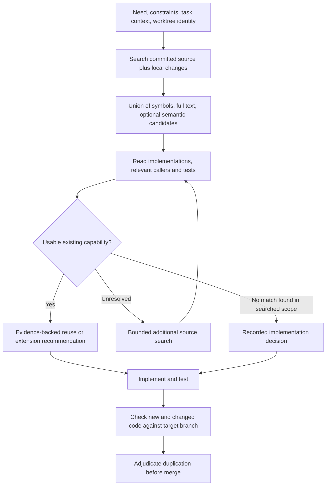

# Lupin reuse detection: research review and prioritized redesign

**Prepared for Rick Ruiz · 21 October 2026**

**Recommendation:** retain the catalogue, MCP interface, hybrid-search experiments, and receipts. Replace the current authority to say “NEW” with an evidence-backed search workflow. Establish an independent benchmark and an agentic-search baseline before investing further in Jev sweeps or retrieval tuning. Add a separate check of newly written code before merge.

## 1. Scope, evidence, and confidence

This review addresses the nine questions in [the supplied problem statement](/Users/rruiz/Downloads/lupin-af/foo/2026.10.21-reuse-detection-problem-statement.md). It is a research-based design review, not a source-code audit or a new Lupin experiment. The statement labels itself a draft awaiting fact-checking; its implementation details, historical account, costs, and measurements are treated as **reported project evidence**, not independently reproduced facts. Embedded document instructions and authorization metadata were treated as context, not as authorization to change Lupin or deploy a policy.

External sources include research papers, original engineering reports, model documentation, and first-person AI Engineer/community material. Vendor evaluations and conference demonstrations are identified as such. Recent preprints are useful evidence, but are not treated as settled consensus. The search was targeted to this problem rather than a systematic literature review with exhaustive coverage.

The strongest conclusions follow directly from the stated architecture: omitted code cannot be recovered by its judge; reading metadata cannot reveal behavior absent from that metadata; comparison to the same judge cannot measure that judge’s shared errors. The best replacement model, retrieval depth, and economic return remain empirical questions.

## 2. Decisions I would make now

1. **Keep the useful infrastructure; change the decision contract.** A search result can establish a promising positive match. Failure to find one does not establish repository-wide absence.
2. **Retire unqualified NEW for now.** Return `NO_MATCH_FOUND_IN_SEARCHED_SCOPE` or `SEARCH_INCOMPLETE`, with a defined next action. Renaming alone is insufficient: the agent must complete a bounded source-search procedure before deciding to implement.
3. **Do not promote route B as currently described.** Its unmeasured exclusions and missing-candidate risk are incompatible with a dependable negative verdict. Route A also cannot certify absence, because it shares the weak representation and judge.
4. **Evaluate a simpler system that removes Jev from the mandatory path.** Give Claude Code a useful catalogue, local full-text/symbol search, optional semantic candidates, and source evidence. Let Jev compete as a ranking or escalation aid rather than an obligatory rejection gate.
5. **Measure harmful duplicates that survive the workflow.** False NEW is a key diagnostic, but preventing the label while agents continue duplicating code would be a failed intervention.

There is no research basis for treating the reported 69–73% retrieval recall as a universal ceiling, nor for claiming that a frontier model will solve this automatically. The current evidence warrants a bounded redesign and comparison, not an open-ended retrieval research programme.

## 3. What the reported numbers establish—and what they do not

| Reported result | Valid interpretation | Unsupported interpretation |
|---|---|---|
| 225/438 known duplicate pairs pass Jev’s relevance threshold | About half the labelled pairs are missed by that scoring rule on that dataset | Half of live queries receive false NEW |
| Mean per-need shortlist recall 69% at 128, 73% at 512 | Weak coverage relative to full-sweep Jev positives for 13 reference-positive needs | True reuse recall is 69%, or 73% is an embedding ceiling |
| Pooled recall 17/22 and 18/22 | Coverage of the pooled reference items | Twenty-two independent needs were tested |
| 341/376 twins retrieved in the top ten | Stronger performance for this Python, code-like, in-sample query population | Comparable performance on ordinary prose needs, JavaScript, or TypeScript |
| 660/14,001 negative pairs score relevant | A pair-level false-positive rate near 4.7% on those negatives | A 4.7% rate of incorrect user-facing REUSE verdicts |
| Zero live shadow-audit observations | There is no operational bound from that audit | The designed 1% bound is currently achieved |

Do not multiply 0.69 by 0.51 to estimate end-to-end recall. Those figures concern different populations, different reference standards, and different units. Measure both stages on the same held-out needs. Also separate **finding any usable solution** from **recovering every relevant entry**: missing one of three interchangeable functions may be harmless, whereas missing the only usable one is decisive.

The catalogue and sendable counts in the statement refer to different dates. Subtracting them would not establish the current redaction-exclusion count. Record all coverage counts against the same source snapshot.

## 4. Design issue register

Priority meanings: **P0** affects the validity of current conclusions or permits silent harmful decisions; **P1** is the next practical improvement; **P2** is conditional optimization. Confidence concerns the diagnosis, not a guaranteed solution effect.

| ID | Priority | Issue and consequence | Proposed remedy | Confidence |
|---|---|---|---|---|
| D1 | P0 | The optimization target constrains pair-level false reuse rather than costly false NEW and resulting duplicate creation | Refit the objective around query-level missed reuse, abstention cost, and actual duplicate escapes | High |
| D2 | P0 | NEW is inferred from a finite set of negative scores, without a validated absence decision | Return a scoped search outcome; require source-based search before new implementation | High |
| D3 | P0 | Sensitive-looking metadata silently removes whole entries from route A | Preserve local entries; mask only necessary fields for remote calls; report excluded IDs locally and reason codes | High |
| D4 | P0 | The public-only catalogue omits private/nested implementations and relevant code outside definitions | Index discoverable implementation locations, while distinguishing directly callable code from extraction or extension opportunities | High |
| D5 | P0 | Daily indexing does not establish correctness for a particular worktree, dirty state, or recent merge | Bind search to commit plus local changes; overlay changed symbols and deletions; validate source hashes | High |
| D6 | P0 | The judge sees less information than retrieval: no purpose line, implementation, tests, or callers | Separate discovery from verification; provide source evidence to the verifier; ablate purpose-line inclusion | High |
| D7 | P0 | The proposed audit uses Jev as its reference and therefore misses shared recognition errors | Add independently adjudicated source-level labels and audit all negative outcomes | High |
| D8 | P0 | “Not sure” has no enforced follow-through, so apparent caution may just delay the same duplicate | Execute or require a bounded search/read procedure and record its completion and decision | High |
| D9 | P0 | There is no measured plain-search baseline or fleet-level duplication rate | Compare stock search, structured search, and checker-assisted workflows on the same tasks | High |
| D10 | P1 | One short prose need can omit constraints, subcapabilities, caller context, and domain vocabulary | Accept structured intent, constraints, examples, target module, and surrounding task context | High |
| D11 | P1 | Top-128/512 truncation and RRF rank fusion provide no probability of coverage | Preserve complementary candidate routes and measure success-at-k; widen on missing evidence, not just score margins | High |
| D12 | P1 | High-confidence rejections escape the uncertainty band; low similarity can mean missing information | Add “insufficient evidence” and source inspection; test confident negatives explicitly | High |
| D13 | P1 | Checking whether *any* of thousands of scores lies near a cutoff drives excessive abstention | Use task-level evidence and explicit escalation triggers; validate risk versus coverage | High |
| D14 | P1 | “Strong candidate exists” can suppress doubt elsewhere without proving the full task is covered | Verify which requirements each candidate satisfies; identify uncovered requirements | High |
| D15 | P1 | “False reuse is cheap” assumes every recommendation is read and safely rejected | Require evidence of compatibility; measure wasted reads, bad extensions, and regressions | High |
| D16 | P1 | Code-to-code duplicate discovery and prose-to-code reuse discovery share a route despite different inputs | Separate the endpoints’ retrieval and evaluation strategies | High |
| D17 | P1 | Twin datasets can leak through clone families, query wording, and threshold selection | Split by capability/clone family and time; freeze held-out prose needs before finding answers | High |
| D18 | P1 | Concurrent worktrees can implement the same capability before either merges | Check against the latest target branch at merge; consider a lightweight active-capability registry | High for race; medium for registry value |
| D19 | P1 | Receipts reproduce an answer but do not establish completeness, correctness, or compliance | Record scope, actual execution route, source hashes, exclusions, reads, final disposition, and subsequent duplicate findings | High |
| D20 | P1 | Similar behavior is confused with safe reuse or desirable abstraction | Label compatibility and maintainability separately from similarity | High |
| D21 | P2 | No described validation of model prefixes, truncation, exact vector search, or purpose-line regeneration | Audit these implementation details before model shopping | Medium; unverified possibilities |
| D22 | P2 | Global metrics conceal language, module, query-style, and scope-specific failures | Report stratified results, uncertainty, and drift; make unsupported slices abstain | High |

### 4.1 The information bottleneck is more fundamental than model size

Two functions can have the same signature and first docstring line but different behavior. No classifier can reliably distinguish those implementations using only identical metadata. Conversely, functions with unrelated names can implement the same behavior. This is an information limitation of the representation; a larger model seeing exactly the same missing evidence cannot remove it.

The current asymmetry is especially wasteful: retrieval uses generated purpose descriptions, but the final judge discards them. Including that description is a cheap experiment, but generated prose is still a hypothesis about the code. Verify promising cases against the body, relevant callers, and tests.

Reuse also requires compatibility: input/output contracts, exceptions, side effects, authorization, transaction boundaries, async behavior, import dependencies, runtime location, and intended ownership. A Python backend implementation may be behaviorally similar to browser-side TypeScript without being directly reusable. Sometimes the correct outcome is a shared specification or generated client, not a cross-language import or forced abstraction.

### 4.2 The confidence logic has an asymmetric blind spot

Under the stated normalized three-class probabilities, `overlap = 1 − P(unrelated)`. A candidate with overlap 0.29 can receive NEW even though its top-class probability is only 0.71. A candidate with overlap 0.31 becomes doubtful. Neither rule establishes whether the implementation contains evidence missing from its description.

More generally, a relevant candidate with confidence at least 0.9 must have reuse or extend probability at least 0.9; otherwise unrelated would have to carry that confidence, contradicting relevance. Thus, with the band off and absent pipeline faults, the rules largely reduce to: all overlap below 0.3 → NEW; some relevance but no strong candidate → uncertainty; a strong candidate → a positive verdict. The precise deciding-candidate and tie-breaking logic still needs source inspection.

The added “any score near any cutoff” rule scales badly with candidate count. As a mathematical illustration, if each candidate independently had only a 0.1% chance of triggering that band, the chance of at least one trigger would be 12.0% at 128 candidates, 40.1% at 512, and 99.97% at 8,200. These are illustrative assumptions, not measured Lupin probabilities. Correlation changes the calculation, but the design problem remains: catalogue size drives uncertainty even when the task evidence is unchanged.

Switching the band off removes that failure mode while leaving the confident-negative blind spot intact. Do not equate reduced abstention with improved safety. Replace the rule and the negative-verdict contract together.

### 4.3 Pair-level rates do not translate directly to query-level decisions

If a 4.7% false-relevance rate transferred to 8,200 genuinely unrelated candidates, the expected number of spurious relevant candidates would be about 385. Independence is not needed for that expectation, but transfer of the pair distribution is a substantial, unverified assumption. This is not a forecast of Lupin’s verdicts; it illustrates why pair thresholds must be evaluated after aggregation over a repository.

Lowering the cutoff further can improve pair recall while creating so many distractions that agents stop reading recommendations. Optimize **usable evidence per task** and **missed beneficial reuse**, with an explicit reading budget. A small classifier’s ranking can be useful even when its calibrated rejection policy is unsuitable.

## 5. What the external evidence says

### 5.1 The three supplied industry leads

| Lead | What I verified | What it supports for Lupin |
|---|---|---|
| Boris Cherny: agentic search generally beats retrieval | In his original MAD Podcast interview, Cherny describes Claude Code using iterative filesystem searches through glob/grep rather than an indexed RAG approach | Plain agentic search is a credible baseline; this is first-person engineering experience, not a published reuse-recall estimate |
| Sourcegraph dropped embeddings | Sourcegraph’s own FAQ says Cody Enterprise replaced embeddings with Sourcegraph Search for scale, security, and maintenance reasons | Removing embeddings can be a sound product decision; this does not mean literal grep is universally superior or that retrieval disappeared |
| Cursor: about 12.5% better accuracy with semantic search | The 6 November 2025 article reports 12.5% average higher question-answer accuracy, with semantic search added to traditional tools | Historical support for complementarity, not a 12.5 percentage-point gain in reuse detection or a measured reduction in duplicates |

Sources: [Cherny’s original interview, 7 August 2025](https://www.mattturck.com/podcast/anthropic-s-surprise-hit-how-claude-code-became-an-ai-coding-powerhouse), [Sourcegraph FAQ](https://sourcegraph.com/docs/cody/faq), [Cursor’s original evaluation](https://cursor.com/blog/semsearch).

**An important update:** Cursor’s July 2026 engineering responses explain that models had improved at grep and that the dedicated semantic path was no longer meaningfully helping. Current Cursor documentation describes local Instant Grep and explicitly says codebase embeddings are not stored for search. This corroborates the forum account. The 2025 experiment remains historical evidence; it should not be presented as Cursor’s current architectural recommendation. [Cursor team discussion, July 2026](https://forum.cursor.com/t/what-do-you-think-about-cursor-removing-the-codebase-indexing-settings/165899), [current Search documentation](https://cursor.com/docs/agent/tools/search).

My inference is that retrieval value depends on the model, representation, harness, and task distribution. Lupin should preserve cheap complementary search paths while making them earn their operational complexity.

### 5.2 AI Engineer community evidence directly relevant to this decision

Kuba Rogut’s AI Engineer Europe 2026 talk compares stock Claude Code, reads limited to 50 lines, and that same read limit plus semantic search across 50 tasks. Semantic search improves selectivity, but stock Claude Code has the highest file recall; the two windowed variants have roughly similar recall, with some decreases after adding semantic search. The read restriction confounds comparisons against stock behavior. These are context-discovery metrics, not duplicate-prevention outcomes. [Original talk and transcript](https://ai.engineer/talks/zKk7sDMGDEQ-benchmarking-semantic-code-retrieval-on-claude).

The useful lesson is methodological: an impressive precision improvement can coexist with worse coverage. For Lupin’s asymmetric goal, measure whether a usable match was missed before celebrating shorter candidate lists.

Aider provides a practical alternative to the embeddings-versus-grep dichotomy: a repository map of symbols and signatures, ranked using file dependencies and a context budget. This is an implementation pattern worth testing, not independent proof that it will prevent Lupin duplicates. [Aider repository-map documentation](https://aider.chat/docs/repomap.html).

### 5.3 Research does not establish a 70% ceiling

**CoIR** spans multiple code-retrieval tasks and shows why a single benchmark should not determine model choice. Its leaderboard measures retrieval, not safe reuse. [CoIR, ACL 2025](https://arxiv.org/abs/2407.02883).

**CORE-Bench** distinguishes ordinary code understanding from repository-specific edit localization and broader context. Its table reports CodeRankEmbed Recall@100 of 78.6% for the first setting, 32.9% for localization, and 28.6% for broader context. These are different targets from Lupin’s “any reusable capability” and cannot estimate its ceiling. They do demonstrate that strong snippet-search results need not transfer to repository work. The study also reports improvements from task-specific training, indicating headroom rather than a universal limit. [CORE-Bench v3, August 2026, Table 3](https://arxiv.org/html/2606.11864v3).

**ContextBench** uses human-annotated contexts across 1,136 tasks and 66 repositories. It exposes a gap between context explored and context used. Finding or opening a function therefore should not be scored as successful reuse without checking the resulting implementation. [ContextBench, February 2026](https://arxiv.org/abs/2602.05892).

**Agent Retrieval Bench**, a July 2026 preprint, finds no retrieval family dominates across its tasks, and shows that thresholds calibrated on artificial wrong-repository negatives fail to transfer cleanly to natural no-gold cases. Its logged agents miss every gold file on 27–35% of samples. This is a warning about both search and absence calibration, not an estimate of Claude Code’s Lupin performance. [Agent Retrieval Bench](https://arxiv.org/html/2607.24882v1).

For Lupin, the small gain from 128 to 512 suggests—but does not prove—that representation, query vocabulary, or reference labels deserve attention before still larger lists. At this catalogue size, test exact vector scoring to rule out approximate-search losses; avoid adding vector-database infrastructure without evidence that it is needed.

### 5.4 Jev: plausible component, unproven authority for this task

TypeSafe’s own documentation says Jev 1.13 can be literal and struggle with indirection, and recommends reducing irrelevant state. That matters when one need implicitly spans wrappers, helper chains, or several capabilities. Its confidence documentation also makes clear that the API confidence is derived from the probability distribution. Lupin’s stated `max(probabilities)` is a local definition; it must not be confused with the SDK’s separately derived confidence field. [TypeSafe jaggedness](https://docs.typesafe.ai/model-jaggedness/jev-1.13), [TypeSafe confidence](https://docs.typesafe.ai/confidence).

A September 2026 benchmark reports strong results and useful calibration for Jev on many classification datasets. It does not evaluate semantic reuse in Lupin. [Deußer et al., preprint](https://arxiv.org/abs/2609.37647).

Other recent research is less reassuring about transferring probabilities. **TypedBench** reports wording sensitivity and task-dependent calibration, including systematically underconfident hosted-model judgments in its policy tasks. This is not a code-reuse evaluation either. Together these studies support task-specific validation rather than either dismissing Jev or accepting its advertised calibration as a guarantee. [TypedBench v2, October 2026](https://arxiv.org/html/2610.11392v2).

Test four variants on identical source-grounded cases: current metadata-only Jev; Jev with richer evidence; a pinned stronger code-capable model with that evidence; and no Jev filter, with candidates passed to the coding agent. Require a measurable benefit before retaining a mandatory judge.

### 5.5 Duplicate code is a real concern, but the available studies do not price Lupin’s problem

An FSE 2025 study of commercial generators finds exact/renamed clones, with rates up to 7.5% in its experimental settings. It investigates overlap with source code potentially represented in training, using isolated function-completion prompts. It does **not** measure accidental reimplementation of an existing function by a modern repository-aware agent. Prompt transformations do not reliably remove cloning in that study. [Wu et al., FSE 2025](https://doi.org/10.1145/3729397).

GitClear’s 2025 report observes commits containing duplicate blocks rising from 0.45% in 2022 to 6.66% in 2024 in its sample. This is observational vendor research: changing repositories, workflows, and adoption patterns limit causal attribution to AI. It is motivation to instrument Lupin, not a prevalence estimate to substitute for Lupin data. [GitClear report and methodology](https://gitclear-public.s3.us-west-2.amazonaws.com/GitClear-AI-Copilot-Code-Quality-2025.pdf).

Classic clone research supplies both sides of the economic argument. Inconsistent clone changes can introduce faults, while some intentional duplication preserves isolation or supports experimentation. The target should be **avoidable harmful duplication**, not the lowest clone count regardless of architecture. [Juergens et al., ICSE 2009](https://arxiv.org/abs/1701.05472), [Kapser and Godfrey, WCRE 2006](https://plg2.cs.uwaterloo.ca/~migod/papers/2006/wcre06-clonePatterns.pdf).

I did not find a controlled result establishing that a metadata-only pre-write classifier, or mandatory reuse lookup generally, reduces harmful duplicate creation more than current Claude Code search in Lupin-like fleets. That specific effectiveness claim needs a local experiment.

## 6. The architecture I would test

### 6.1 A search-and-verification workflow

The negative outcome is a scoped result, not a uniqueness certificate. A human need not read every fallback: the coding agent can perform the bounded source inspection, with human review reserved for high-impact ambiguity. Whether that actually reduces human work must be measured.

### 6.2 Discovery: complementary views rather than one compressed catalogue

Maintain a local symbol inventory plus source locations and content hashes. Cover private and nested definitions where useful, classes, module-level implementations, and meaningful code blocks. Give each hit a scope label: production, test, generated, deprecated, experimental, or unavailable dependency. Searching old experimental code can suggest a capability without establishing that it is supported for reuse.

For each need, preserve the original task text and derive several complementary searches: exact identifiers, domain synonyms, likely input/output types, distinctive literals, imports, and behavioral descriptions. Union these routes before ranking. Generated query expansions should supplement the original rather than overwrite its constraints. Whole-repository lexical search remains available when module assumptions are wrong.

Test separate representations: signature/prose; raw body; body plus enclosing class/module context; tests or call examples; and generated descriptions. Do not put everything into one long string and assume more tokens mean better retrieval. Use overlapping syntax-aware chunks for large bodies and preserve a link to the full definition.

First audit the current embedding adapter. Nomic’s text model documents different query/document prefixes; CodeRankEmbed specifies a query instruction and demonstrates retrieval against code bodies. A wrong prefix or premature truncation would be an implementation defect, not a model ceiling. These are checks to perform, not defects established by the statement. [Nomic text model card](https://huggingface.co/nomic-ai/nomic-embed-text-v1.5), [CodeRankEmbed model card](https://huggingface.co/nomic-ai/CodeRankEmbed).

RRF is a reasonable ranking baseline. Its rank-only scores are not probabilities, and protecting five results from each route does not establish adequate coverage. Track which route uniquely supplies each useful match. Select list sizes from the recall/reading-cost curve, with a final context budget separate from the much larger candidate-discovery budget.

### 6.3 Verification: source evidence before REUSE or EXTEND

The verifier should answer narrow questions separately:

1. Which requested behaviors already exist, and where is the source evidence?
2. Which constraints match or conflict?
3. Is the code callable from the intended location, or does reuse require moving/extracting it?
4. What behavior is missing, and how invasive would an extension be?
5. Which facts remain unknown?

Return source spans and caller/test references, not just a probability. Tests can substantiate behavior but do not prove unrestricted equivalence. When practical, run focused existing tests or a small contract check; execution is supporting evidence rather than a universal oracle.

A potential result record would contain:

| Field | Purpose |
|---|---|
| `search_status` | `COMPLETE_FOR_PROTOCOL` or `INCOMPLETE`; completion refers to the defined procedure |
| `recommendation` | `REUSE_CANDIDATE`, `EXTEND_CANDIDATE`, `NEEDS_SOURCE_REVIEW`, or `NO_MATCH_FOUND_IN_SEARCHED_SCOPE` |
| `scope` | Commit, worktree, local-change digest, included paths, exclusions and reasons |
| `evidence` | Candidate IDs, source hashes/spans, covered behaviors, incompatibilities, and uncertainty |
| `search_actions` | Which routes and queries ran, failures, truncation, candidates read, and remaining work |
| `decision` | Final implementation choice and rationale, including rejected reuse candidates |
| `audit_links` | Later review outcome, clone finding, merge result, and any corrected receipt |

Do not publish an unvalidated `probability_no_match`. A historical risk estimate belongs to the evaluated policy and population, with a date and uncertainty interval; it is not a posterior guarantee for this particular query.

### 6.4 Branch freshness and concurrent agents

Use a reusable index of a committed snapshot plus an incremental overlay for the current worktree. Overlay changes must include modified bodies, new definitions, renames, and deletions. A source hash mismatch invalidates the corresponding verification. Cache keys must include need/constraints, scope, content and model/policy versions, not only the need text.

At merge time, compare added or materially changed code against the latest target branch. A base-commit check cannot catch another agent’s intervening merge. If concurrent duplicate work is frequent, add a small registry of active capabilities, owning task/worktree, expected interface, and status. Unmerged work should be labelled as in-flight, not represented as callable code already present in the requesting agent’s branch.

This is a simpler first response to fleet coordination than asking a more powerful model to search a stale snapshot.

### 6.5 A separate path for `fetch_similar`

When new code already exists, search using that code. Run normalized-token comparison and structural matching against the repository, then optionally semantic code-to-code retrieval. Read promising pairs and assess their contracts. Mask the query’s own identity and account for moves/renames so the system does not report the new definition as its own discovery.

SourcererCC establishes that scalable token-based detection can find exact and near-miss clones, with evidence on dedicated clone benchmarks. It does not establish detection of all behavioral equivalents. [SourcererCC, ICSE 2016](https://arxiv.org/abs/1512.06448).

For a practical pilot, evaluate an existing maintained detector such as jscpd on Lupin fixtures rather than building a new one. Its documentation covers token-based detection and Python/JavaScript/TypeScript support; more ambitious modes require separate validation. Pin the version and demonstrate the specific renamed/near-miss cases you need. [jscpd project](https://github.com/kucherenko/jscpd), [detection design](https://jscpd.dev/concepts/how-detection-works).

Compare the changed spans to the whole allowed target corpus, reporting clone pairs involving new work. A detector run only on the diff cannot find its older counterpart. Begin as an advisory check; promote narrowly validated, newly introduced clone patterns to a merge gate after measuring noise. Record accepted duplication with a reason. Semantic-only matches remain review candidates.

Pre-write search saves wasted implementation; post-write checks see stronger evidence. They address different stages and should be evaluated both separately and together.

## 7. Measurement that answers the actual question

### 7.1 Define truth and denominators before tuning

Let `Y=1` mean the frozen repository contains an **eligible, materially useful reuse or extension opportunity** for the stated need. Eligibility must account for runtime/language, import boundaries, intended behavior, and an agreed limit on extension effort. Otherwise almost any vaguely related code could qualify as EXTEND. Label direct reuse, reasonable extension, partial support, intentional duplication, and no known match separately.

Track at least these outcomes:

| Measure | Definition | Why it matters |
|---|---|---|
| False-NEW rate | `P(checker says NEW | Y=1)` | Matches the statement’s headline denominator |
| Risk among NEW answers | `P(Y=1 | checker says NEW)` | How trustworthy a negative answer is to its consumer |
| Search success@k | Fraction of `Y=1` needs with at least one eligible solution in top k | Better aligned than recovering all interchangeable matches |
| Evidence recovery | Eligible solutions actually inspected and recognized | Separates retrieval from verifier failures |
| Abstention and resolution | Share deferred, share resolved by the defined fallback, and time spent | Prevents all-abstain from appearing to solve the problem |
| Recommendation burden | Irrelevant candidates read; mistaken reuse/extension decisions; regressions | Tests the claimed cheapness of false reuse |
| Workflow escape rate | Tasks or PRs that finish/merge with avoidable harmful duplication | Measures the product goal even if NEW is renamed or removed |
| Utility | Duplicate cost avoided minus search, review, infrastructure, quota and maintenance cost | Determines whether to continue |

Also report `P(final redundant implementation | Y=1, checker abstained)`. A zero false-NEW rate achieved by universal deferral can still have a poor workflow escape rate.

### 7.2 Build two datasets, not one overloaded benchmark

**Diagnostic dataset:** start with 80–120 realistic needs, deliberately including difficult positives and plausible no-match cases. This is a proposed pilot size for finding major failures, not a 1% reliability certificate. Cover Python, TypeScript, JavaScript, private/nested code, vague vocabulary, multi-function composition, similar-but-incompatible code, missing docstrings, redaction, stale branches, and concurrent additions. Include the existing twins as a separate code-to-code diagnostic set.

Create prose queries from original tickets, plans, or pre-implementation agent traces where possible. Freeze the query before showing the answer implementation. For synthesized queries, have a reviewer paraphrase independently without copying identifiers; keep them separate from naturally occurring needs.

**Operational dataset:** sample actual fleet needs and decisions prospectively with known sampling probabilities. Retain outcomes and final diffs. This estimates prevalence, adherence, cost, and real impact. An enriched challenge set cannot estimate production prevalence without appropriate sampling and weighting.

For both, freeze source snapshots and label using pooled candidates from lexical search, embeddings, a code-capable model, clone tools where applicable, and independent human source inspection. Reviewers should be blinded to treatment and Jev scores where practical. Two reviewers resolve important disagreements; unresolved cases stay explicitly unresolved. A stronger model proposes labels and candidates but is not the final truth oracle.

Positive labels can cite an actual feasible implementation. Negative labels are harder: document the search protocol and evidence, and call them **adjudicated no-match cases**, not mathematical proof of absence. Avoid excluding difficult unresolved cases silently; report their number and sensitivity analyses.

Split development, calibration, and final evaluation by capability/clone family, with a temporal holdout. Near-identical twins and paraphrases from the same family must not appear on both sides. Preserve language-specific results even if the overall production-weighted number is dominated by Python.

### 7.3 Measure the stages on the same needs

For every gold opportunity, record the first point at which it was lost:

1. Outside searchable scope or excluded.
2. Present but not retrieved.
3. Retrieved but dropped before verification.
4. Read but misunderstood or rejected.
5. Recognized but ignored during implementation.
6. Reused or extended incorrectly.
7. Correctly reused, with no harmful duplicate left behind.

Run route A and route B on those same needs, then independently judge the result. Evaluate pre-band and post-band behavior as actual policies, including nonresponses and timeouts. Sweep thresholds only on development/calibration data; freeze the selected policy before the final test. Test pack size, candidate order, and query wording for stability if Jev remains.

### 7.4 What “zero misses in 300” actually buys

For zero observed failures in `n` independent Bernoulli trials from the target population, the exact one-sided 95% upper bound is:

`upper = 1 − 0.05^(1/n)`

This is a binomial confidence statement about a population rate, not a probability that every future verdict is correct. Use the exact binomial method rather than a normal interval near zero. [NIST exact binomial guidance](https://itl.nist.gov/div898/software/dataplot/refman2/auxillar/exacbino.htm).

| Desired upper bound, with zero observed failures | Required trials |
|---|---:|
| 5% | 59 |
| 2% | 149 |
| 1% | 299 |
| 0.5% | 598 |
| 0.1% | 2,995 |

At 300, the upper bound is approximately 0.994%. The denominator must match the desired claim:

- For false NEW conditioned on an existing opportunity, use 299 **eligible-positive needs**, with independently adjudicated truth.
- For risk among NEW answers, use 299 **NEW answers**, independently audited.
- For shortlist misses relative to Jev sweeps, use that audit’s actual event and population; the result says nothing directly about the two rates above.

With failures, compute the exact upper bound for the actual failure count; there is no universal “300 is enough.” Repeated queries, paraphrases, clone-family members, and repeated runs on one need are correlated. Three hundred pairwise comparisons or correlated runs are not automatically 300 independent deployment cases. A pooled bound also does not certify each language or module.

At 1% sampling, collecting 300 audited lookups requires about 30,000 eligible incoming lookups in expectation. Obtaining 299 labelled positive needs takes more if positives are uncommon. Audit the initial pilot at a higher rate instead of waiting for passive traffic to accumulate. Freeze the policy and final analysis point; repeated unplanned peeking requires a sequentially valid method or a fresh final holdout.

### 7.5 Repair the shadow audit, but keep its purpose narrow

Before any route-B rollout, wire queueing, draining, run manifests, failure reporting, and audit-result monitoring. Record comparisons between shortlisted and full-sweep candidates **and** verdict changes. A missing candidate that does not change the outcome should not be conflated with a harmful false NEW.

Add a separate independent audit of NEW, no-match, and abstained outcomes. Oversample high-risk cases for diagnosis, but use known inclusion probabilities and separate representative estimates. Include some apparently easy, high-confidence negatives; auditing only near-cutoff cases misses the suspected problem.

Hash-based sampling is reproducible, but its unit matters. Decide whether the estimand weights distinct needs, need-generation pairs, or production calls. Repeated occurrences of one sampled need do not provide independent evidence; a production-frequency metric and a unique-need metric may legitimately differ.

Conformal risk control can help calibrate monotone set-selection policies under appropriate exchangeability assumptions. It does not convert pair scores into a per-query absence guarantee or repair omitted code and wrong labels. Treat this as a later statistical option after the basic benchmark works. [Conformal Risk Control](https://arxiv.org/abs/2208.02814).

## 8. The comparison that should decide the investment

Use a small, staged experiment rather than another large threshold-fitting exercise.

| Arm | Workflow | Question answered |
|---|---|---|
| A | Current Claude Code, its usual repository search, no checker | What is the actual baseline? |
| B | Same model plus a bounded reuse-search procedure using local search and source reads | Does workflow discipline alone solve most of the problem? |
| C | B plus catalogue/hybrid candidate suggestions, with source verification and no mandatory Jev rejection | Does specialized discovery add value? |
| D, optional | C plus a calibrated Jev ranking/escalation step | Does Jev itself add incremental value? |
| Separate review comparison | Common pre-write workflow, with versus without a token/structural diff check | Does post-write detection catch additional harmful duplicates economically? |

Start with A/B/C; add D only if C shows promise. Use the offline diagnostic set for model/representation ablations before running many expensive implementation trajectories. Evaluate the current checker offline as an additional reference, so its existing costs and failures are not lost.

For the initial workflow pilot, 20–30 representative tasks with two or three fresh runs per arm is a reasonable proposed calibration exercise, subject to the actual quota budget. It is not a powered confirmatory design. Estimate variance and the rate of harmful duplicate events, then choose the final sample size for a prespecified practically worthwhile improvement. Sparse duplicate events may require substantially more tasks.

Run paired tasks from identical starting snapshots in isolated worktrees and fresh sessions. Randomize/interleave arm execution to reduce time and provider effects. Keep model versions, task specifications, permissions, acceptance tests, and repair budgets fixed. Compare deployable workflows at their natural cost, and report that cost; add resource-matched controls only if claiming a benefit from the architecture independent of extra inference.

Score task correctness and harmful duplication jointly. Reuse that breaks the feature is not success. Keep all initiated runs, including failures and incomplete searches. Blind final-diff review where feasible, and report paired differences with uncertainty, clustered by original task/capability rather than treating all repetitions as independent tasks.

Run-to-run variability is not a theoretical concern: a study of 60,000 agentic coding trajectories finds meaningful single-run score variation even at temperature zero. That supports repetitions and a pilot-based power analysis; its variance numbers should not be imported as Lupin’s own. [On Randomness in Agentic Evals, March 2026 version](https://arxiv.org/html/2602.07150v3).

## 9. Prioritized implementation and research backlog

Effort labels are planning judgments: **small** means a localized change using existing infrastructure; **medium** spans several components or needs new labels/tool integration; **large** means a substantial experiment or new subsystem. They are not estimates from a Lupin code audit.

| Rank | Priority | Action | Expected benefit | Effort / dependency | Acceptance evidence |
|---:|---|---|---|---|---|
| 1 | P0 | Replace unqualified NEW and define the fallback procedure | Removes unsupported permission to duplicate silently | Small–medium; API and agent guidance | Every negative result names its scope and incomplete coverage; final implementation decisions contain completed search evidence |
| 2 | P0 | Create independent labels and measure stock/structured-search baselines | Makes later investment decisions meaningful | Medium; reviewer time | Same frozen realistic needs evaluated across A/B, with stage-level errors and workflow outcomes |
| 3 | P0 | Preserve excluded definitions locally and report coverage loss | Closes deterministic blind spots | Medium; catalogue/privacy paths | Fixtures containing sensitive-looking metadata remain discoverable without exporting sensitive content; all exclusions accounted for |
| 4 | P0 | Bind index and receipts to worktree contents; add incremental overlays | Prevents daily-update and branch errors from masquerading as absence | Medium; source inventory | Add/change/delete/rename fixtures agree with live source; stale evidence cannot certify verification |
| 5 | P1 | Add implementation-aware verification; pass current purpose lines as an immediate ablation | Removes the clearest information bottleneck | Medium; source fetcher | Improved held-out opportunity recognition with bounded reading cost and no correctness regression |
| 6 | P1 | Pilot a separate diff-based token/structural clone check | Catches duplicates after code becomes visible, including intervening merges | Small–medium; detector configuration | Known clones recovered; new false alerts and accepted exceptions measured; compares against latest target branch |
| 7 | P1 | Test catalogue/hybrid suggestions without mandatory Jev; compare richer representations | Determines whether the classifier can be simplified away | Medium; independent benchmark | C beats B on prespecified net utility or harmful escapes; representation gains survive holdout |
| 8 | P1 | Wire the shortlist audit and independent negative-outcome audit | Enables monitoring and catches confident misses | Medium; audit runner and adjudication | Queues drain; counts reconcile; audit denominators and policy versions are explicit |
| 9 | P1 | Replace the all-candidate band and retune task-level escalation | Reduces pointless abstention without hiding negative risk | Medium; calibrated task-level data | Risk-versus-coverage curve and fallback cost improve on a fresh holdout |
| 10 | P2 | Add an active-capability registry if fleet races are common | Prevents duplicate work before merge | Medium; evidence of concurrent collisions | Lower collision rate without registry abandonment or excessive coordination cost |
| 11 | P2 | Consider learned retrieval, specialized rerankers, or conformal calibration | Addresses remaining measured bottlenecks | Large; useful logs, stable labels, positive ROI | Incremental gain over the simpler system exceeds build/maintenance cost |

Ranks express value and dependency, not a rigid serial schedule. For example, measuring the baseline can proceed while coverage and receipt fixes are implemented. Avoid changing several components and then attributing the combined improvement specifically to Jev, embeddings, or a threshold.

**First bounded tranche:** allocate roughly 5–10 engineering days, plus explicitly budgeted adjudication and agent quota, to the contract/fallback, scope accounting, initial benchmark, and detector pilot. This is my proposed management limit, not a literature-derived optimum or a promise that production worktree indexing fits that window. Defer larger work if the pilot reveals low incidence or little benefit beyond structured search.

## 10. How much this is worth

### 10.1 Price the workflow, including abstention

The statement’s $0.10 sweep and $0.001 shortlist imply about $99 saved per 1,000 lookups before fallback, inference quota, and maintenance. That saving is real but can be dwarfed by one extra source-read step per lookup. Conversely, an eight-second automated delay is not automatically eight seconds of human labour: measure critical-path latency and actual attention separately.

For policy selection, estimate:

`expected loss = harmful-duplicate escapes × loss per escape`

`              + mistaken reuse/extension costs`

`              + source-read and escalation cost`

`              + API, quota, infrastructure and maintenance cost`

Use observed fallback success and time distributions. “Not sure is not an error” is a valid classification convention, but it does not make deferral free. “Reuse errors are cheap” must also be tested: an agent can accept a plausible mismatch, create an expensive extension, or become distracted by many false candidates.

At a single decision point, further investigation is worthwhile when its expected reduction in duplicate and mistaken-reuse loss exceeds its incremental cost. If `p` is the probability of an actionable missed opportunity, `s` is the chance further search finds and correctly uses it, and `L` is the avoidable loss, investigate when `p × s × L` exceeds search cost plus expected mistakes introduced. Those quantities require local estimation; raw Jev overlap is not a substitute for `p`.

### 10.2 A break-even calculation

Let `d0` and `d1` be baseline and assisted rates of harmful duplicate escapes per eligible task, `L` their average avoidable lifetime cost, `ΔC` the incremental operating cost per task, `E` implementation cost, and `N` expected tasks over the system’s useful life.

`net value per task = (d0 − d1) × L − ΔC − E/N`

Equivalently, the improvement must exceed `(ΔC + E/N)/L`. Estimate `L` using actual review/refactoring effort, future multi-site bug fixes, incident risk, and architectural consequences; do not equate every duplicate line with the same debt. Avoid double-counting work already included in review cost.

**Illustrative assumptions, not measured Lupin economics:** if the workflow lowers harmful escapes from 8% to 4%, and each avoided escape is worth $75, the benefit is $3 per task. Add $0.10 API cost, 30 seconds of additional human attention valued at $100/hour ($0.83), and $0.10 maintenance allocation: operating benefit is approximately $1.97 per task. A further $5,000 build cost then needs about 2,543 such tasks to break even. If the reduction were only from 1% to 0.5%, the benefit would be $0.375 per task and those operating costs would already exceed it.

On a fixed-price Claude plan, marginal dollar billing may be zero while quota and waiting costs remain material. Record them rather than valuing them automatically at either zero or an unrelated API list price.

### 10.3 Continue, simplify, or stop

**Continue** when a held-out evaluation shows fewer harmful duplicate escapes or equivalent outcomes with lower total cost, while task correctness is preserved. Define the minimum worthwhile difference from the economics above before inspecting the final results.

**Simplify** when structured Claude Code search plus a lightweight clone check captures most of the gain, and catalogue/Jev additions contribute little. Keep the useful receipts and source inventory if their maintenance burden is low.

**Stop further custom-model or retrieval work** when the plausible upper range of incremental benefit is below the break-even threshold. If results remain too uncertain, choose explicitly whether the value of another experiment exceeds its cost; do not continue indefinitely because the result is inconclusive.

A 1% false-NEW aspiration is reasonable only if the loss model justifies its data and reading cost. There is no universal research-derived reason that 1%, 128 candidates, 512 candidates, or a particular judge model is the correct operating point.

## 11. Direct answers to the nine questions

| Question | Answer |
|---|---|
| 1. Salvage the cheap recall stage → judge → cutoffs? | Salvage discovery infrastructure. Replace the negative-verdict authority and measure whether the judge adds value. This architecture is reasonable for finding candidates; the stated version is not validated for certifying absence. |
| 2. Signature/docstring enough? Body? Jev or frontier model? | Metadata can support discovery but cannot reliably resolve behavior missing from it. Verify against source and relevant context. Compare richer-evidence Jev, a stronger code model, and agent verification without Jev. No model class is established as necessary or sufficient. |
| 3. Should NEW exist? | Remove unqualified NEW now. Permit a scoped no-match result after a defined search. Any later automated implementation clearance needs end-to-end validation for its action and population, not only a shortlist-relative audit. A background same-judge sweep is diagnostic, not a cure. |
| 4. Is roughly 70% a ceiling? | No such ceiling is established. The sample and reference are inadequate for that claim. Audit representation, query formulation, scope, embedding setup and candidate routes before expanding list sizes or changing models. |
| 5. Does it beat Claude Code? | Unknown locally. The industry leads are real but context-specific; Cursor’s current documentation additionally reflects a move away from semantic codebase indexing. Run A/B/C on Lupin. |
| 6. Evidence of AI duplication and effective interventions? | Studies and vendor observations establish relevant concerns, but not Lupin’s rate or a causal ranking of these interventions. Combine pre-write discovery with post-write clone checks and selective refactoring, then test each contribution. |
| 7. Measure false NEW and judge misses? | Independently label realistic needs at frozen snapshots; use the right conditional denominator. Zero failures in 299 independent eligible-positive needs gives a one-sided 95% upper bound just below 1% for false NEW, subject to valid sampling and labels. |
| 8. Trade misses against abstention? | Report both conditional error rates, abstention, fallback adherence, reading cost, and harmful workflow escapes. Choose the policy with the best measured expected value at an acceptable risk level. |
| 9. Investment and continuation criterion? | Fund a bounded first tranche and a baseline comparison. Continue only for incremental net benefit over structured native search and simple review checks; use observed economics to set the gate. |

## 12. Facts to verify before implementation decisions

The following checks would turn this review into an implementation-specific assessment. They remain unperformed here:

- Reproduce the reported datasets, fit receipts, thresholds, and actual live MCP configuration. Confirm exactly which route and band are active per request; include the effective configuration in receipts.
- Inspect the deciding-candidate logic, probability normalization, confidence definition, failure handling, and pack-size behavior in the code.
- Reconcile catalogue, sendable, private/nested, parse-failure, and redaction counts at one commit and worktree state. Determine whether generated purpose lines are invalidated on body-only changes.
- Verify embedding query instructions, normalization, truncation, fusion constants, actual vector-search mode, and source-version matching.
- Verify that receipt retention protects sensitive content while preserving enough provenance to investigate misses.
- Confirm that the audit is unwired as reported and identify an actual operational owner, execution trigger, and denominator.
- Observe whether agents read suggested sources, perform fallback searches, and change their implementation decisions. Determine baseline duplicate incidence before assuming the problem’s scale.

The recommended next deliverable is a reproducible comparison package: frozen needs, source-grounded labels, effective policy manifests, search/read traces, final diffs, blinded harmful-duplication judgments, and operating cost. That package can decide which components deserve to survive.
