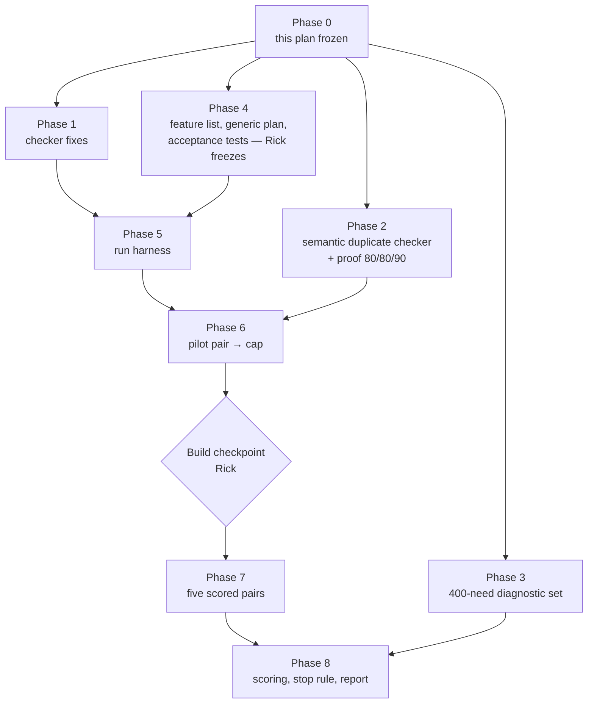

# Reuse detection: remediation plan

*24 October 2026. This plan turns the rulings Rick made on 24 October into work. Every design decision below is his. Estimates are marked as estimates. The ruling-by-ruling record is in `TODO.md` § "Decisions log 2026-10-24". The two temporary explainers (`io/tmp/2026.10.24-reuse-stop-rule-explainer-v2.md`, `io/tmp/2026.10.24-reuse-experiment-base-tree-explainer.md`) are background only; this document replaces them.*

## 0. Cascade review scope (Rick, 2026-10-24 ~16:30 EDT)

Rick's instruction, in his words: *"throughout the cascade review we are focusing on implementation, not on the greater experimental plan itself that is fixed and not renegotiable unless I deem it necessary. What I'm trying to avoid is not just scope creep, but actual focus shifting from one facet to another."*

| | Sections |
|---|---|
| **Under review: how to build it** | §4 (Phase 1), §5 (Phase 2), §6 (Phase 3): code design, files and modules, tests at 100%, order of work, acceptance criteria, risks to the build |
| **Locked: not reviewable** | §1–§3, §7 (the experiment: arms, runs, pilot and cap, metric, stop rule), §8–§10, and the design facts inside §5 and §6 (Fable 5.1 judge, the 80/80/90 bar, 400 needs split 300/100, two blind reviewers, kappa) |

A reviewer comment that would change a locked item is **not a finding**. It goes on the parking list below for Rick, unchanged, and the cascade moves on.

### Cascade sections

| Section | Scope | Why it can be reviewed alone |
|---|---|---|
| **A** | §4 items 1.1–1.3: retire NEW, recorded search, exit gate | Touches the verdict set, a new `record_search` tool and `reuse_exit_gate.py`; no index code |
| **B** | §4 items 1.4–1.8: index fixes, rebuild during a run | Touches the symbol index and its build only; reads A's verdicts by name, not by code |
| **C** | §5: semantic duplicate checker and its proof | A separate scoring tool that never calls the reuse checker, by design (it must not grade its own work); shares only D's labelling tool |
| **D** | §6: tooling for the 400-need diagnostic set | Drafting, checking and labelling tools for needs; its loss-tracing step reads the finished Phase 1 checker (see §3) |

Cross-section dependencies: D's loss tracing needs A and B finished; A's `record_search` needs B's index reader and the 1.4 language helper; C never calls the reuse checker, but its human-labelling step uses D's blind labelling tool.

### Parking list for Rick

| # | Item | Status |
|---|---|---|
| P1 | Section A's reading of D1: the checker never answers DISTINCT; the old NEW becomes UNCERTAIN with cause NO_MATCH; DISTINCT is an agent's ruling, gated by `record_search` | **Confirmed by Rick, 2026-10-24 18:16 EDT** |
| P2 | Commit `9ea8bc102` added one sentence to locked §3: Phase 3's loss-tracing report waits for Phase 1 | FYI to Rick (shown 18:16 EDT); no design change |
| P3 | **D6 revised by Rick, 18:19 EDT**: "I want language to be an explicit parameter such that the agents calling it during the review process have to consider and pass a valid language parameter No defaults because then you get a silent error if the default is incorrect". Item 1.4 becomes: language is a required argument, an invalid value is a named error, and cross-language search stays an explicit opt-in | **Ruled by Rick**; supersedes "target language by default" in item 1.4 |
| P4 | Judge temperature: §5 says temperature 0, but the Max-plan route (`model_transport`) has no temperature setting. Recommended: 0 wherever the server allows it, recorded per verdict, with the 90% repeat-run agreement bar as the determinism guard on the Max plan | **Open, for Rick** (asked 18:23 EDT, timed out). Built as an explicit frozen-config value with no silent default |
| P5 | A capped run that cannot be scored (a file that does not parse, or zero passing tests). Recommended: it takes the worst rank in its arm for the Mann-Whitney test and is reported by name with its cause | **Open, for Rick** (asked 18:30 EDT). The scorer writes `status: "unscorable"`; the stop-rule policy waits |
| P6 | Split of the 300 matched needs by kind (§6 lists the kinds without counts). Recommended: 120 near-copies / 120 same job in different code / 60 cross-language, as an editable table | **Open, for Rick** (asked 18:30 EDT). Built as an editable table, filled at the operator-gated step D7 |
| P7 | Phase 2 estimate is now 6–9 days in §5.C against 5–7 in §3 | FYI; §3 left unchanged |

## 1. What failed, and what this plan does about it

The reuse checker was tested on one number: whether it found a known match for a need (`2026.10.20-reuse-lookup-final-test-results.md`). The two expert critiques (`2026.10.21-reuse-detection-expert-synthesis.md`) and Rick's follow-up questions (`2026.10.23-reuse-detection-response-to-expert-critiques.md` §7) showed that this was the wrong test, and that the checker itself has gaps:

- The checker's "write new" verdict lets an agent skip the search it was meant to do.
- The index leaves out private methods and tests, sees only the first docstring line, and searches every language at once.
- The 30-need test set was too small to tell anything, was labelled by one person, and was found only by structural matching.
- Nothing measured the thing Rick cares about: **whether agents that use the checker write code with fewer duplicates.**

This plan fixes the checker, builds a way to count duplicates, including work-alikes that look different, and runs a controlled experiment that decides whether the checker is worth continuing.

## 2. The hypothesis and the decision it feeds

**Hypothesis:** agents that use the reuse checker write code with fewer duplicate, near-duplicate or work-alike blocks than agents that do not. Code quality only; time and cost are not part of it.

**Decision:** continue building the checker if the experiment in §7 shows fewer duplicates in the "with" arm at p < 0.05; otherwise stop. Whatever the outcome, two free parts stay: the jscpd clone warning on diffs, and the compact map of what exists.

## 3. The plan at a glance



| Phase | What | Estimate | Depends on |
|---|---|---|---|
| 0 | Freeze this plan | — | Rick |
| 1 | Checker fixes | 6–8 days | 0 |
| 2 | Semantic duplicate checker and its proof | 5–7 days | 0 |
| 3 | 400-need diagnostic set | ~2 weeks elapsed | 0, a second reviewer; its loss-tracing report also needs Phase 1 |
| 4 | Feature list, generic plan, acceptance tests | ~3 days plus Rick's review | 0 |
| 5 | Run harness | 3–4 days | 1, 4 |
| 6 | Pilot pair, cap set | the pilot's duration (≤ 10 working days) | 2, 5 |
| 7 | Five scored pairs, one pair at a time | 5 × the cap | 6, Rick's checkpoint |
| 8 | Scoring, verdict, report | ~1 week | 3, 7 |

Phases 1 to 4 run side by side, except that Phase 3's last step, the loss-tracing report, waits for Phase 1. **Ceiling: 10 weeks elapsed**, open to renegotiation once the pilot fixes the cap. Tokens are not a constraint (Rick's employer sponsors them); machines and the fleet cap are.

## 4. Phase 1 — checker fixes

| # | Change | Ruling |
|---|---|---|
| 1.1 | **Retire the NEW verdict.** Verdicts become REUSE, EXTEND, DISTINCT and UNCERTAIN | D1 |
| 1.2 | **Recorded search.** Before ruling DISTINCT, the agent calls a tool that runs fixed-string greps for the need's key terms and returns the five nearest candidates. The agent reads each one and rules on each. The result is written once, as a `record_search` record linked to the reuse receipt | D1 |
| 1.3 | **Exit gate**: `reuse_exit_gate.py` refuses a DISTINCT ruling that has no `record_search` record | D1 |
| 1.4 | **Language is a required argument** (no default); a search covers that language; cross-language search is opt-in | D6, revised by Rick 2026-10-24 (P3) |
| 1.5 | **Private and protected methods** are indexed, with their class named; nested helpers are not | D7 |
| 1.6 | **Tests are indexed as a separate scope**, searched only on request | D8 |
| 1.7 | Whole docstrings are indexed; the purpose line is passed to the judge; JavaScript roots are widened; every dropped entry is reported with its reason | 10-23 response §5 |
| 1.8 | **Index rebuilt during a run** as code lands (today it is built once per commit), so the "with" arm can find the run's own new code | rule of 24 Oct (`TODO.md`, decisions log 2026-10-24, "New engineering item") |

**Acceptance:** each change has unit tests at 100% lines, branches and functions; the exit gate has a test that a DISTINCT ruling without a search record is refused and one with a record passes; a fixture tree with a private method, a test helper and a TypeScript file shows each indexed in the right scope; and the rebuild has a test that a definition written mid-run is found by the next search.

### 4.A Build spec for 1.1 to 1.3 (retire NEW, recorded search, exit gate)

*Read against the code at `d0bd4f604`. Rick's rulings D1 are not touched; this section says how to build them.*

**Assumption A1 (item 1.1).** D1 gives four verdicts: REUSE, EXTEND, DISTINCT, UNCERTAIN. Today `check_exists` returns REUSE, EXTEND, NEW or UNCERTAIN_READ_SOURCE, and the reviewer's ruling vocabulary already has DISTINCT. This spec reads D1 as: the checker never says DISTINCT; DISTINCT stays the reviewer's ruling, reachable only through a recorded search (1.2, 1.3). The checker's old "nothing relevant" outcome becomes `UNCERTAIN_READ_SOURCE` with a new cause `NO_MATCH`. **Open sub-question 1:** if Rick meant the checker itself should print DISTINCT, only the label in step 1 below changes; steps 2 to 4 hold either way.

#### 1.1 Retire NEW: how it is built

| Step | File | Change |
|---|---|---|
| 1 | `src/cosa/repo/symindex/verdict.py` | Add `"no_new": True` to `POLICY` and `POLICY_PROVIDES`. Add `"NO_MATCH"` at the **end** of `CAUSES`, so every other cause still wins the `cause` field. In `decide` and `decide_provides`, when `"no_new" in policy` and nothing is relevant, add `NO_MATCH` to `holds` (the verdict is then UNCERTAIN by the existing cause rule). A policy without `no_new` keeps the old `NEW` branch. This is the same convention as `"strong"` and `"band"`: a stored policy replays as it was stored |
| 2 | `src/cosa/repo/symindex/candidates/shadow_audit.py` | `compare()` tests `full_verdict != "NEW"`. Add a `full_cause` argument and treat "UNCERTAIN with cause `NO_MATCH`" as the decided no-match case. Without this the audit would turn every no-match into `inconclusive` |
| 3 | `src/lupin_mcp/cosa_voice_mcp.py`, `reuse_tools.py` | Docstrings only: `check_exists` lists REUSE, EXTEND, UNCERTAIN_READ_SOURCE and says `NO_MATCH` obliges `record_search` before any DISTINCT |
| 4 | `README-reuse-decision-table.md`, `.claude/skills/reuse-reviewer/SKILL.md` | Row 10 becomes cause `NO_MATCH` (UNCERTAIN). The three-vocabularies table loses its `NEW` row; the `UNCERTAIN` row gains "cause NO_MATCH: run `record_search`" |

Replay: a receipt stored with verdict `NEW` and a policy lacking `no_new` still replays to `NEW` in the frozen re-run (no difference). Its HEAD re-run now answers UNCERTAIN/`NO_MATCH`, which `replay` reports as a head difference. The counter-reviewer brief gets one sentence saying a NEW→NO_MATCH head difference on a receipt written before this change is expected, not a finding.

**Tests (EXECUTOR: AI), 100% lines, branches and functions of the changed files:** in `test_symindex_verdict.py` and `test_symindex_verdict_band.py`, the empty-shortlist case under the shipped policy gives UNCERTAIN/`NO_MATCH` (both `decide` and `decide_provides`); the same input under a policy copy without `no_new` gives `NEW`; a case with `NO_MATCH` beside `CALL_FAILED` reports `CALL_FAILED` as `cause` and lists both in `causes`. In `test_reuse_tools.py`, a hand-built stored `NEW` receipt (fixture written by the old code path, not by the new one) replays with `differences.frozen == []`. In `test_candidates_shadow_audit.py`, the new `compare` case. **Tests that go red under the new shipped policy, and are fixed in the same commit** (each is changed to expect UNCERTAIN/`NO_MATCH`, or pinned to a copy of the policy without `no_new` where it is testing an old receipt): `test_symindex_repair_check.py`, `test_reuse_flip.py`, `test_reuse_page_first.py`, `test_reuse_call_budget.py`, `test_reuse_replay_repeat.py`, `test_reuse_candidate_route.py`, the `test_reuse_e2e_*.py` files, and `test_reuse_reviewer_skill.py`, which pins the skill's vocabulary table, so the `SKILL.md` edits of 1.1 step 4 and 1.2 land in the same commit as that test. The list was counted by hand from `git grep -c -F '"NEW"' -- src/tests`; the list can grow while the build runs, so the whole unit tier is run with the new policy as the **last** build step before review, and again at merge, and any other red file is fixed and added to this list in the PR description. `git grep -l -F '"NEW"' -- src` reports 23 files today, including a design document, a JSON fixture and `src/cosa/tests/unit/rest/test_peer_router.py`, where "NEW" is an unrelated token; those are left alone.

#### 1.2 Recorded search: how it is built

A new tool, **`record_search`**, in a new module `src/lupin_mcp/reuse_search.py` (pure functions, no model call), mounted as a fifth reuse tool in `cosa_voice_mcp.py` beside `replay` and added to `REUSE_TOOLS` in `reuse_call_log_middleware.py`.

| Piece | Spec |
|---|---|
| Signature | `record_search( receipt_id=None, entry=None, extra_terms=None, language=None, root=None )`. Exactly one of `receipt_id` and `entry`, else error `BAD_SEARCH_KEY`. A `receipt_id` search takes its language from the receipt, and a `language` argument beside it is `BAD_SEARCH_KEY`; an `entry` search requires `language` under the same `LANGUAGE_REQUIRED` and `LANGUAGE_INVALID` errors as 1.4, with no default. `receipt_id` is the reuse receipt of the `check_exists` or `fetch_similar` call the search backs. `entry` is for a definition the tool refused to send (`EXCLUDED_*`, no receipt); the search is local, so exclusion does not apply to it. `extra_terms` is strings the agent adds; derived plus added terms are held to D1's 3 to 6 in total |
| Key terms | `derive_terms( text )` calls the existing `split_identifier` (`candidates/identifier_split.py`, which already splits snake_case, camelCase, acronyms, digits and paths). The text it splits comes from the receipt's own record: a `check_exists` receipt's query, or for a `fetch_similar` receipt its stored `need_text`, else the entry text read from the receipt's own snapshot (`load_snapshot( ctx, receipt[ "index_sha" ] )`, as `replay_impl` does). So a rebuild between `fetch_similar` and `record_search`, which may rename or remove the entry, cannot make a legitimate search fail. Only an `entry`-keyed search (no receipt) reads the entry's name, signature and first docstring line from the fresh generation, and answers `UNKNOWN_ENTRY` if it is gone. `derive_terms` adds only a 4-character minimum and a fixed stop list (a constant in the module). It writes no split rules of its own. Cut to the 6 longest (ties by alphabet). A search needs at least 3 terms in total: fewer than 3 derivable, with too few `extra_terms` to reach 3, is `NO_TERMS`; added terms beyond a total of 6 are refused with `TOO_MANY_TERMS`. No model is asked, so the same input always gives the same terms |
| Scope | Files of the target language only (the language is the receipt's own, or the required `language` of an `entry` search; it is validated by the same helper as 1.4, see the order below). Tests are left out unless 1.6 is on and the agent asked for them |
| Search | **The search and the spans come from the same state of the tree.** Step 1: the tool calls `build.ensure` (the same call `prepare` makes), whose manifest follows uncommitted edits, so the generation describes the working tree as it is now. Step 2: `git grep --untracked -n -F -i -e <term> -- <paths>` per term, where `<paths>` are the files of the searchable records in scope, in batches of 500. Plain `git grep` already reads the working-tree content of tracked files, including uncommitted edits; `--untracked` adds new files not yet added to git, which is where a run's newest code lives. The argument list is never a shell string. Step 3: `build.is_fresh` is asked again after the grep; if a file changed meanwhile the call returns the existing `INDEX_STALE` flag as a named error and no candidates. Each hit line is mapped to the indexed definition whose span `line` to `end_line` holds it (innermost if spans nest). `end_line` is a new index field (4.B step S1): Python takes `node.end_lineno` from the nodes `_walk_scope` already yields, TypeScript the node's end position in `ts_extract.js`. A hit in no span (module-level code, a Dart file whose extractor gives no span) is dropped and counted in `dropped_hits`, never given to a neighbour. Definitions come from `read_searchable( gen )` (4.B step S2), so private methods can be candidates. Item 1.8's vector and purpose-line work is **not** a precondition: `record_search` uses no vectors; it needs only S1 and S2, plus 1.8's extraction cache if `ensure` is slow |
| Ranking | Per definition: number of distinct terms matched, then number of hit lines, then symbol id. The top 5 are the candidates. BM25 (`candidates/bm25.py`) is not used here on purpose: D1 fixes this step as a fixed-string search, so its result does not depend on corpus statistics. The definition under review (`entry`, or the receipt's `exclude_id`) is never a candidate. Fewer than 5 is allowed and recorded |
| Record | Written once with `write_once` to `<data>/search-records/<id>.json`, named by its id as receipts are (`<data>/receipts/<id>.json`): `{ id, receipt_id or entry, terms, language, scope, index_sha, generation, candidates: [ { id, file, line, sig, terms_matched } ], dropped_hits }`. `id` is `rs-` plus 10 hex of the sha of the canonical record without `id`, so the same search on the same tree is the same id and a second call is a no-op. Every reader checks an id against `^rs-[0-9a-f]{10}$` before it builds a path |
| Result | `{ status, search_id, receipt_id, candidates }`. `receipt_id` is echoed so the call-log middleware, which reads that field, links the call to the reuse receipt. The middleware also copies `search_id` into its log line |
| Errors | `BAD_SEARCH_KEY`, `RECEIPT_MISSING` (reuses `load_receipt`), `UNKNOWN_ENTRY`, `NO_TERMS` (fewer than 3 terms in total), `TOO_MANY_TERMS` (more than 6), `GREP_FAILED` (git exit other than 0 or 1). Each is a named error, never an empty candidate list |

**Reviewer side (skill change).** After `record_search`, the agent reads the source of each candidate and writes one line per candidate in the review:

```text
SEARCHED <symbol id> :: <search id> :: <candidate id> :: SAME_JOB | RELATED | UNRELATED :: <why>
```

and the DISTINCT ruling cites the search: `RULING <id> :: DISTINCT <why> :: reuse-receipt: <rid> :: search: <search id>`. For an excluded definition the receipt token is `excluded` and the search was keyed on `entry`. `SKILL.md` step 5 and the vocabulary table are updated; the three values and the one-clause `<why>` are D1's; an empty `<why>` makes the line unparsed. A `SAME_JOB` line on a DISTINCT ruling is a contradiction the gate reports (1.3); `RELATED` and `UNRELATED` are allowed.

**Tests (EXECUTOR: AI), 100% of `reuse_search.py` and the middleware change:** `derive_terms` (split rules, stop list, the 6-term cut, fewer than 3 giving `NO_TERMS`, `extra_terms` reaching 3, and a total over 6 giving `TOO_MANY_TERMS`); the grep-to-definition mapping on a fixture tree with two files and a hit before the first definition; ranking ties; exclusion of the entry itself; fewer than 5 candidates; each named error, including the language cases: an `entry` search with no `language` gives `LANGUAGE_REQUIRED`, one with `language="python"` gives `LANGUAGE_INVALID`, a `receipt_id` search that also passes `language` gives `BAD_SEARCH_KEY`, and a `receipt_id` search uses and records the receipt's own stored language; `write_once` idempotence (second call returns the same id and writes nothing); the middleware logs `search_id` and the linked `receipt_id` for a `record_search` call and still logs nothing for other tools. Two tests for the working tree: edit a tracked file after the index was built, then search (the hit lands in the right definition, because `ensure` rebuilds first); add a new **untracked** file with a matching definition, then search (it is a candidate); and a file modified between the grep and the freshness re-check returns `INDEX_STALE` with no candidates. **The seam for that test is named:** the search runs through `run_search( ctx, terms, paths, grep=git_grep, fresh=build.is_fresh )`, and the test passes a fake `grep` that edits the file from inside the call, so the second `fresh` check fails. No sleeps and no threads. Also: rebuild between `fetch_similar` and `record_search` (terms still derive from the receipt's snapshot). **Mount tests:** `record_search` is a fifth tool, so `test_reuse_mcp_mount.py` and `test_reuse_review_mount_invariants.py` are changed to expect it, and `src/tests/unit/lupin_mcp/test_reuse_tools_stdio_integration.py` starts a fresh server from the build tree and calls `record_search` through stdio (a stdio server is a subprocess started with the seat, so a stale one would hide the new tool). **Mutation arms for `reuse_search.py`**, in a detached worktree: swap the ranking key order, change the span test to nearest-above, change the term cut from 6 to 7; each must redden a named test (EXECUTOR: AI). A real-producer check: one fixture search run on a copy of the real `src/lupin_mcp/` tree through `git grep`, not a hand-written grep output.

#### 1.3 Exit gate: how it is built

`reuse_exit_gate.py` keeps its current checks and gains one rule for DISTINCT rulings only (DUPLICATE and EXTEND rows are unchanged).

| Step | Change |
|---|---|
| 1 | `RULING_RE` accepts an optional trailing `:: search: <id>` (id `rs-[0-9a-f]{10}`). `parse_rulings` returns it as `search`. `unparsed_ruling_lines` is unchanged, so a malformed tail is still refused by name |
| 2 | New `parse_searched( text )` reads `SEARCHED` lines into `{ symbol id: { search id: { candidate id: { value: SAME_JOB, RELATED or UNRELATED, why } } } }`, where the candidate id may be the word `none` (an empty search, see `SEARCH_EMPTY_UNEXPLAINED`); a line that opens with `SEARCHED` and does not match is reported like an unparsed ruling |
| 3 | New `searches_by_symbol( records, data_dir )`: from the merged call logs, every `record_search` call with no error and a `search_id`, keyed by the symbol it backs: the `entry` argument read with the gate's existing `entry_of` (which already copes with the 300-character cut of the logged args), or the `query` of the `fetch_similar` receipt named by `receipt_id`. The gate stays stdlib-only: the receipt and the record file are read with plain `json` from `<data>/receipts/<id>.json` and `<data>/search-records/<sha>.json`, never through `reuse_tools.load_receipt`, which needs a `ReuseContext`. A log line whose record file is missing or unreadable yields no search |
| 4 | `check_run` gains `searches` and `searched` as optional keyword arguments defaulting to `None` (as `excluded` is today), so a call that omits them still type-checks. **`None` fails closed:** on a DISTINCT row `None` yields `NO_SEARCH`, never a skipped rule; DUPLICATE and EXTEND rows are unaffected by it. For a row whose ruling is DISTINCT, new statuses: `NO_SEARCH` (no logged search for the symbol), `SEARCH_NOT_CITED` (the ruling names no search, or one that is not the symbol's), `CANDIDATES_UNRULED` (some candidate of the cited search has no `SEARCHED` line), `DISTINCT_CONTRADICTED` (a candidate is `SAME_JOB`), `SEARCH_EMPTY_UNEXPLAINED` (the cited search has no candidates and the review lacks the line `SEARCHED <symbol id> :: <search id> :: none :: <why>` with a non-empty why; an empty search is allowed, but it must be said, with its reason, so a poor choice of terms cannot pass in silence). A row passes only on `OK` or `EXCLUDED` as before; the new statuses go into `reasons` |
| 5 | `main` gains `--data-dir` (default: the parent of `--log-dir`); `run_gate` takes `data_dir`. `run_gate` and `main` always pass `searches` and `searched`, so the gate never runs with the new rule off. The existing DISTINCT cases in `test_reuse_exit_gate.py` are **updated to carry a search**, not left as they are |

**Why the gate checks the log and the record, not only the review text:** a ruling line can be typed without the search ever having run; the log line is written by the server, not by the agent (the same reason the current gate matches `fetch_similar` calls). **Search before ruling is enforced by the citation, not by a clock:** the search id is a hash of the search's own result, so a ruling can cite it only after the search ran; a ruling that cites an id found in no logged call is `SEARCH_NOT_CITED`. No timestamp or file time is compared.

**Tests (EXECUTOR: AI), 100% of the gate file:** the five new statuses each from a fixture; a ruling citing an invented `rs-` id (order by citation); a zero-candidate search with and without its `none` line; the two `RULING_RE` edges: a `<why>` that contains ` :: ` parses (the line may not contain the literal `:: reuse-receipt:` or `:: search:` inside the why), and a line with a `:: search:` tail whose id is not `rs-` plus 10 hex is reported as an unparsed ruling line, naming it; "DISTINCT with a logged search, a cited search id and every candidate ruled RELATED or UNRELATED with a why" passes; "DISTINCT with no search record" is refused (this is the plan's named acceptance test); a DUPLICATE row without a search still passes; an excluded definition ruled DISTINCT passes only with an `entry`-keyed search. Mutation arms, taken in a detached worktree per the working rules: delete the `NO_SEARCH` branch, the `SEARCH_NOT_CITED` branch and the candidate-count check one at a time, and make `None` skip the rule (a DISTINCT row with `searches=None` must be refused by a named test); each must redden a named test (EXECUTOR: AI). One end-to-end test drives `main()` over a log directory, a data directory, a diff and a review in a temporary root. No tool writes review lines, an agent does, so the review text of that test is the example block of `SKILL.md` taken by the pin test (acceptance d), and the fixture cannot be better formed than the skill.

**Order and size (estimate):** 1.1 first (small, the other two depend on the new cause); 1.3 next (it needs no index change); 1.2 last, because it reads `end_line` and `read_searchable` from 4.B steps S1 and S2 and reuses the language validation of 4.B item 1.4 (`LANGUAGE_REQUIRED`, `LANGUAGE_INVALID`, the valid-value set), so S0 to S2 and the 1.4 validation helper land first or in the same commit; about 3 of the 6 to 8 days in §3's Phase 1 estimate.

**Acceptance for 1.1 to 1.3 (EXECUTOR: AI):** (a) no code path outside old stored receipts can emit `NEW`: a test over `check_exists_impl` with the shipped policy and an empty index match asserts UNCERTAIN/`NO_MATCH`; (b) the unit files named above pass at 100% lines, branches and functions for the changed files, shown by the coverage gate's table (not a scoped `--cov` run); (c) `src/tests/run-census-guards.sh` is green; (d) the skill file and the gate agree on the line formats, pinned by one test that feeds the skill's example lines to `parse_rulings` and `parse_searched`.


### 4.B Build spec for 1.4 to 1.8 (index fixes, rebuild during a run)

*Read against the code at `d0bd4f604`. Depends on 4.A only through two fields: `record_search` reads the receipt's `language` (1.4) and `include_tests` (1.6); until those land it searches all languages and says so in its record.*

**What the index looks like today (checked in code, `src/cosa/repo/symindex/`).** Each definition is a record with `lang` (`py`, `ts` for JavaScript and TypeScript alike, `dart`), `file`, `name` (class-qualified, so `Foo._bar` already names its class), `public`, `sig`, `doc` (first docstring line), `pin` and `line`. A generation holds `symbols.jsonl` (public) and `symbols-all.jsonl` (every definition: Python private and nested; TypeScript non-private only). `reuse_tools.prepare` and the candidate build both read the **public** file, so no private method is ever sent to the judge or embedded. `SKIP_PARTS` skips any `tests` directory, so tests are not indexed at all. `symbols_sha` is the hash of the public listing only.

#### Shared change: a `scope` field and a search hash

| Step | File | Change |
|---|---|---|
| S0 | `spec.py` | One constant for what a script file is: `SCRIPT_SUFFIXES = ( ".js", ".mjs", ".cjs", ".ts", ".tsx" )` and `SUFFIX_LANG`, mapping each indexed suffix to `py`, `ts` or `dart`. `all_files`, `build.collect`, `build.environment` (the node and TypeScript check) and the language filter of 1.4 all read it. Widening only `collect` would leave the freshness manifest and the missing-tool check blind to a tree of `.mjs` files |
| S1 | `build.py` `collect` | Every record gets `end_line` (last line of the definition; Python `node.end_lineno`, TypeScript the node's end, Dart none until its extractor gives one; the extractor contract's `RECORD_KEYS` lists it as optional) and `scope`: `test` (file under a tests directory), else `public` if `public`, else `nested` if the name holds `<locals>`, else `private`. `public` is unchanged, so `symbols.jsonl`, the wiki lint and the pins keep their meaning |
| S2 | `build.py` `read_symbols`, new `read_searchable( gen, tests=False )` | `read_searchable` returns scopes `public` and `private`, plus `test` when asked. Every `read_symbols( gen )` caller is classified. **Move to `read_searchable`** (they feed the judge, the vectors or the purpose lines): `reuse_tools.prepare` (`reuse_tools.py:1056`), `candidate_build.run` (`:160`) and `candidate_build.sample_purposes` (`:202`), `vector_refresh.py:153`, `vector_status.py:104` (its "missing purpose lines" count must describe the set that was built), `candidates/search.py:147`. **Stay public-only:** `wiki_lint.py:67`, and `diff.py:39`, which already takes `all_symbols`. A census test lists every call of `read_symbols(` in `src` and fails on one that is in neither list |
| S3 | `build.py` `_write_generation` | Header gains `search_sha`: hash of the sorted `(id, pin, sig, doc_full)` of the searchable set. `reuse_tools.index_sha` takes `search_sha` when the header has it, else `symbols_sha`. **Why:** today a new or changed private method leaves `symbols_sha` unchanged, so a receipt or cached judge answer would be reused for a different index. This is also what makes 1.8 testable. **The replay snapshot follows the same set:** `save_snapshot` today writes the public listing (`symbols.jsonl`) under the index sha, and `replay_impl` reloads its entries from it, so a new receipt would replay against a different set than it judged. It now writes the searchable listing the call used (public and private, plus test records when `include_tests`; not filtered by language, because the language is stored on the receipt and applied again at replay), keyed by the new `index_sha`. A snapshot written before this change holds the public listing only and replays as it did. Test: a receipt for a private method replays with `differences.frozen == []`, and an old public-only snapshot still loads |

#### 1.4 Target language by default

- **Rick's revised D6 (24 Oct, by voice): the language is an explicit parameter with no default,** so a wrong default can never be a silent error. `check_exists( need, language, root=None )` and `fetch_similar( entry, language, root=None )` take `language` as a required argument, in `py`, `ts`, `dart` or `all`. **Where the check lives:** the MCP wrappers declare `language: Optional[ str ] = None`, because FastMCP rejects a missing required argument with its own validation error before the function runs, and then the named error and its test could not exist; the docstring says the argument is mandatory. The impls (`check_exists_impl( need, ctx, language=None )`, `fetch_similar_impl( entry, ctx, language=None )`) refuse `None` with `LANGUAGE_REQUIRED` before any request, so the rule is enforced in one place. A call without it returns the named error `LANGUAGE_REQUIRED`; a value outside those four returns `LANGUAGE_INVALID`; both list the valid choices and make no request. `all` is the explicit opt-in cross-language search, and nothing else ever widens a search. `fetch_similar` does not infer the language from its entry either: the agent states it, and a language that differs from the entry's own `lang` is allowed (that is a cross-language look, on purpose). Nothing is resolved from a file, the working tree or the environment.
- `reuse_tools.prepare( ctx, language )` filters `entries` by `lang` before any request. The candidate stage holds the whole index, so `_run_question` also drops stage ids whose `lang` differs. `all` filters nothing. The internal measurement drivers (`sweep_need_impl`, `unstored_need_impl`, and their callers in `reuse_e2e_run.py`, `reuse_flip.py`, `reuse_seeded_miss_e2e.py`) are not agent-facing; each passes `language="all"` explicitly at its call site so its numbers do not change, and `_run_question` takes `language` as a required argument with no default of its own. **Pinned by tests:** one test per driver (`sweep_need_impl`, `unstored_need_impl`, and the three call sites) with a fake `_run_question` that records the `language` it receives and asserts `"all"`; and a census, in the style of the S2 census, over every caller of `check_exists_impl`, `fetch_similar_impl`, `sweep_need_impl` and `unstored_need_impl` in `src`, with a positive control (a stray caller in a temporary tree turns it red).
- Receipts store `language`, and **it is part of the receipt id**: `receipt_id()` gains `language` and `include_tests` fields **only when present**, as `sweep_only` and `need_text` are, so a receipt written before this change keeps its id; `load_receipt`'s recompute of the id passes the same fields, or `RECEIPT_ID_MISMATCH` would fire on every new receipt. Without this, the same need and index asked under `py` and then `ts` would share one id and `write_once` would hand the second call the first receipt, stating the wrong language. Test: same need, `py` then `ts`, gives two ids and two receipts; an old stored receipt still loads. `replay_impl` filters the snapshot by the stored value; a receipt without the key replays as `all`, which is what it was. `record_search` (4.A) reads the language from the receipt; when it is keyed on `entry` it takes its own required `language` argument under the same two errors.
- **Tests (EXECUTOR: AI):** a two-language fixture index; the same need under `py`, `ts`, `all` returns only that language's ids in `shortlist` and `nearest`; a call with no `language` returns `LANGUAGE_REQUIRED` and a call with `language="python"` returns `LANGUAGE_INVALID`, each before any model request (a fake transport records zero calls), tested twice: through the MCP wrapper and through the impl with a `ctx`; `fetch_similar` with the entry's own language and with the other language; a stage id of the wrong language is dropped; replay of a receipt with no `language` key equals its stored result. **Callers updated in the same commit:** `cosa_voice_mcp.py` (both wrappers and their docstrings), the three measurement call sites above, `SKILL.md` steps 2 and the example commands (the agent must pass `language`), and the 21 test files that call `check_exists_impl`, `fetch_similar_impl`, `sweep_need_impl` or `unstored_need_impl` (`git grep -l` over `src/tests` at build time). The 21-file count is a hand count and peers add tests while this builds, so the full unit tier is run as the last build step before review and again at merge; a file that calls an impl without `language` fails there.

#### 1.5 Private and protected methods

- Python: no extractor change (`extract_python( include_all=True )` already returns them); the change is S1/S2. `<locals>` helpers get scope `nested` and are never searchable.
- TypeScript/JavaScript: `ts_extract.js` stops dropping `private`, `protected` and `#private` members. It emits them as `kind: "method"`, name `Class.member`, with `public: false`. `js_index.extract_js` passes `public` through instead of the constant `True`. `ts_extract.js` already has a second walker, `shapes()`, that visits private members, nested functions and class-property arrow functions (`field` and `hidden`); the main emit loop and `shapes()` use one helper for "is this member private or protected, and is it a property function", so the two walkers cannot disagree about what a private member is. No pin-algorithm constant is bumped by hand: `build.logic_version` hashes the extractor sources, so `algorithm_changed` fires by itself. 1.5 and 1.7 both edit `py_index.py` and `ts_extract.js`, so they land in one commit; it then fires once, and the skill's rebuild-both-sides rule applies to the review of that commit.
- Every consumer of `public` for TypeScript is re-read: `symbols.jsonl` and the wiki lint must still see only public members (a test pins this).
- `extractor_contract.py`: `RECORD_KEYS` stays the required set; `doc_full` and `end_line` are added as **optional** keys that `validate_record` accepts and type-checks when present; `scope` is computed by the builder, like `id`, and an extractor that returns it is refused. Dart returns neither optional key, and `entry_text` and `record_search` handle their absence.
- **Tests (EXECUTOR: AI):** the fixture tree of the plan's acceptance paragraph: a Python `_private` method and a nested helper (searchable and not searchable), a TypeScript `private` and a `#private` member (searchable, class named in `name`), and a check that `symbols.jsonl` still lists neither. `test_symindex_js.py` assertions that private members are absent are changed to the new rule, not deleted. **The TypeScript tests (1.5 and 1.7) fail, never skip, when node or `node_modules/typescript` is missing** (`test_symindex_js.py` patches the lookup today, which hides it); the builder links the artifact into the worktree as the worktree rules say, and the PR names what was linked. The private-member fixture runs through the real `ts_extract.js`.
- **Cost, measured not guessed (EXECUTOR: AI):** the PR states the searchable-entry count before and after on the real tree (from `header.json` `counts`), since the judge sweep and the call budget scale with it (`call_budget_cap_for`). The PR also reports the judge-call count of one cold full sweep before and after 1.7: adding `doc_full` and `purpose` to the entry text changes every request hash, so the cached sweep is cold on first use. `doc_full` stays inside `search_sha` because the judge reads it; a docstring edit therefore mints new receipts, which is correct (the judge's input changed).

#### 1.6 Tests as a separate scope

- Tests are **not** added to the main generation. `build( root, out_dir, spec=None )` and `ensure( root, out_dir, spec=None )` take an optional spec, so the one publisher, its atomic swap, its manifest freshness check and its pruning serve the tests too, with no second builder. `spec.tests_spec( root )` returns the tests spec: Python roots `src/tests` and `src/cosa/tests` (neither is under any current `LUPIN_PY_PACKAGES` root), script roots the same two folders, and `skip_parts` equal to the main set minus `tests`. It publishes to its own out directory, `<out>/tests`, with its own `current` link, header and manifest, built on first request. So an ordinary build does not pay for about 2,000 test files and a test edit never makes the main index stale. Records carry `scope: "test"`.
- `check_exists` and `fetch_similar` take `include_tests=False`. When true, `read_searchable( gen, tests=True )` adds the test records, the receipt stores `include_tests` and a `tests_sha`, and `index_sha` mixes it in. A default call never reads or sends a test record. **Path of an `include_tests=True` call (chosen):** test records have no vectors, because the vector set is built from `read_searchable` with tests off, so the candidate stage can never propose them. The call therefore takes the existing sweep-only route (`_need_impl( ..., sweep_only=True )`, every searchable and test record asked, as `sweep_need_impl` does) and the receipt records that route. `call_budget_cap_for` is given the larger entry count, and a test pins that the budget is the cap for the searchable-plus-test count and that a default call's budget does not change. The alternative, a separate test vector set, is left out: it adds a second build and refresh path for a search that is only run on request.
- `sendable()` screens test records like any other (they hold fixture paths and addresses more often than source does).
- **Tests (EXECUTOR: AI):** default call returns no `test` id; `include_tests=True` returns the helper from the fixture; the main generation's `symbols_sha` and `search_sha` do not change when only a test file changes; `ensure( root, out, tests_spec )` rebuilds when a test file changes and not otherwise, and a call to `build` with no spec produces byte-identical output to before, compared with a golden captured from the code at `d0bd4f604` (named by that sha in the test and committed), never one regenerated by the new code; a receipt replays with its own `include_tests`.

#### 1.7 Docstrings, purpose line, roots, dropped entries

| Part | Spec |
|---|---|
| Whole docstrings | Records gain `doc_full`: the whole docstring, whitespace folded, cut at 800 characters with a trailing marker (Python `ast.get_docstring`; TypeScript the whole JSDoc text from `ts_extract.js`). `doc` stays the first line, so ids, the wiki and old snapshots are unchanged |
| What the judge sees | `entry_text( rec )` appends `doc_full` and the stored purpose line (looked up by `pin` in `purpose.jsonl`, added to the entry by `prepare` as `purpose`) **only when the record has those keys**. A snapshot written before this change has neither key, so `replay` rebuilds the old text and the frozen re-run still hits its cached answers. `c1_hits` screens `doc_full` and `purpose` too, so the new text cannot carry a path, address or token out |
| JavaScript roots | `spec.LUPIN_JS_DIR` becomes `LUPIN_JS_DIRS`: the web client's `js` directory, `src/scripts`, `src/cosa/repo/symindex` and `src/conf`; the suffix set is `SCRIPT_SUFFIXES` (step S0), not a new list. The set is not guessed: a census guard, `test_script_files_census.py` (the name matches `*census*`, so `run-census-guards.sh` picks it up; modelled on `test_c8_ignore_next_census.py`) lists `git ls-files` for `.js .mjs .cjs .ts .tsx`, minus the nested repos, and asserts every file is under an index root or named in `UNINDEXED_REASONS` with a reason (generated output, vendored, test). A new script file outside every root turns it red |
| Dropped entries | `sendable()` already returns the ids it drops; `prepare` discards them today. `prepare` keeps them as `dropped = { EXCLUDED_SENSITIVE_CONTENT: [ids], EXCLUDED_PREFIX: [ids] }`; the tool result and the receipt carry the counts per reason and the first 10 ids. The header gains `skipped_files` (count per skip rule) beside the existing `unparsed`. A tool answer never silently has fewer candidates than the index holds |

**Tests (EXECUTOR: AI):** `doc_full` for Python and TypeScript including the 800-character cut; `entry_text` with and without the new keys gives different strings and the old-snapshot replay is byte-equal to its stored request hash, taken from the committed receipts under `src/tests/fixtures/reuse_e2e/` or a golden captured at `d0bd4f604`, with one side pinned to the literal bytes; the sensitive-content screen drops an entry whose only secret is in `doc_full`; the census guard (with a positive control: add a stray `.mjs` in a temp tree and watch it fail); `dropped` appears in a result when a fixture entry carries an address.

#### 1.8 Index rebuilt during a run

**What the code already does, and what is unknown.** `prepare` calls `build.ensure` on every tool call, and `ensure` rebuilds when the file manifest (path, mtime, size) differs, so the symbol index already follows uncommitted edits. The candidate stage calls its `refresher` (an incremental vector build) before a lookup when the vector set is behind. The scheduled script `src/scripts/reuse-vector-refresh.sh` also exists. Where a definition written mid-run is lost is therefore **not known from reading**; the first step measures it.

| Step | Work |
|---|---|
| 1. Probe (EXECUTOR: AI) | A test builds a temp git repo with a fake embedding client whose vector is a function of the input text (a hash-seeded vector, so two different texts give two different vectors and the same text gives the same one) and a fake judge transport, calls `fetch_similar`, then writes a new uncommitted function in a new file and calls again. It records, per layer, whether the new definition is present: symbol index · vector set · purpose line · query cache · full sweep. For the vector layer the probe asserts that the new row's vector **equals that function of its text**, not merely that a row exists, so a constant-vector fake cannot make it green. Control (EXECUTOR: AI): replace the refresher with a no-op and the vector layer must read "missing" in a named probe case. The first layer that misses is the defect |
| 2. Fixes by layer | **Symbol index:** if the full `collect` per call is slower than the bound below, cache extraction per `(path, mtime, size)` so only changed files are re-read. **Vectors:** the run-time refresher embeds new rows only (the builder already reuses unchanged rows). **Purpose line:** the run-time refresher must not wait for the bounded Claude Code job that writes purpose lines; the run-time refresher is the existing `candidate_build.run( skip_if_current=True )`, which already re-checks the manifest under the build lock and skips when current, with one new argument `purposes="skip"` and no new entry point; a pin without a line is already tolerated as `unwritten_pins`, and the scheduled script writes it later. **Query cache:** keyed on the index, so it must include `search_sha` (S3) or a stale answer survives a rebuild |
| 3. Bound (EXECUTOR: AI) | One edited file to the next search finishing its lookup: **TBD, set from the step 1 measurement, which the AI runs on the real tree and records with the date and host; the figure is then committed as a constant** (proposal: 30 seconds on the real tree; missing it returns a named `INDEX_REFRESH_SLOW` note in the result, never a silent stale answer). `INDEX_REFRESH_SLOW` is tested with a fake clock. The acceptance names which step 2 fixes the probe called for, with a test for each one built |
| 4. Isolation | The data directory is keyed on the repository, shared by every worktree; `LUPIN_REUSE_DATA_DIR` and `LUPIN_REUSE_OUT_DIR` already relocate it. Two runs on one machine must not see each other's new code, so a test pins that two contexts with different data directories do not, with a negative control that two contexts sharing **one** data directory do see each other's receipt. Setting those variables per run is the harness's job (§7.3); this build only adds the test and makes `context_from_environment` report the data directory it chose (EXECUTOR: AI) |

**Tests (EXECUTOR: AI):** the plan's acceptance test, stated as the probe: a definition written mid-run is returned by the next `fetch_similar` for a similar need; the same for a new private method (needs 1.5); a changed signature changes `search_sha`; `purposes="skip"` writes no purpose line and does not raise; two contexts with separate data directories keep separate answers.

**Order and size (estimate):** S0 to S3 first, then 1.5 and 1.7 together (one extractor commit), 1.4, 1.6, and 1.8 last because its probe needs all of them; about 4 of the 6 to 8 days of Phase 1, in parallel with 4.A except that item 1.2 of 4.A waits for S1 and S2 and for the 1.4 language-validation helper.

**Acceptance for 1.4 to 1.8 (EXECUTOR: AI):** the unit files above pass at 100% lines, branches and functions for the changed files, read from the coverage gate's table (not a scoped `--cov` run); `run-census-guards.sh` is green with the new script-file census; after the combined 1.5 and 1.7 extractor commit a diff of the tree reports `algorithm_changed` once, and the PR says the review of that diff needs the head tree's tool for both sides (SKILL.md step 1); the `fetch_similar` entry lookup (it reads `symbols-all.jsonl`) is tested both before and after the candidate stage moves to `read_searchable`, since a private TypeScript id becomes askable the moment 1.5 lands; the PR states the searchable-entry count before and after. **Mutation arms** (detached worktree, one at a time; each must redden a named test, EXECUTOR: AI): drop the `lang` filter in `prepare`; drop the stage-id language drop in `_run_question`; swap the `nested` and `private` order in `scope`; leave `tests_sha` out of `index_sha`; leave `search_sha` out of the query-cache key.

## 5. Phase 2 — the semantic duplicate checker

Scoring needs a counter that finds code doing the same job even when it looks different.

| Step | What happens |
|---|---|
| Extract | Every definition the run wrote, with body, signature and call sites. TypeScript, JavaScript and Python; TypeScript coverage must be complete |
| Candidates | The union of three lists: nearest bodies by code embedding, nearest by word overlap, structural clones (jscpd for TS/JS, `dups.py` for Python). Keep the top 5 to 10 |
| Judge | **Fable 5.1** rules each definition against its candidates: duplicate, near-duplicate, related or distinct, with a one-line reason |
| Cluster | Duplicates and near-duplicates are joined into clusters. **Score = surplus copies** (definitions minus clusters) **per 100 passing acceptance tests**, reported beside the raw count and the pass rate |

**Scope of a duplicate:** two new definitions doing the same job, or a new definition redoing something the frozen server already provides.

**Fairness rules:** the judge is blind (tool traces and arm labels stripped); frozen before any run (one model id, temperature 0, a fixed prompt); each verdict records which server ran it (Max plan or Rick's work server); it is not Jev.

**Proof before use:** about 60 planted rewrites (Fable rewrites existing functions with their names banned) plus about 60 duplicate pairs from the old monolith, labelled by both reviewers. The bar is **at least 80% found, at least 80% of flags right, at least 90% agreement with itself on a repeat run**. A failure is fixed and the proof rerun. The proof set includes Opus-written work-alikes, because Opus implements the runs.

**Acceptance:** the proof passes the bar, with the run recorded; the checker's code has 100% coverage; its frozen configuration (model id, prompt hash, temperature) is committed before the pilot starts.

**Scale (estimate):** 1,500 to 2,000 definitions per client, so 15,000 to 20,000 judge calls over ten runs.

### 5.C Build spec for Phase 2 (semantic duplicate checker and its proof)

*Read against the code at `6ba4a8f9e`. The design facts of §5 and Rick's rulings S1 to S3 (`TODO.md`, decisions log 2026-10-24) are built exactly as stated and not touched. This section says how to build them. It is a separate scoring tool that never calls the reuse checker, so it can be read alone. Its only link to another section is the blind labelling tool of 6.D, used in step C9 and nowhere before it.*

**What exists today (checked in code).**

| Piece | State |
|---|---|
| `symindex/dups.py` | Structural only. Python by AST shingles; TypeScript and JavaScript by name-erased node-kind lists from `extract_js_shapes`. It keeps no body text, no line range and no call sites, and skips a file that does not parse |
| `symindex/py_index.extract_python( spec, path, include_all=True )` | Returns one record per Python definition, private and nested included: `name`, `kind`, `sig`, `line`, `public` and the AST node itself (`_node`). It raises `SyntaxError` for a file that does not parse |
| `symindex/ts_extract.js` | Two modes (symbols, shapes). Neither emits a body, a line range or the calls a definition makes. `shapes` already walks every function-like node, names the anonymous callback it does not report, and skips a file with parse errors |
| Embeddings | `candidates/vector_build.entry_texts` embeds path, name, signature, docstring and purpose and **never the body**. `EndpointClient.embed( texts, content_type, role )` takes a `code` or `prose` engine and a `document` or `query` role |
| Word overlap | `candidates/bm25.py` (`build_bm25`, `rank_scored`) over `split_identifier` words, and `candidates/rank_fusion.fuse`. Both are deterministic |
| Judge door | `doc_lint/model_transport.complete( model, system_prompt, user_prompt )`: bounded Claude Code, tools off, hermetic profile, Max plan. `doc_lint/harness_runner.Ledger` is an append-only resumable file of finished calls. `model_transport` states that bounded Claude Code **has no temperature setting** |
| jscpd | Not installed, not in `package.json`, referenced by no code or script |

**Assumptions a reviewer may question.**

- **C1 (the score formula).** §5 says "surplus copies (definitions minus clusters)" and counts a new definition that redoes frozen-server code (S1) as a duplicate. Read literally, a cluster of one new definition and one server definition gives 1 − 1 = 0. This spec counts that as 1: for each connected cluster, surplus = (new definitions in it) − (1 if it holds no server definition, else 0). With only new definitions it is exactly "definitions minus clusters". A faithful translation is not a duplicate (S1) and cannot occur: the frozen server has no client code.
- **C2 (what "90% agreement with itself" measures).** Agreement is measured on the flag, duplicate-or-near-duplicate against related-or-distinct, over every (definition, candidate) pair judged in both of two independent passes, because the flag is what feeds the clusters. Four-way label agreement is reported beside it and gates nothing. If Rick wants the four-way figure to gate, only `evaluate_bar` changes.
- **C3 (temperature 0).** §5 says temperature 0. The Max-plan door cannot set one (`model_transport` header). The build therefore has a `JudgeBackend` seam with two backends: `MaxPlanBackend` (the existing door; its frozen record says `temperature: "unsettable:bounded-cc"`) and `WorkServerBackend` (passes `temperature: 0`; needs Rick's server details). **Open sub-question 1 (parking item P4, open for Rick):** which backend and which temperature are frozen. **No silent default:** `build_config` takes `backend` and `temperature` as required arguments with no default value, and `freeze` refuses (`CONFIG_UNDECIDED`) while either is unset. The shipped code carries both backends and a config *template* with those two fields empty; the operator step in C9 fills them with Rick's decision. Until then every stage before the freeze runs (tests use a fake backend), and nothing is committed as frozen.
- **C4 (which definitions are judged).** Only the run's **new** definitions are judged, each against candidates drawn from the new ones and the frozen server's. A pair of two server definitions is never a duplicate of the run's making.
- **C6 (what the scorer does with an unscorable run).** Per-run, the scorer writes the `unscorable` report and exits 2 (see C6). Across runs, what the stop rule does when fewer than 5 against 5 runs are scorable is parking item P5, open for Rick. **No silent default:** the config has a field `unscorable_policy`, empty until Rick names one, and `aggregate_runs( reports, cfg )` raises `POLICY_UNDECIDED` the moment any report is unscorable and the field is empty; with the field set it hands the reports to the named policy, which Phase 8 implements. It never drops, zero-fills or excludes a run by itself.
- **C5 (small definitions).** Definitions under 25 AST nodes (the constant `dups.DEFAULT_MIN_NODE`) are not judged and are counted in the run report as `below_min`. **Open sub-question 2:** whether a 5-line duplicated helper must count. The proof's recall on short planted rewrites answers it before the config is frozen.

#### Package and files: `src/cosa/repo/semdup/` (new; no import of `lupin_mcp`, `reuse_tools`, `symindex.verdict` or `candidates.search`)

| File | Job | Public functions |
|---|---|---|
| `errors.py` | `SemdupError( code, detail )`, codes in the table below | |
| `config.py` | The frozen configuration | `build_config( backend, temperature, unscorable_policy, ... )`, `freeze( cfg, path )`, `verify_frozen( path )`, `config_sha( cfg )` |
| `extract.py` | One record per definition, both languages, with a completeness account | `extract_tree( root, files )`, `extract_python( root, path )`, `extract_script( root, files )`, `completeness( report )` |
| `blind.py` | Strips arm and tool traces; opaque ids | `blind_definition( d, scrub )`, `assert_blind( text, scrub )`, `opaque_id( d )` |
| `structural.py` | jscpd and `dups.py` clone pairs mapped to definitions | `run_jscpd( root, dirs, cfg )`, `parse_jscpd( report, defs, cover )`, `python_clones( spec, paths )`, `clone_pairs( ... )` |
| `candidates.py` | Three ranked lists and their fusion | `embedding_list( d, pool, vectors )`, `word_list( d, index )`, `structural_list( d, pairs )`, `candidates_for( d, pool, lists, cfg )` |
| `body_vectors.py` | Body embeddings, cached by body hash | `body_text( d, limit )`, `ensure_vectors( defs, client, cache_dir )` |
| `judge.py` | Prompt, strict parse, ledgered calls | `build_prompt( d, cands )`, `parse_reply( text, labels )`, `judge_run( defs, cands, backend, ledger, slot )` |
| `cluster.py` | Union-find and the score | `join_pairs( verdicts )`, `clusters( ids, pairs )`, `surplus( clusters, origin )`, `score( surplus, passing )` |
| `score_run.py` | The command line for one run directory | `main( argv )` |
| `proof/plant.py` | Planted rewrites and Opus work-alikes; the phase shape (select, ledgered calls, check, retry, assemble) and the "no silent regeneration" rule are copied from `doc_lint/labelled_set_seeder.py`, which is not imported because it is doc-lint specific | `select_originals`, `banned_names`, `strip_names`, `rewrite_prompt`, `check_rewrite` |
| `proof/monolith_pairs.py` | The monolith duplicate pairs and their source tags | `candidate_pairs`, `assemble_pairs` |
| `proof/proof_bar.py` | The 80/80/90 bar as a pure function, and the self-agreement count | `evaluate_bar( counts )`, `agreement( pass0, pass1 )` |
| `proof/proof_run.py` | Builds the closed pool, runs two passes, writes the record | `main( argv )` |

Changes outside the package, each a small move or extension of existing code: (1) `ts_extract.js` `shapes()` gains an opt-in request flag `"bodies": true` that adds fields to the entries it already emits (see C2), with no third walker; (2) `harness_runner.run_all`'s parallel loop is factored into `run_parallel( items, run_one, parallel, key )` and `run_all` calls it with `run_pair` (a pure move; C5 calls the same function); (3) `need_writer.own_words_found`'s whole-word regex becomes `name_hits( names, text )`, which `own_words_found` calls (a pure move; C7 calls it); (4) `dups.find_duplicates`' inline Jaccard becomes `dups.jaccard( a, b )` (same result; C7 calls it); `package.json` gains `jscpd` as a devDependency at an exact version (**TBD** which: chosen at install time from `npm view jscpd versions`, not the newest release, and checked against a committed real-producer report); `vector_build._embed_all` is promoted to a public `embed_all` with the old name kept as an alias, so `body_vectors` does not import a private name and no existing test changes.

**Tests for the moves (EXECUTOR: AI; Q6).** A move can change a result without breaking an old test, so each has a direct one: `name_hits` returns the same verdict as the old `own_words_found` regex on 5 literal cases (captured from `d0bd4f604`); `dups.jaccard` is pinned to literal values, and `find_duplicates` on a committed pair set equals a golden captured at `d0bd4f604`; `embed_all is _embed_all` for the alias; `run_parallel` is exercised once through `run_all` and once through `judge_run`.

**Named errors** (`SemdupError.code`; none returns an empty result):

| Code | When |
|---|---|
| `CONFIG_DRIFT` | the frozen file's recomputed sha differs from its stored sha, or a run's prompt, model id, backend or constants differ from the frozen ones |
| `CONFIG_ALREADY_FROZEN` | `freeze` finds a file at the path |
| `CONFIG_UNDECIDED` | `freeze` finds `backend` or `temperature` empty (P4) |
| `POLICY_UNDECIDED` | `aggregate_runs` meets an unscorable report while `unscorable_policy` is empty (P5) |
| `EXTRACT_INCOMPLETE` | a TypeScript or JavaScript file did not parse, or the reported definitions plus the anonymous callbacks differ from the compiler's own count of function-like nodes in that file |
| `DEPENDENCY_MISSING` | node, typescript or jscpd absent (reuses `symindex.errors.DependencyMissing`, mapped) |
| `BLINDNESS_BREACH` | a scrub token survives in text bound for the judge |
| `JUDGE_UNREADABLE` | the reply is not the strict JSON after one retry; the definition is recorded as unjudged |
| `RUN_INCOMPLETE` | any definition is unjudged: the run has a count but no score |
| `NO_PASSING_TESTS` | `score` asked for a per-100 figure with zero passing tests; the raw count is still reported |
| `NO_FLAGS` | the proof raised no flag, so flag precision is undefined and the bar fails |
| `BAD_PAIR_SOURCE` | a proof pair without a source tag, or with a tag outside the three |

**Data formats.** All files are JSON lines or JSON, under `<data>/semdup/<run id>/`, written once.

- Definition: `{ id, origin, lang, file, name, line, end_line, sig, text, calls, nodes, public }`. `origin` is `new` or `server`. `id` is `d-` plus 10 hex of the sha of `origin`, `file`, `name` and `text`. `calls` is the deduplicated callee names (at most 50).
- Candidate row: `{ id, candidates: [ { id, rank, from: [ "embedding", "words", "structural" ] } ] }`.
- Verdict row: `{ id, candidate, verdict, reason, model, prompt_version, server, slot }`. `verdict` is `duplicate`, `near_duplicate`, `related` or `distinct`; `server` is `max-plan` or `work-server:<host>`.
- Report: `{ config_sha, run, definitions, below_min, unjudged, clusters, surplus, passing_tests, score_per_100, pass_rate, server }`.
- Frozen config `semdup-frozen-1.json`: `{ model_id: "claude-fable-5-1", backend, temperature, unscorable_policy, prompt_version, system_prompt_sha, parser_sha, min_nodes, max_candidates: 10, min_candidates: 5, list_depth: 10, fusion_head: 2, body_chars, clone_cover, jscpd: { version, min_tokens, min_lines, chosen_in }, scrub_sha, config_sha }`. Its sha is the "frozen configuration" §5 requires to be committed before the pilot.

#### C1 Freeze machinery (`errors.py`, `config.py`)

`build_config` fixes every constant above in one dict; `freeze` writes it once and `verify_frozen` recomputes `config_sha` and compares every field a run uses. `prompt_version` comes from `model_transport.prompt_version( "semdup", system_prompt, user_template, parser_source )`, so editing the prompt or the parser changes it. Every command below calls `verify_frozen` first and raises `CONFIG_DRIFT`. **Tests (EXECUTOR: AI):** freeze then edit one constant, one word of the prompt, the backend, the model id: each raises; refreezing raises `CONFIG_ALREADY_FROZEN`; a sha that matches passes. `freeze` with `backend` empty and with `temperature` empty each raise `CONFIG_UNDECIDED` and write nothing; `aggregate_runs` over one unscorable report with `unscorable_policy` empty raises `POLICY_UNDECIDED`, and over only scorable reports does not. Mutation arms in a detached worktree: delete the field comparison for `prompt_version` and for `model_id`, one at a time; each reddens a named test.

#### C2 Extraction (`extract.py`, `ts_extract.js` mode `bodies`)

- **Python:** call `py_index.extract_python( spec, path, include_all=True )` and keep the records whose `kind` is not `class`. Its `name`, `kind`, `sig`, `line` and `public` are used as returned, so there is one signature builder in the tree. `extract.py` adds only what it lacks, read from the `_node` it returns: `end_line` (`node.end_lineno`), `text` (`ast.get_source_segment`), `calls` (the callee `Name` ids and `Attribute` attrs of its `ast.Call` nodes), `nodes` (`sum( 1 for _ in ast.walk( node ) )`, as `dups` counts) and `declared` (its parameters, assigned local names and comprehension variables). A file that raises `SyntaxError` goes to the report's `skipped_python` list and is shown in the run report; unlike a script file it does not raise `EXTRACT_INCOMPLETE`, because §5 asks for complete TypeScript coverage and `dups` already skips such a file.
- **TypeScript and JavaScript:** extend `shapes()` in `ts_extract.js`; do not add a third walker. With `"bodies": true` in the request, each entry of `defs` (already `{ file, name, kinds }`, found by the same `isFnLike`, `fnName`, nesting and `<locals>` rules) also carries `line`, `end_line`, `sig`, `text`, `calls`, `declared` (parameter, variable and property names declared inside it) and `public`, and each file in `scanned` gets `function_like_total` (every function-like node, anonymous included) and `anonymous_walked`. A file with parse diagnostics goes to `skipped`, as before. Without the flag the output is byte-for-byte what it is today, so `dups` and 4.B's private-member rule see one walker. A pinning test (below) holds that.
- **Complete, not best effort (§5: "TypeScript coverage must be complete").** `completeness( report )` raises `EXTRACT_INCOMPLETE` for any skipped script file, or any file where `reported + anonymous_walked != function_like_total`. `score_run` calls it before anything else and **catches** the error: a score is never produced over a partial extraction, but the run is not dropped either. It writes the report with `status: "unscorable"`, the named `cause` and the files or definitions behind it (J2, below).
- Server definitions come from the same `extract_tree` over `spec.all_files( spec_for( root ) )` at the frozen server commit, cached as `<data>/semdup/existing/<commit>.jsonl`. This does not read the symbol index, so 4.B's scopes are not a dependency.

**Where the script is tested and what else changes with it (answer to the earlier TBD).** `ts_extract.js` runs under c8 in the TypeScript tier: `src/tests/unit/ts_extract/extract.test.ts` exercises it, and the file is in the `--include` list of `src/tests/run-typescript-tests.sh`, so the flag's 100% is a c8 `.test.ts` job on the scheduled `:8000` tier, not a Python test. The doclint gate counts markers in the file (`src/conf/doc-lint-ts-counts.json` lists `ts_extract.js`); the same commit regenerates that file so the gate's rate check does not fail.

**Tests (EXECUTOR: AI):** a fixture tree with a class holding public, private (`private x`, `#y`) and static methods, an arrow function in a `const`, a getter, a nested function and an inline callback: every named definition appears once with correct `line` and `end_line`, the callback is only counted. The Python `sig` equals `extract_python`'s for the same definition (asserted by comparing, so a second builder cannot creep in). In `extract.test.ts`: the `shapes` output without the flag equals a committed golden **captured from the code at `d0bd4f604`, before the change** (the test names that sha; a golden regenerated by the new code would prove nothing), and with the flag every new field is present for a fixture covering a method, a getter, an arrow function in a `const` and a `#private` member. A file with a syntax error raises `EXTRACT_INCOMPLETE` (positive control: the same file repaired passes). A hand-built report with `reported + anonymous_walked` one short raises. **Census guard (named `*census*` so `run-census-guards.sh` runs it):** run `extract_tree` over `git ls-files` for `.ts .tsx .js .mjs .cjs` under `src/lupin_app/static/js/` (the 186 TypeScript files and the 30,101-line monolith `notifications.js` among them) and assert zero skipped files and a closed account; a stray file with a syntax error in a temp tree turns it red. This is a real-producer run, not a fixture. **Measured today (2026-10-24, host `dual-rtx-4090s`):** the existing `shapes` mode over the 207 script files under `static/js` (186 `.ts`, 21 `.js`) scanned all 207, skipped none, and found 3,114 definitions in 0.7 s. The script-side census is therefore far under the 2-minute line and may run on `:7999` as a read-only unit test. The Python side (server tree, `assert_blind` over every definition) is **measured when built**; if it passes 2 minutes it moves to the scheduled tier by the testing-venues rubric. The server census names a commit sha constant in the test (`CENSUS_SERVER_COMMIT`), because the frozen server commit of §7.1 does not exist yet; that one constant changes at the freeze.

#### C3 Blindness (`blind.py`)

- `scrub` is a constant list of strings that exist **only** because of the reuse tools: `check_exists`, `fetch_similar`, `read_capability`, `record_search`, `reuse-reviewer`, `reuse-receipt`, `SEARCHED`, and the arm labels the run harness writes (§7.3 supplies them; **TBD** the exact strings, read from the harness's arm config at freeze time). It holds no ordinary word: `receipt` and persona names are left out because the existing client already uses them (`receipt` in `multiplexer/api/ApiClient.ts`, `render/taskLookupBox.ts` and `render/taskVerbs.ts`; "persona" about 1,000 times under `static/js`), so a rebuilt client will too, and a scrub on them would leave honest runs unscorable.
- `blind_definition` replaces `file` with its path relative to the client or server root (no worktree name), removes any comment line holding a scrub token, and gives every definition and candidate an `opaque_id`. Candidate order shown to the judge is the sha order of the opaque ids, so neither arm nor origin nor rank leaks through position. The judge is never told which candidates are new and which are server.
- `assert_blind( text, scrub )` runs on the final prompt and raises `BLINDNESS_BREACH`.

**Census guard (named `*census*`; EXECUTOR: AI):** run `assert_blind` over every definition of the frozen server tree and of the existing client (`src/lupin_app/static/js`) and assert zero breaches, with a positive control that appends a definition containing `check_exists` to a temp copy and watches it fail. A scrub entry that fires on real code turns this red before it can make a run unscorable.

**Tests (EXECUTOR: AI):** each scrub token placed in a body, a comment, a path and a name is gone or refused; two definitions identical except for the worktree path give the same prompt bytes; candidate order is stable under input reordering; a prompt built from a body that mentions `check_exists` inside a string literal (which cannot be a comment) raises, not passes. Mutation arm: delete the path normalisation; the identical-prompt test reddens.

#### C4 Candidates (`structural.py`, `body_vectors.py`, `candidates.py`)

| List | Build |
|---|---|
| Embedding | `body_text( d, body_chars )` = signature plus body, cut at `body_chars` (**TBD**, set from the longest planted original; the cut is recorded per definition as `truncated`). Embedded with the `code` engine, role `document` on both sides (code to code). Vectors cached by `sha( body_text )` under `<data>/semdup/vectors/`, so a re-run embeds only new text. Top 10 by cosine, ties by id |
| Words | `build_bm25` over fields `name`, `sig`, `text` (words split by `split_identifier`); top 10 by `rank_scored` |
| Structural | **TypeScript and JavaScript:** `node_modules/.bin/jscpd --reporters json --output <tmp> --min-tokens <n> --min-lines <n> --format typescript,javascript,tsx` over the run's client directory and the server's script directories. `parse_jscpd` reads `duplicates[].firstFile` and `secondFile` (`name`, `start`, `end`) and links two definitions when each fragment covers at least `clone_cover` (0.5, frozen) of its definition's `line..end_line`. **Python:** `dups.find_duplicates` exact and near pairs mapped by id. Ordered by clone size, then id. `min_tokens` and `min_lines` start at jscpd's own defaults (50 and 5), which need no tuning, and change only as one of the fixes after a failed proof run: the change is a new frozen config (C1), the proof is rerun, and `chosen_in` names the proof run that set the values |
| Fusion | `rank_fusion.fuse( [ emb, words, structural ], depth=cfg.list_depth, limit=10, head=2 )`; `depth` is passed so the frozen `list_depth: 10` governs and the default of 512 does not. Six head ids at most, so `HEAD_EXCEEDS_LIMIT` cannot fire. Fewer than 5 candidates is allowed only when the pool holds fewer than 5 other definitions, and is recorded |

The pool for a definition is every new and server definition except itself and except a definition with the same file and name (a redefinition on a later line). Cross-language pairs are allowed; the embedding list is the one that can find them, and the report counts how many verdict rows are cross-language.

**Tests (EXECUTOR: AI):** a pool of 12 hand-made definitions with known neighbours: each list returns its expected top ids (fake embedding client that maps each text to a deterministic vector by token set, not a constant); fusion keeps every list's top 2; a definition is never its own candidate; vector cache hit on a second call (the fake counts calls). **Real producers:** a committed jscpd JSON report made by the real tool on a fixture tree is parsed (`parse_jscpd` is not tested only on a hand-written report); the same fixture run live through `run_jscpd` is checked against a **literal list of expected pairs** in the test. That test never skips: it fails by name when node or `node_modules/.bin/jscpd` is missing (`node_modules` is linked into worktrees by `link-worktree-artifacts.sh`), and the PR names what was linked. `parse_jscpd` cases: a fragment covering 49% of a definition links nothing; 50% links; a fragment spanning two definitions links both. Mutation arms (Q8): `>=` to `>` in the 50% cover (the 50% case must redden); drop the sha-order sort of candidates in `blind.py` (the order-stability test must redden).

#### C5 Judge (`judge.py`)

- **Prompt.** One fixed system prompt (committed as a string constant, hashed into `prompt_version`) and one user template: the definition under review, then each candidate under its opaque label `c1..cN`, then the instruction to rule on every candidate with `duplicate`, `near_duplicate`, `related` or `distinct` and a one-line reason, and to answer only a JSON object `{ "verdicts": [ { "candidate": "c1", "verdict": "...", "reason": "..." } ] }`. Tags carry a random suffix from `model_transport.new_suffix` so a body cannot forge them, as the existing judges do.
- **Parse.** `parse_reply` accepts exactly the labels sent, one verdict each, a known verdict word, a non-empty reason. A reply that fails is retried once; a second failure is `JUDGE_UNREADABLE`, ledgered with `parse_failed` so a resume does not ask again.
- **Calls.** One call per new definition (this is the 15,000 to 20,000 calls of §5). `ledger_key( "semdup", { "old": candidate texts, "new": definition text }, prompt_version, model_id, slot )`; the ledger is bound to `cli_version | backend | server label`, so a resume under another binary is refused (`LedgerBindingError`). `judge_run` does not write a second run loop: it calls `harness_runner.run_parallel( definitions, judge_one, parallel, key )`, the factored body of `run_all` (semaphore of `parallel`, a lock per twin key so a repeated definition never repeats a finished call, a stop signal that cuts a waiting call short, the ledger written without an await between check and write, the earliest failure in input order raised). `key` is the definition text, so two byte-equal definitions are serialised. `parallel` is an argument, default from the throughput measurement in C8. A kill loses at most the calls in flight. `judge_run` sets no call cap: `model_transport.set_budget` is process-wide, and a cap named for `claude-fable-5-1` anywhere in the process would stop a 15,000-call run with a non-retried `CallBudgetExceeded`; the ledger it names is `<data>/semdup/<run id>/judge-ledger.jsonl`.
- **Both directions.** A pair (A, B) is a flag if either A's call or B's call rules `duplicate` or `near_duplicate`; both rows are kept. Only new definitions are judged, so a server definition has no call of its own.

**Tests (EXECUTOR: AI), with a fake backend whose verdict depends on its input** (it rules `duplicate` only when the two bodies share a marker token, so a fake that ignored input would fail): parse accepts good JSON and refuses each of: missing candidate, extra candidate, unknown verdict, empty reason, prose around the JSON; retry once then `JUDGE_UNREADABLE`; resume after a kill makes no repeat call (call counter); a changed prompt word or model id is a ledger miss; two backends in one ledger are refused; the OR rule on a pair judged one way. Mutation arms: delete the retry; delete the label-set check. The factored `run_parallel` keeps every existing `run_all` test passing unchanged (the move is pure), and one new test runs `judge_run` at `parallel=3` with a fake that fails the second definition: pending ones are skipped, in-flight ones finish and stay in the ledger, and the failure raised is the earliest in input order.

#### C6 Clusters and the score (`cluster.py`, `score_run.py`)

`join_pairs` takes the flags; `clusters` is union-find on definition ids, with server definitions as nodes; `surplus( clusters, origin )` applies C1; `score( surplus, passing )` returns `100 * surplus / passing`, or raises `NO_PASSING_TESTS`. `score_run` takes a run directory, the passing-test count and pass rate from the harness's result file (§7.3 names it), runs C2 to C5, and writes the report with the raw surplus, the count of clusters by size, the pass rate, the server label, and `below_min`. **A run that cannot be scored is reported, never dropped (J2).** `score_run` writes the report with `status: "unscorable"`, a `cause` and the evidence for it, and no score, when: a script file did not parse or the account did not close (`EXTRACT_INCOMPLETE`, with the file list), the harness reports zero passing tests (`NO_PASSING_TESTS`; the raw surplus count is still printed), a definition hit `BLINDNESS_BREACH`, or any definition is unjudged (`RUN_INCOMPLETE`). If the harness's result file says whether the client builds, that is copied into the report. The exit code is 0 for a scored run and 2 for an unscorable one with its report written. **What the stop rule does with fewer than 5 against 5 scorable runs is not decided here:** it touches locked §7.5 and §7.6 and is on the parking list for Rick (P5); this section builds only the report.

**Tests (EXECUTOR: AI):** worked cases with the answer computed by hand in the test: three new definitions all one cluster → surplus 2; two new plus one server in one cluster → surplus 2; one new plus one server → surplus 1; a chain A~B, B~C → one cluster of three; two separate pairs → surplus 2; `related` joins nothing; `score` with 0 passing tests raises `NO_PASSING_TESTS`. **The unscorable path has one test per cause (Q2):** `EXTRACT_INCOMPLETE`, `NO_PASSING_TESTS` (the raw surplus is still printed), `BLINDNESS_BREACH` and `RUN_INCOMPLETE` each make `score_run` write a report with `status: "unscorable"`, that cause, its evidence and no score, and exit 2; a scored run exits 0; a Python file that raises `SyntaxError` lands in `skipped_python`, does not raise, and the run still scores; the client-builds flag is copied when the result file has it. A case where two quantities could swap without changing the output is avoided by giving the cluster sizes distinct values (2, 3, 4). Mutation arms: change the server rule (subtract 1 always); the three-case test and the two-new-plus-server test must each redden; let `related` join (the cluster test must redden); let `score_run` skip the report on one cause (that cause's test must redden).

#### C7 The proof (`proof/*`)

- **Planted rewrites, about 60.** `select_originals` draws definitions from the frozen server and the current client with at least `min_nodes` nodes, seeded, **60% TypeScript and JavaScript** (the same mix as §6; **Open sub-question 3:** the plan does not state a mix for the proof). `banned_names( rec )` = for Python, `need_input.build_input( member_id, src_root ).forbidden` (own name, class, module parts, parameters and attribute names, longest first, names of 3 or more characters) plus the definition's `declared` locals, which `build_input` does not collect; for TypeScript and JavaScript, the `declared` list from the bodies output plus the name, class and file stem. `need_input` resolves Python module ids only, so the TypeScript side has no existing counterpart and is built here from `declared`. Every name also contributes its words of 4 or more letters (`split_identifier`). `rewrite_prompt` asks Fable 5.1 to rewrite it to do the same job without using any banned word. `check_rewrite` refuses a rewrite that contains a banned word as a whole word (`need_writer.name_hits`, the regex `own_words_found` uses), that parses to the same shape as the original (`dups.jaccard( shingles( a ), shingles( b ) )` at or above 0.85, the `dups` near threshold, so a rewrite the old structural pass already finds does not count as "different looking"), or that does not parse. Up to 3 tries, then the next original. **One third of the planted pairs (about 20) are Opus-written work-alikes:** the need sentence is written from the original's stripped text (`need_input.build_input` for Python; for TypeScript, `plant.strip_names( text, declared )`, a replacement of the `declared` names by `NAME` and `ARGn` with the same longest-first whole-word rule, since `build_input` takes Python module ids only), checked by `need_writer.check_form`, and Opus 5.5 writes the function from the sentence alone, never seeing the original (§5: "because Opus implements the runs"; the share is **Open sub-question 3** as well).
- **Monolith pairs, about 60.** `candidate_pairs` over `notifications.js` pinned by its blob sha, from three sources kept as `source` tags: `structural` (`dups` and jscpd hits), `neighbour` (embedding neighbours that `dups` does not link) and `nominated` (a person names a pair; operator-gated). `assemble_pairs` refuses a pair with no tag (`BAD_PAIR_SOURCE`). Recall is reported per source, because a pair found by the same three lists the checker uses says nothing about the lists. **Open sub-question 4:** the split across sources (proposed 20 each).
- **Labels.** Every planted pair and monolith pair goes to both reviewers through the blind packet tool of 6.D. A pair is a true duplicate if both say so, or Rick's call on a disagreement. A planted pair both reviewers rule not equivalent is dropped from the denominators and counted as `plant_failures`; that rate is reported.
- **The run.** `proof_run` builds the pool from the monolith's definitions, the originals, the rewrites, **and every other definition of the frozen server and of the current client as `server`-origin distractors**, so retrieval is tested at the size of the real pool (a small closed pool overstates recall, since the three lists have few wrong answers to rank above the right one). The proof record prints the pool size. The rewrites and one randomly chosen side of each monolith pair (seeded) are designated `new`; everything else is `server`-origin. It runs the full pipeline twice (slots 0 and 1) with the same frozen config, blind, writes `<data>/semdup/proof/<n>.json` with the counts, and appends one line to `proof-ledger.jsonl` with the `config_sha` and the result. **Every run is kept, including failures**, so a pass cannot hide the attempts before it.
- **The bar.** `evaluate_bar( counts )`: found = found true pairs over true pairs ≥ 0.80; correct = flags that are true over all flags ≥ 0.80; agreement ≥ 0.90 per C2. Each is compared with `>=` against exact fractions, so 80/100 passes and 79/100 fails. The proof record prints each of the three figures with `harness_report.interval( successes, trials )` beside the point value, so a pass at 48/60 shows its width; the interval is a report column and decides nothing. The record also prints the found-rate **per stratum**, each with its interval: Fable-planted rewrites, Opus work-alikes, and monolith pairs by source tag. The rewriter and the judge are the same model, so the combined figure can pass while the Opus stratum (the runs' real author) is weak; the strata are reporting only and change no gate. Zero flags raises `NO_FLAGS`. Every flag outside the labelled pairs goes to the reviewers as well, so "correct" is not computed over the known pairs only; **Open sub-question 5:** a cap on how many unlabelled flags the reviewers can read (proposed: all, until the first pass shows the count).

**Tests (EXECUTOR: AI):** `check_rewrite` refuses a banned word, an unparsable rewrite and a same-shape rewrite, accepts a different-shape one; `evaluate_bar` on counts at exactly the thresholds and one unit either side; `NO_FLAGS`; a pair with no source tag; the proof ledger appends and never rewrites; **the self-agreement count has its own worked test (Q1):** `agreement( pass0, pass1 )` is the fraction of (definition, candidate) pairs judged in **both** passes whose flag is the same. Pass 0 judges P1 to P6 and pass 1 judges P2 to P7, so P1 and P7 are excluded and the denominator is 5. P2 is `duplicate` in both (agrees); P3 is `duplicate` then `near_duplicate` (the flag agrees, the four-way label differs); P4 is `related` then `distinct` (the flag agrees, the four-way differs); P5 is `duplicate` then `distinct` (disagrees); P6 is `distinct` in both (agrees). The test asserts flag agreement 4/5, four-way agreement 2/5, `pairs_in_both` 5 and `pairs_one_pass` 2; counting the one-pass pairs would give another denominator, and the values 0.8 and 0.4 differ so a swap shows. Mutation arms: use four-way agreement as the gated figure; include the one-pass pairs in the denominator; each must redden this test. Also tested here: a proof run over a toy pool (12 definitions, fake judge keyed on a marker) gives the hand-computed found, correct and agreement figures, prints a pool size equal to the toy distractors plus the toy pool, and prints each stratum (Fable-planted, Opus work-alike, monolith by source) with its interval. The helpers each have a named test (Q3): `banned_names` for one Python and one TypeScript member (positive control: a name left in an unstripped text is found, and the stripped text has none); `strip_names` on overlapping names (`getUser` and `getUserId`) removes the longer first and leaves no half-replaced name; `select_originals` gives exactly 60% TypeScript and JavaScript for a fixed seed on a pool large enough, and the same draw whatever order the pool arrives in; `candidate_pairs` returns only the three source tags and `assemble_pairs` refuses the rest. Mutation arms: `>=` to `>` in the bar; drop the "both reviewers" rule; each reddens a named test.

#### C8 Live smoke and throughput

Run 20 new definitions of the real tree through the real pipeline and the Max-plan door, in the 10 a.m. to 1 p.m. Eastern window (host and plan limits, `bounded-claude-code-jobs.md`). Record seconds per call, the failure rate and the concurrency that held. **Risk R1:** 15,000 to 20,000 calls at roughly the measured seconds each is days, not hours, at concurrency 1; the measured figure decides the default concurrency, and the ledger makes the run resumable across nights when the host is off. If the measured throughput cannot finish one client's ~2,000 calls inside a night's window, say so in the report; do not change §5's one-call-per-definition design. This is a **measurement, not a test** (EXECUTOR: AI). Its output is one file, `<data>/semdup/smoke/<date>.json`, holding the date, host, repository sha, config sha, seconds per call (min, median, p95), failure rate and the concurrency that held. It uses the Max plan, not API spend, and is not a `:8000` suite. **What forces action:** a failure rate above 5% of calls (**TBD**, to be confirmed by the manager) reopens the backend choice (Open sub-question 1) before C9; a median that makes one client's ~2,000 calls exceed a night's window is reported as R1 above.

#### C9 Labelling and the pass (operator-gated)

| Step | Owner |
|---|---|
| Rick decides P4 (judge backend and temperature) and P5 (the unscorable policy), approves the frozen prompt text, then `freeze` is committed with those fields filled | **EXECUTOR: HUMAN Rick** (a decision the code cannot make) |
| Rick and the second reviewer label every planted pair, monolith pair and flag, blind and independently | **EXECUTOR: HUMAN Rick and the second reviewer** (human judgment of "same job"; the second reviewer is not yet found, so this cannot finish tonight) |
| Persons nominate monolith pairs (source `nominated`) | **EXECUTOR: HUMAN Rick** |
| Run `proof_run`, read the record, rerun after any fix | **EXECUTOR: AI** once the labels exist |
| Rick names the passing record and the frozen commit as the one used for scoring | **EXECUTOR: HUMAN Rick** |

**Order and size (estimate).** C1, C2, C3 first (no model calls); C4 and C5 next; C6; then C7's code with a fake judge; C8 (it can run in parallel with C7); C9 last. Code and tests: **6 to 9 working days** (about 11 modules, 4 proof files, the extractor flag with its c8 golden, 3 small refactors in existing modules, the jscpd install, mutation arms and two census guards, all at 100%). That is longer than the 5 to 7 days in §3's Phase 2 row, which the manager should see. The labelling wait comes on top and no code shortens it; it cannot start until the second reviewer exists. If code time slips, Phase 6, which depends on Phase 2, is what waits.

**Acceptance for Phase 2 (EXECUTOR: AI unless tagged):** (a) the unit files named above pass at 100% lines, branches and functions for `cosa/repo/semdup/` and the `ts_extract.js` mode, read from the coverage gate's table (not a scoped `--cov` run); `src/cosa/repo/semdup` is added to the pyproject coverage frame in the same change, and the `ts_extract.js` flag is covered at 100% by c8 in the TypeScript tier through `extract.test.ts` (see C2); the AI submits that tier through `POST /api/v2/submit` on a verified-idle `:8000`, placed behind any scheduled run, and quotes the c8 table row for `ts_extract.js`; and `src/cosa/repo/semdup` is added to the doclint gate's swept scope (`swept_scope.py` decides it) so its docstrings are linted; (b) a guard test pins independence: no module under `semdup/` imports `lupin_mcp` (any module), `symindex.verdict` or `symindex.candidates.search`; the forbidden list is those named modules, not a prefix, so the reuse C4 asks for (`candidates.bm25`, `candidates.rank_fusion`, `candidates.vector_build`, `candidates.identifier_split`) stays allowed. A positive control that adds one and watches it fail; (c) `run-census-guards.sh` is green, including the extraction census; (d) the proof passes the bar, with the run recorded in `proof-ledger.jsonl` and the frozen configuration committed before the pilot (**EXECUTOR: HUMAN Rick and the second reviewer**, for the labels); (e) the report reads `server: max-plan` or `work-server:<host>` on every verdict row.

## 6. Phase 3 — the 400-need diagnostic set

This set diagnoses **where** the checker loses a match. It does not decide anything.

| | |
|---|---|
| Size | 300 needs with a known match, 100 with none. All 300 found bounds the miss rate at about 1% (95% confidence) |
| Language | About 60% TypeScript and JavaScript, 40% Python |
| Kinds | Near-copies · same job in different code · nothing exists · cross-language |
| A need | One plain sentence of what an agent is about to build, never naming the answer, paired with its answer key |
| Labels | Fable drafts each key; a second model checks it. **Rick and a second reviewer label independently and blind**: every disputed key, every "nothing exists" key, a random 15% of agreed keys, and the semantic checker's samples. Cohen's kappa is reported. Rick breaks ties |
| Loss tracing | Per need: did the search return the right code, did the judge rate it relevant, did the agent read it, did the agent rule it the same job? The first "no" is where the match was lost |

**Acceptance:** 400 labelled needs committed with their keys; kappa reported; a loss-tracing report from the Phase 1 checker.

**Dependency:** a second reviewer. Rick will find one.

### 6.D Build spec for Phase 3 (tooling for the 400-need diagnostic set)

*Read against the code at `6ba4a8f9e`. The design facts of §6 and Rick's rulings (`TODO.md`, decisions log 2026-10-24: "Test set: 400 needs in one stage", D3 revisited, D6) are built exactly as stated and not touched. This section builds the tools that draft, check, label and trace the set. Steps D1 to D6 depend on nothing in 4.A or 4.B. Only the loss-tracing run (D8) needs them, which is the dependency §3 already states.*

**What exists today (checked in code).**

| Piece | State |
|---|---|
| `symindex/need_input.py`, `need_writer.py` | Write one need sentence from a member's name-stripped text, Python only (`resolve_member`, `_find_node` walk a `.py` file). Sentence form and length checks are in `need_writer` (`OPENERS`, 8 to 40 words, one sentence). The model door is `claude_agent_sdk.query` with `tools=[]` |
| `lupin_mcp/reuse_need_check.py` | The leak checks: `shared_run( need, text, n=4 )` (a 4-word run copied from the member or a twin), `identifier_tokens( rec )` (name, id parts, file stem, argument names), `check_form( need )`. They take index records, but `identifier_tokens` does **not** work for a TypeScript record today: `_argument_names` parses the signature as a Python `def`, fails on `(ms: number, label?: string): string`, and falls back to every word, so the tokens include `number` and `string` (measured by the Stage 1 review). D3 fixes that first |
| `symindex/labelled_set.py`, `stage2_split.py` | Pairs of the old Jev experiment, with a fit/check split by twin group. No human labels, no second reviewer, no agreement measure |
| `lupin_mcp/reuse_tools.py` | `unstored_need_impl( need, exclude_id, ctx, candidates=True )` runs one need through the candidate stage and the judge with the seed member left out and returns `shortlist`, `nearest`, `doubtful`, `verdict`, `receipt_id`. `_public` is its result shape |
| Model door | `doc_lint/model_transport.complete` plus `harness_runner.Ledger`, as in 5.C. `sdk_query` with a tool list is the door for a tools-on probe (`need_writer.sdk_reply` is the tools-off version) |
| Kappa, quotas, sampling, packets | None of them exists |

**Assumptions a reviewer may question.**

- **D-A1 (what "60% TypeScript and JavaScript" counts).** The language the agent is about to **write** in (`write_lang`), not the language of the answer. A need whose answer is in the other language is a cross-language need. 240 of the 400 are `ts`, 160 are `py`, exactly (60% of 400), not "about".
- **D-A2 (how the 300 split by kind).** §6 names four kinds and gives no split. A split of near-copies 120, same job in different code 120 and cross-language 60 is **offered as an example only** (it ships as a commented example file, not as a default). **Open sub-question 1 (parking item P6, open for Rick):** the split is an editable table, `kind_split`, that `plan_quota` requires as an argument; with it absent `plan_quota` raises `KIND_SPLIT_UNSET`. The table is filled at the operator-gated step in D5, and the manifest records who set it and when. It does not touch the 300/100 or the 60/40 language rule.
- **D-A3 (what an answer key is).** A key is the set of index symbols that do the need's job at a named source commit (`key.symbols`), possibly several (all twins), or the empty set for a nothing-exists need. A need is *found* when the checker's pipeline ends with an agent ruling one of the key symbols the same job (D8).
- **D-A4 (which tree).** The index is built at one source commit recorded in the set's manifest. **TBD:** Rick names it. Proposed: the frozen server commit of §7.1 if it is named by then, else the main tree's head when the draw is made. It must be a commit where the client sources (`src/lupin_app/static/js/`, 186 TypeScript files and the monolith) exist, since 60% of the needs live there.
- **D-A5 (the second model).** The checker of §6 is a different model id from the drafter (Fable 5.1 drafts, `claude-opus-5-5` checks; **TBD** if Rick prefers another). The build refuses equal ids, as `harness_runner.check_models` does for a judge and its writer.

#### Packages and files

`src/lupin_mcp/reuse_needset/` (new; beside `reuse_need_check.py` and `reuse_tools.py`, which it imports) and `src/cosa/repo/labelling/` (new; neutral, imports neither, because 5.C uses it too).

| File | Job | Public functions |
|---|---|---|
| `reuse_needset/errors.py` | `NeedsetError( code, detail )` | |
| `reuse_needset/schema.py` | The need record and its validator | `new_need( ... )`, `validate_need( rec )`, `need_id( rec )` |
| `reuse_needset/quota.py` | The cell table and the seeded draw; the split itself is `quotas( total, mix )`, lifted out of `doc_lint/labelled_set_seeder.py` (not imported whole; it is 1,460 lines and doc-lint specific) | `plan_quota( total, matched, none, ts_share, kind_split )`, `census( pool )`, `draw( pool, quota, seed )` |
| `reuse_needset/pool.py` | Eligible seed symbols from the index; the adapter from `dups` output to the manifest shape `reuse_need_check.twin_groups` reads | `eligible( gen, cfg )`, `dups_manifest( result )` |
| `reuse_needset/strip.py`, `needset_strip.js` | Name-stripped text of a TypeScript or JavaScript member, as `need_input` does for Python | `strip_member( rec, root )` |
| `reuse_needset/keys.py` | Key evidence per kind | `twins_of( seed, groups )`, `work_alike_candidates( seed, ... )`, `absence_evidence( capability, ... )` |
| `reuse_needset/draft.py` | Fable drafts a need and its key | `draft_need( cell, seed, backend, ledger )`, `draft_none( file_context, backend, ledger )` |
| `reuse_needset/check.py` | Mechanical leak checks and the second model's check | `leak_check( need, key_recs, seed_rec )`, `second_check( need, key_recs, evidence, backend, ledger )` |
| `reuse_needset/finalize.py` | Assembles the set and verifies its manifest | `select_for_labelling( needs, seed )`, `finalize( needs, labels )`, `verify_manifest( path )` |
| `reuse_needset/loss_trace.py` | The four-stage trace per need | `trace_need( need, ctx, probe )`, `trace_all( ... )` |
| `reuse_needset/agent_probe.py` | The tools-on agent step | `run_probe( need, result, root, model )`, `read_files( transcript )`, `rulings( reply )` |
| `labelling/items.py` | The item format shared with 5.C | `make_item( kind, id, payload )`, `validate_item( item )` |
| `labelling/packets.py` | Blind packets, one per reviewer | `export_packets( items, reviewers, seed, out_dir )`, `read_labels( path )` |
| `labelling/agreement.py` | Cohen's kappa and raw agreement | `cohen_kappa( pairs, categories )`, `agreement_report( ... )` |
| `labelling/adjudicate.py` | The disputes list and the final label | `disputes( labels )`, `resolve( labels, tiebreaks )` |

**Named errors:** `KIND_SPLIT_UNSET` (no split supplied; P6), `QUOTA_UNFILLABLE` (a cell has fewer eligible seeds than its quota; never a silent shortfall), `BAD_NEED` (record fails `validate_need`), `NEED_LEAKS_KEY` (identifier or 4-word run shared), `CHECKER_EQUALS_DRAFTER`, `UNREADABLE_REPLY` (after one retry; the need is recorded as failed, not dropped), `BAD_ITEM`, `PACKET_LEAK` (a packet holds the drafter's or checker's verdict, the other reviewer's label, or the arm of a source), `BAD_LABEL`, `KAPPA_UNDEFINED` (expected agreement is 1), `MANIFEST_MISMATCH`, `PROBE_UNREADABLE`.

**Shared edits with 5.C (K3).** One author wrote both sections, so each edit that touches code both use has one owner, a path and a landing order:

| Edit | Owner | Path | Used by | Lands |
|---|---|---|---|---|
| `dups.jaccard( a, b )`, moved out of `find_duplicates` (same result) | **5.C** | `src/cosa/repo/symindex/dups.py` | 5.C `check_rewrite`; 6.D D2 work-alike filter | first |
| `harness_runner.run_parallel( items, run_one, parallel, key )`, moved out of `run_all` | **5.C** | `src/cosa/repo/doc_lint/harness_runner.py` | 5.C `judge_run`; 6.D D3, D4 and D8 | first |
| `need_writer.name_hits( names, text )`, moved out of `own_words_found` | **5.C** | `src/cosa/repo/symindex/need_writer.py` | 5.C `check_rewrite` | first |
| `need_writer.build_prompt` gains `write_lang` | **6.D** | `src/cosa/repo/symindex/need_writer.py` | 6.D D3 | after the line above, as a separate commit (same file, different functions) |
| `quotas( total, mix )`, moved out of `labelled_set_seeder` into `src/cosa/repo/doc_lint/quota_split.py`, the seeder importing it back | **6.D** | that file | 6.D D1 | any time |
| `identifier_tokens` TypeScript branch | **6.D** | `src/lupin_mcp/reuse_need_check.py` | 6.D D3 | any time |
| `run_jscpd` | **5.C** | `src/cosa/repo/semdup/structural.py` | 5.C C4; 6.D D2 near-copy (optional) | first, if used |

D1, D2 near-copy (without jscpd) and D5 to D7 depend on none of the "first" rows. **Guards that fail by name instead of an `AttributeError`:** a D2 test asserts `dups.jaccard` exists and equals the formula on two literal sets; a D3 test asserts `run_parallel` is importable from `harness_runner`; each message names the owner and the 5.C step. Without them a build that runs D before C fails far from the cause.

**Data formats** (all JSON lines, written once, under `<data>/needset/<set id>/` while building):

- Need `needset-need-1`: `{ id, kind, write_lang, seed, selection_route, key: { symbols: [ids], key_lang, version }, need, source_commit, drafter: { model, prompt_version, server }, check: { model, result, note, mechanical }, status }`. `kind` is `near_copy`, `work_alike`, `cross_language` or `nothing`; `seed` is null for `nothing`; `selection_route` is `vector` or `sampled` for the two work-alike kinds and null otherwise; `key.version` starts at 1 and rises when a reviewer confirms an alternative (K2); `status` is `drafted`, `checked`, `labelled` or `final`.
- Item `labelling-item-1`: `{ item_id, type, payload }` where `type` is `need_key` (payload: need text, proposed key source excerpts or "nothing exists" plus the top 10 search hits) or `semdup_pair` (payload: two definitions' sources, blind of origin). 5.C emits the second type and this section the first.
- Label: `{ item_id, reviewer, choice, symbols, note, ts }`. `choice` is `AS_PROPOSED`, `OTHER` (with `symbols`) or `NONE`.
- Final set `needset-final.jsonl` and `needset-manifest.json` (counts by kind and language, seed, source commit, kappa, the sha of the final file), committed under `src/tests/data/reuse_needset/`. These are the committed deliverable §6 requires; they are a test fixture, not an R&D note.

#### D1 Schema, quota and the draw (`schema.py`, `quota.py`)

`plan_quota` fills a kind-by-language table by calling `quotas( total, mix )` (the seeder's largest-remainder split, moved to `doc_lint/quota_split.py` with the seeder importing it back, a pure move that 6.D owns; see the shared-edit table) once for the kinds and once per kind for the languages, so the margins are exact: per D-A1, and for the example split of D-A2, it gives near_copy 72 ts / 48 py, work_alike 72 / 48, cross_language 36 / 24, nothing 60 / 40, which sums to 240 ts, 160 py, 300 matched, 100 none; any split Rick fills in keeps those margins. `census( pool )` counts eligible seeds per cell before any model call; `draw` takes a seed and a sorted pool, uses `random.Random( seed )`, and raises `QUOTA_UNFILLABLE` naming the cell. The seed value, the kind table and the source commit are written to the manifest **before** the first draft is requested. **Tests (EXECUTOR: AI):** `plan_quota` without `kind_split` raises `KIND_SPLIT_UNSET`; the table sums as above for the example split; a changed `kind_split` still sums to 300 and the language margins stay 240 and 160; a pool one short in one cell raises with that cell named; the same seed gives the same draw regardless of pool order; a different seed gives a different one; `validate_need` refuses each missing or mistyped field (parametrized over every key of the format). Mutation arm: replace largest remainder by plain rounding on a table that rounds to 399; the sum test reddens.

#### D2 Seeds and key evidence (`pool.py`, `strip.py`, `keys.py`)

- **Eligible seeds.** From the index at the source commit (`build.read_searchable` as 4.B defines it, public and private; until 4.B lands, `read_symbols` public only. The manifest records which reader built the pool, because a draw made from the public pool and repeated after 4.B on the larger pool would be a different draw under the same seed), excluding tests, symbols under the `min_nodes` of `dups`, and symbols without a docstring or body. Each record carries `lang`.
- **Near-copy.** Groups come from the existing `reuse_need_check.twin_groups( manifest )`, which returns `{ id: the other members of its group }`, exactly "key = the other members". It takes `{ "exact": [ { "members": [ { "id" } ] } ], "near": [ ... ] }`; `pool.dups_manifest( result )` is the ten-line adapter from `dups.find_duplicates` output (`exact` as id lists, `near` as `{ ids, jaccard }`), and it maps a `~2` or `~3` suffix on a repeated id back to the index id. jscpd pairs from 5.C's `run_jscpd` join the same manifest **if 5.C has landed**, else `dups` alone for both languages (the census says how many groups each language has before any model call). There is no third grouping copy: `stage2_split.twin_groups` and `reuse_need_check.twin_groups` already exist. Seed M, key = the other members of its group.
- **Same job, different code, by two routes (K1).** The check-time candidate stage ranks by the index's own vectors, so a key chosen only by those vectors could never include a work-alike the vectors fail to surface, and `NOT_RETRIEVED` would be under-counted for the kind built to find where matches are lost. Each work-alike seed is therefore assigned a `selection_route` by a seeded alternation in the draw, half and half, and the route is recorded on the need. **`vector`:** `work_alike_candidates( M )` takes the 10 nearest same-language symbols by cosine over the stored vectors (`vector_store.load_vectors( live_dir )`; the seed is already a row, so its own row is the query and no text is embedded or sent through `search.answer`, which would return the seed first). **`sampled`:** none of the candidates is ranked by those vectors: the 10 best by word overlap (`candidates/bm25`, over the symbol bodies' split identifiers), up to 10 symbols from the seed's own directory, and 10 drawn by seeded random sample from the same-language pool, de-duplicated. In both routes the candidates must have structural Jaccard with M under 0.5 (`dups.jaccard( shingles( a ), shingles( b ) )`, so they do not look alike), and Fable rules each "same job: yes or no" in one call. A "yes" neighbour N becomes the key. The seed is left out of the search (D8 uses `exclude_id`). **Yield is TBD, measured in the D3 smoke:** random candidates are rarely the same job, so the `sampled` route may need many more seeds per accepted need; the census (D1) is repeated after the smoke with that rate before the draw is frozen. The kind split is untouched.
- **Cross-language.** The same two routes, with the neighbour required to be in the other language (the `sampled` route draws its random and directory candidates from the other language's pool) and `write_lang` set to the seed's language.
- **Nothing exists.** There is no seed symbol. Fable is given the symbol list of one randomly drawn file (so the neighbours exist and the answer does not) and asked for a helper a developer working there might need that the list does not contain. `absence_evidence( capability )` then runs the index's word list and vector list, takes the top 10 of each, and the second model rules "does any of these do this job?". One "yes" rejects the need. A need that survives is only *proposed* as nothing-exists; people settle every one (D5).
- **Stripping.** Python uses `need_input.build_input` unchanged. TypeScript and JavaScript use `needset_strip.js`, a small compiler script of the same kind as `ts_extract.js` (a separate file, so this section and 5.C do not edit one file; it is launched through `js_index.find_node`, `find_typescript` and `_run`, not a copy of that subprocess code, and it is added to the c8 `--include` list of `run-typescript-tests.sh` and to `src/conf/doc-lint-ts-counts.json`, or the 100% TypeScript gate and the doclint count check would not see it): it returns the member's body with the member's name, its class, its parameters and its property names replaced by `NAME`, `CLASS`, `ARGn`, `ATTRn`, and the list of replaced names for the leak check.

**Tests (EXECUTOR: AI):** a Python and a TypeScript fixture member each strip to text holding none of their own identifiers (positive control: the unstripped text does); `twin_groups` joins a pair found by exact and by near into one group; the work-alike filter drops a neighbour with Jaccard 0.9 and keeps one at 0.3; `absence_evidence` returns up to 10 from each list and the second-model rule rejects on one "yes" (fake model ruling by a marker in the text, not a constant). A work-alike seed whose true neighbour is absent from the vector top 10 but present in the BM25 top 10 is found by the `sampled` route and not by the `vector` route (fake vectors built so the neighbour ranks 11th), and the need records its route; the alternation gives half and half for a fixed seed; a `sampled` candidate list holds no id taken from the vector ranking (assert the intersection with a vector-only call is limited to ids that are also in the BM25, directory or random sets). **Real producers:** `strip_member` runs on three real members of the tree (one Python, one class method, one monolith function) and the test asserts the forbidden-name list is non-empty and absent from the output.

#### D3 Drafting (`draft.py`)

One bounded call per need through `model_transport.complete( "claude-fable-5-1", ... )` and a `Ledger` bound to the CLI version and server label, as in 5.C C5, so a stopped run resumes without repeating a call. The prompt is `need_writer.build_prompt` (one sentence, `A function that`, `A method that`, `A class that`, 8 to 40 words, no names) given a `write_lang` argument, not a second copy, so `redo_from_resend_list` keeps working; it is hashed into `prompt_version`. The reply is parsed strictly; an unreadable reply is retried once and then recorded `UNREADABLE_REPLY`, kept as a failed need for the report. Every draft passes `leak_check` before the second model sees it: `identifier_tokens` of the seed and the key symbols, `shared_run( need, text )` against the seed's and every key symbol's text at the shared length 4 (`RUN_LENGTH`), and `reuse_need_check.check_form( need )`, imported by module-qualified name (`need_writer.check_form( sentence, need )` has the same name and checks other things, and is not used).

**The TypeScript fix this depends on.** `reuse_need_check.identifier_tokens` gets a TypeScript branch, selected by `rec[ "lang" ] == "ts"`: `_ts_argument_names( sig )` splits the parameter list on commas outside `<>`, `()`, `[]` and `{}`, takes the name before `:`, `?`, `=` (dropping `...`, `readonly`, `public`, `private`, `protected`), and reads a destructured parameter as the names inside it; return and parameter **types are never tokens**. A fixed set `TS_TYPE_WORDS` (`string number boolean any unknown void never object undefined null bigint symbol`) is also removed from the result, so a type word written as an argument name cannot become a token in either branch. The Python branch is unchanged, and its existing tests pass as they are. Without this, 60% of the seeds would fail on a need that says "string" or "number" and burn their 3 rewrites. A failed check is a rewrite request with the offending token named but never the key (as `redo_from_resend_list` does), up to 3 tries, then the seed is replaced by the next in the draw, with the replacement counted and reported (K5): the manifest prints the number of replacements **per cell and per failure reason** and keeps the original seed list beside the final one, because a set made of seeds that were easy to describe without leaking is biased toward them and a reader must be able to see how much. **Tests (EXECUTOR: AI):** `identifier_tokens` on the real record Tiberius measured, a TypeScript symbol with sig `(ms: number, label?: string): string`: the tokens contain `ms` and `label` and contain neither `number` nor `string` (positive control: the current code returns both, so the test is red before the fix); a destructured parameter `({ a, b }: Opts)`, a rest parameter `(...xs: number[])`, a generic `(m: Map<string, number>, k: string)` and a default `(n = 3)` each give only their names; `TS_TYPE_WORDS` removed from a Python record that has an argument literally named `string` is checked and the outcome pinned. A need saying "string" passes `leak_check` for that record. Fake model that returns the stripped text's first words, so a copied run exists and `NEED_LEAKS_KEY` fires; a rewrite request names the token and not the key (assert the key text is absent from the request); the third failure draws the next seed; the manifest's replacement counts per cell and reason equal a hand-counted fixture and the original list is kept; resume makes no repeat call. Mutation arms: raise `RUN_LENGTH` to 6, delete the identifier check; each must redden a named test.

#### D4 The second model's check (`check.py`)

`second_check` sends the need, the proposed key symbols' source, and for matched needs nothing else; for nothing-exists needs the `absence_evidence` hits. The model answers `agree`, `disagree` or `unsure` with one line. `CHECKER_EQUALS_DRAFTER` is raised before any call when the ids match. `agree` on a matched need means "this key does the job"; `disagree` or `unsure` makes the need *disputed* (D5). The result and the model id are stored on the need. **Tests (EXECUTOR: AI):** equal ids raise before the first call; the three replies map to the three results; an extra word in the reply is `UNREADABLE_REPLY`; resume.

#### D5 Labelling tools and the human step (`labelling/*`, `finalize.select_for_labelling`)

- **Who is shown what (§6, D3 revisited).** `select_for_labelling( needs, seed )` returns, in this order and with its reason hidden from the reviewers: every disputed need; every `nothing` need (all 100); a random 15% of the agreed matched needs (`round( 0.15 * n_agreed )`, seeded from the manifest seed); and any items 5.C hands over (`semdup_pair`). The count is an **estimate** until the check step has run: 100 + disputes + about 30 + 5.C's pairs.
- **Blind packets.** `export_packets` writes one file per reviewer holding the same items in a different seeded order, each with the need or pair and the proposed key's source (or "nothing exists" and the top-10 hits), and **nothing else**: not the drafter's or checker's opinion, not the other reviewer's label, not why the item was picked. `PACKET_LEAK` is raised if any item carries a forbidden field; the check runs on the bytes written.
- **Agreement.** `cohen_kappa( pairs, categories )` over the two reviewers' `choice`; `agreement_report` gives kappa, raw agreement, per-category counts, and for `OTHER` the number of pairs whose `symbols` sets are equal. `KAPPA_UNDEFINED` when every label is one category.
- **Disputes and final labels.** `disputes( labels )` lists items where the two `choice`s differ or the `OTHER` sets differ. `resolve( labels, tiebreaks )` takes Rick's tiebreak for each dispute and records `final_source` as `agreed`, `rick_tiebreak` or, for needs nobody labelled, `model_agreed`.
- **Operator steps** (cannot finish tonight):

| Step | Owner |
|---|---|
| Find the second reviewer | **EXECUTOR: HUMAN Rick** (§8 already lists it) |
| Label every packet item, blind and independently | **EXECUTOR: HUMAN Rick and the second reviewer** (a judgment of "same job" that the project exists to get from people) |
| Break each tie after seeing both labels | **EXECUTOR: HUMAN Rick** |
| Name the source commit (D-A4) and fill in the kind split (P6, Open sub-question 1) | **EXECUTOR: HUMAN Rick** |

**Tests (EXECUTOR: AI):** kappa on a 2-by-2 table worked by hand in the test (for example 20, 5, 10, 15 gives po = 0.7, pe = 0.5, kappa = 0.4); perfect agreement gives 1; all one category raises `KAPPA_UNDEFINED`; a packet built from items that carry a verdict field raises `PACKET_LEAK`; two reviewers' packets hold the same item ids in different orders; the 15% sample is the same for the same seed and rounds as stated; `resolve` marks the three provenances. Mutation arms: swap `po` and `pe` in kappa; let the packet include the checker note. Each must redden a named test.

#### D6 Finalize and verify (`finalize.py`)

`finalize` joins needs with final labels and writes `needset-final.jsonl` and the manifest. `verify_manifest( path )` fails with `MANIFEST_MISMATCH` unless: 400 rows; 300 matched and 100 `nothing`; 240 `ts` and 160 `py` by `write_lang`; every matched row has a non-empty key and every `nothing` row an empty one; every `nothing` row and every disputed row has a human `final_source`; the sha in the manifest equals the file's; kappa is present. It runs as a unit test over the committed files, so a later edit to the set turns the unit tier red; the test is named `*census*` so `run-census-guards.sh` picks it up. **Tests (EXECUTOR: AI):** a 400-row fixture passes; each condition broken in turn fails by name (399 rows, 301 matched, 239 ts, an empty matched key, a `nothing` row labelled `model_agreed`, a changed byte).

#### D7 Statistics (reuse `doc_lint/harness_report.upper_bound`)

No new module. `harness_report.upper_bound( misses, trials )` is already the exact one-sided 95% Clopper-Pearson bound (`beta.ppf( 0.95, misses + 1, trials - misses )`; `scipy` is already imported there), and `interval()` sits beside it. §6 says all 300 found "bounds the miss rate at about 1%": `upper_bound( 0, 300 )` is 1 − 0.05^(1/300) = 0.00994. **Tests (EXECUTOR: AI), in the loss-trace test file:** the existing function returns 0.0099 for 0 in 300 and 0.0256 for 3 in 300, both to 4 places and both checked against a value computed in the test by direct bisection with `math.comb` (an independent route, so the pin is not the function agreeing with itself); it returns `None` for 0 trials, so `trace_all` raises `BAD_NEED` for an empty matched set before calling it. These tests run in the main venv, where `harness_report` already imports `scipy` for its own tests (a worktree gets that venv from `link-worktree-venv.sh`, which links `.venv`); a guard test `test_scipy_importable` fails by that name, instead of every pin erroring on an import, if the interpreter lacks it.

#### D8 Loss tracing (`loss_trace.py`, `agent_probe.py`) — runs only after Phase 1 is merged

- **Per need, in order, stopping at the first "no":**
  1. **Retrieved?** Is any key symbol among the entries the candidate stage sent to the judge. The receipt hashes the stage's ids; the asked entries are in the receipt's `requests` rows on the packed path. **TBD, answered by a probe in step D8.0:** which receipt field lists the asked ids on each path; the tracer reads exactly that field and raises if absent, so it never reports "not retrieved" from a missing field.
  2. **Rated relevant?** Is a key symbol in the result's `shortlist` (not only `nearest` or `doubtful`).
  3. **Read?** In the probe's transcript, a `Read` tool call whose path is the key symbol's file and whose range includes its `line..end_line` (4.B S1 supplies `end_line`), or no range.
  4. **Ruled the same job?** The probe's ruling for the key symbol is `DUPLICATE` or `EXTEND`.
  The first failed stage is the need's `lost_at`: `NOT_RETRIEVED`, `NOT_RATED_RELEVANT`, `NOT_READ`, `NOT_RULED_SAME_JOB`, or `FOUND`. A `nothing` need is `CORRECT_NO_MATCH`, or `FALSE_MATCH` when the checker ends with `REUSE`/`EXTEND` or the probe rules something the same job.
  **A key can be incomplete (K2).** When the probe rules `DUPLICATE` or `EXTEND` on a shortlisted symbol outside the key, the need is `ALT_MATCH` (and a `nothing` need ruled on any symbol stays `FALSE_MATCH`), not `NOT_RULED_SAME_JOB` and not yet a miss. Every `ALT_MATCH` and every `FALSE_MATCH` becomes a `need_key` item for both reviewers (D5 tools; a few items, the proposed alternative's source shown). A confirmed alternative is added to the key (`key.version` rises, provenance `reviewer_confirmed`) and the need is re-traced against the new key; an unconfirmed one is counted `NOT_RULED_SAME_JOB`. The miss rate and `upper_bound` are computed only after this step, and the report prints the figures before and after it. This adds an **operator step** after the trace (EXECUTOR: HUMAN Rick and the second reviewer for the confirmations).
- **The check call** is `unstored_need_impl( need, exclude_id=<seed>, ctx, candidates=True )` with `language=write_lang` (D6: language is required), or `language="all"` for `cross_language` needs, the explicit opt-in D6 provides. The seed is left out so a need is not "found" by returning its own source. A nothing-exists need has no seed to leave out.
- **The probe** (`run_probe`): the agent model of §7.1 (Opus, pinned id from the run harness's config; for this report, 5.5) through `sdk_query`, with `ClaudeAgentOptions` built the way `need_writer.sdk_reply` builds them from `model_transport`'s constants (`PERMISSION_MODE`, `MAX_TURNS` raised for reading, `CLI_PATH`, `SETTING_SOURCES`, `extra_args=ISOLATION_ARGS`) but with `tools=[ "Read" ]` instead of `NO_TOOLS`. The isolation profile is the point: without it the probe's rulings are made under the operator's `CLAUDE.md`, MCP servers, hooks and memory, which is the contamination `model_transport` exists to stop. `CALL_PROFILE` is hashed into the probe's prompt version, as the transport does. **It is ledgered and resumable (K4):** each probe is keyed in the same `Ledger` as D3 on ( need id, checker receipt id, probe model id, prompt version ), its full transcript is stored with the record, and `trace_all` reads finished records before calling anything, so a killed or re-run trace repeats no spend and cannot give a different answer on a second pass. `trace_all` runs the probes through `harness_runner.run_parallel` (the function 5.C factors out of `run_all`), which supplies the semaphore, the stop on the first failure and the earliest-failure-first error. It runs in a read-only worktree of the source commit, given the need, the checker's result as the reuse-reviewer skill would see it, and the skill's instruction to read each shortlisted candidate and rule `DUPLICATE`, `EXTEND` or `DISTINCT` on it. **Open sub-question 2:** replaying the checker's actual result into a single prompt (this spec) against a live session with the real MCP tools; the first is reproducible and cheap, the second is closer to a run and not repeatable. The report states which.
- **Output** `loss-report.json` and `.md`: counts by `lost_at` for the 300 matched, by kind and by language, and for the work-alike and cross-language needs the `NOT_RETRIEVED` rate **per `selection_route`**, so any circularity from the vector route shows; the nothing-exists outcomes; the miss rate (matched not `FOUND`) with `upper_bound` at 95%; per-need rows; the checker's commit sha, the index sha, the probe model and the date.

**Tests (EXECUTOR: AI), 100% of the new files, before any real run:** with a fake `ctx` and a fake probe, a need whose key is absent from the asked rows is `NOT_RETRIEVED`; present in asked but not in `shortlist` is `NOT_RATED_RELEVANT`; in `shortlist` with no Read of its file is `NOT_READ`; read but ruled `DISTINCT` is `NOT_RULED_SAME_JOB`; ruled `DUPLICATE` is `FOUND`; a Read of the right file with a range that excludes the symbol is not a read. The fake gives each stage a different answer for each need (not one constant), so swapping two stages reddens a test. `read_files` collects the `ToolUseBlock`s named `Read` from the `AssistantMessage` content, the same isinstance loop `claude_code/dispatcher.py` uses, and is tested on a **transcript captured from one real `sdk_query` run** committed as a fixture, not a hand-written one. A test builds the probe's options and asserts `setting_sources == []`, the isolation args are present and `tools == [ "Read" ]`. **Step D8.0 probe (EXECUTOR: AI):** run `unstored_need_impl` on a fixture tree and print the receipt keys per path; commit the answer as the asserted field name. Resume: a second `trace_all` over a ledger holding every record makes zero probe calls (a call counter), and a changed prompt version or probe model id is a ledger miss; a failing probe at `parallel=3` stops pending ones and keeps finished records. A fake probe that rules `DUPLICATE` on a non-key shortlisted symbol gives `ALT_MATCH`, produces a `need_key` item, and after a confirmation the same need is `FOUND` with `key.version` 2 (and stays `NOT_RULED_SAME_JOB` when not confirmed); a `nothing` need ruled on a symbol gives `FALSE_MATCH` and an item. **Mutation arms:** make the Read check ignore the range; make stage 2 accept `nearest`; count `ALT_MATCH` as `FOUND` without confirmation; each must redden a named test.

**Order and size (estimate).** D1, D2 and D7 first, no model calls; D3, D4 after a live smoke of 10 needs in the 10 a.m. to 1 p.m. Eastern window; D5 tools; then the operator steps; D6 when labels exist; D8 last, after 4.A and 4.B merge. About 6 working days of the ~2 weeks elapsed are code and tests; the rest is labelling elapsed time and waiting for Phase 1.

**Acceptance for Phase 3 (EXECUTOR: AI unless tagged):** (a) the unit files above pass at 100% lines, branches and functions for `lupin_mcp/reuse_needset/`, `cosa/repo/labelling/`, the `identifier_tokens` branch and the new script, read from the coverage gate's table (not a scoped `--cov` run), with both packages added to the coverage frame, and `reuse_needset` also added to the doclint gate's swept scope (`lupin_mcp` is held out of it today, so without that line its docstrings are never linted); the new script's 100% is a c8 `.test.ts` job on the TypeScript tier; (b) `verify_manifest` passes over the committed set: 400 needs, 300 matched and 100 nothing-exists, 240 `ts` and 160 `py`; (c) kappa is in the manifest, from two real reviewers' labels (**EXECUTOR: HUMAN Rick and the second reviewer** for the labels); (d) a loss-tracing report from the Phase 1 checker, with the miss bound, exists in the folder and names the checker sha (**blocked until 4.A and 4.B merge**); (e) `run-census-guards.sh` is green.

## 7. Phases 4 to 8 — the experiment

### 7.1 Design (fixed now)

| Element | Ruling |
|---|---|
| Arms | **With** the reuse tools; **without** them |
| What differs | **Only** `check_exists`, `fetch_similar`, `read_capability` and the `reuse-reviewer` skill. Grep, the code, `CLAUDE.md` and the docs are in both arms |
| Runs | **5 per arm**, plus one unscored pilot pair |
| A run | The full process end to end: cascaded plan review, then implementation phase by phase |
| Day one | **Today's server and API, frozen at one commit, with no client code.** Each run builds a TypeScript client from zero |
| Implementer | **Opus**, one pinned version for the pilot and all ten runs: 5.5, or whatever newer Opus exists when the runs start |
| Held fixed | The server commit, the plan and its tests, the implementing model and version, the cascade skills |
| Scheduling | **One pair at a time** (one run per arm at once); more pairs at once if the machines allow, always whole pairs, each pair on one machine |

### 7.2 Phase 4 — feature list, generic plan, acceptance tests

1. A feature list written from today's user-visible behaviour. Rick approves it.
2. A **fresh Fable 5.1 session allowed to read only the server code, the API docs and the feature list** writes the generic plan: feature level, which API each feature calls, and no module or file layout.
3. The same session writes the **acceptance tests**: black-box Playwright tests that act through the UI and check the result through the API. Elements are found by visible text and ARIA role, never by test ids or CSS classes. Every feature has at least one test.
4. Rick freezes the plan and the tests together. They are **not** cascade-reviewed beforehand; the cascade happens inside each run.

The old plan folder (`src/rnd/v0.1.7/2026.05.02-notifications-ui-js-refactor/`) is **not used**: it was cascade-reviewed already, and its later phases were written after seeing the original code.

**Acceptance:** the feature list, plan and tests are committed at one sha that Rick names as frozen, and every feature maps to at least one test.

### 7.3 Phase 5 — run harness

For each run, the harness provides:
- a worktree with today's frozen server and the client folder empty;
- its own server container and throwaway database, so the acceptance tests run against that run alone;
- the arm switch (the four reuse surfaces present or absent);
- the pinned model id;
- the cap and the "all tests pass" stop;
- logs of seat-hours, the model id and the server per verdict.

**Acceptance:** a dry run of each arm proves the switch: the "without" arm cannot call the four surfaces, and the "with" arm can. A stub client that passes one test proves the stop condition and the per-run database. The harness code has 100% coverage.

### 7.4 Phase 6 — pilot pair and the cap

One unscored pair (one run per arm), with no cap, through the real harness.

- **Cap** = 1.5 × the slower arm's time to pass every acceptance test, rounded up to whole working days, then frozen.
- The pilot also measures one run's peak memory, CPU and seat count, which decides whether more than one pair can run at once.
- **Guard:** if the pilot has not passed every test within 10 working days, stop and rethink the plan's size before any scored run.

**Build checkpoint:** Rick reviews the pilot (time, pass rate, cap, capacity) and gives the go for Phase 7.

### 7.5 Phase 7 — five scored pairs

Run the five pairs under the frozen cap. A run ends when every acceptance test passes or at the cap; a capped run is scored as it stands. Skeleton crew is off and the fleet cap is raised for the run window; Rick sets both.

### 7.6 Phase 8 — scoring and the stop rule

1. Score all ten runs with the frozen semantic checker, blind to arm.
2. **Continue** if a **one-sided Mann-Whitney rank test** gives **p < 0.05** for fewer surplus duplicates per 100 passing tests in the "with" arm. With 5 against 5, that allows at most 4 of the 25 cross-arm pairs to go the wrong way.
3. **Stop** if p ≥ 0.05, or if the "without" arm makes **fewer than 5** surplus duplicates over its five runs, because then the setup did not reproduce the problem.
4. **Reported beside the verdict, deciding nothing:** the median reduction and each run's count, each run's pass rate, seat-hours per run, the diagnostic set's loss tracing, and the original May–June client scored once as a loose sanity check (labelled as built from a different plan and tree).
5. **No runs are added after the results are seen.**

**Acceptance:** a report in this folder with the verdict, the ten counts, p, and every item in step 4.

## 8. What Rick owns

| Item | When |
|---|---|
| Freeze this plan | before any work |
| Find a second reviewer | before Phase 3 labelling |
| Approve the feature list; freeze the plan and tests | end of Phase 4 |
| Label with the second reviewer; break ties | Phases 2 and 3 |
| The build checkpoint after the pilot | end of Phase 6 |
| Skeleton crew off and the fleet cap raised for the run window | Phases 6 and 7 |

## 9. Risks

| Risk | Mitigation |
|---|---|
| The checker's own model shares blind spots with the implementer | The judge is Fable and the implementer is Opus; the proof includes Opus-written work-alikes |
| Runs cannot finish under the cap | The cap is set from the pilot, and the 10-day guard stops the experiment before scored runs |
| Drift over the weeks (model, server, fleet) | Runs in pairs, a pinned model id, a frozen server commit, the server recorded per verdict |
| The "without" arm makes too few duplicates to test | The stop rule's floor of 5 says so explicitly instead of reporting a meaningless p |
| Peeking and adding runs | The test, metric, scope and floor are frozen now; no runs are added after looking |
| One reviewer's bias | Two reviewers labelling blind, with kappa reported |

## 10. Out of scope

- Repeating the experiment on Gemini or OpenAI models. Rick may do this later if the Opus result is decisive.
- Measuring time or money saved downstream. Seat-hours are recorded so a later question has data.
- Changing the cascaded review itself.
