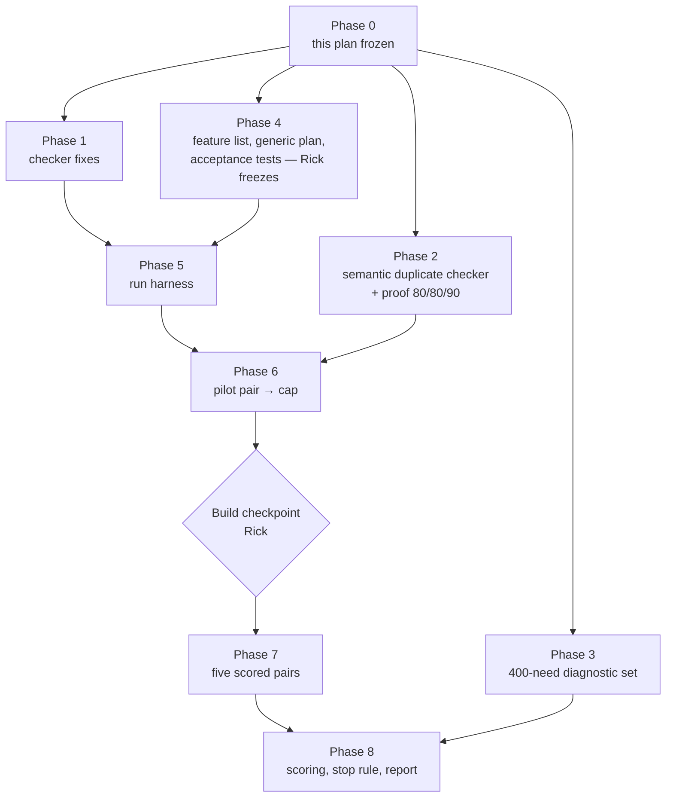

# Reuse detection: remediation plan

*24 October 2026. This plan turns the rulings Rick made on 24 October into work. Every design decision below is his. Estimates are marked as estimates. The ruling-by-ruling record is in `TODO.md` § "Decisions log 2026-10-24". The two temporary explainers (`io/tmp/2026.10.24-reuse-stop-rule-explainer-v2.md`, `io/tmp/2026.10.24-reuse-experiment-base-tree-explainer.md`) are background only; this document replaces them.*

## 0. Cascade review scope (Rick, 2026-10-24 ~16:30 EDT)

Rick's instruction, in his words: *"throughout the cascade review we are focusing on implementation, not on the greater experimental plan itself that is fixed and not renegotiable unless I deem it necessary. What I'm trying to avoid is not just scope creep, but actual focus shifting from one facet to another."*

| | Sections |
|---|---|
| **Under review: how to build it** | §4 (Phase 1), §5 (Phase 2), §6 (Phase 3): code design, files and modules, tests at 100%, order of work, acceptance criteria, risks to the build |
| **Locked: not reviewable** | §1–§3, §7 (the experiment: arms, runs, pilot and cap, metric, stop rule), §8–§10, and the design facts inside §5 and §6 (Fable 5.1 judge, the 80/80/90 bar, 400 needs split 300/100, two blind reviewers, kappa) |

A reviewer comment that would change a locked item is **not a finding**. It goes on the parking list below for Rick, unchanged, and the cascade moves on.

### Cascade sections

| Section | Scope | Why it can be reviewed alone |
|---|---|---|
| **A** | §4 items 1.1–1.3: retire NEW, recorded search, exit gate | Touches the verdict set, a new `record_search` tool and `reuse_exit_gate.py`; no index code |
| **B** | §4 items 1.4–1.8: index fixes, rebuild during a run | Touches the symbol index and its build only; reads A's verdicts by name, not by code |
| **C** | §5: semantic duplicate checker and its proof | A separate scoring tool that never calls the reuse checker, by design (it must not grade its own work) |
| **D** | §6: tooling for the 400-need diagnostic set | Drafting, checking and labelling tools for needs; its loss-tracing step reads the finished Phase 1 checker (see §3) |

Cross-section dependencies: D's loss tracing needs A and B finished; C shares nothing with A, B or D.

### Parking list for Rick

| # | Item | Status |
|---|---|---|
| P1 | Section A's reading of D1: the checker never answers DISTINCT; the old NEW becomes UNCERTAIN with cause NO_MATCH; DISTINCT is an agent's ruling, gated by `record_search` | **Confirmed by Rick, 2026-10-24 18:16 EDT** |
| P2 | Commit `9ea8bc102` added one sentence to locked §3: Phase 3's loss-tracing report waits for Phase 1 | FYI to Rick (shown 18:16 EDT); no design change |
| P3 | **D6 revised by Rick, 18:19 EDT**: "I want language to be an explicit parameter such that the agents calling it during the review process have to consider and pass a valid language parameter No defaults because then you get a silent error if the default is incorrect". Item 1.4 becomes: language is a required argument, an invalid value is a named error, and cross-language search stays an explicit opt-in | **Ruled by Rick**; supersedes "target language by default" in item 1.4 |

## 1. What failed, and what this plan does about it

The reuse checker was tested on one number: whether it found a known match for a need (`2026.10.20-reuse-lookup-final-test-results.md`). The two expert critiques (`2026.10.21-reuse-detection-expert-synthesis.md`) and Rick's follow-up questions (`2026.10.23-reuse-detection-response-to-expert-critiques.md` §7) showed that this was the wrong test, and that the checker itself has gaps:

- The checker's "write new" verdict lets an agent skip the search it was meant to do.
- The index leaves out private methods and tests, sees only the first docstring line, and searches every language at once.
- The 30-need test set was too small to tell anything, was labelled by one person, and was found only by structural matching.
- Nothing measured the thing Rick cares about: **whether agents that use the checker write code with fewer duplicates.**

This plan fixes the checker, builds a way to count duplicates, including work-alikes that look different, and runs a controlled experiment that decides whether the checker is worth continuing.

## 2. The hypothesis and the decision it feeds

**Hypothesis:** agents that use the reuse checker write code with fewer duplicate, near-duplicate or work-alike blocks than agents that do not. Code quality only; time and cost are not part of it.

**Decision:** continue building the checker if the experiment in §7 shows fewer duplicates in the "with" arm at p < 0.05; otherwise stop. Whatever the outcome, two free parts stay: the jscpd clone warning on diffs, and the compact map of what exists.

## 3. The plan at a glance



| Phase | What | Estimate | Depends on |
|---|---|---|---|
| 0 | Freeze this plan | — | Rick |
| 1 | Checker fixes | 6–8 days | 0 |
| 2 | Semantic duplicate checker and its proof | 5–7 days | 0 |
| 3 | 400-need diagnostic set | ~2 weeks elapsed | 0, a second reviewer; its loss-tracing report also needs Phase 1 |
| 4 | Feature list, generic plan, acceptance tests | ~3 days plus Rick's review | 0 |
| 5 | Run harness | 3–4 days | 1, 4 |
| 6 | Pilot pair, cap set | the pilot's duration (≤ 10 working days) | 2, 5 |
| 7 | Five scored pairs, one pair at a time | 5 × the cap | 6, Rick's checkpoint |
| 8 | Scoring, verdict, report | ~1 week | 3, 7 |

Phases 1 to 4 run side by side, except that Phase 3's last step, the loss-tracing report, waits for Phase 1. **Ceiling: 10 weeks elapsed**, open to renegotiation once the pilot fixes the cap. Tokens are not a constraint (Rick's employer sponsors them); machines and the fleet cap are.

## 4. Phase 1 — checker fixes

| # | Change | Ruling |
|---|---|---|
| 1.1 | **Retire the NEW verdict.** Verdicts become REUSE, EXTEND, DISTINCT and UNCERTAIN | D1 |
| 1.2 | **Recorded search.** Before ruling DISTINCT, the agent calls a tool that runs fixed-string greps for the need's key terms and returns the five nearest candidates. The agent reads each one and rules on each. The result is written once, as a `record_search` record linked to the reuse receipt | D1 |
| 1.3 | **Exit gate**: `reuse_exit_gate.py` refuses a DISTINCT ruling that has no `record_search` record | D1 |
| 1.4 | **Language is a required argument** (no default); a search covers that language; cross-language search is opt-in | D6, revised by Rick 2026-10-24 (P3) |
| 1.5 | **Private and protected methods** are indexed, with their class named; nested helpers are not | D7 |
| 1.6 | **Tests are indexed as a separate scope**, searched only on request | D8 |
| 1.7 | Whole docstrings are indexed; the purpose line is passed to the judge; JavaScript roots are widened; every dropped entry is reported with its reason | 10-23 response §5 |
| 1.8 | **Index rebuilt during a run** as code lands (today it is built once per commit), so the "with" arm can find the run's own new code | rule of 24 Oct (`TODO.md`, decisions log 2026-10-24, "New engineering item") |

**Acceptance:** each change has unit tests at 100% lines, branches and functions; the exit gate has a test that a DISTINCT ruling without a search record is refused and one with a record passes; a fixture tree with a private method, a test helper and a TypeScript file shows each indexed in the right scope; and the rebuild has a test that a definition written mid-run is found by the next search.

### 4.A Build spec for 1.1 to 1.3 (retire NEW, recorded search, exit gate)

*Read against the code at `d0bd4f604`. Rick's rulings D1 are not touched; this section says how to build them.*

**Assumption A1 (item 1.1).** D1 gives four verdicts: REUSE, EXTEND, DISTINCT, UNCERTAIN. Today `check_exists` returns REUSE, EXTEND, NEW or UNCERTAIN_READ_SOURCE, and the reviewer's ruling vocabulary already has DISTINCT. This spec reads D1 as: the checker never says DISTINCT; DISTINCT stays the reviewer's ruling, reachable only through a recorded search (1.2, 1.3). The checker's old "nothing relevant" outcome becomes `UNCERTAIN_READ_SOURCE` with a new cause `NO_MATCH`. **Open sub-question 1:** if Rick meant the checker itself should print DISTINCT, only the label in step 1 below changes; steps 2 to 4 hold either way.

#### 1.1 Retire NEW: how it is built

| Step | File | Change |
|---|---|---|
| 1 | `src/cosa/repo/symindex/verdict.py` | Add `"no_new": True` to `POLICY` and `POLICY_PROVIDES`. Add `"NO_MATCH"` at the **end** of `CAUSES`, so every other cause still wins the `cause` field. In `decide` and `decide_provides`, when `"no_new" in policy` and nothing is relevant, add `NO_MATCH` to `holds` (the verdict is then UNCERTAIN by the existing cause rule). A policy without `no_new` keeps the old `NEW` branch. This is the same convention as `"strong"` and `"band"`: a stored policy replays as it was stored |
| 2 | `src/cosa/repo/symindex/candidates/shadow_audit.py` | `compare()` tests `full_verdict != "NEW"`. Add a `full_cause` argument and treat "UNCERTAIN with cause `NO_MATCH`" as the decided no-match case. Without this the audit would turn every no-match into `inconclusive` |
| 3 | `src/lupin_mcp/cosa_voice_mcp.py`, `reuse_tools.py` | Docstrings only: `check_exists` lists REUSE, EXTEND, UNCERTAIN_READ_SOURCE and says `NO_MATCH` obliges `record_search` before any DISTINCT |
| 4 | `README-reuse-decision-table.md`, `.claude/skills/reuse-reviewer/SKILL.md` | Row 10 becomes cause `NO_MATCH` (UNCERTAIN). The three-vocabularies table loses its `NEW` row; the `UNCERTAIN` row gains "cause NO_MATCH: run `record_search`" |

Replay: a receipt stored with verdict `NEW` and a policy lacking `no_new` still replays to `NEW` in the frozen re-run (no difference). Its HEAD re-run now answers UNCERTAIN/`NO_MATCH`, which `replay` reports as a head difference. The counter-reviewer brief gets one sentence saying a NEW→NO_MATCH head difference on a receipt written before this change is expected, not a finding.

**Tests (EXECUTOR: AI), 100% lines, branches and functions of the changed files:** in `test_symindex_verdict.py` and `test_symindex_verdict_band.py`, the empty-shortlist case under the shipped policy gives UNCERTAIN/`NO_MATCH` (both `decide` and `decide_provides`); the same input under a policy copy without `no_new` gives `NEW`; a case with `NO_MATCH` beside `CALL_FAILED` reports `CALL_FAILED` as `cause` and lists both in `causes`. In `test_reuse_tools.py`, a hand-built stored `NEW` receipt (fixture written by the old code path, not by the new one) replays with `differences.frozen == []`. In `test_candidates_shadow_audit.py`, the new `compare` case. **Tests that go red under the new shipped policy, and are fixed in the same commit** (each is changed to expect UNCERTAIN/`NO_MATCH`, or pinned to a copy of the policy without `no_new` where it is testing an old receipt): `test_symindex_repair_check.py`, `test_reuse_flip.py`, `test_reuse_page_first.py`, `test_reuse_call_budget.py`, `test_reuse_replay_repeat.py`, `test_reuse_candidate_route.py`, the `test_reuse_e2e_*.py` files, and `test_reuse_reviewer_skill.py`, which pins the skill's vocabulary table, so the `SKILL.md` edits of 1.1 step 4 and 1.2 land in the same commit as that test. The list was counted by hand from `git grep -c -F '"NEW"' -- src/tests`; the build step is to run the whole unit tier once with the new policy and add any other red file to this list in the PR description. `git grep -l -F '"NEW"' -- src` reports 23 files today, including a design document, a JSON fixture and `src/cosa/tests/unit/rest/test_peer_router.py`, where "NEW" is an unrelated token; those are left alone.

#### 1.2 Recorded search: how it is built

A new tool, **`record_search`**, in a new module `src/lupin_mcp/reuse_search.py` (pure functions, no model call), mounted as a fifth reuse tool in `cosa_voice_mcp.py` beside `replay` and added to `REUSE_TOOLS` in `reuse_call_log_middleware.py`.

| Piece | Spec |
|---|---|
| Signature | `record_search( receipt_id=None, entry=None, extra_terms=None, root=None )`. Exactly one of `receipt_id` and `entry`, else error `BAD_SEARCH_KEY`. `receipt_id` is the reuse receipt of the `check_exists` or `fetch_similar` call the search backs. `entry` is for a definition the tool refused to send (`EXCLUDED_*`, no receipt); the search is local, so exclusion does not apply to it. `extra_terms` is strings the agent adds; derived plus added terms are held to D1's 3 to 6 in total |
| Key terms | `derive_terms( text )` calls the existing `split_identifier` (`candidates/identifier_split.py`, which already splits snake_case, camelCase, acronyms, digits and paths) on the receipt's need text, or on the entry's name, signature and first docstring line, and adds only a 4-character minimum and a fixed stop list (a constant in the module). It writes no split rules of its own. Cut to the 6 longest (ties by alphabet). A search needs at least 3 terms in total: fewer than 3 derivable, with too few `extra_terms` to reach 3, is `NO_TERMS`; added terms beyond a total of 6 are refused with `TOO_MANY_TERMS`. No model is asked, so the same input always gives the same terms |
| Scope | Files of the target language only (item 1.4 supplies the language; until 1.4 lands, all languages, and the record says `language: "all"`). Tests are left out unless 1.6 is on and the agent asked for them |
| Search | `git grep -n -F -i -e <term>` per term in the root, over tracked files, one subprocess call per term, argument list never a shell string. Each hit line is mapped to the indexed definition whose span `line` to `end_line` holds it (the innermost span if spans nest). `end_line` is a new index field (4.B step S1): Python takes `node.end_lineno` from the same AST nodes `_walk_scope` already yields, TypeScript takes the node's end position in `ts_extract.js`. A hit in no span (module-level code, a Dart file whose extractor gives no span) is dropped and counted in `dropped_hits`, never attributed to a neighbour. Definitions come from `read_searchable( gen )` (4.B step S2), so private methods can be candidates |
| Ranking | Per definition: number of distinct terms matched, then number of hit lines, then symbol id. The top 5 are the candidates. BM25 (`candidates/bm25.py`) is not used here on purpose: D1 fixes this step as a fixed-string search, so its result does not depend on corpus statistics. The definition under review (`entry`, or the receipt's `exclude_id`) is never a candidate. Fewer than 5 is allowed and recorded |
| Record | Written once with `write_once` to `<data>/search-records/<sha>.json`: `{ id, receipt_id or entry, terms, language, scope, index_sha, candidates: [ { id, file, line, sig, terms_matched } ], dropped_hits, root_sha }`. `id` is `rs-` plus 10 hex of the sha of the canonical record without `id`, so the same search on the same tree is the same id and a second call is a no-op |
| Result | `{ status, search_id, receipt_id, candidates }`. `receipt_id` is echoed so the call-log middleware, which reads that field, links the call to the reuse receipt. The middleware also copies `search_id` into its log line |
| Errors | `BAD_SEARCH_KEY`, `RECEIPT_MISSING` (reuses `load_receipt`), `UNKNOWN_ENTRY`, `NO_TERMS` (fewer than 3 terms in total), `TOO_MANY_TERMS` (more than 6), `GREP_FAILED` (git exit other than 0 or 1). Each is a named error, never an empty candidate list |

**Reviewer side (skill change).** After `record_search`, the agent reads the source of each candidate and writes one line per candidate in the review:

```text
SEARCHED <symbol id> :: <search id> :: <candidate id> :: SAME_JOB | RELATED | UNRELATED :: <why>
```

and the DISTINCT ruling cites the search: `RULING <id> :: DISTINCT <why> :: reuse-receipt: <rid> :: search: <search id>`. For an excluded definition the receipt token is `excluded` and the search was keyed on `entry`. `SKILL.md` step 5 and the vocabulary table are updated; the three values and the one-clause `<why>` are D1's; an empty `<why>` makes the line unparsed. A `SAME_JOB` line on a DISTINCT ruling is a contradiction the gate reports (1.3); `RELATED` and `UNRELATED` are allowed.

**Tests (EXECUTOR: AI), 100% of `reuse_search.py` and the middleware change:** `derive_terms` (split rules, stop list, the 6-term cut, fewer than 3 giving `NO_TERMS`, `extra_terms` reaching 3, and a total over 6 giving `TOO_MANY_TERMS`); the grep-to-definition mapping on a fixture tree with two files and a hit before the first definition; ranking ties; exclusion of the entry itself; fewer than 5 candidates; each named error; `write_once` idempotence (second call returns the same id and writes nothing); the middleware logs `search_id` and the linked `receipt_id` for a `record_search` call and still logs nothing for other tools. A real-producer check: one fixture search run on a copy of the real `src/lupin_mcp/` tree through `git grep`, not a hand-written grep output.

#### 1.3 Exit gate: how it is built

`reuse_exit_gate.py` keeps its current checks and gains one rule for DISTINCT rulings only (DUPLICATE and EXTEND rows are unchanged).

| Step | Change |
|---|---|
| 1 | `RULING_RE` accepts an optional trailing `:: search: <id>` (id `rs-[0-9a-f]{10}`). `parse_rulings` returns it as `search`. `unparsed_ruling_lines` is unchanged, so a malformed tail is still refused by name |
| 2 | New `parse_searched( text )` reads `SEARCHED` lines into `{ symbol id: { search id: { candidate id: { value: SAME_JOB, RELATED or UNRELATED, why } } } }`; a line that opens with `SEARCHED` and does not match is reported like an unparsed ruling |
| 3 | New `searches_by_symbol( records, data_dir )`: from the merged call logs, every `record_search` call with no error and a `search_id`, keyed by the symbol it backs: the `entry` argument read with the gate's existing `entry_of` (which already copes with the 300-character cut of the logged args), or the `query` of the `fetch_similar` receipt named by `receipt_id`. The gate stays stdlib-only: the receipt and the record file are read with plain `json` from `<data>/receipts/<id>.json` and `<data>/search-records/<sha>.json`, never through `reuse_tools.load_receipt`, which needs a `ReuseContext`. A log line whose record file is missing or unreadable yields no search |
| 4 | `check_run` gains `searches` and `searched` as optional keyword arguments defaulting to `None` (as `excluded` is today), so every existing call in `test_reuse_exit_gate.py` stays valid. For a row whose ruling is DISTINCT, new statuses: `NO_SEARCH` (no logged search for the symbol), `SEARCH_NOT_CITED` (the ruling names no search, or one that is not the symbol's), `CANDIDATES_UNRULED` (some candidate of the cited search has no `SEARCHED` line), `DISTINCT_CONTRADICTED` (a candidate is `SAME_JOB`). A row passes only on `OK` or `EXCLUDED` as before; the new statuses go into `reasons` |
| 5 | `main` gains `--data-dir` (default: the parent of `--log-dir`); `run_gate` takes `data_dir`. Existing callers keep working because DISTINCT is the only trigger |

**Why the gate checks the log and the record, not only the review text:** a ruling line can be typed without the search ever having run; the log line is written by the server, not by the agent (the same reason the current gate matches `fetch_similar` calls).

**Tests (EXECUTOR: AI), 100% of the gate file:** the four new statuses each from a fixture; "DISTINCT with a logged search, a cited search id and every candidate ruled RELATED or UNRELATED with a why" passes; "DISTINCT with no search record" is refused (this is the plan's named acceptance test); a DUPLICATE row without a search still passes; an excluded definition ruled DISTINCT passes only with an `entry`-keyed search. Mutation arms, taken in a detached worktree per the working rules: delete the `NO_SEARCH` branch, the `SEARCH_NOT_CITED` branch and the candidate-count check one at a time; each must redden a named test (EXECUTOR: AI). One end-to-end test drives `main()` over a log directory, a data directory, a diff and a review written by the real tools in a temporary root.

**Order and size (estimate):** 1.1 first (small, the other two depend on the new cause); 1.3 next (it needs no index change); 1.2 last, because it reads `end_line` and `read_searchable` from 4.B steps S1 and S2, which land first; about 3 of the 6 to 8 days in §3's Phase 1 estimate.

**Acceptance for 1.1 to 1.3 (EXECUTOR: AI):** (a) no code path outside old stored receipts can emit `NEW`: a test over `check_exists_impl` with the shipped policy and an empty index match asserts UNCERTAIN/`NO_MATCH`; (b) the unit files named above pass at 100% lines, branches and functions for the changed files, shown by the coverage gate's table (not a scoped `--cov` run); (c) `src/tests/run-census-guards.sh` is green; (d) the skill file and the gate agree on the line formats, pinned by one test that feeds the skill's example lines to `parse_rulings` and `parse_searched`.


### 4.B Build spec for 1.4 to 1.8 (index fixes, rebuild during a run)

*Read against the code at `d0bd4f604`. Depends on 4.A only through two fields: `record_search` reads the receipt's `language` (1.4) and `include_tests` (1.6); until those land it searches all languages and says so in its record.*

**What the index looks like today (checked in code, `src/cosa/repo/symindex/`).** Each definition is a record with `lang` (`py`, `ts` for JavaScript and TypeScript alike, `dart`), `file`, `name` (class-qualified, so `Foo._bar` already names its class), `public`, `sig`, `doc` (first docstring line), `pin` and `line`. A generation holds `symbols.jsonl` (public) and `symbols-all.jsonl` (every definition: Python private and nested; TypeScript non-private only). `reuse_tools.prepare` and the candidate build both read the **public** file, so no private method is ever sent to the judge or embedded. `SKIP_PARTS` skips any `tests` directory, so tests are not indexed at all. `symbols_sha` is the hash of the public listing only.

#### Shared change: a `scope` field and a search hash

| Step | File | Change |
|---|---|---|
| S1 | `build.py` `collect` | Every record gets `end_line` (last line of the definition; Python `node.end_lineno`, TypeScript the node's end, Dart none until its extractor gives one; the extractor contract's `RECORD_KEYS` lists it as optional) and `scope`: `test` (file under a tests directory), else `public` if `public`, else `nested` if the name holds `<locals>`, else `private`. `public` is unchanged, so `symbols.jsonl`, the wiki lint and the pins keep their meaning |
| S2 | `build.py` `read_symbols`, new `read_searchable( gen, tests=False )` | `read_searchable` returns scopes `public` and `private`, plus `test` when asked. Callers that must stay public-only (wiki lint, `diff` without `--all`) keep `read_symbols`. Callers that feed the judge or the vectors (`reuse_tools.prepare`, `candidate_build.run`, `vector_refresh`, `candidates/search.py`) move to `read_searchable` |
| S3 | `build.py` `_write_generation` | Header gains `search_sha`: hash of the sorted `(id, pin, sig, doc_full)` of the searchable set. `reuse_tools.index_sha` takes `search_sha` when the header has it, else `symbols_sha`. **Why:** today a new or changed private method leaves `symbols_sha` unchanged, so a receipt or cached judge answer would be reused for a different index. This is also what makes 1.8 testable |

#### 1.4 Target language by default

- `check_exists( need, language=None, target_file=None, ... )` and `fetch_similar( entry, language=None, ... )` take `language` in `py`, `ts`, `dart`, `all`. `all` is the opt-in cross-language search; nothing else ever widens a search. `fetch_similar` defaults to the entry's own `lang`. `check_exists` has no entry, so `resolve_language( language, target_file, root )` (new, in `reuse_tools.py`) picks the target language in this order, and the first rule that answers wins: **(1)** an explicit `language`; **(2)** the suffix of `target_file`, the file the agent is about to write (`.py` is `py`; `.ts`, `.tsx`, `.js`, `.mjs`, `.cjs` are `ts`; `.dart` is `dart`); **(3)** the language of the files changed in the working tree against `HEAD`, untracked files included, when one language holds more than half of them. The result carries `language_source` (`explicit`, `target_file`, `working_tree`) so a reviewer sees how the default was met. If none answers, or rule 4 has no majority, the call returns the named error `LANGUAGE_UNRESOLVED` listing the choices and what it saw, and never guesses. An environment-variable rule was considered and dropped: nothing in this plan names who would set it. **Open sub-question 2:** a plan-time `check_exists`, made before any file exists or changes, hits `LANGUAGE_UNRESOLVED`; the agent then passes `target_file` or `language`. Rick's D6 default holds whenever there is a file being written or work in the tree.
- `reuse_tools.prepare( ctx, language )` filters `entries` by `lang` before any request. The candidate stage holds the whole index, so `_run_question` also drops stage ids whose `lang` differs. `all` filters nothing.
- Receipts store `language`. `replay_impl` filters the snapshot by the stored value; a receipt without the key replays as `all`, which is what it was.
- **Tests (EXECUTOR: AI):** a two-language fixture index; the same need under `py`, `ts`, `all` returns only that language's ids in `shortlist` and `nearest`; each of the three resolution rules wins over the ones after it (three cases, plus the working-tree case with no majority giving `LANGUAGE_UNRESOLVED`); `language_source` is reported; `fetch_similar` default; a stage id of the wrong language is dropped; replay of a receipt with no `language` key equals its stored result.

#### 1.5 Private and protected methods

- Python: no extractor change (`extract_python( include_all=True )` already returns them); the change is S1/S2. `<locals>` helpers get scope `nested` and are never searchable.
- TypeScript/JavaScript: `ts_extract.js` stops dropping `private`, `protected` and `#private` members. It emits them as `kind: "method"`, name `Class.member`, with `public: false`. `js_index.extract_js` passes `public` through instead of the constant `True`. The extractor's pin algorithm string is bumped, so `diff` reports `algorithm_changed` once and the skill's rebuild-both-sides rule applies.
- Every consumer of `public` for TypeScript is re-read: `symbols.jsonl` and the wiki lint must still see only public members (a test pins this).
- **Tests (EXECUTOR: AI):** the fixture tree of the plan's acceptance paragraph: a Python `_private` method and a nested helper (searchable and not searchable), a TypeScript `private` and a `#private` member (searchable, class named in `name`), and a check that `symbols.jsonl` still lists neither. `test_symindex_js.py` assertions that private members are absent are changed to the new rule, not deleted.
- **Cost, measured not guessed (EXECUTOR: AI):** the PR states the searchable-entry count before and after on the real tree (from `header.json` `counts`), since the judge sweep and the call budget scale with it (`call_budget_cap_for`).

#### 1.6 Tests as a separate scope

- Tests are **not** added to the main generation. A second file, `symbols-tests.jsonl`, is built on first request by `build.ensure_tests( root, out_dir )` with its own manifest in `tests-header.json`, so an ordinary build does not pay for about 2,000 test files and a test edit never makes the main index stale. Python test roots are every `tests` directory (`src/tests`, `src/cosa/tests`); script tests are the `.js` and `.ts` files under them. Records carry `scope: "test"`.
- `check_exists` and `fetch_similar` take `include_tests=False`. When true, `read_searchable( gen, tests=True )` adds the test records, the receipt stores `include_tests` and a `tests_sha`, and `index_sha` mixes it in. A default call never reads or sends a test record.
- `sendable()` screens test records like any other (they hold fixture paths and addresses more often than source does).
- **Tests (EXECUTOR: AI):** default call returns no `test` id; `include_tests=True` returns the helper from the fixture; the main generation's `symbols_sha` and `search_sha` do not change when only a test file changes; `ensure_tests` rebuilds when a test file changes and not otherwise; a receipt replays with its own `include_tests`.

#### 1.7 Docstrings, purpose line, roots, dropped entries

| Part | Spec |
|---|---|
| Whole docstrings | Records gain `doc_full`: the whole docstring, whitespace folded, cut at 800 characters with a trailing marker (Python `ast.get_docstring`; TypeScript the whole JSDoc text from `ts_extract.js`). `doc` stays the first line, so ids, the wiki and old snapshots are unchanged |
| What the judge sees | `entry_text( rec )` appends `doc_full` and the stored purpose line (looked up by `pin` in `purpose.jsonl`, added to the entry by `prepare` as `purpose`) **only when the record has those keys**. A snapshot written before this change has neither key, so `replay` rebuilds the old text and the frozen re-run still hits its cached answers. `c1_hits` screens `doc_full` and `purpose` too, so the new text cannot carry a path, address or token out |
| JavaScript roots | `spec.LUPIN_JS_DIR` becomes `LUPIN_JS_DIRS`: the web client's `js` directory, `src/scripts`, `src/cosa/repo/symindex` and `src/conf`; suffixes gain `.mjs` and `.cjs`. The set is not guessed: a census guard (name matches `*census*` so `run-census-guards.sh` picks it up) lists `git ls-files` for `.js .mjs .cjs .ts .tsx`, minus the nested repos, and asserts every file is under an index root or named in `UNINDEXED_REASONS` with a reason (generated output, vendored, test). A new script file outside every root turns it red |
| Dropped entries | `sendable()` already returns the ids it drops; `prepare` discards them today. `prepare` keeps them as `dropped = { EXCLUDED_SENSITIVE_CONTENT: [ids], EXCLUDED_PREFIX: [ids] }`; the tool result and the receipt carry the counts per reason and the first 10 ids. The header gains `skipped_files` (count per skip rule) beside the existing `unparsed`. A tool answer never silently has fewer candidates than the index holds |

**Tests (EXECUTOR: AI):** `doc_full` for Python and TypeScript including the 800-character cut; `entry_text` with and without the new keys gives different strings and the old-snapshot replay is byte-equal to its stored request hash; the sensitive-content screen drops an entry whose only secret is in `doc_full`; the census guard (with a positive control: add a stray `.mjs` in a temp tree and watch it fail); `dropped` appears in a result when a fixture entry carries an address.

#### 1.8 Index rebuilt during a run

**What the code already does, and what is unknown.** `prepare` calls `build.ensure` on every tool call, and `ensure` rebuilds when the file manifest (path, mtime, size) differs, so the symbol index already follows uncommitted edits. The candidate stage calls its `refresher` (an incremental vector build) before a lookup when the vector set is behind. The scheduled script `src/scripts/reuse-vector-refresh.sh` also exists. Where a definition written mid-run is lost is therefore **not known from reading**; the first step measures it.

| Step | Work |
|---|---|
| 1. Probe (EXECUTOR: AI) | A test builds a temp git repo with a fake embedding client and fake judge transport, calls `fetch_similar`, then writes a new uncommitted function in a new file and calls again. It records, per layer, whether the new definition is present: symbol index · vector set · purpose line · query cache · full sweep. The first layer that misses is the defect |
| 2. Fixes by layer | **Symbol index:** if the full `collect` per call is slower than the bound below, cache extraction per `(path, mtime, size)` so only changed files are re-read. **Vectors:** the run-time refresher embeds new rows only (the builder already reuses unchanged rows). **Purpose line:** the run-time refresher must not wait for the bounded Claude Code job that writes purpose lines; `candidate_build.run` gains `purposes="skip"` for this path, a pin without a line is already tolerated as `unwritten_pins`, and the scheduled script writes it later. **Query cache:** keyed on the index, so it must include `search_sha` (S3) or a stale answer survives a rebuild |
| 3. Bound | One edited file to the next search finishing its lookup: **TBD, set from the step 1 measurement** (proposal: 30 seconds on the real tree; missing it returns a named `INDEX_REFRESH_SLOW` note in the result, never a silent stale answer) |
| 4. Isolation | The data directory is keyed on the repository, shared by every worktree; `LUPIN_REUSE_DATA_DIR` and `LUPIN_REUSE_OUT_DIR` already relocate it. Two runs on one machine must not see each other's new code, so a test pins that two contexts with different data directories do not. Setting those variables per run is the harness's job (§7.3); this build only adds the test and makes `context_from_environment` report the data directory it chose (EXECUTOR: AI) |

**Tests (EXECUTOR: AI):** the plan's acceptance test, stated as the probe: a definition written mid-run is returned by the next `fetch_similar` for a similar need; the same for a new private method (needs 1.5); a changed signature changes `search_sha`; `purposes="skip"` writes no purpose line and does not raise; two contexts with separate data directories keep separate answers.

**Order and size (estimate):** S1 to S3 first, then 1.5, 1.4, 1.7, 1.6, and 1.8 last because its probe needs all of them; about 4 of the 6 to 8 days of Phase 1, in parallel with 4.A except that item 1.2 waits for S1 and S2.

**Acceptance for 1.4 to 1.8 (EXECUTOR: AI):** the unit files above pass at 100% lines, branches and functions for the changed files, read from the coverage gate's table (not a scoped `--cov` run); `run-census-guards.sh` is green with the new script-file census; a diff of a tree whose indexer changed reports `algorithm_changed` once and the skill's rebuild rule is updated to say so; the PR states the searchable-entry count before and after.

## 5. Phase 2 — the semantic duplicate checker

Scoring needs a counter that finds code doing the same job even when it looks different.

| Step | What happens |
|---|---|
| Extract | Every definition the run wrote, with body, signature and call sites. TypeScript, JavaScript and Python; TypeScript coverage must be complete |
| Candidates | The union of three lists: nearest bodies by code embedding, nearest by word overlap, structural clones (jscpd for TS/JS, `dups.py` for Python). Keep the top 5 to 10 |
| Judge | **Fable 5.1** rules each definition against its candidates: duplicate, near-duplicate, related or distinct, with a one-line reason |
| Cluster | Duplicates and near-duplicates are joined into clusters. **Score = surplus copies** (definitions minus clusters) **per 100 passing acceptance tests**, reported beside the raw count and the pass rate |

**Scope of a duplicate:** two new definitions doing the same job, or a new definition redoing something the frozen server already provides.

**Fairness rules:** the judge is blind (tool traces and arm labels stripped); frozen before any run (one model id, temperature 0, a fixed prompt); each verdict records which server ran it (Max plan or Rick's work server); it is not Jev.

**Proof before use:** about 60 planted rewrites (Fable rewrites existing functions with their names banned) plus about 60 duplicate pairs from the old monolith, labelled by both reviewers. The bar is **at least 80% found, at least 80% of flags right, at least 90% agreement with itself on a repeat run**. A failure is fixed and the proof rerun. The proof set includes Opus-written work-alikes, because Opus implements the runs.

**Acceptance:** the proof passes the bar, with the run recorded; the checker's code has 100% coverage; its frozen configuration (model id, prompt hash, temperature) is committed before the pilot starts.

**Scale (estimate):** 1,500 to 2,000 definitions per client, so 15,000 to 20,000 judge calls over ten runs.

## 6. Phase 3 — the 400-need diagnostic set

This set diagnoses **where** the checker loses a match. It does not decide anything.

| | |
|---|---|
| Size | 300 needs with a known match, 100 with none. All 300 found bounds the miss rate at about 1% (95% confidence) |
| Language | About 60% TypeScript and JavaScript, 40% Python |
| Kinds | Near-copies · same job in different code · nothing exists · cross-language |
| A need | One plain sentence of what an agent is about to build, never naming the answer, paired with its answer key |
| Labels | Fable drafts each key; a second model checks it. **Rick and a second reviewer label independently and blind**: every disputed key, every "nothing exists" key, a random 15% of agreed keys, and the semantic checker's samples. Cohen's kappa is reported. Rick breaks ties |
| Loss tracing | Per need: did the search return the right code, did the judge rate it relevant, did the agent read it, did the agent rule it the same job? The first "no" is where the match was lost |

**Acceptance:** 400 labelled needs committed with their keys; kappa reported; a loss-tracing report from the Phase 1 checker.

**Dependency:** a second reviewer. Rick will find one.

## 7. Phases 4 to 8 — the experiment

### 7.1 Design (fixed now)

| Element | Ruling |
|---|---|
| Arms | **With** the reuse tools; **without** them |
| What differs | **Only** `check_exists`, `fetch_similar`, `read_capability` and the `reuse-reviewer` skill. Grep, the code, `CLAUDE.md` and the docs are in both arms |
| Runs | **5 per arm**, plus one unscored pilot pair |
| A run | The full process end to end: cascaded plan review, then implementation phase by phase |
| Day one | **Today's server and API, frozen at one commit, with no client code.** Each run builds a TypeScript client from zero |
| Implementer | **Opus**, one pinned version for the pilot and all ten runs: 5.5, or whatever newer Opus exists when the runs start |
| Held fixed | The server commit, the plan and its tests, the implementing model and version, the cascade skills |
| Scheduling | **One pair at a time** (one run per arm at once); more pairs at once if the machines allow, always whole pairs, each pair on one machine |

### 7.2 Phase 4 — feature list, generic plan, acceptance tests

1. A feature list written from today's user-visible behaviour. Rick approves it.
2. A **fresh Fable 5.1 session allowed to read only the server code, the API docs and the feature list** writes the generic plan: feature level, which API each feature calls, and no module or file layout.
3. The same session writes the **acceptance tests**: black-box Playwright tests that act through the UI and check the result through the API. Elements are found by visible text and ARIA role, never by test ids or CSS classes. Every feature has at least one test.
4. Rick freezes the plan and the tests together. They are **not** cascade-reviewed beforehand; the cascade happens inside each run.

The old plan folder (`src/rnd/v0.1.7/2026.05.02-notifications-ui-js-refactor/`) is **not used**: it was cascade-reviewed already, and its later phases were written after seeing the original code.

**Acceptance:** the feature list, plan and tests are committed at one sha that Rick names as frozen, and every feature maps to at least one test.

### 7.3 Phase 5 — run harness

For each run, the harness provides:
- a worktree with today's frozen server and the client folder empty;
- its own server container and throwaway database, so the acceptance tests run against that run alone;
- the arm switch (the four reuse surfaces present or absent);
- the pinned model id;
- the cap and the "all tests pass" stop;
- logs of seat-hours, the model id and the server per verdict.

**Acceptance:** a dry run of each arm proves the switch: the "without" arm cannot call the four surfaces, and the "with" arm can. A stub client that passes one test proves the stop condition and the per-run database. The harness code has 100% coverage.

### 7.4 Phase 6 — pilot pair and the cap

One unscored pair (one run per arm), with no cap, through the real harness.

- **Cap** = 1.5 × the slower arm's time to pass every acceptance test, rounded up to whole working days, then frozen.
- The pilot also measures one run's peak memory, CPU and seat count, which decides whether more than one pair can run at once.
- **Guard:** if the pilot has not passed every test within 10 working days, stop and rethink the plan's size before any scored run.

**Build checkpoint:** Rick reviews the pilot (time, pass rate, cap, capacity) and gives the go for Phase 7.

### 7.5 Phase 7 — five scored pairs

Run the five pairs under the frozen cap. A run ends when every acceptance test passes or at the cap; a capped run is scored as it stands. Skeleton crew is off and the fleet cap is raised for the run window; Rick sets both.

### 7.6 Phase 8 — scoring and the stop rule

1. Score all ten runs with the frozen semantic checker, blind to arm.
2. **Continue** if a **one-sided Mann-Whitney rank test** gives **p < 0.05** for fewer surplus duplicates per 100 passing tests in the "with" arm. With 5 against 5, that allows at most 4 of the 25 cross-arm pairs to go the wrong way.
3. **Stop** if p ≥ 0.05, or if the "without" arm makes **fewer than 5** surplus duplicates over its five runs, because then the setup did not reproduce the problem.
4. **Reported beside the verdict, deciding nothing:** the median reduction and each run's count, each run's pass rate, seat-hours per run, the diagnostic set's loss tracing, and the original May–June client scored once as a loose sanity check (labelled as built from a different plan and tree).
5. **No runs are added after the results are seen.**

**Acceptance:** a report in this folder with the verdict, the ten counts, p, and every item in step 4.

## 8. What Rick owns

| Item | When |
|---|---|
| Freeze this plan | before any work |
| Find a second reviewer | before Phase 3 labelling |
| Approve the feature list; freeze the plan and tests | end of Phase 4 |
| Label with the second reviewer; break ties | Phases 2 and 3 |
| The build checkpoint after the pilot | end of Phase 6 |
| Skeleton crew off and the fleet cap raised for the run window | Phases 6 and 7 |

## 9. Risks

| Risk | Mitigation |
|---|---|
| The checker's own model shares blind spots with the implementer | The judge is Fable and the implementer is Opus; the proof includes Opus-written work-alikes |
| Runs cannot finish under the cap | The cap is set from the pilot, and the 10-day guard stops the experiment before scored runs |
| Drift over the weeks (model, server, fleet) | Runs in pairs, a pinned model id, a frozen server commit, the server recorded per verdict |
| The "without" arm makes too few duplicates to test | The stop rule's floor of 5 says so explicitly instead of reporting a meaningless p |
| Peeking and adding runs | The test, metric, scope and floor are frozen now; no runs are added after looking |
| One reviewer's bias | Two reviewers labelling blind, with kappa reported |

## 10. Out of scope

- Repeating the experiment on Gemini or OpenAI models. Rick may do this later if the Opus result is decisive.
- Measuring time or money saved downstream. Seat-hours are recorded so a later question has data.
- Changing the cascaded review itself.
