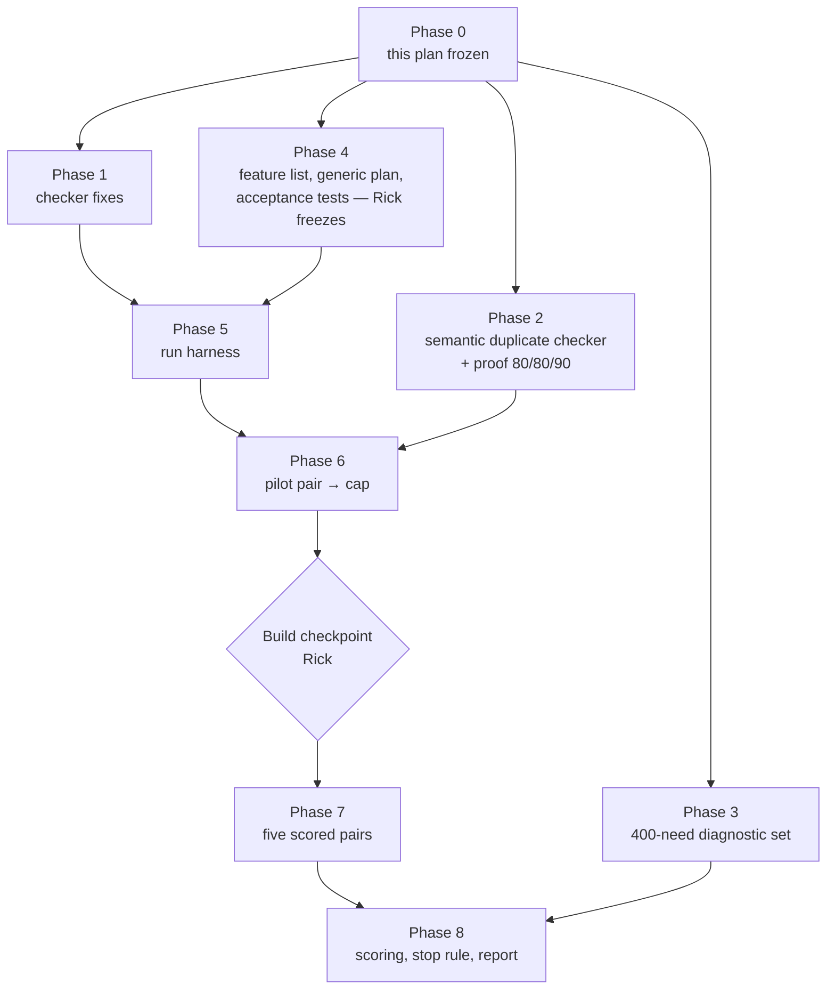

# Reuse detection: remediation plan

*24 October 2026. This plan turns the rulings Rick made on 24 October into work. Every design decision below is his. Estimates are marked as estimates. The ruling-by-ruling record is in `TODO.md` § "Decisions log 2026-10-24". The two temporary explainers (`io/tmp/2026.10.24-reuse-stop-rule-explainer-v2.md`, `io/tmp/2026.10.24-reuse-experiment-base-tree-explainer.md`) are background only; this document replaces them.*

## 0. Cascade review scope (Rick, 2026-10-24 ~16:30 EDT)

Rick's instruction, in his words: *"throughout the cascade review we are focusing on implementation, not on the greater experimental plan itself that is fixed and not renegotiable unless I deem it necessary. What I'm trying to avoid is not just scope creep, but actual focus shifting from one facet to another."*

| | Sections |
|---|---|
| **Under review: how to build it** | §4 (Phase 1), §5 (Phase 2), §6 (Phase 3): code design, files and modules, tests at 100%, order of work, acceptance criteria, risks to the build |
| **Locked: not reviewable** | §1–§3, §7 (the experiment: arms, runs, pilot and cap, metric, stop rule), §8–§10, and the design facts inside §5 and §6 (Fable 5.1 judge, the 80/80/90 bar, 400 needs split 300/100, two blind reviewers, kappa) |

A reviewer comment that would change a locked item is **not a finding**. It goes on the parking list below for Rick, unchanged, and the cascade moves on.

### Cascade sections

| Section | Scope | Why it can be reviewed alone |
|---|---|---|
| **A** | §4 items 1.1–1.3: retire NEW, recorded search, exit gate | Touches the verdict set, a new `record_search` tool and `reuse_exit_gate.py`; no index code |
| **B** | §4 items 1.4–1.8: index fixes, rebuild during a run | Touches the symbol index and its build only; reads A's verdicts by name, not by code |
| **C** | §5: semantic duplicate checker and its proof | A separate scoring tool that never calls the reuse checker, by design (it must not grade its own work) |
| **D** | §6: tooling for the 400-need diagnostic set | Drafting, checking and labelling tools for needs; its loss-tracing step reads the finished Phase 1 checker (see §3) |

Cross-section dependencies: D's loss tracing needs A and B finished; C shares nothing with A, B or D.

### Parking list for Rick

| # | Item | Status |
|---|---|---|
| P1 | Section A's reading of D1: the checker never answers DISTINCT; the old NEW becomes UNCERTAIN with cause NO_MATCH; DISTINCT is an agent's ruling, gated by `record_search` | **Confirmed by Rick, 2026-10-24 18:16 EDT** |
| P2 | Commit `9ea8bc102` added one sentence to locked §3: Phase 3's loss-tracing report waits for Phase 1 | FYI to Rick (shown 18:16 EDT); no design change |

## 1. What failed, and what this plan does about it

The reuse checker was tested on one number: whether it found a known match for a need (`2026.10.20-reuse-lookup-final-test-results.md`). The two expert critiques (`2026.10.21-reuse-detection-expert-synthesis.md`) and Rick's follow-up questions (`2026.10.23-reuse-detection-response-to-expert-critiques.md` §7) showed that this was the wrong test, and that the checker itself has gaps:

- The checker's "write new" verdict lets an agent skip the search it was meant to do.
- The index leaves out private methods and tests, sees only the first docstring line, and searches every language at once.
- The 30-need test set was too small to tell anything, was labelled by one person, and was found only by structural matching.
- Nothing measured the thing Rick cares about: **whether agents that use the checker write code with fewer duplicates.**

This plan fixes the checker, builds a way to count duplicates, including work-alikes that look different, and runs a controlled experiment that decides whether the checker is worth continuing.

## 2. The hypothesis and the decision it feeds

**Hypothesis:** agents that use the reuse checker write code with fewer duplicate, near-duplicate or work-alike blocks than agents that do not. Code quality only; time and cost are not part of it.

**Decision:** continue building the checker if the experiment in §7 shows fewer duplicates in the "with" arm at p < 0.05; otherwise stop. Whatever the outcome, two free parts stay: the jscpd clone warning on diffs, and the compact map of what exists.

## 3. The plan at a glance

| Phase | What | Estimate | Depends on |
|---|---|---|---|
| 0 | Freeze this plan | — | Rick |
| 1 | Checker fixes | 6–8 days | 0 |
| 2 | Semantic duplicate checker and its proof | 5–7 days | 0 |
| 3 | 400-need diagnostic set | ~2 weeks elapsed | 0, a second reviewer; its loss-tracing report also needs Phase 1 |
| 4 | Feature list, generic plan, acceptance tests | ~3 days plus Rick's review | 0 |
| 5 | Run harness | 3–4 days | 1, 4 |
| 6 | Pilot pair, cap set | the pilot's duration (≤ 10 working days) | 2, 5 |
| 7 | Five scored pairs, one pair at a time | 5 × the cap | 6, Rick's checkpoint |
| 8 | Scoring, verdict, report | ~1 week | 3, 7 |

Phases 1 to 4 run side by side, except that Phase 3's last step, the loss-tracing report, waits for Phase 1. **Ceiling: 10 weeks elapsed**, open to renegotiation once the pilot fixes the cap. Tokens are not a constraint (Rick's employer sponsors them); machines and the fleet cap are.

## 4. Phase 1 — checker fixes

| # | Change | Ruling |
|---|---|---|
| 1.1 | **Retire the NEW verdict.** Verdicts become REUSE, EXTEND, DISTINCT and UNCERTAIN | D1 |
| 1.2 | **Recorded search.** Before ruling DISTINCT, the agent calls a tool that runs fixed-string greps for the need's key terms and returns the five nearest candidates. The agent reads each one and rules on each. The result is written once, as a `record_search` record linked to the reuse receipt | D1 |
| 1.3 | **Exit gate**: `reuse_exit_gate.py` refuses a DISTINCT ruling that has no `record_search` record | D1 |
| 1.4 | **Target language by default**: a search covers the language being written; cross-language search is opt-in | D6 |
| 1.5 | **Private and protected methods** are indexed, with their class named; nested helpers are not | D7 |
| 1.6 | **Tests are indexed as a separate scope**, searched only on request | D8 |
| 1.7 | Whole docstrings are indexed; the purpose line is passed to the judge; JavaScript roots are widened; every dropped entry is reported with its reason | 10-23 response §5 |
| 1.8 | **Index rebuilt during a run** as code lands (today it is built once per commit), so the "with" arm can find the run's own new code | rule of 24 Oct (`TODO.md`, decisions log 2026-10-24, "New engineering item") |

**Acceptance:** each change has unit tests at 100% lines, branches and functions; the exit gate has a test that a DISTINCT ruling without a search record is refused and one with a record passes; a fixture tree with a private method, a test helper and a TypeScript file shows each indexed in the right scope; and the rebuild has a test that a definition written mid-run is found by the next search.

## 5. Phase 2 — the semantic duplicate checker

Scoring needs a counter that finds code doing the same job even when it looks different.

| Step | What happens |
|---|---|
| Extract | Every definition the run wrote, with body, signature and call sites. TypeScript, JavaScript and Python; TypeScript coverage must be complete |
| Candidates | The union of three lists: nearest bodies by code embedding, nearest by word overlap, structural clones (jscpd for TS/JS, `dups.py` for Python). Keep the top 5 to 10 |
| Judge | **Fable 5.1** rules each definition against its candidates: duplicate, near-duplicate, related or distinct, with a one-line reason |
| Cluster | Duplicates and near-duplicates are joined into clusters. **Score = surplus copies** (definitions minus clusters) **per 100 passing acceptance tests**, reported beside the raw count and the pass rate |

**Scope of a duplicate:** two new definitions doing the same job, or a new definition redoing something the frozen server already provides.

**Fairness rules:** the judge is blind (tool traces and arm labels stripped); frozen before any run (one model id, temperature 0, a fixed prompt); each verdict records which server ran it (Max plan or Rick's work server); it is not Jev.

**Proof before use:** about 60 planted rewrites (Fable rewrites existing functions with their names banned) plus about 60 duplicate pairs from the old monolith, labelled by both reviewers. The bar is **at least 80% found, at least 80% of flags right, at least 90% agreement with itself on a repeat run**. A failure is fixed and the proof rerun. The proof set includes Opus-written work-alikes, because Opus implements the runs.

**Acceptance:** the proof passes the bar, with the run recorded; the checker's code has 100% coverage; its frozen configuration (model id, prompt hash, temperature) is committed before the pilot starts.

**Scale (estimate):** 1,500 to 2,000 definitions per client, so 15,000 to 20,000 judge calls over ten runs.

## 6. Phase 3 — the 400-need diagnostic set

This set diagnoses **where** the checker loses a match. It does not decide anything.

| | |
|---|---|
| Size | 300 needs with a known match, 100 with none. All 300 found bounds the miss rate at about 1% (95% confidence) |
| Language | About 60% TypeScript and JavaScript, 40% Python |
| Kinds | Near-copies · same job in different code · nothing exists · cross-language |
| A need | One plain sentence of what an agent is about to build, never naming the answer, paired with its answer key |
| Labels | Fable drafts each key; a second model checks it. **Rick and a second reviewer label independently and blind**: every disputed key, every "nothing exists" key, a random 15% of agreed keys, and the semantic checker's samples. Cohen's kappa is reported. Rick breaks ties |
| Loss tracing | Per need: did the search return the right code, did the judge rate it relevant, did the agent read it, did the agent rule it the same job? The first "no" is where the match was lost |

**Acceptance:** 400 labelled needs committed with their keys; kappa reported; a loss-tracing report from the Phase 1 checker.

**Dependency:** a second reviewer. Rick will find one.

## 7. Phases 4 to 8 — the experiment

### 7.1 Design (fixed now)

| Element | Ruling |
|---|---|
| Arms | **With** the reuse tools; **without** them |
| What differs | **Only** `check_exists`, `fetch_similar`, `read_capability` and the `reuse-reviewer` skill. Grep, the code, `CLAUDE.md` and the docs are in both arms |
| Runs | **5 per arm**, plus one unscored pilot pair |
| A run | The full process end to end: cascaded plan review, then implementation phase by phase |
| Day one | **Today's server and API, frozen at one commit, with no client code.** Each run builds a TypeScript client from zero |
| Implementer | **Opus**, one pinned version for the pilot and all ten runs: 5.5, or whatever newer Opus exists when the runs start |
| Held fixed | The server commit, the plan and its tests, the implementing model and version, the cascade skills |
| Scheduling | **One pair at a time** (one run per arm at once); more pairs at once if the machines allow, always whole pairs, each pair on one machine |

### 7.2 Phase 4 — feature list, generic plan, acceptance tests

1. A feature list written from today's user-visible behaviour. Rick approves it.
2. A **fresh Fable 5.1 session allowed to read only the server code, the API docs and the feature list** writes the generic plan: feature level, which API each feature calls, and no module or file layout.
3. The same session writes the **acceptance tests**: black-box Playwright tests that act through the UI and check the result through the API. Elements are found by visible text and ARIA role, never by test ids or CSS classes. Every feature has at least one test.
4. Rick freezes the plan and the tests together. They are **not** cascade-reviewed beforehand; the cascade happens inside each run.

The old plan folder (`src/rnd/v0.1.7/2026.05.02-notifications-ui-js-refactor/`) is **not used**: it was cascade-reviewed already, and its later phases were written after seeing the original code.

**Acceptance:** the feature list, plan and tests are committed at one sha that Rick names as frozen, and every feature maps to at least one test.

### 7.3 Phase 5 — run harness

For each run, the harness provides:
- a worktree with today's frozen server and the client folder empty;
- its own server container and throwaway database, so the acceptance tests run against that run alone;
- the arm switch (the four reuse surfaces present or absent);
- the pinned model id;
- the cap and the "all tests pass" stop;
- logs of seat-hours, the model id and the server per verdict.

**Acceptance:** a dry run of each arm proves the switch: the "without" arm cannot call the four surfaces, and the "with" arm can. A stub client that passes one test proves the stop condition and the per-run database. The harness code has 100% coverage.

### 7.4 Phase 6 — pilot pair and the cap

One unscored pair (one run per arm), with no cap, through the real harness.

- **Cap** = 1.5 × the slower arm's time to pass every acceptance test, rounded up to whole working days, then frozen.
- The pilot also measures one run's peak memory, CPU and seat count, which decides whether more than one pair can run at once.
- **Guard:** if the pilot has not passed every test within 10 working days, stop and rethink the plan's size before any scored run.

**Build checkpoint:** Rick reviews the pilot (time, pass rate, cap, capacity) and gives the go for Phase 7.

### 7.5 Phase 7 — five scored pairs

Run the five pairs under the frozen cap. A run ends when every acceptance test passes or at the cap; a capped run is scored as it stands. Skeleton crew is off and the fleet cap is raised for the run window; Rick sets both.

### 7.6 Phase 8 — scoring and the stop rule

1. Score all ten runs with the frozen semantic checker, blind to arm.
2. **Continue** if a **one-sided Mann-Whitney rank test** gives **p < 0.05** for fewer surplus duplicates per 100 passing tests in the "with" arm. With 5 against 5, that allows at most 4 of the 25 cross-arm pairs to go the wrong way.
3. **Stop** if p ≥ 0.05, or if the "without" arm makes **fewer than 5** surplus duplicates over its five runs, because then the setup did not reproduce the problem.
4. **Reported beside the verdict, deciding nothing:** the median reduction and each run's count, each run's pass rate, seat-hours per run, the diagnostic set's loss tracing, and the original May–June client scored once as a loose sanity check (labelled as built from a different plan and tree).
5. **No runs are added after the results are seen.**

**Acceptance:** a report in this folder with the verdict, the ten counts, p, and every item in step 4.

## 8. What Rick owns

| Item | When |
|---|---|
| Freeze this plan | before any work |
| Find a second reviewer | before Phase 3 labelling |
| Approve the feature list; freeze the plan and tests | end of Phase 4 |
| Label with the second reviewer; break ties | Phases 2 and 3 |
| The build checkpoint after the pilot | end of Phase 6 |
| Skeleton crew off and the fleet cap raised for the run window | Phases 6 and 7 |

## 9. Risks

| Risk | Mitigation |
|---|---|
| The checker's own model shares blind spots with the implementer | The judge is Fable and the implementer is Opus; the proof includes Opus-written work-alikes |
| Runs cannot finish under the cap | The cap is set from the pilot, and the 10-day guard stops the experiment before scored runs |
| Drift over the weeks (model, server, fleet) | Runs in pairs, a pinned model id, a frozen server commit, the server recorded per verdict |
| The "without" arm makes too few duplicates to test | The stop rule's floor of 5 says so explicitly instead of reporting a meaningless p |
| Peeking and adding runs | The test, metric, scope and floor are frozen now; no runs are added after looking |
| One reviewer's bias | Two reviewers labelling blind, with kappa reported |

## 10. Out of scope

- Repeating the experiment on Gemini or OpenAI models. Rick may do this later if the Opus result is decisive.
- Measuring time or money saved downstream. Seat-hours are recorded so a later question has data.
- Changing the cascaded review itself.
