# The two labelling jobs: 125 proof pairs and the 400-need set

## The short version

You are being asked to label two different things, for two different tools, at two different times.

| | **The 125 proof pairs** (now) | **The 400-need set** (later) |
|---|---|---|
| Plan section | §5, Phase 2 | §6, Phase 3 |
| Tool it tests | The **duplicate counter**: the new checker that will count duplicate code in the experiment's ten runs | The **reuse lookup**: `check_exists`, the tool agents call before writing code |
| One item is | **Two functions side by side** | **One sentence describing a job**, plus the function proposed as the answer (or "nothing exists") |
| Your question | "Do these two functions do the same job?" | "Is the proposed function the right answer for this sentence, is it a different one, or does nothing exist?" |
| What you label | All 125 (**all saved**, 2026-10-29 evening) | Only the items picked for people (estimated 150 to 200, not 400; see §4) |
| What the second reviewer labels | **All 125, blind** (Rick's change, 2026-10-29; see §5) | A random 20% blind; confirms or disputes your label on the other 80% (confirm mode, unchanged so far) |
| What it decides | **A gate.** If the counter fails the bar, it is fixed and re-proved before any run is scored | **Nothing.** It diagnoses where the lookup loses a match and is reported beside the verdict |
| Built from | Your code: 65 planted rewrites and 60 pairs from `notifications.js` | A fresh draw of 400 functions and sentences; **none of the 125 pairs is reused** |

They share three things: the same labelling page and packet tool, the same "same job" judgment from you, and a second reviewer.

## Read this first: who reviews what, one set at a time

*Added 2026-10-29 ~22:50 EDT because earlier answers gave numbers without saying which set they belonged to. From here on, every number names its set.*

There are two sets. They never share items, and they are labelled under different rules.

### Set A: the 125 proof pairs (calibrating the duplicate counter)

This set **decides** something: whether the duplicate counter passes its bar. So it gets the strictest labelling.

| Reviewer | How many of Set A's 125 pairs | How |
|---|---|---|
| Rick | **All 125** | Blind. **Done.** |
| Second reviewer | **All 125** | Blind, in a different order |
| Third rater | **Only the Set A pairs Rick and the second reviewer disagree on**: about 19 if they agree 85% of the time | Blind to both labels; breaks the tie |

Three reviewers. Two label everything blind; the third only breaks ties.

### Set B: the 400-need set (a diagnostic; decides nothing)

People do **not** look at all 400 needs in Set B. A model drafts an answer for every need and a second model checks it. People look only at the Set B needs picked for them (§4): every need where the two models disagreed, all 100 "nothing exists" needs, and a random 15% of the rest. **Estimate: 150 to 200 of Set B's 400 needs.** The other 200 to 250 keep the models' answer with no person involved.

Under the plan today (confirm mode):

| Reviewer | How many of Set B's picked 150 to 200 | How |
|---|---|---|
| Rick | **All 150 to 200** | Blind |
| Second reviewer, blind part | **20% of them: 30 to 40** | Blind |
| Second reviewer, confirm part | **The other 80%: 120 to 160** | Sees Rick's answer, and confirms it or disputes it |
| Third rater | **None** | Set B has no third rater. Every dispute goes to Rick |

Two reviewers. Both see all 150 to 200 picked needs, but only Rick labels them all blind.

**So "30 to 40" is a Set B number only.** It is the part of Set B the second reviewer labels blind. The agreement figure for Set B is measured on those 30 to 40, because a confirm given while seeing Rick's answer is not an independent check.

### The open choice is about Set B only

Set A is settled. The only open question is how the **second reviewer** works on Set B's 150 to 200 picked needs. Rick's workload in Set B is the same under every option.

| Option for Set B | Second reviewer's blind part | Second reviewer's confirm part | Set B agreement figure rests on |
|---|---|---|---|
| **Confirm mode, the plan today (recommended)** | 30 to 40 | 120 to 160 | 30 to 40 needs |
| All blind, like Set A | 150 to 200 | none | 150 to 200 needs |
| No second reviewer | none | none | no figure |

## 1. Why there are two jobs at all

The experiment (plan §7) asks one question: do agents that use the reuse tools write less duplicate code? Ten runs build the same client, five with the tools and five without, and then **someone counts the duplicates in each run**.

Nobody can count duplicates by hand across ten clients of about 2,000 functions each. So Phase 2 builds a counter, an AI judge that compares each function with its likeliest twins. **A counter nobody has checked can't settle anything**, so before it scores a single run it has to pass a test on pairs where we already know the answer. Your labels are that answer.

Phase 3 is separate. It tests the lookup the agents use during a run, not the counter. Its question is "when an agent describes what it is about to build, does the lookup find the existing code?" The answer explains why the experiment came out the way it did, but by the plan's own words it "does not decide anything".

```mermaid
flowchart TD
    subgraph Phase2["Phase 2: the duplicate counter"]
        A[Build 125 pairs<br/>65 planted + 60 from notifications.js] --> B[Rick labels 125 pairs]
        B --> C[Second reviewer labels]
        C --> D[Proof run: counter vs your labels<br/>80% found, 80% of flags right, 90% self-agreement]
        D -->|fails| E[Fix the counter, rerun the proof]
        E --> D
    end
    subgraph Phase3["Phase 3: the 400-need set"]
        F[Draw 400 needs<br/>300 with an answer, 100 with none] --> G[Two models draft and check each answer]
        G --> H[Rick labels the picked items]
        H --> I[Second reviewer: 20% blind, 80% confirm]
        I --> J[Trace where the lookup lost each match]
    end
    D -->|passes| K[Ten experiment runs scored by the counter]
    J --> L[Report: reported beside the verdict, decides nothing]
    K --> L
    B -.->|your 125 labels inform how the 400's work-alikes are sourced| F
```

## 2. The 125 pairs, step by step

**What is in them** (run 5, built 2026-10-25 14:32 EDT at head `92917bf1e`):

| Group | Count | How it was made |
|---|---|---|
| Fable rewrites | 45 | Fable 5.1 rewrote an existing function to do the same job without using any of its names, so it looks different on purpose |
| Opus work-alikes | 20 | A one-sentence description was written from the original, and Opus 5.5 wrote a function from that sentence alone, never seeing the original. Opus implements the experiment's runs, so this is the most realistic kind of twin |
| Monolith, structural | 30 | Pairs inside `notifications.js` that the clone finders (jscpd and `dups`) flag as copies |
| Monolith, neighbour | 30 | Pairs inside `notifications.js` whose code embeddings sit close together but which the clone finders do not link |

Each item on your page is two functions, A and B, in a seeded random order. You answer "same job: yes or no", with "unsure" available. The page hides which group a pair came from.

**What happens after you finish:**

1. The second reviewer labels the same 125 pairs, blind and independently, in a different random order (§5).
2. Where you two disagree, you break the tie. The resulting answer sheet is "true duplicate" or "not a duplicate" for each pair.
3. A planted pair that both of you call **not** the same job is a failed plant. It is dropped from the scoring and counted, so a bad rewrite can't count against the counter.
4. The **proof run** puts every function from those pairs into a pool with every other function of the server and the client as distractors, so the counter has to find the twin among thousands, and then runs the counter twice.
5. It is scored on three figures:
   - **found**: of the pairs you called true duplicates, how many the counter flagged (at least 80%);
   - **correct**: of the pairs the counter flagged, how many are true (at least 80%);
   - **self-agreement**: how often its two passes give the same verdict (at least 90%).
6. **The counter may flag pairs that are not among the 125.** Those have no label yet, so the run stops in status `labels_pending` and lists them. Both reviewers then label those too. This is a **second, smaller round** after the 125, and its size is unknown until the first pass runs (plan §5, open sub-question 5).
7. Every proof run is kept in a ledger, failures included. You name the passing run and its frozen commit (row `35914482`).

## 3. The 400-need set (plan §6), step by step

**What a "need" is.** It is one plain sentence of what an agent is about to build, written so it never names the answer. Example shape: *"Format a duration in milliseconds as a short human-readable label."* Each need has an **answer key**: the existing function that already does it, or "nothing exists".

**The composition** (§6 and your rulings):

| | |
|---|---|
| Size | 400: **300 with a known answer**, **100 where nothing exists** |
| Language | About 60% TypeScript and JavaScript (240), 40% Python (160) |
| Kinds of the 300 | Your P6 ruling (2026-10-26): **150 near-copies, 150 work-alikes, 0 cross-language** |
| Status today | **On hold.** Work-alike needs are hard to find: 0 in 563 Python tries and 5 in 500 TypeScript tries (row `46105b99`). You ruled on 2026-10-26: "TS pilot, decide after labels", meaning the work-alike source is chosen **after your 125 labels show how your "same job" bar compares to the judge's** |

**So does the 400 draw on the 125?** Not as items: no pair from the 125 becomes a need. It draws on them in one way only: your 125 labels, especially on the 20 Opus work-alikes, tell us whether your idea of "same job" matches the AI judge's. That decides how the 150 work-alike needs get sourced. The format is different too: the 125 are pairs, the 400 are a sentence plus an answer.

**How the answer keys are made.** Fable drafts each key, then a second model checks it. Where the two agree, the key is "model-agreed". Where they disagree, it is "disputed".

### Why the 400 exists, and what it decides (added 2026-10-29, from your question in the decision walkthrough)

**Short answer: it decides nothing.** Plan §6 says so in its first line: *"This set diagnoses **where** the checker loses a match. It does not decide anything."* Plan §7 lists its loss tracing under *"reported beside the verdict, deciding nothing"*. You are right that it is an observational tool.

**What does decide:** the experiment in plan §7. Agents build the same features with and without the checker, the duplicate counter (the thing the 125 pairs prove) counts the duplicates in each arm, and **p < 0.05 fewer duplicates in the "with" arm means continue, otherwise stop** (plan §2). The 400 is not an input to that test.

**Why build it, then.** It does three jobs the experiment cannot:

| Job | What it gives you | Why the experiment can't |
|---|---|---|
| **Explain the verdict** | For each need, the first step where the match was lost: the search did not return the right code, the judge did not rate it relevant, the agent did not read it, or the agent did not rule it the same job | The experiment gives one yes or no. If it says "no benefit", the 400 tells you whether the search is the weak point (fixable) or the agents ignore good results (a different problem) |
| **Replace the old test** | A miss rate with a bound: if all 300 known matches are found, the miss rate is under about 1% at 95% confidence | The 30-need test (2026-10-20) was too small, labelled by one person and structural only, and the expert critiques discredited it (plan §1) |
| **Check Phase 1's fixes** | Whether the checker fixes (private methods, tests, full docstrings, language) actually find more | The experiment measures the whole agent, not the search on its own |

**So how rigorous does its labelling need to be?** That is the real question behind decision 1b, and it is a judgement call, not a rule:

- **The case for rigour:** the miss bound is only as good as the answer keys. A key that names the wrong function counts a correct search as a miss, or a miss as a hit. If anyone later reads "under 1% missed" as a claim about the checker, a weak key set undercuts it.
- **The case for less:** nothing is decided by it, so a wrong key changes a diagnostic figure, not the continue-or-stop verdict. The expert's criticism was aimed at the 125, where the labels are the truth the proof is scored against.

**Lighter options exist.** Keep confirm mode as the plan has it today (20% blind, 80% confirm). Or go further: you alone label the selected items, with no second reviewer, and the report says so. Kappa then cannot be reported for the 400, and plan §6's acceptance (c), "kappa is in the manifest, from two real reviewers' labels", would need to change.

## 4. Who labels what in the 400, and why you don't label 400

The tool `select_for_labelling` (in `src/lupin_mcp/reuse_needset/finalize.py`) picks the items people see, in this order:

1. **every disputed need** (the two models disagreed);
2. **every "nothing exists" need**, all 100, because a model is weakest at proving an absence;
3. **a random 15% of the agreed matched needs**, a spot check on the models;
4. any pairs the duplicate counter hands over (`semdup_pair`).

So your count is **100 + the disputes + about 15% of the agreed rest**. If the models agreed on all 300 matched needs, that is 100 + 0 + 45 = 145. Every dispute adds one person-labelled item and takes one away from the agreed pool. **Estimate: 150 to 200 items, not 400.** The exact count is unknown until the check step runs. The other needs keep their model-agreed key, marked `model_agreed` in the final file.

For each item you choose one of three: **as proposed** (the key is right), **other** (a different function is the answer, and you name it), or **none** (nothing exists).

## 5. The second reviewer: blind, and "confirm mode"

**The original rule** (your decisions log, 2026-10-24): you and a second person label every selected item **independently and blind**, then Cohen's kappa measures how much you agree beyond chance.

**What you changed on 2026-10-25 (decision 5b, now in plan §6 and §5.C9): confirm mode.** It is built in `src/cosa/repo/labelling/confirm.py`. After you finish, the second reviewer gets a packet in which:

- **20% of the items, drawn at random with a recorded seed, are blind.** They see only the item, never your label, and label it from scratch.
- **The other 80% show your label.** They either confirm it or dispute it.
- **Kappa is computed on the blind 20% only**, and the report says so and gives its size. The confirmed 80% can't measure agreement, because someone who can see your answer is anchored by it.
- **Every dispute, from either part, comes back to you to settle.**

**Why:** it cuts the second reviewer's work roughly in half while keeping an honest agreement figure from the blind sample. **The cost:** the agreement figure rests on a fifth of the items, so its margin of error is wider, and on the 80% a reviewer who tends to agree will mostly confirm.

### The change for the 125 proof pairs (Rick, 2026-10-29 evening)

**Ruling:** for the 125 proof pairs, confirm mode is dropped. The second reviewer labels **all 125 pairs, blind and independently**. Rick is finding a person willing to sit through all of them. In Rick's words: a resident expert criticised the second reviewer "only looking at 20% of the same 125 pairs", and Rick agreed it was a problem.

Before this ruling the sources disagreed, and the ruling settles it:

| Source | Said | After the ruling |
|---|---|---|
| Plan §5.C9 (edited after the 5b ruling) | The second reviewer works in confirm mode | **Superseded for the 125.** The plan text is left as written; this record is the change |
| Store row `f029b4b5` (written 2026-10-24) | "every planted pair, monolith pair and flag is labelled blind and independently by both people" | **Matches** |
| Run 5 on disk | `packet-reviewer-2.jsonl` holds the same 125 pairs as yours, as a full blind packet | **Ready to use as it is** |

**Correction.** An earlier version of this document, and I in conversation, called the two packets "byte-identical". They are not. They are the same size (794,389 bytes) and hold the same 125 pairs, **in a different seeded order** (measured 2026-10-29: `cmp` differs at byte 19; same item set; different sequence). The packet tool does this on purpose: `export_packets` gives each reviewer "the same items ... in a different seeded order".

**Not changed by this ruling:** confirm mode for the 400-need set (§4). That still stands as ruled on 2026-10-25 unless Rick changes it too.

## 6. Reliability: what two full raters buy, the order question, and a third rater

### What "reliable" means here

There are two separate reliabilities, and it helps to keep them apart:

1. **How trustworthy the answer sheet is.** The answer sheet is the 125 "true duplicate or not" labels. The counter is graded against it, so every wrong label on the sheet moves its grade. This is the reliability that more raters improve.
2. **How trustworthy the counter is.** That is the proof's job: its found and correct rates against the sheet, plus its own repeat-run agreement (at least 90%), which is the counter's test-retest reliability. More human raters do not change the counter; they change how much its grade can be believed.

### Why a wrong label matters to the proof

The bar is 80% found and 80% of flags correct. A pair wrongly labelled "duplicate" that the counter misses lowers **found**. A pair wrongly labelled "not a duplicate" that the counter flags lowers **correct**. Errors in the other direction flatter the counter. If about 100 of the pairs turn out to be true duplicates, each wrong label moves **found** by about one percentage point. So near the 80% line, a handful of label errors can decide pass or fail.

The bar is also measured on a small set, which has its own uncertainty, as the proof record prints. Illustration (not a measurement): 80 found out of 100 true pairs has a 95% interval of about 71% to 87% (Wilson interval).

### What changes when the second reviewer labels all 125 instead of 20%

| | Confirm mode (old) | Both label all 125 blind (new) |
|---|---|---|
| Pairs with two independent votes | about 25 (the blind 20%) | all 125 |
| On the other ~100 pairs | The reviewer sees your label first, so their "confirm" is anchored and is not an independent check | An independent vote on every pair |
| Disagreements found | Mostly those in the blind 25; an anchored reviewer under-reports the rest | Every disagreement on every pair |
| Agreement figure (Cohen's kappa) | Computed on about 25 pairs | Computed on all 125 |

**How much tighter the agreement figure gets** (illustration, assuming 85% raw agreement and 50% expected by chance, so kappa = 0.70): on 25 pairs, kappa's 95% margin is roughly plus or minus 0.28, so the true value could be anywhere from about 0.42 (weak) to near 1.0. On 125 pairs it is roughly plus or minus 0.13, about 0.57 to 0.83. The margin shrinks with the square root of the count, so five times the pairs gives a margin a bit under half as wide.

**The expert's criticism is right for this set.** For the 125, the labels **are** the measuring stick. A stick checked on only a fifth of its length, with the rest anchored to one person, is mostly one person's stick. With both reviewers labelling all 125, every pair carries two independent judgments, and every disagreement goes to an explicit ruling.

### Will the second reviewer see the pairs in the same order as you?

**No.** The two packets hold the same 125 pairs in **different random orders** (seeded; measured 2026-10-29). That is deliberate: `export_packets` writes "the same items for every reviewer in a different seeded order". Within each pair, which function is A and which is B is fixed by the item, so both reviewers see the same A and B for a given pair; only the sequence of pairs differs.

**Why order matters:** a rater's judgment drifts with fatigue, and a pair can colour the next one (anchoring, contrast). If both raters saw the same order, those effects would line up and could make them agree more than the code justifies, which inflates kappa. Different orders scatter the effects, so agreement reflects the pairs, not the sequence.

### Would a third rater help?

**Yes, mostly on the answer sheet's hardest pairs, at the cost of time and a small code change.**

| Benefit | Why |
|---|---|
| A majority on every pair | With two raters, a disagreement is settled by Rick, who is also one of the two raters, so the final sheet leans toward Rick's view. With three, a 2-to-1 majority settles it without a tiebreak by an interested party |
| An outlier check | With three, you can see whether one rater disagrees with the other two far more often, a sign of a different idea of "same job" |
| A stronger agreement figure | Fleiss' kappa across three raters, or the three pairwise Cohen's kappas, shows whether agreement holds across people, not just between two |
| Where it helps least | On pairs the first two already agree on, a third vote rarely changes the label. The gain is concentrated in the disagreements |

**Order for a third rater:** give them a **third, different seeded order**, for the same reason as above. The packet tool already produces a different order per reviewer.

**What it costs:**
- One more person's time on all 125 pairs, plus any extra flags the proof run produces (§2, step 6).
- **Code:** the proof's loader (`resolved_labels` in `src/cosa/repo/semdup/proof/label_load.py`) takes exactly two label files plus Rick's rulings. A third rater needs a small change: a majority rule, with Rick's ruling only where no majority exists (for example, if "unsure" splits the vote). That needs tests at 100%, a review and a merge before the proof runs.
- **Packets:** a third packet would be made from the same items; before it goes out it should be checked against the existing two so that neither changes.

**What the plan and store said before:** two reviewers, Rick breaks ties (plan §5.C7, row `f029b4b5`).

### Ruling: a third rater breaks ties only (Rick, 2026-10-29 ~22:15 EDT)

Rick chose **"third rater on disputes only"** in the decision walkthrough. The design is now:

| Step | Who | What they see |
|---|---|---|
| 1 | Rick | All 125, blind (done) |
| 2 | Second reviewer | All 125, blind, in a different seeded order |
| 3 | Third rater | **Only the pairs where Rick and the second reviewer disagree**, blind to both labels, in a third seeded order |
| 4 | The 2-to-1 majority settles each disputed pair | Rick rules only where no majority exists, for example when the third rater ticks "unsure" |

**What this buys:** Rick is no longer the tiebreaker on pairs where he is one side of the dispute. The third rater's time is limited to the disputes: at 85% agreement, about 19 pairs.

**What it does not buy:** a three-way agreement figure (Fleiss' kappa). The reported reliability stays the Cohen's kappa between Rick and the second reviewer on all 125.

**What it needs before the proof runs:**
- the loader (`resolved_labels` in `src/cosa/repo/semdup/proof/label_load.py`) takes an optional third label file covering only the disputed items, applies the majority, and falls back to Rick's ruling. Tests at 100%, a review and a merge.
- a third packet holding only the disputed items. It can only be built after the second reviewer is done.
- a third person, whom Rick names.

Plan §5.C7 and row `f029b4b5` still say "Rick breaks ties", and both need amending to match.

## 7. The comment question, and what editing comments would do to the experiment

**What you saw.** The pairs page shows script functions without their doc comments and with old inline comments inside the body. The October 14 rewrite (row `e988650f`) did put a fresh doc comment above every TypeScript and JavaScript function; `notifications.js` has 1,020 of them. The pair builder (`src/cosa/repo/semdup/extract.py`) starts a function at its first code line, so the comment just above it is left off. Python docstrings live **inside** the function, so they show. The rewrite replaced the block above each function, not the comments inside its body, so those are the old ones.

Measured on your packet today (125 pairs, 250 sides): 137 script sides show no doc block, 59 show one; 46 Python sides show a docstring, 8 don't.

**Your packets are safe.** They are saved files (`io/semdup-labelling/2026.10.25-run5/packets/`). Editing code does not change what you or the second reviewer see.

**What the proof run is sensitive to.** It re-reads the **live code**:

- It checks that `notifications.js` is still the exact version the pairs were built from (version `f7473f11`, recorded in the answer key) and refuses otherwise.
- It builds its pool of distractors from "the server-origin definitions of the tree now". Edit comments and the pool quietly changes, and the counter would be scored on code you never labelled against.

**So any comment cleanup must leave the proof reading the old code.** The way to do that, if you want it: mark today's commit, which still matches version `f7473f11`, with a local git tag, and run the proof from a separate checkout of that tag. Main is then free for the cleanup.

**Ruling (Rick, 2026-10-29 ~22:20 EDT): no cleanup until the proof has passed.** No frozen tag is needed, because the code stays as labelled. The cleanup is ticket `3ef167df`, held until then so it is not forgotten. Until it lands, nobody edits comments in `notifications.js`. An edit there makes the proof refuse to run. An edit elsewhere quietly changes its distractor pool.

**What the cleanup itself would touch, beyond the proof:**

| Area | Effect |
|---|---|
| How the code runs | None; comments do nothing at run time. A comments-only change can be proven so by the docs-only check |
| The next set of pairs, and the 400 | Built from the edited code, which is the point: those would show the fresh comments |
| Fairness of the pairs | Unmeasured but worth naming: the planted rewrites were told to write no comments, and the originals carry old inline ones. A reader might tell which side is the original from the comments alone. Making script functions carry their doc comment, as Python already does, is the matching fix |
| The experiment's runs (Phase 7) | They start from a frozen server commit with no client code, so `notifications.js` comments don't reach the runs. Its only other role is the "original client scored once as a sanity check" in §7.6, which decides nothing |

## 8. Where things stand today (2026-10-29)

| Step | Row | State |
|---|---|---|
| You label the 125 pairs | `f029b4b5` | **Done**: 125 of 125, no gaps or repeats |
| Second reviewer labels all 125, blind | `f029b4b5` | Rick is finding a person; their packet is ready (`packet-reviewer-2.jsonl`) |
| Third rater labels the disputed pairs only | not yet filed | Waiting on the second reviewer; loader change needed (§6) |
| Proof run | `6e821290` | Waiting on the label sets; driver landed |
| You name the passing proof | `35914482` | Waiting on the proof |
| Comment cleanup | `3ef167df` | Held until the proof has passed (§7) |
| 400-need draw | `46105b99` | Your labels are in, so the work-alike source decision is now due (§9, item 5) |
| You and the second reviewer label the picked needs | `b85a20a0` | Waiting on the draw and on §9 item 1b |

### Your 125 labels, by group

| Group | Built to be | You said same job | You said not the same job |
|---|---|---|---|
| Rewrites (45) | Same job | 42 | 3 |
| Work-alikes (20) | Same job | 11 | **9** |
| Notification-script, structural (30) | Unknown | 10 | 20 |
| Notification-script, neighbour (30) | Unknown | 7 | 23 |
| **Total** | | **70** | **55** |

The work-alike row is the one to watch. Opus wrote those 20 to do the same job in different code, and you ruled 9 of them not the same job. There are two possible readings, and nothing yet tells them apart:
- some work-alikes drifted when they were written and really do a different job;
- your bar for "same job" is stricter than the generator's.

The second reviewer's labels on the same 20 will help separate the two. This row also bears on §9 item 5.

## 9. Decisions: what is settled and what is still open (as of 2026-10-29 ~22:30 EDT)

This section is written for a critical review. Every open question gives its options, the pros and cons of each, and Cheech's recommendation with the reason. The recommendation is a proposal; Rick decides.

### Settled

| # | Question | Ruling | Where |
|---|---|---|---|
| 1 | Confirm mode for the 125? | **No.** The second reviewer labels all 125 blind (Rick, 2026-10-29 evening, after the resident expert's criticism) | §5, row `f029b4b5` |
| 1a | A third rater for the 125? | **Yes, as tiebreaker only.** They label only the pairs Rick and the second reviewer disagree on; a 2-to-1 majority settles each; Rick rules only where no majority exists | §6 "Ruling" |
| 2 | When to clean up the comments? | **After the proof has passed.** No cleanup and no frozen tag before then; ticket `3ef167df` holds it | §7 |
| 1b | How Set B's second reviewer works | **Confirm mode, as the plan has it** (Rick, 2026-10-29 ~23:00 EDT): 30 to 40 of Set B's picked needs blind, the rest confirm or dispute | "Read this first" |
| 3 | Doc comments in future pairs | **Show them on both sides, Python and script alike** (Rick, ~23:00 EDT). Applies to Set B and to any future proof set; Set A's packets stay as saved | below |
| 4 | Banned names built from joined strings | **Reject them** in any future set of rewrites (Rick, ~23:05 EDT); Set A keeps its labels | below |
| 5 | Source of Set B's 150 work-alike needs | **A mix, Rick's proposal** (~23:10 EDT): TypeScript's share (about 90, at Set B's 60/40 mix) mined from real code; Python's share (about 60) written by a model. Two conditions: **a person checks every synthetic Python key**, and **the report gives results for the two sources separately**. **Flagged for the resident expert's review** | below |

**When would there be another proof set?** (Rick asked, ~23:00 EDT.) Not under the plan: plan §5 says "A failure is fixed and the proof rerun", against Set A's same labels. A new set is worth making only if:
- the fix for a failed proof is tuned by looking at Set A's misses, so fresh pairs are needed to show the fix is not fitted to these 125;
- the counter changes a lot later (a new model, judge prompt or language);
- the pass is marginal and more pairs are wanted to narrow the margin;
- the counter is used on a different codebase.

Nothing trains on the labels; they are the answer key. So items 3 and 4 bind any such future set, and item 3 also binds Set B.

### Still open

#### 1b. How rigorous should the 400-need labelling be? **Decided: confirm mode** (see Settled)

The 400 decides nothing; see §3, "Why the 400 exists, and what it decides".

| Option | Pros | Cons |
|---|---|---|
| **Keep confirm mode (recommended)** | The plan today, no change; cheap for the second reviewer; still reports an agreement figure | That figure rests on the blind 20%, about 30 to 40 items, margin about ±0.28 |
| All blind, same as the 125 | One rule everywhere; strongest backing for the miss-rate figure | Most reviewer time, spent on a set that decides nothing |
| Rick alone, no second reviewer | Cheapest; frees the second reviewer for the 125 | No agreement figure; plan §6 acceptance (c) must change; weakest figures |

**Where "30 to 40" comes from** (Rick asked, 2026-10-29 ~22:40 EDT). It is **not** the number of items anyone labels. The two people's work in confirm mode:

| Who | How many items | How |
|---|---|---|
| Rick | All the picked items, about 150 to 200 (§4) | Blind, as now |
| Second reviewer | **The same 150 to 200** | A random 20%, about 30 to 40, labelled blind; the other 80%, about 120 to 160, shown with Rick's label to confirm or dispute |

The 20% is `BLIND_SHARE = 0.2` in `src/cosa/repo/labelling/confirm.py`. The draw is seeded, rounds half up (20% of 150 is 30, of 200 is 40), and records the seed and the blind ids in a manifest. Agreement (kappa) is computed on those 30 to 40 only, because a label given while seeing Rick's is not independent; the report states that and the count. Every dispute, blind or confirmed, goes to Rick.

So confirm mode does not save Rick any work. It saves the second reviewer time, because confirming is quicker than labelling from scratch, and it costs a weaker agreement figure.

**Why:** the expert's criticism matters most where labels are the truth a gate is scored against, and that is the 125. A diagnostic needs enough backing to be believed, not a gate's backing.

**A reviewer may push back here:** the 400's miss-rate bound ("under about 1% missed") will be quoted, and a quoted figure invites the same criticism. If Rick expects it to be quoted, all blind is the safer choice.

#### 3. Should future pairs show each script function's doc comment? **Decided: yes, on both sides** (see Settled)

Today the pair builder drops the comment above a script function but keeps a Python docstring, because the docstring sits inside the function (§7).

| Option | Pros | Cons |
|---|---|---|
| **Yes, for both sides, from the next set of pairs on (recommended)** | Script and Python pairs are shown the same way; the reader judges on the same evidence | A doc comment can name the answer or a banned word, so the rewrite check must scan comments too; the judge then reads more text |
| No, keep code only | No change; the judge reads only behaviour | Script sides keep looking bare beside Python sides; an original keeps its old inline comments while its rewrite has none, a possible tell |
| Strip all comments from both sides, Python docstrings included | Fully even; no comment can give a side away | Loses the intent a docstring carries, which a human reader uses; a bigger change to the extractor |

**Why:** an even treatment matters more than which way it goes, and "show both" keeps intent that helps a human judge the job. Run 5's packets are not changed either way.

#### 4. Should the rewrite check reject banned names built from joined strings? **Decided: yes** (see Settled)

18 sides in run 5 build names from joined fragments (`"mess" + "ages"`), all of them Fable rewrites; the live code has none. `check_rewrite` matches banned names only as whole words, the same weakness as P9 (row `6e534dbe`).

| Option | Pros | Cons |
|---|---|---|
| **Yes, reject them in the next set (recommended)** | Closes a tell: a reader can spot the rewrite from the odd string-building; closes the evasion itself | A small change to `check_rewrite` with tests; more rewrites get rejected and must be redrawn |
| No, accept them | No change | The tell stays; the generator learns nothing |

**Why:** a pair that shows which side is the rewrite weakens the blind design. Run 5's 18 pairs stay usable: the question is still whether the two do the same job, and Rick labelled them on that.

#### 5. Where should the 150 work-alike needs come from? (row `46105b99`) **Decided: a mix** (see Settled; flagged for the resident expert)

Rick ruled on 2026-10-26 to decide this after his 125 labels. Those labels are now in. The pilots: Python work-alike mining found 0 keys in 563 judge calls; TypeScript found 5 in 500, about 100 calls per key.

| Option | Pros | Cons |
|---|---|---|
| **Mine TypeScript naturally (recommended)** | Real code, the kind agents meet; the pilot shows it works | About 15,000 judge calls for 150 at the pilot rate, and up to about 38,000 to 46,000 at the low end of the rate; machine time is the cost (tokens are not a constraint, plan §3); all 150 would be TypeScript, so work-alikes cannot be split by language |
| Synthetic: a model writes the work-alike, as with the 20 Opus pairs | Fast and cheap; any language | **You ruled 9 of the 20 Opus work-alikes not the same job.** If that rate holds, nearly half of synthetic keys are wrong unless each is checked |
| Change the split: fewer work-alikes, more near-copies | Cheap; near-copies are easy to find | Weakens the measure the plan cares about most, work-alikes that look different (plan §1); a change to Rick's P6 ruling |
| Wait for the second reviewer's labels on the 20 work-alikes, then decide | Tells "the generator drifted" apart from "Rick's bar is strict" before committing | The draw waits on another person |

**Why:** your 9-of-20 result is the strongest evidence in hand, and it points away from synthetic keys. Natural TypeScript mining is proven to work and costs only machine time.

**A reviewer may push back here:** a 100% TypeScript work-alike pool tilts the set's language mix (plan §6 wants 60/40 overall). It is worth a sentence in the report either way.

**The ruling, and what the expert is asked to look at** (Rick, 2026-10-29 ~23:10 EDT). Rick proposed a mix and adopted it with the two conditions, on the understanding that this explainer goes to the resident expert for criticism.

| Part | About | Source | Cost or check |
|---|---|---|---|
| TypeScript | 90 | Mined from real code | About 9,000 judge calls at the pilot rate (about 25,000 at the low end) |
| Python | 60 | A model writes each work-alike | **Every one checked by a person**, which adds up to about 60 to Rick's Set B labelling |

Questions for the expert:
- **Language and source always go together.** Python work-alikes are always synthetic and TypeScript ones always mined. A gap between Python and TypeScript results cannot be told apart from a gap between synthetic and mined. Is reporting the two separately, and saying so, enough?
- **Is a person's check enough for synthetic keys?** Rick ruled 9 of Set A's 20 synthetic work-alikes not the same job. A checked key is sound, but the rejected ones must be redrawn, and the survivors may lean toward the easier cases.
- **Should a small number of mined Python work-alikes be added, if any are found, as a control?** Python mining found 0 in 563 calls, so this may cost far more than it returns.

#### 6. Who are the second reviewer and the third rater?

Rick has said he will find a second reviewer. The third rater (§6 ruling) is a separate person. Nothing can be proved until the second reviewer is done. The third rater's packet holds only the disputed pairs, so it can only be built after that.

### Follow-on work these rulings create (not decisions)

| Work | Why | Row |
|---|---|---|
| Amend plan §5.C7 and row `f029b4b5`: third rater as tiebreaker | They still say Rick breaks ties | to be filed |
| Loader change: an optional third label file, majority rule, Rick's ruling as the fallback | §6 ruling | to be filed |
| Build the third rater's packet from the disputed items | After the second reviewer is done | to be filed |
| Comment cleanup | After the proof has passed | `3ef167df` |
