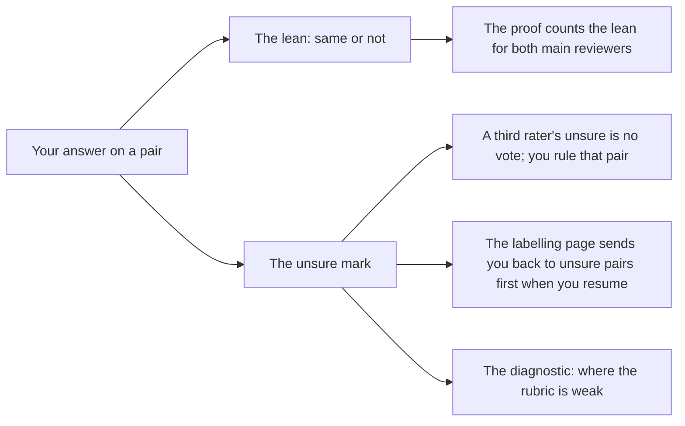

# The work-alike weak spot, "unsure" and the lean, and relabelling

## The short version

- **The weak spot is real, and it shows up in the labels themselves, not only in the detector.** On the 20 Opus work-alikes, your blind second pass agreed with your first on 12 of 20. Six of the 8 "unsure" marks across all 222 pairs fall on those 20 pairs. Every other group has one unsure or none.
- **"Unsure" and the lean are two parts of one answer.** The proof needs a yes or no on every pair, so the lean is what it counts. The unsure mark says how much to trust that answer, and it is how we found the weak spot.
- **"Work-alike" is not a second kind of answer.** It names how a pair was **made**, which the reviewer never sees. "Same job" is the **verdict** on the pair. We report work-alikes separately because they are the pairs most likely to be badly made, and the only planted pairs written by a different model from the judge.
- **Yes, a reviewer can go back and change a label**, but today the change overwrites the old answer and leaves no record. A proof run also does not record which labels it used. Both are cheap to fix before the official run (§5).
- 🆕 **The second reviewer agrees with you on 78.8% of pairs and on 70% of the work-alikes.** They found the work-alikes as hard as you did, but not the same ones. The bigger risk to the bar is the flags: they hold 25 of the 47 disputes, and run 3 failed on "correct", which is measured over flags.

All figures below were measured on 2026-10-31 from `io/semdup-labelling/2026.10.25-run5/` (the answer key and `labels-rick.jsonl`), the backup `io/tmp/2026.10.30-labels-rick-before-redo.jsonl`, and the trial record `io/semdup/proof-unofficial/3.json`. 🆕 The second reviewer's figures come from `labels-reviewer-2.jsonl` in the same folder, imported at about 12:25 EDT.

## 🆕 What changed after the second reviewer

The first version of this document was written before the second reviewer's labels arrived. Here is what their 222 labels changed.

| # | Change | Where |
|---|---|---|
| 1 | The two of you agree on 78.8% of all pairs (kappa 0.54). The work-alikes are the weakest group, at 70% (kappa 0.29) | §1, new table "You and the second reviewer" |
| 2 | **The two readings in §1 are now partly told apart.** The second reviewer also marked 6 of the 20 work-alikes unsure, so the pairs are hard for both of you, not only under your bar. But only 1 pair was unsure for both: you each found *different* pairs hard | §1, "Two readings" |
| 3 | **New finding: most disagreements are confident ones.** 40 of the 47 disputes carry no unsure mark from either of you. The unsure mark does not predict a dispute well: 14 of the 21 pairs that someone marked unsure were still agreed | §2, new subsection |
| 4 | **New finding: the flags, not the work-alikes, decide the bar.** Flags hold 25 of the 47 disputes, and "correct" (the measure that failed run 3) is computed over flags | §1, new subsection "The flags matter more to the bar" |
| 5 | Under the plan's rule that a plant fails only if *both* reviewers say not the same job, failed plants drop from 8 to 3. All 3 are Opus work-alikes; the other 5 go to the third rater | §1 |
| 6 | W1 is done, and its result is recorded. W2's load is now known: 47 pairs for the third rater | §4 |
| 7 | **The recommendation changed.** A new option, W16, comes first: an unofficial trial run on the second reviewer's labels alone, to see whether "correct" passes under their labels before the third rater starts. W10 is second. The third rater gets the second reviewer's instructions unchanged | §4, §6 |

## 1. What the data shows about work-alikes

### Your two passes on the 20 Opus work-alikes

| | Same job | Not the same job | Unsure |
|---|---|---|---|
| First pass (2026-10-29) | 11 | 9 | 0 |
| Blind second pass (2026-10-30) | 15 | 5 | 6 |

| Second pass compared with the first | Pairs |
|---|---|
| Same answer | 12 |
| Changed from "not" to "same" | 6 |
| Changed from "same" to "not" | 2 |
| Changed, and marked unsure the second time | 4 of the 8 |

The second pass is the one in `labels-rick.jsonl` now.

### "Unsure" across all 222 pairs, by group

| Group (hidden from you) | Pairs | Unsure |
|---|---|---|
| Opus work-alikes | 20 | **6** |
| Fable-planted rewrites | 45 | 0 |
| Pairs from one large file, `notifications.js` (60 pairs: 30 structural, 30 neighbour) | 60 | 0 |
| Flags the detector raised outside the built pairs | 97 | 2 |

### What the detector did with them (trial run 3)

| Group | Found | Range (interval) |
|---|---|---|
| Fable-planted | 42 of 42 | 0.92 to 1.00 |
| Opus work-alikes | 11 of 15 | 0.45 to 0.92 |

Fifteen work-alikes count because 5 were labelled "not the same job". Those 5 are dropped as failed plants, beside 3 Fable ones, which makes 8 of 65 in all. With only 15 pairs the range is wide, and it would stay wide even if every label were certain.

### Two readings, still not told apart

- **The pairs are hard to judge.** Opus wrote each one from a single sentence, so some do nearly the same job with a small difference: a field kept instead of cleared, an extra side effect. The rubric's line, "the caller's next step still works", falls right on those differences.
- **Some pairs drifted when they were written.** For those, "not the same job" is the right answer, and the pair is a bad plant, not a hard one.

Both readings predict a lot of unsure marks and flipped answers. The second reviewer's labels are the first evidence that can separate them: if two people independently flip on the same pairs, the pairs are hard.

### 🆕 You and the second reviewer

| Group | Pairs | Agreement | Kappa | Unsure (you / second reviewer) | Disputes |
|---|---|---|---|---|---|
| All | 222 | 78.8% | 0.54 | 8 / 14 | 47 |
| Fable-planted | 45 | 93.3% | 0.00 | 0 / 0 | 3 |
| Flags | 97 | 74.2% | 0.41 | 2 / 8 | 25 |
| Monolith, structural | 30 | 76.7% | 0.53 | 0 / 0 | 7 |
| Monolith, neighbour | 30 | 80.0% | 0.38 | 0 / 0 | 6 |
| **Opus work-alikes** | 20 | **70.0%** | **0.29** | **6 / 6** | 6 |

Kappa is agreement beyond chance: 0 is chance and 1 is perfect. The Fable figure reads 0.00 only because the second reviewer said "same job" on all 45, which leaves chance nothing to beat; 93% raw agreement is the honest number there.

**What this says about the two readings:**
- **The pairs are hard for both of you**, not only under your bar. The second reviewer marked 6 of the 20 unsure, the same count as you. Elsewhere they marked 8 of the 97 flags and none of the other 105 pairs. So "Rick's bar is strict" is not the main story.
- **But you found different pairs hard.** Only 1 work-alike was unsure for both of you, and 12 of the 20 were unsure for at least one. So no small set of "bad pairs" explains it. The difficulty is spread across the group, which fits the idea that the rubric's line ("the caller's next step still works") is fuzzy for this kind of pair.
- **On the 8 work-alikes you changed your mind about**, the second reviewer sided with your second answer on 5 and marked 2 of the 8 unsure.
- **Failed plants:** the plan drops a planted pair only when both reviewers say "not the same job". That now applies to 3 pairs, all Opus work-alikes, against 8 on your labels alone. The other 5 are disputes and go to the third rater.

### 🆕 The flags matter more to the bar than the work-alikes

Run 3 passed "found" and agreement, and failed "correct": 128 of 171 flags were real, against a bar of 0.80 (137 of 171). Ninety-seven of those 171 are the flags outside the built pairs, and they are where the two of you disagree most.

| Labels for the 97 flags | Real flags among the 97 | "Correct", other 74 flags held at your labels |
|---|---|---|
| Real only if both of you say so | 53 | 117 of 171 = 68.4% |
| Your labels (run 3) | 64 | 128 of 171 = 74.9% |
| Real if either of you says so | 78 | 142 of 171 = 83.0% |

This is arithmetic, not a run. It assumes the 97 flags are all among run 3's 171, as the 10-30 history entry says; that was not re-checked pair by pair. It also holds your labels fixed on the other 74. **What it shows:** depending on how the 25 flag disputes settle, "correct" could pass or fail. The work-alikes move "found" for one group of 15. The flags move a whole gate.

## 2. Why a yes-or-no question records "unsure" and a lean

The page asks one question, same job or not, and also lets you tick "unsure". When you do, you still give the answer you lean toward. Here is where each part goes.

| Part | What uses it | Where in the code |
|---|---|---|
| The lean | The proof. Each main reviewer's unsure label counts at its lean, so every pair has a yes or no and the proof can always run | `same_job_labels` in `src/cosa/repo/labelling/pair_labels.py`; `pair_key_labels` in `src/cosa/repo/semdup/proof/label_load.py` |
| The unsure mark, for the third rater | An unsure from the third rater is no vote, so you rule that pair (your ruling of 2026-10-29) | `third_votes` in `label_load.py` |
| The unsure mark, on the page | When you resume, the page opens at the first unlabelled pair, and then at the first unsure one | `progress` in `pair_labels.py` |
| The unsure mark, in the data | Nothing in the bar weighs it. It is stored as a note starting `UNSURE:` | `is_unsure` in `pair_labels.py` |

**Why we record the lean at all.** Without it, an unsure pair has no answer. The pair either leaves the denominators, or the proof refuses to run until someone decides it. A forced lean keeps every count complete. The unsure mark then tells us which answers to trust less.

**Why we keep the unsure mark at all.** A plain yes or no hides how hard the question was. Your flipped answers showed the work-alikes were unstable, but only because you happened to label them twice. The unsure marks showed the same thing in a single pass: 6 of 20 against at most 2 of 202 in the other groups. For the second reviewer, who labels once, the unsure mark is the only signal of this kind we will get.

**What we do not do with it yet:** we do not report the bar with unsure pairs left out, or counted as half. Option W10 in §4 would add that.

### 🆕 What the second reviewer's labels showed about "unsure"

- **Most disagreements are confident.** Of the 47 disputes, 40 carry no unsure mark from either of you. You each simply read the pair differently.
- **An unsure mark does not usually mean a dispute.** Twenty-one pairs were marked unsure by at least one of you. Fourteen of those were still agreed, and 7 became disputes.
- **What this means for the design:** the unsure mark is a good signal of which *groups* are hard (both of you, 6 of 20 on work-alikes). It is a poor signal of which *pairs* will be disputed. So the third rater, not the unsure mark, has to settle disputes, which is how it is already set up. It also weakens W11 (§4): leaving out pairs both of you mark unsure would remove 1 pair.

## 3. Why "work-alike" is kept apart from "same job"

They answer different questions.

| | "Same job" | "Work-alike" |
|---|---|---|
| What it is | The verdict: would B satisfy a caller who wanted A? | How the pair was **made**: Opus 5.5 wrote B from a one-sentence description of A, without ever seeing A |
| Who decides it | The reviewers | The build script, before anyone labels |
| Does the reviewer see it? | It is their answer | No, the page hides every pair's group |
| Where it appears | The labels file | `stratum` in the answer key, and the per-group lines of the proof record |

The proof reports work-alikes as their own group for three reasons, all from the plan (§5 C7 of the remediation plan):

1. **They are the duplicates the tool exists to find.** They do the same job in code that looks different, which the old structure-matching check could not catch.
2. **They are the only planted pairs written by a different model from the judge.** Fable 5.1 wrote the planted rewrites and Fable is also the judge, so the combined score can pass while the Opus group is weak. Opus also writes the code in the real experiment, so its group is the realistic one.
3. **A made pair can be made badly.** If you label a planted pair "not the same job", the proof drops it as a failed plant instead of counting it as a miss. So for a work-alike, your label checks the pair as well as the detector.

Reporting the group separately changes no gate. It shows how much of the score rests on each kind of pair.

## 4. Options for the work-alike weak spot

All options are on the table, as you asked. They are listed first, then each one's pros and cons.

### The options

| # | Option |
|---|---|
| W1 | Wait for the second reviewer's labels and compare their unsure marks and answers with yours on the 20 pairs. 🆕 **Done 2026-10-31: see §1, "You and the second reviewer"** |
| W2 | Use the third rater on disagreements (already ruled). 🆕 **47 pairs: 25 flags, 7 structural, 6 work-alikes, 6 neighbour, 3 Fable** |
| W3 | Have you label the 20 a third time, blind, and keep a pair's label only when two of your three answers agree |
| W4 | Add worked work-alike examples to the instructions, with the right answers explained, for future reviewers |
| W5 | Run a short calibration round: all reviewers label the same 10 practice pairs, talk through the disagreements, then label the real set |
| W6 | Show more context with each pair: doc comments (already ruled for future pairs), and where each function is called |
| W7 | Replace the yes-or-no with a graded scale (same job · same with a small change · related · different job), and turn it back into yes or no by a fixed rule |
| W8 | Ask a short checklist per pair (same inputs? same result? same state left behind? same side effects?), with the verdict following from the answers |
| W9 | Check each generated work-alike by running it: give the original and the rewrite the same inputs and compare what they return and change, before any person sees the pair |
| W10 | Report the bar twice: once with every label, once without the pairs anyone marked unsure |
| W11 | Leave out of the denominators any pair both reviewers mark unsure, as an "undecidable" count, the way failed plants are left out |
| W12 | Replace synthetic work-alikes with ones mined from real code (the TypeScript mining pilot found 5 in 500 tries) |
| W13 | Have a group of models label every pair first, and send people only the pairs where the models disagree |
| W14 | Make more work-alikes, about 60 instead of 20, so one hard pair moves the group's score less |
| W15 | Accept the weakness: keep reporting the group with its range, and gate on nothing new |
| 🆕 W17 | Have a non-Anthropic model (a GPT or Gemini model) write work-alikes. **Declined (Rick, 2026-10-31 ~12:50 EDT): "doesn't really enhance anything since they do not serve the proof set"** |
| 🆕 W16 | Run an unofficial trial (run 4) on the second reviewer's labels alone, beside run 3 on yours, so we see whether "correct" passes under either set before the third rater labels anything |

### Pros and cons

| # | Pros | Cons |
|---|---|---|
| W1 | Costs nothing new; it is the first evidence that tells "the pairs are hard" from "your bar is strict" | Waits on another person; one more reviewer is a small sample on 20 pairs. 🆕 Done: it pointed to "the pairs are hard", but the two of you found different pairs hard |
| W2 | Already built and tested; settles disputes without you being the tiebreaker on your own labels | Covers disagreements only; if both reviewers agree but are both unsure, it never sees the pair |
| W3 | Measures your own consistency directly; a 2-of-3 rule smooths out one bad day | More of your time; by the third pass you may remember the pairs, so it is no longer blind |
| W4 | Cheap; aims straight at the cases that flipped (fields kept against cleared, extra side effects) | Must not reach the second reviewer mid-task, or the two of you labelled under different instructions; examples can steer answers toward the author's view |
| W5 | The standard way to align raters; finds rubric gaps before they cost real labels | Too late for the second reviewer, who already has the file; needs everyone at once; the discussion can make answers agree without making them right |
| W6 | Call sites show what a caller actually needs, which is the question the rubric asks | More to read per pair; call sites can give away which pair is the original; a code change to the pair builder |
| W7 | Records the "same with a small change" middle ground that causes the flips; still turns back into yes or no | Changes the question after 222 labels are in, so your existing labels would not compare; the fixed rule for the middle grade is a new decision of its own |
| W8 | Splits one hard judgment into four easier ones; a disagreement shows which part people disagree on | Slower per pair; the rule from four answers to one verdict can be wrong in its own way; a page change |
| W9 | Separates bad plants from hard pairs without any person, and catches drift at the source | Most pairs are browser code that touches the page, so running them needs a fake page; costly to build; equal output on test inputs does not prove the same job |
| W10 | Cheap, a report change only; shows at once whether the bar's result depends on the doubtful pairs | Changes no decision unless we agree in advance what to do if the two results differ |
| W11 | Stops the proof resting on pairs nobody can decide | Fewer work-alikes in an already small group; leaving out hard cases makes the score look better than it is, so the count must be reported beside it. 🆕 Only 1 pair qualifies today, so it would change almost nothing |
| W12 | Real code, the kind agents meet; no generator to drift | About 100 judge calls per mined pair; TypeScript only; it changes Set A, which is already labelled |
| W13 | Spends people's time where it is needed | Models labelling the pairs a model judge is scored on is close to circular; the plan wants people's labels for exactly this |
| W14 | Narrows the range; one hard pair matters less | Another round of generating and labelling; a bigger set from the same generator still has the same drift |
| W15 | No new work; the per-group report already exists | The weak spot stays; "found" for the realistic group rests on 15 pairs with a range of 0.45 to 0.92 |
| 🆕 W17 | An independent writer: the judge (Fable) and the writer (Opus) are both Anthropic models, and this would show whether the judge favours its own family's style | Replacing Set A's Opus pairs stops that group measuring Opus, which writes the real code. Added to Set A, about 20 new pairs would only be reported, not gated, and would not touch the flags that decide "correct"; both reviewers would label them, and the proof would need a new run folder. In Set B it would not reach the proof at all. **Declined** |
| 🆕 W16 | The tool already supports a one-reviewer unofficial run, so no code is needed. It turns the arithmetic in §1 into a real figure, and it shows whether the 47 disputes can change the outcome at all | Uses machine time on the Max plan. Not checked: whether the judge ledger lets it reuse run 3's judge calls. It adds a run to the unofficial ledger, which is kept on purpose. A reviewer's labels alone are not the proof's labels, so the run decides nothing |

### 🆕 Recommendation, revised after the second reviewer

**W16, then W10, then W2 as ruled, then W9 for Set B. The third rater gets the second reviewer's instructions unchanged.**

- **W16 first.** The flags, not the work-alikes, are where the bar can turn (§1). The arithmetic in §1 says the disputes alone can carry "correct" from 68% to 83%, so the third rater's labels will decide the gate. A trial run on the second reviewer's labels replaces part of that arithmetic with a measured figure, before anyone else spends time labelling. It cannot settle the result: the settled labels will mix the two of you, pair by pair.
- **W10 next**, as before. It is cheap, and it shows whether the doubtful pairs decide the result.
- **W2, the third rater, as ruled**, with the same instructions the two of you had. Any new example would make the three sets of labels incomparable.
- **W9 for Set B**, as before.
- **W4 and W6 later**, for future reviewers. A worked-examples sheet should now cover the flag disputes as well as the work-alikes, since that is where most of the confident disagreements are.

### Original recommendation (kept for the record; superseded by the revision above)

**W1, W10 and W9 for future sets, in that order. Do not change anything the second reviewer already has.**

- **W1** is already moving and is the only option that separates the two readings in §1.
- **W10** is cheap and shows straight away whether the doubtful pairs decide the result.
- **W9** stops bad plants being made, which helps Set B's synthetic Python work-alikes (your ruling of 2026-10-29, about 60 of them) more than it helps Set A.
- **W4 and W6 next**, for future reviewers only.

Instructions shown halfway through a set would make the two reviewers' labels impossible to compare. That is why the recommendation leaves the second reviewer's file and instructions as they are.

## 5. Relabelling: can a reviewer go back, and what happens when the sets change?

### What happens today

- **A reviewer can change any label at any time.** The labelling page (`save_label` in `pair_labels.py`) replaces the earlier answer in place: one line per pair, with a new time stamp. **The old answer is not kept in the file.** The second reviewer can likewise edit their JSON as often as they like before sending it back.
- **Your work-alike redo was done the careful way, by hand.** It went through a separate blind packet, `packet-rick-redo.jsonl`, with the pairs in a new order and without your earlier answers. Its 20 answers were then copied over `labels-rick.jsonl`.
- ⚠️ **Your first-pass answers survive only in `io/tmp/`.** The copy is `io/tmp/2026.10.30-labels-rick-before-redo.jsonl`. The daily sweep deletes files there that are older than 7 days, so this copy goes on or after 2026-11-06. The figures in §1 are gone with it unless the file moves somewhere that is kept. 🆕 **Fixed 2026-10-31**: it is copied to `io/semdup-labelling/2026.10.25-run5/history/2026.10.29-labels-rick-first-pass.jsonl`, which the sweep does not touch.
- **A proof run does not record which labels it used.** The record and `proof-ledger.jsonl` store the frozen configuration's fingerprint (`config_sha`), not one for the labels (`proof_run.py`). Trial runs 2 and 3 used different label sets, and nothing in either record says so.

### When the labelling set itself changes

| Change | What the code does today |
|---|---|
| Pairs added | Existing labels still count. The proof refuses to run until both reviewers have labelled the new pairs (`resolved_labels`: "pairs are not labelled by both reviewers") |
| Pairs removed | The loader refuses a labels file holding a pair the answer key no longer has (`_known`: "labels for items the key does not know"), so those lines must be removed first |
| The plants rebuilt under a new configuration | The proof refuses a run folder built under a different configuration (`proof_cli.py`) |

Not checked: whether a pair whose code changed keeps its old id. If it does, an old label would silently carry over to new code. This gap is worth closing before Set B.

### The options

| # | Option |
|---|---|
| R1 | Keep it as it is: changes overwrite, nothing else recorded |
| R2 | Keep every answer: the labels file only ever grows, the proof uses each pair's latest answer, and earlier answers stay readable |
| R3 | Record a fingerprint of each labels file in every proof record and ledger line |
| R4 | Freeze the labels when the official proof run starts; after that, a change only by a logged ruling naming the pair and the reason |
| R5 | Allow revisits only blind: a pair is relabelled through a fresh packet in a new order without the earlier answer, as your redo was |
| R6 | Version the sets: a changed set gets a new run folder, and a carry-over report lists which labels were kept, which are new and which were dropped |
| R7 | Move the current backups out of `io/tmp/` now, to a folder the sweep leaves alone |

### Pros and cons

| # | Pros | Cons |
|---|---|---|
| R1 | No work | Self-consistency can only be measured by luck, as it was this time; a label changed after seeing a run's result leaves no trace |
| R2 | Self-consistency becomes measurable on any pair; the history shows how often people change their minds | The file format and its reader change; must be tested at 100%; old files need a one-time conversion |
| R3 | Every run can be tied to the exact labels it used; a small change | Fingerprints show *that* labels changed, not which ones; that needs R2 |
| R4 | Stops labels from being tuned to make the result pass, which matters because every run is kept to show the tries before a pass | Real mistakes found late cost a ruling each; needs a defined start for "official" |
| R5 | A revisit measures judgment, not memory of the first answer | Slower than editing in place; needs a packet per revisit (the tool exists, it was used for the redo) |
| R6 | Set changes become visible and checkable | More folders and a new report; worth it mainly for Set B, which will change |
| R7 | Saves the only record of your first pass; a minute's work | None worth weighing |

### Recommendation

**R7 now. Then R3 and R2 before the official proof run. Then R4 and R5 as the rule for that run.**

- **R7 now**, because the sweep deletes the first-pass file on or after 2026-11-06.
- **R3 and R2 before the official run.** They are small code changes with tests, and they make every later question about labels answerable.
- **R4 and R5 as the rule for the official run.** Every proof run is kept so that a pass cannot hide the tries before it. A label edited after a result, with no record, would undo that.
- **R6** waits for Set B.

## 🆕 Rulings (Rick, decision walkthrough, 2026-10-31 about 14:09 to 14:16 EDT)

| # | Decision | Ruling |
|---|---|---|
| 1 | Work-alike and flag steps | **Trial run first, then the rest:** W16, then W10, then the third rater, then W9 for Set B |
| 2 | Third rater's instructions | **The second reviewer's sheet, unchanged** |
| 3 | Label record | **Both R3 (label fingerprints in every proof record) and R2 (keep every answer), before the official run** |
| 4 | Rule once the official run starts | **Freeze, with blind revisits (R4 + R5)** |
| 5 | Future labelling, Set B and later | **W4 worked examples and W6 call sites**; Set A unchanged |
| — | W17, a non-Anthropic writer | **Declined** (about 12:50 EDT) |

The table below is the proposal as it stood before these rulings.

## 6. Decisions this asks of you

| # | Decision | Recommendation |
|---|---|---|
| 1 | Which work-alike options to adopt | 🆕 W16 (trial run on the second reviewer's labels), then W10, then the third rater as ruled, then W9 for Set B; W4 and W6 later |
| 🆕 1b | Third rater's instructions | The second reviewer's sheet, unchanged |
| 2 | Move the first-pass backup out of `io/tmp/` | 🆕 **Done 2026-10-31**: copied to `io/semdup-labelling/2026.10.25-run5/history/2026.10.29-labels-rick-first-pass.jsonl`, checksum matched; the `io/tmp/` copy is left in place |
| 3 | Record labels in every proof run and keep every answer | Yes, R3 and R2, before the official run |
| 4 | Rule for changing labels once the official run starts | R4 (frozen, change only by logged ruling) and R5 (revisits blind) |

## 7. Why the official run asks for 8 more labels

*Added 2026-10-31 about 17:10 EDT, at your request. Every figure below was read from the run records named, between 16:58 and 17:08 EDT.*

### The short version

- **The official run did not fail. It stopped before scoring**, with status `labels_pending`, because 8 of the pairs it flagged as duplicates have no human label.
- **One of the three bars needs a human answer for every flag.** "80% of flags right" means: of the pairs the checker says are duplicates, how many do you and the second reviewer agree really are. A flag nobody has labelled cannot be counted right or wrong, so the run refuses to give a number rather than guess.
- **The 8 are old code, not new code.** All of the ones I could date first appeared between March and early October. They are pairs the checker had not flagged before, or had not flagged on this tree.
- **They have to go in a separate packet.** The 222 labels froze when the official run started (your rule R4), and the second reviewer has already answered the 222, so the tool refuses to add items to that packet.

### How a flag outside the 222 happens

The proof does two things at once. It checks the 125 pairs we built on purpose (65 planted and 60 from the monolith). It also searches the whole codebase, about 12,000 definitions, for anything else that looks like a duplicate, because a checker that only looks where we planted things would prove nothing. Whatever that open search flags has to be labelled too.

So the label set has grown in rounds, each time the search turned up flags we had not labelled:

| Run | Tree | Definitions searched | Flags with no label | What we did |
|---|---|---|---|---|
| Trial run 2 (10-30) | main tree | 12,229 | **97** | You labelled them; they became the 97 "flag" items, so the set went from 125 to **222** |
| Trial run 3 (10-30) | main tree | 12,230 | **0** | Nothing owed; all 222 labels used |
| Trial run 4 (10-31) | the pinned proof worktree | (same tree as the official run) | **16** | Packaged for an optional labelling round, not sent |
| **Official run 1** (10-31, 15:17–15:31) | the pinned proof worktree | **12,287** | **8** | This question |

Source files: `io/semdup/proof-unofficial/2.json` and `3.json`, the run 4 notes in `io/semdup-labelling/2026.10.25-run5/run4-new-flags/`, and `.claude/worktrees/cheech-proof-pinned/io/semdup/proof/1.json`.

**7 of the 8 were already among trial run 4's 16.** The other 9 of run 4's 16 were not flagged this time, and 1 of the 8 is new. So most of the 8 have been coming up since the proof moved to the pinned worktree.

### Why run 3 owed nothing and the later runs did

Two things changed between run 3 and the official run, both measured:

1. **The tree moved.** The search covered 12,230 definitions in run 3 and 12,287 in the official run. That is 57 more, from code merged on 10-30 and 10-31, and the pinned worktree also restores the two files the proof pins (`notifications.js` and `chunk-sequencer.js`). The search compares each definition with its nearest neighbours, so changing the population changes which pairs get looked at.
2. **The judge is a model, and it does not answer exactly the same way twice.** In the official run, its two passes agreed on 1,075 of the 1,110 pairs they both judged (96.8%). A pair near the line can be flagged in one run and not the next.

⚠️ **What I have not measured** is which of the two put each of the 8 on the list. Telling them apart would need a rerun on run 3's tree. I don't think that's worth it, because either way the answer is the same: label the 8.

### The 8 pairs

These are the names only, so you can judge whether it's a small job. The packets themselves show you the full code, in a different order for each of you, with no labels.

| Pair | Functions |
|---|---|
| 1 | `_toggleHoldingAreaGroup` and `handlePlanToggle` |
| 2 | `stampUpdated` and `_stampTaskListUpdated` |
| 3 | `addChunkIndicator` and `appendBadge` |
| 4 | `_run_deep_research` and `_perform` |
| 5 | `_perform` and another `_run_deep_research` (this pair shares one definition with pair 4) |
| 6 | `beginCapture` and an unnamed function |
| 7 | `buildUrl` and another `buildUrl` |
| 8 | `hydrateAwaitingResponseCards` and `loadPending` |

### What happens next

1. You and the second reviewer each label the 8 from your own packet, `io/semdup-labelling/2026.10.25-run5/supplement-proof1/supp-packet-rick.jsonl` and `supp-packet-reviewer-2.jsonl`. It's the same question and the same sheet as before.
2. Jason settles any pair where you two disagree, as he did for the 47.
3. The answers are added beside the frozen 222 as a logged addition, leaving those unchanged (R4), and **official run 2** goes in the same pinned worktree. It is recorded as proof 2; proof 1 stays in the ledger. ⚠️ I have not yet checked how the loader takes in a second, separate labels file. It may need a small, reviewed change before run 2, and a worker will confirm that first.
4. ⚠️ **Run 2 may flag a few pairs again** for the same two reasons. If it does, the same steps repeat, and each round so far has been smaller than the last (97, 0, 16, 8). If you would rather stop the loop, one option is to rule that a flag first seen in a later run is reported as "unlabelled" in a range, not owed. That is a change to the bar, so it is yours to make.
