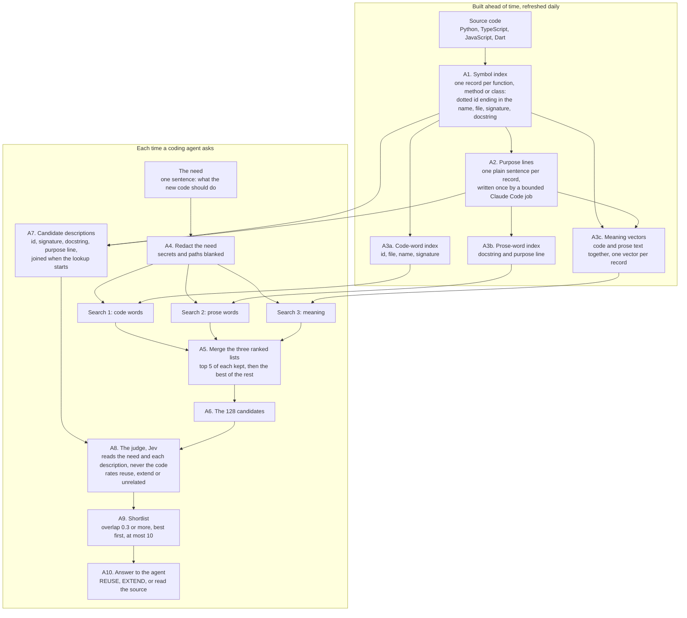
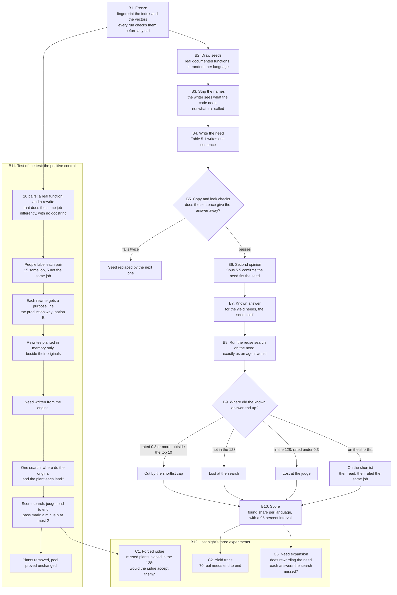
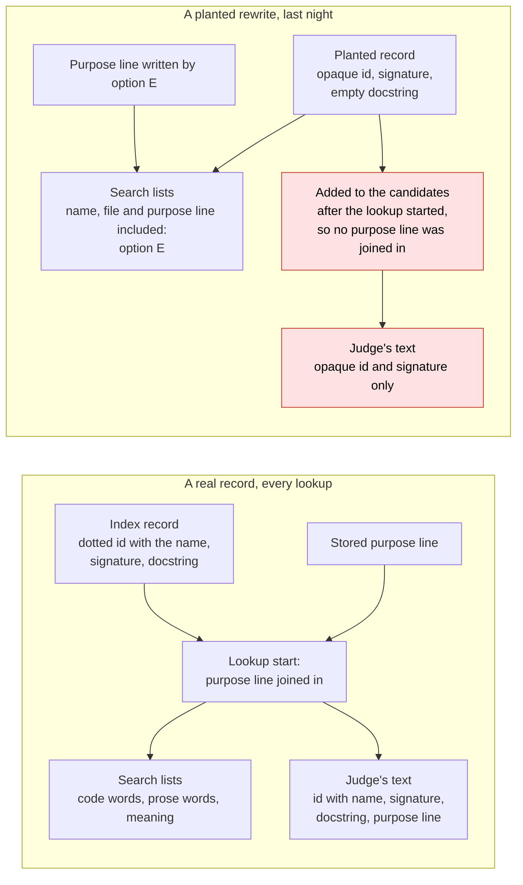

# How we measure the reuse search, step by step, and what the judge actually saw last night

*Lupin reuse project, 2 November 2026. Times are Eastern.*

## The short version

- **What we are building.** A reuse checker. Before a coding agent writes a new function, it describes what it needs in one sentence, and the checker answers: this already exists, reuse it; something close exists, extend it; or nothing clear, read the source.
- **What "quantified" means.** We want a number we can defend: when existing code really does the job, how often does the checker put it in front of the agent, and where does it lose it when it does not. The first-thousand trial is the first measurement of that number at scale.
- **What went wrong last night.** To test the test, we plant known duplicates and check that the checker finds them. Last night the planted duplicates were given their one-line description for the **search**, but the **judge** that rates each candidate was shown the plant without it. It saw an opaque code, a parameter list, and nothing else, while each real function beside it came with its name, its comment and its one-line description.
- **What that changes.** The search results from last night stand: with the one-line description, 12 of 13 planted duplicates reached the judge, against 5 of 13 without it. Every judge result about the planted duplicates is suspended, and so is the headline that "the judge is now where we lose them". The real-code measurements (70 needs end to end, and the rewording experiment) did not use planted records and stand.
- **Why it happened.** The plan routed the description into the two search inputs and never said it must also reach the judge's text. The checks before the run looked at the search only. The code that adds the plants to the candidate list does so after the step that attaches descriptions, so nothing attached one. The plan was carried out as written; the hole was in the plan.

---

## 1. What we are building, and what we are measuring

**The product.** Lupin has a tool named `check_exists`. A coding agent, about to write new code, calls it with a sentence such as *"a function that retries an HTTP request with exponential backoff"*. The tool searches the whole code base, about 12,900 functions, methods and classes (12,944 in the snapshot last night's runs used), and returns a verdict with a short list of the existing code that best fits. The point is to stop agents writing their fifth copy of something the code base already has.

**The measurement.** A checker like this can fail quietly. If it misses existing code, the agent writes a duplicate and nobody notices. So before we rely on it we need two numbers:

1. **Yield, or recall.** Out of the cases where existing code really does the job, the share the checker finds.
2. **Where the misses happen.** The checker has two stages, a search that picks 128 candidates and a judge that rates them. A miss at the search needs a different fix from a miss at the judge.

**The trial.** The "first-thousand trial" is the first measurement at scale: real needs, each with a known right answer, run through the real checker, with a budget that started at 1,000 model calls, was raised to 1,314, and then to 2,314. Part 1 ran on 1 November in the afternoon. Part 2, the positive control and three experiments, ran last night. Part 3, a closer look at the judge, is designed and has not run.

---

## 2. Part A: how the reuse search works

### Process chart 1: the reuse search as built



### Each step, what it does, and what it is for

| Step | What it does | What it is for |
|---|---|---|
| **A1. Symbol index** | Reads every source file and writes one record per function, method or class. A record holds a dotted id that ends in the function's name (for example `cosa.repo.doc_lint.labelled_set_seeder.build_split_plan`), its file, its signature (the parameter list) and its docstring (the comment its author wrote, if any). The extractor reads Python, JavaScript, TypeScript and Dart. The snapshot last night's runs used, written at 23:20 on 1 November, held 12,944 records (Pocholo's count). | A list of everything that already exists, in a form a program can search. |
| **A2. Purpose lines** | A bounded Claude Code job writes one plain-English sentence of at most 25 words per record, saying what it is for. It is written once and stored. In last night's snapshot, 12,564 of the 12,765 records the checker may send had one, 98% (Pocholo's count). | Much code has no comment, or a comment in the author's shorthand. The purpose line gives every record words a search can match. |
| **A3. Three search indexes** | (a) A keyword index over the code words: id, file, name, signature. (b) A keyword index over the prose: docstring and purpose line. (c) Meaning vectors: each record's code text and prose text, taken together, turned into one vector of numbers by an embedding model, so that two texts that mean the same thing land close together even when they share no words. No function body is ever embedded. | Three different ways to recognise a match: same names, same descriptive words, or same meaning in different words. |
| **A4. Redact the need** | Blanks emails, addresses, paths and anything shaped like a credential in the agent's sentence. | Nothing sensitive leaves the machine. |
| **A5. Merge the lists** | Each search returns a ranked list. The merge gives each record points for its position in each list (reciprocal rank fusion), always keeps the top five of every list, then fills the rest by points. | The three searches score on different scales; position is the one thing they share. Keeping each list's top five means no single search is drowned out. |
| **A6. The 128** | The merged list is cut to 128 candidates. | The judge costs a model call per pack of candidates, 50 per pack in this trial's runs, so it reads 128, not 12,900. Anything outside the 128 is never judged: a miss here is final. |
| **A7. Candidate descriptions** | When a lookup starts, each record is joined with its stored purpose line. A candidate's description is then its id, signature, docstring and purpose line, in one line of text. | This text is everything the judge will know about the candidate. |
| **A8. The judge** | Jev, a model from TypeSafe pinned at version `jev-1.13.0`, gets the need and one question per candidate: given only this description, does the candidate already provide the capability? It answers with three probabilities: reuse as is, extend slightly, unrelated. The **overlap** score is reuse plus extend. | The search finds things that look alike; the judge decides whether they do the job. |
| **A9. Shortlist** | Candidates with overlap of 0.3 or more, best first, at most 10. | The short list the agent is told to read. |
| **A10. Answer** | REUSE, EXTEND, or "uncertain, read the source" with a reason (for example, nothing reached 0.3). | Something an agent can act on, with the evidence beside it. |

**The one thing to remember about the judge.** The judge never sees code. It sees one line of description per candidate. Here is a real one, the original function of one of last night's pairs, exactly as the judge received it:

```text
src.lupin_app.static.js.multiplexer.stores.NotificationStore.NotificationStoreImpl.subscribe(): void —  | purpose: Begin listening for notification arrivals, replies, expirations and clock ticks so state stays current.
```

Anything missing from that line is invisible to the judge. Section 5 shows what the judge received for the planted duplicate of this same function.

---

## 3. Part B: how we measure it

### Process chart 2: the measurement, end to end



### The measurement steps

| Step | What it does | What it is for |
|---|---|---|
| **B1. Freeze** | Records three fingerprints: the index, its record list, and the vector set. Every run compares them before its first model call and refuses if any differs. | A score is only meaningful against a fixed code base. If the index moved mid-trial, a change in the score could be the data, not the checker. |
| **B2. Draw seeds** | Picks real functions at random, per language (Python and TypeScript), from the ones that are not tests, not tiny, and have a docstring. | Real code, not invented examples, so the score speaks about this code base. |
| **B3. Strip the names** | Gives the need writer the function's code with its own names removed. | A developer asking for a function does not know its name. The question must describe the job, not the identifiers. |
| **B4. Write the need** | Fable 5.1 writes one sentence describing what the seed does, as a developer would ask for it. | Produces the test question. |
| **B5. Copy and leak checks** | A free check rejects a sentence that copies the seed's identifiers or file path; a second check rejects one that shares identifier words or a run of four words with the answer. One targeted rewrite is allowed (four tries for the control); a seed that still fails is replaced. | A question that contains the answer's words would make the search look better than it is. |
| **B6. Second opinion** | Opus 5.5, a different model, reads the need and the seed and says whether the need describes it. | One model checking another's work. A disagreement goes to a person, not to the score. |
| **B7. Known answer** | For the yield needs, the seed itself is the right answer (Rick's ruling of 1 November). For the attribution needs it is a neighbour that a model ruled does the same job. For the control it is the plant. | We know, for every question, what the checker should find. |
| **B8. Run the checker** | The real checker, on the frozen index, on the need. | Measures the product, not a model of it. |
| **B9. Where was it lost** | Reads the checker's receipt in four stages: was the answer among the 128; did the judge rate it 0.3 or more; did it make the ten-place shortlist; and, in the full trace, was it read and ruled the same job. The first stage that fails names the loss. | Splits a miss into a search miss, a judge miss, a cap miss or a reading miss, because each needs a different fix. |
| **B10. Score** | Found share per language, with a 95% interval (a Wilson interval: the range the true rate plausibly sits in, given how few items we measured). | A number with its uncertainty stated. |
| **B11. Positive control** | See below. | Proves the test can find a duplicate that is known to be there. |
| **B12. Experiments** | C1, C2 and C5, below. | Each answers one question the control raised. |
| **Guards** | A call cap (1,000 at the start, raised to 1,314 and then to 2,314); a spend ledger where each run name can be used once; a plan-only mode that spends nothing. | The trial cannot overspend or mix two runs' spending. |

### The positive control: a test of the test

If the checker found nothing, we could not tell "there was nothing to find" from "the checker is blind". So we plant duplicates we know are there and check that the checker finds them.

- **The pairs.** Twenty pairs from an earlier project: a real function from the code base (the *original*) and a rewrite of it by Claude Opus that does the same job in different code (the *plant*). A rewrite carries no docstring, which is realistic: many duplicates in real code are undocumented.
- **The labels.** Two people labelled each pair, with a third breaking ties: 15 pairs do the same job, 5 do not. The 15 are the positive control. The 5 are a **negative control**: finding one of them is a false alarm, not a success.
- **Option E.** The first run of the control, run -l on 1 November, found only 5 of 17 plants. Expert 1 named the reason: real records get a purpose line from the production writer and the plants did not. Option E gives each plant a purpose line from the same writer, with the same prompt and screen.
- **Planting.** The plants are added in memory only, beside their originals. The live index is never written, and after the run the pool is proved unchanged.
- **One search, two ranks.** The need is written from the original. One search shows where the original lands and where the plant lands.
- **The pass mark, set before the run.** Over the same-job pairs: **a** counts pairs where the original reached the 128 and the plant did not; **b** counts the reverse. The control passes when a minus b is at most 2: the plants are not found worse than their originals by more than two pairs. The mark was fixed before the run and did not move after it.
- **Three figures.** Search (did the plant reach the 128), judge given search (did the judge rate it 0.3 or more), and end to end. Pairs whose need could not be written count as misses in an "intention to treat" figure, so nothing is quietly dropped.
- **The bare arm.** The same needs searched against the plants without their purpose lines, with no model call, to show how much the line alone contributes.

### Last night's three experiments

| | Question | How |
|---|---|---|
| **C1. Forced judge** | When the search misses a plant, would the judge have accepted it anyway? | The 12 plants run -l's search missed are placed into the 128 by the program, the plant in a pack of its own, and the judge is asked about each. |
| **C2. Yield trace** | On real code, how often does the checker find the answer end to end, and where are the misses? | 70 real needs from the yield sample, each with its seed as the known answer, through the full checker. |
| **C5. Need expansion** | The misses sit deep in every list. Would rewording the need reach them? | One Fable call per need for three paraphrases and five likely identifier words; search with all of them; read the answer's rank before and after. Search only, no judge. Here "enters the 128" means a fused rank of 128 or better, a little generous against the production cut, which also keeps each list's top five. |

---

## 4. Last night: the steps as planned, and the steps as they ran

### Process chart 3: planned against actual

```mermaid
flowchart LR
    subgraph PLAN["As planned: plan Part 2, ruled at 22:55"]
        direction TB
        A1["Rulings by voice card"] --> A2["Run -m launches<br/>freeze check passes"]
        A2 --> A3["Control, two passes on frozen needs<br/>plants carry purpose lines in the search"]
        A3 --> A4["Judge reads each plant as it reads<br/>a real record: intended, never written down"]
        A4 --> A5["C1 forced judge"]
        A5 --> A6["C2 yield trace"]
        A6 --> A7["C5 one-call smoke, then the full run"]
        A7 --> A8["Morning report"]
    end
    subgraph RAN["As it ran: 1 to 2 November"]
        direction TB
        B1["22:55 rulings"] --> B2["23:01 run -m refused before any call:<br/>vectors not from the current index"]
        B2 --> B3["23:03 to 23:08 vectors rebuilt,<br/>proved identical"]
        B3 --> B4["23:09 relaunch refused before any call:<br/>run name already used"]
        B4 --> B5["23:11 to 23:18 run -n: control, two passes<br/>search used the purpose lines"]
        B5 --> B6["Judge read each plant as an opaque id<br/>and a parameter list only"]
        B6 --> B7["23:20 C1: plants judged the same way"]
        B7 --> B8["23:21 to 23:33 C2: real records,<br/>full descriptions"]
        B8 --> B9["23:38 to 00:04 C5: 7 replies unreadable,<br/>reader fixed, 2 recovered"]
        B9 --> B10["00:20 results written:<br/>judge named the loss stage"]
        B10 --> B11["10:01 next morning: the gap found<br/>while building Part 3"]
    end
    classDef gap fill:#fde2e1,stroke:#c0392b,color:#000
    classDef refused fill:#fff8e1,stroke:#b7950b,color:#000
    classDef intent fill:#e8eaf6,stroke:#3949ab,color:#000
    class B6,B7,B10 gap
    class B2,B4 refused
    class A4 intent
```



Red marks where the planted records reached the judge without their description. Yellow marks launches that refused before spending anything. Blue marks the step the plan assumed and never stated.

### Step by step

| # | Planned | What happened | Did it change a result? |
|---|---|---|---|
| 1 | Rick's four rulings: full plan, cap raised to 2,314, go on expert 1, pass mark a minus b at most 2 | 22:55, by voice card | No |
| 2 | Launch run -m; the freeze check passes | 23:01, refused before any call: the index fingerprint covers file times in the run's source tree, and they had moved. John rebuilt the vectors and proved them byte-identical. What moved the file times is still unmeasured | No; zero calls |
| 3 | (not planned) | 23:09, the relaunch refused before any call: a run name can be used once, and the failed launch had used it. Renamed run -n | No; zero calls |
| 4 | Control, two passes on the frozen needs, plants carrying their purpose lines | 23:11 to 23:18, 12 model calls, both passes identical. The search used the plants' purpose lines. The judge's text for each plant did not carry it, nor the plant's name | **Yes**: every judge figure on the plants is suspended |
| 5 | Replays of the earlier stages from saved answers; the remainder check | As planned, no calls | No |
| 6 | C1, forced judge | 23:20, 4 calls; the plants judged with the same bare text | **Yes**: C1 suspended |
| 7 | C2, yield trace | 23:21 to 23:33, 221 calls; real records with their full descriptions | No |
| 8 | C5, a one-call smoke, then the full run | The smoke's reply was unreadable (a full-width comma inside the model's JSON). The full run made 124 calls, 7 replies unreadable. Pocholo's reader fix, reviewed by Chloé, recovered 2 by replay with no new calls | No; both readings are recorded |
| 9 | C3, optional | Not built | — |
| 10 | Morning report | Written at 00:20 as section 15 of the plan. It named the judge as the new loss stage | That conclusion is suspended |

Every step that ran did what the plan said. The plan had a hole in it, at step 4.

---

## 5. What the judge saw

### Data chart 4: where the purpose line went



### The exhibit: the exact text, for three pairs

Pocholo rebuilt each text from the saved records with the production functions and proved each one byte-exact against the judge's answer cache, whose key is a hash of the need and the candidate text. No model call was made.

**Pair B, same job, the original was rated instead.** The need, as the judge received it:

> A method that subscribes to four event-bus messages about alert queue changes, user replies, timeouts, and clock ticks, routing each to its own handler, and records the unsubscribe handles for later cleanup, returning nothing.

| | What the judge received | Judge's overlap |
|---|---|---|
| Original | `src.lupin_app.static.js.multiplexer.stores.NotificationStore.NotificationStoreImpl.subscribe(): void — ` followed by `| purpose: Begin listening for notification arrivals, replies, expirations and clock ticks so state stays current.` | 0.97, on the shortlist |
| Plant, last night | `d-cfbf2cdad1(): void — ` and nothing else | 0.08, rated unrelated |
| Plant, as production would describe it (purpose line attached) | `d-cfbf2cdad1(): void — ` followed by `| purpose: Wire up listeners so incoming alert events update the store and stale alerts are periodically swept away.` | not yet judged |

The plant does the same job; people labelled it so. The judge was asked whether a function with no name, no parameters and no description provides that job, and it said no. That answer is about the text, not about the plant.

**Pair C, not the same job, the plant was rated 0.76.** The need:

> A function that shuffles one subset's grouped examples with a seeded random generator, numbers them so order hides their category, builds matching randomly keyed writing assignments, and returns the hashed overall layout together with the shuffled assignment rows.

| | What the judge received | Judge's overlap |
|---|---|---|
| Original | `cosa.repo.doc_lint.labelled_set_seeder.build_split_plan(name, picks, seed) — Turn one split's picks into pair records and writer tasks.` followed by the rest of its docstring and its purpose line | 1.00 |
| Plant, last night | `d-7a334b0576(pairs, split, seed, writers=None, id_length=12) — ` and nothing else | 0.76, accepted |
| Plant, as production would describe it | the same, followed by `| purpose: Prepare blinded, shuffled example pairs for impartial labeling, hiding the answers and splitting the work across reviewers.` | not yet judged |

People labelled this pair "not the same job". The judge, seeing only parameter names that echo the need's words (pairs, split, seed, writers), accepted it. A false alarm built on parameter names alone.

**Pair A, same job, plant accepted.** The plant's signature is long and descriptive (`options: { uploadUrl?, method?, credentials?, mimeType?, maxDurationMs?, onStart?, onStop?, onError?, onUploaded? }`), and the judge rated it 0.98 on the parameters alone. In these three pairs the plant whose signature names its options was accepted, and the plant with an empty signature was not. Whether that pattern holds across all 12 is what the re-judging will show. The full texts are in Pocholo's exhibit (receipts below).

### Why it happened, in plain words

1. **The lookup attaches descriptions at its start.** When the checker begins a lookup it joins each index record with its stored purpose line. That joined record is what both the search and the judge read.
2. **The control adds its plants after that step.** The code that runs the control asks the lookup to prepare the real records, then appends the plants to the list. The joining had already happened, so the plants got none.
3. **Option E fed the search directly.** The plants' purpose lines were written into the search inputs (the prose-word index and the vectors) by a separate path. That is why the search found 12 of 13 plants. Nothing fed the same line to the judge.
4. **The plant's record also carries an opaque id.** A real record's id is a dotted path ending in the function's name; the judge reads it. A plant's id is the pair's code from the earlier labelling project, such as `d-7a334b0576`. The search saw the plant's name and file, because the code-word index reads the name and file fields and the vector text holds the path and name. The judge reads only the id.
5. **Why nobody caught it.**
   - The plan said the purpose line "enters the plant's prose index and vector text" and never said "and the judge's text".
   - The check before the run, at 21:00, was a search-only check.
   - No one compared a plant's judge text with a real record's.
   - The first run's figure made the judge look safe: across run -l's two passes the judge accepted all 9 plant readings it was given (plan section 8).
6. **Two facts, and the open question between them.** In run -l, without purpose lines, the search found 5 of 17 plants and the judge accepted every plant reading it got. In run -n, with purpose lines in the search, 12 of 13 same-job plants reached the 128 and the judge rated 6 of those 12 onto the shortlist. Both runs showed the judge the same bare text. Whether the 7 plants the line newly brought in are the ones with uninformative signatures is not measured; Part 3's re-judging answers it. What is measured: the purpose line got the plants into the 128, and the judge never read it.

---

## 6. What stands, and what is suspended

| Figure (from section 15 of the plan) | Value | What it measures | Status | Why |
|---|---|---|---|---|
| Plants reaching the 128, with purpose line | 12 of 13 same-job; 4 of 4 not-same | the search | **Stands** | The search used the line, as production would |
| Plants reaching the 128, bare | 5 of 13; 0 of 4 | the search without the line | **Stands** | No judge involved |
| Originals reaching the 128 | 9 of 13; 3 of 4 | the search, on real records | **Stands** | Real records, full descriptions |
| Pass mark | a = 1, b = 4, passed | search only: plant against original | **Stands** | Computed from the 128, before the judge |
| Plants the judge rated onto the shortlist | 6 of 12 same-job; 2 of 4 not-same | the judge | **Suspended** | The judge read a bare plant |
| End to end, and intention to treat | 6 of 13; 6 of 15 | search and judge | **Suspended** | Includes the judge on bare plants |
| "A duplicate, plant or original, was listed" | 10 of 12 | the judge, on the 12 pairs whose plant reached the 128 | **Suspended in part** | The original was listed in 8 of the 12 (both 4, original only 4); the judge rates each candidate alone and saw the originals' full descriptions, so those 8 stand. The 2 plant-only pairs and the 2 where neither was listed depend on the plant's text |
| C1 forced judge | 4 of 8 same-job and 3 of 4 not-same accepted | the judge | **Suspended** | Same bare plant text |
| C2 yield trace | 58 of 70 found; 10 lost at the search, 2 at the reading stage | real code end to end | **Stands, one check pending** | The seeds are real records, and the code path gives every real record its docstring and purpose line. On the index the run used, 97 of the 99 sendable seeds have a purpose line. The request bodies themselves are not yet rebuilt and checked |
| C5 need expansion | 80 to 110 of 119 answers entering the 128 | the search with reworded needs | **Stands** | No judge involved |
| "The loss has moved to the judge" | headline of section 15 | conclusion | **Suspended** | It rests on the suspended judge figures |

The good news holds: with a purpose line, the search finds the planted duplicates about as well as it finds the originals. What we do not know yet is how good the judge is at recognising a duplicate when it is shown one properly.

---

## 7. What has been done since, and what is still open

- **10:01 to 10:05.** Pocholo found the gap from the code while building Part 3; Rachel confirmed it from the code; the plan's section 15.6 got an erratum.
- **10:35.** The fix is merged: the control now joins each plant with its purpose line through the same step real records use. Rachel reviewed and approved it. On the merged tree the reuse and Jev unit tests passed (3,831 passed, 1 skipped) and the census guards passed (1,567 passed, 9 skipped). Nothing has run live since.
- **Still different from production after the fix: the plant's id.** The judge would still read `d-7a334b0576` where a real record reads `cosa.repo.doc_lint.labelled_set_seeder.build_blind_pair_set`. Found while writing this explainer, from Pocholo's exhibit. Not changed.
- **Part 3, designed and not run.** It re-judges the 17 planted pairs three ways: as last night, with the purpose line attached, and with the original's purpose line also shown. It is locked behind its own switch and waits for Rick's go.
- **Waiting for Rick, nothing asked today:** whether the re-judging should also give each plant a production-shaped id with its name; the go on the Part 3 probe; two extra zero-call checks John proposed; three follow-up rows from the post-game.

---

## 8. Glossary

| Term | Meaning |
|---|---|
| **Need** | One sentence saying what new code should do, as a developer would ask for it. |
| **Seed** | A real function chosen at random; a need is written from it, and it is the known answer. |
| **Index record** | The checker's entry for one function, method or class: id, file, signature, docstring. |
| **Docstring** | The comment a developer wrote at the top of a function. Often missing. |
| **Signature** | The function's parameter list, for example `(pairs, split, seed)`. |
| **Purpose line** | One plain sentence, written once by a model, saying what a record is for. |
| **The 128** | The candidates the search hands to the judge. |
| **Jev** | The judge model, from TypeSafe. It rates each candidate against the need. |
| **Overlap** | The judge's probability of "reuse" plus "extend". 0.3 or more puts a candidate on the shortlist. |
| **Shortlist** | Up to 10 candidates with overlap of 0.3 or more, shown to the agent. |
| **Original / plant** | In the control: a real function, and a rewrite of it planted beside it. |
| **Positive / negative control** | Pairs labelled the same job (should be found) and not the same job (finding them is a false alarm). |
| **a and b** | Pairs where only the original was found, and pairs where only the plant was found. |
| **Intention to treat** | Counting every planned item, including those that could not be run, so nothing is quietly dropped. |
| **Wilson interval** | The range a true rate plausibly sits in, given the small number measured. |
| **Fable 5.1, Opus 5.5** | The Claude models that write needs (Fable) and check them (Opus). |
| **Bounded Claude Code job** | A one-off Claude Code task run by the server, here used to write purpose lines. |

---

## 9. Receipts

- The plan, with last night's results, the erratum and Part 3: `src/rnd/v0.2.2/2026.09.30-wiki-and-jev-for-code-reuse-review/2026.11.01-first-thousand-run-revised-plan.md` (sections 7 to 15; erratum in 15.6; Part 3 from 16).
- The exhibit of the judge's texts, with cache keys and saved answers (Pocholo, 10:35): `io/write-ups/2026.11.02-explainer-judge-text-exhibit-pocholo.md` (local, not committed).
- The pipeline inventory, a row per step with the file and symbol (John, 10:36): `io/write-ups/2026.11.02-explainer-pipeline-inventory-john.md` (local, not committed).
- Run reports: `io/needset-first-1000/2026.11.01-e/stage-reports-run-n.json`, `2026.11.01-forced-judge/forced-judge-report.json`, `2026.11.01-yield-trace/yield-trace-report.json`, `2026.11.01-expansion/expansion-report.json` and its replay.
- The post-game of last night's run: `src/docs/post-games/v0.2.2/2026.11.02-first-thousand-part-2-crew-post-game.md`.
- The fix: merge `e607c9040` (Pocholo's `886c56cf3`, `995b9c774`, `87e06a1dd`; Rachel's approvals at 10:17 and 10:21).

### For engineers: where each step lives

| Step | Code |
|---|---|
| A1 index | `cosa/repo/symindex/build.py`: `collect`, `read_searchable` |
| A2 purpose lines | `cosa/repo/symindex/candidates/purpose_lines.py`: `write_purpose_lines`; `build.py`: `attach_purposes`; writer `candidate_build.BoundedJobWriter` |
| A3 indexes | `candidates/bm25.py` (`CODE_FIELDS`, `PROSE_FIELDS`); `candidates/vector_build.py`: `entry_texts`, `build_vectors` |
| A4 redaction | `lupin_mcp/reuse_redact.py` |
| A5, A6 merge and cut | `candidates/rank_fusion.py`: `fuse` (k 60, depth 512, head 5); `candidates/candidate_stage.py`: `shortlist`; `reuse_candidates.DEFAULT_K = 128` |
| A7 descriptions | `lupin_mcp/reuse_tools.py`: `prepare` (joins purpose lines), `entry_text` |
| A8 judge | `lupin_mcp/reuse_pack.py`: `pack_request`; `reuse_tools.PROMPT_TEMPLATE`, `JEV_MODEL` |
| A9, A10 shortlist and verdict | `cosa/repo/symindex/verdict.py`: `call_facts`, `decide`, `POLICY` |
| B1 freeze | `lupin_mcp/reuse_needset/freeze.py` |
| B2 to B7 seeds and needs | `reuse_needset/pool.py`, `stage_seeds.py`, `strip.py`, `draft.py`, `check.py` |
| B8 to B10 trace and score | `reuse_needset/loss_trace.py`, `yield_trace.py` |
| B11 control | `reuse_needset/positive_control.py`, `planted_pool.py` (`planted_entry`), `first_thousand.py` (`planted_check`, `planted_stage_for`), `planted_purposes.py`, `control_report.py` |
| C1, C5 | `reuse_needset/forced_judge.py`; `expansion_replay.py`, `expansion_run.py` |
| The gap | `first_thousand.planted_check` appended the plants after `rt.prepare` (fixed at `995b9c774`); `planted_pool.planted_entry` sets `doc` to empty and the id to the pair's `d-` code (not changed) |
