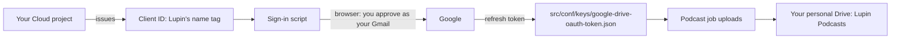

# Google Drive sign-in for podcast publishing: what, why, and the steps

## The short answer

- **Whose Drive:** yours, `ricardo.felipe.ruiz@gmail.com`. Files land in your personal Drive, in a folder
  called `Lupin Podcasts`.
- **Who signs in:** you, with that Gmail account, once, in a browser.
- **Why a Google Cloud project is involved at all:** Google lets a program touch anyone's Drive, a personal
  one included, only when the program shows an **OAuth client ID**. That ID is the program's name tag: it
  tells Google, and you on the consent screen, which app is asking. Google hands out client IDs only from
  a Cloud project. The project holds none of your files and is not billed for this.
- **Which project:** **any project you own.** `hello-world-foo-423219` was only a suggestion, because it
  already exists. If you have already started making a new project, or a client ID in a different
  project, keep going with that one; nothing in Lupin depends on the project's name.
- **Why Lupin's own login does not cover it:** Lupin's login is its own email-and-password system (a mock
  Firebase setup, `src/cosa/rest/auth.py`). It is not a Google sign-in, so it carries no permission to
  touch your Drive.



## Where you might be now

| If you have... | Go to step |
|---|---|
| nothing yet | 1 |
| a project, but no client ID | 2 |
| a client ID JSON already downloaded | 5 |
| run the sign-in script and seen "done" | nothing to do; tell Mr. Radio |

## The steps (about five minutes, once)

1. **Pick the project.** Open <https://console.cloud.google.com> signed in as your Gmail, and pick the
   project from the selector at the top: the one you started, or `hello-world-foo-423219`.
2. **Turn on the Drive API.** *APIs & Services → Library*, search "Google Drive API", press **Enable**.
   Without it every upload is refused, even after a good sign-in.
3. **Set up the consent screen.** *APIs & Services → OAuth consent screen* (newer consoles call it
   *Google Auth Platform → Branding / Audience*):
   - User type **External**. App name: `Lupin`. Support and developer email: your Gmail.
   - Under *Audience* (or *Publishing status*), press **Publish app** so it reads **In production**. In
     *Testing* mode Google expires the sign-in after 7 days and uploads stop. `drive.file` is not a
     restricted scope, so publishing needs no Google review.
   - Google would not publish until the *Branding* page had an **app home page**, a **privacy policy link**
     and a **terms of service link** (Rick, 2026-11-01).
4. **Make the client ID.** *APIs & Services → Credentials → Create credentials → OAuth client ID*.
   Application type **Desktop app**, any name. Press **Download JSON**.
5. **Put the JSON where Lupin looks.** Save it, renamed, as:

   ```text
   src/conf/keys/google-drive-oauth-client.json
   ```

   (in the main checkout, `/mnt/DATA01/include/www.deepily.ai/projects/lupin`). It is a secret: never
   committed, never linked into worktrees.
6. **Sign in once.** In my terminal, type:

   ```bash
   ! cd /mnt/DATA01/include/www.deepily.ai/projects/lupin && LUPIN_ROOT="$PWD" PYTHONPATH="$PWD/src" .venv/bin/python src/scripts/google-drive-authorize.py
   ```

   A browser tab opens. Choose your Gmail account. Because the app is yours and unverified, Google shows
   "Google hasn't verified this app": press **Advanced → Go to Lupin (unsafe)**, then **Allow**. The page
   asks only for "files this app creates" (`drive.file`); Lupin cannot see your other files. The script
   saves the token to `src/conf/keys/google-drive-oauth-token.json` and prints your email.
7. **Tell Mr. Radio.** I then switch publishing on, run one short real podcast, check that the folder and
   files appear in your Drive and that the card links open them, and send the receipt.

## What I have already done (2026-10-31)

- The upload code is merged (0910548f8 and a53707d30) and switched **off** by default.
- I installed `google-auth-oauthlib` 1.5.0, the version in `uv.lock`, into the shared `.venv`, so the
  sign-in script in step 6 can run.

## If something goes wrong

| What you see | What it means |
|---|---|
| `client file missing` from the script | step 5's file is not at that exact path or name |
| `redirect_uri_mismatch` or `invalid_client` in the browser | the client ID is a Web type, not **Desktop app**; make a Desktop one |
| "Access blocked: Lupin has not completed the Google verification process" (Error 403: access_denied) | step 3's **Publish app** was skipped, so the app is still in Testing and your Gmail is not a listed tester. Publish it, then sign in again. Seen 2026-10-31 |
| `webbrowser.Error: could not locate runnable browser` | the terminal has no browser to open. Put `BROWSER="echo %s"` in front of the command in step 6: the script then prints the sign-in link, and you open it in a browser on the same computer. Seen 2026-10-31 |
| uploads fail with `Drive API has not been used in project ...` | step 2 was skipped |
