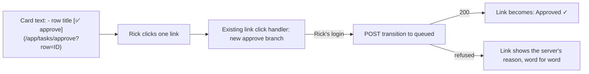

# One-click ticket approval from the action-required card

## The problem, in Rick's words

Approving a held ticket takes six steps: copy the ticket id, switch to the task list, find the row, open the
⋯ menu, pick "approve", press submit. Rick wants one click, from inside the action-required card.

## Rick's ruling (2026-10-31)

- **No change to how cards are drawn.** The approve control is an ordinary markdown link in the card's text,
  written the way a session writes a doc link.
- **The link is an action, not a destination.** Clicking it goes nowhere. It acts in place, the way an
  abstract icon link does, and the link changes to show the result.
- **Several tickets, one card.** A card asking about four tickets lists each one as a one-line bullet with
  its own approve link beside it. Rick clicks the ones he approves and leaves the rest.
- **The checkmark lives in the clients.** The code that turns a clicked link into "Approved ✓" is part of
  the legacy and multiplexer clients' own browser code, loaded with the app.

## What already exists (measured 2026-10-31, code map by an explore pass)

| Piece | Where | What it gives us |
|---|---|---|
| Approve request | `POST /api/tasks/{id}/transition` with `to_status:"queued"` (`src/cosa/rest/routers/tasks.py`, route `transition`) | the single move we need |
| Rick is never asked about his own click | `ASK_EXEMPT_PERSONAS = ("rick",)` in `src/cosa/rest/task_promotion_gate.py` | a click from Rick's login moves the row at once |
| Legacy client sender | `_transitionTask` in `src/lupin_app/static/js/notifications.js` | already sends that exact body and handles 202 |
| Multiplexer sender | `TaskListStore.transitionTask` in `src/lupin_app/static/js/multiplexer/stores/TaskListStore.ts` | the same, for the new client |
| Shared verb spec | `approve` in `src/lupin_app/static/js/shared/task-verbs.js` | legal only from `not_approved` |
| Link click catchers | the `/app/docs?path=` click handler in `notifications.js`; `docLink.ts` in the multiplexer | where the new branch goes |
| Link sanitizers | legacy keeps `href`; the multiplexer keeps `href` and `data-*` | a plain `href` survives both |

## The design

1. **The link format.** `[✅ approve](/app/tasks/approve?row=<full uuid>)`, one per bullet. A helper
   (MCP side and Python side) writes the bullet line for a row id, title included, so nobody hand-types it.
2. **The click.** Both clients' existing link click handlers gain one branch for `/app/tasks/approve?row=`.
   It stops the browser from following the link and calls the client's existing approve sender. No new
   endpoint and no server change.
3. **The result, drawn in place.** On success the link is replaced by "Approved ✓"; on a refusal the
   server's reason is shown beside it; while waiting it is greyed so a double click sends once. Each link
   is independent, so "yes, yes, skip, yes" on four bullets is four clicks.
4. **A safe landing if the click is not caught.** A middle-click or a link preview opens
   `/app/tasks/approve?row=<id>`. That page approves nothing on its own: it shows the row and one Approve
   button. Opening a page never changes a row.
5. **Scope.** Approve only. Not clicking a link is the "no"; declining a ticket stays in the task list.

## Tests (the crew owns them)

- TypeScript, both clients: the approve branch calls the sender once with the row id; success shows
  "Approved ✓"; a refusal shows the server's text; a second click while waiting sends nothing; a doc link
  still behaves as before.
- Unit: the link helper writes the exact format for a real row id and refuses a malformed one.
- E2E, both clients: a card with three held rows, two clicks, and exactly those two rows read `queued`.
- The safe landing page: opening it leaves the row `not_approved`.

## Build order

1. The link helper, and the approve branch in the legacy client, with tests.
2. The same branch in the multiplexer, with tests.
3. The safe landing page.
4. A one-line note telling managers to use the helper when they ask Rick to approve rows.
