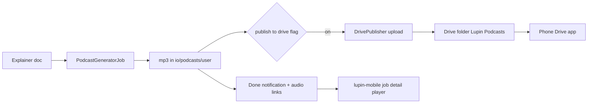

# Podcast publishing loop: Google Drive (desktop) and the phone

Rick, voice, 2026-10-31: make "explainer → podcast → listen on the phone" one seamless loop.
No earlier design was found (searched 2026-10-31: lupin tracked files, history, TODO, `src/rnd`,
`~/.claude/plans`, memory, task store), so this is a fresh design. The explainer-to-podcast half is covered by
[the 2026-10-08 document-to-podcast plan](2026.10.08-voice-driven-document-to-podcast-plan.md) (row
`4bf48f78`); this design adds only the delivery half.

## Two cases

| Started from | Where the audio must end up | Work needed |
|---|---|---|
| Desktop | Phone, via Google Drive | **New**: upload the finished mp3 to Drive |
| Phone (lupin-mobile) | Same phone | **Mostly exists**: `job_detail_screen.dart` already embeds `AudioArtifactPlayer`; the FCM wake push (`src/cosa/rest/fcm_wake_service.py`) summons the app when the done notification lands |

## Decision: login method (Rick, 2026-10-31)

**Rick's own Google login (OAuth, installed-app flow).** A service account was rejected because on a
personal Gmail account it has no storage quota, so uploads fail. rclone was rejected because it runs
outside the app and is hard to trigger and test.

- Scope: `https://www.googleapis.com/auth/drive.file`, so the app sees only files it created.
- One-time setup (human step): create an OAuth client ID (Desktop app) in Google Cloud Console and save
  it as `src/conf/keys/google-drive-oauth-client.json`. Then run `src/scripts/google-drive-authorize.py`,
  which opens the browser consent page and writes the refresh token to
  `src/conf/keys/google-drive-oauth-token.json`. Both files are secrets and are never committed or
  symlinked into worktrees.

## Desktop path design

- **New module** `src/cosa/utils/drive_publisher.py`, class `DrivePublisher`:
  - `publish( local_path, mime_type ) -> { file_id, web_view_link }`
  - finds or creates the folder named by the INI key `podcast drive folder name` (default `Lupin Podcasts`)
  - refreshes the token with `google.oauth2.credentials.Credentials` and uploads with a resumable
    `MediaFileUpload` through `googleapiclient`
  - the Drive service is injected so unit tests use a fake service
- **Hook**: `PodcastGeneratorJob._execute`, after the audio is written and before the completion notify.
  Three kinds of file are uploaded:
  - one mp3 per language (always, when publishing is on)
  - the script markdown, one per language (behind its own flag)
  - **the original source document**, `self.research_path`, uploaded once per job (Rick, 2026-10-31,
    behind its own flag, default on)
- **Grouping**: each job gets its own subfolder, `<timestamp>-<topic>`, inside the podcast folder, so the
  audio, scripts and source document of one podcast sit together.
- **INI keys** (`lupin-app.ini`, podcast section):
  - `podcast publish to google drive = false`, read **before** importing the Google modules, so a
    disabled feature imposes no dependency
  - `podcast drive folder name = Lupin Podcasts`
  - `podcast drive upload script = false`
  - `podcast drive upload source document = true`
  - `podcast drive token path = /src/conf/keys/google-drive-oauth-token.json`
- **Both podcast jobs** (`PodcastGeneratorJob` and `DeepResearchToPodcastJob`) call one shared hook;
  the implementation plan's Phase 3 has the detail.
- **Failure is non-fatal**: the podcast still completes. The abstract gains `**Drive**: upload failed
  (<reason>)` instead of a link, and the job logs one line.
- **Success**: each language line in the abstract gains `[☁️ Drive](<web_view_link>)`, and one line
  links the job's Drive subfolder.
- **Dependencies**: add `google-api-python-client`, `google-auth` and `google-auth-oauthlib` to the
  `dependencies` list in the root `pyproject.toml`. The first two are installed in `.venv` today only as
  side dependencies of other packages (checked 2026-10-31), and pyproject does not list them;
  `google-auth-oauthlib` is not installed and is needed only by the authorize script. `uv.lock` is
  regenerated with them, and the container images are rebuilt, because they install with
  `uv sync --locked`.

## Phone path

The phone path lives in the separate lupin-mobile repo, so it is managed in its own session. This repo
owes only the server side, which already sends the done notification with audio links. Gaps to verify
there, not here: submitting an explainer-plus-podcast from the phone in one action, and background or
lock-screen playback.

**Dependency: a separate ticket owned by Tiffany**, who owns the lupin-mobile repo. Rick filed it on
2026-10-31: row `3469e9db` ("UI and explainer to podcast generation to playback cycle", project
lupin-mobile, P0, accountable manager Mr. Radio). This design's desktop half does not wait
on it. The two halves meet only at the done notification's audio links, so any change to those links
here must be checked against Tiffany's ticket before it merges.

## Tests (100% lines, branches and functions)

| Tier | What | Venue |
|---|---|---|
| Unit | `DrivePublisher` with a fake Drive service: folder found, folder created, upload, token refresh, every failure arm | :7999 |
| Unit | `PodcastGeneratorJob` hook: flag off (no import), flag on success (link in abstract), flag on failure (non-fatal line) | :7999 |
| Integration | dry-run podcast with publishing on and a fake publisher injected | :8000 scheduled |
| Live | one real upload, run by me once the token exists, then the file is deleted | manual run, receipt in the row |

## Open questions

1. ~~Should explainer documents also go to Drive?~~ Answered by Rick on 2026-10-31: yes, the original
   source document is uploaded beside the audio. It goes up as markdown, unconverted; converting it to a
   Google Doc is still open.
2. Should old podcasts be removed from Drive after N days?
