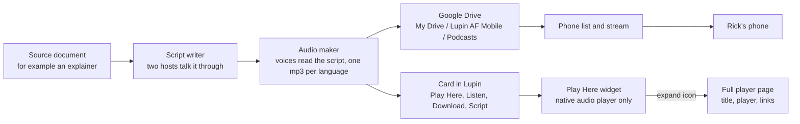

# From a document to a podcast on Rick's phone

This is the whole story of how a written document, such as an explainer, becomes a podcast episode that Rick can play on his phone. It describes only what is merged and running as of 1 November 2026.

## 1. The document

Everything starts with a written document. It can be a research report, or a hand-written explainer like this one. The podcast job reads it, and everything that follows is built from it.

## 2. The script

A language model reads the document and writes a script, a conversation between two hosts. The first line of the script is a heading that holds the episode's title, for example "Podcast: Grading Your Own Exam: Construct Validity". The word "Podcast:" is dropped, and what remains is the plain title used everywhere else. It carries no date, no time and no serial number. A run can produce a script in more than one language, and each language gets its own script.

## 3. The audio

Each line of the script is read aloud by a synthetic voice from ElevenLabs, one voice per host. The pieces are stitched together into a single mp3 file. If there are two languages, there are two mp3 files, one per language.

## 4. Upload to Google Drive

When the audio exists, a publish step copies it to Rick's own Google Drive. Nothing is uploaded if the switch for publishing is off, and it is on today.

- **Where:** My Drive, then a folder called Lupin AF Mobile, then a folder called Podcasts. Each episode gets its own subfolder named with the date, the time and the topic.
- **What goes in:** the mp3, and the original source document. The script file is not uploaded by default.
- **The title:** the clean title is saved as the subfolder's description, so a list of episodes can show a human title without reading any file.
- **How it signs in:** Lupin uses a token that Rick created once on the desktop by signing in to Google. The token only lets Lupin see files that Lupin itself put in Drive.
- **If it fails:** the episode is still finished. The card in Lupin says the upload failed and why.

## 5. The card and the Play Here player

When the job finishes, a card appears in Lupin with links: Script, Play Here, Listen, Download, and the Drive folder.

**Play Here** opens a small floating widget on the page. It shows the browser's native audio player and nothing else, with no heading, no buttons and no details. The widget has a close icon and an expand icon. The expand icon opens the full player page in a new tab and closes the widget, so the audio never plays twice.

The **full player page** shows the plain title, the audio player, a download button, a link to the script, a link to the original document, and the file details. Listen opens this same page directly. If a link's file does not exist, that link is left out instead of shown broken.

## 6. The owner-only document links

The script and the original document live in Lupin's own files under a folder named for the person who ordered the episode. The Script and Original document links open them in Lupin's document viewer. The viewer is closed to everyone by default, with one exception: you may read files in the folder that carries your own email address, and in a proxy card made for you. Another signed-in person is refused. So are tricks like climbing out of the folder with two dots, encoded slashes, or a shortcut that points into someone else's folder. This is read-only. Nobody can write through it.

## 7. The phone list and stream

Rick's phone talks to two endpoints, both served by Lupin using the same Drive token, so the phone never signs in to Google.

- **List:** returns the episode folders in Lupin AF Mobile / Podcasts, newest first, up to 50. Each entry has its title, creation time and files, and each file has a stream address.
- **Stream:** plays one file. The phone can jump around inside the audio, because the request for a byte range is passed straight to Drive and the answer comes back in small pieces, never held whole in memory.

Both endpoints answer only one person: the owner email set in Lupin's configuration, which is Rick's. Anyone else gets a refusal before Drive is touched. The stream also refuses any file that is not inside an episode folder under the configured Podcasts folder, so the phone cannot ask Lupin for some other file in Rick's Drive. If Drive itself is down, the answer says Drive is unavailable, which is different from "no such file".

## The short version

A document becomes a script, the script becomes audio, the audio is saved to Rick's Drive and announced on a card, the card plays it in a bare widget or a full page, the links to the script and the source open only for their owner, and the phone lists and streams the episodes from Drive through two owner-only endpoints.
