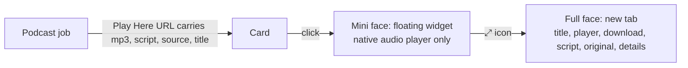

# Play Here widget: a mini face and a full face

## Rick's asks (row 53760b4c, 2026-11-01)

1. An expand icon in the widget's upper-right corner that opens the player in a new tab at full size, like the
   reading pane's bust-out button.
2. **Mini face** (the floating widget): only the browser's native audio player, scrolled into view. Nothing else.
3. **Full face** (the expanded tab): the audio player, the download, a link to the **script**, a link to the
   **original document**, the full title and the metadata.
4. The title is plain words, no dates and no serial numbers: "Grading Your Own Exam: Construct Validity…",
   not `2026.11.01-014849-grading-your-own-exam-construct-validit`.

## What exists today (read 2026-11-01)

| Piece | Where | Today |
|---|---|---|
| Card links | `src/cosa/agents/podcast_generator/job.py` `_audio_triplet`; same in `src/cosa/agents/deep_research_to_podcast/job.py` | Play Here = `/app/audio?path=<mp3>&embed=1`; no script, source or title in the URL |
| Floating widget, legacy client | `_showPodcastOverlay` in `src/lupin_app/static/js/notifications.js` | header (title = link text) + ✕ + a 96 px iframe |
| Floating widget, multiplexer | `showPodcastOverlay` in `src/lupin_app/static/js/multiplexer/render/podcastLinks.ts`, CSS `podcast-overlay.css` | the same, ported |
| Player page | `src/lupin_app/static/html/audio-player.html` | `embed=1` hides the nav but still draws the title, subtitle, download and file details, so the 96 px frame shows the top of the page, not the player |
| Title | the player page | built from the file name, so dates and the serial show |
| Script lookup | the player page: `mp3 path → -script.md` | **misses**: the script and the mp3 carry different time stamps (`…014724…-script.md` vs `…014849….mp3`), so the subtitle is always empty |
| Original document | the job's `research_doc_path` | never reaches the card or the player |

## The design

1. **The job puts everything the player needs in the link.** Play Here and Listen gain `script=<rel>`,
   `source=<rel>` and `title=<clean title>`. The job already knows all three, so the player no longer guesses
   from file names. Both podcast jobs share one helper so the two cannot drift.
2. **The clean title** comes from the script's first heading with the `Podcast:` prefix removed. For older
   cards with no `title=`, the player falls back to the file name with the date, time and serial stripped.
3. **The mini face.** With `embed=1` the player page draws only the `<audio controls>` element, with no
   heading, download or details, so the widget shows the player and nothing else. The widget's header keeps
   ✕ and gains a ⤢ icon; its title shows the clean title.
4. **The ⤢ icon** opens the same URL without `embed=1` in a new tab and closes the widget, so audio never
   plays twice. Same behaviour as the reading pane's bust-out.
5. **The full face** (no `embed=1`): clean title, the player, ⬇️ Download, 📝 Script, 📄 Original document
   (doc-viewer links), and the file details. A link whose file is absent is left out, not shown broken.
6. Both clients change together: the legacy `notifications.js` widget and the multiplexer `podcastLinks.ts`.

## Out of scope

Drive links (row d0361881) and the Listen link's behaviour, beyond carrying the same new query values.

## Tests (the worker owns them)

- Unit (Python): the link helper writes `script`, `source` and `title` for a real job; the title helper strips
  `Podcast:`; a missing script or source is left out of the URL.
- TypeScript, both clients: the widget has ⤢ and ✕; ⤢ opens the non-embed URL in a new tab and removes the
  widget; the widget title is the clean title.
- E2E, both clients: the mini face shows the audio element and no heading or download; the full face shows
  the clean title, Download, Script and Original links, and each link opens the right file; an old-style URL
  with no new values still plays and shows a date-free title.
- 100% lines, branches and functions on every changed file.

## Build order

1. The shared link and title helper in the jobs, with unit tests.
2. The player page's two faces.
3. The ⤢ icon in both clients' widgets, with TypeScript tests.
4. E2E for both clients; update `src/docs/wiki/capabilities/web-client-render-items-podcast-links.md`.
