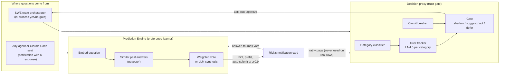
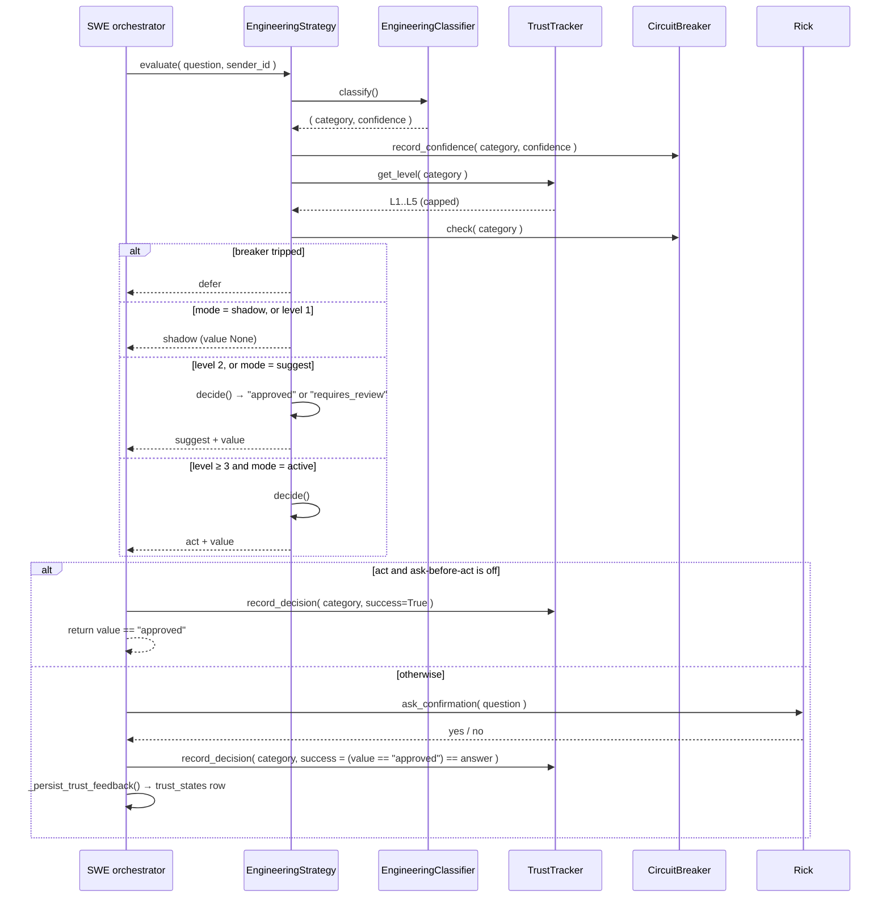
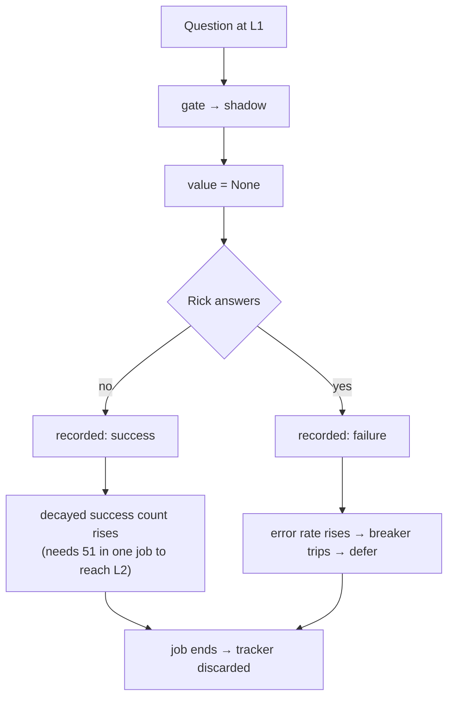
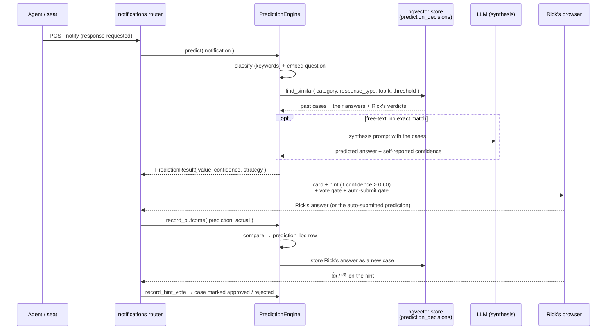
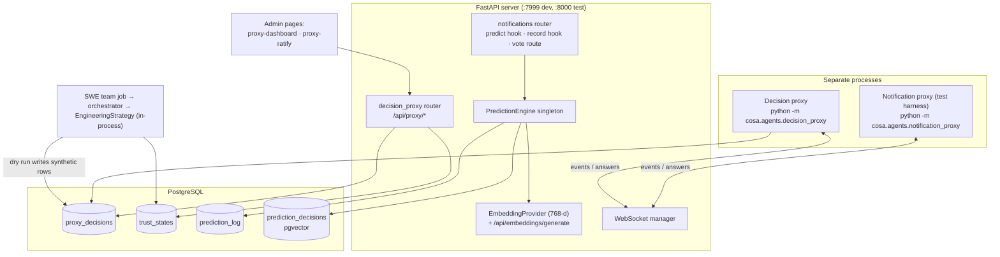
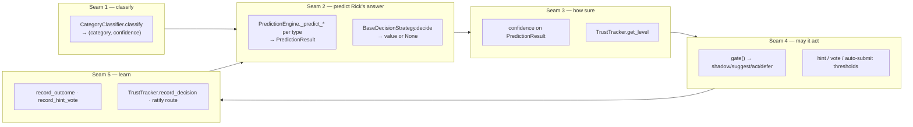
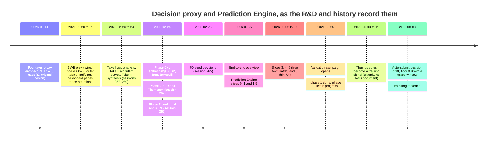

# The decision proxy's preference learning: how it works today, and where an LLM could take over

**For**: an outside design expert who will redesign the algorithm.
**Written by**: Pocholo, at Rick's request (row `55e451bf`, relayed by Mr. Radio).
**Source of truth**: the code at commit `3a2ffcbc6`. R&D documents are cited only as history and are labelled that way.

## How to read this document

Every claim carries one of four labels.

| Label | Meaning |
|---|---|
| **[Code]** | Read in the source at `3a2ffcbc6`; the file and symbol are named |
| **[Measured]** | Counted or run by me on 2026-11-03 between 20:51 and 20:53 EST; the query or probe is in the appendix |
| **[Inferred]** | My reading of what two facts imply; the link itself was not measured |
| **[R&D history]** | What a design document said when it was written; not a statement about the code now |

## 1. Summary

1. **There are two learners, not one.** The *decision proxy* is a trust gate that decides how much freedom an agent has in each decision category (levels L1–L5). The *Prediction Engine* is a separate system that predicts Rick's answer to each notification from his past answers. Only the Prediction Engine learns Rick's preferences in production today. [Code, Measured]
2. **The shipped trust gate is not Bayesian.** It counts time-decayed "agreements" against fixed thresholds (50, 200, 500, 1000). A Beta-Bernoulli model, an online Bayesian logistic regression (BLR), Thompson sampling, conformal deferral and the LLM fallback ("ICRL") are all written, but only the tests reach them. [Code; measured 2026-11-03 by `git grep` of every caller at `3a2ffcbc6`: no `trust_model=` argument outside the tests, no caller of `record_decision_with_features`, and both production constructors of `EngineeringStrategy` leave `thompson_enabled`, `conformal_enabled`, `icrl_enabled`, the case store and the LLM client at their off defaults. Section 3.3]
3. **The trust gate has never been used on real decisions.** The `proxy_decisions` table holds 66,683 rows. Every one is synthetic, every one is a pending suggestion, and none has been ratified. [Measured 2026-11-04 01:51 UTC by a read-only SQL count, appendix A.1]
4. **At L1 the feedback rule inverts.** When the proxy has no answer (always the case at L1), the SWE orchestrator records Rick's "yes" as a proxy failure and his "no" as a success. Every category starts at L1 and restarts at L1 on each job, so the gate cannot climb. [Code; measured 2026-11-03 20:53 EST by an in-process probe in all three modes, appendix A.2]
5. **The L1–L5 dashboard displays levels; it cannot set them.** The only control is one global mode (disabled, shadow, suggest, active). The per-category caps are constants in code, and the INI keys meant to override them are read and then ignored. [Code: no route or page control writes a level, and `TrustStateRepository.update_trust_level` has no caller. Section 6]
6. **The Prediction Engine is case-based reasoning plus an LLM.** It retrieves similar past questions by embedding, votes among their answers (weighted by Rick's thumbs-up and thumbs-down), and for free-text questions asks an LLM to synthesise an answer from the retrieved cases. [Code]
7. **It already acts in Rick's stead in one place.** For a batch of free-text questions, a prediction at confidence 0.9 or above fills the form and submits it after a 5-second grace window, unless Rick intervenes. This is on in the shipped INI. [Code]
8. **Its measured yes/no accuracy does not beat a constant guess.** Over the last 60 days it was right 495 times in 657 (75.3%). Answering "yes" every time would have been right 519 times (79.0%). [Measured 2026-11-04 01:52 UTC from `prediction_log`, appendix A.1. The table mixes Rick's answers with automated ones; see the caveat there]
9. **Two of its accuracy figures are not real.** Free-text accuracy reads 100%, and that figure is **invalid**: the similarity it is scored on is a plain dot product (`PredictionEngine._cosine_similarity`), which equals cosine similarity only for unit-length vectors, and the stored values are not unit length (132 of 133 above 1.0, median 202). Multiple-choice accuracy is recorded for 2 of 2,812 rows. [Measured 2026-11-04 01:52 UTC, appendix A.1; Code for the cause]
10. **The seams for an LLM replacement already exist.** The classifier, the strategy's `decide` and `gate`, the case-based store, the Prediction Engine's per-type predictors, the outcome recorder and the two prompt templates are all swappable units. What is missing is a confidence measure that is calibrated and checked against a baseline. Section 7 proposes one.



## 2. The two systems and how they relate

| | Decision proxy (trust gate) | Prediction Engine |
|---|---|---|
| Question it answers | "May the agent act on its own in this category?" | "What will Rick answer to this question?" |
| Package | `src/cosa/agents/decision_proxy/`, domain layer `src/cosa/agents/swe_team/proxy/` | `src/cosa/agents/prediction_engine/` |
| Where it runs | Inside a SWE team job (`SweTeamOrchestrator._gated_confirmation` in `src/cosa/agents/swe_team/orchestrator.py`), and as a standalone process (`python -m cosa.agents.decision_proxy`) | Inside the FastAPI server, on every notification that asks for a response (`notify_user` in `src/cosa/rest/routers/notifications.py`) |
| Switched on? | `decision proxy enabled = false`; `swe team trust mode = shadow`; `swe team enabled = false` (`src/conf/lupin-app.ini`) [Code] | `prediction engine enabled = true` [Code] |
| Learns from | Agreement between its answer and Rick's | Rick's actual answers, plus thumbs votes on hints |
| Data so far | 66,683 synthetic rows, 0 ratified; 38,052 one-decision trust rows [Measured] | 1,250 stored cases since 2026-09-25; 4,683 scored predictions since 2026-04-05 [Measured] |

They share code: the Prediction Engine's classifier implements the decision proxy's `CategoryClassifier` interface, and both use `ProxyDecisionEmbeddings` as their vector store. [Code: `NotificationCategoryClassifier` in `src/cosa/agents/prediction_engine/notification_category_classifier.py`; `PredictionEngine._get_embedding_store` in `prediction_engine.py`]

They do not share state. The trust gate never reads the Prediction Engine's cases, and the Prediction Engine never reads trust levels. [Code: no import of either from the other outside the shared classes above]

The Rick of the R&D wanted both under one name, the "Universal Decision Proxy" (the INI section header still says so above the `prediction engine *` keys). [R&D history: see section 9]

## 3. The decision proxy: the algorithm as implemented

### 3.1 The pipeline: classify, look up the level, gate, decide



[Code: `EngineeringStrategy.evaluate`, `.gate`, `.decide` in `src/cosa/agents/swe_team/proxy/engineering_strategy.py`; `SweTeamOrchestrator._gated_confirmation` in `src/cosa/agents/swe_team/orchestrator.py`]

The abstract base, `BaseDecisionStrategy.evaluate` in `src/cosa/agents/decision_proxy/base_decision_strategy.py`, hard-codes `trust_level = 1`. Only the SWE subclass overrides it to ask the tracker. A new domain strategy that does not override `evaluate` would be stuck at L1. [Code]

### 3.2 The category classifier

`EngineeringClassifier.classify` (`src/cosa/agents/swe_team/proxy/engineering_classifier.py`) is a keyword counter. [Code]

- Six categories: `deployment`, `testing`, `deps`, `architecture`, `destructive`, `general` (`ENGINEERING_CATEGORIES` in `engineering_categories.py`).
- For each category, count the keywords that occur as **substrings** of the lower-cased question. Confidence is `min( 0.5 + 0.1 × matches, 0.95 )`.
- A sender hint adds 0.15 (capped at 0.98): `swe.tester` hints `testing` (`SENDER_CATEGORY_HINTS`).
- No match: the sender's hinted category at 0.45, or `general` at 0.3.
- Highest score wins; ties go to dictionary order.

Because matching is by substring, "test" matches "latest" and "clean" (a `destructive` keyword) matches "cleanup". [Inferred from the code; not measured on real traffic]

The confidence is a keyword count, not a probability. Two consumers treat it as one: the circuit breaker's "confidence collapse" check, and the `decide`-time suggestion text shown to Rick ("confidence: 70%"). [Code: `CircuitBreaker.check`; `_gated_confirmation` step 2]

### 3.3 The trust tracker and its three level models

`TrustTracker` (`src/cosa/agents/decision_proxy/trust_tracker.py`) keeps one `CategoryTrust` per category. Each records outcomes as `( timestamp, success )` pairs and three lifetime counters (`total_decisions`, `total_successes`, `total_rejections`). The level is computed on demand by the `CategoryTrust.level` property, which dispatches on `trust_model`. [Code]

| Model | What it computes | Level rule | Who uses it |
|---|---|---|---|
| `count` (default) | `_effective_decision_count`: the sum over **successes only** inside a 30-day window of `exp( −ln 2 × age / 14 days )` | Highest level whose threshold (50, 200, 500, 1000) the decayed count reaches, capped | **Production.** Every `TrustTracker(...)` call outside the tests omits `trust_model` [Code: the two constructors, in `orchestrator.py` and `EngineeringStrategy.__init__`] |
| `beta` | Posterior Beta( successes + 1, rejections + 1 ) over lifetime counts | Highest level where the 5th percentile (`beta.ppf( 0.05, … )`) ≥ the rate threshold (0.70, 0.80, 0.90, 0.95) **and** n ≥ the minimum samples (20, 50, 100, 200) | Tests only |
| `blr` | Online Bayesian logistic regression over 4 features | Under 30 decisions, falls back to `beta`. Otherwise the highest level where `posterior_mean_rate()` ≥ the rate threshold and n ≥ the minimum samples | Tests only; `record_decision_with_features`, the only method that feeds the BLR, has no caller outside the tests [Code] |

**The default count model rewards volume, not accuracy.** Rejections never subtract; they are skipped. A category with 60 successes and 600 rejections in a fortnight reaches L2. [Code: `_effective_decision_count` skips `not success`; Inferred for the example] Only the circuit breaker (section 3.6) reacts to rejections.

The probe in appendix A.2 measured that 51 consecutive successes on the same day reach L2; 50 fall just short because each decays slightly. [Measured]

### 3.4 Is it Bayesian? Exactly how

**In production, no.** The level comes from a decayed count compared to fixed thresholds. Nothing is a posterior. [Code]

**In the code, yes, in two dormant forms.**

**(a) Beta-Bernoulli.** Each category's approval rate θ gets a uniform prior, Beta(1, 1). After s successes and r rejections the posterior is Beta(1 + s, 1 + r). The level gate uses the 5th percentile of that posterior, a one-sided 95% credible lower bound, so a category must be *confidently* above a rate before it graduates. [Code: `CategoryTrust._level_beta`]

**(b) Online Bayesian logistic regression with a Laplace approximation.** [Code: `BayesianLogisticRegression` in `src/cosa/agents/decision_proxy/bayesian_trust.py`]

- **Model.** P( success | x ) = σ( wᵀx ), with four features in [0, 1] (`CategoryTrust.build_feature_vector`):

  | # | Feature | Encoding |
  |---|---|---|
  | 0 | category | ordinal index ÷ 6 |
  | 1 | question length | min( words ÷ 50, 1 ) |
  | 2 | hour of day | hour ÷ 24 |
  | 3 | recent error rate | **always 0.0**: the builder leaves a placeholder "caller should set error_rate", and no caller does |

- **Prior.** w ~ N( 0, λ⁻¹ I ) with λ = `prior_precision` = 1.0.
- **Posterior.** Approximated as Gaussian, N( w_MAP, H⁻¹ ), where H is the Hessian of the negative log posterior.
- **Update, one observation ( x, y ).** With p = σ( wᵀx ) at the current mean and λₒ = p( 1 − p ):
  1. Sherman–Morrison rank-one update of the covariance: H⁻¹ ← H⁻¹ − λₒ (H⁻¹x)(H⁻¹x)ᵀ ⁄ ( 1 + λₒ xᵀH⁻¹x ).
  2. One Newton step on the mean: w ← w − H⁻¹ ( p − y ) x.

  Cost is O(d²) per observation. This is assumed-density filtering: one Newton step, not iteration to the true MAP, so the mean lags when p moves far in one step. [Inferred from the update rule]
- **Prediction.** The probit (MacKay) approximation: s² = xᵀH⁻¹x, p = σ( wᵀx ⁄ √( 1 + π s² ⁄ 8 ) ). It returns ( p, s ).
- **Thompson draw.** `sample_rate` draws w ~ N( w_MAP, H⁻¹ ) and returns σ( wᵀx ).
- **What sets the level.** `posterior_mean_rate()` evaluates σ( w_MAPᵀ x̄ ) at the *average* feature vector seen so far. Its docstring calls it "conservative"; it is a point estimate with no uncertainty term. [Code]

**Design consequences an expert should know.** [Inferred from the code]

- Category is encoded as one ordinal number inside one shared weight, but each category owns a separate BLR, so within a model feature 0 is a constant. It contributes nothing a bias term would not. There is no explicit bias term, so the constant category feature is acting as one, with a different scale per category.
- Feature 3 is always zero, so the model has effectively two informative features: length and hour.
- The level is read at x̄, so the features never affect the level of a specific question; they only shift the average.
- The Beta, BLR and Thompson paths read **lifetime** counters. The count model reads a 30-day decayed window. The two notions of "recent" disagree.
- `CategoryTrust.demote` prunes the `decisions` list, which only the count model reads. On a `beta` or `blr` category, demotion is a no-op. The probe in appendix A.2 measured a beta category at L3 before `demote( 2 )` and L3 after. [Measured]

### 3.5 The gate: modes, levels, caps and the optional extensions

`EngineeringStrategy.gate` applies these checks in order. [Code]

1. **Circuit breaker.** If `CircuitBreaker.check( category )` fails, return `defer`.
2. **Mode = shadow.** Return `shadow`.
3. **Conformal check** (only if `conformal_enabled`). See below.
4. **Thompson sampling** (only if `thompson_enabled`). Draw θ ~ Beta( s + 1, r + 1 ). Return `act` if θ ≥ 0.90, `suggest` if θ ≥ 0.70, otherwise `shadow`. This branch **ignores the trust level, its cap and the mode** (suggest mode can still `act`). [Code: `_gate_thompson`]
5. **Mode = suggest.** L2 and above → `suggest`; L1 → `shadow`.
6. **Mode = active.** L1 → `shadow`; L2 → `suggest`; L3–L5 → `act`.

The `confidence` argument to `gate` is unused. The admin guide's description of L3 ("acts on decisions with high confidence (>80%)") and L4 ("only queues low-confidence or destructive-category decisions") is not what the code does: L3, L4 and L5 behave identically. [Code: `gate`; `src/docs/proxy-admin-guide/01-why-trust-levels-and-contents.md` § "Trust Level Progression"]

The level names differ in three places. [Code]

| Level | `TRUST_LEVELS` in `decision_proxy/config.py` | Dashboard `TRUST_LABELS` in `proxy-dashboard.js` | What `gate` does in active mode |
|---|---|---|---|
| L1 | Shadow — predict only, log, don't act | Shadow | `shadow` |
| L2 | Suggest — queue as provisional, human ratifies | Provisional | `suggest` |
| L3 | Act + Notify — commit decision, async audit | Trusted | `act` |
| L4 | Autonomous + Audit — 10% random audit | Autonomous | `act` (no audit is drawn; `l4_audit_sample_rate` is read and unused) |
| L5 | Full Autonomy — circuit breaker only | Full Trust | `act` |

**Caps.** `deployment`, `destructive` and `architecture` are capped at L3; the rest at L5 (`DEFAULT_*_CAP_LEVEL` in `src/cosa/agents/swe_team/proxy/config.py`). The cap is applied inside `CategoryTrust.level`. The INI keys `swe engineering proxy deployment cap level` (and the destructive and architecture ones) are read by `swe_proxy_config_from_config_mgr`, but `get_category_cap_level` reads the module constants, so the INI values never take effect. [Code]

**Conformal deferral** (`ConformalDecisionWrapper` in `src/cosa/agents/decision_proxy/conformal_wrapper.py`). Split conformal prediction for a binary label. Nonconformity is 1 − p(true class). With n calibration scores and α = 0.10, the threshold q is the ⌈(n + 1)(1 − α)⌉-th smallest score. A class enters the prediction set when its score ≤ q; a set with both classes (or neither) means `defer`. The gate asks the BLR for p at the category's x̄. [Code]

`EngineeringStrategy.calibrate_conformal` builds its calibration set by giving every past outcome of a category **the same probability** (the BLR's p at x̄) and the observed label. That is not held-out data and every point in a category is identical, so the coverage guarantee does not hold. Nothing in production calls `calibrate_conformal`. [Code; Inferred for the guarantee]

**Not built.** `bald_enabled` and `bald_defer_threshold` are read into the config dict and used nowhere. [Code: `trust_proxy_config_from_config_mgr`; no other reader]

### 3.6 The circuit breaker

`CircuitBreaker` (`src/cosa/agents/decision_proxy/circuit_breaker.py`) trips a category, demotes it by two levels and defers everything in it for an hour, on either of two signals. [Code]

| Signal | Rule | Default |
|---|---|---|
| Error-rate spike | lifetime `rejections ÷ decisions` > threshold, once there are ≥ 10 decisions | 0.15 |
| Confidence collapse | mean of the last 20 classifier confidences < threshold, once there are ≥ 5 | 0.3 |

After the cooldown the trip clears by itself. The rule uses lifetime counts, so a category that had a bad first week stays above 15% for a long time and re-trips every hour. [Inferred] A trip posts a high-priority alert notification (`SweTeamOrchestrator._on_circuit_breaker_trip`). Trip state lives only in memory; the `trust_states.circuit_breaker_state` column is null in all 38,052 rows. [Code, Measured]

### 3.7 Deciding the answer: heuristic, case-based shadow, and the ICRL fallback

`EngineeringStrategy.decide` returns a fixed rule: `requires_review` for `deployment`, `destructive` and `architecture`, and `approved` for the rest. [Code]

Two optional add-ons sit beside it. Neither is wired in production, because `EngineeringStrategy` is always built without a case store, an embedding provider or an LLM client. [Code: both constructors]

- **Case-based reasoning in shadow.** `CBRDecisionStore.predict` (`cbr_decision_store.py`) retrieves the top 5 similar past cases in the category, takes a majority vote on their values, and scores confidence = top similarity × the majority's share. The strategy logs whether it agrees with the heuristic and never uses it. [Code]
- **In-context learning fallback ("ICRL").** When the case vote's confidence is under 0.60 **and** the cases disagree, the strategy builds the prompt in `prompts/icrl_decision.py` (`build_icrl_prompt`): the question, the category, and up to 5 numbered past cases with their values and ratification states. The model must answer one word, `approved` or `requires_review`. Any other reply is discarded and the heuristic stands. Despite the name there is no reinforcement-learning loop; it is few-shot prompting over retrieved cases. [Code]

### 3.8 Where Rick's answers feed back, and the inversion at L1

There are three feedback doors into the trust gate. [Code]

| Door | Writes | Read back by the gate? |
|---|---|---|
| SWE orchestrator, after Rick answers (`_gated_confirmation` step 4) | In-memory `TrustTracker.record_decision`, then a `trust_states` row via `TrustStateRepository.update_after_ratification` | The in-memory tracker, yes, for the rest of that job. The row, never |
| SWE orchestrator, on auto-approval (step 2) | `record_decision( success=True )` with no human verdict | Yes, for that job |
| Ratify page (`ratify_decision` in `src/cosa/rest/routers/decision_proxy.py`) | `proxy_decisions.ratification_state` and a `trust_states` row keyed on the ratifier's email | Never |

**The L1 inversion.** At L1 the gate returns `shadow` and `evaluate` skips `decide`, so the proxy's value is `None`. Step 4 computes `proxy_would_approve = ( value == "approved" )`, which is `False`, and records `success = ( False == user_answer )`. So a "yes" from Rick is recorded as a proxy failure and a "no" as a success. [Code; Measured, appendix A.2: in all three modes, at L1, `user_yes=True → success=False`]

**Self-reinforcement above L2.** An auto-approved `act` is recorded as a success without Rick ever seeing it. [Code]

**No memory across jobs.** The tracker is created fresh inside each `SweTeamOrchestrator`. Nothing loads `trust_states` back. The fallback user key is `f"{session_id}@swe.deepily.ai"`, so each job writes its own rows. [Code] The table holds 38,052 rows, all under `@swe.deepily.ai`, and **no row has more than one decision**. All are at trust level 1. [Measured]

| Category | Rows | Recorded successes | Recorded rejections |
|---|---|---|---|
| general | 32,340 | 11,435 | 20,905 |
| testing | 1,911 | 1,904 | 7 |
| deployment | 1,902 | 0 | 1,902 |
| architecture | 1,899 | 0 | 1,899 |
| deps, destructive | 0 | — | — |

[Measured.] Which jobs wrote these rows, and whether a human or a test answered, was not measured. Under the L1 rule above, a "success" row means the answer was "no". [Inferred]



**Inferred consequence.** Combined, these mean the trust gate cannot graduate any category in normal use: a job would need about 51 "no" answers in one category, and the next job starts again at L1.

### 3.9 The standalone decision proxy process

`python -m cosa.agents.decision_proxy` (`__main__.py`) runs the same strategy as a separate process that watches the notification stream. [Code]

- It refuses to start unless `decision proxy enabled = true`, and refuses again if the SWE profile fails to load (`main`, `_load_swe_team_profile`).
- `DecisionListener` (`listener.py`) logs in over the WebSocket and subscribes to `notification_queue_update`, `job_state_transition` and `sys_ping`.
- `DecisionResponder._handle_decision_event` (`responder.py`) checks the master switch first, then the sender allowlist (fail-closed; the three `swe.*` addresses), then runs `evaluate`, then:
  - `shadow` → logs a `proxy_decisions` row with `ratification_state = not_required`;
  - `suggest` → logs a pending row for the ratify page;
  - `act` → defers to Rick if he is available, otherwise posts the answer through the REST API;
  - `defer` → logs only.
- **Availability** (`SmartRouter` in `smart_router.py`, `sessions_feed` in `user_presence.py`): Rick is available when the hour is inside 09–22 in `America/Chicago` **and** `GET /api/websocket-sessions` shows a live session for `decision proxy human user id` other than the proxy's own. That key ships empty, so the proxy treats Rick as always away. If the sessions call fails, `FEED_FAILURE_MEANS_CONNECTED = False` also treats him as away ("Proxy answers", Rick's ruling recorded in the constant's comment).
- The process builds its strategy without a case store or embedding provider, so the "embedding" persistence step (`_persist_embedding`) always returns early. [Code: `_load_swe_team_profile` passes neither] The comments in `responder.py` still say "LanceDB"; the store moved to PostgreSQL with pgvector (`ProxyDecisionEmbeddings` docstring).

## 4. The Prediction Engine: the live preference learner

### 4.1 Where it is called



[Code: `notify_user` (the "Prediction Engine Hook" block), `submit_notification_response`, `vote_on_prediction_hint` in `src/cosa/rest/routers/notifications.py`; `PredictionEngine.predict`, `.record_outcome`, `.record_hint_vote` in `src/cosa/agents/prediction_engine/prediction_engine.py`]

### 4.2 The algorithm by response type

All types first classify the message with `NotificationCategoryClassifier` (six keyword categories, `permission`, `confirmation`, `approach`, `input`, `workflow`, `meta`, plus `uncategorized`) and embed it (768 dimensions). Retrieval is filtered by category **and** response type. [Code]

| Response type | Method | Prediction | Confidence |
|---|---|---|---|
| yes/no | `_predict_yes_no` | Weighted vote over the top 5 cases at similarity ≥ 0.75; each case's answer is reduced to yes/no by its first word | top similarity × the winner's share of positive vote mass |
| multiple choice (single or multi-select) | `_predict_multiple_choice` | Weighted vote per option header | same shape |
| free text | `_predict_open_ended` | Tier 1: an exact match on the normalised question returns that answer. Tier 2: an LLM synthesises from the top 5 cases at similarity ≥ 0.85. On LLM failure, the top case's answer | Tier 1: its similarity. Tier 2: min( top similarity, the LLM's self-reported confidence ) |
| batch of free-text questions | `_predict_open_ended_batch` | The same two tiers on a key built from the questions' text (the message itself is a content-free preamble, bug `cdb5a76f`) | same |

**The vote weights are Rick's preference signal.** [Code: `_ratified_weight`, `_bounded_consistency`]

- An ordinary past case votes +1 for its answer.
- A case Rick thumbed up (`ratification_state = approved`) votes +2.0 (`prediction hint vote approved weight`).
- A case Rick thumbed down (`rejected`) votes **−2.0** against its answer, steering away from it.
- Consistency is the winner's tally over the sum of positive tallies, clamped to [0, 1], so negative votes cannot push it out of range.

For free text, thumbed-down cases are never returned as the answer, thumbed-up exact matches are preferred, and in the LLM prompt each case carries `user_verdict="approved"` or `"rejected"`. The prompt (`src/conf/prompts/prediction-engine-open-ended-synthesis.txt`) tells the model to weight approved cases heavily and never to paraphrase a rejected one. [Code: `_select_retrieval_case`, `_build_synthesis_prompt`]

**Learning is purely by accumulation.** Every answer Rick gives is stored as a new case (`_store_decision`), so the next similar question retrieves it. There are no learned weights, no decay and no per-category rates. "Online preference learning" here means: the case base grows, and thumbs votes reweight cases. [Code]

The LLM for free-text synthesis is `kaitchup/phi_4_14b` (`prediction engine open ended llm spec key`). [Code]

### 4.3 The gates that decide what Rick sees, and when the prediction acts

All three gates are thresholds on the same `confidence` number, stamped into the hint by the server so the browser cannot drift from the INI. [Code: `notify_user`]

| Gate | Threshold (INI key) | Effect |
|---|---|---|
| Show a hint | ≥ 0.60 (`prediction engine confidence threshold`) | The card shows the predicted answer |
| Offer thumbs voting | ≥ 0.50 (`prediction hint vote min confidence threshold`), and `prediction hint voting enabled = true` | 👍 / 👎 buttons on the hint |
| **Act for Rick** | ≥ 0.90 (`expeditor prediction auto submit confidence floor`), `expeditor prediction auto submit enabled = true` | Batch free-text only: the form is prefilled from the prediction and submitted after 5 s (`… grace window seconds`) unless Rick says "wait" or edits. Below 0.9 it prefills and waits for one tap |

[Code: `_batchPredictedAnswers` and `renderOpenEndedBatchUI` in `src/lupin_app/static/js/notifications.js`; the gate refuses any non-scalar answer]

57 logged batch predictions had confidence ≥ 0.9 (47 by exact retrieval, 10 by LLM synthesis). [Measured] Whether each was auto-submitted, or Rick stopped it, is not recorded in `prediction_log` and was not measured.

### 4.4 How well it predicts: measured

All figures from the live database, 2026-11-04 01:51–01:53 UTC. [Measured; queries in appendix A.1]

**Volume.** `prediction_log` has 4,683 scored predictions from 2026-04-05 to now; every one has a response. `prediction_decisions` (the case base) has 1,250 cases from 2026-09-25 to now: 781 multiple choice, 450 yes/no, 16 free text, 3 batch. Rick has cast 4 thumbs votes, all down. No case is thumbed up.

**Yes/no.**

| Window | Predictions | Right | Accuracy | Always "yes" would score |
|---|---|---|---|---|
| All time (from 2026-04-05) | 1,448 | 1,059 | 73.1% | not measured |
| Last 60 days | 657 | 495 | 75.3% | 519 (79.0%) |

In the last 60 days the engine predicted "yes" 602 times in 657 (91.6%); Rick answered yes 519 times (79.0%). [Measured]

**Calibration, yes/no, all time.** A calibrated predictor's accuracy in each band would sit inside the band. [Measured]

| Confidence band | Predictions | Right | Accuracy |
|---|---|---|---|
| 0.3–0.4 | 3 | 1 | — |
| 0.4–0.5 | 26 | 7 | 26.9% |
| 0.5–0.6 | 285 | 173 | 60.7% |
| 0.6–0.7 | 13 | 7 | 53.8% |
| 0.7–0.8 | 403 | 298 | 73.9% |
| 0.8–0.9 | 41 | 37 | 90.2% |
| 0.9–1.0 | 493 | 395 | 80.1% |
| above 1.0 | 184 | 141 | 76.6% |

The 184 rows above 1.0 (maximum 407.8) all date from 2026-05-06 to 2026-06-03. [Measured] The repository now clamps similarity to [0, 100] (`ProxyDecisionEmbeddings.find_similar` docstring), which I take to be the fix. [Inferred] The 476 rows at exactly 1.0 sit in the 0.9–1.0 band and score about 80%: a confidence of 1.0 means "the top case was identical and the vote was unanimous", not "certain". [Measured counts; Inferred meaning]

**Multiple choice.** 2,812 rows; `accuracy_match` is set on 2. The comparator returns `{"reason": "empty_answers"}` for the rest. So no multiple-choice accuracy exists. [Measured] The cause, whether the browser's answer arrives in a shape the comparator does not read, was not traced.

**Free text.** 133 rows scored by embedding similarity; all count as correct. 132 of the 133 similarities are above 1.0 (median 202.4, maximum 535.6), which a cosine similarity cannot be. `_cosine_similarity` takes a plain dot product and assumes unit vectors. One logged pair counted as a match: predicted "the file named 'config.yaml' in the /etc/settings directory", actual "the explainer I wrote about the KISS protocol". [Measured] The vectors on that path are evidently not normalised; whether the local provider or the HTTP fallback produced them was not measured.

**Batch.** 61 rows; none has an accuracy value. [Measured]

**Verdict for the designer.** The only real accuracy number, yes/no, is 3.7 points below the constant baseline over the last 60 days. The confidence that gates auto-submission has never been checked for calibration on the type it gates, because that type has no accuracy data. [Measured; the comparison is arithmetic on measured counts]

## 5. The infrastructure around both systems

### 5.1 Components



### 5.2 Persistence

| Table | Model | Writer | Reader | Contents now [Measured] |
|---|---|---|---|---|
| `proxy_decisions` | `ProxyDecision` (`src/cosa/rest/postgres_models.py`) | `ProxyDecisionRepository.log_shadow` / `log_decision` from the standalone responder; `SweTeamJob._execute_dry_run` (`src/cosa/agents/swe_team/job.py`) | ratify page, dashboard history | 66,683 rows, 2026-02-26 → now: 66,633 `synthetic_generated` and 50 `synthetic_seed`, all `suggest` / `pending`, 0 ratified |
| `trust_states` | `TrustState` | orchestrator feedback; ratify route | dashboard cards only | 38,052 rows, one decision each, all L1 |
| `prediction_log` | `PredictionLog` | `PredictionEngine.record_outcome` | `get_accuracy_summary` | 4,683 rows |
| `prediction_decisions` | `PredictionDecision` (`src/cosa/rest/db/vector_store_models.py`) | `_store_decision`, `record_hint_vote` | all Prediction Engine retrieval | 1,250 cases |

The SWE dry run writes up to 10 synthetic pending rows per run, valued by the keyword classifier's confidence (`approved` at ≥ 0.7). [Code] Those rows are what the ratify page lists. [Inferred: the page fetches `get_pending`, which has no user filter, and every pending row is synthetic]

### 5.3 Embeddings

768-dimensional vectors from the in-process `EmbeddingProvider`, with an HTTP fallback to `/api/embeddings/generate` for processes that cannot load the GPU model. Similarity comes back as a percentage, clamped to [0, 100]. [Code: `PredictionEngine._generate_embedding`, `_generate_embedding_via_http`; `ProxyDecisionEmbeddings.find_similar`] A class-level re-entrant lock makes the vote's check-then-write atomic (`ProxyDecisionEmbeddings._write_lock`).

### 5.4 The notification proxy and its scripts

`src/cosa/agents/notification_proxy/` is a **test-harness** auto-answerer, not a preference learner. It answers agents' questions during automated runs so a suite can proceed unattended. [Code: module docstrings; `src/conf/notification-proxy-scripts/README.md`]

- A three-tier chain: an LLM fuzzy-matches the question to a Q&A script entry (`LlmScriptMatcherStrategy`, Phi-4 locally or Gemini Flash on the VM per the two `llm spec key for notification proxy matcher` lines), then keyword rules (`ExpediterRuleStrategy`), then an Anthropic SDK fallback (`LLMFallbackStrategy`). [Code: `responder.py`]
- Scripts are JSON files per agent under `src/conf/notification-proxy-scripts/` (`deep-research.json`, `swe-team.json`, …), each scoped by sender id.
- `verification.py` uses an LLM to judge whether an answer matched the expected one.

It matters for the redesign as a ready-made pattern: an LLM choosing an answer from a fixed menu, with a separate LLM judge. [Inferred]

### 5.5 Configuration

The INI keys live in `src/conf/lupin-app.ini` under "Decision Proxy Configuration", "SWE Engineering Proxy" and "Prediction Engine Configuration". `trust_proxy_config_from_config_mgr` (`decision_proxy/config.py`) reads 35 trust keys. Which of them reach running code: [Code]

| Keys | Read into config | Reach the running gate |
|---|---|---|
| `decision proxy enabled`, active hours, timezone, human user id | yes | yes (standalone process) |
| `swe team trust mode` | yes | yes (orchestrator; the dashboard's mode selector writes it) |
| L2–L5 thresholds, decay half-life, rolling window | yes | yes, orchestrator only; the standalone process uses the defaults (`EngineeringStrategy` builds its own `TrustTracker( debug )`) |
| circuit breaker four | yes | orchestrator only |
| `l4 audit sample rate` | yes | no |
| beta rate thresholds and min samples | yes | no (passed to no tracker) |
| `similarity threshold`, `decisions table` | yes | table name only, in the standalone responder |
| `cbr top k`, `cbr confidence threshold` | yes | no |
| thompson three, conformal two, icrl two, bald two | yes | no |
| `swe engineering proxy * cap level` | yes | no (module constants win) |
| `swe engineering proxy ask before act` | yes | yes |
| `prediction engine *`, `prediction hint vote *`, `expeditor prediction auto submit *` | yes | yes |

## 6. The admin UI: L1–L5 per category

Two pages, both under `src/lupin_app/static/html/auth/admin/`. [Code]

### 6.1 The trust dashboard (`/app/admin/proxy-dashboard`)

- **Six category cards** (`renderTrustCards`, `createTrustCard` in `js/proxy-dashboard.js`). Each shows the level badge, its label, success rate, total, rejected, and a breaker dot. The data is `GET /api/proxy/trust/{email}?domain=swe` for the signed-in user (`get_trust_state`).
- **One mode selector** (`onModeChange`): disabled, shadow, suggest, active, for the whole `swe` domain. `PUT /api/proxy/mode` (`update_trust_mode`) writes `swe team trust mode` to the INI and, if a SWE job is running, changes its proxy's mode at once.
- **A recent-decisions table** per category, from `GET /api/proxy/decisions/swe/{category}`.

**What the levels on the cards mean.** The badge is the `trust_states.trust_level` column. Only `get_or_create` writes it, always as 1; `TrustStateRepository.update_trust_level` has no caller. So every card shows L1 whatever happens. [Code] Rick's own email has no rows (he has never ratified), so his cards read "No data". [Inferred from the measured 0 ratified rows and the measured email domains]

**How a level is set.** It is not. There is no per-category control on either page, no route that sets a level, and the caps are code constants. The only lever is the global mode. A level, where it matters at all, is computed inside one job's memory from that job's decisions. [Code]

### 6.2 The ratification page (`/app/admin/proxy-ratify`)

- Lists pending decisions (`GET /api/proxy/pending/{email}` → `ProxyDecisionRepository.get_pending`). The list is not filtered by user; the path's email is used only for the owner check. [Code]
- Approve or reject with optional feedback (`POST /api/proxy/ratify/{id}`), or delete a pending row (`DELETE /api/proxy/decision/{id}`). Ratifying sets the row's state and adds one to the ratifier's `trust_states` counters. [Code: `ratify_decision`]
- Nothing reads those counters back into any gate. [Code]

The admin guide (`src/docs/proxy-admin-guide/04-trust-feedback-loop.md` § "How Ratification Updates Trust States") draws ratification feeding a level change and a breaker trip. Neither link exists in code. [Code]

## 7. The seams for an LLM predictor, and later a generator

### 7.1 What can be swapped, and the contract each must keep



| Seam | Interface today | Swap-in for an LLM | Constraint to keep |
|---|---|---|---|
| 1. Classify | `CategoryClassifier.classify( question, sender_id, context ) → ( category, confidence )` (`decision_proxy/category_classifier.py`) | An LLM or embedding classifier | Categories are the unit of trust; changing the set orphans history. Confidence must become a probability if the breaker keeps reading it |
| 2a. Predict (notifications) | `PredictionEngine.predict( notification_dict ) → PredictionResult`, dispatching on `response_type` | An LLM given the retrieved cases for **every** type, not only free text; the synthesis prompt is the template | `PredictionResult.to_hint_dict` is what the browser renders; `_wrap_predicted_value` is what the comparators read |
| 2b. Predict (SWE gate) | `BaseDecisionStrategy.decide( question, category, context )` | Replace the fixed rule; the ICRL path (`_get_icrl_decision` with an `llm_client`) is already the hook | Must return `approved` / `requires_review`; the orchestrator compares to that string |
| 3. Confidence | `PredictionResult.confidence`; `TrustTracker.get_level` | A calibrated probability (section 7.2) | One number in [0, 1] per prediction |
| 4. Act | `EngineeringStrategy.gate`; the three thresholds in `notify_user`; `_batchPredictedAnswers` | Gate on a calibrated, per-category, baseline-beating confidence | The 5-second grace window and the scalar-answer refusal are safety features |
| 5. Learn | `record_outcome`, `_store_decision`, `record_hint_vote`; `TrustTracker.record_decision` | Same data, plus storing the LLM's own prediction and its stated reason | Fix the L1 inversion first, or the gate learns the opposite of Rick's preference |

The Prediction Engine is the better base for the swap: it already stores every real question with Rick's real answer, in every response type, and already has the predict → show → act → score loop. [Inferred from sections 4.1–4.4]

### 7.2 What confidence measure should gate acting in Rick's stead

**What exists today.** [Code]

| Measure | Where | What it is |
|---|---|---|
| top similarity × vote share | `_predict_yes_no`, `_predict_multiple_choice`, `CBRDecisionStore.predict` | A heuristic score, not a probability; measured 80% right at 1.0 |
| min( top similarity, LLM's stated confidence ) | `_predict_open_ended*` | The LLM's self-report, capped by retrieval |
| Beta 5th percentile per category | `_level_beta` | A real credible bound on the approval rate; dormant |
| BLR probit predictive | `BayesianLogisticRegression.predict` | A real predictive probability; dormant, two useful features |
| Conformal set size | `ConformalDecisionWrapper` | Valid only with held-out calibration; dormant and miscalibrated |
| Decayed success count | `_level_count_based` | Volume, not accuracy; the one in production |

**What I would ask the designer to consider.** [Inferred; a proposal, not measured]

1. **Score agreement, per category and per response type.** For each prediction, record whether Rick's answer matched. This is exactly `prediction_log.accuracy_match`, which works for yes/no today and needs fixing for multiple choice and free text.
2. **Gate on a lower credible bound of that agreement rate.** A Beta posterior over the matches in a recent window, per category and type. Act only when its 5th percentile clears the target, which is the dormant `_level_beta` applied to the right signal. It has the property Rick asked for: it opens only after enough evidence, and closes again when errors arrive.
3. **Require the bound to beat the baseline.** The baseline is the constant majority answer for that category (79.0% "yes" for yes/no over 60 days). A predictor that cannot beat it has not learned a preference.
4. **Calibrate the per-prediction confidence on held-out data,** for example by isotonic or Platt scaling against `accuracy_match`, and check calibration per band as in section 4.4. Only then does a per-prediction threshold such as 0.9 mean "90% right".
5. **Stage it**: shadow (predict and score, show nothing) → hint → prefill → act with a grace window → act with sampled audit. The code already has every stage except the audit draw.
6. **Keep the hard caps** on `destructive`, `deployment` and `architecture` as code constants that no learned score can override, and add a real per-category control on the dashboard.

## 8. Defects and gaps found while reading

| # | Finding | Evidence | Label |
|---|---|---|---|
| 1 | At L1, a "yes" is recorded as a proxy failure | `_gated_confirmation` step 4; probe A.2 | Code, Measured |
| 2 | Trust never persists across jobs; the DB rows are never read | `SweTeamOrchestrator.__init__`; 38,052 rows with one decision each | Code, Measured |
| 3 | Auto-approved decisions count as successes with no human verdict | `_gated_confirmation` step 2 | Code |
| 4 | Beta and BLR models never selected; BLR never fed | no `trust_model=` outside tests; no caller of `record_decision_with_features` | Code |
| 5 | BLR feature 3 is always 0; feature 0 is constant within a model | `build_feature_vector` | Code |
| 6 | `demote` is a no-op on beta and BLR categories | probe A.2 | Measured |
| 7 | L3, L4 and L5 behave identically; no L4 audit draw | `gate` | Code |
| 8 | Thompson branch bypasses the level, the cap and the mode | `gate`, `_gate_thompson` | Code |
| 9 | Conformal calibration uses one probability per category, not held-out data | `calibrate_conformal` | Code |
| 10 | INI cap-level keys are ignored | `get_category_cap_level` | Code |
| 11 | Dashboard level is always L1; no control sets a level | `update_trust_level` has no caller | Code |
| 12 | Admin guide describes confidence-based L3/L4 behaviour and a ratify → level link that the code does not have | admin guide parts 01 and 04 | Code |
| 13 | Ratify page lists only synthetic rows; no real decision has ever reached it | 66,683 synthetic, 0 organic | Measured |
| 14 | Yes/no prediction is below the always-yes baseline over 60 days | 75.3% against 79.0% | Measured |
| 15 | Free-text accuracy is computed on non-unit vectors and is meaningless | 132 of 133 similarities > 1 | Measured |
| 16 | Multiple-choice and batch accuracy are not recorded | 2 of 2,812; 0 of 61 | Measured |
| 17 | `BaseDecisionStrategy.evaluate` hard-codes L1 | `evaluate` | Code |
| 18 | Classifier matches keywords as substrings | `EngineeringClassifier.classify` | Code |

Not one of these is fixed by this document. Each needs a row if it is to be worked. [Statement of scope]

## 9. History: how the R&D got here

Everything in this section is **[R&D history]**: what the design documents said on the dates given. None of it describes the code now; sections 3–6 do that. Short paths: **S** = `src/rnd/v0.1.4/2026.02.14-swe-team-phase-4-decision-proxy-architecture/`, **P** = `src/rnd/v0.1.5/2026.02.23-trust-proxy-preference-learning/`.

### 9.1 Timeline



| Piece | Marked done | Where it says so |
|---|---|---|
| Architecture, levels, caps | designed 2026-02-14 | S/`2026.02.14-decision-proxy-architecture-original.md` |
| SWE proxy wiring, phases 0–8 | 2026-02-20 to 02-21 | S/`01-implementation-current.md` § Phase Status |
| Takes I, II, III | sessions 257, 258, 259; 2026-02-23 to 02-24 | P/`…take-I.md`, `…take-II.md`, `…take-III-synthesis.md` headers |
| Phase 0+1 (embeddings, CBR, Beta) | session 262, 2026-02-24, commit `bcd5e4e` | `history/2026-02-24-to-03-03-history.md` § Session 262 |
| Phase 2 (BLR, Thompson) | session 262 (continued), 2026-02-24 | same history file; the plan's own header still says "PLANNED" |
| Phase 3 (conformal, ICRL) | session 266, 2026-02-24 | P/`2026.02.24-phase-3-conformal-icrl-plan.md` header |
| Prediction Engine slices 0–6 | 2026-02-27 to 2026-03-03 (slice 3 `709ffc2`, slices 4–5 `e05f63e`, slice 6 `7554e97`) | P/`2026.02.27-universal-prediction-engine-plan.md`; P/`2026.03.02-slices-4-5-open-ended-prediction.md` |
| Live validation | opened 2026-03-25; phases 2–6 pending | P/`2026.03.25-prediction-system-validation-campaign.md` |
| Thumbs votes as a training signal | git `bbde599fe` (2026-06-03) and `5914586de` (2026-06-11) | no R&D document |
| Auto-submit | draft 2026-08-03, "Not fired to Rick" | `src/rnd/v0.2.0/_archive/E/2026.08.03-expeditor-prediction-auto-submit-decision.md` |

The index's session numbers for Phases 1 and 2 disagree with the history files; the history files are the ones used above.

### 9.2 Why each piece was chosen, in the documents' words

| Piece | Stated reason | Source |
|---|---|---|
| Beta-Bernoulli | Fixes "50 of 50 vs 50 of 500": a raw count gives L2 to 50 successes out of 500 | P/Take I § 3–4 |
| Order of build | "Beta-Bernoulli first, upgrade to BLR later… sequential upgrades" | P/Take III § 10.2 |
| BLR | Learns "*which features* predict approval"; "posterior variance x*ᵀΣx* indicates confidence"; the "simplest principled implementation" | P/Take III § 4.1; P/Take II § 1 |
| The four features | category ("different base approval rates"), length ("may correlate with complexity"), hour ("behavior may vary by time of day"), recent errors ("should lower trust"); called "a starting point" | P/`…phase-2-blr-thompson-sampling-plan.md` § 3.2 and Open Question 1 |
| Thompson sampling | "Natural exploration… self-correcting… automatic demotion without explicit thresholds"; "Thompson Sampling governs *whether* to act, CBR governs *how*" | P/Take III § 4.4 |
| CBR | "Works from first interaction", sub-millisecond, explainable, "zero LLM cost" | P/Take III § 4.3 |
| Conformal | "the only component that provides statistical guarantees" | P/Take III § 10.5; phase 3 plan § 3.1 |
| ICRL | the LLM "just needs to *see*" past cases (Song et al. 2025); demoted to an "optional layer for ambiguous cases" | P/Take I § 6; Take III § 4.6 |
| GP/BALD | "not a preference predictor — it's an **active query selector**"; deferred | P/Take III § 4.5, § 10.4 |
| Overall frame | "deferral is… an information-gathering mechanism" | P/Take III § 3.5 |

### 9.3 The end state the R&D described

- "The proxy replaces real-time babysitting with asynchronous batch review." (P/`2026.02.27-end-to-end-trust-proxy-overview.md` § The Core Problem)
- "If L3 (Trusted) + confidence > 0.80: → ACT autonomously… If L4-L5: → ACT on almost everything." (same document, § Where CBR Fits). The code has no such confidence test (section 3.5).
- Projected review load: "First week = 30 decisions to review per job. After a month = 3-5." (same document, § The Flywheel Effect)
- Projected autonomy by observation count: about 10–20% at 1–30 observations, 40–60% at 30–100, 80–95% above 100. (P/Take III § 6)
- "Day 30+: Enough data to consider selective auto-response." (P/universal-prediction-engine plan § Progressive Learning Timeline)
- Auto-submit: "Option C, floor 0.9, with a mandatory 3–5 second grace window", with the warning that "1.0 is brittle". (auto-submit draft § Recommendation)

### 9.4 What the R&D measured, and what it did not

- 50 seed decisions (25 approve, 25 reject); top retrieval match 80.7%; one CBR auto-approval at confidence 0.646. (history, session 265)
- Validation phase 1, 2026-03-25: 145 tests, 124 pass, 21 skipped; all 21 E2E tests marked skip. (P/validation campaign § Phase 1)
- **No accuracy rate was ever measured in the R&D.** The overview's dashboard figures (for example 93%, 247 of 265) are a mock-up, and the autonomy percentages are projections from the literature. Section 4.4 of this document holds the first accuracy figures I know of.

### 9.5 Where the R&D and the code part ways

| Topic | R&D said | Code at `3a2ffcbc6` does |
|---|---|---|
| Default trust model | "beta" (phases 2–3 history) | `count` (`CategoryTrust.__init__` default); nothing sets another |
| L3 behaviour | act when confidence > 0.80 | act regardless of confidence |
| L4 | 10% random audit | no audit |
| Caps | three documents disagree: L3 for deployment, architecture and destructive (original design, overview); destructive L2 and deps L4 (Take I § 10) | L3 / L3 / L3 and L5 for the rest, from constants |
| Cap configuration | three INI keys | read and ignored |
| Setting a level in the UI | never planned: the cards were "display-only" and the mode bar "Read-only in Phase 6"; Phase 8 added only the global mode dropdown (S/`04-ui-design-ratification-dashboard.md` § 5.1, § 5.2, § 11) | as planned: no level control |
| Disconnected surfaces | an audit on 2026-02-20 found the router unmounted, 18 INI keys unwired and the tracker "in-memory only"; marked fixed by 2026-02-21 (S/`02-disconnected-surfaces-audit.md`) | the tracker is still in memory only; its DB rows are written and never read |

ADR-003 gives the reason for caps: "approve test reruns != merge to main"; caps prevent "autonomy creep". (`src/rnd/v0.1.4/2026.02.13-claude-code-agentic-dev-team/02-architecture-decisions.md` § ADR-003)

## Appendix A. How the measurements were taken

### A.1 Database census (read-only)

Run from my seat tree with `LUPIN_ROOT` and `PYTHONPATH` pinned to it, through `cosa.rest.db.database.get_db`, on 2026-11-04 01:51–01:53 UTC. The scripts were throwaway files in my session scratchpad; the queries that produced each table are below.

```sql
-- proxy_decisions
SELECT action, ratification_state, data_origin, count(*) FROM proxy_decisions GROUP BY 1,2,3;
SELECT min(created_at), max(created_at), count(*) FROM proxy_decisions;
SELECT ratification_state, count(*) FROM proxy_decisions WHERE ratified_at IS NOT NULL GROUP BY 1;
-- trust_states
SELECT domain, category, trust_level, count(*), sum(total_decisions), sum(successful_decisions),
       sum(rejected_decisions), max(total_decisions) FROM trust_states GROUP BY 1,2,3;
SELECT split_part(user_email,'@',2), count(*) FROM trust_states GROUP BY 1;
SELECT count(*) FROM trust_states WHERE circuit_breaker_state IS NOT NULL;
-- prediction_decisions
SELECT response_type, ratification_state, data_origin, count(*) FROM prediction_decisions GROUP BY 1,2,3;
SELECT ratification_state, count(*) FROM prediction_decisions WHERE id LIKE 'hintvote-%' GROUP BY 1;
-- prediction_log
SELECT response_type, prediction_strategy, count(*),
       sum(CASE WHEN accuracy_match THEN 1 ELSE 0 END),
       sum(CASE WHEN accuracy_match IS NULL THEN 1 ELSE 0 END) FROM prediction_log GROUP BY 1,2;
SELECT width_bucket(prediction_confidence, 0, 1.0000001, 10), count(*),
       sum(CASE WHEN accuracy_match THEN 1 ELSE 0 END)
  FROM prediction_log WHERE response_type='yes_no' AND prediction_strategy='cbr_majority_vote' GROUP BY 1;
SELECT count(*), sum(CASE WHEN accuracy_match THEN 1 ELSE 0 END),
       sum(CASE WHEN (predicted_value->>'value')='yes' THEN 1 ELSE 0 END),
       sum(CASE WHEN (actual_value->>'value') ILIKE 'yes%' THEN 1 ELSE 0 END)
  FROM prediction_log WHERE response_type='yes_no' AND prediction_strategy='cbr_majority_vote'
   AND predicted_at > now() - interval '60 days';
SELECT count(*), min((accuracy_detail->>'similarity')::float),
       percentile_cont(0.5) WITHIN GROUP (ORDER BY (accuracy_detail->>'similarity')::float),
       max((accuracy_detail->>'similarity')::float),
       sum(CASE WHEN (accuracy_detail->>'similarity')::float > 1.0 THEN 1 ELSE 0 END)
  FROM prediction_log WHERE response_type='open_ended' AND accuracy_detail->>'method'='embedding_similarity';
```

**Population caveats.** The database is the shared one the dev server uses. Test and dry-run traffic is in it alongside Rick's own; `data_origin` separates them in `proxy_decisions` (all synthetic) but `prediction_log` has no such column, so its figures mix Rick's answers with any automated answerer's. [Measured: the column list of `PredictionLog`]

### A.2 In-process probe of the feedback rule and demotion

Pure Python, no server, no database writes.

```python
from cosa.agents.swe_team.proxy import EngineeringStrategy
from cosa.agents.decision_proxy.trust_tracker import CategoryTrust
for mode in ( "shadow", "suggest", "active" ):
    s = EngineeringStrategy( trust_mode=mode )
    r = s.evaluate( "Run the pytest unit test suite now?", "swe.tester@lupin.deepily.ai" )
    for user_answer in ( True, False ):
        agreement = ( ( r.value == "approved" ) == user_answer )   # orchestrator step 4
        print( mode, r.action, r.value, r.trust_level, user_answer, agreement )
c = CategoryTrust( "testing" )                                     # shipped default model
# record successes until c.level >= 2
b = CategoryTrust( "testing", trust_model="beta" )                 # 60 successes, then demote( 2 )
```

Output, verbatim in substance:

```text
mode=shadow  action=shadow value=None level=L1 user_yes=True  -> recorded success=False
mode=shadow  action=shadow value=None level=L1 user_yes=False -> recorded success=True
mode=suggest action=shadow value=None level=L1 user_yes=True  -> recorded success=False
mode=suggest action=shadow value=None level=L1 user_yes=False -> recorded success=True
mode=active  action=shadow value=None level=L1 user_yes=True  -> recorded success=False
mode=active  action=shadow value=None level=L1 user_yes=False -> recorded success=True
default trust_model: count
count model reaches L2 after 51 consecutive successes
beta model: level before demote L3, after demote(2) L3
```

## Appendix B. Glossary

| Term | Meaning here |
|---|---|
| Category | A bucket of decision types with its own trust level (SWE: six) or its own retrieval filter (Prediction Engine: six plus uncategorized) |
| Trust level L1–L5 | How much the SWE gate lets an agent do alone in a category; section 3.5 |
| Trust mode | One global switch: disabled, shadow, suggest, active |
| Ratify | Approve or reject a proxy decision after the fact on the ratify page |
| Case | One stored past question with Rick's answer and, optionally, his thumbs verdict |
| CBR | Case-based reasoning: retrieve similar past cases, reuse their answers |
| ICRL | Named "in-context reinforcement learning" in the code; in practice few-shot prompting over retrieved cases |
| Hint | The predicted answer shown on Rick's notification card |
| Auto-submit | The batch free-text path that submits the prediction for Rick after a grace window |
