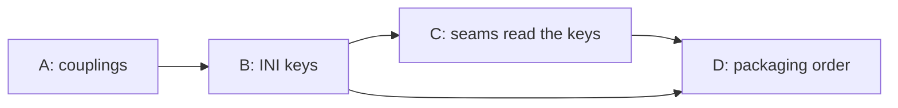

# Cascade revision handoff: code-health abstraction

Chloé 🗼 (author), 11 Nov 2026. Written for the lupin-resident session that builds §6.3 step 1 and for the `lupin-mobile` session that owns step 2. It is readable without the cascade topic files, DM threads or the Step 8 summary. Measured from lupin at `870c42685`, the revised plan merged by María, and from the commons topic `cascade-code-health-abstraction`.

## 1. Purpose and cross-reference

The input plan is `2026.11.09-abstracted-source-code-duplication-and-reuse-services.md` in this folder (the census of the five code-health services and the proposal to abstract them for other repos). Rick ordered a cascaded review of it (row `898c93d8`). The cascade ran on 11 Nov 2026 and closed all four sections, A to D. Rick then ruled the three open items, and the plan was revised and re-reviewed.

This document is the hand-off, not the plan. It says what the cascade changed, what Rick ruled, what stays open, and who builds what. The plan is the specification; where this document and the plan disagree, the plan wins and this document is the bug.

The task-stub manifest that accompanies it is `src/docs/plan-stubs/2026.11.09-abstracted-source-code-duplication-and-reuse-services.stubs.json` (26 steps in 5 phases, 31 rows with the phase rows). The phase headings it validates against are at the end of this document, because the plan itself carries no `## Phase N` headings.

## 2. Cascade telemetry

Cast: author Chloé, Stage 1 Rachel (usability and reuse), Stage 2 John (viability and gap), Stage 3 Pocholo (ownership), manager María. The cast was spawned at 13:21 EST on 11 Nov; Sections A and B closed at Stage 3 at about 13:35 and C and D at about 13:37 (commons timestamps).

| Section | Content | Stage 1 | Stage 2 | Stage 3 | Total | Inconsistency | Cosmetic |
|---|---|---|---|---|---|---|---|
| A | §4 couplings, §5 per repo versus shared | 6 | 4 | 3 | 13 | 10 | 3 |
| B | §6.1 per-repo settings, Q1 | 8 | 6 | 5 | 19 | 14 | 5 |
| C | §6.2 seams, Q2 | 9 | 6 | 6 | 21 | 21 | 0 |
| D | §6.3 packaging, §7 owed work, Q3, §8 | 7 | 5 | 6 | 18 | 11 | 7 |
| **All** | | 30 | 21 | 20 | **71** | **56** | **15** |

- **Foundational findings: none.** Nothing was escalated during the run.
- **Closure:** every finding was classified `revised` except A's V2 and V4 (`documented`, moved to §7 items 8 and 9), D's D4 (`documented`, then settled by John's read of the code), and D-O6 (`kept`, an item for Rick).
- **One finding was raised in severity** (C9, cosmetic to inconsistency) and **one backflow into a closed section** occurred (A's group 8, cosmetic, found by the author).
- **Rick's rulings** arrived after Stage 3 and needed a revision outside the cascade: commit `2af7b2bba`, then the light-review fixes `870c42685` (§4).
- **Not measured:** verbatim-accept rates, and message counts per section against the budget of 25.

Commit trail (author tip, with the merge where María reported one):

| Step | Commit |
|---|---|
| Cast manifest | `816f4a5b0`, `dfc477f65` (merged `30455b16d`) |
| A, B, C, D Stage 1 fixes | `8c2c09d64`, `235170c07`, `c6e41a276`, `1da17b578`, `377bb93cf` |
| A and B Stage 2 and 3 | `e29d4facd`, `b3089b2bc`, `c58a49baa`, `07acc1c73` (merged `cc9ee3f93`) |
| C and D Stage 2 and 3 | `ba68924cc`, `622465533` (merged `049ccac2d`) |
| Step 8 summary | `8443edd67` (merged `ac0cf9e0a`) |
| Rick's rulings folded in, then the review fixes | `2af7b2bba`, `870c42685` (merged by María) |

## 3. Per-section revision summary

The input plan had no acceptance criteria. Every AC below was created by the cascade, with an `EXECUTOR` tag and the 100% lines, branches and functions assertion (Lupin's coverage rule, `src/tests/run-coverage-gate.sh`). None is verifiable until its code exists.

### 3.1 Section A: couplings, per repo versus shared (13 findings)

- **Findings closed:** 10 inconsistency, 3 cosmetic. The main ones: the nine groups now cite full paths and the real constants (`LUPIN_PY_PACKAGES`, `LUPIN_JS_DIRS`, `TESTS_DIRS`, the `tests_spec` branch); group 6 names both compose mounts and the single-root loader; group 7 is split into "already a parameter" and "still a constant"; §5 states that merge gates are not a per-repo copy, the co-residence assumption with `:7999`, and that the onboarding baseline cost is unmeasured.
- **Documented, not revised:** the nine groups are **sampled, not a census** (§7 item 9), and the `lupin-mobile` baseline cost is **not measured** (§7 item 8).
- **Impact on ACs:** none created in A. §7 items 8 and 9 carry executors and done-signals.

### 3.2 Section B: per-repo settings (19 findings)

- **Findings closed:** 14 inconsistency, 5 cosmetic. The settings are now **eight per-repo INI keys and one global key** in `lupin-app.ini` (§6.1), each with a default equal to today's value, a reader, and a splainer twin. The `.code-health.yml` was dropped after Rick's ruling (§4).
- **Moved out of the settings:** schedules stay in `src/conf/job-registry.json`; judge model and Jev version are code pins; `notify.on`, `doc_lint.standard`, `doc_lint.gates` and `remediation.filing` were dropped because nothing reads them.
- **ACs created:** B-AC1 to B-AC7 (census of keys and twins, defaults, bad values, path refusals, the real INI read through the real reader, key census with a name check, and the ledger sync with its drift check).

### 3.3 Section C: the seams (21 findings)

- **Findings closed:** 21 inconsistency. The direction: **a seam is a name and a contract for an existing thing, never a new class.** Eight seams: `IndexSpec` (widened), `DataRoot` (`fleet_data_root`), `EmbeddingProvider`, `Judge` (duplicate check only; the doc-lint judge is a separate seam), `TaskStoreAdapter`, `Notifier` (`hook_link_tick`), `Scheduler` (`job-registry.json` plus `cron_generate.py`, which gains a repo key), `Gate` (the fixed hook chain).
- **Pinned:** the doc-lint rule list (`rule_lists.py`, ruling `b42eb0de`) is a pin; its drift since the freeze is cited with its rows.
- **ACs created:** C-AC1 to C-AC10, including the one-time mutation arm (C-AC3), the embeddings-route census (C-AC4, red until §7 item 10 lands), and the ceiling move (C-AC10).

### 3.4 Section D: packaging, owed work, Q3, §8 (18 findings)

- **Findings closed:** 11 inconsistency, 7 cosmetic. §6.3 is the one packaging list. The installer composes `install-git-hooks.sh` and `cron_generate --install` and checks `install-cosa-voice.sh --check-only` as a precondition. Q3 states the real mount mechanism (a bind mount cannot take a glob) and the corrected costs of the alternatives. The two-week gate has a start event and a literal pass signal.
- **ACs created:** D-AC1 to D-AC4, plus D-AC3b (the container reads the new repo's vectors after the recreate).

### 3.5 Cross-section dependencies and shared state

- The keys in B are what C's seams read; C's `Scheduler` change (a registry repo key) and `duplicate_check_daily.py` ceiling change both depend on B's keys existing first.
- D's installer writes B's keys and runs C's ledger sync; D's phase order follows from "name existing seams" in C, not from a new package.
**Shared state the builder must treat as interaction pairs:**

| State | Writers | Readers or other writers |
|---|---|---|
| The Jev ledger file (`jev-spend-ledger.jsonl`, one per repo folder) | the §6.1 sync (`create`, `set_limit`); every Jev run (`begin_run`, spend, end) | the drift check at the start of each Jev run; the shadow audit's lifetime check (`reuse_shadow.py`) |
| `lupin-app.ini` per-repo keys against the ledger's limit row | the INI (the single source) and the sync | the drift check, which fails loud when they differ |
| The duplicate check's run history (`runs.jsonl`, `job-summary.json`, `run.lock`, `daily.log`) | the duplicate check (path moves from `io/` to `code-health`, step `ph1-s12`) | the registry entry's `summary_path`, `lock_path`, evidence path and `cron_log`; the jobs page; the status page |

- Build order: B's keys, then the sync and the ceiling move, then the seams, then `lupin-mobile`, then the package, then the plugin (§6.3).

## 4. Cross-section ratification summary

**Rick's three rulings, 11 Nov 2026 (card answers):**

| # | Ruling | Effect on the plan |
|---|---|---|
| 1 | **Q3: one read-only mount line per repo** (the plan's stance) | Q3 marked ruled; each onboarding needs a compose edit and `--force-recreate` of `:7999` and `:8000` |
| 2 | **All code-health settings live in Lupin's INI.** In his words: "if these are services that are created or abstracted by Lupin and provided to other repos then yes that information should live in Lupin's configuration file." | `.code-health.yml` retired; keys on the `external repo <name> ...` pattern; the duplicate check's per-run ceiling (800) moves from the registry argument to an INI key; schedules may stay in the registry, and any limit or budget lives in the INI |
| 3 | **Per-repo Jev limit as an INI key is the single source; the lifetime cap is kept** | `external repo <name> jev token limit` (Lupin's default 1428571428, the ledger's limit row read 11 Nov); one new thin sync writes the ledger from it, with a drift check; `reuse shadow audit lifetime token limit` stays as Rick's separate backstop |

**Step 9 light-review fixes S9-1 to S9-6 (`870c42685`, approved by Pocholo):**

- **S9-1:** two guards in `duplicate_check_daily.py` (`:1005`, `:1006`) refused a run without `--ceiling`; they now accept the INI key, a blank key still refuses naming the key, and C-AC10 covers it.
- **S9-2:** a registry row, not a listing in `external repos`, turns code health on for a repo; B-AC6 checks the directory-name match only for repos with a row. `par-pacific` and `claude-plans` do not match their directory names and stay off.
- **S9-3 to S9-6:** coverage wording on B-AC2, B-AC3 and B-AC5; Open sub-question 4; the drift check runs at the start of every Jev run and at the end of onboarding; leftover wording.

**Manager ruling on Q2's consequence (María, 11 Nov; not one of Rick's rulings):** Q2's move stays: the duplicate check's run history moves from `io/` to the `code-health` leaf under `fleet_data_root`, **every** `io/` reference in the code-health jobs follows (the five registry paths, six code lines in four files, measured at `12082dcde`), and the jobs page, the status page and the history command must read the moved files. This was an unwritten consequence in the plan until the Step 9 light review (H1, then R1 and R2). It is manifest step `ph1-s12`; C-AC1, C-AC2 and D-AC1 say "unchanged except the run-history location", and C-AC5 says "the same 17 lines except the cron-log path".

**Retired during the cascade:** a second settings file; `TaskSink` and `RepoSpec` as new classes; `Embedder` as a new wrapper; `judges.*`, `schedule.*`, `notify`, `doc_lint` and `repo.branch` as settings.

**Recon checklist, resolved** (every item from the plan's preface):

| Item | State |
|---|---|
| 100% lines, branches and functions | CARRIED: on every AC and every seam's code |
| Coverage does not reach `lupin-mobile` | CARRIED: step 2's lupin-side code is covered, the repo's own code follows its repo's rules |
| `lupin_mcp` is ratcheted, not swept | CARRIED: new code there is held to the ratchet table |
| Nested repos are separate | CARRIED: a `lupin-mobile` session builds step 2 |
| Path management | RESOLVED: every key path is relative to the repo root; the data subdir is a leaf under `fleet_data_root` |
| `REUSE-OUTCOME` per new definition | CARRIED: C-AC6 and the reuse gate; the one new thing is the ledger sync, with its lookup recorded in §6.1 |
| No test or job touches a GPU | CARRIED: C-AC4 states it |
| Seats install nothing in cron | CARRIED: D-AC3 and the Phase 1 gate step are `EXECUTOR: HUMAN` |
| Build belongs to a lupin-resident session | CARRIED (row `898c93d8`) |
| `:8000` serves the main checkout, check idle first | CARRIED at build time: D-AC1 names the scheduled path and `venue_idle` |

## 5. Post-cascade fold bundle: open items

None of these is a decision for Rick. Each has an owner and a done-signal in the plan.

| Item | Where | Owner and done-signal |
|---|---|---|
| **Open sub-question 1**: what carries a third repo's merge gate | §6.3 step 3 | The step 3 builder; done when the choice is written and a test shows a failing merge-gate input refused |
| **Open sub-question 2**: whether `lupin-mobile` retires its vendored doc-lint copy | §6.3 step 3 | Same builder; decided at step 3 |
| **Open sub-question 3**: `module_base` has no INI key | §6.2 | The step 1 builder; one outcome written and tested |
| **Open sub-question 4**: whether the shadow audit's per-drain ceiling becomes per repo | §6.1 | The step 1 builder; outcome written, census count updated if a key is added |
| §7 item 8: `lupin-mobile` baseline cost | §5, §7 | A `lupin-mobile` session |
| §7 item 9: dated census of couplings | §4, §7 | Any lupin seat; a timestamped table replaces the nine-group sample |
| §7 item 10: route `vector_build.py:61` through `EmbeddingProvider` | §6.2, C-AC4 | The step 1 builder; lands before or with C-AC4 |
| **Pocholo's leftover 1:** what `reinstall_command` prints for the ceiling | `duplicate_check_daily.py:523-528` (`limit_flag`, `reinstall_command` print `--ceiling N`) | **Manifest step `ph1-s13`.** After the ceiling moves to the INI, the printed install text must either omit `--ceiling` or print the INI key; the step 1 builder chooses and tests both cases |
| **Pocholo's leftover 2:** a negative control for B-AC6 | §6.1 | **Manifest step `ph1-s14`.** A registry row whose repo name differs from its directory must make the check fail |
| The run-history move from `io/` to the `code-health` leaf (Q2) | §6.2 `DataRoot`, C-AC2, C-AC5 | **Manifest step `ph1-s12`** (manager ruling, §4): every `io/` reference of the code-health jobs follows, starting from the five registry paths (`src/conf/job-registry.json` lines 34, 39, 55, 60, 83) and the code lines named in the step; the jobs page, the status page and the history command read the same records |
| The `lupin-mobile` owner and manager row | §6.3 step 2 | **Filed:** row `e1778814-f4fa-4def-a222-402d64379f07`, owned by Tiffany. Phase 2 step 1 in the manifest checks it is live |
| ~~Whether the 1 Oct change to `rule_lists.py` (`34988c0f7`) carried Rick's word~~ | §6.2 | **Closed:** Rick ruled keep (row `6b65f04e`). The plan's §6.2 paragraph now says so too |

## 6. Workflow-guidance index (candidates; each cites its anchor)

The deeper redline in planning-is-prompting is not written; the Manager files it.

1. **A late direction needs a sweep across sibling sections.** The "registry wins, the file holds no schedule" direction (B Stage 2) contradicted text already in Section A (group 8); found only because a grep for the old key name was run. Anchor: backflow classification on commons, 11 Nov 13:34 EST.
2. **A "move X to Y" ruling needs the reader code read, not only the plan.** Moving the ceiling to the INI hit two argument guards that refuse a run without `--ceiling` (S9-1). Anchor: light review at `2af7b2bba`.
3. **A census AC must be run against the live population before it is written.** B-AC6 was red the day it was written because two registered names differ from their directories (S9-2). Anchor: same review.
4. **A receipt must be a commit on a branch.** The store refused a receipt for a commit that existed only under `refs/archive/`. A seat whose branch is guarded cannot close its row until the manager merges. Anchor: transition refusal on row `b73470ed`, 11 Nov.
5. **`src/rnd/` accepts only `.md`**, so a stub manifest cannot live next to its plan; it lives in `src/docs/plan-stubs/`. The importer's `validate` also needs `## Phase N` headings in the file `plan_ref` names, which a review-cascade plan does not have. Anchor: `plan-stub-manifest.md` §3 and this hand-off.
6. **Reviewer citations drift.** Four of the Stage 1 findings carried a wrong path or line; each cite was re-opened before use. Anchor: author deposit on the `post-game` topic, 11 Nov.
7. **"Add EXECUTOR tags to every AC" is an instruction to create ACs when a section has none.** The review cascade input here had no ACs at all. Anchor: author deposit, same.
8. **A decision made after Stage 3 sits outside the cascade's 1-revision cap.** Rick's rulings needed their own revision and re-review; the workflow does not say how that loop is counted. Anchor: rows `b73470ed` and `d8d88860`.
9. **The light-review cap was exceeded once on this run, because the reviewer's own count was short.** A move ruling needs a census of every reader before the step is written: the run-history move was first scoped to four registry lines (H1) and then widened to every `io/` reference in the code-health jobs (R1, R2). Anchor: light-review re-check of `12082dcde`, 11 Nov.

## 7. Hand-off statement

**Who builds what.** A **lupin-resident session** builds §6.3 step 1 (Phases 0 and 1 in the manifest): row `898c93d8` is Rick's order that the build is lupin-resident. A **`lupin-mobile` session** owns step 2 (Phase 2); that row is filed as `e1778814-f4fa-4def-a222-402d64379f07`, owned by Tiffany. Steps 3 and 4 (Phases 3 and 4) are built after two repos run cleanly, by a lupin-resident session. **Owners in the manifest:** `owner_persona` is `cheech` for Phases 0, 1, 3 and 4. Phase 2 belongs to `tiffany`, but the importer takes one owner per manifest (`plan_stub_import.py` writes `m["owner_persona"]` on every row, and its phase fields have no owner), so Phase 2's steps carry `owner_role: tiffany (lupin-mobile session)` and the manager reassigns those rows after the import. **The correlation key `epic:code-health-abstraction-build` is kept** (María, 11 Nov).

**Order and gates.** Hold any third repo until two weeks of green scheduled runs on Lupin and `lupin-mobile` (Rick's decision 1; the window is defined in §6.3 step 2). Nothing in the plan is built yet; nothing in Lupin changes behaviour until step 1's ACs pass.

**Standing rules the builder must follow:**

- 100% lines, branches and functions on every file changed; a coverage run is never scoped when its output is read as a list.
- Commit with `git commit -F <file> -- <paths>`; never attach a heredoc to the commit line. Stage only your own files; never `git add .`.
- Seats never install cron lines. Rick runs `cron_generate --install`.
- Venues: unit and inline smoke on `:7999`; the merge pyramid's `:8000` rows go through `POST /api/v2/submit` after `python -m cosa.rest.venue_idle --port 8000` answers idle (exit 0). No test or job touches a GPU.
- Work in a worktree under `.claude/worktrees/`, with `LUPIN_ROOT` and `PYTHONPATH` both pinned to it.
- Every new definition carries a `REUSE-OUTCOME` line; the reuse gate checks it.
- Each new INI key gets a splainer twin in `lupin-app-splainer.ini`.
- `src/conf/lupin-app.ini` is always committed when modified, in its own commit when a merge is blocked on it.

**What the builder can rely on:** every claim in §6.1 and §6.2 cites a file and line at `870c42685`; the figures labelled "not measured" are not guesses. **What the builder must not assume:** that the sync command's name is final (`python -m lupin_mcp.reuse_ledger_sync` is proposed), that any AC is executable before its code exists, or that registering a repo in `external repos` turns code health on.

## Phase 0: Owed work first

The three owed items of §7 (4, 8, 9). Steps `ph0-s1` to `ph0-s3` in the manifest. Run first so the census and the baseline cost are known before the keys are written.

## Phase 1: INI keys and seams in cosa

Section 6.3 step 1. Steps `ph1-s1` to `ph1-s14`: the keys, the ledger sync, the ceiling move, `IndexSpec`, the `Scheduler` repo key, Rick's cron install (a gate), the embeddings route, the contract paragraphs, the run-history move, the `reinstall_command` text, the B-AC6 negative control and the merge pyramid (`ph1-s11`, last). Open sub-questions 3 and 4 are decision steps here.

## Phase 2: lupin-mobile as repo 2

Section 6.3 step 2. Steps `ph2-s1` to `ph2-s3`: a check that the owner row is live, the registry rows and keys, and the two-week green gate.

## Phase 3: Installable package and installer

Section 6.3 step 3. Steps `ph3-s1` to `ph3-s4`: Open sub-questions 1 and 2 as decisions, the installer, and the mount check after the recreate.

## Phase 4: Claude Code plugin

Section 6.3 step 4. Steps `ph4-s1` and `ph4-s2`: move the wrappers, then the new plugin manifest.

## Reuse review: coupling census script (row 43f4a504, step ph0-s3)

The census script was first written with its own `tracked_files` and `head_sha`. The lookups showed `cosa.repo.doc_lint.cli.tracked_files( root, ( "", ), scoped=False )` lists every tracked file from git, and `cosa.repo.doc_lint.range_gate.git` runs a git command and raises on failure. The script now calls both, so those two definitions are gone. Each remaining definition's search candidates are listed below with a ruling.

SEARCHED cosa.repo.coupling_census.validate_needles :: rs-9ff2becfc4 :: lupin_mcp.session_spawner.spawn_sessions :: UNRELATED :: starts sessions; shares only the words requires and ensures
SEARCHED cosa.repo.coupling_census.validate_needles :: rs-9ff2becfc4 :: cosa.rest.routers.tasks.create_task :: UNRELATED :: a task-store endpoint, validates a task payload
SEARCHED cosa.repo.coupling_census.validate_needles :: rs-9ff2becfc4 :: cosa.rest.task_store_rules.validate_transition :: UNRELATED :: validates a task status change, not a needle table
SEARCHED cosa.repo.coupling_census.validate_needles :: rs-9ff2becfc4 :: cosa.rest.routers.notifications.notify_user :: UNRELATED :: a notification endpoint
SEARCHED cosa.repo.coupling_census.validate_needles :: rs-9ff2becfc4 :: cosa.rest.routers.tasks._apply_transition_under_lock :: UNRELATED :: a task transition under lock
RULING cosa.repo.coupling_census.validate_needles :: DISTINCT checks that every needle has a kind and a mapping, which no existing validator does :: reuse-receipt: 4fedbecc4e14e5a5 :: search: rs-9ff2becfc4
REUSE-OUTCOME 4fedbecc4e14e5a5 :: rs-9ff2becfc4 :: WROTE_NEW checks that every needle has a kind and a mapping, which no existing validator does :: src/rnd/v0.2.3/2026.11.09-abstracted-source-code-duplication-and-reuse-services/01-cascade-revision-handoff.md#7.9-ph0s3

SEARCHED cosa.repo.coupling_census.in_population :: rs-383dad9dcc :: cosa.repo.gate_reachability.find_test_file_population :: UNRELATED :: walks the disk for test files, not git
SEARCHED cosa.repo.coupling_census.in_population :: rs-383dad9dcc :: lupin_mcp.fleet_cap_admission.admit :: UNRELATED :: fleet admission control
SEARCHED cosa.repo.coupling_census.in_population :: rs-383dad9dcc :: lupin_mcp.session_spawner.spawn_sessions :: UNRELATED :: starts sessions
SEARCHED cosa.repo.coupling_census.in_population :: rs-383dad9dcc :: cosa.rest.routers.tasks.query_tasks :: UNRELATED :: a task-store query endpoint
SEARCHED cosa.repo.coupling_census.in_population :: rs-383dad9dcc :: cosa.utils.checked_hash_pyc._in_scope :: RELATED :: an in-scope test for pyc rewriting, owned roots rather than vendored names
RULING cosa.repo.coupling_census.in_population :: DISTINCT drops a path with any of exactly three directory names (.venv, node_modules, site-packages) and nothing else; symindex skipped() would also drop SKIP_SUFFIXES files and change the stated population :: reuse-receipt: 1fa57c013fa8d776 :: search: rs-383dad9dcc
REUSE-OUTCOME 1fa57c013fa8d776 :: rs-383dad9dcc :: WROTE_NEW drops a path with any of exactly three directory names (.venv, node_modules, site-packages) and nothing else; symindex skipped() would also drop SKIP_SUFFIXES files and change the stated population :: src/rnd/v0.2.3/2026.11.09-abstracted-source-code-duplication-and-reuse-services/01-cascade-revision-handoff.md#7.9-ph0s3

SEARCHED cosa.repo.coupling_census.is_code :: rs-8761fa2ff2 :: cosa.rest.routers.notifications.notify_user :: UNRELATED :: a notification endpoint
SEARCHED cosa.repo.coupling_census.is_code :: rs-8761fa2ff2 :: cosa.repo.coupling_census.render :: UNRELATED :: the renderer in this file, which calls is_code
SEARCHED cosa.repo.coupling_census.is_code :: rs-8761fa2ff2 :: cosa.agents.presentation_generator.orchestrator.PresentationOrchestratorAgent._ingest_async :: UNRELATED :: ingests documents for a presentation
SEARCHED cosa.repo.coupling_census.is_code :: rs-8761fa2ff2 :: cosa.rest.v2.source_document.validate_source_documents :: UNRELATED :: validates a request's source documents
SEARCHED cosa.repo.coupling_census.is_code :: rs-8761fa2ff2 :: cosa.repo.doc_lint.claim_judge.history_destinations_missing :: UNRELATED :: checks history-note destinations in a lint report
RULING cosa.repo.coupling_census.is_code :: DISTINCT separates production code from tests, documents, history and backup copies; the existing is_test_path variants judge tests only :: reuse-receipt: e55f08a1376ee415 :: search: rs-8761fa2ff2
REUSE-OUTCOME e55f08a1376ee415 :: rs-8761fa2ff2 :: WROTE_NEW separates production code from tests, documents, history and backup copies; the existing is_test_path variants judge tests only :: src/rnd/v0.2.3/2026.11.09-abstracted-source-code-duplication-and-reuse-services/01-cascade-revision-handoff.md#7.9-ph0s3

SEARCHED cosa.repo.coupling_census.scan :: rs-ae70edd899 :: cosa.repo.coupling_census.run :: UNRELATED :: the caller of scan
SEARCHED cosa.repo.coupling_census.scan :: rs-ae70edd899 :: cosa.rest.podcast_proxy.check_source :: UNRELATED :: checks a scope path for a podcast source
SEARCHED cosa.repo.coupling_census.scan :: rs-ae70edd899 :: lupin_cli.claude_code.hooks.lib.commit_scope_guard._staged_paths :: UNRELATED :: lists staged paths
SEARCHED cosa.repo.coupling_census.scan :: rs-ae70edd899 :: lupin_cli.claude_code.hooks.lib.heartbeat_hold.classify_hold_file :: UNRELATED :: classifies a hold file
SEARCHED cosa.repo.coupling_census.scan :: rs-ae70edd899 :: cosa.repo.coupling_census.render :: UNRELATED :: the renderer in this file
RULING cosa.repo.coupling_census.scan :: DISTINCT one case-sensitive pass of fixed strings over many needles; reuse_search.git_grep is case-insensitive and takes one term, which would blur needles such as PROJECT = "lupin" :: reuse-receipt: d69eb10f8ac1ab6b :: search: rs-ae70edd899
REUSE-OUTCOME d69eb10f8ac1ab6b :: rs-ae70edd899 :: WROTE_NEW one case-sensitive pass of fixed strings over many needles; reuse_search.git_grep is case-insensitive and takes one term, which would blur needles such as PROJECT = "lupin" :: src/rnd/v0.2.3/2026.11.09-abstracted-source-code-duplication-and-reuse-services/01-cascade-revision-handoff.md#7.9-ph0s3

SEARCHED cosa.repo.coupling_census.check_controls :: rs-c60e3186ae :: cosa.rest.routers.notifications.notify_user :: UNRELATED :: a notification endpoint
SEARCHED cosa.repo.coupling_census.check_controls :: rs-c60e3186ae :: lupin_mcp.session_spawner.spawn_sessions :: UNRELATED :: starts sessions
SEARCHED cosa.repo.coupling_census.check_controls :: rs-c60e3186ae :: lupin_mcp.reuse_needset.first_thousand.control_stage_live :: RELATED :: a live control for the reuse needset: plants decoys and asks a judge; it checks a different pipeline
SEARCHED cosa.repo.coupling_census.check_controls :: rs-c60e3186ae :: lupin_mcp.session_spawner.dismiss_sessions :: UNRELATED :: reaps sessions
SEARCHED cosa.repo.coupling_census.check_controls :: rs-c60e3186ae :: lupin_app.main.lifespan :: UNRELATED :: server startup
RULING cosa.repo.coupling_census.check_controls :: DISTINCT asserts the first hit of a needle in a file is at a known line; positive_control.run_control plants records in a pool, which is a different control :: reuse-receipt: 77704f03c3e5e23f :: search: rs-c60e3186ae
REUSE-OUTCOME 77704f03c3e5e23f :: rs-c60e3186ae :: WROTE_NEW asserts the first hit of a needle in a file is at a known line; positive_control.run_control plants records in a pool, which is a different control :: src/rnd/v0.2.3/2026.11.09-abstracted-source-code-duplication-and-reuse-services/01-cascade-revision-handoff.md#7.9-ph0s3

SEARCHED cosa.repo.coupling_census.render :: rs-e469decc9a :: cosa.repo.coupling_census.run :: UNRELATED :: the caller of render
SEARCHED cosa.repo.coupling_census.render :: rs-e469decc9a :: lupin_mcp.session_spawner.default_fleet_gate :: UNRELATED :: fleet gate
SEARCHED cosa.repo.coupling_census.render :: rs-e469decc9a :: cosa.agents.deep_research.seed_context.read_seed_documents :: UNRELATED :: reads seed documents
SEARCHED cosa.repo.coupling_census.render :: rs-e469decc9a :: cosa.rest.routers.arbiter._live_fleet_counts :: UNRELATED :: counts live sessions
SEARCHED cosa.repo.coupling_census.render :: rs-e469decc9a :: lupin_cli.claude_code.hooks.register_session.main :: UNRELATED :: session registration hook
RULING cosa.repo.coupling_census.render :: DISTINCT builds the census table from hits and the population line; the doc_lint and directory_analyzer reporters format other data :: reuse-receipt: 12d8ed12a862641a :: search: rs-e469decc9a
REUSE-OUTCOME 12d8ed12a862641a :: rs-e469decc9a :: WROTE_NEW builds the census table from hits and the population line; the doc_lint and directory_analyzer reporters format other data :: src/rnd/v0.2.3/2026.11.09-abstracted-source-code-duplication-and-reuse-services/01-cascade-revision-handoff.md#7.9-ph0s3

SEARCHED cosa.repo.coupling_census.run :: rs-12f39e6cf0 :: cosa.rest.routers.notifications.notify_user :: UNRELATED :: a notification endpoint
SEARCHED cosa.repo.coupling_census.run :: rs-12f39e6cf0 :: cosa.repo.directory_analyzer.report_formatter.DirectoryReportFormatter.format_markdown :: UNRELATED :: formats line-of-code statistics
SEARCHED cosa.repo.coupling_census.run :: rs-12f39e6cf0 :: cosa.agents.deep_research.cli.save_report_with_frontmatter :: UNRELATED :: saves a research report
SEARCHED cosa.repo.coupling_census.run :: rs-12f39e6cf0 :: cosa.agents.shared.report_writer.ReportWriter.write :: UNRELATED :: writes an agent report file
SEARCHED cosa.repo.coupling_census.run :: rs-12f39e6cf0 :: cosa.repo.directory_analyzer.analyzer.quick_smoke_test :: UNRELATED :: a smoke test
RULING cosa.repo.coupling_census.run :: DISTINCT wires listing, scanning, the controls and rendering into one census; no existing function does this job :: reuse-receipt: df42ec3de13547b5 :: search: rs-12f39e6cf0
REUSE-OUTCOME df42ec3de13547b5 :: rs-12f39e6cf0 :: WROTE_NEW wires listing, scanning, the controls and rendering into one census; no existing function does this job :: src/rnd/v0.2.3/2026.11.09-abstracted-source-code-duplication-and-reuse-services/01-cascade-revision-handoff.md#7.9-ph0s3

SEARCHED cosa.repo.coupling_census.main :: rs-7cdfe429ef :: cosa.rest.routers.notifications.notify_user :: UNRELATED :: a notification endpoint
SEARCHED cosa.repo.coupling_census.main :: rs-7cdfe429ef :: cosa.agents.podcast_generator.orchestrator.PodcastOrchestratorAgent.from_saved_script :: UNRELATED :: loads a saved podcast script
SEARCHED cosa.repo.coupling_census.main :: rs-7cdfe429ef :: cosa.agents.runtime_argument_expeditor.expeditor.RuntimeArgumentExpeditor._build_request_context :: UNRELATED :: builds an expeditor request
SEARCHED cosa.repo.coupling_census.main :: rs-7cdfe429ef :: cosa.repo.coupling_census.run :: UNRELATED :: the function main calls
SEARCHED cosa.repo.coupling_census.main :: rs-7cdfe429ef :: cosa.repo.cli_common.add_common_output_args :: UNRELATED :: adds output flags to other repo tools' parsers; this tool has one flag
RULING cosa.repo.coupling_census.main :: DISTINCT the command line of this census, with exit 1 and a message when a control fails :: reuse-receipt: 3b2d91e6ad57eb9e :: search: rs-7cdfe429ef
REUSE-OUTCOME 3b2d91e6ad57eb9e :: rs-7cdfe429ef :: WROTE_NEW the command line of this census, with exit 1 and a message when a control fails :: src/rnd/v0.2.3/2026.11.09-abstracted-source-code-duplication-and-reuse-services/01-cascade-revision-handoff.md#7.9-ph0s3

SEARCHED cosa.repo.coupling_census.ControlFailed :: rs-22812407b4 :: lupin_mcp.session_spawner.spawn_sessions :: UNRELATED :: starts sessions
SEARCHED cosa.repo.coupling_census.ControlFailed :: rs-22812407b4 :: cosa.rest.routers.tasks._apply_transition_under_lock :: UNRELATED :: task transition
SEARCHED cosa.repo.coupling_census.ControlFailed :: rs-22812407b4 :: cosa.rest.routers.websocket.websocket_queue_endpoint :: UNRELATED :: a websocket endpoint
SEARCHED cosa.repo.coupling_census.ControlFailed :: rs-22812407b4 :: cosa.rest.task_approval_settings.refusal_for_pull :: UNRELATED :: a task-approval refusal
SEARCHED cosa.repo.coupling_census.ControlFailed :: rs-22812407b4 :: cosa.rest.routers.notifications.notify_user :: UNRELATED :: a notification endpoint
RULING cosa.repo.coupling_census.ControlFailed :: DISTINCT a named exception for a failed positive control, so main can refuse on it and not on any ValueError :: reuse-receipt: 5b828e7ca8b6886e :: search: rs-22812407b4
REUSE-OUTCOME 5b828e7ca8b6886e :: rs-22812407b4 :: WROTE_NEW a named exception for a failed positive control, so main can refuse on it and not on any ValueError :: src/rnd/v0.2.3/2026.11.09-abstracted-source-code-duplication-and-reuse-services/01-cascade-revision-handoff.md#7.9-ph0s3

## Reuse review: code-health settings reader (row 7ba187b5, step ph1-s1)

The settings reader first carried its own `load_registry`. The lookup showed `cosa.rest.job_registry.load_registry( root )` already reads and validates `src/conf/job-registry.json`, so the reader now takes that function's result and defines no loader of its own. The other sixteen definitions are ruled distinct below; `read_positive_int` and `check_relative` share a rule with `reuse_shadow._read_positive` and `reader_rig_run.check_prefix` but differ in the error they raise and in naming the key.

RULING cosa.repo.code_health_settings.CodeHealthSettingError :: DISTINCT a bare ValueError subclass whose message names an INI key; directory_analyzer ConfigurationError is a tool-specific error with config_path, field and value attributes :: reuse-receipt: c4c96d69e2dec5b3 :: search: rs-f82c6dec4a
REUSE-OUTCOME c4c96d69e2dec5b3 :: rs-f82c6dec4a :: WROTE_NEW a bare ValueError subclass whose message names an INI key; directory_analyzer ConfigurationError is a tool-specific error with config_path, field and value attributes :: src/rnd/v0.2.3/2026.11.09-abstracted-source-code-duplication-and-reuse-services/01-cascade-revision-handoff.md#6.1-ph1s1

RULING cosa.repo.code_health_settings.repo_key :: DISTINCT builds the new per-repo key names in one place; no shared builder exists, the scope registry writes its path and prefix keys as inline f-strings :: reuse-receipt: fc0caee76223be6c :: search: rs-847715be79
REUSE-OUTCOME fc0caee76223be6c :: rs-847715be79 :: WROTE_NEW builds the new per-repo key names in one place; no shared builder exists, the scope registry writes its path and prefix keys as inline f-strings :: src/rnd/v0.2.3/2026.11.09-abstracted-source-code-duplication-and-reuse-services/01-cascade-revision-handoff.md#6.1-ph1s1

RULING cosa.repo.code_health_settings.read_text :: DISTINCT reads through ConfigurationManager.get with silent=True and returns stripped text; librarian_tick.read_value reads the INI file fresh from disk and returns None :: reuse-receipt: 70328114ada66d43 :: search: rs-b4acce9bbe
REUSE-OUTCOME 70328114ada66d43 :: rs-b4acce9bbe :: WROTE_NEW reads through ConfigurationManager.get with silent=True and returns stripped text; librarian_tick.read_value reads the INI file fresh from disk and returns None :: src/rnd/v0.2.3/2026.11.09-abstracted-source-code-duplication-and-reuse-services/01-cascade-revision-handoff.md#6.1-ph1s1

RULING cosa.repo.code_health_settings.read_entries :: DISTINCT a plain strip-and-drop-blanks comma split of one key; parse_declared_managers also dedupes and drops the star entry :: reuse-receipt: 3768617800ffb64b :: search: rs-cfc50c5ce5
REUSE-OUTCOME 3768617800ffb64b :: rs-cfc50c5ce5 :: WROTE_NEW a plain strip-and-drop-blanks comma split of one key; parse_declared_managers also dedupes and drops the star entry :: src/rnd/v0.2.3/2026.11.09-abstracted-source-code-duplication-and-reuse-services/01-cascade-revision-handoff.md#6.1-ph1s1

RULING cosa.repo.code_health_settings.read_positive_int :: DISTINCT same positive-whole-number rule as reuse_shadow._read_positive, which reads the disk and raises CandidateError with a code; this reads ConfigurationManager and raises an error that names the key :: reuse-receipt: 463c8fced8df781e :: search: rs-26dcda1b8e
REUSE-OUTCOME 463c8fced8df781e :: rs-26dcda1b8e :: WROTE_NEW same positive-whole-number rule as reuse_shadow._read_positive, which reads the disk and raises CandidateError with a code; this reads ConfigurationManager and raises an error that names the key :: src/rnd/v0.2.3/2026.11.09-abstracted-source-code-duplication-and-reuse-services/01-cascade-revision-handoff.md#6.1-ph1s1

RULING cosa.repo.code_health_settings.check_relative :: DISTINCT same absolute-or-dotdot test as reader_rig_run.check_prefix, which raises RunRefused with no key name; this names the key and is reused by two readers :: reuse-receipt: 0c5d4cc061704180 :: search: rs-b714bb6139
REUSE-OUTCOME 0c5d4cc061704180 :: rs-b714bb6139 :: WROTE_NEW same absolute-or-dotdot test as reader_rig_run.check_prefix, which raises RunRefused with no key name; this names the key and is reused by two readers :: src/rnd/v0.2.3/2026.11.09-abstracted-source-code-duplication-and-reuse-services/01-cascade-revision-handoff.md#6.1-ph1s1

RULING cosa.repo.code_health_settings.index_languages :: DISTINCT reads and validates the optional language list against py, ts and dart; IndexSpec holds already-resolved roots :: reuse-receipt: f4aec24502f2b651 :: search: rs-64ae37a822
REUSE-OUTCOME f4aec24502f2b651 :: rs-64ae37a822 :: WROTE_NEW reads and validates the optional language list against py, ts and dart; IndexSpec holds already-resolved roots :: src/rnd/v0.2.3/2026.11.09-abstracted-source-code-duplication-and-reuse-services/01-cascade-revision-handoff.md#6.1-ph1s1

RULING cosa.repo.code_health_settings.relative_paths :: DISTINCT a per-key wrapper that reads a list of repo-relative directories and runs check_relative on each; no other symbol reads such a list from the INI :: reuse-receipt: af7c335f168901aa :: search: rs-e085c244f9
REUSE-OUTCOME af7c335f168901aa :: rs-e085c244f9 :: WROTE_NEW a per-key wrapper that reads a list of repo-relative directories and runs check_relative on each; no other symbol reads such a list from the INI :: src/rnd/v0.2.3/2026.11.09-abstracted-source-code-duplication-and-reuse-services/01-cascade-revision-handoff.md#6.1-ph1s1

RULING cosa.repo.code_health_settings.index_exclude :: DISTINCT reads the configured skip names and refuses a path separator; spec.skipped tests one path against skip names :: reuse-receipt: f29f7ecf0f01fa24 :: search: rs-5349375084
REUSE-OUTCOME f29f7ecf0f01fa24 :: rs-5349375084 :: WROTE_NEW reads the configured skip names and refuses a path separator; spec.skipped tests one path against skip names :: src/rnd/v0.2.3/2026.11.09-abstracted-source-code-duplication-and-reuse-services/01-cascade-revision-handoff.md#6.1-ph1s1

RULING cosa.repo.code_health_settings.wiki_dir :: DISTINCT reads one optional relative path key and returns None when blank; no other reader covers the wiki directory key :: reuse-receipt: 76a159aeb0718b60 :: search: rs-f826cef18b
REUSE-OUTCOME 76a159aeb0718b60 :: rs-f826cef18b :: WROTE_NEW reads one optional relative path key and returns None when blank; no other reader covers the wiki directory key :: src/rnd/v0.2.3/2026.11.09-abstracted-source-code-duplication-and-reuse-services/01-cascade-revision-handoff.md#6.1-ph1s1

RULING cosa.repo.code_health_settings.filed_title_prefix :: DISTINCT adds a bracketed upper-case repo name default on top of read_text for one key; no other symbol resolves a filed-row title prefix :: reuse-receipt: 08cefb911dca5eb8 :: search: rs-b44f067a87
REUSE-OUTCOME 08cefb911dca5eb8 :: rs-b44f067a87 :: WROTE_NEW adds a bracketed upper-case repo name default on top of read_text for one key; no other symbol resolves a filed-row title prefix :: src/rnd/v0.2.3/2026.11.09-abstracted-source-code-duplication-and-reuse-services/01-cascade-revision-handoff.md#6.1-ph1s1

RULING cosa.repo.code_health_settings.duplicate_check_ceiling :: DISTINCT a one-line wrapper that binds the ceiling key to read_positive_int, so no logic is repeated :: reuse-receipt: 9072d19e65c54006 :: search: rs-13fe490223
REUSE-OUTCOME 9072d19e65c54006 :: rs-13fe490223 :: WROTE_NEW a one-line wrapper that binds the ceiling key to read_positive_int, so no logic is repeated :: src/rnd/v0.2.3/2026.11.09-abstracted-source-code-duplication-and-reuse-services/01-cascade-revision-handoff.md#6.1-ph1s1

RULING cosa.repo.code_health_settings.jev_token_limit :: DISTINCT a one-line wrapper that binds the Jev token limit key to read_positive_int, so no logic is repeated :: reuse-receipt: 5b5926aa0f964384 :: search: rs-1a8967c407
REUSE-OUTCOME 5b5926aa0f964384 :: rs-1a8967c407 :: WROTE_NEW a one-line wrapper that binds the Jev token limit key to read_positive_int, so no logic is repeated :: src/rnd/v0.2.3/2026.11.09-abstracted-source-code-duplication-and-reuse-services/01-cascade-revision-handoff.md#6.1-ph1s1

RULING cosa.repo.code_health_settings.data_subdir :: DISTINCT validates one configured folder name with a default and a key-naming error; docs_files._safe_upload_name cleans an upload name and raises HTTP 400 :: reuse-receipt: b7b808b29150086e :: search: rs-359d2e0da4
REUSE-OUTCOME b7b808b29150086e :: rs-359d2e0da4 :: WROTE_NEW validates one configured folder name with a default and a key-naming error; docs_files._safe_upload_name cleans an upload name and raises HTTP 400 :: src/rnd/v0.2.3/2026.11.09-abstracted-source-code-duplication-and-reuse-services/01-cascade-revision-handoff.md#6.1-ph1s1

RULING cosa.repo.code_health_settings.repo_settings :: DISTINCT assembles the six optional per-repo settings into one dict from this file's readers; no existing aggregator reads these keys :: reuse-receipt: 06162257a261cccf :: search: rs-6da0101146
REUSE-OUTCOME 06162257a261cccf :: rs-6da0101146 :: WROTE_NEW assembles the six optional per-repo settings into one dict from this file's readers; no existing aggregator reads these keys :: src/rnd/v0.2.3/2026.11.09-abstracted-source-code-duplication-and-reuse-services/01-cascade-revision-handoff.md#6.1-ph1s1

RULING cosa.repo.code_health_settings.registry_repo_names :: DISTINCT derives repo names from the job-registry jobs, defaulting to lupin; symindex.paths.registered_repo_names lists repos from the INI external repos key :: reuse-receipt: 33c6ec441564c732 :: search: rs-266ff92ce5
REUSE-OUTCOME 33c6ec441564c732 :: rs-266ff92ce5 :: WROTE_NEW derives repo names from the job-registry jobs, defaulting to lupin; symindex.paths.registered_repo_names lists repos from the INI external repos key :: src/rnd/v0.2.3/2026.11.09-abstracted-source-code-duplication-and-reuse-services/01-cascade-revision-handoff.md#6.1-ph1s1

RULING cosa.repo.code_health_settings.name_mismatches :: DISTINCT compares a registered name to the fleet data folder name and calls fleet_data_root, so the worktree-to-main rule is not re-derived :: reuse-receipt: 2e232146ad501898 :: search: rs-08457a253f
REUSE-OUTCOME 2e232146ad501898 :: rs-08457a253f :: WROTE_NEW compares a registered name to the fleet data folder name and calls fleet_data_root, so the worktree-to-main rule is not re-derived :: src/rnd/v0.2.3/2026.11.09-abstracted-source-code-duplication-and-reuse-services/01-cascade-revision-handoff.md#6.1-ph1s1

## Reuse review: Jev ledger sync and drift check (row b3e013ec, step ph1-s2)

RULING lupin_mcp.reuse_ledger_sync.LedgerDrift :: DISTINCT a bare Exception subclass raised when the ledger limit differs from the INI key; LedgerUnreadable is for a missing or damaged ledger and AccountLimitReached is for a run that does not fit, so neither can mean drift :: reuse-receipt: 53335df7080fb17c :: search: rs-3cb70b70cf
REUSE-OUTCOME 53335df7080fb17c :: rs-3cb70b70cf :: WROTE_NEW a bare Exception subclass raised when the ledger limit differs from the INI key; LedgerUnreadable is for a missing or damaged ledger and AccountLimitReached is for a run that does not fit, so neither can mean drift :: src/rnd/v0.2.3/2026.11.09-abstracted-source-code-duplication-and-reuse-services/01-cascade-revision-handoff.md#6.1-ph1s2

RULING lupin_mcp.reuse_ledger_sync.check_drift :: DISTINCT compares AccountLedger.limit_tokens() with an INI value and raises LedgerDrift naming the key and both numbers; no existing symbol compares the two, and secret_drift.check_key_drift compares key-file hashes :: reuse-receipt: a5266bebf2ffc7bb :: search: rs-21de09d4a1
REUSE-OUTCOME a5266bebf2ffc7bb :: rs-21de09d4a1 :: WROTE_NEW compares AccountLedger.limit_tokens() with an INI value and raises LedgerDrift naming the key and both numbers; no existing symbol compares the two, and secret_drift.check_key_drift compares key-file hashes :: src/rnd/v0.2.3/2026.11.09-abstracted-source-code-duplication-and-reuse-services/01-cascade-revision-handoff.md#6.1-ph1s2

RULING lupin_mcp.reuse_ledger_sync.sync :: DISTINCT the one command that wraps AccountLedger.create and set_limit, which only the run scripts call today; it calls both and adds the create, set or unchanged decision :: reuse-receipt: 1a1f139864eeea32 :: search: rs-6fa5b88e0d
REUSE-OUTCOME 1a1f139864eeea32 :: rs-6fa5b88e0d :: WROTE_NEW the one command that wraps AccountLedger.create and set_limit, which only the run scripts call today; it calls both and adds the create, set or unchanged decision :: src/rnd/v0.2.3/2026.11.09-abstracted-source-code-duplication-and-reuse-services/01-cascade-revision-handoff.md#6.1-ph1s2

RULING lupin_mcp.reuse_ledger_sync.repo_root :: DISTINCT maps a registered repo name to its checkout path, lupin to the project root and others to their `external repo <name> path` key; _resolve_project_root belongs to the session spawner and reads the projects folder, and _registry_container_paths lists container paths without names :: reuse-receipt: c9c87d925c0a71bc :: search: rs-fa26d98abc
REUSE-OUTCOME c9c87d925c0a71bc :: rs-fa26d98abc :: WROTE_NEW maps a registered repo name to its checkout path, lupin to the project root and others to their `external repo <name> path` key; _resolve_project_root belongs to the session spawner and reads the projects folder, and _registry_container_paths lists container paths without names :: src/rnd/v0.2.3/2026.11.09-abstracted-source-code-duplication-and-reuse-services/01-cascade-revision-handoff.md#6.1-ph1s2

RULING lupin_mcp.reuse_ledger_sync.check_repo :: DISTINCT composes jev_token_limit, repo_root, ledger_path and check_drift into the start-of-run check for one repo; each part is reused and no existing function joins them :: reuse-receipt: 5f76c253b159d3ea :: search: rs-7e99568542
REUSE-OUTCOME 5f76c253b159d3ea :: rs-7e99568542 :: WROTE_NEW composes jev_token_limit, repo_root, ledger_path and check_drift into the start-of-run check for one repo; each part is reused and no existing function joins them :: src/rnd/v0.2.3/2026.11.09-abstracted-source-code-duplication-and-reuse-services/01-cascade-revision-handoff.md#6.1-ph1s2

RULING lupin_mcp.reuse_ledger_sync.main :: DISTINCT a two-verb command line (sync, check) with three exit codes, 0 ok, 1 drift and 2 refused; run_cli returns only 0 or 2 and cannot separate drift from a refusal, so it was not reused :: reuse-receipt: 090844e8b855494d :: search: rs-4c68a5a910
REUSE-OUTCOME 090844e8b855494d :: rs-4c68a5a910 :: WROTE_NEW a two-verb command line (sync, check) with three exit codes, 0 ok, 1 drift and 2 refused; run_cli returns only 0 or 2 and cannot separate drift from a refusal, so it was not reused :: src/rnd/v0.2.3/2026.11.09-abstracted-source-code-duplication-and-reuse-services/01-cascade-revision-handoff.md#6.1-ph1s2

RULING lupin_mcp.reuse_tools._refuse_drifted_ledger :: DISTINCT an adapter that calls reuse_ledger_sync.check_repo for the repo's own ledger before a packed run and turns LedgerDrift into ReuseError LEDGER_DRIFT; it skips a missing ledger so begin_run still refuses it as before :: reuse-receipt: c0bbb5bbb36ef985 :: search: rs-2ba294c1e1
REUSE-OUTCOME c0bbb5bbb36ef985 :: rs-2ba294c1e1 :: WROTE_NEW an adapter that calls reuse_ledger_sync.check_repo for the repo's own ledger before a packed run and turns LedgerDrift into ReuseError LEDGER_DRIFT; it skips a missing ledger so begin_run still refuses it as before :: src/rnd/v0.2.3/2026.11.09-abstracted-source-code-duplication-and-reuse-services/01-cascade-revision-handoff.md#6.1-ph1s2

## Reuse review: B-AC6 negative control (row 383be1d4, step ph1-s14)

`check_registry_names( registry, config )` composes the two readers step 1 added. `registry_repo_names` lists the repos with a row, and `name_mismatches` compares each name to its checkout's directory name. The one thing it adds is the join: it reads each repo's `external repo <name> path` key, refuses a repo with no path, and refuses an empty registry so the check cannot pass on nothing. It raises `CodeHealthSettingError`, naming every failing repo.

SEARCHED cosa.repo.code_health_settings.check_registry_names :: rs-b6052eaced :: cosa.rest.routers._scope_registry.build_scope_registry :: UNRELATED :: builds the doc-viewer scope map and drops a scope whose path is missing on disk; this check must fail on a missing path
SEARCHED cosa.repo.code_health_settings.check_registry_names :: rs-b6052eaced :: lupin_arbiter_app.fleet_arbiter_loop._registry_container_paths :: RELATED :: returns the configured paths without their names, and a name with no path drops out silently

RULING cosa.repo.code_health_settings.check_registry_names :: EXTEND cosa.repo.code_health_settings.name_mismatches :: reuse-receipt: a0e97d596ca2d49f :: search: rs-b6052eaced

REUSE-OUTCOME a0e97d596ca2d49f :: rs-b6052eaced :: EXTENDED cosa.repo.code_health_settings.name_mismatches :: src/rnd/v0.2.3/2026.11.09-abstracted-source-code-duplication-and-reuse-services/01-cascade-revision-handoff.md#6.1-ph1s14

RULING cosa.memory.embedding_provider.EmbeddingProvider.read_info :: DISTINCT reads the whole info body pinned to the FastAPI server with the FastAPI key; _describe_engines_via_http reads only the engines block, from the model server, with its own key and config timeout :: reuse-receipt: ac764d07031009eb :: search: rs-6ba420a8d7
REUSE-OUTCOME ac764d07031009eb :: rs-6ba420a8d7 :: WROTE_NEW reads the whole info body pinned to the FastAPI server with the FastAPI key; _describe_engines_via_http reads only the engines block, from the model server, with its own key and config timeout :: src/rnd/v0.2.3/2026.11.09-abstracted-source-code-duplication-and-reuse-services/01-cascade-revision-handoff.md#7.10-ph1s9

RULING cosa.repo.symindex.spec.detected_spec :: DISTINCT the old body of spec_for moved unchanged so spec_for can layer the INI override on it; no other function builds an IndexSpec from a root :: reuse-receipt: a4dc54e9cc11ff5c :: search: rs-38aa26aabc
REUSE-OUTCOME a4dc54e9cc11ff5c :: rs-38aa26aabc :: WROTE_NEW the old body of spec_for moved unchanged so spec_for can layer the INI override on it; no other function builds an IndexSpec from a root :: src/rnd/v0.2.3/2026.11.09-abstracted-source-code-duplication-and-reuse-services/01-cascade-revision-handoff.md#6.2-ph1s4

RULING cosa.repo.symindex.spec.configured_dirs :: DISTINCT turns relative INI entries into existing directories and refuses a missing one naming the key; resolve_within_root follows symlinks for a served file and check_relative only judges the text :: reuse-receipt: 7031b99265e99cd5 :: search: rs-fe1284e345
REUSE-OUTCOME 7031b99265e99cd5 :: rs-fe1284e345 :: WROTE_NEW turns relative INI entries into existing directories and refuses a missing one naming the key; resolve_within_root follows symlinks for a served file and check_relative only judges the text :: src/rnd/v0.2.3/2026.11.09-abstracted-source-code-duplication-and-reuse-services/01-cascade-revision-handoff.md#6.2-ph1s4

RULING cosa.repo.symindex.spec.override_spec :: DISTINCT applies the four index keys to a detected IndexSpec field by field; spec_for only calls it and no other function rewrites roots by language :: reuse-receipt: 2999a1ea969ea180 :: search: rs-becd524660
REUSE-OUTCOME 2999a1ea969ea180 :: rs-becd524660 :: WROTE_NEW applies the four index keys to a detected IndexSpec field by field; spec_for only calls it and no other function rewrites roots by language :: src/rnd/v0.2.3/2026.11.09-abstracted-source-code-duplication-and-reuse-services/01-cascade-revision-handoff.md#6.2-ph1s4

MUTATION-ARM 2026-11-11 ph1-s4 (C-AC3, one-time): detached worktree at a5f30efe0 after purge-pycache; baseline 36 passed over four spec test files; the anchor `skip   = frozenset( settings[ "index_exclude" ] ) or detected.skip_parts` matched once and replaced by `skip   = detected.skip_parts` (spec.py sha 63456487cb08 to 370ee9513318); 4 of 36 failed, all in test_symindex_spec_settings.py, first test_exclude_names_replace_the_skip_set_and_a_blank_key_keeps_it on its `== frozenset( { "rnd", "generated" } )` assertion; after `git checkout HEAD` the sha read 63456487cb08 again and 36 passed.

RULING cosa.repo.symindex.spec.check_module_base :: DISTINCT refuses a configured Python source set whose dirs all lie under src/ when module_base is the repo root; _src_root in import_origin finds a checkout's src directory from a module file and refuses nothing :: reuse-receipt: e28ac31764647f6e :: search: rs-bb74ff8565
REUSE-OUTCOME e28ac31764647f6e :: rs-bb74ff8565 :: WROTE_NEW refuses a configured Python source set whose dirs all lie under src/ when module_base is the repo root; _src_root in import_origin finds a checkout's src directory from a module file and refuses nothing :: src/rnd/v0.2.3/2026.11.09-abstracted-source-code-duplication-and-reuse-services/01-cascade-revision-handoff.md#6.2-ph1s5

## Reuse review: duplicate-check ceiling from the INI (row 98615d7a, step ph1-s3)

`resolve_ceiling` is the one new definition. The lookup's nearest symbols are `code_health_settings.read_positive_int` and `duplicate_check_ceiling`, which `resolve_ceiling` calls for the key itself; it adds only the rule that a hand-run `--ceiling` or `--cap` wins.

RULING lupin_mcp.duplicate_check_daily.resolve_ceiling :: DISTINCT applies the command-line precedence (a given ceiling or cap wins) and otherwise calls code_health_settings.duplicate_check_ceiling for the lupin key; that wrapper reads the key and has no flag rule :: reuse-receipt: f570e484e03b91a3 :: search: rs-0021280a4c
REUSE-OUTCOME f570e484e03b91a3 :: rs-0021280a4c :: WROTE_NEW applies the command-line precedence (a given ceiling or cap wins) and otherwise calls code_health_settings.duplicate_check_ceiling for the lupin key; that wrapper reads the key and has no flag rule :: src/rnd/v0.2.3/2026.11.09-abstracted-source-code-duplication-and-reuse-services/01-cascade-revision-handoff.md#6.1-ph1s3

## Reuse review: what reinstall_command prints for the ceiling (row 6ea1421d, step ph1-s13)

`reinstall_command` printed no limit after the ceiling moved to the INI, so it said nothing about where the ceiling is. `ceiling_note` is the one new definition: it names the key and never prints a flag or a literal that could go stale. The lookup found nothing that words such a note.

RULING lupin_mcp.duplicate_check_daily.ceiling_note :: DISTINCT builds the sentence that names the INI key holding the ceiling, with its current value or a blank warning; no existing symbol words that note, and the settings reader it calls only returns the number :: reuse-receipt: aeb9f0c563c38835 :: search: rs-e7e9277ef1
REUSE-OUTCOME aeb9f0c563c38835 :: rs-e7e9277ef1 :: WROTE_NEW builds the sentence that names the INI key holding the ceiling, with its current value or a blank warning; no existing symbol words that note, and the settings reader it calls only returns the number :: src/rnd/v0.2.3/2026.11.09-abstracted-source-code-duplication-and-reuse-services/01-cascade-revision-handoff.md#6.1-ph1s13

## Reuse review: shared xml_models field validators (row 2448ae19, follow-up 0b936194)

The xml_models files repeated two checks inline: turn the None that an empty tag parses to into an empty string, and refuse an empty field. The lookups found only those copies, plus unrelated one-field checks elsewhere. The two helpers replace the copies and each model keeps its own pydantic validator method.

RULING cosa.agents.io_models.field_validators.none_to_empty :: DISTINCT the one shared helper for the None-to-empty-string rule that about a dozen xml_models validators each wrote inline (calculator, crud_for_dataframes, prediction_engine, notification_proxy, dm_quality_judge, dm_compression, dm_tutor, runtime_argument_expeditor, io_models); it takes a keep-none tuple for the required fields, and no shared helper existed :: reuse-receipt: 38345de50a38e379 :: search: rs-20e211e88c
REUSE-OUTCOME 38345de50a38e379 :: rs-20e211e88c :: WROTE_NEW the one shared helper for the None-to-empty-string rule that about a dozen xml_models validators each wrote inline (calculator, crud_for_dataframes, prediction_engine, notification_proxy, dm_quality_judge, dm_compression, dm_tutor, runtime_argument_expeditor, io_models); it takes a keep-none tuple for the required fields, and no shared helper existed :: src/rnd/v0.2.3/2026.11.09-abstracted-source-code-duplication-and-reuse-services/01-cascade-revision-handoff.md#6.1-xmlvalidators

RULING cosa.agents.io_models.field_validators.require_nonempty :: DISTINCT the one shared strip-and-refuse-empty check that about a dozen io_models, dm_compression and dm_tutor validators each wrote inline, with the message passed in and an option to return the value unstripped; no shared helper existed, and notification_models.message_not_whitespace is a single-field validator in another package; duplicate_check.config.is_empty only answers a yes or no and raises nothing :: reuse-receipt: da25cb98b31e02f9 :: search: rs-61a9a9ffba
REUSE-OUTCOME da25cb98b31e02f9 :: rs-61a9a9ffba :: WROTE_NEW the one shared strip-and-refuse-empty check that about a dozen io_models, dm_compression and dm_tutor validators each wrote inline, with the message passed in and an option to return the value unstripped; no shared helper existed, and notification_models.message_not_whitespace is a single-field validator in another package :: src/rnd/v0.2.3/2026.11.09-abstracted-source-code-duplication-and-reuse-services/01-cascade-revision-handoff.md#6.1-xmlvalidators

## Reuse review: shared CostEstimate.add_usage (row 2448ae19, follow-up 78431d50)

RULING cosa.agents.shared.bounded_cc_client.BoundedCCCostEstimate.add_usage :: DISTINCT one copy of the token tally and the Opus-or-Sonnet price estimate, moved from the podcast and presentation CostEstimate classes; CostTracker.record_usage builds a per-call UsageRecord from a model-to-tier table with cache pricing and a budget check, and MockCostEstimate.add_usage adds no cost, so neither fits :: reuse-receipt: aaab35a80d157580 :: search: rs-237e4dbad6
REUSE-OUTCOME aaab35a80d157580 :: rs-237e4dbad6 :: WROTE_NEW one copy of the token tally and the Opus-or-Sonnet price estimate, moved from the podcast and presentation CostEstimate classes; CostTracker.record_usage builds a per-call UsageRecord from a model-to-tier table with cache pricing and a budget check, and MockCostEstimate.add_usage adds no cost, so neither fits :: src/rnd/v0.2.3/2026.11.09-abstracted-source-code-duplication-and-reuse-services/01-cascade-revision-handoff.md#6.1-costestimate

RULING cosa.agents.shared.bounded_cc_client.BoundedCCCostEstimate.price_pair :: DISTINCT picks the Opus or Sonnet per-million-token price pair by a substring of the model name, so add_usage can share one cost formula; CostTracker._calculate_cost looks a model up in MODEL_NAME_TO_TIER and adds cache pricing, which these clients do not use :: reuse-receipt: e7d50a8dadcd0213 :: search: rs-9550b2aeca
REUSE-OUTCOME e7d50a8dadcd0213 :: rs-9550b2aeca :: WROTE_NEW picks the Opus or Sonnet per-million-token price pair by a substring of the model name, so add_usage can share one cost formula; CostTracker._calculate_cost looks a model up in MODEL_NAME_TO_TIER and adds cache pricing, which these clients do not use :: src/rnd/v0.2.3/2026.11.09-abstracted-source-code-duplication-and-reuse-services/01-cascade-revision-handoff.md#6.1-costestimate

RULING cosa.agents.presentation_generator.api_client.CostEstimate.price_pair :: DISTINCT overrides the base price_pair to add a Haiku tier that only the presentation client prices, and defers to the base for every other name; the base method is the one it extends :: reuse-receipt: a8e8b71259524924 :: search: rs-7047f9a841
REUSE-OUTCOME a8e8b71259524924 :: rs-7047f9a841 :: WROTE_NEW overrides the base price_pair to add a Haiku tier that only the presentation client prices, and defers to the base for every other name; the base method is the one it extends :: src/rnd/v0.2.3/2026.11.09-abstracted-source-code-duplication-and-reuse-services/01-cascade-revision-handoff.md#6.1-costestimate

## Reuse review: one persona memento-slug list (row 2448ae19, follow-up 78431d50)

`respin_wake_check.persona_slugs` and `register_session._persona_slugs` each built the same list of slugs a persona's mementos might be filed under. `memento_slugs` is the one new definition, in `lupin_mcp.persona_normalization`, the stdlib-only module both packages may import. The hook name is now an alias for it, and the arbiter function wraps it in a frozenset. The lookup's nearest symbols are the two old copies, then `persona_slug` and `canonical_persona_key`, which return one slug. `board_sweep.persona_slug` is a hook-library variant and stays separate.

RULING lupin_mcp.persona_normalization.memento_slugs :: DISTINCT returns the accent-folded slug first and the naive slug after it, where persona_slug and canonical_persona_key return a single slug and extending them would change the contract of the DM-topic and store-key callers; it is the moved body of the two copies, not a third :: reuse-receipt: 8b5a876a33056852 :: search: rs-a15d1cdce2
REUSE-OUTCOME 8b5a876a33056852 :: rs-a15d1cdce2 :: WROTE_NEW returns the accent-folded slug first and the naive slug after it, where persona_slug and canonical_persona_key return a single slug and extending them would change the contract of the DM-topic and store-key callers; it is the moved body of the two copies, not a third :: src/rnd/v0.2.3/2026.11.09-abstracted-source-code-duplication-and-reuse-services/01-cascade-revision-handoff.md#6.1-mementoslugs

### Reuse review: stop-flag setters and agent __init__ copies (row 2448ae19, follow-ups 78431d50)

Section anchor `6.1-agent-init-and-stop`. Both rulings are on existing code, so no REUSE-OUTCOME line is owed.

RULING cosa.agents.test_fix_expediter.orchestrator.TFEOrchestrator.request_stop :: DISTINCT only one real twin exists, PresentationOrchestratorAgent.request_stop, which also prints under debug; the stop methods of deep_research, podcast and swe_team set their own states and return results, and deep_research also cancels its sub-tasks, and BFE goes through AgenticJobBase.request_cancel :: reuse-receipt: 494627436c81a85a :: search: rs-f679ff0c09

RULING cosa.agents.math_agent.MathAgent.__init__ :: DISTINCT each agent forwards the explicit 12-argument signature to AgentBase.__init__ and then builds its own prompt placeholder and attributes, and sharing the forward needs kwargs that hide the signature; the one repeated fragment is the seven-tag response list in MathAgent and DateAndTimeAgent, which a constant could share but which is not an __init__ copy :: reuse-receipt: 837207f3cdfb93a3 :: search: rs-72e02143ed

RULING cosa.agents.base_llm_client.collect_stream_text :: DISTINCT one consumer of a streamed reply that the three clients' own loops are now thin callers of; CompletionStreamingContext.stream_text produces the text and does not consume it :: reuse-receipt: a15559bedf7c7241 :: search: rs-a9592152ec
REUSE-OUTCOME a15559bedf7c7241 :: rs-a9592152ec :: WROTE_NEW one consumer of a streamed reply that the three clients' own loops are now thin callers of; CompletionStreamingContext.stream_text produces the text and does not consume it :: src/rnd/v0.2.3/2026.11.09-abstracted-source-code-duplication-and-reuse-services/01-cascade-revision-handoff.md#diff

## Reuse review: code-health data folder (row 6fd6fc0c, step ph1-s12)

SEARCHED cosa.repo.code_health_settings.data_dir :: rs-6325c24278 :: cosa.rest.task_approval_settings.refusal_for_admission :: UNRELATED :: a task-approval refusal
SEARCHED cosa.repo.code_health_settings.data_dir :: rs-6325c24278 :: lupin_app.main.lifespan :: UNRELATED :: server start-up
SEARCHED cosa.repo.code_health_settings.data_dir :: rs-6325c24278 :: cosa.memory.solution_manager_factory.SolutionSnapshotManagerFactory.create_from_config_manager :: UNRELATED :: builds a solution-snapshot manager
SEARCHED cosa.repo.code_health_settings.data_dir :: rs-6325c24278 :: cosa.memory.solution_manager_factory.SolutionSnapshotManagerFactory.create_manager :: UNRELATED :: builds a solution-snapshot manager by type
SEARCHED cosa.repo.code_health_settings.data_dir :: rs-6325c24278 :: cosa.rest.routers.speech.stream_tts_elevenlabs :: UNRELATED :: streams speech

RULING cosa.repo.code_health_settings.data_dir :: DISTINCT joins fleet_data_root and the code health data subdir key, so every code-health job resolves one folder; symindex.paths.data_dir does the same join for the reuse-review key and raises CandidateError, and the two folders do not move together :: reuse-receipt: a92e08d48a04c6a9 :: search: rs-6325c24278
REUSE-OUTCOME a92e08d48a04c6a9 :: rs-6325c24278 :: WROTE_NEW joins fleet_data_root and the code health data subdir key, so every code-health job resolves one folder; symindex.paths.data_dir does the same join for the reuse-review key and raises CandidateError, and the two folders do not move together :: src/rnd/v0.2.3/2026.11.09-abstracted-source-code-duplication-and-reuse-services/01-cascade-revision-handoff.md#6.1-ph1s12

SEARCHED lupin_mcp.duplicate_check_status.subdir_of :: rs-02748ecbc3 :: lupin_mcp.duplicate_check_daily.run :: UNRELATED :: runs the daily check
SEARCHED lupin_mcp.duplicate_check_status.subdir_of :: rs-02748ecbc3 :: lupin_mcp.duplicate_check_daily.main :: UNRELATED :: the daily check's command line
SEARCHED lupin_mcp.duplicate_check_status.subdir_of :: rs-02748ecbc3 :: lupin_mcp.duplicate_check_daily.announce :: UNRELATED :: announces a run's result

RULING lupin_mcp.duplicate_check_status.subdir_of :: DISTINCT names the code-health folder from the runs folder's own path, so the evidence label needs no ConfigurationManager and follows whatever folder data_dir gave; code_health_settings.data_subdir reads the INI key :: reuse-receipt: b22aa880ab7236eb :: search: rs-02748ecbc3
REUSE-OUTCOME b22aa880ab7236eb :: rs-02748ecbc3 :: WROTE_NEW names the code-health folder from the runs folder's own path, so the evidence label needs no ConfigurationManager and follows whatever folder data_dir gave; code_health_settings.data_subdir reads the INI key :: src/rnd/v0.2.3/2026.11.09-abstracted-source-code-duplication-and-reuse-services/01-cascade-revision-handoff.md#6.1-ph1s12

## Reuse review: one fenced-block reader for three renderers (row 2448ae19, follow-up adf50584)

RULING cosa.agents.presentation_generator.renderers.fenced_block.extract_fenced_block :: DISTINCT reads the first fenced block of a reply, labelled or unlabelled, and returns None when no fence closes so each renderer can run its own fallback; MultiModalMunger._extract_string_from_backticked_llm_output needs the label, catches everything and returns the raw reply, label_prep.unfence only strips a fence that wraps the whole reply and never returns None, and rescue_code_using_tick_tick_tick_syntax needs a python fence at both ends and returns XML line tags :: reuse-receipt: 043bc9b6f90c0e6d :: search: rs-c9abb4614b
REUSE-OUTCOME 043bc9b6f90c0e6d :: rs-c9abb4614b :: WROTE_NEW reads the first fenced block of a reply, labelled or unlabelled, and returns None when no fence closes so each renderer can run its own fallback; the munger helper needs the label and returns the raw reply on failure, and label_prep.unfence only strips a fence that wraps the whole reply :: src/rnd/v0.2.3/2026.11.09-abstracted-source-code-duplication-and-reuse-services/01-cascade-revision-handoff.md#6.1-fencedblock

RULING cosa.agents.io_models.utils.json_fields.json_or_empty :: DISTINCT reads a JSON list or object out of a model field and answers an empty one for blank, malformed or wrong-kind text; _loads_or fails loudly on corruption, and _parse_json_or_none and _json_carried_in_a_string answer None :: reuse-receipt: 6319a50c42c99851 :: search: rs-1eadc743e4
REUSE-OUTCOME 6319a50c42c99851 :: rs-1eadc743e4 :: WROTE_NEW reads a JSON list or object out of a model field and answers an empty one for blank, malformed or wrong-kind text; _loads_or fails loudly on corruption, and _parse_json_or_none and _json_carried_in_a_string answer None :: src/rnd/v0.2.3/2026.11.09-abstracted-source-code-duplication-and-reuse-services/01-cascade-revision-handoff.md#6.1-jsonfields

RULING cosa.agents.shared.diagnosis_json.fallback_diagnosis_fields :: DISTINCT the one copy of the fields both expediters gave their low-confidence fallback, moved out of BFEOrchestrator._fallback_diagnosis and TFEOrchestrator._fallback_diagnosis, which now call it; nothing else builds these fields :: reuse-receipt: fad83144188fd605 :: search: rs-3fd1cdee95
REUSE-OUTCOME fad83144188fd605 :: rs-3fd1cdee95 :: WROTE_NEW the one copy of the fields both expediters gave their low-confidence fallback, moved out of BFEOrchestrator._fallback_diagnosis and TFEOrchestrator._fallback_diagnosis, which now call it; nothing else builds these fields :: src/rnd/v0.2.3/2026.11.09-abstracted-source-code-duplication-and-reuse-services/01-cascade-revision-handoff.md#6.1-fallbackfields

### Reuse review: the dated-slug path of the four writers (row 2448ae19, follow-up adf50584)

Measured 2026-11-11 at 1fa51d68f, by calling each writer's own slug code on the same nine inputs. The plan, report, presentation and podcast writers disagree on five of them. Folding them into one helper would rename files.

| Input | Plan (5 words) | Report (6 words) | Presentation (5 words) | Podcast (50 characters) |
|---|---|---|---|---|
| `state-of-the-art plan` | `stateoftheart-plan` | `state-of-the-art-plan` | `state-of-the-art-plan` | `state-of-the-art-plan` |
| `a_b c` | `ab-c` | `a-b-c` | `ab-c` | `ab-c` |
| a tab or newline inside | words split | words split | words glued | the tab stays in the name |
| `--x--` | `x` | `x` | `--x--` | `x` |
| empty or `!!!` | `unknown-fix` | `unknown` | `untitled` | empty slug |

Each writer also dates its file differently: the plan uses the day, the report and presentation use `YYYY.MM.DD-at-HH:MM-zone`, and the podcast uses `YYYY.MM.DD-HHMMSS`. The one real finding is that the podcast slug keeps a tab or newline in the file name, because its filter keeps whitespace and replaces only spaces.

RULING cosa.agents.shared.report_writer.ReportWriter._sanitize_slug :: DISTINCT the plan, report, presentation and podcast slugs differ on hyphens, underscores, whitespace, word count and fallback, so one helper would rename files; the dated prefixes also differ :: reuse-receipt: ee74000c2fcea0a3 :: search: rs-384945a220

## Reuse review: one comma-list reader (row 2448ae19, follow-up adf50584)

RULING cosa.utils.csv_text.split_csv :: DISTINCT the one reader of an operator-typed comma list that strips each entry, drops blanks and can lowercase; the nearest hits are the copies it replaces or callers of it (read_entries, parse_languages_arg), parse_permitted_stores returns a set with its own normalisation, and parse_declared_managers also drops the star entry and dedupes by a normalised key :: reuse-receipt: 5d354c90e6ef2ac7 :: search: rs-08eb98b4ba
REUSE-OUTCOME 5d354c90e6ef2ac7 :: rs-08eb98b4ba :: WROTE_NEW the one reader of an operator-typed comma list that strips each entry, drops blanks and can lowercase; the nearest hits are the copies it replaces or callers of it (read_entries, parse_languages_arg), parse_permitted_stores returns a set with its own normalisation, and parse_declared_managers also drops the star entry and dedupes by a normalised key :: src/rnd/v0.2.3/2026.11.09-abstracted-source-code-duplication-and-reuse-services/01-cascade-revision-handoff.md#6.1-csvsplit

## Reuse review: one answers-response parser (row 2448ae19, follow-up adf50584)

RULING lupin_mcp.cosa_voice_mcp._parse_answers_response :: DISTINCT the one reader of a choice or batch notification's JSON answers with a label for the warning: an empty value gives empty answers, a non-object JSON value is wrapped under answers, and text that is not JSON is kept under response; the nearest hits fail differently, PredictionEngine._parse_mc_decision_value returns None, _parse_batch_decision_value returns the raw string, ScriptMatcherResponse.get_answers_dict returns an empty dict, and CRUDIntent._parse_json_field returns an empty dict, and none of them wraps a non-object value or logs a warning :: reuse-receipt: 3e6c797350a85ae2 :: search: rs-7fc1acf98e
REUSE-OUTCOME 3e6c797350a85ae2 :: rs-7fc1acf98e :: WROTE_NEW the one reader of a choice or batch notification's JSON answers with a label for the warning: an empty value gives empty answers, a non-object JSON value is wrapped under answers, and text that is not JSON is kept under response; the nearest hits fail differently, PredictionEngine._parse_mc_decision_value returns None, _parse_batch_decision_value returns the raw string, ScriptMatcherResponse.get_answers_dict returns an empty dict, and CRUDIntent._parse_json_field returns an empty dict, and none of them wraps a non-object value or logs a warning :: src/rnd/v0.2.3/2026.11.09-abstracted-source-code-duplication-and-reuse-services/01-cascade-revision-handoff.md#6.1-answersparser

### Reuse review: the research CLI pipeline against the orchestrator (row 2448ae19, follow-up 78431d50)

Measured 2026-11-11 at 642a616f2, by running `cli.run_research` and `ResearchOrchestratorAgent.do_all_async` side by side. Both ran against one fake model: a three-topic plan, topic 1 failing with `error_max_turns`, nobody answering the gates. The probe is not checked in.

| What | `run_research` (cli.py) | `do_all_async` (orchestrator.py) |
|---|---|---|
| Model calls, in order | json clarification, json planning, 3 research, 1 synthesis | lead clarification, lead planning, 3 research, 1 synthesis, then a feedback ask |
| Topics in flight at once | 1 (max in flight 1) | all of them, with no cap (3 in flight in the three-topic probe) |
| The failed topic | dropped before synthesis, which never sees it; the report ends with a "Skipped topics" section naming `t1`; every topic failing raises | kept as a finding with confidence 0.0, the gap `Research could not be completed` and the text `Research failed: error_max_turns`, so synthesis is given it; the probe's fake synthesis returned fixed text, so what a real report shows of that gap is not measured |
| A login expiry | aborts the run | swallowed into the same 0.0 finding |
| Asks | none when `no_confirm`; tick-boxes for a document run | one plan gate, always asked (1 ask measured), and one draft-feedback ask (1 ask measured) |
| Clarification answer | appended to the query | read and then discarded (`# TODO: Process clarification response in Phase 2`) |
| Search cache, rate-limit partial report, cancel checkpoints, budget error | present | absent; it has stop and pause flags and a revise pass instead |
| Result shape | JSON dicts | `SubagentFinding` and `ResearchPlan` models |

One thing the two share: for the same query `get_planning_prompt` builds the identical 1231-character prompt on both paths, so the prompt is not a difference.

Production reach, from `git grep`: `run_research` has three callers (`job.py`, `chained_pipeline_state.py`, `cli.main`). The orchestrator has none outside its tests, and the import in `cli.py` is unused. The orchestrator's own header says it is reserved and must stay until product intent is confirmed. So folding the two would change what a run does: its parallelism, how it treats a failed topic and when it asks.

RULING cosa.agents.deep_research.cli.run_research :: DISTINCT the research CLI pipeline runs topics one at a time, drops a failed topic and names it in the report, and asks nothing under `no_confirm`; the orchestrator runs them all at once, feeds a failed topic to synthesis as a 0.0-confidence finding and always asks twice; the orchestrator is not wired into production, so there is no live duplicate to remove :: reuse-receipt: 74b50b07022fc3f5 :: search: rs-e1c4efc1de
SEARCHED cosa.agents.deep_research.cli.run_research :: rs-e1c4efc1de :: cosa.agents.deep_research.orchestrator.ResearchOrchestratorAgent.do_all_async :: RELATED :: the same six phases in name, with the differences in the table above
SEARCHED cosa.agents.deep_research.cli.run_research :: rs-e1c4efc1de :: cosa.agents.deep_research.orchestrator.ResearchOrchestratorAgent._clarify_query_async :: RELATED :: calls `call_lead_agent` and falls back to no clarification, where the CLI calls `call_with_json_output`
SEARCHED cosa.agents.deep_research.cli.run_research :: rs-e1c4efc1de :: cosa.agents.deep_research.cli.main :: UNRELATED :: argument parsing and report saving around `run_research`

### Reuse review: four watcher loops against run_poll_loop (row 2448ae19, follow-up adf50584)

Measured 2026-11-11 at 4e190c208, by running each loop's real `_loop` on a thread beside `run_poll_loop`, with a three-second tick and a fake sweep. The probe is not checked in.

| What | `_loop` of follow_through, task_chase, turn_age, self_respin | `run_poll_loop` |
|---|---|---|
| Time from `stop()` to the thread ending | 0.0 s, because the nap is `Event.wait( timeout )` | 2.7 s, because the nap is `clock.sleep( interval_seconds )` |
| Where the pause length comes from | `_tick_seconds()` or `_interval_seconds()`, asked once per cycle (3 times over 3 sweeps), so an INI edit applies on the next cycle | one number the caller passes in, read once |
| An error out of a sweep | `du.print_banner` on stdout; self_respin calls its own `_log_skip` | `log_fn( "poll_error", error=... )` |
| What one guard covers | one `sweep_once`; self_respin puts `sweep_once` and `record_once` inside the same guard | one `poll_once` |
| Where it lives | `cosa` (needs the full app venv) | `lupin_arbiter_app`, standard library only, for the light :8001 venv |

`run_poll_loop` has three users today (`context_pressure_writer`, `health_watcher`, `job_alert_watcher`), all inside `lupin_arbiter_app`. The four loops above share one more thing with each other: each class already gets its thread start and stop from `StoppableDaemonMixin`, which calls `_loop`.

Folding the four onto `run_poll_loop` would change what they do: a stop would wait up to one tick (60 s for turn_age's default) where it now returns at once, an INI change to the tick would stop applying until restart, and the error line would move from stdout to a `log_fn` the four classes do not have. Avoiding those would mean changing `run_poll_loop` for its three existing users.

RULING cosa.rest.follow_through_escalation_watcher.FollowThroughEscalationWatcher._loop :: DISTINCT it naps with `Event.wait` so a stop ends the thread at once and re-reads the tick each cycle, while `run_poll_loop` sleeps the whole interval after a stop and takes one fixed number; it also reports a failed sweep on stdout, not through `log_fn` :: reuse-receipt: dc9d4b086201e9a1 :: search: rs-0492d2ae9f
SEARCHED cosa.rest.follow_through_escalation_watcher.FollowThroughEscalationWatcher._loop :: rs-0492d2ae9f :: cosa.agents.heartbeat_arbiter.turn_age_watchdog.TurnAgeWatchdog._loop :: RELATED :: the same wait-then-sweep loop, ruled with it below
SEARCHED cosa.rest.follow_through_escalation_watcher.FollowThroughEscalationWatcher._loop :: rs-0492d2ae9f :: cosa.rest.job_persistence.mark_interrupted_jobs :: UNRELATED :: marks jobs interrupted at start-up and runs no loop

RULING cosa.rest.task_chase_consumer.TaskChaseConsumer._loop :: DISTINCT it naps with `Event.wait` so a stop ends the thread at once and re-reads the interval each cycle, while `run_poll_loop` sleeps the whole interval after a stop and takes one fixed number; it also reports a failed sweep on stdout, not through `log_fn` :: reuse-receipt: 2070fce70d6ead24 :: search: rs-287ade8960
SEARCHED cosa.rest.task_chase_consumer.TaskChaseConsumer._loop :: rs-287ade8960 :: cosa.agents.heartbeat_arbiter.turn_age_watchdog.TurnAgeWatchdog._loop :: RELATED :: the same wait-then-sweep loop, ruled with it
SEARCHED cosa.rest.task_chase_consumer.TaskChaseConsumer._loop :: rs-287ade8960 :: cosa.rest.follow_through_escalation_watcher.FollowThroughEscalationWatcher._loop :: RELATED :: the same wait-then-sweep loop, ruled with it

RULING cosa.agents.heartbeat_arbiter.turn_age_watchdog.TurnAgeWatchdog._loop :: DISTINCT it naps with `Event.wait` so a stop ends the thread at once and re-reads the tick each cycle, while `run_poll_loop` sleeps the whole interval after a stop and takes one fixed number; it also reports a failed sweep on stdout, not through `log_fn` :: reuse-receipt: 5b997c63f58a7409 :: search: rs-015083eaed
SEARCHED cosa.agents.heartbeat_arbiter.turn_age_watchdog.TurnAgeWatchdog._loop :: rs-015083eaed :: cosa.rest.queue_consumer.start_todo_producer_run_consumer_thread :: UNRELATED :: starts the queue consumer thread and has no sweep or stop wait
SEARCHED cosa.agents.heartbeat_arbiter.turn_age_watchdog.TurnAgeWatchdog._loop :: rs-015083eaed :: lupin_mcp.session_spawner.dismiss_sessions :: UNRELATED :: reaps seats and runs no loop

RULING cosa.agents.heartbeat_arbiter.self_respin_observer.SelfRespinObserverLoop._loop :: DISTINCT it naps with `Event.wait` so a stop ends the thread at once and re-reads the tick each cycle, runs `sweep_once` and `record_once` inside one guard, and reports a failure through its own `_log_skip`, where `run_poll_loop` sleeps the whole interval after a stop, guards one `poll_once` and logs through `log_fn` :: reuse-receipt: 73ddd975e411d3d5 :: search: rs-00fad19630
SEARCHED cosa.agents.heartbeat_arbiter.self_respin_observer.SelfRespinObserverLoop._loop :: rs-00fad19630 :: lupin_arbiter_app.app.assemble_app :: UNRELATED :: builds the arbiter app and runs no loop
SEARCHED cosa.agents.heartbeat_arbiter.self_respin_observer.SelfRespinObserverLoop._loop :: rs-00fad19630 :: cosa.rest.websocket_manager.WebSocketManager.heartbeat_check :: UNRELATED :: one connection check, with no loop and no stop wait
