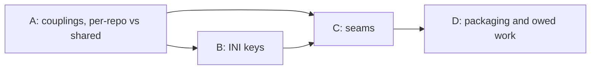
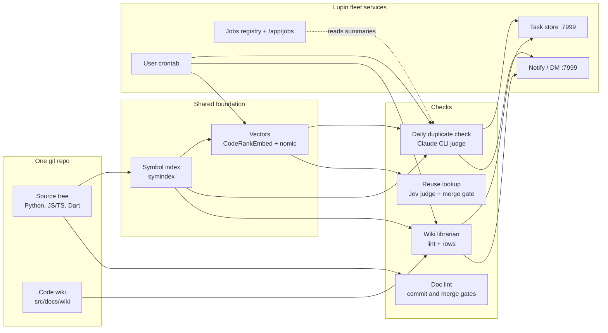

# Code-health services: what is done, what is not, and whether we can abstract them for other repos

María, 9 November 2026, measured between 10:15 and 11:20 EST against the main tree at `daf9b598e` (branch `wip-v0.2.3-2026.11.04-online-preference-learning`), the user crontab, the task store on `:7999` and the data folders under `projects-data/lupin/reuse-review/`. Ordered by Rick by voice this morning; row `898c93d8` quotes the order. Nothing was changed: no code, no cron line, no row.

## Cascade preface (Step 0, added 11 Nov 2026)

Rick ordered a cascaded review of this document (decision 4 in section 8; row `898c93d8`). On 9 Nov he paused it until the cron jobs were centralized (row `449bf026`). On 11 Nov at about 09:45 EST he answered yes to starting it now, because the one cron script is installed and only three weekly jobs are left to prove. Step rows: `9ff22a7a` (Step 0), `6349cc15` (Step 1), `f920520c` (Step 2), all under `epic:cascade-code-health-abstraction`.

### Cast Manifest

Rick turned skeleton crew off on 11 Nov at 09:57 EST. María prepared Step 0 alone, and the cast was spawned at 13:21 EST.

| Role | Persona | Recycled? |
|---|---|---|
| Author | Chloé 🗼 (revises; María wrote the census) | — |
| Manager | María 🌸 | — |
| Stage 1 Reviewer (Usability/Reuse) | Rachel | — |
| Stage 2 Reviewer (Viability/Gap) | John | ✓ Also Step 0 light-review |
| Stage 3 Reviewer (Ownership-Language) | Pocholo | — |
| Step 0 light-reviewer | the Stage 2 reviewer (John) | RECYCLED |
| Step 9 light-reviewer | chosen at Step 8: the reviewer of the most-changed section | RECYCLED |
| Workflow Steward | allocated at spawn; a visible session, never a subagent | — |

Author and Manager are the same seat. That is allowed: the Manager is the default author of a review cascade. To keep the review cold, no reviewer may be a seat that worked on rows `449bf026`, `0d23e394` or `e411c6dd`.

### Pre-cascade Recon checklist

**Standing rules every cast member reads first**

| Rule | Source | Applies to THIS design? | Verification |
|---|---|---|---|
| 100% line, branch and function coverage | lupin `CLAUDE.md:158-166` | ✅ for every seam's code in lupin | Corrected after the light-review: the seams are not all under `src/cosa/repo/`. `Embedder` is `src/cosa/memory/embedding_provider.py`, and `Scheduler` reaches `src/scripts/cron-job.sh` and `lupin_mcp/job_run.py`. All of these are inside the coverage frame: `pyproject.toml:218-224` lists `src/cosa`, `src/lupin_mcp` and `src/scripts` as `source`. The rule binds the build, not the review |
| Coverage does not reach `lupin-mobile` | lupin `CLAUDE.md:166` (sub-repos excluded) | ✅ for §6.3 step 2 and Q2 | `lupin-mobile` follows its own repo's rules; the review must not hold its part to lupin's 100% gate |
| Doc lint: `src/lupin_mcp` is ratcheted, not swept | `swept_scope.py:12` (section 4, group 1) | ✅ for seams in `lupin_mcp` (`TaskSink`, `Scheduler`) | New code there is held to the ratchet table's counts, not the swept-scope zero |
| Nested repos are separate repos | fleet rule: a plan is handed to a session resident in the target repo | ✅ for §6.3 step 2 and Q2 | Work inside `lupin-mobile` is built by a `lupin-mobile` session under its manager, not by a lupin seat |
| Path management: one project-root function, config-relative paths | global `CLAUDE.md` § PATH MANAGEMENT | ✅ for `RepoSpec` and `DataRoot` (§6.2), and the INI keys' paths and the data subdir (§6.1) | Paths resolve through `cu.get_project_root()` and relative paths in config, never `__file__` chains or `sys.path` edits; every path in a §6.1 key is relative to the repo root |
| Plan-time reuse check (`REUSE-OUTCOME` line per new definition) | planning-is-prompting `workflow/plan-review.md` §4 | ✅ | Section 6.2 proposes eight interfaces; each needs a lookup before review closes |
| No test or job touches a GPU | `workflow/testing-baseline.md` | ✅ | The embedding service in section 5 is reached only through `:7999` |
| Seats install nothing in cron; Rick runs installs | row `449bf026` | ✅ | The `Scheduler` seam (section 6.2) must end in a script Rick runs |
| Build belongs to a lupin-resident session | Rick's decision 4 (section 8) | ✅ | The review produces a plan; it does not build |
| Venue `:8000` serves the main checkout; check idle before a merge | fleet memory | Only at build time | Not needed for review |

**Persona conventions**: sign every finding with persona and session id; findings go to the cascade topic, not in DMs; every claim cites a file and line or a row.

**Project rules for this cascade**: doc-viewer scope `lupin`; edits to this file go in the main checkout through Edit, never by copying from a worktree; quantities are measured, not guessed, and any unmeasured figure is labeled as such.

### What changed since 9 Nov (read before sections 2 and 7)

Sections 2, 2.6 and 7 describe the morning of 9 Nov. These facts have changed since then, each with its receipt. Reviewers should not raise findings on the old state.

| 9 Nov statement | Now | Receipt |
|---|---|---|
| Each cron line hand-copies its environment; `job_run` is used by no cron line | 17 generated lines, all through `cron-job.sh` and `job_run`, one shared environment plus `~/.lupin/cron.env` | lupin `87a43c723`, `4a0566621`; installed by Rick 9 Nov 17:25; row `449bf026` |
| Duplicate check refused (`stale_branch`); no scheduled run ever succeeded; hourly mode not installed | Hourly 10:00–22:00 plus boot, follows the working branch; scheduled runs succeed | `io/duplicate-check-daily/runs.jsonl` lines 15–24 (none failed); rows `6d7e091e`, `c376c803`, `0d23e394` closed |
| Librarian crashing since 20 Oct | Clean boot run 10 Nov 19:12 | row `871176fc` closed |
| Shadow audit 4 of 4 failed, cause not measured | Cause measured (definition ids against symbol-index ids), fixed; 11 Nov 09:19 drain audited 1 item, 0 failed, 3,451,591 Jev tokens | lupin `cd70b6dab`; row `e411c6dd` |
| Cheech's D3–D5 open | One row per run, split under the cap; verdicts suppress re-reporting; mutual pairs filed once | rows `c7deca58`, `6c7e0883`, `d57dcf33`, `b7ce2a1c` closed |
| Triage owner configured | Owner from its own key, Cheech; never guessed | lupin `c04d62212`; row `ba4a3111` |
| Section 7 item 4 (stamp `job:<name>` on filed rows) | Not re-measured on 11 Nov | — |

**New cost fact for section 5 and the `budgets:` block**: the hourly baseline drain recorded $227, $201 and $178 (`cost_usd`, 747–782 judge calls each) in its three runs on 10 Nov, with 9,895 pairs still carried. Not measured: whether `cost_usd` is list price or actual billing on the Max plan.

### Proposed sections for review (Step 2 ratifies them)

Sections 1 to 3 are context and are not reviewed. Section 8 is already ruled.

| Section | Content | Reviewable knowing only… |
|---|---|---|
| **A** | §4 couplings and §5 per-repo versus shared | the nine coupling groups and the files they cite |
| **B** | §6.1 the per-repo INI keys | A's group list, as the field inventory |
| **C** | §6.2 the seams | A's group list; B's field names |
| **D** | §6.3 packaging order and §7 owed work | that C names eight seams; the ruled decisions in §8 |

### Step 0 self-check against the six light-review criteria (Manager's pre-check, not the gate)

| # | Criterion | Self-check | Gap the light-reviewer should test |
|---|---|---|---|
| 1 | Section independence | Failed the first light-review: §2, §2.6, §7, §8's preamble and the Verdict still described the morning of 9 Nov, so section D could not be read cold. Rewritten on 11 Nov to the state in the preface table, with the 9 Nov text kept only where labelled "on 9 Nov". C still leans on B's field names | Whether any statement in §2, §7, §8 or the Verdict still contradicts the preface table; whether B and C should merge |
| 2 | Open questions have a stance | Failed the first light-review: Q2 (data root `projects-data/<repo>/code-health/`) conflicted with Q3 (widen the reuse-review mount), no stance said whether reuse-review data moves, and Q3's alternatives (b) and (c) had no pros and cons. Now: reuse-review data does not move, Q2 and Q3 agree, and (b) and (c) each carry pros and cons | Whether Q1 to Q3 are complete and the stances hold |
| 3 | Recon items say where they are verified | Yes, in the table above | Whether coverage scope is right for code that moves into a new package (§6.3 step 3) |
| 4 | Every requirement cites a source | Yes: file and line, or row | §6.1's INI defaults are today's values with their sources; no number is a placeholder |
| 5 | Order respects dependencies | A → B → C → D is a DAG | — |
| 6 | Onboarding complete | Recon checklist above | Missing standing rules |

### Open questions, with a proposed stance (closes the criterion 2 gap)

None of these is a decision for Rick yet. The cast reviews the stance, and only a contested stance goes to him.

| # | Question | Proposed stance | Alternatives | Pros of the stance | Cons of the stance |
|---|---|---|---|---|---|
| Q1 | Where do the per-repo settings live, and what are they called? | **Ruled by Rick, 11 Nov 2026: Lupin's `lupin-app.ini`**, as per-repo keys on the existing `external repo <name> ...` pattern, read through `ConfigurationManager` (§6.1). There is no `.code-health.yml` and no second settings file. Rick's reason: "if these are services that are created or abstracted by Lupin and provided to other repos then yes that information should live in Lupin's configuration file" | The first stance, a repo-root `.code-health.yml` that reused the `.docview.yml` parser pattern, is withdrawn; `src/conf/code-health.yml`; a section in `pyproject.toml` | One home for every setting; a repo's keys sit on the pattern its doc-viewer keys already use, and a registry row decides whether it runs; the INI already has the reader, the splainer twin and the census tests; no new parser | Lupin's INI grows by eight per-repo keys and one global key; a repo outside Lupin's `external repos` cannot configure itself, and registering a repo there does not by itself turn code health on |
| Q2 | Where does each repo's state live? | Every code-health service writes under `projects-data/<repo>/code-health/`, outside the tree, resolved by the existing `fleet_data_root( repo_root )` (`heartbeat_hold.py:236`) plus the INI key `code health data subdir` (default `code-health`, §6.1). `DATA_RELATIVE` is what retires. **Reuse-review data does not move**: it stays at `projects-data/<repo>/reuse-review/`, because the server's read-only mount and the candidate-search loader already read it there | `<repo>/io/code-health/` | Reuse data already lives under `projects-data/<repo>/`; the server's read-only mount already points at `projects-data/lupin/reuse-review`, so nothing about reuse lookup changes; git stays clean | The duplicate check writes to `$LUPIN_ROOT/io/` today (`src/cosa/repo/duplicate_check/proof/proof_cli.py:33`, `DATA_RELATIVE = "/io"`), so its run history must move and the jobs page must follow it |
| Q3 | How does candidate search serve more than one repo (§7 item 5)? | One shared in-process service, no data move (agrees with Q2), keyed by `fleet_data_root( repo )` (`src/lupin_cli/claude_code/hooks/lib/heartbeat_hold.py:236`). **A bind mount cannot take a glob.** Each service has one line naming one host directory, and the container path equals the host path because the caller sends `vectors_dir` as a host path (`docker-compose.yml:273` and `:572`). So the stance takes **one read-only mount line per repo's `reuse-review` folder in both services**, and each onboarding needs a compose edit and `--force-recreate` of `:7999` and `:8000`. The loader is single-root today (`LUPIN_REUSE_REVIEW_DATA_ROOT`, `src/cosa/rest/routers/reuse_candidates.py:27,44`) | (b) a separate search process; (c) one service per repo; (d) mount all of `projects-data` read-only, once, so no compose edit per repo (costs below) | Smallest change; matches §5, which keeps one shared candidate search; reuse-review data stays where Q2 puts it; each container sees only the folders named for it | A compose edit and a recreate of two servers for every new repo; one repo's large index uses memory every repo shares (a repo's stored-vector memory is **not measured**). **Ruled by Rick, 11 Nov 2026: this stance** (one read-only mount line per repo in both services) |

Alternatives to Q3's stance:

| Alternative | Pros | Cons |
|---|---|---|
| (b) Candidate search as its own process outside the container | No mount change; it scales and restarts on its own | **A new service.** Nothing launches a search process today: `search_interpreter()` (`src/cosa/repo/symindex/candidates/storage_paths.py:130`) has no caller outside its own tests, its INI key is empty (`lupin-app.ini:2330`), and search runs in process through `ResidentSearch`. So (b) means a service to run, health-check and give a port, plus an interpreter key and a `DEPENDENCY_MISSING` error written for it and never wired |
| (c) One service per repo | Isolation: one repo's index cannot use another's memory; no shared loader root | N ports and N processes to run and restart; the shared judge budget (decision 3 in section 8) is split. **Not N copies of the embedding model:** search takes `query_vectors` from the caller (`src/cosa/repo/symindex/candidates/resident.py:146`) and I found no model load in it or the router, so each service holds only its repo's stored vectors, whose memory is **not measured** |
| (d) Mount all of `projects-data` read-only | One mount line, no compose edit per repo | The container then sees every repo's holds, mementos and ledgers, not only its vectors; the exposure is wider than "can read every repo's vectors" |

"Code-health services" in this document means the five things Rick named: source-code documentation checks, duplicate detection, the reuse lookup with its wiki, scheduling, and remediation (turning findings into work).

## Verdict

**Yes, we know enough to design the external interface now. No, we are not ready to run it for a third repo yet.**

- **Why design now.** Every piece is built and tested, and the survey below can list every place the code assumes Lupin, file by file. That list is the interface: each assumption becomes a parameter. A second repo, `lupin-mobile`, already runs on part of the stack (its own symbol index, wiki and librarian queue), so the multi-repo path is not hypothetical.
- **Why not ship yet.** On 9 Nov three of the six scheduled jobs failed, two of them because each cron line hand-copied its own environment. That is fixed: since 9 Nov 17:25 all 17 generated cron lines run through one launcher with one shared environment, and the duplicate check, librarian and shadow audit have run clean (preface table, "What changed since 9 Nov"). What is still open: the weekly jobs are not yet proven on the new lines; the hourly baseline drain is costly ($178 to $227 per run on 10 Nov, `cost_usd`, with 9,895 pairs still carried); and the reuse judge is only fair (AUC 0.68), so a new repo would inherit a tool we have not finished tuning.
- **Recommended path.** The broken runs are fixed (see above). Write the per-repo INI keys (section 6.1) and make Lupin the first repo that reads them, with no change in behaviour. Then move `lupin-mobile` fully onto it. Only then add a third repo.

## 1. The ecosystem in one picture

The symbol index is the shared foundation. The duplicate check, the reuse lookup and the wiki librarian all read it. Doc lint stands alone: it reads source files directly and never touches the index.

## 2. Done and not done, by subsystem

### 2.1 Source-code documentation

| Piece | Status | Evidence |
|---|---|---|
| Python docstring lint (8 rules), comment lint, TS/JS JSDoc lint, Dart `///` lint, markdown lint | **Built, tested, blocking** at pre-commit, pre-push, and tier 3 of the merge pyramid | `src/cosa/repo/doc_lint/` (57 modules); `.git/hooks/pre-commit` → `src/scripts/pre-commit-chain.sh`; `src/tests/run-doclint-gate.sh` |
| Ratchet tables (counts can only fall) | Built and in use | `src/conf/doc-lint-counts.json` (1,999 files), `doc-lint-ts-counts.json` (554 files) |
| Claim judge (did a rewrite drop a claim?), Claude and Jev back ends | Built and tested; run by hand per package during the sweep; in no gate | `claim_judge.py`, `jev_judge.py`, `harness_runner.py` |
| Rewriter | **Not code.** Claude Code seats rewrote the text by hand, once | rewriter process-flow doc, section 3 |
| Python sweep | Done once: 859 files, 29,838 findings to 0 | `v0.2.2/.../2026.10.07-docstring-sweep-before-and-after-report.md` |
| Test files and `src/lupin_mcp` | Never swept, only ratcheted (76,985 and 4,992 findings) | same report |
| Inline-comment staleness check | Scratch experiment only | `src/rnd/2026.11.07-inline-comment-quality-census.md` |
| Scheduled run, automatic task filing | **None** | `crontab -l`; findings print to stderr |

About 2,300 unit tests (a grep count of `def test_` across 64 files). None at the integration tier.

### 2.2 Symbol index and code wiki

| Piece | Status | Evidence |
|---|---|---|
| Symbol index: Python (`ast`), JS/TS (TypeScript compiler under node), Dart (Dart SDK) | **Built, tested, in daily use** | `src/cosa/repo/symindex/`; 14,083 symbols, 253 routes |
| Code wiki: 700 capability pages plus `INDEX.md`, each page pinned to symbol hashes | Built and committed; **written by hand by seats**, not generated | `src/docs/wiki/capabilities/` (700 files, counted) |
| Wiki lint (stale, dangling, unindexed, orphan, pin rules) | Built and tested | `symindex/wiki_lint.py` |
| Librarian tick (lint the wiki, file rows for gaps) | Scheduled at 10:17; **clean boot run on 10 Nov at 19:12**. On 9 Nov it was failing, last clean run 20 Oct, because the cron line lacked `LUPIN_CONFIG_MGR_CLI_ARGS` | row `871176fc` closed; on 9 Nov, `projects-data/lupin/reuse-review/librarian/tick-state.json` (`last_run_date: 2026-10-20`) |
| Second repo | `lupin-mobile` has its own index, wiki and librarian corpus | `lupin-mobile/src/docs/wiki/`; `librarian_tick.py:16,67-69` |

### 2.3 Reuse lookup (before writing new code)

| Piece | Status | Evidence |
|---|---|---|
| Candidate search: two keyword lists plus vector similarity, merged, cut to 128 | Built, in production, **runs inside the Lupin server** | `/api/reuse-candidates/*`; `symindex/candidates/` |
| Judge: Jev `jev-1.13.0`, packs of 50 | In production | `lupin_mcp/reuse_tools.py:63`; `doc_lint/jev_transport.py:19` |
| Agent tools `check_exists`, `fetch_similar`, `read_capability`, `record_search`, `replay` | In production on the cosa-voice MCP server: 187 calls in the week of 2–8 Nov | `cosa_voice_mcp.py:4903-5035`; `reuse-behaviour-2026-11-08.txt` |
| Merge gate and review gate | **Enforcing** since `d0180365c` | `lupin-app.ini:2295`; 11 of 11 mutants killed (`reuse-gates-mutation-evidence.md`) |
| Vector refresh | Scheduled at 10:47, **working** (last build 7 Nov, 13,218 rows) | `reuse-review/refresh/refresh-state.json` |
| Shadow audit (re-run about 1 lookup in 100 as a full sweep) | **Fixed.** On 9 Nov it failed 4 of 4 with the cause not measured. The cause was definition ids compared against symbol-index ids; the 11 Nov 09:19 drain audited 1 item, 0 failed, 3,451,591 Jev tokens | lupin `cd70b6dab`; row `e411c6dd`; on 9 Nov, `reuse-review/shadow-audit/shadow-audit.log` last line `"failed": 4, "spent_tokens": 0` |
| Weekly behaviour report | Scheduled, working | 410 wrote new, 17 extended, 0 reused (week of 2–8 Nov) |
| Remediation plan, phases 3 to 8 (400-need set, A/B experiment, pilot) | **Not run**; plan still "awaiting cascaded review" | `v0.2.2/.../2026.10.24-reuse-detection-remediation-plan.md` |

About 240 unit-test files. Of the roughly 50 `lupin_mcp/reuse_*` modules, about 19 are on the production path and the rest are measurement harness.

### 2.4 Daily duplicate check

| Piece | Status | Evidence |
|---|---|---|
| Pipeline: window, extract, blind, embed, structural match (jscpd + AST), fuse, judge (Claude CLI, `claude-fable-5-1`), cluster, file | **Built and tested** (803 tests in 31 files) | `src/cosa/repo/duplicate_check/`, `lupin_mcp/duplicate_check_*.py` |
| Scheduled runs (daily and baseline) | **Hourly 10:00 to 22:00 plus boot, following the working branch; scheduled runs succeed.** On 9 Nov they were refused (`branch_guard: stale_branch`) | `io/duplicate-check-daily/runs.jsonl` lines 15 to 24, none failed; rows `6d7e091e`, `c376c803`, `0d23e394` closed |
| Adaptive hourly mode | **Installed** by Rick on 9 Nov at 17:25, as part of the 17 generated cron lines | row `449bf026`; lupin `87a43c723`, `4a0566621` |
| Status page `/app/duplicate-check` and `/app/jobs` accordion | Built, live on `:7999` | Cheech's row `0d23e394`; 8 e2e UI tests |
| Has a scheduled run ever succeeded? | **Yes, now.** On 9 Nov: no, the three successful runs (3, 6, 7 Nov) were started by hand. Since the hourly install, runs 15 to 24 all succeeded | `runs.jsonl` |

Cheech's census of 9 Nov covers the backlog and its defects in detail; I do not repeat it. See `../2026.11.09-duplication-scheduling-and-remediation/2026.11.09-held-rows-and-backlog-census.md`, sections 4 and 5. **On 9 Nov** it counted 936 findings with no triage row, 1,369 definitions not yet judged, and defects D1 to D7; those counts were not re-measured on 11 Nov. D3 to D5 are closed: one row per run, split under the cap; verdicts suppress re-reporting; mutual pairs filed once (rows `c7deca58`, `6c7e0883`, `d57dcf33`, `b7ce2a1c`).

### 2.5 Scheduling and remediation (shared by all of the above)

| Piece | Status | Evidence |
|---|---|---|
| Jobs registry (23 jobs on 9 Nov), health reader, `/api/jobs/summary`, `/app/jobs` | Built and tested | `src/conf/job-registry.json`; `cosa/rest/job_*.py` |
| `job_run` wrapper (one launcher for every cron job) | Built, 5 tests, **used by every generated cron line** (17 lines, all through `cron-job.sh` and `job_run`, one shared environment plus `~/.lupin/cron.env`). On 9 Nov it was used by none | `lupin_mcp/job_run.py`; lupin `87a43c723`, `4a0566621`; row `449bf026` |
| Per-job notification interval | Stored, nothing sends on it | `job_health.py:285` |
| Findings to task-store rows | Duplicate check and librarian file rows; doc lint and shadow audit do not (as measured on 9 Nov). The triage owner now comes from its own key, Cheech, and is never guessed | `duplicate_check_filing.py`, `librarian_queue.py`; lupin `c04d62212`; row `ba4a3111` |
| Jobs page count of a job's open rows | On 9 Nov: reads key `job:duplicate-check`; the filer never wrote that key, so the count was probably 0. **Not re-measured on 11 Nov** | `job-registry.json:40`; `duplicate_check_filing.py:37-124` (uses `epic:dupcheck-*`). On 9 Nov I read the code; I did not check the page |

### 2.6 Scheduled jobs: 9 Nov and now

| Cron job | Result on 9 Nov | Now (11 Nov) | Receipt |
|---|---|---|---|
| duplicate-check-daily | refused: no `--branch`, so it judged `main`, 5 days stale | Hourly 10:00 to 22:00 plus boot, follows the working branch; scheduled runs succeed | `runs.jsonl` lines 15 to 24; rows `6d7e091e`, `c376c803`, `0d23e394` |
| wiki-librarian-tick | crashed: the line lacked `LUPIN_CONFIG_MGR_CLI_ARGS` (crashing since 20 Oct) | Clean boot run on 10 Nov at 19:12 | row `871176fc` |
| reuse-shadow-audit | 4 of 4 failed, cause not measured | Cause measured (definition ids against symbol-index ids) and fixed; the 11 Nov 09:19 drain audited 1 item, 0 failed, 3,451,591 Jev tokens | lupin `cd70b6dab`; row `e411c6dd` |
| reuse-vector-refresh | working | Not re-measured on 11 Nov | none |
| reuse-behaviour-weekly | working | Not re-measured on 11 Nov | none |
| host_snapshot | not installed, waiting on Rick | Not re-measured on 11 Nov | none |
| adaptive hourly duplicate check | not installed | Installed | row `449bf026` |

**On 9 Nov, two of the three failures were the same defect**: each cron line spelled out its own environment, and the copies drifted. That was the strongest practical argument for the abstraction. It is fixed at the source: one launcher reads one shared environment (17 generated lines, installed by Rick on 9 Nov at 17:25, row `449bf026`). Three weekly jobs are still to be proven on the new lines (the preface's reason for starting the cascade on 11 Nov).

## 3. How good the checks are

| Check | Latest measure | Source |
|---|---|---|
| Doc lint | precision 0.80 to 0.97 on every rule; recall weak on some (tic 0.31, history 0.63) | `v0.2.2/.../2026.10.01-doc-lint-precision-recall-report.md` |
| Claim judge | on 64 planted losses: Haiku and Sonnet missed 0, Jev missed 2 | `v0.2.2/.../2026.10.01-claim-judge-comparison-jev-haiku-sonnet.md` |
| Reuse lookup | found 58 of 70 needs (17% missed) | `v0.2.2/.../2026.11.01-first-thousand-run-revised-plan.md` §15.3 |
| Reuse judge | AUC 0.68; at the 0.30 threshold it accepts 94% of same-job pairs **and 41% of different-job pairs** | same doc, §21 |
| Reuse judge | accepted 13 of 13 planted duplicates and 4 of 4 look-alikes: it cannot yet tell them apart | `v0.2.2/.../2026.11.02-reuse-search-measurement-explainer.md` §8 |
| Duplicate check | 7 Nov hand run: 1,680 definitions judged in 1,500 calls, 936 findings; of 153 triaged findings on 6 Nov, 68 were not duplicates | Cheech's census, sections 3 and 4 |

The lint tools are mature. The judges are usable but not finished. A new repo would get the lint tools at full strength and the judges at today's strength.

## 4. What ties it to Lupin

**Census, replacing the nine-group sample (section 7 item 9, done 11 Nov 2026).** Each row is one fixed-string search; the nine groups of the earlier sample are the Group column. Each row maps to one of three kinds. An INI key or a pin (a constant kept in code on purpose) is the pair the acceptance named. The two `registry` rows (`PROJECT = "lupin"` and `"sender_project": "lupin"`) are a third kind: they map to neither, but to the repo key that §6.2 `Scheduler` adds to each row of `src/conf/job-registry.json`. The script's own file is left out of the population, because it holds the needles and would count itself. "Hits in code" leaves out tests, documents, history and `.backup-` copies. The table was produced by `python -m cosa.repo.coupling_census` (`src/cosa/repo/coupling_census.py`, 100% lines and branches under `src/tests/unit/test_coupling_census.py`) and is re-run, not edited. The commit named is the tree measured, before the script was committed. The positive control found `spec.py:77` and `proof_cli.py:33` first before any count printed. A needle is a search string, not a proof of absence: a coupling spelled another way is not counted, so a zero or a low count means "not found by this string".

Census taken 2026-11-11T18:02:18-05:00 at commit `8542c7f0c`.

| Group | Needle | Hits in code | Files in code | First locations | Maps to |
|---|---|---|---|---|---|
| 1 | `def is_lupin_tree` | 1 | 1 | `src/cosa/repo/symindex/spec.py:77` | ini: external repo <name> index languages |
| 1 | `LUPIN_PY_PACKAGES` | 3 | 1 | `src/cosa/repo/symindex/spec.py:12`, `src/cosa/repo/symindex/spec.py:18`, `src/cosa/repo/symindex/spec.py:100` | ini: external repo <name> index source dirs |
| 1 | `LUPIN_JS_DIRS` | 3 | 1 | `src/cosa/repo/symindex/spec.py:13`, `src/cosa/repo/symindex/spec.py:93`, `src/cosa/repo/symindex/spec.py:101` | ini: external repo <name> index source dirs |
| 1 | `TESTS_DIRS` | 2 | 1 | `src/cosa/repo/symindex/spec.py:18`, `src/cosa/repo/symindex/spec.py:119` | ini: external repo <name> index test dirs |
| 1 | `src/lupin_app/static/js` | 233 | 21 | `docker/lupin/Dockerfile:88`, `docker/lupin/Dockerfile:107`, `package.json:20` | ini: external repo <name> index source dirs |
| 1 | `HELD_PREFIXES` | 2 | 1 | `src/cosa/repo/doc_lint/swept_scope.py:12`, `src/cosa/repo/doc_lint/swept_scope.py:32` | pin: doc-lint rule list (rule_lists.py, ruling b42eb0de) |
| 1 | `cosa|lupin_` | 1 | 1 | `src/lupin_mcp/reuse_tools.py:89` | pin: reuse scope regex (reuse_tools.py), Lupin's package names |
| 2 | `DATA_RELATIVE` | 3 | 2 | `src/cosa/repo/duplicate_check/proof/proof_cli.py:33`, `src/cosa/repo/duplicate_check/proof/proof_cli.py:361`, `src/lupin_mcp/duplicate_check_daily.py:883` | ini: code health data subdir |
| 3 | `LUPIN_CONFIG_MGR_CLI_ARGS` | 228 | 133 | `docker-compose.cloud-gpu.yml:261`, `docker-compose.vm-test-overlay.yml:155`, `docker-compose.yml:355` | pin: settings loader is Lupin's: the new keys live in lupin-app.ini |
| 4 | `/api/embeddings` | 23 | 8 | `src/conf/lupin-app-splainer.ini:40`, `src/conf/lupin-app-splainer.ini:1280`, `src/cosa/agents/prediction_engine/prediction_engine.py:1676` | pin: LUPIN_APP_SERVER_URL: the server is Lupin's own, no key |
| 4 | `LUPIN_APP_SERVER_URL` | 33 | 21 | `docker/lupin/claude-config/mcp.json:9`, `src/conf/lupin-app-splainer.ini:33`, `src/conf/lupin-app.ini:580` | pin: LUPIN_APP_SERVER_URL: the server is Lupin's own, no key |
| 5 | `JEV_MODEL` | 16 | 8 | `src/cosa/repo/symindex/candidates/arm_run.py:42`, `src/lupin_mcp/reuse_e2e_run.py:53`, `src/lupin_mcp/reuse_needset/judge_probe.py:70` | pin: code pin: a new model is a recalibration |
| 5 | `MODEL_ID` | 3 | 2 | `src/cosa/repo/duplicate_check/config.py:12`, `src/cosa/repo/duplicate_check/config.py:89`, `src/ephemera/notebooks/openllm-and-langchain.ipynb:150` | pin: code pin: a new model is a recalibration |
| 6 | `LUPIN_REUSE_REVIEW_DATA_ROOT` | 11 | 6 | `docker-compose.yml:272`, `docker-compose.yml:373`, `docker-compose.yml:571` | pin: reuse review data subdir keys (not touched, Q2) |
| 6 | `projects-data/lupin` | 31 | 13 | `.gitignore:253`, `.gitignore:254`, `docker-compose.cloud-gpu.yml:115` | pin: reuse review data subdir keys (not touched, Q2) |
| 7 | `PROJECT = "lupin"` | 1 | 1 | `src/lupin_mcp/session_spawner.py:55` | registry: registry repo key (section 6.2 Scheduler) |
| 7 | `"sender_project": "lupin"` | 1 | 1 | `src/cosa/repo/symindex/librarian_tick.py:316` | registry: registry repo key (section 6.2 Scheduler) |
| 7 | `f"[LUPIN]` | 2 | 2 | `src/lupin_app/main.py:1135`, `src/lupin_mcp/duplicate_check_filing.py:129` | ini: external repo <name> filed title prefix |
| 8 | `= "main"` | 5 | 4 | `src/cosa/agents/shared/plan_writer.py:439`, `src/cosa/repo/git_loc_delta/analyzer.py:21`, `src/cosa/repo/git_loc_delta/analyzer.py:57` | pin: registry row --branch argument; glob and main fallback in code |
| 8 | `--ceiling` | 26 | 12 | `src/conf/job-registry.json:70`, `src/lupin_mcp/duplicate_check_daily.py:7`, `src/lupin_mcp/duplicate_check_daily.py:524` | ini: external repo <name> duplicate check ceiling |
| 8 | `epic:dupcheck-` | 5 | 3 | `src/conf/job-registry.json:37`, `src/lupin_mcp/duplicate_check_filing.py:20`, `src/lupin_mcp/duplicate_check_filing.py:29` | pin: registry fix_debt_key: the filed rows' correlation prefix |
| 9 | `TestSuiteJob` | 115 | 28 | `src/conf/lupin-app-splainer.ini:1241`, `src/conf/lupin-app-splainer.ini:1243`, `src/conf/lupin-app-splainer.ini:1296` | pin: merge gates are Lupin's pyramid; Open sub-question 1 |

Population: 7526 tracked files, 1 left out (paths under `.venv`, `node_modules` or `site-packages`, and the script's own file, which holds the needles), 7525 counted, 7423 read as UTF-8 text, 102 not readable as text. Positive controls passed: 2 of 2.

One more deep coupling cuts across all of them: the code lives inside the `cosa` package and imports `cosa.utils.util` for the project root. Moving it to its own package is the last step, not the first.

## 5. What a new repo needs: per repo versus shared

| Per repo (one copy each) | Shared (one copy for all repos) |
|---|---|
| per-repo INI keys in `lupin-app.ini` (section 6.1) | embedding service (model server behind `:7999`) |
| symbol index, vectors, ledgers, run history | judges: Claude CLI on the Max plan, Jev |
| code wiki (lives in that repo) | task store, notify, DM |
| doc-lint ratchet tables and rule choices | jobs page and registry (one row per repo per job) |
| cron entries (generated, not hand-written) | candidate search service, once it can load more than one repo's vectors |
| git hooks, installed by `src/scripts/install-git-hooks.sh` (pre-commit is Lupin-wired through `pre-commit-chain.sh`) | purpose-line generation, a job submitted to Lupin's `/api/v2/submit` (`src/cosa/repo/symindex/candidate_build.py:236`) |
| | the code itself |

Two of today's numbers set the cost of each new repo: the duplicate check spends about 0.9 judge calls per changed definition on the Max plan, and the shadow audit's one completed run used 3.3 million Jev tokens. A new repo adds to both shared budgets, so the INI carries a per-repo Jev token limit (`external repo <name> jev token limit`, the unit of the existing `AccountLedger`) and a per-repo duplicate-check ceiling (`... duplicate check ceiling`); both ruled by Rick on 11 Nov (section 6.1). Those two numbers are steady-state rates. A new repo also pays a **baseline**: every definition is judged once. Lupin's baseline is the evidence for the size: 747 to 782 judge calls per hourly run and $178 to $227 `cost_usd` per run on 10 Nov, with 9,895 pairs still carried (preface). **`lupin-mobile`'s baseline is not measured**: nobody has counted its definitions. Measuring it is owed work (section 7, item 8), and a ceiling set before that is a guess.

**Merge gates are not a per-repo copy.** In Lupin the doc and reuse gates are steps 3 and 4 of the merge pyramid run by `TestSuiteJob` (`src/cosa/agents/test_suite/job.py:60-61`), and `reuse` runs on the host only (`job.py:249`; it reads a call log the test container does not mount). A third repo has no pyramid. So what is per repo is the git hook chain, installed by `install-git-hooks.sh` with its two fixed hooks (section 6.2, `Gate`); the INI has no gate key. What carries a third repo's *merge* gate (a hook script, a call into Lupin's job, or nothing until the package exists) is **Open sub-question 1**, owned by §6.3 step 3 (section 6.3 names its executor and done-signal).

**Co-residence assumption.** Every item in the Shared column is Lupin's server at `:7999` plus its credentials: the embeddings key file, Jev, and a login for `/api/v2/submit`. The table assumes a new repo's jobs run on the same host, with network reach to `:7999` and access to those credentials. A repo on another host would need all three arranged first; no plan here covers that case.

**Reuse question for Section B (stated here, answered there).** A per-repo manifest already exists: `.docview.yml`, parsed by `src/cosa/config/docview_manifest.py`, and a repo is registered through the `external repos` list plus `external repo <name> path` keys (`src/conf/lupin-app.ini:1624-1638`; `lupin-mobile` is already in it). That list is the repo registry that "one row per repo per job", cron generation and the janitor sweep can key on. **Answered by Rick on 11 Nov 2026:** the code-health settings are keys on that same `external repo <name> ...` pattern in Lupin's INI, with no new file (section 6.1, Q1).

## 6. The proposed interface

### 6.1 Per-repo settings: keys in Lupin's INI

**Ruled (Rick, 11 Nov 2026, card answer).** "If these are services that are created or abstracted by Lupin and provided to other repos then yes that information should live in Lupin's configuration file." So there is **no per-repo `.code-health.yml`** and no second settings file. Every code-health setting is a key in `src/conf/lupin-app.ini`, read through `ConfigurationManager`, and each per-repo key is named on the existing `external repo <name> ...` pattern (`src/conf/lupin-app.ini:1624-1638`, read by `config_mgr.get( f"external repo {name} ...", default=..., silent=True )` in `src/cosa/rest/routers/_scope_registry.py:988`). A repo is registered by its name in `external repos`. Each key also needs a twin entry in `src/conf/lupin-app-splainer.ini`, as every other key has.

The earlier direction still holds: the INI is a home for a fact only once, so anything the registry, the INI or the manager map already holds stays where it is (the table after the keys says where), **schedules stay in `src/conf/job-registry.json`, and any limit or budget lives in the INI.**

**The keys.** `<name>` is the repo's name in `external repos`. **What turns a repo on for code health is a registry row that carries its repo key (§6.2 `Scheduler`); being listed in `external repos` alone does not** (sixteen repos are registered there for the doc viewer, and none has a code-health registry row today except lupin; `lupin-mobile` already has the `wiki librarian mobile *` keys for the part of the stack it runs, and a row of its own comes with step 2). The per-repo keys are read only for a repo that has such a row. For that repo, `<name>` must equal the checkout's directory name, because the data folder (`fleet_data_root`) and the manager roster variable (`COSA_VOICE_MANAGERS__<NAME>`, upper case, hyphen to underscore) already derive from that name: one name, checked by B-AC6. Two registered names do not match their directory today, `par-pacific` (`par-pacific-financials-er-442109`) and `claude-plans` (`plans`, measured 11 Nov 2026 from the `external repo <name> path` keys); they stay off until a row is added and the name or the key is reconciled. Paths are relative to the repo root; an absolute path is refused. The default is today's value, or detection where a blank means "detect".

| Key | Default (today's value) | Reader |
|---|---|---|
| `external repo <name> index languages` | blank: detection, `spec_for` (`src/cosa/repo/symindex/spec.py:88`) picks the lupin, Flutter or any-tree layout | `spec_for` |
| `external repo <name> index source dirs` | blank: detection (the three constants and the `tests_spec` branch of §4 group 1 become the values detection returns) | `spec_for` |
| `external repo <name> index test dirs` | blank: detection (`tests_spec`) | `tests_spec` |
| `external repo <name> index exclude` | blank: `SKIP_PARTS` (`spec.py`). Directory **names**, not paths: a path entry is refused | `spec_for` |
| `external repo <name> wiki dir` | blank: `<root>/src/docs/wiki`, derived in the librarian (`src/cosa/repo/symindex/librarian_tick.py:171`) | librarian tick |
| `external repo <name> filed title prefix` | `[LUPIN]` for lupin (the literal at `src/lupin_mcp/duplicate_check_filing.py:129`); blank for another repo means `[<NAME>]` upper-cased | duplicate-check filing |
| `external repo <name> duplicate check ceiling` | `800` for lupin: the most judge calls one run may make (the meter is `judge_run( max_calls )`, `src/cosa/repo/duplicate_check/judge.py:256`), read today from the registry's `--ceiling 800` argument | `duplicate_check_daily.py`, when `--ceiling` is not given (see Scheduler, §6.2) |
| `external repo <name> jev token limit` | `1428571428` for lupin: the latest limit row of its ledger, set by Rick on 10 Oct 2026 ("both flip runs"), read from `projects-data/lupin/jev-spend-ledger.jsonl` on 11 Nov 2026. **No code default**: blank is refused by the sync with a message naming the key | the ledger sync (below) |
| `code health data subdir` (one key, not per repo) | `code-health`: a leaf under `fleet_data_root( repo_root )` (`src/lupin_cli/claude_code/hooks/lib/heartbeat_hold.py:236`), not a path through the project root: `projects-data/` lies outside the repo tree | the duplicate check and librarian, in place of `DATA_RELATIVE = "/io"` (`src/cosa/repo/duplicate_check/proof/proof_cli.py:33`) |

**Where the Jev limit is enforced.** The key is the **single source** for a repo's Jev limit. The meter stays the existing `AccountLedger` (`src/lupin_mcp/reuse_ledger.py:144`), one ledger file per repo folder (`ledger_path`), counting Jev tokens. The ledger's limit row is written from the key by **one named sync**, never edited by hand: the installer runs it at onboarding (`AccountLedger.create( path, limit_tokens, by, why )`) and the same command runs whenever the key changes (`set_limit( tokens, by, why )`, `reuse_ledger.py:329`). A **drift check** compares the key with the ledger's latest limit row and fails loud on a difference. It **runs at the start of every Jev run** (before the run asks the ledger to admit it, so a drifted key refuses the run before it spends anything) and again at the end of the installer's onboarding. The sync command is new and thin: **no existing command wraps `create` and `set_limit`** (git grep over `src`: only the run scripts `reuse_e2e_run.py` and `reuse_stage1_run.py` and their tests call them); its name is proposed as `python -m lupin_mcp.reuse_ledger_sync` and is settled at build. A run that does not fit raises `AccountLimitReached` (`reuse_ledger.py:359`; the class at `:36`). **Rick's separate backstop is kept**: the INI lifetime limit `reuse shadow audit lifetime token limit` (`src/conf/lupin-app.ini:2357`, 100000000, read with no default by `src/lupin_mcp/reuse_shadow.py:98,382`) caps shadow-audit spend only (`AUDIT_LIFETIME_REACHED`). This plan does not change it, and it is not per repo.

**Which source wins for everything else**

| Fact | Source that wins | Note |
|---|---|---|
| Schedules (cron lines, `after_boot_seconds`) | `src/conf/job-registry.json`, written to cron by `src/lupin_mcp/cron_generate.py`: 24 jobs, `schedule`, per-job `owner`, `run.argv`, `cron_tag`. **The registry gains a repo key** (§6.2 `Scheduler`) | Rick's ruling: schedules may stay in the registry |
| Per-run ceilings | The INI. The duplicate check's is the `duplicate check ceiling` key above. The shadow audit's is **already an INI key**: `reuse shadow audit max tokens per drain` (`src/conf/lupin-app.ini:2354`, 5000000) | Whether the shadow audit's key also becomes per repo is **Open sub-question 4**: owner, the step 1 builder; `EXECUTOR: AI`; done when the outcome (per repo, or one global key by design) is written here and, if per repo, B-AC1's literal count and the table change in the same commit; it does not block `lupin-mobile`. **Outcome (step 1, 11 Nov 2026): one global key by design.** The shadow audit reads only Lupin's reuse data, which does not move (the reuse-review data row below), and its lifetime backstop is global by ruling. B-AC1's literal count stays eight per-repo kinds for lupin and one global key |
| Owner and managers | Owner: the registry's per-job `owner` and the INI pairs (`wiki librarian owner persona`, `... accountable manager`, and the `mobile` pair, `src/conf/lupin-app.ini:2290-2297`; `duplicate check triage owner`, `:850`). Managers: `COSA_VOICE_MANAGERS__<PROJECT>` (`src/conf/fleet-roster.env.template:62`) | One home each; no new key |
| Reuse-review data location | The INI keys `reuse review data subdir`, `reuse candidate vectors subdir`, `... query cache subdir`, `... purpose lines subdir` (`lupin-app.ini:2326-2329`) | Not touched, which agrees with Q2: reuse data does not move |
| Server URL | The `LUPIN_APP_SERVER_URL` environment variable (`src/cosa/memory/embedding_provider.py:235`), defaulting to `http://localhost:7999` in code | No key: the server is Lupin's own |
| Judge model and Jev version | Code pins only: `MODEL_ID` (`src/cosa/repo/duplicate_check/config.py:12`), the frozen calibration (`src/conf/semdup-frozen-2.json:18`), `JEV_MODEL` (`src/lupin_mcp/reuse_tools.py:63`; the transport has no default, `src/cosa/repo/doc_lint/jev_transport.py:361`) | Not INI keys: a new model is a recalibration, then a new frozen file |
| Branch | The registry row's `--branch` argument (`auto` today), with the glob and the `main` fallback in code (`src/lupin_mcp/duplicate_check_daily.py:47-48,143`) | No key |
| Where a repo's checkout is on the host | Derived from the projects directory by the same rule `fleet_data_root` uses (`heartbeat_hold.py:236`, which anchors on the `projects` directory and so handles nested and grouped repos). The existing `external repo <name> path` is an in-container path (`/var/external-projects/<repo>`, `lupin-app.ini:1635`; `src/cosa/rest/routers/_scope_registry.py:7`) and does not exist for host cron | No new key. Onboarding still means the doc-viewer pair of keys and a docker mount (§6.3 step 3) |
| Doc-lint rule list and hooks | Pins and fixed installer, not keys (§6.2) | `notify.on`, `doc_lint.standard`, `doc_lint.gates` and `remediation.filing` were dropped in the cascade: nothing reads them (`backlog_slip` appears nowhere in `src`; `install-git-hooks.sh` fixes its two hooks; one row per run is the only behaviour) |

**Acceptance criteria for the keys** (Lupin coverage rule: 100% lines, branches and functions on every reader module under `src/tests/run-coverage-gate.sh`; every criterion needs the readers to exist, and none is verifiable before then).

| # | Criterion | Executor and pass signal |
|---|---|---|
| B-AC1 | Every key in the table exists in the shipped `lupin-app.ini` with its default and has a twin entry in `lupin-app-splainer.ini` | `EXECUTOR: AI` — a census test lists the keys from the INI and the splainer, not from the table, and asserts a literal count (eight per-repo kinds for lupin and one global key); it goes red when a splainer twin is deleted; 100% lines, branches and functions on the reader modules |
| B-AC2 | A missing per-repo key gives its default, and a blank detection key gives the detection result; the two keys with no code default (`jev token limit`, and `duplicate check ceiling` for a repo with no value) are refused instead | `EXECUTOR: AI` — one test per key through the real `ConfigurationManager`; 100% lines, branches and functions on the reader modules |
| B-AC3 | A bad value fails loud and names the key | `EXECUTOR: AI` — a test per numeric key (zero, negative, not a whole number) and per list key; a blank `jev token limit` is refused by the sync with a message naming the key; 100% lines, branches and functions on the reader modules |
| B-AC4 | A path entry in `index exclude` and an absolute path in `wiki dir` or `index source dirs` are refused | `EXECUTOR: AI` — a test per refusal; coverage as B-AC1 |
| B-AC5 | The real `lupin-app.ini` yields lupin's values through the real reader | `EXECUTOR: AI` — the real INI, not a minimal hand-written one, read field by field against the table's defaults; 100% lines, branches and functions on the reader modules |
| B-AC6 | Every code-health key read in code is in the table, and each repo with a registry row has a `<name>` equal to its checkout's directory name | `EXECUTOR: AI` — a census over `git ls-files` of `src` for the key prefixes and a literal count of readers; and a check over the repos that carry a registry row (not the whole `external repos` list, where `par-pacific` and `claude-plans` differ from their directory names) that each name matches its checkout's directory name, asserting first that the set of such repos is not empty and names lupin; 100% lines, branches and functions on the check |
| B-AC7 | The ledger's limit row equals the key, and a difference fails loud | `EXECUTOR: AI` — the sync is run against a scratch ledger, then the drift check on a key changed by one token is shown to fail; and a Jev run started with a drifted key is shown to refuse before any spend; 100% lines, branches and functions on the sync and the check |

### 6.2 The seams in the code

**Direction (ruled in the cascade, Stage 1 on this section).** A seam is a *name and a documented contract for something that already exists*, never a new class beside it. There is no `TaskSink` beside `TaskStoreAdapter` and no `RepoSpec` beside `IndexSpec`. All eight seams below already exist; the work is to name them, document each contract, and turn the constants still hard-wired in each into parameters. **No new class is added**, `Embedder` included: it is the existing `EmbeddingProvider`. Lupin's code stays the first implementation of each, so nothing in Lupin changes behaviour.

| Seam (a name, not a new class) | What it answers | The existing thing it names (file and line at `30455b16d`) | What is still hard-wired |
|---|---|---|---|
| `IndexSpec` (widened) | which files, which languages, which branch | `src/cosa/repo/symindex/spec.py:26 IndexSpec` (fields `py_roots`, `js_roots`, `dart_roots`, `module_base`, `skip_parts`), `spec_for` (`:88`) and `tests_spec`: three implementations today (lupin, Flutter, any tree) | Detection comes first today. **Stance:** the INI keys override detection field by field (`index languages`, `index source dirs`, `index test dirs`, `index exclude`); a key left blank keeps the detected value. A `languages` entry with no extractor is refused at load with a message naming the language, not skipped. The three constants and the `tests_spec` branch from §4 group 1 become fields. **Mapping of the keys onto the class:** `index languages` plus `index source dirs` fill the three root sets: an `index source dirs` entry goes into `py_roots` when `python` is listed, `js_roots` when `ts` or `js` is listed and `dart_roots` when `dart` is listed, and each extractor takes only its own suffixes (`SUFFIX_LANG`); `index exclude` entries are directory **names**, the semantics of `skip_parts`; `index test dirs` feed `tests_spec`. **Open sub-question 3:** `module_base` (the directory dotted Python module names are taken relative to: `src` for a lupin tree, the root otherwise) has no INI key. Two possible outcomes. **(a) It stays derived from detection:** a test pins the derivation, and a second test shows the known-wrong case (Python under `src/` in a repo that is not a lupin tree) is refused or flagged rather than given wrong module ids. **(b) A key is added:** the INI, its splainer twin, B-AC1's literal key count and the §6.1 table change in the same commit (B-AC1 reddens by itself if they do not). Blast radius: `lupin-mobile` has no Python, so step 2 is not blocked; the question blocks **a third repo that has Python**, and is a gate for that repo. **Outcome, 11 Nov 2026 (step 5, row 816552b0): (a).** `module_base` stays derived from detection (`src` for a lupin tree, the root otherwise) and no INI key is added, so B-AC1's key count is unchanged. `check_module_base` in `spec.py` refuses, naming `index source dirs`, a configured source set in a non-lupin tree whose Python dirs all lie under `src/`; `test_symindex_spec_settings.py` pins the derivation and the refusal. Plain detection in such a tree is not flagged. Owner: the step 1 builder; `EXECUTOR: AI`; done when one outcome is written here and its tests pass with 100% lines, branches and functions |
| `DataRoot` | where this repo's state lives (one source for the folder name: the checkout's directory name via `fleet_data_root`; the manager roster variable is that name upper-cased with hyphens turned into underscores, e.g. `COSA_VOICE_MANAGERS__LUPIN_MOBILE`, `src/conf/fleet-roster.env.template:65`) | `fleet_data_root( repo_root )` (`src/lupin_cli/claude_code/hooks/lib/heartbeat_hold.py:236`) returns `<DEEPILY_DATA_DIR>/<repo-name>`, plus the INI `... subdir` keys, which are relative to it; `data_root()` (`src/cosa/rest/routers/reuse_candidates.py:44`) is the second reader | `DATA_RELATIVE = "/io"` (`src/cosa/repo/duplicate_check/proof/proof_cli.py:33`) is the thing that retires, not the implementation (Q2) |
| `EmbeddingProvider` (named `Embedder` in the first draft) | text to vector | `src/cosa/memory/embedding_provider.py` (`:235` reads `LUPIN_APP_SERVER_URL`; the route and the key file live here); no duplicate found | The route and key file are inside the class already. Two direct callers bypass it: `src/cosa/agents/prediction_engine/prediction_engine.py:1728` posts to `/api/embeddings/generate` itself (not a code-health service, so out of this plan's scope), and `src/cosa/repo/symindex/candidates/vector_build.py:61` reads `GET /api/embeddings/info` (a code-health service: owed work, section 7 item 10) |
| `Judge` (duplicate check) | is A the same job as B? | `judge_run( ..., backend, ... )` (`src/cosa/repo/duplicate_check/judge.py:256`); a backend carries `.name`, `.server_label` and `.complete( model, system, user )` (`:209-220`) | The model and Jev version are pins (§6.1 table), not per-repo values. **The doc-lint judges are a separate seam**, with a different shape: `jev_judge.py:160` and `judge_comparison.py:60` take `judge( claims, new_text, design_text )`. This table covers the duplicate-check judge only; it does not claim one interface over two shapes |
| `TaskStoreAdapter` | file a finding as a row, idempotently | `src/cosa/repo/symindex/task_store_adapter.py:10 TaskStoreAdapter`, the shared base of both live adapters: `LiveStore` in `librarian_tick.py:243` and in `duplicate_check_filing.py:280`; `SeatStore` (`duplicate_check_verdicts.py:58`) extends one | The stamped constants only: `PROJECT = "lupin"` (`src/lupin_mcp/duplicate_check_filing.py:23`) and the `sender_project` literal (`src/cosa/repo/symindex/librarian_tick.py:316`), from §4 group 7. Owner and managers are not here: one home each (§6.1 table) |
| `Notifier` | tell a person something failed or slipped | `hook_link_tick.notify_route` (`src/cosa/utils/hook_link_tick.py:184`) and `send_notify` (`:206`), called at `src/lupin_mcp/duplicate_check_daily.py:585-587`. Three other senders exist (`src/lupin_cli/notifications/notify_user*.py`, `session_spawner.py:1346`), so the plan names this one and says why: it is the one the scheduled jobs already share | The sender id string and the `LUPIN_API_BASE` variable name |
| `Scheduler` | turn the registry into cron lines and launch each run with the full environment. **The repo key carries more than a name:** the row's `root` (today `{root}` in `defaults.run_env` pins `LUPIN_ROOT` and the `LUPIN_CONFIG_MGR_CLI_ARGS` config to Lupin), its argv `--root` and the config the run uses, since `summary_path` and `lock_path` hang off `{root}`. `--root` is verified only on the duplicate check (`src/lupin_mcp/duplicate_check_daily.py:996`); **not read:** the librarian, vector-refresh, behaviour and shadow-audit entry points | `src/conf/job-registry.json` plus `src/lupin_mcp/cron_generate.py` (the generator; `managed_jobs`, `lines_for_job`, `generate`), launched through `src/scripts/cron-job.sh` and `src/lupin_mcp/job_run.py`. `install_command` (`librarian_tick.py:443`) only builds an install message, and is not the generator | The registry has no repo key yet. **Manager direction (Stage 2 on B):** the registry gains a repo key: its rows carry the repo, and `cron_generate.py` emits per-repo lines. **Schedules stay in the registry; any limit lives in the INI** (Rick, 11 Nov). The duplicate-check ceiling moves out of the registry's `run.argv` (`"--ceiling", "800"`) into the INI key `external repo <name> duplicate check ceiling`. The cron lines carry no command: they name the job, and `job_run --from-registry` reads the registry entry at run time (`lines_for_job`, `src/lupin_mcp/cron_generate.py:54`). So "the generated line reads the INI" is done as: the registry entry omits `--ceiling`, and `duplicate_check_daily.py` reads the INI key when `--ceiling` is not given (`--ceiling` stays as a hand-run override). **Two guards in that file change**: `--adaptive` without `--ceiling` is an error today (`src/lupin_mcp/duplicate_check_daily.py:1005`) and so is neither `--cap` nor `--ceiling` (`:1006`, "the daily check has no default limit"); both now accept the INI key as the ceiling. The behaviour "no default limit" is kept: a repo whose key is missing or blank, with no `--ceiling`, is refused with a message naming the key, as the Jev key is. It already reads the INI through `ConfigurationManager` (`duplicate check triage owner`, `src/lupin_mcp/duplicate_check_daily.py:922`), so no reinstall is needed when the value changes. The shadow audit's per-drain ceiling is already an INI key (`reuse shadow audit max tokens per drain`, `lupin-app.ini:2354`). A data-driven generator, not a shared function: the build differs in kind from `Notifier`'s, which Section D's order follows |
| `Gate` | refuse a commit or merge | Covers all of: doc lint `gate.py`, `range_gate.py`, `scope_gate.py`, `rnd_gate0.py` (`src/cosa/repo/doc_lint/`); reuse `reuse_review_gate.py`, `reuse_exit_gate.py`, `reuse_merge_gate.py` (`src/lupin_mcp/`); the git hook chain `src/scripts/install-git-hooks.sh`, `pre-commit-chain.sh`, `pre-push-chain.sh` | `install-git-hooks.sh` fixes its two hook names and their two target scripts (`HOOK_NAMES`, `HOOK_SCRIPTS`), and links to `src/scripts/*` of the repo it runs in, which another repo lacks; the INI has no gate key, because the installer has no slot for one. Where a new repo's hook-chain scripts come from, or that gates stay Lupin-only for now, is stated in §6.3 step 3. What carries a third repo's merge gate is Open sub-question 1 in §6.3 step 3 (the repo has no `TestSuiteJob` pyramid) |

The doc-lint rule list is a **pin**, not a setting (`doc_lint.standard` is not an INI key): `src/cosa/repo/doc_lint/rule_lists.py` was frozen at `521f36f09` under ruling `b42eb0de` (Rick, 30 Sep 2026), and its header says any change to the list contents needs his word. **As it stands at `b3089b2bc` it differs from that freeze by 17 added lines and 1 changed**, from two changes: `34988c0f7` (1 Oct; rows `e786f5e5`, `f5482b4b`; dotted dates) and the `DO_NOT_SENTENCE` rule (row `e59bd0b3`, Rick, 2 Oct). The 1 Oct change is closed: Rick ruled keep (row `6b65f04e`). This plan adds no lighter per-repo rule set. If `lupin-mobile` wants one, it goes to Rick as a separate decision with a new measurement of precision and recall.

**Acceptance criteria for §6.2** (each names its executor and the coverage assertion; the Lupin coverage rule is 100% lines, branches and functions, `src/tests/run-coverage-gate.sh`, `CLAUDE.md` § 100% coverage mandate). Test file names are fixed at build time and are the only open part of each line; each AC is executable the moment its named file exists.

| # | Criterion | Executor and pass signal |
|---|---|---|
| C-AC1 | Each of the eight existing seams has one contract paragraph, and each hard-wired constant in the right-hand column becomes a parameter whose default is today's value, **except the data folder**, whose default moves from `io/` to the `code-health` leaf under `fleet_data_root` per Q2 and is covered by manifest step `ph1-s12` | `EXECUTOR: AI` — a unit test per seam asserts the default against a **literal captured from the base sha** (not the constant's own line, which would make both sides one value); the contract paragraphs live on one capability page under `src/docs/wiki/capabilities/` (name chosen at build) and `wiki_lint` (`src/cosa/repo/symindex/wiki_lint.py`) reports it clean; `src/tests/run-census-guards.sh` and `run-coverage-gate.sh` exit 0 with 100% lines, branches and functions on each changed file |
| C-AC2 | Lupin's behaviour is unchanged except the run-history location, which moves per Q2 and is covered by manifest step `ph1-s12` | `EXECUTOR: AI` — the existing unit and cosa tiers pass unchanged (`pytest src/tests/unit/`, `src/tests/run-cosa-tests.sh`) with 100% coverage on every file the change touches; the duplicate-check and librarian scheduled runs finish with summary fields equal to a **literal key list read from `runs.jsonl` lines at the base sha** |
| C-AC3 | `IndexSpec` settings override detection field by field, and an unsupported language is refused with a message | `EXECUTOR: AI` — a unit test per branch (override present, override absent, unknown language), 100% lines, branches and functions on `spec.py`; plus **one mutation arm, a one-time evidence step and not a pytest test** (a test that edits source inside the suite would mutate a live tree): the anchor for the deleted override line matches exactly once and the on-disk sha changes; the arm runs in its own detached worktree after `src/scripts/purge-pycache.sh`; the failing set is compared with the green baseline, naming the test and the assertion that fired, with a ceiling on how many tests redden (near-total failure means a syntax error, not a kill); the restore control is re-run and its green read. One dated line is recorded once per build of step 1 |
| C-AC4 | Within the code-health services, only `EmbeddingProvider` reaches the embeddings routes | `EXECUTOR: AI` — a unit test with a fake transport, plus `git grep -n` over the code-health service files (`src/cosa/repo/symindex/`, `src/cosa/repo/duplicate_check/`, `src/lupin_mcp/`) for two patterns, `api/embeddings` and `embeddings/generate\|embeddings/info` as separate fixed strings, finding only `embedding_provider.py` (`git grep` sees tracked files only, so a route built from pieces or kept untracked would not be seen). **§7 item 10 lands before this test, or in the same commit**, because the unit tier must be green to merge and the test is red while `vector_build.py:61` calls the route directly; `prediction_engine.py:1728` is outside the scope. 100% lines, branches and functions on `embedding_provider.py`; no test touches a GPU |
| C-AC5 | The `Scheduler` repo key exists and `cron_generate.py` writes the same 17 lines for Lupin **except the cron-log path, which moves per manifest step `ph1-s12`** (`cron_log` is part of the generated line, `src/lupin_mcp/cron_generate.py:68`) | `EXECUTOR: AI` — a golden test over the generated lines (captured from the real generator, per the testing rule on real-producer fixtures); 100% lines, branches and functions on `cron_generate.py`. Installing the lines stays `EXECUTOR: HUMAN` — seats install nothing in cron (row `449bf026`; Rick runs it) |
| C-AC6 | No new class is created: all eight seams are existing things, with no exception | `EXECUTOR: AI` — `src/tests/run-reuse-gate.sh` exits 0 and every added definition carries a `REUSE-OUTCOME` line |
| C-AC7 | The INI keys map onto `IndexSpec` as §6.2 states | `EXECUTOR: AI` — a test per rule: an `index source dirs` entry lands in `py_roots` only when `python` is in `index languages`, in `js_roots` only when `ts` or `js` is, in `dart_roots` only when `dart` is; 100% lines, branches and functions on `spec.py` |
| C-AC8 | `index exclude` refuses a path entry | `EXECUTOR: AI` — a test that `src/rnd` is refused and `rnd` is accepted, with a message naming the key; coverage as C-AC7, on the reader |
| C-AC9 | A second repo's registry row yields that repo's own lines | `EXECUTOR: AI` — a test over a scratch second-repo row asserts its generated lines carry its own root, `--root` and config, not Lupin's; 100% lines, branches and functions on `cron_generate.py` |
| C-AC10 | The ceiling moves to the INI without losing the "no default limit" rule | `EXECUTOR: AI` — with no `--ceiling` and the key at 800, `adaptive_run` receives 800; with the key blank or missing the run refuses naming the key; a hand-run `--ceiling` wins over the key; the registry entry for the duplicate check no longer contains `--ceiling` (asserted from the registry file); 100% lines, branches and functions on `duplicate_check_daily.py` |

### 6.3 Packaging, in order

This is the one list; §7 items 6 and 7 are these steps 1 and 2 and carry no second sizing.

1. **Per-repo INI keys and seams inside `cosa`** (section 6.1 and 6.2), Lupin as repo 1. No new package yet. Size: medium.
2. **`lupin-mobile` as repo 2 on the full stack**: duplicate check, doc lint (Dart), wiki, reuse lookup. This is the acceptance test, because it is a different language and already half on. Size: medium. **Until step 3, `lupin-mobile` keeps its vendored copy of the doc-lint rule modules** (`rule_lists.py`, `text_rules.py`, `marker_counts.py`, `dartdoc_lint.py` are written "stdlib only, so it can be vendored into lupin-mobile's tool/ directory", `src/cosa/repo/doc_lint/`); whether it then moves to the installed package is step 3's decision, and what is vendored there today is **not measured** (the repo is outside lupin). The work inside `lupin-mobile` is built by a `lupin-mobile` session, not a lupin seat. **Owner row filed:** `e1778814-f4fa-4def-a222-402d64379f07`, owned by Tiffany. **The two-week gate (decision 1)** starts at the first green scheduled run on `lupin-mobile` and ends 14 days later. A run is **green** when its line in the repo's `runs.jsonl` has `status: "ok"`, `failure: null` and `trigger: "cron"`. The expected slots are the hourly cron runs from 10:00 to 22:00; the host is usually off from about 11 pm to 10 am, so a **day** is green when it has at least one green cron line, not when every slot ran. A line with `status: "skipped"` (rate-limit back-off, `duplicate_check_daily.py:160`) is neither green nor a failure: it does not restart the window, and it does not count toward the day. A `trigger: "reboot"` line does not count. A day with only skipped, reboot or no lines is a gap, and a gap longer than one day restarts the window; any `status` other than `ok` or `skipped`, or a non-null `failure`, restarts it at once.
3. **A separate installable package** (for example `code-health`) once two repos run cleanly. Its installer **composes two existing scripts and one precondition check**, not a fourth way to put code in a repo: `src/scripts/install-git-hooks.sh` and `python -m lupin_mcp.cron_generate --install` write into the repo, and `src/scripts/install-cosa-voice.sh --check-only` verifies the user-scope MCP registration (that script installs for the whole user, not per repo, so it cannot count as a per-repo step). `install-git-hooks.sh` links to the running repo's own `src/scripts/*-chain.sh`; a new repo has no such scripts, so the installer must either install the chain scripts it needs or state that gates stay Lupin-only for now. It also writes the repo's INI keys (the per-repo set in §6.1, plus its `external repos` entry and the doc-viewer pair of keys), adds the repo's docker mount (§6.1 table), and adds the registry rows (§6.2 `Scheduler`). Installing cron lines stays a human act: a seat never installs (row `449bf026`). **Open sub-question 1: what carries a third repo's merge gate**, since it has no `TestSuiteJob` pyramid (section 5): a hook script, a call into Lupin's job, or nothing until the package exists. Owner: the lupin-resident session that builds step 3 (decision 4). `EXECUTOR: AI` — done when the chosen option is written into this step and a test installs it into a scratch repo and shows a failing merge-gate input refused (D-AC3); until then step 3 does not start. **Open sub-question 2:** whether `lupin-mobile` retires its vendored copy; same owner, decided at step 3.
4. **The agent side as a Claude Code plugin**: the five reuse tools as their own MCP server, plus the reviewer skill. **Two different sizes:** the tools' logic is already separate (`src/lupin_mcp/reuse_tools.py`, imported by thin `_reuse_call` wrappers inside `src/lupin_mcp/cosa_voice_mcp.py`), so only the wrappers and their registration move; the plugin manifest and packaging are **genuinely new**, and I found no plugin manifest in the tree. **Step 4 needs step 3's package:** `_reuse_call` builds its context from the environment and imports `lupin_mcp` inside the server, so a standalone server needs `lupin_mcp` importable and the environment and data root resolved, which only the package supplies.

**Acceptance criteria for §6.3** (Lupin coverage rule: 100% lines, branches and functions, `src/tests/run-coverage-gate.sh`; the nested `lupin-mobile` and its `tool/` copies are outside lupin's gate and follow their own repo's rules).

| # | Criterion | Executor and pass signal |
|---|---|---|
| D-AC1 | Step 1 lands with Lupin's behaviour unchanged except the run-history location, which moves per Q2 and is covered by manifest step `ph1-s12` | `EXECUTOR: AI` — C-AC1 to C-AC10 pass and the merge pyramid (rows 1 to 15) is green on the merged tree, with 100% lines, branches and functions on every changed lupin file. Rows 8, 13, 14 and 15 run on `:8000` through the scheduled path (`POST /api/v2/submit`, command `agent router go to test suite`) after `cosa.rest.venue_idle --port 8000` answers idle (exit 0) |
| D-AC2 | Step 2 runs the four services on `lupin-mobile` | `EXECUTOR: AI (executability conditional on a lupin-mobile session, Tiffany's, row `e1778814-f4fa-4def-a222-402d64379f07`, running step 2)` — a script reads the repo's `runs.jsonl` and passes when each of 14 consecutive days, counted from the first green one, has at least one line with `status: "ok"`, `failure: null` and `trigger: "cron"`; lupin-side code changed for it holds 100% lines, branches and functions |
| D-AC3 | The step 3 installer is a composition and writes a complete repo | `EXECUTOR: AI` — a test that installs into a scratch registered repo asserts the INI keys (every per-repo key of §6.1, with a splainer twin), hooks, registry rows and the compose mount line exist and that no code outside the two named scripts writes a hook or a cron line; the **ledger file** exists, seeded, by the §6.1 sync, with a limit row equal to `external repo <name> jev token limit` (a missing ledger stops any Jev run with `LedgerUnreadable`, `reuse_ledger.py:190`, and `AccountLedger.create` is the only seeding path); `install-cosa-voice.sh --check-only` is asserted as a precondition only; 100% lines, branches and functions on the installer. `cron_generate --install` itself: `EXECUTOR: HUMAN` — a seat installs nothing in cron (row `449bf026`) |
| D-AC3b | After onboarding, the container reads the new repo's reuse vectors | `EXECUTOR: AI` — after `docker compose up -d --force-recreate` of the two services (`:8000` only once `cosa.rest.venue_idle --port 8000` answers idle; `:7999` through `src/scripts/bounce-dev-server.sh`), a read through the candidate loader for the new repo returns its vectors; this is the observable signal that the mount took effect |
| D-AC4 | Step 4 moves only wrappers and registration | `EXECUTOR: AI` — the reuse-tool unit tests pass unmoved and `git diff --stat` for the step touches no line of `reuse_tools.py` logic; 100% coverage on the new server module |

## 7. Work owed before a third repo

| # | Work | Why first | Size |
|---|---|---|---|
| 1 | **Done.** Install the cron fixes: `--branch auto`, the hourly duplicate check, `LUPIN_CONFIG_MGR_CLI_ARGS` for the librarian line, and measure the shadow-audit failure | on 9 Nov three of six jobs were down | Installed by Rick on 9 Nov at 17:25 (row `449bf026`); shadow-audit cause measured and fixed (lupin `cd70b6dab`, row `e411c6dd`); librarian closed (row `871176fc`) |
| 2 | **Done.** Cheech's D3 to D5: the oversized per-run row, verdicts that did not suppress re-reporting, pairs filed from both sides | each new repo would multiply them | Rows `c7deca58`, `6c7e0883`, `d57dcf33`, `b7ce2a1c` closed |
| 3 | **Done.** Put every cron job behind `job_run` | removes environment drift, the root cause of two failures | 17 generated lines through `cron-job.sh` and `job_run` (lupin `87a43c723`, `4a0566621`; row `449bf026`) |
| 4 | **Done 11 Nov 2026.** Check that the registry's `fix_debt_key` (`prefix:epic:dupcheck-` for duplicate-check; read at `src/cosa/rest/job_service.py:215` and `src/cosa/rest/job_health.py:198`) matches the rows actually filed; stamp `job:<name>` only if it misses | on 9 Nov the jobs page count was probably 0; whether it still is has not been checked, and a second stamp would duplicate the key the page already reads | small. **Measured 11 Nov 2026 17:40 EST at `9c07a4aaa`:** the key matches, so no `job:<name>` stamp is added. The store holds 229 rows with a `correlation_key` starting `epic:dupcheck-` in project lupin (148 `wont_fix`, 71 `done`, 8 `queued`, 2 `not_approved`; below the page's 500-row read limit). The page read 158 open against 10 in the store, because `job_service.TERMINAL` omitted `wont_fix`. Fixed by reading `task_store_rules.TERMINAL_STATUSES`; `LiveDeps.store_counts`, the call the page makes, now returns 10 open, equal to the store's 10. That figure was computed in process with the merged code against the live store: 10 open, equal to the store's 10. `:7999` boot #321 started at 22:55:39Z (11 Nov 2026), after the merge `cb6d18408` at 22:50:05Z, and `job_service.py` is unchanged since. No live HTTP read of the page was made, because this seat holds no key for it |
| 5 | Candidate search that can load more than one repo's vectors (Docker mount and loader) | the one deep blocker for reuse lookup elsewhere | medium |
| 6 | Per-repo INI keys and seams (section 6), Lupin as repo 1 | the interface itself | See section 6.3 step 1 |
| 7 | `lupin-mobile` on the full stack | proves the interface on a second language | See section 6.3 step 2 |
| 8 | **Measured 11 Nov 2026.** The onboarding baseline cost of `lupin-mobile`: count its definitions in its symbol index, and price the first full pass at Lupin's measured rate | a per-repo ceiling needs the right quantity (section 5) | small. `EXECUTOR: AI`, run by a `lupin-mobile` session (the repo is outside lupin). Done when a dated line in this plan gives: the definition count read from `lupin-mobile`'s symbol index, the per-definition rate and its source (Lupin's 747 to 782 calls per run, preface), and the product, with the arithmetic shown. The same count command runs first on Lupin's own index as a control. No code is built here; any script that is written holds 100% lines, branches and functions under `src/tests/run-coverage-gate.sh`. **Measured 11 Nov 2026** (Tiberius for Tiffany, re-run by Tiffany; row `2ee18321`): `lupin-mobile` has 3,905 definitions (`wc -l < symbols-all.jsonl` in `projects-data/lupin-mobile/reuse-review/index/lupin-mobile/current`); the same command on Lupin's index gives 14,188 against the stated 14,083 (+0.75%, commits since). At 0.9 judge calls per definition (the plan's only per-definition rate, section 5), the baseline is 3,905 × 0.9 ≈ 3,515 judge calls, about $837 to $1,020 at $178 to $227 per 747 to 782 calls. Caveats: 0.9 has no derivation in this plan; the index was built 11 Nov 11:15, before `86eb067`; public-only symbols are 2,755 (≈2,480 calls) |
| 9 | **Done 11 Nov 2026** (table in section 4). A dated census of the Lupin-specific assumptions, replacing the nine-group sample in section 4 | Section B's field list inherits whatever the sample missed | medium. `EXECUTOR: AI`. Population: `git ls-files` of the main tree, with `.venv`, `node_modules` and `site-packages` excluded, counted and stated. Fixed-string searches, not patterns. A positive control: the search must find the couplings already known (`src/cosa/repo/symindex/spec.py:77`, `src/cosa/repo/duplicate_check/proof/proof_cli.py:33`) before a zero means anything. Done when a table with a timestamp and the commit sha replaces section 4's sample and every row maps to a settings field or a pin. A committed counting script holds 100% lines, branches and functions under `src/tests/run-coverage-gate.sh` |
| 10 | Route `vector_build.py`'s `GET /api/embeddings/info` read (`src/cosa/repo/symindex/candidates/vector_build.py:61`) through `EmbeddingProvider` | C-AC4 is red until it lands | small. `EXECUTOR: AI`; done when C-AC4's `git grep` finds only `embedding_provider.py` and `vector_build.py`'s unit test passes with 100% lines, branches and functions |

Items 5 to 7 are the abstraction; items 8 to 10 are work it needs first.

**Ruled 9 Nov 2026, about 11:50 EST, Rick by voice:** item 3 comes first. The cron jobs "should be centralized in 1 script", and that "definitely needs to be addressed before we build out a plan to abstract the system out across other repos". Row `449bf026` (P1). The cascaded review of this document waits on it. Measured on 9 Nov: 21 active crontab lines, 11 of them for the five code-health jobs, each hand-copying its own environment. Done the same day: Rick installed the 17 generated lines at 17:25.

## 8. Decisions for Rick

**Ruled 9 Nov 2026, about 11:35 EST, by Rick through a four-question card: all four as recommended below.** Design the interface now and hold any third repo; `lupin-mobile` is the second repo; one shared judge budget with a per-repo ceiling; cascaded review, then a Lupin-resident session builds. **Status on 11 Nov:** the cascaded review (decision 4) was paused on 9 Nov until the cron jobs were centralized (row `449bf026`, done) and started on 11 Nov at about 09:45 EST on Rick's yes. The text of each decision below is as written on 9 Nov.

1. **Proceed to interface design now, and hold the third repo until two weeks of green scheduled runs on Lupin and `lupin-mobile`** (recommended). The alternative, extracting a package first, would freeze today's couplings into a public shape and copy today's broken cron lines with it.
2. **Second repo for the acceptance test: `lupin-mobile`** (recommended), because it is already half on and adds Dart. The alternative, `planning-is-prompting`, is smaller but almost all Markdown, so it would test little.
3. **Shared or per-repo judge budgets.** I recommend one shared Max-plan budget with a per-repo ceiling in Lupin's INI, because the judges are one account either way. **Ruled 9 Nov; the settings are Lupin's INI (Rick, 11 Nov).**
   **Implementation note (11 Nov):** the meter is the account-level `AccountLedger` (`src/lupin_mcp/reuse_ledger.py:144`); the per-repo ceiling is one INI key (`external repo <name> jev token limit`, section 6.1), and the ledger's limit row is written from it by one named sync with a drift check, so there is a single source. Rick's separate backstop, `reuse shadow audit lifetime token limit`, is kept. The per-run limit that already exists is separate (`judge_run( max_calls )`, `src/cosa/repo/duplicate_check/judge.py:256`) and is now the INI key `external repo <name> duplicate check ceiling`.
4. **Who owns the build.** The duplicate check and librarian are Cheech's lane today. I recommend this design goes through `/plan-review-cascaded` before anyone builds, and that the build belongs to a Lupin-resident session.

## Gaps I did not close

- Why the shadow audit failed on 9 Nov: **now measured** (definition ids against symbol-index ids; lupin `cd70b6dab`, row `e411c6dd`).
- Whether the jobs page really shows 0 open duplicate-check rows: inferred from code on 9 Nov, not checked on the page, and not re-measured on 11 Nov.
- Whether `cost_usd` (the hourly drain's $178 to $227 per run) is list price or actual billing on the Max plan: not measured.
- Whether the doc-parity cron fires: its log is empty, which a clean run also produces. It compares workflow documents, not source code, so it is outside this ecosystem.
- Test counts are grep counts of `def test_`, not collected runs.
- Quality figures are copied from the cited reports, not re-measured.
- The settings-file draft in section 6.1 is mine and has not been reviewed.

## Sources

- Cheech's census: `../2026.11.09-duplication-scheduling-and-remediation/2026.11.09-held-rows-and-backlog-census.md`
- Reuse and wiki design: `../../v0.2.2/2026.09.30-wiki-and-jev-for-code-reuse-review/` (main doc, 2026.10.20 test results, 2026.10.24 remediation plan, 2026.11.01 revised plan, 2026.11.02 explainer)
- Documentation rewrite: `../../v0.2.2/2026.09.30-lupin-af-documentation-rewrite-plan/`
- Job reporting format: planning-is-prompting `src/rnd/2026.11.07-background-job-reporting-format.md`
- Rows: `898c93d8` (this document), `a04f7fe5` (census), `0d23e394` (hourly duplicate check)
- Runtime: `crontab -l`; `io/duplicate-check-daily/runs.jsonl`; `projects-data/lupin/reuse-review/{librarian,refresh,shadow-audit}/`

## Cascade review summary (Step 8, 11 Nov 2026)

Cascade `code-health-abstraction`, correlation key `epic:cascade-code-health-abstraction`. Author Chloé, Stage 1 Rachel, Stage 2 John, Stage 3 Pocholo, Manager María. All four sections closed at Stage 3 on 11 Nov. **No finding was foundational and nothing was escalated mid-run.** Counts are findings per stage, as classified by the Manager.

| Section | Content | Stage 1 | Stage 2 | Stage 3 | Total | Verdict |
|---|---|---|---|---|---|---|
| A | §4 couplings, §5 per repo versus shared | 6 | 4 | 3 | **13** | Closed; two findings recorded as unmeasured or sampled and moved to §7 items 8 and 9 |
| B | §6.1 per-repo settings, Q1 | 8 | 6 | 5 | **19** | Closed at Stage 3 as a settings file; **revised after Rick's ruling of 11 Nov into INI keys** (see the rulings below), pending Pocholo's re-review |
| C | §6.2 seams, Q2 | 9 | 6 | 6 | **21** | Closed; eight existing seams and no new class |
| D | §6.3 packaging, §7 owed work, Q3, §8 | 7 | 5 | 6 | **18** | Closed; Q3's final stance is Rick's, below |

Open items that are not decisions for Rick: **Open sub-question 1** (what carries a third repo's merge gate), **Open sub-question 2** (whether `lupin-mobile` retires its vendored doc-lint copy), **Open sub-question 3** (`module_base` has no INI key), **Open sub-question 4** (whether the shadow audit's per-drain ceiling becomes per repo), §7 items 8 to 10 (the `lupin-mobile` baseline cost, a dated census, routing `vector_build.py` through `EmbeddingProvider`), and the `lupin-mobile` owner and manager row, which is filed as `e1778814-f4fa-4def-a222-402d64379f07`.

### Three items for Rick: ruled 11 Nov 2026 (card answers)

1. **Q3, the candidate-search mount: ruled as the stance.** One read-only mount line per repo's `reuse-review` folder in both services, with a compose edit and `--force-recreate` of `:7999` and `:8000` at each onboarding. The alternatives (a separate search process, one service per repo, mounting all of `projects-data`) are not taken; their costs stay in Q3.
2. **Where the settings live: Lupin's `lupin-app.ini`, not a per-repo file.** In Rick's words: "if these are services that are created or abstracted by Lupin and provided to other repos then yes that information should live in Lupin's configuration file." Every code-health setting is an INI key, per-repo ones on the `external repo <name> ...` pattern; the `.code-health.yml` is dropped. **The duplicate check's per-run ceiling (800) moves from the registry's cron argument to an INI key**, so the question of where that ceiling lives is answered the same way: schedules may stay in the registry, and any limit or budget lives in the INI.
3. **Jev: one source, with the backstop kept.** `external repo <name> jev token limit` in the INI is the single source for a repo's Jev limit. The ledger's limit row is written from it by one new thin sync command (name proposed, settled at build), with a drift check that fails loud. **Rick's INI lifetime cap `reuse shadow audit lifetime token limit` is kept as a separate backstop**, unchanged.
