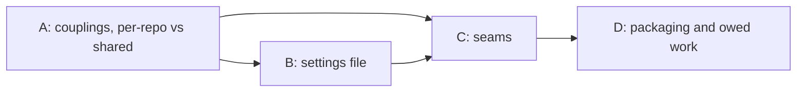
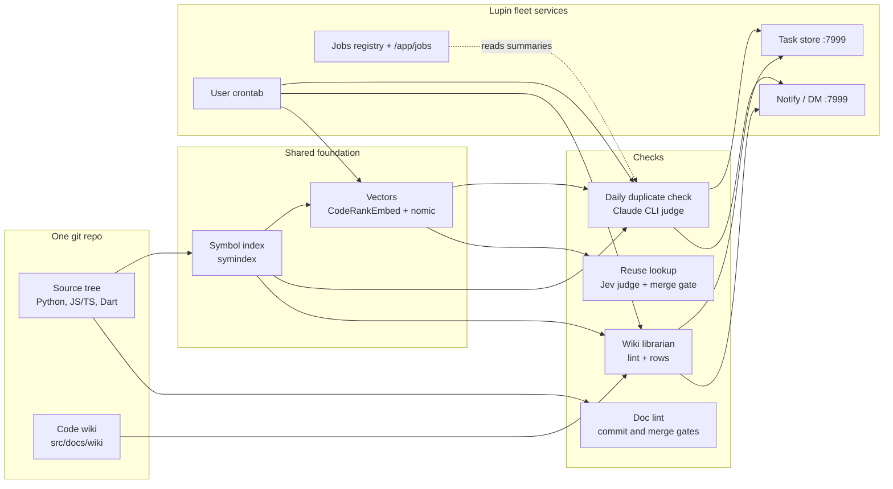

# Code-health services: what is done, what is not, and whether we can abstract them for other repos

María, 9 November 2026, measured between 10:15 and 11:20 EST against the main tree at `daf9b598e` (branch `wip-v0.2.3-2026.11.04-online-preference-learning`), the user crontab, the task store on `:7999` and the data folders under `projects-data/lupin/reuse-review/`. Ordered by Rick by voice this morning; row `898c93d8` quotes the order. Nothing was changed: no code, no cron line, no row.

## Cascade preface (Step 0, added 11 Nov 2026)

Rick ordered a cascaded review of this document (decision 4 in section 8; row `898c93d8`). On 9 Nov he paused it until the cron jobs were centralized (row `449bf026`). On 11 Nov at about 09:45 EST he answered yes to starting it now, because the one cron script is installed and only three weekly jobs are left to prove. Step rows: `9ff22a7a` (Step 0), `6349cc15` (Step 1), `f920520c` (Step 2), all under `epic:cascade-code-health-abstraction`.

### Cast Manifest

Skeleton crew is on until 17:00 EDT, so no seats are spawned before then. María prepares Step 0 alone, and reviewers are spawned at Step 4.

| Role | Persona | Recycled? |
|---|---|---|
| Author | María 🌸 (wrote this census) | — |
| Manager | María 🌸 | — |
| Stage 1 Reviewer (Usability/Reuse) | allocated at spawn, Step 4 | — |
| Stage 2 Reviewer (Viability/Gap) | allocated at spawn, Step 4 | ✓ Also Step 0 light-review |
| Stage 3 Reviewer (Ownership-Language) | allocated at spawn, Step 4 | — |
| Step 0 light-reviewer | the Stage 2 reviewer | RECYCLED |
| Step 9 light-reviewer | chosen at Step 8: the reviewer of the most-changed section | RECYCLED |
| Workflow Steward | allocated at spawn; a visible session, never a subagent | — |

Author and Manager are the same seat. That is allowed: the Manager is the default author of a review cascade. To keep the review cold, no reviewer may be a seat that worked on rows `449bf026`, `0d23e394` or `e411c6dd`.

### Pre-cascade Recon checklist

**Standing rules every cast member reads first**

| Rule | Source | Applies to THIS design? | Verification |
|---|---|---|---|
| 100% line, branch and function coverage | lupin `CLAUDE.md:158-166` | ✅ for every seam's code in lupin | Corrected after the light-review: the seams are not all under `src/cosa/repo/`. `Embedder` is `src/cosa/memory/embedding_provider.py`, and `Scheduler` reaches `src/scripts/cron-job.sh` and `lupin_mcp/job_run.py`. All of these are inside the coverage frame: `pyproject.toml:218-224` lists `src/cosa`, `src/lupin_mcp` and `src/scripts` as `source`. The rule binds the build, not the review |
| Coverage does not reach `lupin-mobile` | lupin `CLAUDE.md:166` (sub-repos excluded) | ✅ for §6.3 step 2 and Q2 | `lupin-mobile` follows its own repo's rules; the review must not hold its part to lupin's 100% gate |
| Doc lint: `src/lupin_mcp` is ratcheted, not swept | `swept_scope.py:12` (section 4, group 1) | ✅ for seams in `lupin_mcp` (`TaskSink`, `Scheduler`) | New code there is held to the ratchet table's counts, not the swept-scope zero |
| Nested repos are separate repos | fleet rule: a plan is handed to a session resident in the target repo | ✅ for §6.3 step 2 and Q2 | Work inside `lupin-mobile` is built by a `lupin-mobile` session under its manager, not by a lupin seat |
| Path management: one project-root function, config-relative paths | global `CLAUDE.md` § PATH MANAGEMENT | ✅ for `RepoSpec` and `DataRoot` (§6.2), and the settings file's `root` and `data.root` (§6.1) | Paths resolve through `cu.get_project_root()` and relative paths in config, never `__file__` chains or `sys.path` edits; the absolute `root:` in the §6.1 draft becomes repo-relative |
| Plan-time reuse check (`REUSE-OUTCOME` line per new definition) | planning-is-prompting `workflow/plan-review.md` §4 | ✅ | Section 6.2 proposes eight interfaces; each needs a lookup before review closes |
| No test or job touches a GPU | `workflow/testing-baseline.md` | ✅ | The embedding service in section 5 is reached only through `:7999` |
| Seats install nothing in cron; Rick runs installs | row `449bf026` | ✅ | The `Scheduler` seam (section 6.2) must end in a script Rick runs |
| Build belongs to a lupin-resident session | Rick's decision 4 (section 8) | ✅ | The review produces a plan; it does not build |
| Venue `:8000` serves the main checkout; check idle before a merge | fleet memory | Only at build time | Not needed for review |

**Persona conventions**: sign every finding with persona and session id; findings go to the cascade topic, not in DMs; every claim cites a file and line or a row.

**Project rules for this cascade**: doc-viewer scope `lupin`; edits to this file go in the main checkout through Edit, never by copying from a worktree; quantities are measured, not guessed, and any unmeasured figure is labeled as such.

### What changed since 9 Nov (read before sections 2 and 7)

Sections 2, 2.6 and 7 describe the morning of 9 Nov. These facts have changed since then, each with its receipt. Reviewers should not raise findings on the old state.

| 9 Nov statement | Now | Receipt |
|---|---|---|
| Each cron line hand-copies its environment; `job_run` is used by no cron line | 17 generated lines, all through `cron-job.sh` and `job_run`, one shared environment plus `~/.lupin/cron.env` | lupin `87a43c723`, `4a0566621`; installed by Rick 9 Nov 17:25; row `449bf026` |
| Duplicate check refused (`stale_branch`); no scheduled run ever succeeded; hourly mode not installed | Hourly 10:00–22:00 plus boot, follows the working branch; scheduled runs succeed | `io/duplicate-check-daily/runs.jsonl` lines 15–24 (none failed); rows `6d7e091e`, `c376c803`, `0d23e394` closed |
| Librarian crashing since 20 Oct | Clean boot run 10 Nov 19:12 | row `871176fc` closed |
| Shadow audit 4 of 4 failed, cause not measured | Cause measured (definition ids against symbol-index ids), fixed; 11 Nov 09:19 drain audited 1 item, 0 failed, 3,451,591 Jev tokens | lupin `cd70b6dab`; row `e411c6dd` |
| Cheech's D3–D5 open | One row per run, split under the cap; verdicts suppress re-reporting; mutual pairs filed once | rows `c7deca58`, `6c7e0883`, `d57dcf33`, `b7ce2a1c` closed |
| Triage owner configured | Owner from its own key, Cheech; never guessed | lupin `c04d62212`; row `ba4a3111` |
| Section 7 item 4 (stamp `job:<name>` on filed rows) | Not re-measured on 11 Nov | — |

**New cost fact for section 5 and the `budgets:` block**: the hourly baseline drain recorded $227, $201 and $178 (`cost_usd`, 747–782 judge calls each) in its three runs on 10 Nov, with 9,895 pairs still carried. Not measured: whether `cost_usd` is list price or actual billing on the Max plan.

### Proposed sections for review (Step 2 ratifies them)

Sections 1 to 3 are context and are not reviewed. Section 8 is already ruled.

| Section | Content | Reviewable knowing only… |
|---|---|---|
| **A** | §4 couplings and §5 per-repo versus shared | the nine coupling groups and the files they cite |
| **B** | §6.1 the settings file | A's group list, as the field inventory |
| **C** | §6.2 the seams | A's group list; B's field names |
| **D** | §6.3 packaging order and §7 owed work | that C names eight seams; the ruled decisions in §8 |



### Step 0 self-check against the six light-review criteria (Manager's pre-check, not the gate)

| # | Criterion | Self-check | Gap the light-reviewer should test |
|---|---|---|---|
| 1 | Section independence | Holds for A, B and D. C leans on B's field names | Whether B and C should merge |
| 2 | Open questions have a stance | Was a gap (file name, data root, multi-repo candidate search had no stance); stances added below as Q1 to Q3 | Whether Q1 to Q3 are complete and the stances hold |
| 3 | Recon items say where they are verified | Yes, in the table above | Whether coverage scope is right for code that moves into a new package (§6.3 step 3) |
| 4 | Every requirement cites a source | Yes: file and line, or row | §6.1's two ceilings are placeholders, labeled as such |
| 5 | Order respects dependencies | A → B → C → D is a DAG | — |
| 6 | Onboarding complete | Recon checklist above | Missing standing rules |

### Open questions, with a proposed stance (closes the criterion 2 gap)

None of these is a decision for Rick yet. The cast reviews the stance, and only a contested stance goes to him.

| # | Question | Proposed stance | Alternatives | Pros of the stance | Cons of the stance |
|---|---|---|---|---|---|
| Q1 | Where does the settings file live, and what is it called? | `<repo>/.code-health.yml` at the repo root | `src/conf/code-health.yml`; a section in `pyproject.toml` | Same place in every repo, whatever its layout or language; `lupin-mobile` (Dart) has no `pyproject.toml` | One more dotfile at the root |
| Q2 | Where does each repo's state live? | `projects-data/<repo>/code-health/`, outside the tree | `<repo>/io/code-health/` | Reuse data already lives under `projects-data/<repo>/`; the server's read-only mount already points at `projects-data/lupin/reuse-review`; git stays clean | The duplicate check writes to `$LUPIN_ROOT/io/` today (`proof_cli.py:33`), so its run history must move, and the jobs page must follow it |
| Q3 | How does candidate search serve more than one repo (§7 item 5)? | One shared service: widen the read-only mount to `projects-data/*/reuse-review` and key the loader by repo name | (b) run candidate search as its own process outside the container; (c) one service per repo | Smallest change; matches §5, which keeps one shared candidate search | The container can read every repo's vectors, though only read-only; one repo's large index uses memory every repo shares |

Next: the Stage 2 reviewer runs the light-review gate once seats can be spawned (after 17:00 EDT, or earlier if Rick lifts skeleton crew).

"Code-health services" in this document means the five things Rick named: source-code documentation checks, duplicate detection, the reuse lookup with its wiki, scheduling, and remediation (turning findings into work).

## Verdict

**Yes, we know enough to design the external interface now. No, we are not ready to run it for a third repo yet.**

- **Why design now.** Every piece is built and tested, and the survey below can list every place the code assumes Lupin, file by file. That list is the interface: each assumption becomes a parameter. A second repo, `lupin-mobile`, already runs on part of the stack (its own symbol index, wiki and librarian queue), so the multi-repo path is not hypothetical.
- **Why not ship yet.** Three of the six scheduled jobs failed this morning, and two of those three failures come from the same cause: each cron line hand-copies its own environment, and the copies have drifted. Copying that arrangement into another repo would copy the failures. The reuse judge is also only fair (AUC 0.68), so a new repo would inherit a tool we have not finished tuning.
- **Recommended path.** Fix the broken runs first. Then write a per-repo settings file (section 6) and make Lupin the first repo that reads it, with no change in behaviour. Then move `lupin-mobile` fully onto it. Only then add a third repo.

## 1. The ecosystem in one picture



The symbol index is the shared foundation. The duplicate check, the reuse lookup and the wiki librarian all read it. Doc lint stands alone: it reads source files directly and never touches the index.

## 2. Done and not done, by subsystem

### 2.1 Source-code documentation

| Piece | Status | Evidence |
|---|---|---|
| Python docstring lint (8 rules), comment lint, TS/JS JSDoc lint, Dart `///` lint, markdown lint | **Built, tested, blocking** at pre-commit, pre-push, and tier 3 of the merge pyramid | `src/cosa/repo/doc_lint/` (57 modules); `.git/hooks/pre-commit` → `src/scripts/pre-commit-chain.sh`; `src/tests/run-doclint-gate.sh` |
| Ratchet tables (counts can only fall) | Built and in use | `src/conf/doc-lint-counts.json` (1,999 files), `doc-lint-ts-counts.json` (554 files) |
| Claim judge (did a rewrite drop a claim?), Claude and Jev back ends | Built and tested; run by hand per package during the sweep; in no gate | `claim_judge.py`, `jev_judge.py`, `harness_runner.py` |
| Rewriter | **Not code.** Claude Code seats rewrote the text by hand, once | rewriter process-flow doc, section 3 |
| Python sweep | Done once: 859 files, 29,838 findings to 0 | `v0.2.2/.../2026.10.07-docstring-sweep-before-and-after-report.md` |
| Test files and `src/lupin_mcp` | Never swept, only ratcheted (76,985 and 4,992 findings) | same report |
| Inline-comment staleness check | Scratch experiment only | `src/rnd/2026.11.07-inline-comment-quality-census.md` |
| Scheduled run, automatic task filing | **None** | `crontab -l`; findings print to stderr |

About 2,300 unit tests (a grep count of `def test_` across 64 files). None at the integration tier.

### 2.2 Symbol index and code wiki

| Piece | Status | Evidence |
|---|---|---|
| Symbol index: Python (`ast`), JS/TS (TypeScript compiler under node), Dart (Dart SDK) | **Built, tested, in daily use** | `src/cosa/repo/symindex/`; 14,083 symbols, 253 routes |
| Code wiki: 700 capability pages plus `INDEX.md`, each page pinned to symbol hashes | Built and committed; **written by hand by seats**, not generated | `src/docs/wiki/capabilities/` (700 files, counted) |
| Wiki lint (stale, dangling, unindexed, orphan, pin rules) | Built and tested | `symindex/wiki_lint.py` |
| Librarian tick (lint the wiki, file rows for gaps) | Scheduled at 10:17, **failing: last clean run 20 Oct** | `projects-data/lupin/reuse-review/librarian/tick-state.json` (`last_run_date: 2026-10-20`); this morning's log ends in `LUPIN_CONFIG_MGR_CLI_ARGS is NOT set` |
| Second repo | `lupin-mobile` has its own index, wiki and librarian corpus | `lupin-mobile/src/docs/wiki/`; `librarian_tick.py:16,67-69` |

### 2.3 Reuse lookup (before writing new code)

| Piece | Status | Evidence |
|---|---|---|
| Candidate search: two keyword lists plus vector similarity, merged, cut to 128 | Built, in production, **runs inside the Lupin server** | `/api/reuse-candidates/*`; `symindex/candidates/` |
| Judge: Jev `jev-1.13.0`, packs of 50 | In production | `lupin_mcp/reuse_tools.py:63`; `doc_lint/jev_transport.py:19` |
| Agent tools `check_exists`, `fetch_similar`, `read_capability`, `record_search`, `replay` | In production on the cosa-voice MCP server: 187 calls in the week of 2–8 Nov | `cosa_voice_mcp.py:4903-5035`; `reuse-behaviour-2026-11-08.txt` |
| Merge gate and review gate | **Enforcing** since `d0180365c` | `lupin-app.ini:2295`; 11 of 11 mutants killed (`reuse-gates-mutation-evidence.md`) |
| Vector refresh | Scheduled at 10:47, **working** (last build 7 Nov, 13,218 rows) | `reuse-review/refresh/refresh-state.json` |
| Shadow audit (re-run about 1 lookup in 100 as a full sweep) | Scheduled at 11:37, **failed 4 of 4 this morning**, cause not measured | `reuse-review/shadow-audit/shadow-audit.log` last line `"failed": 4, "spent_tokens": 0` |
| Weekly behaviour report | Scheduled, working | 410 wrote new, 17 extended, 0 reused (week of 2–8 Nov) |
| Remediation plan, phases 3 to 8 (400-need set, A/B experiment, pilot) | **Not run**; plan still "awaiting cascaded review" | `v0.2.2/.../2026.10.24-reuse-detection-remediation-plan.md` |

About 240 unit-test files. Of the roughly 50 `lupin_mcp/reuse_*` modules, about 19 are on the production path and the rest are measurement harness.

### 2.4 Daily duplicate check

| Piece | Status | Evidence |
|---|---|---|
| Pipeline: window, extract, blind, embed, structural match (jscpd + AST), fuse, judge (Claude CLI, `claude-fable-5-1`), cluster, file | **Built and tested** (803 tests in 31 files) | `src/cosa/repo/duplicate_check/`, `lupin_mcp/duplicate_check_*.py` |
| Daily cron and baseline cron | Installed, **refused this morning** (`branch_guard: stale_branch`) | last two lines of `io/duplicate-check-daily/runs.jsonl`, both `"branch": "main"` |
| Adaptive hourly mode | Built, **not installed** | row `0d23e394`, 21:03 amendment, holds the install command |
| Status page `/app/duplicate-check` and `/app/jobs` accordion | Built, live on `:7999` | Cheech's row `0d23e394`; 8 e2e UI tests |
| Has a scheduled run ever succeeded? | **No.** All three successful runs (3, 6, 7 Nov) were started by hand | `runs.jsonl` |

Cheech's census this morning covers the backlog and its defects in detail; I do not repeat it. See `../2026.11.09-duplication-scheduling-and-remediation/2026.11.09-held-rows-and-backlog-census.md`, sections 4 and 5: 936 findings with no triage row, 1,369 definitions not yet judged, and defects D1 to D7.

### 2.5 Scheduling and remediation (shared by all of the above)

| Piece | Status | Evidence |
|---|---|---|
| Jobs registry (23 jobs), health reader, `/api/jobs/summary`, `/app/jobs` | Built and tested | `src/conf/job-registry.json`; `cosa/rest/job_*.py` |
| `job_run` wrapper (one launcher for every cron job) | Built, 5 tests, **used by no cron line** | `lupin_mcp/job_run.py`; `crontab -l` |
| Per-job notification interval | Stored, nothing sends on it | `job_health.py:285` |
| Findings to task-store rows | Duplicate check and librarian file rows; doc lint and shadow audit do not | `duplicate_check_filing.py`, `librarian_queue.py` |
| Jobs page count of a job's open rows | Reads key `job:duplicate-check`; the filer never writes that key, so the count is probably 0 | `job-registry.json:40`; `duplicate_check_filing.py:37-124` (uses `epic:dupcheck-*`). I read the code; I did not check the page |

### 2.6 Scheduled jobs this morning

| Cron job | Time | Result on 9 Nov | Cause |
|---|---|---|---|
| duplicate-check-daily | 10:00, 11:07, reboot | refused | cron line has no `--branch`, so it judges `main`, which is 5 days stale |
| wiki-librarian-tick | 10:17, reboot | crashed | cron line lacks `LUPIN_CONFIG_MGR_CLI_ARGS` |
| reuse-shadow-audit | 11:37, reboot | 4 of 4 failed | not measured (the Jev key missing from the cron environment is one guess) |
| reuse-vector-refresh | 10:47, reboot | working | — |
| reuse-behaviour-weekly | 18:00, reboot | working | — |
| host_snapshot, adaptive hourly duplicate check | — | not installed | waiting on Rick |

**Two of the three failures are the same defect**: each cron line spells out its own environment, and the copies drifted. That is the strongest practical argument for the abstraction, because one launcher reading one settings file removes the copies.

## 3. How good the checks are

| Check | Latest measure | Source |
|---|---|---|
| Doc lint | precision 0.80 to 0.97 on every rule; recall weak on some (tic 0.31, history 0.63) | `v0.2.2/.../2026.10.01-doc-lint-precision-recall-report.md` |
| Claim judge | on 64 planted losses: Haiku and Sonnet missed 0, Jev missed 2 | `v0.2.2/.../2026.10.01-claim-judge-comparison-jev-haiku-sonnet.md` |
| Reuse lookup | found 58 of 70 needs (17% missed) | `v0.2.2/.../2026.11.01-first-thousand-run-revised-plan.md` §15.3 |
| Reuse judge | AUC 0.68; at the 0.30 threshold it accepts 94% of same-job pairs **and 41% of different-job pairs** | same doc, §21 |
| Reuse judge | accepted 13 of 13 planted duplicates and 4 of 4 look-alikes: it cannot yet tell them apart | `v0.2.2/.../2026.11.02-reuse-search-measurement-explainer.md` §8 |
| Duplicate check | 7 Nov hand run: 1,680 definitions judged in 1,500 calls, 936 findings; of 153 triaged findings on 6 Nov, 68 were not duplicates | Cheech's census, sections 3 and 4 |

The lint tools are mature. The judges are usable but not finished. A new repo would get the lint tools at full strength and the judges at today's strength.

## 4. What ties it to Lupin

The three surveys listed the Lupin-specific assumptions file by file (I did not total them). They fall into nine groups. "Easy" means a constant or argument becomes a setting. "Deep" means a service has to be split out or replaced.

| # | Group | Examples | Easy or deep |
|---|---|---|---|
| 1 | **Repo layout** | `is_lupin_tree` needs `src/cosa` and `src/lupin_mcp` (`symindex/spec.py:77`); hardcoded JS folder `src/lupin_app/static/js` (`proof/label_prep.py:540`); doc-lint held prefix `src/lupin_mcp/` (`swept_scope.py:12`); scope regex `cosa\|lupin_\w+` (`reuse_tools.py:89`) | Easy: `spec.py` already has a generic fallback |
| 2 | **Data location** | duplicate check writes to `$LUPIN_ROOT/io/` (`proof_cli.py:33`); doc-lint tables in `src/conf/` (`counts.py:23`); reuse data under `projects-data/<repo>/reuse-review` (already per repo) | Easy |
| 3 | **Settings** | everything reads `lupin-app.ini` through `ConfigurationManager` and `LUPIN_CONFIG_MGR_CLI_ARGS` (`storage_paths.py:12,45`, INI lines 2267 to 2344) | Moderate: the settings loader is Lupin's |
| 4 | **Embeddings** | vectors come from Lupin's `/api/embeddings` on `:7999` and a key file (`embedding_provider.py:235`) | Deep, but sharing it is fine (see section 5) |
| 5 | **Judges** | Claude CLI for the duplicate check (`judge.py:145`); Jev for reuse (`jev_transport.py:19`); both for the claim judge; purpose lines through a Lupin job submission `/api/v2/submit` (`candidate_build.py:236`) | Easy for the CLI and Jev; deep for purpose lines |
| 6 | **Candidate search location** | runs inside the Lupin server, whose Docker mount is read-only to `projects-data/lupin/reuse-review` only (`docker-compose.yml:272`) | **Deep**: another repo's vectors cannot be read today |
| 7 | **Fleet services** | task store `project="lupin"`, owners `cheech` and `tiffany`, `[LUPIN]` titles, `COSA_VOICE_MANAGERS__LUPIN`; notify and DM at `:7999` with `sender_project: "lupin"` (`librarian_queue.py:22`, `duplicate_check_filing.py:65-81`, `librarian_tick.py:53`) | Deep if another repo has no fleet; easy if it does |
| 8 | **Scheduling** | each cron line hand-copies the venv, `PYTHONPATH`, `LUPIN_ROOT` and settings; `BRANCH="main"` (`duplicate_check_daily.py:47`) | Easy, and it fixes today's failures |
| 9 | **Gates and agent tools** | doc and reuse gates are steps 3 and 4 of Lupin's merge pyramid (`TestSuiteJob`, `job.py:60`); the five reuse tools live inside the cosa-voice MCP server | Moderate |

One more deep coupling cuts across all of them: the code lives inside the `cosa` package and imports `cosa.utils.util` for the project root. Moving it to its own package is the last step, not the first.

## 5. What a new repo needs: per repo versus shared

| Per repo (one copy each) | Shared (one copy for all repos) |
|---|---|
| settings file (section 6) | embedding service (model server behind `:7999`) |
| symbol index, vectors, ledgers, run history | judges: Claude CLI on the Max plan, Jev |
| code wiki (lives in that repo) | task store, notify, DM |
| doc-lint ratchet tables and rule choices | jobs page and registry (one row per repo per job) |
| cron entries (generated, not hand-written) | candidate search service, once it can load more than one repo's vectors |
| commit and merge hooks | the code itself |

Two of today's numbers set the cost of each new repo: the duplicate check spends about 0.9 judge calls per changed definition on the Max plan, and the shadow audit's one completed run used 3.3 million Jev tokens. A new repo adds to both shared budgets, so the settings file needs a per-repo ceiling.

## 6. The proposed interface

### 6.1 One settings file per repo

A first draft of the parameters. The example values are Lupin's, from the files cited above, except the two ceilings under `shadow_audit` and `budgets`, which are placeholders I chose.

```yaml
# <repo>/.code-health.yml   (name to be decided)
repo:
  name: lupin                          # task-store project, sender id, data folder
  root: /mnt/DATA01/.../lupin
  branch: auto                         # newest active branch; or a fixed name
  languages: [ python, ts, js ]        # dart for lupin-mobile
  source_dirs:  [ src/cosa, src/lupin_mcp, src/lupin_app/static/js ]
  test_dirs:    [ src/tests ]
  exclude:      [ src/rnd, io, node_modules ]
  wiki_dir: src/docs/wiki
data:
  root: projects-data/lupin/code-health   # one folder per repo, outside the tree
services:
  embeddings: http://localhost:7999/api/embeddings
  candidate_search: http://localhost:7999/api/reuse-candidates
  judge_duplicate: { transport: claude_cli, model: claude-fable-5-1 }
  judge_reuse:     { transport: jev, version: jev-1.13.0, pack_size: 50 }
remediation:
  task_store: http://localhost:7999
  owner: cheech                        # who receives filed rows
  managers: [ "Mr. Radio", "Cheech" ]
  title_prefix: "[LUPIN]"
  filing: one_row_per_run              # duplicate check
notify:
  url: http://localhost:7999/api/notify
  on: [ failure, backlog_slip ]
schedule:                              # turned into cron lines by one installer
  duplicate_check: { every: hour, from: "10:00", to: "23:00", ceiling: 800 }
  librarian:       { daily: "10:17" }
  vector_refresh:  { daily: "10:47" }
  shadow_audit:    { daily: "11:37", token_ceiling: 3500000 }
doc_lint:
  standard: design-by-contract         # or a lighter set of rules
  gates: [ pre-commit, pre-push, merge ]
budgets:
  judge_calls_per_day: 1500
```

### 6.2 The seams in the code

Each group in section 4 becomes one small interface. Lupin's current code becomes the first implementation of each, so nothing in Lupin changes behaviour.

| Interface | What it answers | Lupin's implementation today |
|---|---|---|
| `RepoSpec` | which files, which languages, which branch | `symindex/spec.py` (`spec_for` already chooses Lupin or generic) |
| `DataRoot` | where this repo's state lives | `storage_paths.py`, `proof_cli.py:33` |
| `Embedder` | text to vector | `EmbeddingProvider` via `:7999` |
| `Judge` | is A the same job as B? | `duplicate_check/judge.py` (Claude CLI), `jev_transport.py` (Jev) |
| `TaskSink` | file a finding as a row, idempotently | `duplicate_check_filing.py`, `librarian_queue.py` |
| `Notifier` | tell a person something failed or slipped | `/api/notify` calls in `duplicate_check_daily.py:545` and `librarian_tick.py:53` |
| `Scheduler` | turn `schedule:` into cron lines and launch each run with the full settings | `job_run.py` (built, unused) plus `duplicate_check_daily --install` |
| `Gate` | refuse a commit or merge | `gate.py`, `reuse_merge_gate.py` |

### 6.3 Packaging, in order

1. **Settings file and seams inside `cosa`**, Lupin as repo 1. No new package yet.
2. **`lupin-mobile` as repo 2 on the full stack**: duplicate check, doc lint (Dart), wiki, reuse lookup. This is the acceptance test, because it is a different language and already half on.
3. **A separate installable package** (for example `code-health`) once two repos run cleanly, plus an installer that writes the settings file, the hooks and the cron lines into a new repo.
4. **The agent side as a Claude Code plugin**: the five reuse tools as their own MCP server, plus the reviewer skill. Today they sit inside the cosa-voice server.

## 7. Work owed before a third repo

| # | Work | Why first | Size |
|---|---|---|---|
| 1 | Install the cron fixes: `--branch auto` and the hourly duplicate check; add `LUPIN_CONFIG_MGR_CLI_ARGS` to the librarian line; measure the shadow-audit failure | three of six jobs are down | Rick runs one command; one small investigation |
| 2 | Cheech's D3 to D5: the oversized per-run row, verdicts that do not suppress re-reporting, pairs filed from both sides | each new repo would multiply them | one row, already scoped in the census |
| 3 | Put every cron job behind `job_run` | removes environment drift, the root cause of two failures | small: the wrapper exists |
| 4 | Stamp `job:<name>` on filed rows | the jobs page count is probably 0 today | small |
| 5 | Candidate search that can load more than one repo's vectors (Docker mount and loader) | the one deep blocker for reuse lookup elsewhere | medium |
| 6 | Settings file and seams (section 6), Lupin as repo 1 | the interface itself | medium |
| 7 | `lupin-mobile` on the full stack | proves the interface on a second language | medium |

Items 1 to 4 are worth doing whether or not we abstract. Items 5 to 7 are the abstraction.

**Ruled 9 Nov 2026, about 11:50 EST, Rick by voice:** item 3 comes first. The cron jobs "should be centralized in 1 script", and that "definitely needs to be addressed before we build out a plan to abstract the system out across other repos". Row `449bf026` (P1). The cascaded review of this document waits on it. Measured that morning: 21 active crontab lines, 11 of them for the five code-health jobs, each hand-copying its own environment.

## 8. Decisions for Rick

**Ruled 9 Nov 2026, about 11:35 EST, by Rick through a four-question card: all four as recommended below.** Design the interface now and hold any third repo; `lupin-mobile` is the second repo; one shared judge budget with a per-repo ceiling; cascaded review, then a Lupin-resident session builds.

1. **Proceed to interface design now, and hold the third repo until two weeks of green scheduled runs on Lupin and `lupin-mobile`** (recommended). The alternative, extracting a package first, would freeze today's couplings into a public shape and copy today's broken cron lines with it.
2. **Second repo for the acceptance test: `lupin-mobile`** (recommended), because it is already half on and adds Dart. The alternative, `planning-is-prompting`, is smaller but almost all Markdown, so it would test little.
3. **Shared or per-repo judge budgets.** I recommend one shared Max-plan budget with a per-repo ceiling in the settings file, because the judges are one account either way.
4. **Who owns the build.** The duplicate check and librarian are Cheech's lane today. I recommend this design goes through `/plan-review-cascaded` before anyone builds, and that the build belongs to a Lupin-resident session.

## Gaps I did not close

- Why the shadow audit failed this morning: not measured.
- Whether the jobs page really shows 0 open duplicate-check rows: inferred from code, not checked on the page.
- Whether the doc-parity cron fires: its log is empty, which a clean run also produces. It compares workflow documents, not source code, so it is outside this ecosystem.
- Test counts are grep counts of `def test_`, not collected runs.
- Quality figures are copied from the cited reports, not re-measured.
- The settings-file draft in section 6.1 is mine and has not been reviewed.

## Sources

- Cheech's census: `../2026.11.09-duplication-scheduling-and-remediation/2026.11.09-held-rows-and-backlog-census.md`
- Reuse and wiki design: `../../v0.2.2/2026.09.30-wiki-and-jev-for-code-reuse-review/` (main doc, 2026.10.20 test results, 2026.10.24 remediation plan, 2026.11.01 revised plan, 2026.11.02 explainer)
- Documentation rewrite: `../../v0.2.2/2026.09.30-lupin-af-documentation-rewrite-plan/`
- Job reporting format: planning-is-prompting `src/rnd/2026.11.07-background-job-reporting-format.md`
- Rows: `898c93d8` (this document), `a04f7fe5` (census), `0d23e394` (hourly duplicate check)
- Runtime: `crontab -l`; `io/duplicate-check-daily/runs.jsonl`; `projects-data/lupin/reuse-review/{librarian,refresh,shadow-audit}/`
