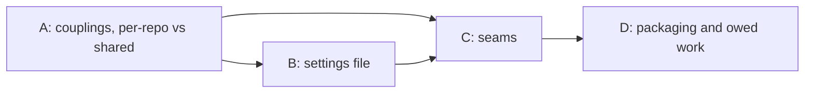
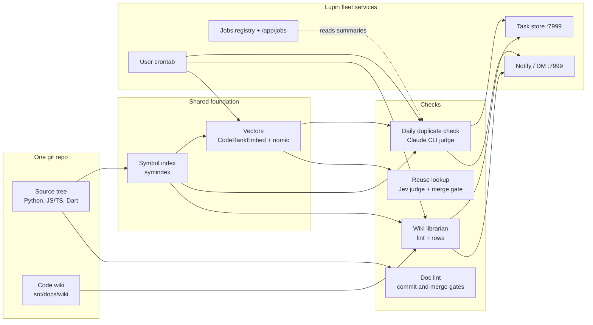

# Code-health services: what is done, what is not, and whether we can abstract them for other repos

María, 9 November 2026, measured between 10:15 and 11:20 EST against the main tree at `daf9b598e` (branch `wip-v0.2.3-2026.11.04-online-preference-learning`), the user crontab, the task store on `:7999` and the data folders under `projects-data/lupin/reuse-review/`. Ordered by Rick by voice this morning; row `898c93d8` quotes the order. Nothing was changed: no code, no cron line, no row.

## Cascade preface (Step 0, added 11 Nov 2026)

Rick ordered a cascaded review of this document (decision 4 in section 8; row `898c93d8`). On 9 Nov he paused it until the cron jobs were centralized (row `449bf026`). On 11 Nov at about 09:45 EST he answered yes to starting it now, because the one cron script is installed and only three weekly jobs are left to prove. Step rows: `9ff22a7a` (Step 0), `6349cc15` (Step 1), `f920520c` (Step 2), all under `epic:cascade-code-health-abstraction`.

### Cast Manifest

Rick turned skeleton crew off on 11 Nov at 09:57 EST. María prepared Step 0 alone, and the cast was spawned at 13:21 EST.

| Role | Persona | Recycled? |
|---|---|---|
| Author | Chloé 🗼 (revises; María wrote the census) | — |
| Manager | María 🌸 | — |
| Stage 1 Reviewer (Usability/Reuse) | Rachel | — |
| Stage 2 Reviewer (Viability/Gap) | John | ✓ Also Step 0 light-review |
| Stage 3 Reviewer (Ownership-Language) | Pocholo | — |
| Step 0 light-reviewer | the Stage 2 reviewer (John) | RECYCLED |
| Step 9 light-reviewer | chosen at Step 8: the reviewer of the most-changed section | RECYCLED |
| Workflow Steward | allocated at spawn; a visible session, never a subagent | — |

Author and Manager are the same seat. That is allowed: the Manager is the default author of a review cascade. To keep the review cold, no reviewer may be a seat that worked on rows `449bf026`, `0d23e394` or `e411c6dd`.

### Pre-cascade Recon checklist

**Standing rules every cast member reads first**

| Rule | Source | Applies to THIS design? | Verification |
|---|---|---|---|
| 100% line, branch and function coverage | lupin `CLAUDE.md:158-166` | ✅ for every seam's code in lupin | Corrected after the light-review: the seams are not all under `src/cosa/repo/`. `Embedder` is `src/cosa/memory/embedding_provider.py`, and `Scheduler` reaches `src/scripts/cron-job.sh` and `lupin_mcp/job_run.py`. All of these are inside the coverage frame: `pyproject.toml:218-224` lists `src/cosa`, `src/lupin_mcp` and `src/scripts` as `source`. The rule binds the build, not the review |
| Coverage does not reach `lupin-mobile` | lupin `CLAUDE.md:166` (sub-repos excluded) | ✅ for §6.3 step 2 and Q2 | `lupin-mobile` follows its own repo's rules; the review must not hold its part to lupin's 100% gate |
| Doc lint: `src/lupin_mcp` is ratcheted, not swept | `swept_scope.py:12` (section 4, group 1) | ✅ for seams in `lupin_mcp` (`TaskSink`, `Scheduler`) | New code there is held to the ratchet table's counts, not the swept-scope zero |
| Nested repos are separate repos | fleet rule: a plan is handed to a session resident in the target repo | ✅ for §6.3 step 2 and Q2 | Work inside `lupin-mobile` is built by a `lupin-mobile` session under its manager, not by a lupin seat |
| Path management: one project-root function, config-relative paths | global `CLAUDE.md` § PATH MANAGEMENT | ✅ for `RepoSpec` and `DataRoot` (§6.2), and the settings file's `root` and `data.root` (§6.1) | Paths resolve through `cu.get_project_root()` and relative paths in config, never `__file__` chains or `sys.path` edits; the absolute `root:` in the §6.1 draft becomes repo-relative |
| Plan-time reuse check (`REUSE-OUTCOME` line per new definition) | planning-is-prompting `workflow/plan-review.md` §4 | ✅ | Section 6.2 proposes eight interfaces; each needs a lookup before review closes |
| No test or job touches a GPU | `workflow/testing-baseline.md` | ✅ | The embedding service in section 5 is reached only through `:7999` |
| Seats install nothing in cron; Rick runs installs | row `449bf026` | ✅ | The `Scheduler` seam (section 6.2) must end in a script Rick runs |
| Build belongs to a lupin-resident session | Rick's decision 4 (section 8) | ✅ | The review produces a plan; it does not build |
| Venue `:8000` serves the main checkout; check idle before a merge | fleet memory | Only at build time | Not needed for review |

**Persona conventions**: sign every finding with persona and session id; findings go to the cascade topic, not in DMs; every claim cites a file and line or a row.

**Project rules for this cascade**: doc-viewer scope `lupin`; edits to this file go in the main checkout through Edit, never by copying from a worktree; quantities are measured, not guessed, and any unmeasured figure is labeled as such.

### What changed since 9 Nov (read before sections 2 and 7)

Sections 2, 2.6 and 7 describe the morning of 9 Nov. These facts have changed since then, each with its receipt. Reviewers should not raise findings on the old state.

| 9 Nov statement | Now | Receipt |
|---|---|---|
| Each cron line hand-copies its environment; `job_run` is used by no cron line | 17 generated lines, all through `cron-job.sh` and `job_run`, one shared environment plus `~/.lupin/cron.env` | lupin `87a43c723`, `4a0566621`; installed by Rick 9 Nov 17:25; row `449bf026` |
| Duplicate check refused (`stale_branch`); no scheduled run ever succeeded; hourly mode not installed | Hourly 10:00–22:00 plus boot, follows the working branch; scheduled runs succeed | `io/duplicate-check-daily/runs.jsonl` lines 15–24 (none failed); rows `6d7e091e`, `c376c803`, `0d23e394` closed |
| Librarian crashing since 20 Oct | Clean boot run 10 Nov 19:12 | row `871176fc` closed |
| Shadow audit 4 of 4 failed, cause not measured | Cause measured (definition ids against symbol-index ids), fixed; 11 Nov 09:19 drain audited 1 item, 0 failed, 3,451,591 Jev tokens | lupin `cd70b6dab`; row `e411c6dd` |
| Cheech's D3–D5 open | One row per run, split under the cap; verdicts suppress re-reporting; mutual pairs filed once | rows `c7deca58`, `6c7e0883`, `d57dcf33`, `b7ce2a1c` closed |
| Triage owner configured | Owner from its own key, Cheech; never guessed | lupin `c04d62212`; row `ba4a3111` |
| Section 7 item 4 (stamp `job:<name>` on filed rows) | Not re-measured on 11 Nov | — |

**New cost fact for section 5 and the `budgets:` block**: the hourly baseline drain recorded $227, $201 and $178 (`cost_usd`, 747–782 judge calls each) in its three runs on 10 Nov, with 9,895 pairs still carried. Not measured: whether `cost_usd` is list price or actual billing on the Max plan.

### Proposed sections for review (Step 2 ratifies them)

Sections 1 to 3 are context and are not reviewed. Section 8 is already ruled.

| Section | Content | Reviewable knowing only… |
|---|---|---|
| **A** | §4 couplings and §5 per-repo versus shared | the nine coupling groups and the files they cite |
| **B** | §6.1 the settings file | A's group list, as the field inventory |
| **C** | §6.2 the seams | A's group list; B's field names |
| **D** | §6.3 packaging order and §7 owed work | that C names eight seams; the ruled decisions in §8 |



### Step 0 self-check against the six light-review criteria (Manager's pre-check, not the gate)

| # | Criterion | Self-check | Gap the light-reviewer should test |
|---|---|---|---|
| 1 | Section independence | Failed the first light-review: §2, §2.6, §7, §8's preamble and the Verdict still described the morning of 9 Nov, so section D could not be read cold. Rewritten on 11 Nov to the state in the preface table, with the 9 Nov text kept only where labelled "on 9 Nov". C still leans on B's field names | Whether any statement in §2, §7, §8 or the Verdict still contradicts the preface table; whether B and C should merge |
| 2 | Open questions have a stance | Failed the first light-review: Q2 (data root `projects-data/<repo>/code-health/`) conflicted with Q3 (widen the reuse-review mount), no stance said whether reuse-review data moves, and Q3's alternatives (b) and (c) had no pros and cons. Now: reuse-review data does not move, Q2 and Q3 agree, and (b) and (c) each carry pros and cons | Whether Q1 to Q3 are complete and the stances hold |
| 3 | Recon items say where they are verified | Yes, in the table above | Whether coverage scope is right for code that moves into a new package (§6.3 step 3) |
| 4 | Every requirement cites a source | Yes: file and line, or row | §6.1's one chosen number (`budgets.jev_token_limit`) is a placeholder, labeled as such |
| 5 | Order respects dependencies | A → B → C → D is a DAG | — |
| 6 | Onboarding complete | Recon checklist above | Missing standing rules |

### Open questions, with a proposed stance (closes the criterion 2 gap)

None of these is a decision for Rick yet. The cast reviews the stance, and only a contested stance goes to him.

| # | Question | Proposed stance | Alternatives | Pros of the stance | Cons of the stance |
|---|---|---|---|---|---|
| Q1 | Where does the settings file live, what is it called, and how does it relate to `.docview.yml`? | `<repo>/.code-health.yml` at the repo root, as a **separate file that reuses the `.docview.yml` parser pattern** (`version` key, `extra="forbid"`, a missing file means defaults) and is read for the repos already listed under `external repos` (`lupin-app.ini:1624-1638`). It is a view over the registry, INI and manager map, never a second source of truth (§6.1 table) | `src/conf/code-health.yml`; a section in `pyproject.toml`; one manifest with a `code_health:` section inside `.docview.yml` | Same place in every repo, whatever its layout or language; `lupin-mobile` (Dart) has no `pyproject.toml`; a doc-viewer manifest change cannot break a code-health run, and the reverse, because `.docview.yml` rejects unknown keys and would fail on a `code_health:` section | One more dotfile at the root; two loaders to keep in step, until the parser pattern is shared in code |
| Q2 | Where does each repo's state live? | Every code-health service writes under `projects-data/<repo>/code-health/`, outside the tree, resolved by the existing `fleet_data_root( repo_root )` (`heartbeat_hold.py:236`) plus per-service subdir keys. `DATA_RELATIVE` is what retires. **Reuse-review data does not move**: it stays at `projects-data/<repo>/reuse-review/`, because the server's read-only mount and the candidate-search loader already read it there | `<repo>/io/code-health/` | Reuse data already lives under `projects-data/<repo>/`; the server's read-only mount already points at `projects-data/lupin/reuse-review`, so nothing about reuse lookup changes; git stays clean | The duplicate check writes to `$LUPIN_ROOT/io/` today (`src/cosa/repo/duplicate_check/proof/proof_cli.py:33`, `DATA_RELATIVE = "/io"`), so its run history must move and the jobs page must follow it |
| Q3 | How does candidate search serve more than one repo (§7 item 5)? | One shared service, no data move (agrees with Q2): widen the read-only mount to `projects-data/*/reuse-review` and key the loader by `fleet_data_root( repo )` (`src/lupin_cli/claude_code/hooks/lib/heartbeat_hold.py:236`) instead of a new path rule. The loader is single-root today (`LUPIN_REUSE_REVIEW_DATA_ROOT`, `src/cosa/rest/routers/reuse_candidates.py:27,44`) and the mount sits in two compose services, so rollout is a `--force-recreate` of both, not a restart | (b) run candidate search as its own process outside the container; (c) one service per repo; pros and cons below | Smallest change; matches §5, which keeps one shared candidate search; reuse-review data stays where Q2 puts it | The container can read every repo's vectors, though only read-only; one repo's large index uses memory every repo shares |

Alternatives to Q3's stance:

| Alternative | Pros | Cons |
|---|---|---|
| (b) Candidate search as its own process outside the container | No mount change; it scales and restarts on its own | **Not yet known to be a new service.** `search_interpreter()` (`src/cosa/repo/symindex/candidates/storage_paths.py:130`) is documented as the interpreter that runs a search process, with an INI key and an environment variable, and nobody has read who launches it. Until that is read, this alternative is not costed as "a second service to run, health-check and give a port" |
| (c) One service per repo | Isolation: one repo's index cannot use another's memory | N copies of the embedding model's memory; N ports; the shared judge budget (decision 3 in section 8) is split |


"Code-health services" in this document means the five things Rick named: source-code documentation checks, duplicate detection, the reuse lookup with its wiki, scheduling, and remediation (turning findings into work).

## Verdict

**Yes, we know enough to design the external interface now. No, we are not ready to run it for a third repo yet.**

- **Why design now.** Every piece is built and tested, and the survey below can list every place the code assumes Lupin, file by file. That list is the interface: each assumption becomes a parameter. A second repo, `lupin-mobile`, already runs on part of the stack (its own symbol index, wiki and librarian queue), so the multi-repo path is not hypothetical.
- **Why not ship yet.** On 9 Nov three of the six scheduled jobs failed, two of them because each cron line hand-copied its own environment. That is fixed: since 9 Nov 17:25 all 17 generated cron lines run through one launcher with one shared environment, and the duplicate check, librarian and shadow audit have run clean (preface table, "What changed since 9 Nov"). What is still open: the weekly jobs are not yet proven on the new lines; the hourly baseline drain is costly ($178 to $227 per run on 10 Nov, `cost_usd`, with 9,895 pairs still carried); and the reuse judge is only fair (AUC 0.68), so a new repo would inherit a tool we have not finished tuning.
- **Recommended path.** The broken runs are fixed (see above). Write a per-repo settings file (section 6) and make Lupin the first repo that reads it, with no change in behaviour. Then move `lupin-mobile` fully onto it. Only then add a third repo.

## 1. The ecosystem in one picture



The symbol index is the shared foundation. The duplicate check, the reuse lookup and the wiki librarian all read it. Doc lint stands alone: it reads source files directly and never touches the index.

## 2. Done and not done, by subsystem

### 2.1 Source-code documentation

| Piece | Status | Evidence |
|---|---|---|
| Python docstring lint (8 rules), comment lint, TS/JS JSDoc lint, Dart `///` lint, markdown lint | **Built, tested, blocking** at pre-commit, pre-push, and tier 3 of the merge pyramid | `src/cosa/repo/doc_lint/` (57 modules); `.git/hooks/pre-commit` → `src/scripts/pre-commit-chain.sh`; `src/tests/run-doclint-gate.sh` |
| Ratchet tables (counts can only fall) | Built and in use | `src/conf/doc-lint-counts.json` (1,999 files), `doc-lint-ts-counts.json` (554 files) |
| Claim judge (did a rewrite drop a claim?), Claude and Jev back ends | Built and tested; run by hand per package during the sweep; in no gate | `claim_judge.py`, `jev_judge.py`, `harness_runner.py` |
| Rewriter | **Not code.** Claude Code seats rewrote the text by hand, once | rewriter process-flow doc, section 3 |
| Python sweep | Done once: 859 files, 29,838 findings to 0 | `v0.2.2/.../2026.10.07-docstring-sweep-before-and-after-report.md` |
| Test files and `src/lupin_mcp` | Never swept, only ratcheted (76,985 and 4,992 findings) | same report |
| Inline-comment staleness check | Scratch experiment only | `src/rnd/2026.11.07-inline-comment-quality-census.md` |
| Scheduled run, automatic task filing | **None** | `crontab -l`; findings print to stderr |

About 2,300 unit tests (a grep count of `def test_` across 64 files). None at the integration tier.

### 2.2 Symbol index and code wiki

| Piece | Status | Evidence |
|---|---|---|
| Symbol index: Python (`ast`), JS/TS (TypeScript compiler under node), Dart (Dart SDK) | **Built, tested, in daily use** | `src/cosa/repo/symindex/`; 14,083 symbols, 253 routes |
| Code wiki: 700 capability pages plus `INDEX.md`, each page pinned to symbol hashes | Built and committed; **written by hand by seats**, not generated | `src/docs/wiki/capabilities/` (700 files, counted) |
| Wiki lint (stale, dangling, unindexed, orphan, pin rules) | Built and tested | `symindex/wiki_lint.py` |
| Librarian tick (lint the wiki, file rows for gaps) | Scheduled at 10:17; **clean boot run on 10 Nov at 19:12**. On 9 Nov it was failing, last clean run 20 Oct, because the cron line lacked `LUPIN_CONFIG_MGR_CLI_ARGS` | row `871176fc` closed; on 9 Nov, `projects-data/lupin/reuse-review/librarian/tick-state.json` (`last_run_date: 2026-10-20`) |
| Second repo | `lupin-mobile` has its own index, wiki and librarian corpus | `lupin-mobile/src/docs/wiki/`; `librarian_tick.py:16,67-69` |

### 2.3 Reuse lookup (before writing new code)

| Piece | Status | Evidence |
|---|---|---|
| Candidate search: two keyword lists plus vector similarity, merged, cut to 128 | Built, in production, **runs inside the Lupin server** | `/api/reuse-candidates/*`; `symindex/candidates/` |
| Judge: Jev `jev-1.13.0`, packs of 50 | In production | `lupin_mcp/reuse_tools.py:63`; `doc_lint/jev_transport.py:19` |
| Agent tools `check_exists`, `fetch_similar`, `read_capability`, `record_search`, `replay` | In production on the cosa-voice MCP server: 187 calls in the week of 2–8 Nov | `cosa_voice_mcp.py:4903-5035`; `reuse-behaviour-2026-11-08.txt` |
| Merge gate and review gate | **Enforcing** since `d0180365c` | `lupin-app.ini:2295`; 11 of 11 mutants killed (`reuse-gates-mutation-evidence.md`) |
| Vector refresh | Scheduled at 10:47, **working** (last build 7 Nov, 13,218 rows) | `reuse-review/refresh/refresh-state.json` |
| Shadow audit (re-run about 1 lookup in 100 as a full sweep) | **Fixed.** On 9 Nov it failed 4 of 4 with the cause not measured. The cause was definition ids compared against symbol-index ids; the 11 Nov 09:19 drain audited 1 item, 0 failed, 3,451,591 Jev tokens | lupin `cd70b6dab`; row `e411c6dd`; on 9 Nov, `reuse-review/shadow-audit/shadow-audit.log` last line `"failed": 4, "spent_tokens": 0` |
| Weekly behaviour report | Scheduled, working | 410 wrote new, 17 extended, 0 reused (week of 2–8 Nov) |
| Remediation plan, phases 3 to 8 (400-need set, A/B experiment, pilot) | **Not run**; plan still "awaiting cascaded review" | `v0.2.2/.../2026.10.24-reuse-detection-remediation-plan.md` |

About 240 unit-test files. Of the roughly 50 `lupin_mcp/reuse_*` modules, about 19 are on the production path and the rest are measurement harness.

### 2.4 Daily duplicate check

| Piece | Status | Evidence |
|---|---|---|
| Pipeline: window, extract, blind, embed, structural match (jscpd + AST), fuse, judge (Claude CLI, `claude-fable-5-1`), cluster, file | **Built and tested** (803 tests in 31 files) | `src/cosa/repo/duplicate_check/`, `lupin_mcp/duplicate_check_*.py` |
| Scheduled runs (daily and baseline) | **Hourly 10:00 to 22:00 plus boot, following the working branch; scheduled runs succeed.** On 9 Nov they were refused (`branch_guard: stale_branch`) | `io/duplicate-check-daily/runs.jsonl` lines 15 to 24, none failed; rows `6d7e091e`, `c376c803`, `0d23e394` closed |
| Adaptive hourly mode | **Installed** by Rick on 9 Nov at 17:25, as part of the 17 generated cron lines | row `449bf026`; lupin `87a43c723`, `4a0566621` |
| Status page `/app/duplicate-check` and `/app/jobs` accordion | Built, live on `:7999` | Cheech's row `0d23e394`; 8 e2e UI tests |
| Has a scheduled run ever succeeded? | **Yes, now.** On 9 Nov: no, the three successful runs (3, 6, 7 Nov) were started by hand. Since the hourly install, runs 15 to 24 all succeeded | `runs.jsonl` |

Cheech's census of 9 Nov covers the backlog and its defects in detail; I do not repeat it. See `../2026.11.09-duplication-scheduling-and-remediation/2026.11.09-held-rows-and-backlog-census.md`, sections 4 and 5. **On 9 Nov** it counted 936 findings with no triage row, 1,369 definitions not yet judged, and defects D1 to D7; those counts were not re-measured on 11 Nov. D3 to D5 are closed: one row per run, split under the cap; verdicts suppress re-reporting; mutual pairs filed once (rows `c7deca58`, `6c7e0883`, `d57dcf33`, `b7ce2a1c`).

### 2.5 Scheduling and remediation (shared by all of the above)

| Piece | Status | Evidence |
|---|---|---|
| Jobs registry (23 jobs on 9 Nov), health reader, `/api/jobs/summary`, `/app/jobs` | Built and tested | `src/conf/job-registry.json`; `cosa/rest/job_*.py` |
| `job_run` wrapper (one launcher for every cron job) | Built, 5 tests, **used by every generated cron line** (17 lines, all through `cron-job.sh` and `job_run`, one shared environment plus `~/.lupin/cron.env`). On 9 Nov it was used by none | `lupin_mcp/job_run.py`; lupin `87a43c723`, `4a0566621`; row `449bf026` |
| Per-job notification interval | Stored, nothing sends on it | `job_health.py:285` |
| Findings to task-store rows | Duplicate check and librarian file rows; doc lint and shadow audit do not (as measured on 9 Nov). The triage owner now comes from its own key, Cheech, and is never guessed | `duplicate_check_filing.py`, `librarian_queue.py`; lupin `c04d62212`; row `ba4a3111` |
| Jobs page count of a job's open rows | On 9 Nov: reads key `job:duplicate-check`; the filer never wrote that key, so the count was probably 0. **Not re-measured on 11 Nov** | `job-registry.json:40`; `duplicate_check_filing.py:37-124` (uses `epic:dupcheck-*`). On 9 Nov I read the code; I did not check the page |

### 2.6 Scheduled jobs: 9 Nov and now

| Cron job | Result on 9 Nov | Now (11 Nov) | Receipt |
|---|---|---|---|
| duplicate-check-daily | refused: no `--branch`, so it judged `main`, 5 days stale | Hourly 10:00 to 22:00 plus boot, follows the working branch; scheduled runs succeed | `runs.jsonl` lines 15 to 24; rows `6d7e091e`, `c376c803`, `0d23e394` |
| wiki-librarian-tick | crashed: the line lacked `LUPIN_CONFIG_MGR_CLI_ARGS` (crashing since 20 Oct) | Clean boot run on 10 Nov at 19:12 | row `871176fc` |
| reuse-shadow-audit | 4 of 4 failed, cause not measured | Cause measured (definition ids against symbol-index ids) and fixed; the 11 Nov 09:19 drain audited 1 item, 0 failed, 3,451,591 Jev tokens | lupin `cd70b6dab`; row `e411c6dd` |
| reuse-vector-refresh | working | Not re-measured on 11 Nov | none |
| reuse-behaviour-weekly | working | Not re-measured on 11 Nov | none |
| host_snapshot | not installed, waiting on Rick | Not re-measured on 11 Nov | none |
| adaptive hourly duplicate check | not installed | Installed | row `449bf026` |

**On 9 Nov, two of the three failures were the same defect**: each cron line spelled out its own environment, and the copies drifted. That was the strongest practical argument for the abstraction. It is fixed at the source: one launcher reads one shared environment (17 generated lines, installed by Rick on 9 Nov at 17:25, row `449bf026`). Three weekly jobs are still to be proven on the new lines (the preface's reason for starting the cascade on 11 Nov).

## 3. How good the checks are

| Check | Latest measure | Source |
|---|---|---|
| Doc lint | precision 0.80 to 0.97 on every rule; recall weak on some (tic 0.31, history 0.63) | `v0.2.2/.../2026.10.01-doc-lint-precision-recall-report.md` |
| Claim judge | on 64 planted losses: Haiku and Sonnet missed 0, Jev missed 2 | `v0.2.2/.../2026.10.01-claim-judge-comparison-jev-haiku-sonnet.md` |
| Reuse lookup | found 58 of 70 needs (17% missed) | `v0.2.2/.../2026.11.01-first-thousand-run-revised-plan.md` §15.3 |
| Reuse judge | AUC 0.68; at the 0.30 threshold it accepts 94% of same-job pairs **and 41% of different-job pairs** | same doc, §21 |
| Reuse judge | accepted 13 of 13 planted duplicates and 4 of 4 look-alikes: it cannot yet tell them apart | `v0.2.2/.../2026.11.02-reuse-search-measurement-explainer.md` §8 |
| Duplicate check | 7 Nov hand run: 1,680 definitions judged in 1,500 calls, 936 findings; of 153 triaged findings on 6 Nov, 68 were not duplicates | Cheech's census, sections 3 and 4 |

The lint tools are mature. The judges are usable but not finished. A new repo would get the lint tools at full strength and the judges at today's strength.

## 4. What ties it to Lupin

The three surveys listed the Lupin-specific assumptions file by file (I did not total them). They fall into nine groups. **The list is sampled, not a census**: it is what three surveys happened to find, and Section B's field inventory inherits that limit. A measured census is owed work (section 7, item 9). "Easy" means a constant or argument becomes a setting. "Deep" means a service has to be split out or replaced. "Moderate" sits between: existing code has to be moved or re-wired, but no service is split out or replaced.

| # | Group | Examples | Easy or deep |
|---|---|---|---|
| 1 | **Repo layout** | `is_lupin_tree` needs `src/cosa` and `src/lupin_mcp` (`src/cosa/repo/symindex/spec.py:77`); the same file pins `LUPIN_PY_PACKAGES`, `LUPIN_JS_DIRS` and `TESTS_DIRS` (`spec.py:12-18`) and `tests_spec` branches on `is_lupin_tree` (`spec.py:119-121`); hardcoded JS folder `src/lupin_app/static/js` (`src/cosa/repo/duplicate_check/proof/label_prep.py:29,31`); doc-lint held prefix `src/lupin_mcp/` (`src/cosa/repo/doc_lint/swept_scope.py:12`); scope regex `cosa\|lupin_\w+` (`src/lupin_mcp/reuse_tools.py:89`) | Easy: `spec.py` already has a generic fallback (a Flutter branch and an any-tree branch). Section B's field inventory starts from the three constants and the `tests_spec` branch, not only `is_lupin_tree` |
| 2 | **Data location** | duplicate check writes to `$LUPIN_ROOT/io/` (`src/cosa/repo/duplicate_check/proof/proof_cli.py:33`); doc-lint tables in `src/conf/` (`src/cosa/repo/doc_lint/counts.py:23`); reuse data under `projects-data/<repo>/reuse-review` (already per repo) | Easy |
| 3 | **Settings** | everything reads `lupin-app.ini` through `ConfigurationManager` and `LUPIN_CONFIG_MGR_CLI_ARGS` (`storage_paths.py:12,45`, INI lines 2267 to 2344) | Moderate: the settings loader is Lupin's |
| 4 | **Embeddings** | vectors come from Lupin's `/api/embeddings` on `:7999` and a key file (`embedding_provider.py:235`) | Deep, but sharing it is fine (see section 5) |
| 5 | **Judges** | Claude CLI for the duplicate check (`judge.py:145`); Jev for reuse (`jev_transport.py:19`); both for the claim judge; purpose lines through a Lupin job submission `/api/v2/submit` (`candidate_build.py:236`) | Easy for the CLI and Jev; deep for purpose lines |
| 6 | **Candidate search location** | runs inside the Lupin server. The mount is read-only to `projects-data/lupin/reuse-review` only, in two services: `lupin-rest-dev` (`docker-compose.yml:273`) and `lupin-rest-test` (`docker-compose.yml:572`). The loader is also single-root: one environment variable, `LUPIN_REUSE_REVIEW_DATA_ROOT` (`src/cosa/rest/routers/reuse_candidates.py:27`), names the one repo it serves | **Deep**: another repo's vectors cannot be read today. Widening it means two mounts, one variable made per repo, and a `--force-recreate` of both services, not a mount edit alone |
| 7 | **Fleet services** | *Already a parameter:* `LibrarianQueue` takes `project`, `owner` and `manager` (`src/cosa/repo/symindex/librarian_queue.py:226`, defaults `lupin`, `cheech`, `cheech`), and `COSA_VOICE_MANAGERS__<PROJECT>` already maps a project to its manager personas (`src/conf/fleet-roster.env.template:29-63`). *Still a constant:* `PROJECT = "lupin"` (`src/lupin_mcp/duplicate_check_filing.py:23`) and the `sender_project: "lupin"` literal in the DM body (`src/cosa/repo/symindex/librarian_tick.py:316`). `[LUPIN]` titles and the notify and DM address at `:7999` (`duplicate_check_filing.py:65-81`, `librarian_tick.py:53`) were not re-measured | Easy for the two constants and the already-parameterized queue; deep only if another repo has no fleet to receive rows. Section C's `TaskSink` seam starts from this split |
| 8 | **Scheduling** | on 9 Nov each cron line hand-copied the venv, `PYTHONPATH`, `LUPIN_ROOT` and settings and `BRANCH="main"` (`duplicate_check_daily.py:47`); now 17 generated lines share one launcher and environment (preface table). The coupling left is the branch: `BRANCH = "main"` (`src/lupin_mcp/duplicate_check_daily.py:47`) is still the fallback, and `--branch auto` (`:48`) picks the newest local branch matching a glob, so the glob and the fallback are what the per-repo file must carry | Easy; the 9 Nov failures it was to fix are already fixed |
| 9 | **Gates and agent tools** | doc and reuse gates are steps 3 and 4 of Lupin's merge pyramid (`TestSuiteJob`, `job.py:60`); the five reuse tools live inside the cosa-voice MCP server. A third repo has no `TestSuiteJob` pyramid, and `reuse` is host-only (`src/cosa/agents/test_suite/job.py:249`), so section 5 says what carries its merge gate | Moderate |

One more deep coupling cuts across all of them: the code lives inside the `cosa` package and imports `cosa.utils.util` for the project root. Moving it to its own package is the last step, not the first.

## 5. What a new repo needs: per repo versus shared

| Per repo (one copy each) | Shared (one copy for all repos) |
|---|---|
| settings file (section 6) | embedding service (model server behind `:7999`) |
| symbol index, vectors, ledgers, run history | judges: Claude CLI on the Max plan, Jev |
| code wiki (lives in that repo) | task store, notify, DM |
| doc-lint ratchet tables and rule choices | jobs page and registry (one row per repo per job) |
| cron entries (generated, not hand-written) | candidate search service, once it can load more than one repo's vectors |
| git hooks, installed by `src/scripts/install-git-hooks.sh` (pre-commit is Lupin-wired through `pre-commit-chain.sh`) | purpose-line generation, a job submitted to Lupin's `/api/v2/submit` (`src/cosa/repo/symindex/candidate_build.py:236`) |
| | the code itself |

Two of today's numbers set the cost of each new repo: the duplicate check spends about 0.9 judge calls per changed definition on the Max plan, and the shadow audit's one completed run used 3.3 million Jev tokens. A new repo adds to both shared budgets, so the settings file carries a per-repo Jev token limit (`budgets.jev_token_limit`, the unit of the existing `AccountLedger`; ruled in section 8 decision 3); the duplicate check's per-run call ceiling stays in the registry (section 6.1). Those two numbers are steady-state rates. A new repo also pays a **baseline**: every definition is judged once. Lupin's baseline is the evidence for the size: 747 to 782 judge calls per hourly run and $178 to $227 `cost_usd` per run on 10 Nov, with 9,895 pairs still carried (preface). **`lupin-mobile`'s baseline is not measured**: nobody has counted its definitions. Measuring it is owed work (section 7, item 8), and a ceiling set before that is a guess.

**Merge gates are not a per-repo copy.** In Lupin the doc and reuse gates are steps 3 and 4 of the merge pyramid run by `TestSuiteJob` (`src/cosa/agents/test_suite/job.py:60-61`), and `reuse` runs on the host only (`job.py:249`; it reads a call log the test container does not mount). A third repo has no pyramid. So what is per repo is the git hook chain, installed by `install-git-hooks.sh` with its two fixed hooks (section 6.2, `Gate`); the settings file carries no gate field. What carries a third repo's *merge* gate (a hook script, a call into Lupin's job, or nothing until the package exists) is **Open sub-question 1**, owned by §6.3 step 3 (section 6.3 names its executor and done-signal).

**Co-residence assumption.** Every item in the Shared column is Lupin's server at `:7999` plus its credentials: the embeddings key file, Jev, and a login for `/api/v2/submit`. The table assumes a new repo's jobs run on the same host, with network reach to `:7999` and access to those credentials. A repo on another host would need all three arranged first; no plan here covers that case.

**Reuse question for Section B (stated here, answered there).** A per-repo manifest already exists: `.docview.yml`, parsed by `src/cosa/config/docview_manifest.py` (strict schema with `extra="forbid"`, a missing file gives defined defaults) and registered through the `external repos` list plus `external repo <name> path` keys (`src/conf/lupin-app.ini:1624-1638`; `lupin-mobile` is already in it). That list is the repo registry that "one row per repo per job", cron generation and the janitor sweep can key on. So the `.code-health.yml` proposal must say whether it reuses that loader pattern and registry, and whether it is one file with two sections or two files. Section B owns the answer (Q1).

## 6. The proposed interface

### 6.1 One settings file per repo

**Direction (ruled in the cascade, Stage 1 on this section).** The file is a per-repo *view or input*, never a second source of truth. Anything that `src/conf/job-registry.json` (written out to cron by `src/lupin_mcp/cron_generate.py`), `src/conf/lupin-app.ini` or `COSA_VOICE_MANAGERS__<PROJECT>` already holds stays there, and the file either feeds it or reads it. The table after the example says, field by field, which source wins and which keys retire.

A first draft of the parameters. Example values are Lupin's, from the files cited above. The one number I chose is `budgets.jev_token_limit`, a placeholder in **Jev tokens**, the unit the existing meter counts; it is the same order as the shadow audit's one completed run (3.3 million tokens, preface) and is not measured as a ceiling. The file holds **no schedule, no per-run ceiling and no judge pin**: the registry (and, for the shadow-audit token ceiling, code) holds those.

```yaml
# <repo>/.code-health.yml   (name: Q1)
version: 1                             # as .docview.yml; the only accepted value today
repo:
  name: lupin                          # task-store project and sender id; the data folder name comes from the checkout's directory (fleet_data_root), not from this field
  branch: auto                         # --branch auto: newest matching branch; or a fixed name
  languages: [ python, ts, js ]        # dart for lupin-mobile
  source_dirs:  [ src/cosa, src/lupin_mcp, src/lupin_app/static/js ]
  test_dirs:    [ src/tests ]
  exclude:      [ rnd, io, node_modules ]   # directory NAMES, as IndexSpec.skip_parts, not paths
  wiki_dir: src/docs/wiki
data:
  code_health: code-health            # new: a leaf under the repo's fleet data folder (<fleet data root>/code-health)
  # reuse-review is NOT a field: read from the existing INI keys (reuse review data subdir and the three candidate subdirs)
server:
  url: http://localhost:7999           # one URL; the embeddings, candidate-search, task-store and notify paths are fixed in code
remediation:
  title_prefix: "[LUPIN]"
budgets:
  jev_token_limit: 3500000             # placeholder; unit = Jev tokens, the unit of AccountLedger
```

**File rules (reused from `src/cosa/config/docview_manifest.py`).** `version` is a required integer with one accepted value; the schema is strict, so an unknown key rejects the whole file at parse time (`extra="forbid"`); a missing file is not a failure: for Lupin it means today's constants; for any other repo it means `spec_for`'s any-tree defaults (`src/cosa/repo/symindex/spec.py:88`). The file is read from the checkout the job runs in (the working tree, not another branch's blob, even when `branch: auto` picked a feature branch). No absolute paths anywhere: `repo.root` is dropped because the file lives at the repo root, and repo paths resolve through `cu.get_project_root()`, and `data.code_health` is a leaf under `fleet_data_root( repo_root )` (`src/lupin_cli/claude_code/hooks/lib/heartbeat_hold.py:236`, which returns `<DEEPILY_DATA_DIR>/<repo-name>`), not a path through the project root: `projects-data/` lies outside the repo tree.

**Fields left out on purpose.** `notify.on` is dropped: nothing sends on `backlog_slip` (it appears nowhere in `src`, and the per-job notification interval is stored with nothing sending on it, `src/cosa/rest/job_health.py:285`), and the sender id is the `Notifier` seam's constant. `doc_lint.standard` is dropped: it is a pin (`rule_lists.py` is frozen under ruling `b42eb0de`), and the schema checks keys, not values, so a `standard: lighter` line would parse. `doc_lint.gates` is dropped: `install-git-hooks.sh` fixes its two hook names and their two target scripts (`HOOK_NAMES`, `HOOK_SCRIPTS`), so the file would have nothing to change. `remediation.filing` is dropped: one row per run is the only behaviour, not a choice.

**Acceptance criteria for the loader** (Lupin coverage rule: 100% lines, branches and functions on the loader module under `src/tests/run-coverage-gate.sh`; every criterion needs the loader to exist, and none is verifiable before then).

| # | Criterion | Executor and pass signal |
|---|---|---|
| B-AC1 | A valid file parses and an unknown key rejects the whole file | `EXECUTOR: AI` — two unit tests (valid, unknown key); 100% lines, branches and functions on the loader |
| B-AC2 | `version` accepts only the one supported value | `EXECUTOR: AI` — a test per bad value (missing, 0, 2); coverage as B-AC1 |
| B-AC3 | A missing file means today's constants for Lupin and `spec_for`'s any-tree defaults for another repo | `EXECUTOR: AI` — two tests, one per repo kind; coverage as B-AC1 |
| B-AC4 | No absolute path is accepted anywhere in the file | `EXECUTOR: AI` — a test that an absolute `wiki_dir` and an absolute `source_dirs` entry are each refused with a message naming the field; coverage as B-AC1 |
| B-AC5 | One real `.code-health.yml` for Lupin loads through the real reader | `EXECUTOR: AI` — a fixture file committed from the real producer's output, read through the loader, asserted field by field, not a hand-written minimal file |
| B-AC6 | Every schema field has a row in the source-wins table | `EXECUTOR: AI` — a census test lists the schema's fields and fails on a field with no row, and a count taken from the schema (not from the table) is asserted as a literal |

**Which source wins, field by field**

| Field | Source that wins | What happens to the file's copy or the old key |
|---|---|---|
| Schedules and per-run ceilings (the duplicate-check `--ceiling 800`, the shadow-audit token ceiling) | `src/conf/job-registry.json`, written to cron by `src/lupin_mcp/cron_generate.py`: 24 jobs, `schedule` as raw cron plus `after_boot_seconds`, per-job `owner`, `run.argv`, `cron_tag`. The shadow-audit ceiling stays in code (`reuse_ceiling.py`); that job's registry entry has no argv slot for it | **Not in the settings file at all**, so no feed from the file into the registry is needed and no second schedule syntax exists. **The registry gains a repo key**: its rows carry the repo, and `cron_generate.py` emits per-repo lines (Section C's `Scheduler` seam). Manager direction at the Stage 2 review of this section |
| Per-repo judge budget (`budgets.jev_token_limit`) | **No new meter.** Jev spend is already metered by `AccountLedger` (`src/lupin_mcp/reuse_ledger.py:144`): a ledger file per repo folder (`ledger_path`, under `fleet_data_root( index_root )`), whose limit is `limit_tokens` and which counts Jev **tokens**. Duplicate-check spend is already metered by `judge_run( max_calls )` (`src/cosa/repo/duplicate_check/judge.py:256`): **calls per run**, set by the registry row's `--ceiling` (800 today), so it is a per-run ceiling and stays in the registry | The key's name and unit follow the meter: `budgets.jev_token_limit`, in tokens. It seeds the repo's ledger limit at onboarding (`AccountLedger.create( path, limit_tokens, by, why )`); later changes go through `set_limit`, since `create` refuses an existing file. Rick's decision 3 (one shared budget, a per-repo ceiling in the settings file) is met for the account-level meter; the duplicate check's per-run call ceiling is the registry's. **When the ceiling is hit:** `begin_run` admits a run under one lock, so a run over the limit is not admitted; the plan names no other behaviour |
| Owner and managers | Owner: the registry's per-job `owner` and the INI pairs (`wiki librarian owner persona`, `... accountable manager`, and the `mobile` pair, `src/conf/lupin-app.ini:2290-2297`). Managers: `COSA_VOICE_MANAGERS__<PROJECT>` (`src/conf/fleet-roster.env.template:62`) | `remediation.owner` and `remediation.managers` are removed from the file. Nothing retires; one home each |
| Reuse-review data location | The INI keys `reuse review data subdir`, `reuse candidate vectors subdir`, `... query cache subdir`, `... purpose lines subdir` (`lupin-app.ini:2326-2329`) | Not a field, which agrees with Q2: reuse data does not move |
| `data.code_health` | This file (new; no existing key), read as a leaf under `fleet_data_root( repo_root )` | Replaces the duplicate check's write to `$LUPIN_ROOT/io/` (`src/cosa/repo/duplicate_check/proof/proof_cli.py:33`); migration is Section D's |
| Server URL | The `LUPIN_APP_SERVER_URL` environment variable (`src/cosa/memory/embedding_provider.py:235`) | `server.url` is the default when the variable is unset; the variable still wins, as on `:8000` |
| Judge model and Jev version | Code pins only: `MODEL_ID` (`src/cosa/repo/duplicate_check/config.py:12`), the frozen calibration (`src/conf/semdup-frozen-2.json:18`), `JEV_MODEL` (`src/lupin_mcp/reuse_tools.py:63`; the transport has no default, `src/cosa/repo/doc_lint/jev_transport.py:361`) | **Not in the settings file.** The schema checks keys, not values, so a `model:` line could not be held to the pin; a second copy would only invite drift. A new model is a recalibration, then a new frozen file |
| Where the file is found on the host | The existing key `external repo <name> path` is an in-container path (`/var/external-projects/<repo>`, `src/conf/lupin-app.ini:1635`; `src/cosa/rest/routers/_scope_registry.py:7`), which does not exist for host cron. So the host path is **derived from the projects directory by the same rule `fleet_data_root` uses** (`src/lupin_cli/claude_code/hooks/lib/heartbeat_hold.py:236`, which anchors on the `projects` directory and so handles nested and grouped repos), not read from a new key | **No new INI key**: a repo's location has one source. Onboarding a repo still means the doc-viewer pair of keys and a docker mount; Section D's installer must do both (§6.3 step 3) |
| `repo.name` | The checkout's directory name, for the data folder (`fleet_data_root`); this field is only the task-store project and sender id, constants today (`PROJECT`, `src/lupin_mcp/duplicate_check_filing.py:23`; `sender_project`, `src/cosa/repo/symindex/librarian_tick.py:316`) | The field and the directory name must agree; the loader refuses a file whose `name` differs from its checkout's directory name, so there is one name |
| `repo.branch` | The registry row's `--branch` argument (`auto` today), with the branch glob and the `main` fallback in code (`src/lupin_mcp/duplicate_check_daily.py:47-48,143`) | The argument wins when present; the file's value is used only when the row omits it |
| `repo.exclude` | `IndexSpec.skip_parts` (`src/cosa/repo/symindex/spec.py`), which holds directory **names** | The file's entries are names, not paths; a path entry is refused |
| `repo.wiki_dir` | `<root>/src/docs/wiki`, derived in the librarian (`src/cosa/repo/symindex/librarian_tick.py:171`) | The file overrides the derivation for a repo whose wiki lives elsewhere |
| `remediation.title_prefix` | The `[LUPIN]` literal in the filed row's title (`src/lupin_mcp/duplicate_check_filing.py:129`) | The constant becomes this field; default today's value |
| `repo.languages`, `source_dirs`, `test_dirs` | Detection first: `spec_for` (`src/cosa/repo/symindex/spec.py`) picks the lupin, Flutter or any-tree layout. Precedence is settled in section 6.2 (`IndexSpec` row): the file overrides detection field by field | Nothing retires. Nothing else is open here: `doc_lint.*` fields were dropped from the file (see "Fields left out on purpose") |

### 6.2 The seams in the code

**Direction (ruled in the cascade, Stage 1 on this section).** A seam is a *name and a documented contract for something that already exists*, never a new class beside it. There is no `TaskSink` beside `TaskStoreAdapter` and no `RepoSpec` beside `IndexSpec`. Seven of the eight seams below already exist in some form; the work is to name them, document each contract, and turn the constants still hard-wired in each into parameters. One seam, `Embedder`, is a thin wrapper over an existing class. Lupin's code stays the first implementation of each, so nothing in Lupin changes behaviour.

| Seam (a name, not a new class) | What it answers | The existing thing it names (file and line at `30455b16d`) | What is still hard-wired |
|---|---|---|---|
| `IndexSpec` (widened) | which files, which languages, which branch | `src/cosa/repo/symindex/spec.py:26 IndexSpec`, `spec_for` (`:88`) and `tests_spec`: three implementations today (lupin, Flutter, any tree) | Detection comes first today. **Stance:** settings override detection field by field (`languages`, `source_dirs`, `test_dirs`, `exclude`); a field the file leaves out keeps the detected value. A `languages` entry with no extractor is refused at load with a message naming the language, not skipped. The three constants and the `tests_spec` branch from §4 group 1 become fields |
| `DataRoot` | where this repo's state lives | `fleet_data_root( repo_root )` (`src/lupin_cli/claude_code/hooks/lib/heartbeat_hold.py:236`) returns `<DEEPILY_DATA_DIR>/<repo-name>`, plus the INI `... subdir` keys, which are relative to it; `data_root()` (`src/cosa/rest/routers/reuse_candidates.py:44`) is the second reader | `DATA_RELATIVE = "/io"` (`src/cosa/repo/duplicate_check/proof/proof_cli.py:33`) is the thing that retires, not the implementation (Q2) |
| `Embedder` (the one wrapper) | text to vector | `src/cosa/memory/embedding_provider.py` (`:235` reads `LUPIN_APP_SERVER_URL`); no duplicate found | The wrapper hides the `:7999` route and key file behind one call so a second host can swap them |
| `Judge` (duplicate check) | is A the same job as B? | `judge_run( ..., backend, ... )` (`src/cosa/repo/duplicate_check/judge.py:256`); a backend carries `.name`, `.server_label` and `.complete( model, system, user )` (`:209-220`) | The model and Jev version are pins (§6.1 table), not per-repo values. **The doc-lint judges are a separate seam**, with a different shape: `jev_judge.py:160` and `judge_comparison.py:60` take `judge( claims, new_text, design_text )`. This table covers the duplicate-check judge only; it does not claim one interface over two shapes |
| `TaskStoreAdapter` | file a finding as a row, idempotently | `src/cosa/repo/symindex/task_store_adapter.py:10 TaskStoreAdapter`, the shared base of both live adapters: `LiveStore` in `librarian_tick.py:243` and in `duplicate_check_filing.py:280`; `SeatStore` (`duplicate_check_verdicts.py:58`) extends one | The stamped constants only: `PROJECT = "lupin"` (`src/lupin_mcp/duplicate_check_filing.py:23`) and the `sender_project` literal (`src/cosa/repo/symindex/librarian_tick.py:316`), from §4 group 7. Owner and managers are not here: one home each (§6.1 table) |
| `Notifier` | tell a person something failed or slipped | `hook_link_tick.notify_route` (`src/cosa/utils/hook_link_tick.py:184`) and `send_notify` (`:206`), called at `src/lupin_mcp/duplicate_check_daily.py:585-587`. Three other senders exist (`src/lupin_cli/notifications/notify_user*.py`, `session_spawner.py:1346`), so the plan names this one and says why: it is the one the scheduled jobs already share | The sender id string and the `LUPIN_API_BASE` variable name |
| `Scheduler` | turn the registry into cron lines and launch each run with the full environment | `src/conf/job-registry.json` plus `src/lupin_mcp/cron_generate.py` (the generator; `managed_jobs`, `lines_for_job`, `generate`), launched through `src/scripts/cron-job.sh` and `src/lupin_mcp/job_run.py`. `install_command` (`librarian_tick.py:443`) only builds an install message, and is not the generator | The registry has no repo key yet. **Manager direction (Stage 2 on B):** the registry gains a repo key: its rows carry the repo, and `cron_generate.py` emits per-repo lines. Schedules and per-run ceilings stay in the registry (the shadow-audit token ceiling stays in code, `reuse_ceiling.py`); the settings file holds none of them, so no file-to-registry feed is needed. The one ceiling the file keeps is the per-repo daily judge budget (`budgets.jev_token_limit`, section 8 decision 3). A data-driven generator, not a shared function: the build differs in kind from `Notifier`'s, which Section D's order follows |
| `Gate` | refuse a commit or merge | Covers all of: doc lint `gate.py`, `range_gate.py`, `scope_gate.py`, `rnd_gate0.py` (`src/cosa/repo/doc_lint/`); reuse `reuse_review_gate.py`, `reuse_exit_gate.py`, `reuse_merge_gate.py` (`src/lupin_mcp/`); the git hook chain `src/scripts/install-git-hooks.sh`, `pre-commit-chain.sh`, `pre-push-chain.sh` | `install-git-hooks.sh` fixes its two hook names and their two target scripts (`HOOK_NAMES`, `HOOK_SCRIPTS`), and links to `src/scripts/*` of the repo it runs in, which another repo lacks; the settings file has no gate field, because the installer has no slot for one. What carries a third repo's merge gate is Open sub-question 1 in §6.3 step 3 (the repo has no `TestSuiteJob` pyramid) |

`doc_lint.standard` is a **pin**, not a setting: `src/cosa/repo/doc_lint/rule_lists.py` is frozen at `521f36f09` under ruling `b42eb0de` (Rick, 30 Sep 2026), and any change to the lists needs his word. This plan adds no lighter per-repo rule set. If `lupin-mobile` wants one, it goes to Rick as a separate decision with a new measurement of precision and recall.

**Acceptance criteria for §6.2** (each names its executor and the coverage assertion; the Lupin coverage rule is 100% lines, branches and functions, `src/tests/run-coverage-gate.sh`, `CLAUDE.md` § 100% coverage mandate). Test file names are fixed at build time and are the only open part of each line; each AC is executable the moment its named file exists.

| # | Criterion | Executor and pass signal |
|---|---|---|
| C-AC1 | Each of the seven existing seams has one contract paragraph, and each hard-wired constant in the right-hand column becomes a parameter whose default is today's value | `EXECUTOR: AI` — a unit test per seam asserts the default equals the old constant, and `src/tests/run-census-guards.sh` plus `run-coverage-gate.sh` exit 0 with 100% lines, branches and functions on each changed file |
| C-AC2 | Lupin's behaviour is unchanged | `EXECUTOR: AI` — the existing unit and cosa tiers pass unchanged (`pytest src/tests/unit/`, `src/tests/run-cosa-tests.sh`) with 100% coverage on every file the change touches; the duplicate-check and librarian scheduled runs finish with the same summary fields as before |
| C-AC3 | `IndexSpec` settings override detection field by field, and an unsupported language is refused with a message | `EXECUTOR: AI` — a test per branch (override present, override absent, unknown language) and a test that deletes the override code and goes red; 100% lines, branches and functions on `spec.py` |
| C-AC4 | `Embedder` wraps `EmbeddingProvider` and nothing else reaches `:7999` for vectors | `EXECUTOR: AI` — a unit test with a fake transport, plus a repo-wide `git grep -n` that finds no second caller; 100% lines, branches and functions on `embedding_provider.py` and the wrapper; no test touches a GPU, per the standing rule |
| C-AC5 | The `Scheduler` repo key exists and `cron_generate.py` writes the same 17 lines for Lupin | `EXECUTOR: AI` — a golden test over the generated lines (captured from the real generator, per the testing rule on real-producer fixtures); 100% lines, branches and functions on `cron_generate.py`. Installing the lines stays `EXECUTOR: HUMAN` — seats install nothing in cron (row `449bf026`; Rick runs it) |
| C-AC6 | No new class is created beside an existing seam | `EXECUTOR: AI` — `src/tests/run-reuse-gate.sh` exits 0 and every added definition carries a `REUSE-OUTCOME` line |

### 6.3 Packaging, in order

This is the one list; §7 items 6 and 7 are these steps 1 and 2 and carry no second sizing.

1. **Settings file and seams inside `cosa`** (section 6.1 and 6.2), Lupin as repo 1. No new package yet. Size: medium.
2. **`lupin-mobile` as repo 2 on the full stack**: duplicate check, doc lint (Dart), wiki, reuse lookup. This is the acceptance test, because it is a different language and already half on. Size: medium. **Until step 3, `lupin-mobile` keeps its vendored copy of the doc-lint rule modules** (`rule_lists.py`, `text_rules.py`, `marker_counts.py`, `dartdoc_lint.py` are written "stdlib only, so it can be vendored into lupin-mobile's tool/ directory", `src/cosa/repo/doc_lint/`); whether it then moves to the installed package is step 3's decision, and what is vendored there today is **not measured** (the repo is outside lupin). The work inside `lupin-mobile` is built by a `lupin-mobile` session, not a lupin seat.
3. **A separate installable package** (for example `code-health`) once two repos run cleanly. Its installer is a **composition of three existing scripts**, not a fourth way to put code in a repo: `src/scripts/install-git-hooks.sh`, `python -m lupin_mcp.cron_generate --install` and `src/scripts/install-cosa-voice.sh`. It also writes the settings file, adds the repo's doc-viewer pair of INI keys and docker mount (§6.1 table), and adds the registry rows (§6.2 `Scheduler`). Installing cron lines stays a human act: a seat never installs (row `449bf026`). **Open sub-question 1: what carries a third repo's merge gate**, since it has no `TestSuiteJob` pyramid (section 5): a hook script, a call into Lupin's job, or nothing until the package exists. Owner: the lupin-resident session that builds step 3 (decision 4). `EXECUTOR: AI` — done when the chosen option is written into this step and a test installs it into a scratch repo and shows a failing merge-gate input refused (D-AC3); until then step 3 does not start. **Open sub-question 2:** whether `lupin-mobile` retires its vendored copy; same owner, decided at step 3.
4. **The agent side as a Claude Code plugin**: the five reuse tools as their own MCP server, plus the reviewer skill. **Two different sizes:** the tools' logic is already separate (`src/lupin_mcp/reuse_tools.py`, imported by thin `_reuse_call` wrappers inside `src/lupin_mcp/cosa_voice_mcp.py`), so only the wrappers and their registration move; the plugin manifest and packaging are **genuinely new**, and I found no plugin manifest in the tree.

**Acceptance criteria for §6.3** (Lupin coverage rule: 100% lines, branches and functions, `src/tests/run-coverage-gate.sh`; the nested `lupin-mobile` and its `tool/` copies are outside lupin's gate and follow their own repo's rules).

| # | Criterion | Executor and pass signal |
|---|---|---|
| D-AC1 | Step 1 lands with Lupin's behaviour unchanged | `EXECUTOR: AI` — C-AC1 to C-AC6 pass and the merge pyramid (rows 1 to 15) is green on the merged tree, with 100% lines, branches and functions on every changed lupin file |
| D-AC2 | Step 2 runs the four services on `lupin-mobile` | `EXECUTOR: AI (executability conditional on a lupin-mobile session being spawned by its own manager)` — each scheduled run's summary shows success on the `lupin-mobile` repo for two weeks (decision 1); lupin-side code changed for it holds 100% coverage |
| D-AC3 | The step 3 installer is a composition and writes a complete repo | `EXECUTOR: AI` — a test that installs into a scratch registered repo asserts the settings file, hooks, registry rows and INI keys exist and that no code outside the three named scripts writes a hook or a cron line; 100% lines, branches and functions on the installer. `cron_generate --install` itself: `EXECUTOR: HUMAN` — a seat installs nothing in cron (row `449bf026`) |
| D-AC4 | Step 4 moves only wrappers and registration | `EXECUTOR: AI` — the reuse-tool unit tests pass unmoved and `git diff --stat` for the step touches no line of `reuse_tools.py` logic; 100% coverage on the new server module |

## 7. Work owed before a third repo

| # | Work | Why first | Size |
|---|---|---|---|
| 1 | **Done.** Install the cron fixes: `--branch auto`, the hourly duplicate check, `LUPIN_CONFIG_MGR_CLI_ARGS` for the librarian line, and measure the shadow-audit failure | on 9 Nov three of six jobs were down | Installed by Rick on 9 Nov at 17:25 (row `449bf026`); shadow-audit cause measured and fixed (lupin `cd70b6dab`, row `e411c6dd`); librarian closed (row `871176fc`) |
| 2 | **Done.** Cheech's D3 to D5: the oversized per-run row, verdicts that did not suppress re-reporting, pairs filed from both sides | each new repo would multiply them | Rows `c7deca58`, `6c7e0883`, `d57dcf33`, `b7ce2a1c` closed |
| 3 | **Done.** Put every cron job behind `job_run` | removes environment drift, the root cause of two failures | 17 generated lines through `cron-job.sh` and `job_run` (lupin `87a43c723`, `4a0566621`; row `449bf026`) |
| 4 | **Open, not re-measured on 11 Nov.** Check that the registry's `fix_debt_key` (`prefix:epic:dupcheck-` for duplicate-check; read at `src/cosa/rest/job_service.py:215` and `src/cosa/rest/job_health.py:198`) matches the rows actually filed; stamp `job:<name>` only if it misses | on 9 Nov the jobs page count was probably 0; whether it still is has not been checked, and a second stamp would duplicate the key the page already reads | small |
| 5 | Candidate search that can load more than one repo's vectors (Docker mount and loader) | the one deep blocker for reuse lookup elsewhere | medium |
| 6 | Settings file and seams (section 6), Lupin as repo 1 | the interface itself | See section 6.3 step 1 |
| 7 | `lupin-mobile` on the full stack | proves the interface on a second language | See section 6.3 step 2 |
| 8 | **Not measured.** The onboarding baseline cost of `lupin-mobile`: count its definitions in its symbol index, and price the first full pass at Lupin's measured rate | a per-repo ceiling needs the right quantity (section 5) | small. `EXECUTOR: AI`, run by a `lupin-mobile` session (the repo is outside lupin). Done when a dated line in this plan gives: the definition count read from `lupin-mobile`'s symbol index, the per-definition rate and its source (Lupin's 747 to 782 calls per run, preface), and the product, with the arithmetic shown. The same count command runs first on Lupin's own index as a control. No code is built here; any script that is written holds 100% lines, branches and functions under `src/tests/run-coverage-gate.sh` |
| 9 | **Not done.** A dated census of the Lupin-specific assumptions, replacing the nine-group sample in section 4 | Section B's field list inherits whatever the sample missed | medium. `EXECUTOR: AI`. Population: `git ls-files` of the main tree, with `.venv`, `node_modules` and `site-packages` excluded, counted and stated. Fixed-string searches, not patterns. A positive control: the search must find the couplings already known (`src/cosa/repo/symindex/spec.py:77`, `src/cosa/repo/duplicate_check/proof/proof_cli.py:33`) before a zero means anything. Done when a table with a timestamp and the commit sha replaces section 4's sample and every row maps to a settings field or a pin. A committed counting script holds 100% lines, branches and functions under `src/tests/run-coverage-gate.sh` |

Items 5 to 7 are the abstraction; items 8 and 9 are measurements it needs first.

**Ruled 9 Nov 2026, about 11:50 EST, Rick by voice:** item 3 comes first. The cron jobs "should be centralized in 1 script", and that "definitely needs to be addressed before we build out a plan to abstract the system out across other repos". Row `449bf026` (P1). The cascaded review of this document waits on it. Measured on 9 Nov: 21 active crontab lines, 11 of them for the five code-health jobs, each hand-copying its own environment. Done the same day: Rick installed the 17 generated lines at 17:25.

## 8. Decisions for Rick

**Ruled 9 Nov 2026, about 11:35 EST, by Rick through a four-question card: all four as recommended below.** Design the interface now and hold any third repo; `lupin-mobile` is the second repo; one shared judge budget with a per-repo ceiling; cascaded review, then a Lupin-resident session builds. **Status on 11 Nov:** the cascaded review (decision 4) was paused on 9 Nov until the cron jobs were centralized (row `449bf026`, done) and started on 11 Nov at about 09:45 EST on Rick's yes. The text of each decision below is as written on 9 Nov.

1. **Proceed to interface design now, and hold the third repo until two weeks of green scheduled runs on Lupin and `lupin-mobile`** (recommended). The alternative, extracting a package first, would freeze today's couplings into a public shape and copy today's broken cron lines with it.
2. **Second repo for the acceptance test: `lupin-mobile`** (recommended), because it is already half on and adds Dart. The alternative, `planning-is-prompting`, is smaller but almost all Markdown, so it would test little.
3. **Shared or per-repo judge budgets.** I recommend one shared Max-plan budget with a per-repo ceiling in the settings file, because the judges are one account either way.
   **Implementation note (11 Nov):** the shared budget is the account-level `AccountLedger` (`src/lupin_mcp/reuse_ledger.py:144`); the per-repo ceiling is one key in the settings file (`budgets.jev_token_limit`, section 6.1) that the ledger reads. The per-run limit that already exists is separate (`judge_run( max_calls )`, `src/cosa/repo/duplicate_check/judge.py:256`).
4. **Who owns the build.** The duplicate check and librarian are Cheech's lane today. I recommend this design goes through `/plan-review-cascaded` before anyone builds, and that the build belongs to a Lupin-resident session.

## Gaps I did not close

- Why the shadow audit failed on 9 Nov: **now measured** (definition ids against symbol-index ids; lupin `cd70b6dab`, row `e411c6dd`).
- Whether the jobs page really shows 0 open duplicate-check rows: inferred from code on 9 Nov, not checked on the page, and not re-measured on 11 Nov.
- Whether `cost_usd` (the hourly drain's $178 to $227 per run) is list price or actual billing on the Max plan: not measured.
- Whether the doc-parity cron fires: its log is empty, which a clean run also produces. It compares workflow documents, not source code, so it is outside this ecosystem.
- Test counts are grep counts of `def test_`, not collected runs.
- Quality figures are copied from the cited reports, not re-measured.
- The settings-file draft in section 6.1 is mine and has not been reviewed.

## Sources

- Cheech's census: `../2026.11.09-duplication-scheduling-and-remediation/2026.11.09-held-rows-and-backlog-census.md`
- Reuse and wiki design: `../../v0.2.2/2026.09.30-wiki-and-jev-for-code-reuse-review/` (main doc, 2026.10.20 test results, 2026.10.24 remediation plan, 2026.11.01 revised plan, 2026.11.02 explainer)
- Documentation rewrite: `../../v0.2.2/2026.09.30-lupin-af-documentation-rewrite-plan/`
- Job reporting format: planning-is-prompting `src/rnd/2026.11.07-background-job-reporting-format.md`
- Rows: `898c93d8` (this document), `a04f7fe5` (census), `0d23e394` (hourly duplicate check)
- Runtime: `crontab -l`; `io/duplicate-check-daily/runs.jsonl`; `projects-data/lupin/reuse-review/{librarian,refresh,shadow-audit}/`
