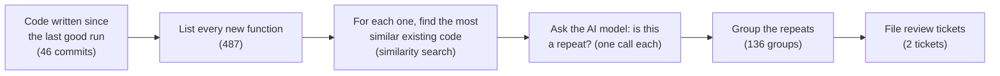

# The duplicate check's first full scheduled run: what it did and what it cost

Cheech, 9 November 2026, written for a reader outside the project. Every figure comes from the run's own record, `io/duplicate-check-daily/2026-11-09-190003-cron.json` and its line in `runs.jsonl`, read at 19:33 and 19:50 EST. Rick asked for it by voice (row `77fb86c2`).

## In one paragraph

Every hour while the machine is on, an automatic job reads the code written since its last run and asks an AI model, for each new function, whether it repeats code we already have. The 7 pm run on 9 November was the first scheduled run to finish, and the first to record how much AI it used. It covered a day's work: 46 commits holding 487 new functions. It checked 485 of them in 31 minutes and flagged 136 as possible repeats. It filed them as 2 review tickets, so that someone decides on each one. It made 487 model calls. At pay-per-use prices that would have cost $101.81. We are on a flat-rate plan, so no money was charged, and the plan never asked the job to slow down.

## Why the check exists

Most of this project's code is written by AI coding agents. An agent that cannot see a helper someone else already wrote will often write a new one. Over time the same logic ends up in several places, and a later fix lands in one copy but not the others. The duplicate check catches each repeat the day it is written, while it is still cheap to merge.

## How a run works

The search step is a cheap similarity search, not a call to the AI model. It picks the few existing functions that look most like each new one. The AI model (Claude, through the flat-rate Claude Code plan) then reads the new function beside those candidates and gives a verdict. The model never changes code; it only flags code for a person or an agent to decide on.

## The results, line by line

| Figure | Value | What it means |
|---|---|---|
| Commits covered | 46 | The day's changes, from this morning's starting point to 7 pm |
| Functions owed a check | 487 | New functions in those commits. The run is allowed up to 800, so all of them fit in one run |
| Checked | 485 | The model gave a verdict on these |
| Carried over | 2 | Not checked this time. They go first in the next run. The record does not say why these two were left; the 8 pm run will show whether they clear |
| Possible repeats flagged | 136 | 28% of the functions checked. Each one is a new function that closely resembles existing code |
| Review tickets filed | 2 | One ticket for 106 of the flags and one for the other 30, so a reviewer handles them as one batch instead of 136 tickets |
| Time taken | 31 minutes | About 3.8 seconds per check on average |

**A flag is a question, not a verdict.** The review ticket asks, for each flagged function, one of three things: reuse the existing code, extend the existing code to cover the new case, or keep both because they really are different. Two patterns account for most of today's flags, and both are expected:

- **40 flags are the same screen built twice on purpose.** Today's Background Jobs work had to appear in both of our web clients, the older page and the newer one. Each client carries its own copy of the formatting helpers. The reviewer will probably mark these "keep both" or move them into one shared file.
- **72 flags are inside test code.** Tests are often written as near-copies of each other, each one varying a single input. These usually get "keep both".

The remaining flags in production code are where real cleanup is likely to come from.

## How this run compares with earlier ones

| Run | Started | Functions checked | Flagged | Flag rate | Tokens recorded |
|---|---|---|---|---|---|
| By hand | 3 Nov | 100 | 41 | 41% | no |
| By hand | 6 Nov | 304 | 153 | 50% | no |
| By hand | 7 Nov | 1,680 | 936 | 56% | no |
| **Scheduled** | **9 Nov, 7 pm** | **485** | **136** | **28%** | **yes** |

The three earlier runs were started by hand. Today's run is the first one the schedule started on its own and completed, and the first one that recorded its AI usage. Every earlier run today was refused before it started, for two bookkeeping reasons, both fixed by just after 6 pm: the schedule pointed at the wrong branch, and a marker was left over from the previous branch.

## What it cost

| Figure | Value | Per check |
|---|---|---|
| Model calls | 487 | — |
| Output written by the model | 364,999 tokens | about 750 tokens, a short written verdict |
| Prompt text sent to the model | about 4.16 million tokens | about 8,500 tokens: the new function, its candidates and the instructions |
| Prompt text read back from the cache | 8,493 tokens | almost none |
| Pay-per-use price | $101.81 | about $0.21 |
| Calls per hour | 949 | — |
| Times the plan asked us to slow down | 0 | — |

**Why $101.81 is not a bill.** The figure is what the same calls would cost at Anthropic's pay-per-use API prices. The job runs on our flat-rate Claude Max subscription, which charges nothing per call. On that plan the real limit is how many calls an hour the plan will accept before asking us to wait. This run made 949 calls an hour, and the plan never pushed back. The figure is still worth recording: it shows what the check would cost if it ever moved to a pay-per-use key, and it tracks how heavily the job uses the plan. Rick asked for that measurement on 7 November.

**About the "cache" lines.** The prompt service can keep a prompt it has seen recently and reuse it more cheaply. Nearly all of this run's prompt text was stored that way, and almost none of it was ever reused. On the flat-rate plan this changes nothing we pay. We have not yet measured whether the parts every prompt shares, such as the instructions, could be reused.

## What happens next

- **The 8 pm run** should pick up the 2 carried functions plus whatever was written in the last hour. Two runs in a row with a falling carried count is the proof that the schedule keeps up on its own.
- **The 2 review tickets** wait in the holding area for approval. Once approved, a reviewer rules on each flagged function, and any real merge becomes its own change.
- **If the carried count rises six hourly runs in a row,** the job alerts Rick automatically. That would mean more code is being written than the hourly runs can check.
