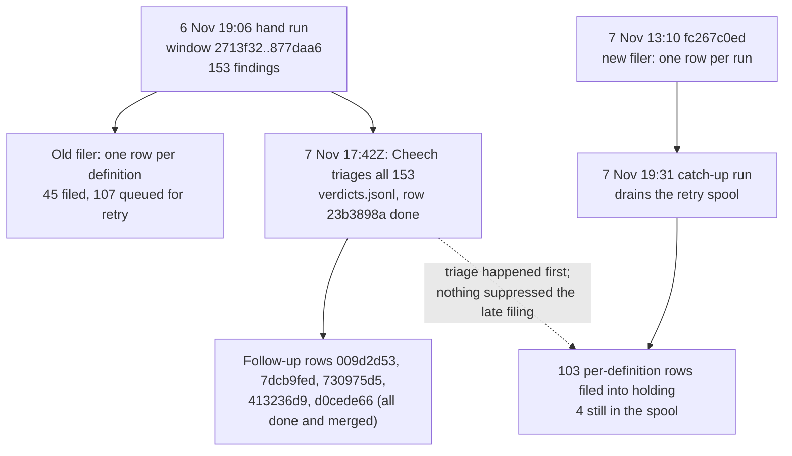

# Duplicate check: the 103 held rows and the backlog behind them

Cheech, 9 November 2026, measured between 10:20 and 10:45 EST against the task store on `:7999` and the main tree at `daf9b598e`. Ordered by Rick by voice (row a04f7fe5). Nothing was changed: no row moved, and no code changed.

## Verdict

**Do not admit the 103 rows. Drop them as superseded.** Every one of them is a finding I already triaged on 7 November (row 23b3898a, done), and every finding that asked for work already has a follow-up row that is done and merged. They arrived after the triage because a retry queue flushed them late.

The real work is behind them: **936 findings from the 7 November run with no triage row, and 1,369 definitions not yet judged.** The scheduler has made no progress since Saturday night. The hourly cron was never installed, and today's two runs refused to start because the cron still points at `main`.

## 1. What is in the holding area

On 9 Nov at 10:25 EST the store held 107 `not_approved` rows.

| Population | Rows | Created by |
|---|---|---|
| Duplicate-check findings, lupin | **103** | `duplicate-check-daily` |
| Other lupin | 1 | Chloe: bfc63d63, two-concurrent-jobs tests (my 7 Nov memento recommends dropping it) |
| lupin-mobile | 3 | María 204e8100, Tiberius eb149168, Krishna 1d674700 (not part of this census) |

All 103 duplicate-check rows are the same shape:

| Field | Value on all 103 |
|---|---|
| Priority | P5 |
| Owner and manager | `manager on duty`, which is not a persona; the body says "manager unresolved" |
| Created | 8 Nov 01:xx UTC, which is 7 Nov about 20:48 EST |
| Window in the body | `2713f32db..877daa677` (2 Nov 11:43 to 6 Nov 19:01, 65 commits) |
| Correlation | one row per definition, key `epic:dupcheck-<hash>` |

## 2. How they got here

Each step has a receipt:

- All 103 subjects are in the 6 Nov run's findings (`io/duplicate-check-daily/2026-11-06-190659-hand.json`). That run filed 45, queued 107 for retry and found 1 already filed.
- All 103 have a verdict line in `io/duplicate-check-daily/verdicts.jsonl`, written by Cheech at 7 Nov 17:42Z (row 23b3898a).
- Commit `fc267c0ed` (7 Nov 13:10) changed the filer to one triage row per run. The 7 Nov 19:31 run then sent the spooled per-definition payloads under the old shape. Its record shows `filed: 103`, and `io/duplicate-check-daily/pending-rows.jsonl` still holds 4 of them.

## 3. What the 103 are

### 3.1 The verdicts already on them

| Verdict | Rows | Meaning |
|---|---|---|
| DISTINCT | 68 | not a duplicate; no work |
| EXTEND | 20 | fold into an existing definition |
| DUPLICATE | 15 | the same code twice |

All 35 EXTEND and DUPLICATE rows map to a follow-up row that is **done**:

| Follow-up row | Rows covered | What it did | Merge |
|---|---|---|---|
| 009d2d53 | 15 | retired the `notifications.js` copies of the approve-link and reading-pane code | `802c6a0f6` |
| 730975d5 | 7 | folded the peft trainer and speech-router tests, the TTS validators and the pytest summary parser | `b5ee557ba` |
| d0cede66 | 6 | one store adapter, one JSON-lines writer, one batch-halving helper, the new-definition diff | `29f567509` |
| 7dcb9fed | 4 | one shared frame for the DeepResearch podcast and presentation chains | `373533034` |
| 413236d9 | 3 | one run-under-cap helper for the reuse_needset drivers | `b5ee557ba` (pin `3963bc153`) |

The 68 DISTINCT rows fall into these reason classes: same shape but a different job 21, already wraps the other 8, a `.d.ts` declaration of its own `.js` 8, test stub 6, thin wrapper 6, and 19 across 11 smaller classes.

### 3.2 Their shape

| Measure | Value |
|---|---|
| Same pair filed from both sides | **52 mutual pairs**: most rows are one half of a pair |
| Distinct duplicate clusters | 63 (32 of 1 row, 24 of 2, 6 of 3, 1 of 5) |
| Language | Python 74, JavaScript 15, TypeScript 14 |
| Area | `lupin_app/static` 28, `lupin_mcp/reuse_needset` 22, other `lupin_mcp` 18, tests 16, `cosa` agents, rest and repo 12, other 9 |
| Subject name still in its file at HEAD | 88 present, 15 gone |

"Present" does not mean "unfixed". I read three of the legacy handlers that are still present (`_handleApprovePriorityLinkClick`, `_handleBatchApproveLinkClick`, `_handleBatchViewLinkClick`). Since 009d2d53 each is a two-line delegate to the shared library. I did not read the other 85 one by one; the appendix lists them all.

### 3.3 Recommendation for the holding area

| Rows | Action | Why |
|---|---|---|
| 103 duplicate-check rows | drop, with the reason "superseded by 23b3898a; verdict recorded; follow-up done" | admitting them would hand 103 already-decided items to a seat |
| bfc63d63 (Chloe) | drop | my 7 Nov memento records it for dropping; not re-measured today |
| 4 spooled per-definition payloads | delete from `pending-rows.jsonl` | they are the same old shape and would file 4 more rows like these |

## 4. The backlog behind them

### 4.1 Where the scheduler stands

| Date | Run | Outcome |
|---|---|---|
| 6 Nov 19:06 | hand | 153 findings; 2,124 definitions carried |
| 7 Nov 19:31 to 20:48 | hand catch-up | 1,680 judged in 1,500 calls (the ceiling), 936 findings, **1,369 carried**, cursor not advanced |
| 8 Nov | — | no run; the host was off from Sun 01:52 to Mon 09:18 (`journalctl --list-boots`) |
| 9 Nov 09:23 | reboot | **refused, `branch_guard: stale_branch`**, in 0.2 s |
| 9 Nov 10:00 | cron | **refused, `stale_branch`** |

The 7 Nov record shows the run stopping at its 1,500-call ceiling. I found no token-limit failure in the run file. Whatever ran out on Saturday, it did not end this run.

### 4.2 Defects found while counting

| # | Defect | Evidence | Effect |
|---|---|---|---|
| D1 | The cron runs on `main`, and the guard refuses because the newest work is on `wip-v0.2.3-2026.11.04-online-preference-learning` | the `refusal` and `reinstall` fields in the 10:00 entry of `io/duplicate-check-daily/daily.log`; `crontab -l` lines 21 to 23 have no `--branch` | the backlog cannot drain |
| D2 | The hourly adaptive cron was never installed | crontab has only the 10:00 daily, the 11:07 baseline and `@reboot` | row 0d23e394's done condition cannot be met |
| D3 | The 7 Nov per-run triage row was never filed | `pending-rows.jsonl` line 5, key `epic:dupcheck-run-4d0c54aba4a4487a`, owner `mr radio`, **body 258,831 characters** | 936 findings have no row. I have not measured why it was refused; the body size is the first thing to test |
| D4 | Verdicts do not suppress re-reporting | 47 of the 103 already-triaged findings appear again in the 7 Nov run's 936; `triaged.jsonl` has 0 lines | every run re-asks questions already answered |
| D5 | The same pair is filed from both sides | 52 mutual pairs in the 103 | about half of all filings are redundant |
| D6 | Late filing of the old row shape | section 2 | rows land after their triage |
| D7 | 42 definitions unreadable in the 7 Nov run | 41 `BLINDNESS_BREACH` (tool names such as `check_exists` survive the scrub), 1 `JUDGE_UNREADABLE` | those definitions are never judged |

There is also window drift. HEAD is 158 commits past the 6 Nov window end, and the cursor is still at `2713f32` (2 Nov).

### 4.3 The work owed, sized

| Item | Size | Model calls |
|---|---|---|
| Triage of the 7 Nov findings | 936, of which 47 already have a verdict, so 889 | none: it is reading work; on 7 Nov one session triaged 153 |
| Judging the carried definitions | 1,369, plus whatever the window from 2 Nov to today adds | about 1,220 calls at the 7 Nov rate (1,500 calls for 1,680 definitions, 0.89 each, about 3.1 s a call), so about 63 minutes |

## 5. Decisions for Rick

1. **Drop the 103 held rows** (recommended), or admit some. Dropping is one batch transition with the reason in section 3.3.
2. **Install the hourly cron on the working branch.** You run it; seats install nothing. The command is the `reinstall` field in today's 10:00 entry of `daily.log`; row 0d23e394's 21:03 amendment has the hourly flags.
3. **Fix D3 to D5 before draining.** If we drain first, every hourly run re-files pairs and re-asks settled questions, and the 936 still have no row. This would be today's implementation work. I recommend it as one row with D3 first, and I have filed nothing for it yet.

## Gaps I did not close

- Why the per-run row (D3) was refused: unmeasured.
- Whether each of the 85 "present" names is a delegate or a live copy: three read, the rest inferred from the follow-up rows being done.
- How large the 2 Nov to today window is in definitions: not counted.

## Appendix: all 103 rows

Generated from the store on 9 Nov at 10:25 EST, the verdicts file and `git show HEAD:<file>`. "Name present" tests only that the last segment of the name still appears in the file.

| row | subject | file | verdict | reason class | follow-up | at HEAD |
|---|---|---|---|---|---|---|
| `6c7d3711` | `handleBatchViewLinkClick` | `lupin_app/static/js/multiplexer/render/approveLink.ts` | DUPLICATE | legacy-js-port | 009d2d53 | name gone |
| `32e8e66c` | `handleBatchApproveLinkClick` | `lupin_app/static/js/multiplexer/render/approveLink.ts` | DUPLICATE | legacy-js-port | 009d2d53 | name gone |
| `5e5df9c3` | `markApproveLinks` | `lupin_app/static/js/multiplexer/render/approveLink.ts` | DUPLICATE | legacy-js-port | 009d2d53 | name gone |
| `9404be9e` | `batchLinkOf` | `lupin_app/static/js/multiplexer/render/approveLink.ts` | DUPLICATE | legacy-js-port | 009d2d53 | name gone |
| `ac0b2f5f` | `batchParams` | `lupin_app/static/js/multiplexer/render/approveLink.ts` | DUPLICATE | legacy-js-port | 009d2d53 | name gone |
| `c472d27d` | `approvePriorityLink` | `lupin_app/static/js/multiplexer/render/approveLink.ts` | DUPLICATE | legacy-js-port | 009d2d53 | name gone |
| `4934a709` | `handleApprovePriorityLinkClick` | `lupin_app/static/js/multiplexer/render/approveLink.ts` | DUPLICATE | legacy-js-port | 009d2d53 | name gone |
| `b59b5cde` | `NotificationsUI._handleBatchViewLinkClick` | `lupin_app/static/js/notifications.js` | DUPLICATE | legacy-js-port | 009d2d53 | name present |
| `4d867e43` | `NotificationsUI._handleBatchApproveLinkClick` | `lupin_app/static/js/notifications.js` | DUPLICATE | legacy-js-port | 009d2d53 | name present |
| `1b2eb544` | `NotificationsUI._initMasterDetailLayout` | `lupin_app/static/js/notifications.js` | DUPLICATE | legacy-js-port | 009d2d53 | name present |
| `11ca8884` | `NotificationsUI._markApproveLinks` | `lupin_app/static/js/notifications.js` | DUPLICATE | legacy-js-port | 009d2d53 | name gone |
| `dada0641` | `NotificationsUI._batchLinkOf` | `lupin_app/static/js/notifications.js` | DUPLICATE | legacy-js-port | 009d2d53 | name gone |
| `e1b264c0` | `NotificationsUI._batchParams` | `lupin_app/static/js/notifications.js` | DUPLICATE | legacy-js-port | 009d2d53 | name gone |
| `19168f36` | `NotificationsUI._approvePriorityLink` | `lupin_app/static/js/notifications.js` | DUPLICATE | legacy-js-port | 009d2d53 | name gone |
| `50cb0445` | `NotificationsUI._handleApprovePriorityLinkClick` | `lupin_app/static/js/notifications.js` | DUPLICATE | legacy-js-port | 009d2d53 | name present |
| `47fe956d` | `_embed_halving` | `cosa/repo/symindex/candidates/vector_build.py` | EXTEND | embed-halving-copy | d0cede66 | name present |
| `3fc4e5c0` | `get_tts_audio` | `cosa/rest/routers/speech.py` | EXTEND | endpoint-copy | 730975d5 | name present |
| `2e8a1554` | `get_tts_audio_elevenlabs` | `cosa/rest/routers/speech.py` | EXTEND | endpoint-copy | 730975d5 | name present |
| `b10ab568` | `write_pending` | `lupin_mcp/duplicate_check_filing.py` | EXTEND | jsonl-writer-copy | d0cede66 | name present |
| `d79fac96` | `new_definitions` | `lupin_mcp/duplicate_check_daily.py` | EXTEND | new-definition-diff-copy | d0cede66 | name present |
| `f80fb89b` | `added_definition_ids` | `lupin_mcp/reuse_merge_gate.py` | EXTEND | new-definition-diff-copy | d0cede66 | name present |
| `6337c45b` | `TestGetTtsAudioElevenlabs.test_link_target_is_not_sent_to_the_stream` | `cosa/tests/unit/rest/test_speech_router.py` | EXTEND | parametrise-tests | 730975d5 | name present |
| `cbc19c89` | `TestGetTtsAudio.test_link_target_is_not_sent_to_the_stream` | `cosa/tests/unit/rest/test_speech_router.py` | EXTEND | parametrise-tests | 730975d5 | name present |
| `3e0e7ce8` | `TestPeftTrainer.test_quantize_merged_adapter_two_gpus_maps_cuda0` | `cosa/tests/unit/training/test_peft_trainer.py` | EXTEND | parametrise-tests | 730975d5 | name gone |
| `7af11ff2` | `TestPeftTrainer.test_quantize_merged_adapter_single_gpu_debug_branch` | `cosa/tests/unit/training/test_peft_trainer.py` | EXTEND | parametrise-tests | 730975d5 | name gone |
| `561e797d` | `parse_census` | `cosa/utils/review_verdict.py` | EXTEND | pytest-summary-parser-copy | 730975d5 | name present |
| `0fdcfe74` | `DeepResearchToPresentationAgent._run_presentation_generator` | `cosa/agents/deep_research_to_presentation/agent.py` | EXTEND | sibling-agent-copy | 7dcb9fed | name present |
| `defb84ad` | `DeepResearchToPresentationAgent._run_deep_research` | `cosa/agents/deep_research_to_presentation/agent.py` | EXTEND | sibling-agent-copy | 7dcb9fed | name present |
| `a3c06b5a` | `DeepResearchToPresentationJob._execute` | `cosa/agents/deep_research_to_presentation/job.py` | EXTEND | sibling-agent-copy | 7dcb9fed | name present |
| `92ef66e9` | `PresentationGeneratorJob._execute` | `cosa/agents/presentation_generator/job.py` | EXTEND | sibling-agent-copy | 7dcb9fed | name present |
| `0dbfc55a` | `run_live.&lt;locals&gt;.write` | `lupin_mcp/reuse_needset/forced_judge.py` | EXTEND | sibling-driver-copy | 413236d9 | name gone |
| `9ca75247` | `collect_rows` | `lupin_mcp/reuse_needset/forced_judge.py` | EXTEND | sibling-driver-copy | 413236d9 | name present |
| `fbb4d542` | `run_live` | `lupin_mcp/reuse_needset/forced_judge.py` | EXTEND | sibling-driver-copy | 413236d9 | name present |
| `967225a7` | `LiveStore.amend` | `lupin_mcp/duplicate_check_filing.py` | EXTEND | store-adapter-copy | d0cede66 | name gone |
| `059814fb` | `LiveStore.__init__` | `lupin_mcp/duplicate_check_filing.py` | EXTEND | store-adapter-copy | d0cede66 | name present |
| `d538b4b6` | `judge_row_in_pack` | `lupin_mcp/reuse_needset/forced_judge.py` | DISTINCT | already-factored | none needed | name present |
| `a1d9c150` | `judge_row` | `lupin_mcp/reuse_needset/forced_judge.py` | DISTINCT | already-factored | none needed | name present |
| `aabd3d0d` | `run_provenance` | `cosa/repo/duplicate_check/proof/proof_cli.py` | DISTINCT | already-wraps | none needed | name present |
| `f02ce454` | `read_provenance` | `cosa/repo/labelling/packets.py` | DISTINCT | already-wraps | none needed | name present |
| `fb20f836` | `working_seconds` | `lupin_mcp/reuse_harness/measure.py` | DISTINCT | already-wraps | none needed | name present |
| `a460a7b1` | `working_days` | `lupin_mcp/reuse_harness/measure.py` | DISTINCT | already-wraps | none needed | name present |
| `d07c6ab7` | `newcombe` | `lupin_mcp/reuse_needset/judge_probe_read.py` | DISTINCT | already-wraps | none needed | name present |
| `eb182e7d` | `source_tree_of` | `lupin_mcp/reuse_needset/launch_preflight.py` | DISTINCT | already-wraps | none needed | name present |
| `7539edbb` | `index_of` | `lupin_mcp/reuse_needset/launch_preflight.py` | DISTINCT | already-wraps | none needed | name present |
| `0a17c9d3` | `_live_build` | `lupin_mcp/reuse_needset/rebuild_vectors.py` | DISTINCT | already-wraps | none needed | name present |
| `18a3404c` | `main` | `lupin_mcp/reuse_merge_gate.py` | DISTINCT | cli-entry | none needed | name present |
| `f64a56ad` | `main` | `lupin_mcp/reuse_refusals.py` | DISTINCT | cli-entry | none needed | name present |
| `6b13fc46` | `filterTasksByChips` | `lupin_app/static/js/shared/task-status-filter.d.ts` | DISTINCT | declaration-file | none needed | name present |
| `0854c3ce` | `toggleChip` | `lupin_app/static/js/shared/task-status-filter.d.ts` | DISTINCT | declaration-file | none needed | name present |
| `37211fc3` | `activeChips` | `lupin_app/static/js/shared/task-status-filter.d.ts` | DISTINCT | declaration-file | none needed | name present |
| `40aac45e` | `publishOnWindow` | `lupin_app/static/js/shared/task-status-filter.d.ts` | DISTINCT | declaration-file | none needed | name present |
| `3269ba73` | `filterTasksByChips` | `lupin_app/static/js/shared/task-status-filter.js` | DISTINCT | declaration-file | none needed | name present |
| `c6cda8f1` | `toggleChip` | `lupin_app/static/js/shared/task-status-filter.js` | DISTINCT | declaration-file | none needed | name present |
| `05d9414f` | `activeChips` | `lupin_app/static/js/shared/task-status-filter.js` | DISTINCT | declaration-file | none needed | name present |
| `92b579d2` | `publishOnWindow` | `lupin_app/static/js/shared/task-status-filter.js` | DISTINCT | declaration-file | none needed | name present |
| `260c80b1` | `git_source_lines.&lt;locals&gt;.source_lines` | `lupin_mcp/reuse_needset/stage_c.py` | DISTINCT | git-helper-copy | none needed | name present |
| `1d21434e` | `git_source_lines` | `lupin_mcp/reuse_needset/stage_c.py` | DISTINCT | git-helper-copy | none needed | name present |
| `0776699e` | `ClaudeCodeDispatcher._run_interactive` | `cosa/orchestration/claude_code/dispatcher.py` | DISTINCT | nested-helper | none needed | name present |
| `2b079fa0` | `ClaudeCodeDispatcher._run_interactive.&lt;locals&gt;.session` | `cosa/orchestration/claude_code/dispatcher.py` | DISTINCT | nested-helper | none needed | name present |
| `c32eb8df` | `Meter.read` | `lupin_mcp/reuse_harness/measure.py` | DISTINCT | real-port-of-test-stubs | none needed | name present |
| `e4232dcb` | `Sessions.probe` | `lupin_mcp/reuse_harness/session.py` | DISTINCT | real-port-of-test-stubs | none needed | name present |
| `e2ca3921` | `put_back` | `lupin_mcp/duplicate_check_verdicts.py` | DISTINCT | same-goal-different-mechanism | none needed | name present |
| `b84d2973` | `plan_of` | `lupin_mcp/reuse_needset/forced_judge.py` | DISTINCT | same-name-different-job | none needed | name present |
| `44b03b24` | `reset_dispatch_context` | `cosa/agents/utils/agent_notification_dispatcher.py` | DISTINCT | same-shape-different-job | none needed | name present |
| `6ce692fd` | `test_a_dry_run_of_all_in_a_container_says_what_the_real_run_would_leave_out` | `cosa/tests/unit/agents/test_suite/test_job.py` | DISTINCT | same-shape-different-job | none needed | name present |
| `88d84da6` | `test_execute_of_all_in_a_container_runs_no_unit_and_names_it_in_every_result` | `cosa/tests/unit/agents/test_suite/test_job.py` | DISTINCT | same-shape-different-job | none needed | name present |
| `2f8af39f` | `TestPeftTrainer.test_quantize_merged_adapter_success` | `cosa/tests/unit/training/test_peft_trainer.py` | DISTINCT | same-shape-different-job | none needed | name present |
| `c3e24558` | `TestPeftTrainer.test_quantize_merged_adapter_passes_the_requested_bits` | `cosa/tests/unit/training/test_peft_trainer.py` | DISTINCT | same-shape-different-job | none needed | name present |
| `751c109b` | `TestPeftTrainer.test_quantize_merged_adapter_uses_stored_merged_dir` | `cosa/tests/unit/training/test_peft_trainer.py` | DISTINCT | same-shape-different-job | none needed | name present |
| `5a4f1d31` | `NotificationsUI.clearTaskStatusChips` | `lupin_app/static/js/notifications.js` | DISTINCT | same-shape-different-job | none needed | name present |
| `157d4b52` | `NotificationsUI.toggleTaskStatusChip` | `lupin_app/static/js/notifications.js` | DISTINCT | same-shape-different-job | none needed | name present |
| `d9dcfcd0` | `send_row` | `lupin_mcp/duplicate_check_filing.py` | DISTINCT | same-shape-different-job | none needed | name present |
| `ce74a74e` | `correlation_key` | `lupin_mcp/duplicate_check_filing.py` | DISTINCT | same-shape-different-job | none needed | name present |
| `b7a87a93` | `read_names` | `lupin_mcp/reuse_merge_gate.py` | DISTINCT | same-shape-different-job | none needed | name present |
| `85768566` | `in_pack_run_index` | `lupin_mcp/reuse_needset/forced_judge.py` | DISTINCT | same-shape-different-job | none needed | name present |
| `10ad1482` | `next_run_name` | `lupin_mcp/reuse_needset/launch_preflight.py` | DISTINCT | same-shape-different-job | none needed | name present |
| `225c1553` | `drafted_rows` | `lupin_mcp/reuse_needset/probe_d_e.py` | DISTINCT | same-shape-different-job | none needed | name present |
| `4c2405d0` | `arm_view` | `lupin_mcp/reuse_needset/probe_d_e.py` | DISTINCT | same-shape-different-job | none needed | name present |
| `c6954e95` | `live_purpose_store` | `lupin_mcp/reuse_needset/rebuild_vectors.py` | DISTINCT | same-shape-different-job | none needed | name present |
| `b57fa167` | `judge_rows` | `lupin_mcp/reuse_needset/report_rollup.py` | DISTINCT | same-shape-different-job | none needed | name present |
| `190980ad` | `save_rejects` | `lupin_mcp/reuse_needset/stage_c.py` | DISTINCT | same-shape-different-job | none needed | name present |
| `4e8204a7` | `draft_job` | `lupin_mcp/reuse_needset/stage_c.py` | DISTINCT | same-shape-different-job | none needed | name present |
| `ca60c6aa` | `cache_only` | `lupin_mcp/reuse_needset/stage_c.py` | DISTINCT | same-shape-different-job | none needed | name present |
| `613194f3` | `with_headroom` | `lupin_mcp/reuse_needset/stage_c.py` | DISTINCT | same-shape-different-job | none needed | name present |
| `2d5d7f71` | `link` | `tests/unit/notifications_js/batch_approve_link.test.ts` | DISTINCT | test-accessor | none needed | name present |
| `e27392ab` | `Amender.amend` | `tests/unit/test_duplicate_check_verdicts.py` | DISTINCT | test-stub | none needed | name present |
| `c4ab9be6` | `test_the_clock_starts_after_the_arm_proof_so_set_up_is_not_counted_as_build_time.&lt;locals&gt;.slow_probe` | `tests/unit/test_reuse_harness.py` | DISTINCT | test-stub | none needed | name present |
| `76c9d2fa` | `StubMeter.read` | `tests/unit/test_reuse_harness.py` | DISTINCT | test-stub | none needed | name present |
| `e7b1d4c8` | `StubMeter.read` | `tests/unit/test_reuse_harness_driver.py` | DISTINCT | test-stub | none needed | name present |
| `8af5f7a5` | `LiveSession.probe` | `tests/unit/test_reuse_harness_live_check.py` | DISTINCT | test-stub | none needed | name present |
| `b5dc1548` | `index_of.&lt;locals&gt;.index` | `tests/unit/test_reuse_needset_launch_preflight.py` | DISTINCT | test-stub | none needed | name present |
| `12412782` | `_sweeper_factory.&lt;locals&gt;.factory` | `lupin_mcp/reuse_flip.py` | DISTINCT | thin-closure | none needed | name present |
| `de0d9ea9` | `_sweeper_factory.&lt;locals&gt;.factory.&lt;locals&gt;.sweeper` | `lupin_mcp/reuse_flip.py` | DISTINCT | thin-closure | none needed | name present |
| `4973e277` | `approve_batch_line` | `cosa/rest/task_approve_link.py` | DISTINCT | thin-wrapper | none needed | name present |
| `3b5dd2bf` | `approve_link_line` | `cosa/rest/task_approve_link.py` | DISTINCT | thin-wrapper | none needed | name present |
| `f5920626` | `task_approve_batch_line` | `lupin_mcp/cosa_voice_mcp.py` | DISTINCT | thin-wrapper | none needed | name present |
| `9ac775a4` | `task_approve_line` | `lupin_mcp/cosa_voice_mcp.py` | DISTINCT | thin-wrapper | none needed | name present |
| `b15852ed` | `task_approve_batch_line_impl` | `lupin_mcp/task_store_tools.py` | DISTINCT | thin-wrapper | none needed | name present |
| `bf763d33` | `task_approve_line_impl` | `lupin_mcp/task_store_tools.py` | DISTINCT | thin-wrapper | none needed | name present |
| `24a85dfa` | `RecordNotWritten.__init__` | `lupin_mcp/duplicate_check_refile.py` | DISTINCT | trivial-exception-init | none needed | name present |
| `93eef180` | `bindDocRelativeLinks.&lt;locals&gt;.startFor.&lt;locals&gt;.rewrite` | `lupin_app/static/js/multiplexer/docPodcast/docLinks.ts` | DISTINCT | wrapper-already-delegates | none needed | name present |
| `acc2359a` | `rewriteRelativeDocLinks` | `lupin_app/static/js/multiplexer/render/docLink.ts` | DISTINCT | wrapper-already-delegates | none needed | name present |
| `a57d2e10` | `NotificationsUI.filterTasksByStatusChips` | `lupin_app/static/js/notifications.js` | DISTINCT | wrapper-already-delegates | none needed | name present |
