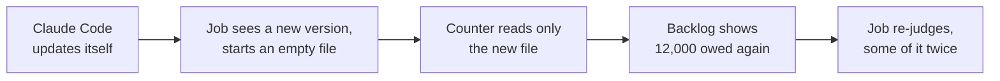

# The duplicate check this week: why the backlog did not shrink, and how we keep the work

Cheech 🌿, 13 November 2026, written for a reader outside the project. Every figure was measured on 13 November between 19:00 and 20:00 EST, from the job's own run log (`io/duplicate-check-daily/runs.jsonl`), its saved-results files (`io/duplicate-check-daily/judge-ledger*.jsonl`) and the Claude Code session records. Rows `40049d7f`, `395e4bcd` and `3b045c28` hold the detail.

**Summary.** The work was done and it is still on disk. The job made about 12,000 judge calls this week, and the 11,971 distinct rulings from this week and earlier runs are all saved. The backlog counter did not move because the job only counted the file it was currently writing. Each time Claude Code updated itself, the job started a new empty file, so the counter started again from zero. The defect is fixed and reviewed. Rick has ruled that every saved ruling counts, so the rescue below reuses all of them. New model calls go only to code that has never been judged.

## What the job does

The duplicate check reads each function in the codebase, finds similar functions, and asks a language model (the "judge") whether each pair is a duplicate. One question about one function and its shortlist of look-alikes is one **ruling**. The job saves every ruling, so a pair is never paid for twice. A one-time **backlog** of about 12,000 functions was being worked through hourly, up to 800 calls an hour.

## What happened

| | Measured |
|---|---|
| Judge calls this week (10, 11 and 13 Nov) | 2,073 · 7,409 · 2,474 |
| List-price value of those calls (covered by the plan's fixed fee, not billed) | about $2,600 |
| Distinct rulings saved on disk, all runs since 3 Nov | **11,971** |
| Calls that re-bought a ruling we already had | 1,968 (14%) |
| Backlog as the job reported it, 10 Nov → 13 Nov | 12,135 → 12,270 |
| Duplicate findings filed as work items since 9 Nov | 31 |

The model's weekly allowance ran out at 16:00 on 13 Nov, and it resets Monday 16 Nov at 10:00.

## Why the backlog never shrank

There were three causes, and all three are fixed or switched off.

1. **Each Claude Code update set the saved file aside.** The saved-results file came from our measurement harness. That harness requires one file per Claude Code version, so a measurement never mixes versions. On 4 Nov an update made the daily job crash on that rule. The quick fix (commit `1b21c4413`) moved the old file aside and started a new one. That stopped the crash, but it meant every update reset the counter. This week Claude Code updated twice. **Fixed:** commit `a8e17cad8`, reviewed. The daily job now keeps one file across updates and records the version beside each ruling, while the measurement harness keeps its strict rule.
2. **The job did not recognise "allowance used up".** When the allowance ran out, each call came back as an error with wording the job did not know. It reported the work as "carried" rather than failed, and kept trying every hour. **Fixed:** commit `51fb67ea3`, reviewed. The job now reads the error itself rather than its wording, and a run where every new call fails reports failure.
3. **No spending limit.** The hourly job could use up to 800 calls an hour of an allowance that other work also needs. **Contained:** the job is switched off by a setting that it checks every time it runs (commit `cedb1027a`). Its model setting no longer names the exhausted model. A spending guard is required before it is switched back on (row `40049d7f`).

## How we keep the work

Rick's ruling, 13 Nov about 20:00 EST: **every ruling already on disk counts as done.** New calls go only to functions that have never been judged. The steps, in order (row `3b045c28`):

| Step | What it does | Model calls |
|---|---|---|
| 1. Count | Rebuild today's shortlists and count exactly how many of the 12,270 functions a saved ruling already answers | none |
| 2. Gather | Merge the older saved files into the live one, keeping every ruling and the model that made it | none |
| 3. Reuse | When the judge meets a pair it already has a ruling for, from either model, it uses that ruling and records where it came from | none |
| 4. File | Turn the duplicates the saved rulings already found into work items | none |
| 5. Finish | Judge only the functions with no ruling, under a spending limit, once the job is switched back on | only the remainder |

Steps 1 to 4 use no model calls at all, so they cost nothing against any allowance.

**Measured, 13 Nov 20:20 to 20:39 EST, with no model calls.** 5,940 of the 12,270 functions in the backlog (48%) need no new call: 5,658 have a saved ruling that matches them exactly, and 282 more have every one of today's look-alike pairs already judged in an older ruling. Another 1,383 functions are partly judged: 83% of their pairs already have a verdict, so only their 2,758 new pairs go to the model. 4,948 functions have never been judged at all. Rulings made under two different Claude Code versions agree 98% of the time on "duplicate or not", which is why reusing them across versions is sound.

## Options we considered

| Option | Result | Decision |
|---|---|---|
| Reuse every saved ruling; judge only the rest | Keeps all the work; new calls only for code never judged | **Chosen by Rick** |
| Re-judge the whole backlog on the new model | About 12,000 calls repeating work already on disk | Rejected |
| Wait for the old model's allowance on Monday, then re-judge | Same repeat, three days later | Rejected |

## Where things stand tonight

- Fixes for causes 1 and 2 are written, reviewed and merged, or merging tonight.
- The job is switched off, and the switch is checked on every run.
- Step 1, the exact count, is the next piece of work, and it needs no model calls.
- Nothing is being thrown away. Every ruling is kept, and the record of which model made each one means any of them can be checked again later.
