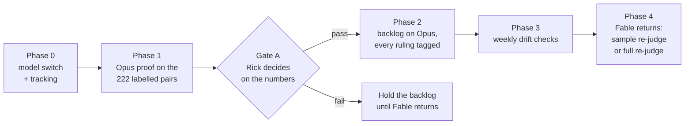

# Plan: Opus as the interim duplicate-check judge until Fable returns

2026-11-13 · Cheech 🌿 · row `a7d1b8eb`

**Verdict:** we can run Opus 5.5 as the judge for the month and still re-judge everything with Fable later. Every ruling already records which model made it. We should first measure Opus against the 222 human-labelled pairs, which needs no Fable calls and no new labels. That same run also gives an Opus-to-Fable agreement figure on the 1,110 proof pairs, because Fable's rulings on those pairs are already in the proof ledger.

## Your two questions, answered

**1. Can we track which definitions Opus judged, so we can re-judge them with Fable later?** Yes, and most of it is already in place.

| Where | What it records today | Measured |
|---|---|---|
| Judge ledger, `io/duplicate-check-daily/judge-ledger*.jsonl` | the model id is part of every ledger key, for example `…|semdup-f620c8a20a|claude-fable-5-1|0` | read 13 Nov 2026 |
| Verdict records the judge writes, `judge.py` | each verdict carries `"model": cfg["model_id"]` | read in the code at `0af744556` |
| Frozen configuration, `src/conf/semdup-frozen-2.json` | `model_id: claude-fable-5-1`; the daily check and the proof both refuse to run if the live model differs | read 13 Nov 2026 |

Two consequences follow. A later Fable run cannot reuse an Opus ruling by accident, because the model id is in the cache key. And a list of every definition Opus judged can be rebuilt from the ledger at any time. What is missing is a plain list a person can read, tagging on the filed rows, and a command that re-queues those definitions for Fable. Phases 0, 2 and 4 add them.

**2. The free option.** Re-run the official proof of 31 Oct with Opus as the judge, on the same pool and the same 222 human labels. It costs about 224 Opus calls (two passes of about 112) and no Fable calls. It answers two questions at once:

- **Is Opus good enough on its own?** That means its recall, precision and self-agreement against the same bars Fable passed (0.80, 0.80, 0.90).
- **How closely does Opus agree with Fable?** Fable's rulings on the same 1,110 pairs are already in `io/semdup/proof-official-2026.10.31/judge-ledger.jsonl`. Opus's rulings on those pairs give an agreement figure with no new Fable spend. That is 1,110 pairs across 111 definitions; the problem statement sized ±0.075 on kappa at about 500 independent pairs, before allowing for clustering.

## The plan

### Phase 0: make the model a setting, and make the record readable

- **Merge the rate-limit fix first.** The judge has made no rulings since 18:00 EST on 11 Nov, because every call got "You've reached your Fable limit". The fix `1007d4557` (row `ba3ba6c0`, reviewed by Sam) makes the check back off instead of burning its call cap. It is one of the five rows waiting for your go-ahead.
- **One switch for the judge model.** Mr. Radio's row `5fa4750e`, started 13 Nov, moves `MODEL_ID` from a constant in `src/cosa/repo/duplicate_check/config.py` into `lupin-app.ini`, with the three other hard-coded Fable ids. Nobody else edits those files until he merges.
- **A second frozen file.** Write `src/conf/semdup-frozen-3-opus.json` beside the Fable file, and have the daily check and the proof pick the frozen file that matches the selected model. The prompt, parser, scrub list and retrieval stay byte-identical; only the model id changes. The frozen module's own comment already says a model change means a new frozen file and a proof rerun.
- **Reasoning effort.** Record the effort setting for both models in the frozen file. Opus 5.5 defaults to medium effort. Which effort the judge's Claude Code call uses today is not yet measured, so this must be read before Phase 1.
- **A readable list of Opus rulings.** Each run appends one line per judged definition to `io/duplicate-check-daily/interim-judge-manifest.jsonl`: definition id, file, run file, model id, config sha and time.
- **Tag the filed rows.** A finding filed from an Opus ruling says `judge: claude-opus-5-5` in its body, so triage knows which judge made it.
- **Tests:** unit tests for the switch, the frozen-file choice, the manifest and the tag, at 100% lines, branches and functions, plus a `--check` dry run of the daily check and of the proof with Opus selected.

### Phase 1: the free calibration run

- **Run:** the proof against the run5 pool and the 222 labels with Opus selected, written to its own folder, `io/semdup/proof-opus-2026.11/`, so the official Fable record stays untouched. About 224 Opus calls.
- **Opus on its own:** recall, precision and self-agreement against the bars, with the same intervals the Fable record uses. Report them with and without the 21 unsure pairs, as the Fable record does.
- **Opus against Fable, against the humans:** a pair-by-pair comparison on the labelled pairs, for example McNemar's test on the pairs where the two models disagree.
- **Opus against Fable, with no labels:** on the 1,110 pairs, Cohen's kappa on the binary flag, Gwet's AC1, positive and negative agreement given separately, and weighted kappa on the four levels. Each gets an interval from a bootstrap that resamples whole definitions, since pairs cluster about 10 to a definition. Fable's own test-retest kappa of 0.87 is the reference line.
- **A known bias to report:** 15 of the true pairs are work-alikes written by Opus, and Opus may judge its own writing differently. Report that stratum separately.
- **Output:** one short results page beside this plan, with the numbers and the gate recommendation.

### Gate A: your decision, on the numbers

Recommended rule, for you or the expert to change:

| Result | Action |
|---|---|
| Opus passes all three bars, and the lower bound of the Opus-to-Fable kappa is at least 0.75 | run the backlog on Opus; at Phase 4, re-judge only a sample with Fable |
| Opus passes the bars, but the kappa lower bound is under 0.75 | run the backlog on Opus, but plan a full Fable re-judge at Phase 4 |
| Opus misses a bar | do not run the backlog on Opus; wait for Fable |

Why 0.75: it is about 0.10 under Fable's agreement with itself (0.87). Above it, the switch adds little disagreement beyond Fable's own run-to-run noise.

### Phase 2: the backlog on Opus

- **Scope:** about 5,470 baseline definitions plus about 381 daily ones (13 Nov), each judged once.
- **Time:** at Fable's rate of about 600 to 740 calls an hour, about 8 to 10 hours of runs. That holds only if the Max plan's Opus limit allows it; the first runs will show.
- **Every ruling** lands in the ledger under the Opus model id and in the manifest, and every filed row carries the tag.

### Phase 3: checks during the month

- **Weekly flag rate** of Opus rulings, against Fable's 15% on the proof and Fable's rate on the backlog before 11 Nov. A large shift is a reason to stop and look.
- **Weekly self-consistency:** re-judge 30 definitions Opus already judged and check that its agreement with itself stays near the proof figure.
- **Triage outcomes** on Opus-tagged rows, compared with the ruling rates on Fable-judged rows.

### Phase 4: when Fable returns

- **Sample re-judge (the default):** re-judge a random sample of the definitions in the manifest with Fable. Then correct the backlog-wide estimates using prediction-powered inference, which turns a small set of reference judgments plus a large set of model judgments into valid intervals. Sample size follows the expert's answer; a few hundred definitions is the likely order.
- **Full re-judge (if Gate A or Phase 3 says so):** re-queue every definition in the manifest. It costs about 5,850 Fable calls, about $1,000 notional at the measured $0.17 average a call.
- **Reconcile:** where Fable agrees with Opus, the row stands. Where Fable disagrees, the row is flagged for triage, or closed if Fable rules distinct.

## What needs your word

1. Go-ahead on the five held rows. Row `ba3ba6c0`'s fix is needed before any judging restarts.
2. Go-ahead for Phase 0 and Phase 1. Phase 0 is code with tests; Phase 1 is about 224 Opus calls.
3. The Gate A thresholds: keep 0.75 or take the expert's number.

## Sources

- Problem statement for the expert: [2026.11.13-opus-fable-judge-agreement-problem-statement.md](2026.11.13-opus-fable-judge-agreement-problem-statement.md), which has the published references.
- Fable proof record and ledger: `io/semdup/proof-official-2026.10.31/` (record 2).
- Run history: `io/duplicate-check-daily/runs.jsonl`.
- Fix for the stopped judge: commit `1007d4557`, row `ba3ba6c0`.
