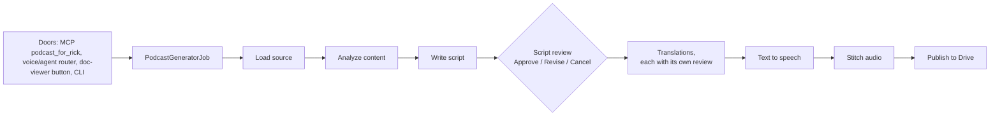

# Podcast script types: a mini plan, starting with a 5-minute status-report explainer

**Revision 2 (11 Nov, about 10:10 EST)** folds all twelve critique findings and the four Pass 2 items. **Revision 3 (about 10:16)** folds the re-check's R1 to R3. Section 6 maps each one. Superseded text was replaced, not kept.

María, 11 November 2026. Ordered by Rick by voice at about 09:53 EST. Row `60d13c9a` quotes the order word for word. The facts in section 1 were read from the main tree on branch `wip-v0.2.3-2026.11.04-online-preference-learning`. This plan changes nothing yet. Order of work: Rick approves the plan, peer review follows, then a lupin-resident session builds it.

## Rick's approval (11 Nov, about 10:00 EST)

**Approved with D1, D2 and D4 as recommended. D3 is replaced by his ruling**, given as a comment on his yes:

> "You may want to review the ability to create English and Spanish versions because by default I'm only seeing English versions So file that as a bug Make the default English only but I want to be able to toggle that into Spanish in the future Understood? Also make sure you update the multiplexer in addition to the legacy notification client"

- **Languages**: English only is the default for every type. Spanish is a per-request switch at every door. The languages bug is row `c0c422b8`, built with this plan (sections 2.3 and 3). Revision 2 corrects the diagnosis: both research forms already ask for Spanish on every job (`target_languages: ["en", "es-MX"]`, `SubmitJobsStore.ts:345`, `notifications.js:4205`). The factory reads only `languages` (`agentic_job_factory.py:241`, `:284`), so it drops the request, and the INI defaults (`lupin-app.ini:359`, `:364`, `:1975`) are `en`. The INI chose English on purpose (comment at `:342-357`): translation can silently return English labelled es-MX (bug `0913bb90`).
- **Both browser clients**: every choice this plan adds (script type, Spanish, one-shot) goes into the multiplexer **and** the legacy `notifications.js`.

## Verdict

**Add one setting, `script_type`, with two values to start: `research_critical`, the default, which leaves today's behaviour unchanged, and `status_report`, the new one.** Each type is a small profile that sets four things:

- the prompts,
- the target length,
- what the analysis step extracts,
- whether the script stops for your review.

`status_report` runs in one shot by default. Every place a podcast can be started (the MCP tool, voice, the doc viewer, the CLI) passes the type through. If no type is given, you get today's podcast.

## 1. How the generator works today (measured)



| Fact | Where |
|---|---|
| **No notion of script type exists.** The only switch on content is `audience` (beginner, general, expert, academic; default academic) | `cosa/agents/podcast_generator/config.py:331` |
| The "research critical" style is the "Dynamic Duo" system prompt plus the academic audience guidelines (research gaps, methodology, limitations) | `podcast_generator/prompts/script_generation.py:116-170`, `:76-89` |
| Target length is 10 minutes, with 8 to 20 exchanges | `lupin-app.ini:2012-2014`; `config.py:289` |
| **The review stop**: the generator asks Approve, Revise or Cancel, and approves on its own if nobody answers. The INI sets the timeout to 60 seconds | `orchestrator.py:499-512`, `:1680-1733`; `lupin-app.ini:2001` |
| Each translation gets the same review | `orchestrator.py:637-650` |
| **No setting skips review on a full run.** Only `--generate-audio` (audio only) and `dry_run` bypass it | `podcast_generator/__main__.py:332-348`; `job.py:211` |
| Two hosts are fixed: a curious host and an expert host (Maria and Mr. Radio) | `config.py:284-287`; `lupin-app.ini:2052-2070`; `state.py:108` |
| The analysis output is built for the research style (`discussion_questions`, `analogies_suggested`, 10-minute coverage) | `state.py:351-383` |

**Every door hardcodes its arguments, so each one needs a small change to carry a type:**

| Door | What it passes today | Where |
|---|---|---|
| MCP tool `podcast_for_rick` | `path`, `card_id` only | `lupin_mcp/cosa_voice_mcp.py:4807-4852`; `lupin_mcp/podcast_for_rick.py:146` |
| Proxy (MCP and viewer) | `{"research": path}` only. The card checks its key set strictly, and `StartIn` refuses unknown fields | `cosa/rest/routers/podcast_proxy.py:213-221`, `:162-172`; `cosa/rest/podcast_proxy.py:386`, `:423` |
| Voice / agent router | contract: `research`, `document_path`, `audience`, `audience_context` | `runtime_argument_expeditor/agent_registry.py:102-147` |
| Job factory | `research`, `languages`, `dry_run`, `audience`, `audience_context` | `cosa/rest/agentic_job_factory.py:219-260` |
| CLI | `--research`, `--audience`, … | `podcast_generator/__main__.py:405-495` |
| Doc-viewer button | posts `{path}`; no options | `lupin_app/static/js/multiplexer/docPodcast/docPodcast.ts:17-19`, `:145` |

## 2. The design

### 2.1 One profile per script type

A new module, `podcast_generator/script_types.py`, holds a frozen `ScriptTypeProfile` for each type and a lookup function that refuses an unknown name.

| Field | `research_critical` (default) | `status_report` (new) |
|---|---|---|
| System prompt | today's "Dynamic Duo" prompt, unchanged | new: walk the accomplishments, then the outstanding items; comment on completion, tricky bits, unresolved issues and anything that threatens completion; no theory |
| Analysis | today's `ContentAnalysis` | new `StatusDigest`: done, outstanding, tricky, unresolved, blocked, next steps; each item quotes its line from the source |
| Target length | 10 min, 8–20 exchanges (INI) | **5 min**, about 6–10 exchanges |
| Review | ask (today) | **one shot**: no script review and no translation review |
| Audience | academic (INI) | general |
| Hosts | Maria and Mr. Radio | the same two: the curious host asks "where are we?", the expert answers |

**`research_critical` must stay byte-for-byte what it is today.** Before any code changes, a golden file is captured from main. It holds the assembled messages, system and user, at all four prompt call sites with fixed inputs: analysis (`orchestrator.py:1357`), script (`:1415`), revision (`:1515`) and translation (`:1836`). A test compares the default type against that file.

**The type reaches every builder, not only the system prompt.** `get_content_analysis_prompt`, `get_script_generation_prompt` and `get_script_revision_prompt` each take the profile. The revision and translation call sites stop using `SCRIPT_GENERATION_SYSTEM_PROMPT` unconditionally and use the profile's system prompt. `status_report` gets its own user-prompt builder, because the research one bakes in the analogies step and the 10-minute template.

**`StatusDigest`** is a pydantic model next to `ContentAnalysis`, stored in the same state slot under a type tag. It is parsed with the existing `parse_analysis_response` (no new parser, REUSE line 3). A failed parse raises, as `_analyze_content_async` does today. Every item carries the source line it came from, and a test checks each one is a substring of the source text.

**Where the numbers live, and which wins**: request, then profile, then INI. The status-report numbers go in new INI keys (`podcast status report target duration minutes = 5`, `… min exchanges = 6`, `… max exchanges = 10`, `… audience = general`), per the project rule that tunables live in the INI. The profile names the keys. `deep_research_to_podcast` builds a bare `PodcastConfig()` (`agent.py:287`) that reads no INI, so it is switched to `PodcastConfig.from_config` before the profile is applied.

**The saved script remembers its type**: `script_type` goes in the saved script's frontmatter. `from_saved_script` and review-only read it back, and refuse a script with no type unless `--script-type` is given.

### 2.2 Review mode is per type, and a request can override it

- Each profile carries a `review` default: `ask` or `one_shot`.
- A request may pass `review=one_shot` or `review=ask` to override it, so any type can run either way.
- **In `one_shot`, no person is ever asked anything.** Both review loops are skipped (no `present_choices`, so the Revise path's `get_input` at `orchestrator.py:535`, `:676` and `:996` is unreachable). The partial-audio question (`voice_io.ask_yes_no` at `:730` and `:1121`) takes its existing `unattended_default` without asking.
- `one_shot` with review-only mode (`do_review_only_async`, `:899`) is refused, since that mode exists only to review.
- The final card says "script generated in one shot, not reviewed", the same way `script_auto_approved` is disclosed today (`orchestrator.py:92`, `:529`).

### 2.3 Plumbing through every door

- `script_type` (and the optional `review`) is added to: `PodcastConfig`, the job, both factory builders (`_build_podcast_generator`, `_build_research_to_podcast`), the CLI (`--script-type`, `--review`), the MCP tool, `AskIn`, `ViewerIn`, and the router's args dict.
- **Proxy card (critique 3)**: the type and languages are chosen at ask time (`AskIn`, `ViewerIn`), stored in the card, and read from the card at start. **`StartIn` does not change**, so nobody can switch the type after the person approved a different one. The card check changes from "keys equal `PAYLOAD_KEYS`" (`podcast_proxy.py:423`) to "every required key present, and the only optional keys are `script_type`, `languages` and `review` (ruled by María, 11 Nov: the viewer sends `review`, and a status report must be able to run in one shot from the viewer)". An old-shape card reads as `research_critical`, English, with its type's own review. A test starts an old-shape card.
- **Voice (critique 7)**: both expeditor contracts (`agent_registry.py:127` podcast generator, `:187` research to podcast) gain an `arg_mapping` entry for `script_type` and a `fallback_defaults` entry of `research_critical`, so the expeditor never asks. The router's training data (`src/conf/training/agent-router-agentic-commands.json:33`) gains a status-report example. A voice test shows "status report podcast of …" reaches `script_type`.
- **Languages (row `c0c422b8`, critique 1)**:
  - Both factory builders accept `target_languages` as an alias of `languages`, reusing the existing parsers `parse_languages_arg` and `parse_languages` rather than writing a third (REUSE line 5). A factory test drives both key names.
  - Both clients stop hardcoding `["en", "es-MX"]` (`SubmitJobsStore.ts:345`, `notifications.js:4205`), and send languages only when the Spanish switch is on.
  - Every code fallback becomes `en`: `agent_registry.py:127` and `:187`, the stale comment at `job.py:284`, and the router docstring at `routers/deep_research_to_podcast.py:55`. The test auto-answer profile (`notification_proxy/config.py:101`) becomes `en`, and a second profile is added for Spanish runs.
- **Spanish fails loudly, never silently (critique 2, bug `0913bb90`)**: after each translation, a language check compares the es-MX script with the English one, using a Spanish-stopword ratio. If the text was not translated, the episode is not shipped as es-MX. It is marked "Translation failed", and the job card says so. The root cause of `0913bb90` stays its own row; this check is what makes the switch safe to offer while that row is open.

### 2.4 How you choose the type

| Door | How |
|---|---|
| Voice | "make a status report podcast of …": the expeditor maps "status report" to `status_report` |
| MCP | `podcast_for_rick( path, script_type="status_report" )` |
| **Doc viewer page, both clients** | one change: the viewer page is "the ONE page both clients show a document through" (`docPodcast.ts:3-5`); the legacy client opens it in a pane iframe and the multiplexer embeds it. Its confirm step offers both types (research-critical pre-selected) and a Spanish switch (off) |
| **Multiplexer research form** | the choices next to its "with podcast" checkbox (`SubmitJobsStore.ts:343`, `withPodcast`) |
| **Legacy research form** | the same choices next to its "with podcast" checkbox (submit at `notifications.js:4149-4205`) |
| CLI | `--script-type status_report` |

### 2.5 Not changed

- Text to speech, audio stitching and Drive publishing.
- `deep_research_to_podcast` keeps its own agent, but takes `script_type` and `languages` from its request, because both research forms reach podcasts that way. It also reads the INI (section 2.1).

## 3. Build order

| # | Step | Done when (every step: `EXECUTOR: AI`) |
|---|---|---|
| 0 | Capture the golden prompt file from main before any edit | the file holds the assembled messages at all four call sites with fixed inputs, and is committed first |
| 1 | `script_types.py` with both profiles; `PodcastConfig.script_type` and `review`; the INI keys; the precedence rule; frontmatter type on saved scripts | the default type matches the golden file at all four call sites; an unknown type is refused; request beats profile beats INI, each tested |
| 2 | Status-report builders and `StatusDigest` | given a fixture status report with N known done and open items, the digest holds all N, and every item's source line is a substring of the source; a failed parse raises |
| 3 | Orchestrator: the one-shot path | with `present_choices`, `ask_yes_no` and `get_input` all raising if called, a full `one_shot` run (including a forced partial-audio failure) passes and an `ask` run fails (the mutant proof); `one_shot` plus review-only is refused |
| 4 | Doors: CLI, both factory builders (with the `target_languages` alias), both expeditor contracts and the training row, the proxy card (optional keys, `StartIn` unchanged), the MCP tool, the deep-research path | per-door contract tests; a request with no type and no languages produces a research-critical, English-only job; an old-shape card starts; `src/tests/unit/test_podcast_proxy_default_yes.py:23`, which builds a card from `PAYLOAD_KEYS`, is updated to the required-plus-optional shape |
| 5 | Three UI surfaces: the shared viewer page (its confirm panel in `src/lupin_app/static/html/document-viewer.html:421-425`, plus `docPodcast.ts`), the multiplexer research form, the legacy research form | e2e UI tests: the viewer page as loaded in each client, and each research form. Picking "status report" and Spanish sends `script_type` and `languages`; with nothing picked, the request carries no languages (English). New e2e files are listed in `src/tests/e2e_ui/partition/` |
| 6 | Language check on translations | the threshold lives in an INI key (`podcast translation min spanish stopword ratio`), with a starting value set by measuring two **captured** scripts: one real es-MX script and one English-unchanged one (the `0913bb90` shape), never hand-written text. The test feeds both: the real one passes, and the unchanged one gets "Translation failed" instead of a shipped es-MX episode |
| 7 | Live runs on `:8000` through `/api/v2/submit` | (a) status report of a real explainer: audio length read from the mp3 is 4 to 6 minutes; the job's notifications hold no review card; output filenames are English only. (b) The same with Spanish on. **`c0c422b8` closes only on a real translation**: an English and a Spanish episode, with the es-MX script passing the check. A loud "Translation failed" proves the switch cannot fail silently, but leaves `c0c422b8` open, blocked on the row for `0913bb90`. TTS goes through its service, so no GPU is touched |

Lupin's 100% line, branch and function coverage rule applies, since all of this code is under `src/cosa` and `src/lupin_mcp`. Each new definition gets a plan-time reuse lookup (`REUSE-OUTCOME` line) at review.

## 4. Decisions for Rick

| # | Question | Recommended | Pros | Cons |
|---|---|---|---|---|
| D1 | Should the doc-viewer button offer a choice of type? | **Yes**: a choice in its confirm step, research-critical pre-selected | The viewer is where you read status reports, so the button should reach the new type | One more UI change and its e2e test |
| D2 | Does one-shot also skip the translation reviews? | **Yes** | "All in one shot" means no stop at all | Translations go out unreviewed |
| D3 | Languages | **Ruled by Rick: English only by default; Spanish is a per-request switch** | — | — |
| D4 | Should the default review timeout go back from 60 s to 600 s? | **No change** (out of scope) | Keeps this plan small | — |

## 5. After your approval

1. Peer review through `/plan-review`, with reviewers in visible sessions. Skeleton crew was switched off at about 10:00, so the reviewers are spawned now.
2. The build goes to a lupin-resident session, following section 3's order, with an adversarial review before the merge.

## 6. Critique resolution (Revision 2)

| Critique | Severity | Resolution |
|---|---|---|
| 1 Languages diagnosis | blocking | Diagnosis corrected in the approval block. Alias at the factory, clients stop hardcoding, every fallback listed (§2.3) |
| 2 Spanish silent failure | blocking | Language check makes it loud (§2.3); step 6 tests it, step 7(b) accepts either a real translation or a loud failure |
| 3 Proxy card keys | blocking | Optional-key check, type set at ask time, `StartIn` unchanged, old-card test (§2.3) |
| 4 Viewer button is one page | blocking | One viewer change reaches both clients; three surfaces; the "new legacy button" is dropped (§2.4) |
| 5 Byte-for-byte pinned too thin | should-fix | Golden file at four call sites; builders take the profile (§2.1, step 0) |
| 6 Hidden one-shot stops | should-fix | `unattended_default` without asking; the test raises on all three calls; review-only refused (§2.2, step 3) |
| 7 Voice door | should-fix | Both contracts, fallback default, training row, voice test (§2.3) |
| 8 Numbers and precedence | should-fix | INI keys, request > profile > INI, deep-research reads the INI (§2.1) |
| 9 `StatusDigest` plumbing | should-fix | Same state slot, existing parser, raise on failure, substring check (§2.1) |
| 10 Saved script type | should-fix | Frontmatter; refuse without a type (§2.1) |
| 11 Citations | note | Corrected: `notifications.js:4149-4205`, `docPodcast.ts:145` |
| 12 Doors missed | note | Auto-answer profile and router docstring added (§2.3) |
| Re-check R1 (close `c0c422b8` only on a real translation) | should-fix | Step 7(b) |
| Re-check R2 (stopword threshold) | note | Step 6: INI key, set from two captured scripts |
| Re-check R3 (files not listed) | note | Steps 4 and 5 name `test_podcast_proxy_default_yes.py:23` and `document-viewer.html` |
| P2-1 to P2-4 | should-fix / note | `EXECUTOR: AI` on every step; step 2 asserts N items; step 7 names venue and readings; partition listing in step 5 |

## Sources

- Rick's order: row `60d13c9a` (verbatim).
- Survey of the generator, 11 Nov: every citation above. I spot-checked these lines myself: `lupin-app.ini:2001` and `:2012-2014`, `config.py:331`, `orchestrator.py:499-512`, `podcast_proxy.py:386`, and `docPodcast.ts:17-19`.
- Earlier podcast design docs: `../v0.2.2/2026.10.08-voice-driven-document-to-podcast-plan.md`, `../v0.2.2/2026.10.08-podcast-proxy-explainer.md`, `../v0.2.2/2026.11.01-explainer-to-podcast-to-drive-story.md`.

## Critique (Extra 1, 2026-11-11)

Critic seat for María, session `dda60c5e`. Verdict: **not ready to build.** 4 blocking findings, 6 should-fix, 2 notes. Line numbers below are from the main tree on branch `wip-v0.2.3-2026.11.04-online-preference-learning`, commit `4a21189f7`. Cite the quoted text, not the line, when folding fixes.

### Findings

**1. BLOCKING. The languages diagnosis is wrong, so the fix would not close `c0c422b8`.**
- *Claim*: section 2.3, "the code fallback becomes `en`, matching the INI", and the approval block, "no door can ask for Spanish".
- *Evidence, run*: I built the research-to-podcast job through the real factory (`_build_research_to_podcast` in `cosa/rest/agentic_job_factory.py`). Args `{query, target_languages:["en","es-MX"]}` gave `target_languages == ['en']`. Args `{query, languages:"en,es-MX"}` gave `['en','es-MX']`. The factory reads only `languages` (`:241`, `:284`). Both browser clients send `target_languages`: `SubmitJobsStore.ts:345` and `notifications.js:4205`. A grep of `src/cosa/rest/v2` and `routers/v2_ask.py` found no rename. So the two clients already ask for Spanish on every research-with-podcast job and the factory drops it. That fits Rick's "I'm only seeing English".
- *Consequence for step 5*: its test "with nothing picked, the request matches today's" would pin the hardcoded `["en","es-MX"]` both clients send, which contradicts "English only by default".
- *Fix*: (a) add `languages` handling that accepts `target_languages` as an alias in both factory builders, or change the clients to send `languages`; (b) delete the hardcoded arrays in both clients and send languages only when the Spanish switch is on; (c) add a factory test that drives both key names; (d) correct the sentence "no door can ask for Spanish".
- *Missed fallback sites*: `agent_registry.py:127` (podcast generator) **and** `:187` (research to podcast), plus `notification_proxy/config.py:101` (the test auto-answer profile `research_to_podcast`, `"en,es-MX"`). The plan lists one fallback. The `job.py:284` comment ("default en,es-MX") will also be stale.

**2. BLOCKING. Spanish is known to fail silently, and the plan's done-criterion cannot see it.**
- *Claim*: step 6(b), "one run with Spanish on, which produces both episodes (closes `c0c422b8`)".
- *Evidence*: the INI comment above `lupin-app.ini:359` (bug `0913bb90`). The translation step can return the English text unchanged, and it ships as a normally titled es-MX script. The comment says the frequency was never measured and Krishna's fix covers only the zero-segment case. The plan never mentions this.
- *Failure*: step 6(b) passes with two episodes, one labelled es-MX and in English. Rick toggles Spanish and gets a mislabelled English podcast.
- *Fix*: say in section 2.3 that the toggle exposes `0913bb90`. Make step 6(b) assert that the es-MX script text differs from the English script (for example, a stopword-ratio check), and name `0913bb90` as a prerequisite or an explicit known risk in the row.

**3. BLOCKING. Adding keys to the proxy card breaks every card in flight, and `StartIn` is the wrong place for the type.**
- *Claim*: section 2.3, "A card written before this change has no `script_type` and reads as `research_critical`, so cards already in flight keep working", together with "added to … `StartIn` … `PAYLOAD_KEYS`".
- *Evidence*: `cosa/rest/podcast_proxy.py:423` rejects a card unless `set( payload ) == PAYLOAD_KEYS`, answering 403 `bad_card`. Adding keys to the frozenset (`:386`) rejects every old card. The plan's own table notes the strict key set but does not resolve it. `StartIn` (`routers/podcast_proxy.py:162-172`) carries `card_id` and `actor` with `extra="forbid"`.
- *Failure*: after the change, an old card is refused. If the type is also put in `StartIn`, the caller can change the type after the person approved a different one.
- *Fix*: the type and languages are set at ask time (`AskIn` and `ViewerIn`), stored in the card, and read from the card at start. `StartIn` stays unchanged. The card check becomes "required keys present, optional keys limited to `script_type` and `languages`". Add a test with an old-shape card.

**4. BLOCKING. The "legacy has no viewer podcast button" claim is wrong, and the legacy form is not the only place a podcast checkbox lives.**
- *Claim*: section 2.4 and step 5, "it has no viewer podcast button … and a new legacy viewer button", and "the legacy research-with-podcast form".
- *Evidence*: the header of `docPodcast.ts` (lines 3-5) says the viewer page is "the ONE page both clients show a document through: the legacy notifications client opens it in a pane iframe and the multiplexer embeds it". The one `docPodcast.ts` serves both. A second legacy button would show two buttons in the legacy pane. Separately, the multiplexer has its own research-with-podcast checkbox (`SubmitJobsStore.ts:343`, `withPodcast`), and the plan's step 5 names only the legacy form.
- *Fix*: three surfaces need the choices, not two: (a) the shared viewer page (one change, which reaches both clients); (b) the multiplexer research form; (c) the legacy research form (`notifications.js:4149-4205`). Drop the "new legacy viewer button". Write one e2e test for the viewer page as loaded in each client, and one per research form.

**5. SHOULD-FIX. "`research_critical` stays byte-for-byte" is pinned at too few places.**
- *Claim*: section 2.1, "A test pins its system prompt and analysis prompt against the current text".
- *Evidence*: prompts are built at four call sites with module constants: `orchestrator.py:1357` (analysis), `:1415` (script, plus the duo description), `:1515` (revision) and `:1836` (translation). Three builders format the user messages: `get_content_analysis_prompt`, `get_script_generation_prompt` and `get_script_revision_prompt`. The pin covers two system prompts only.
- *Second problem*: `:1515` and `:1836` use `SCRIPT_GENERATION_SYSTEM_PROMPT` unconditionally. A status-report translation or revision would carry the research style. `get_script_generation_prompt` also bakes research text into the user message (the "use suggested analogies" step and the duration/exchanges template), so `status_report` needs its own user-prompt builder, not only a system prompt.
- *Fix*: pin the assembled strings at all four call sites with fixed inputs, against a golden file captured from main before any edit (not a regenerated constant). State which builders gain a type argument.

**6. SHOULD-FIX. One-shot still has stops the plan's mutant test cannot see.**
- *Claim*: section 2.2, "never calls `present_choices`", and step 3's test where `present_choices` raises.
- *Evidence*: `voice_io.ask_yes_no` ("Continue with partial audio?") at `orchestrator.py:730` and `:1121` is a person-facing stop on TTS partial failure, with a 120 s timeout at `:1121`. `voice_io.get_input` at `:535`, `:676` and `:996` is the Revise path, unreachable only if `present_choices` is skipped. `do_review_only_async` (`:899`) is a mode that exists only to review.
- *Failure*: a one-shot job stalls up to 120 s on a TTS hiccup; the mutant test is green.
- *Fix*: decide that in `one_shot` the partial-audio question takes its existing `unattended_default` without asking, and make the step 3 test raise on `present_choices`, `ask_yes_no` and `get_input`. Define `one_shot` plus review-only (refuse it).

**7. SHOULD-FIX. The voice door is under-specified.**
- *Claim*: section 2.4, "the expeditor maps 'status report' to `status_report`".
- *Evidence*: the router model emits the args, trained from `src/conf/training/agent-router-agentic-commands.json:33`, whose placeholders are only topic, audience and audience context. The contract at `agent_registry.py:102-147` has no `script_type` entry in `arg_mapping`, `fallback_questions` or `fallback_defaults`.
- *Fix*: step 4 needs the `arg_mapping` entry, a `fallback_defaults` entry of `research_critical` (so the expeditor never asks), and a training-data row or placeholder, with a voice test showing the phrase reaches `script_type`.

**8. SHOULD-FIX. Where the status-report numbers live, and which wins, is unspecified.**
- *Claim*: the section 2.1 table (5 min, 6 to 10 exchanges, audience general) against "(INI)" for the default column.
- *Evidence*: `PodcastConfig.from_config` reads the INI (`config.py:440-500`), the job overlays `audience` after it (`job.py:250-254`), and `DeepResearchToPodcastAgent` builds a bare `PodcastConfig()` (`agent.py:287`) that reads no INI at all.
- *Fix*: state the precedence (request, then profile, then INI), put the status-report numbers in INI keys per project rule, and say where the profile is applied for the research-to-podcast path.

**9. SHOULD-FIX. `StatusDigest` has no plumbing or verification.**
- *Evidence*: `ContentAnalysis` is a pydantic model (`state.py:351`) built field by field at `orchestrator.py:1365-1376`, then passed to the script prompt as a dict. `parse_analysis_response` returns research-shaped defaults when parsing fails.
- *Fix*: say how the digest is stored in state, which parser it uses (see REUSE line 3), what happens on a failed parse (raise, as `_analyze_content_async` does), and how "each item quotes its line from the source" is checked (a substring test against the source text).

**10. SHOULD-FIX. The saved script does not remember its type.**
- *Evidence*: `from_saved_script` and the `--generate-audio` path (`__main__.py:282-348`) rebuild an orchestrator without the type. Audio-only is fine, but review-only on a status-report script would revise with research prompts.
- *Fix*: store `script_type` in the saved script's frontmatter, or refuse review-only without `--script-type`.

**11. NOTE. Citation check.** Confirmed as stated: `lupin-app.ini:359`, `:364`, `:1975`, `:2001`, `:2012-2014`; `config.py:284-289`, `:331`; `orchestrator.py:499-512`, `:637-650`, `:1680-1733`; `podcast_proxy.py:386`, `:423`; `__main__.py:332-348`; `agentic_job_factory.py:219-260`; `agent.py:272-298` (range sits inside `:255-305`). Wrong or loose: `notifications.js:2830-2838` is the checkbox mutual-exclusion listener, and the submit is at `:4149-4205`; `docPodcast.ts:17-19` are URL constants, and the `{path}` post is at `:145`. `agent_registry.py:102-147` is right but covers only one of the two contracts that carry `en,es-MX` (see finding 1).

**12. NOTE. Doors checked for completeness.** Covered by the plan: MCP, proxy, viewer, voice router, factory, CLI. Missed: the auto-answer profile `research_to_podcast` in `notification_proxy/config.py:101` (a test door; finding 1) and the `deep_research_to_podcast` router, whose docstring example at `routers/deep_research_to_podcast.py:55` shows `["en","es-MX"]`. `/api/v2/submit` is covered through the factory. No other TS or JS file under `src/lupin_app` (excluding `dist`) mentions the podcast commands.

### Pass 2: ownership-language

- **P2-1 (should-fix)**: section 3 carries no `EXECUTOR` tags. Add `EXECUTOR: AI` to every "Done when". No step needs a human, so no `EXECUTOR: HUMAN` line is justified.
- **P2-2 (should-fix)**: step 2, "a dry run … lists every done and open item", is a reader's judgment. Make it an assertion: a fixture status report with N known items, and the digest must hold all N.
- **P2-3 (should-fix)**: step 6, "4 to 6 minutes of audio, no review card, English only", has no named venue or assertion. State: scheduled on `:8000` through `/api/v2/submit`, audio length read from the mp3, review card absence read from the job's notifications, language read from the output filenames. TTS goes through its service, so no GPU is touched.
- **P2-4 (note)**: step 5's new e2e files must be listed in `src/tests/e2e_ui/partition/`, or `test_e2e_halves_partition.py` fails.
- *Greps run on this file*: `Manual|manual` returned 0 hits; `EXECUTOR: HUMAN` returned 0; the bare-checkbox pattern returned 0; the Pass 1 greps (`TBD|confirm during impl|decide at impl time|tbd` and `Open sub-question`) returned 0. Instrument check: a grep for `verify|confirm|observe|inspect|ensure|check` on the same file returned 6 hits, so the search works. None of the 6 is a human-action verb needing reframing.

### REUSE-OUTCOME

```text
REUSE-OUTCOME be3f299c8544cb18 :: rs-c9a5e4fd94 :: WROTE_NEW per-type frozen profile with a refusing lookup; no per-type profile exists, and the nearest, the audience-keyed dict AUDIENCE_DIALOGUE_GUIDELINES (script_generation.py:28), is a separate axis that status_report must not overwrite :: src/rnd/v0.2.3/2026.11.11-podcast-script-types-mini-plan.md#3-1
REUSE-OUTCOME f432ad9dd62bcc6e :: rs-4df5822634 :: WROTE_NEW StatusDigest fields (done, outstanding, tricky, unresolved, blocked, next steps), unlike ContentAnalysis at state.py:351 :: src/rnd/v0.2.3/2026.11.11-podcast-script-types-mini-plan.md#3-2
REUSE-OUTCOME f432ad9dd62bcc6e :: rs-4df5822634 :: REUSED cosa.agents.podcast_generator.prompts.script_generation.parse_analysis_response :: src/rnd/v0.2.3/2026.11.11-podcast-script-types-mini-plan.md#3-2
REUSE-OUTCOME eab4878bdb8171de :: rs-7cfbdac8cd :: WROTE_NEW the review=ask|one_shot argument; the shortlist held no review-mode argument, and the existing unattended_default on ask_yes_no is reused for the one-shot stops :: src/rnd/v0.2.3/2026.11.11-podcast-script-types-mini-plan.md#3-3
REUSE-OUTCOME 30693e6c92e48d32 :: rs-a68dc3d471 :: EXTENDED cosa.rest.agentic_job_factory._build_podcast_generator :: src/rnd/v0.2.3/2026.11.11-podcast-script-types-mini-plan.md#3-4
REUSE-OUTCOME 30693e6c92e48d32 :: rs-a68dc3d471 :: EXTENDED cosa.rest.agentic_job_factory._build_research_to_podcast :: src/rnd/v0.2.3/2026.11.11-podcast-script-types-mini-plan.md#3-4
RULING cosa.agents.podcast_generator.script_types.ScriptTypeProfile :: DISTINCT no per-type profile exists; AUDIENCE_DIALOGUE_GUIDELINES is a separate, audience-keyed axis :: reuse-receipt: be3f299c8544cb18 :: search: rs-c9a5e4fd94
RULING cosa.agents.podcast_generator.state.StatusDigest :: DISTINCT its fields (done, outstanding, tricky, unresolved, blocked, next steps) are not ContentAnalysis's :: reuse-receipt: f432ad9dd62bcc6e :: search: rs-4df5822634
RULING cosa.agents.podcast_generator.prompts.script_generation.parse_analysis_response :: DUPLICATE :: reuse-receipt: f432ad9dd62bcc6e :: search: rs-4df5822634
RULING cosa.agents.podcast_generator.config.PodcastConfig.review :: DISTINCT no review-mode argument exists; ask_yes_no's unattended_default is reused for the one-shot stops :: reuse-receipt: eab4878bdb8171de :: search: rs-7cfbdac8cd
RULING cosa.rest.agentic_job_factory._build_podcast_generator :: EXTEND cosa.rest.agentic_job_factory._build_podcast_generator :: reuse-receipt: 30693e6c92e48d32 :: search: rs-a68dc3d471
RULING cosa.rest.agentic_job_factory._build_research_to_podcast :: EXTEND cosa.rest.agentic_job_factory._build_research_to_podcast :: reuse-receipt: 30693e6c92e48d32 :: search: rs-a68dc3d471
```

*Shape fix (María, 11 Nov): the checker (`lupin_mcp/reuse_outcome.py` `OUTCOME_RE`) needs the step as section-dash-step and a bare symbol after `REUSED` or `EXTENDED`. The lines above were rewritten to that shape. The reasons that were cut from the `REUSED` and `EXTENDED` lines: the digest must not add a parser; the factory gains the `target_languages` alias and the Spanish switch, reusing `parse_languages_arg` and `parse_languages`.*

Reading depth: I read the source of `AUDIENCE_DIALOGUE_GUIDELINES`, `PodcastConfig`, `ContentAnalysis`, `_analyze_content_async`, both factory builders and both language parsers. For the other shortlist entries I read only the tool's description, and I ruled them unrelated on that basis.


### REUSE rulings for the new definitions of the merged build (11 Nov)

One lookup per definition, run by Implementer B. The lookups found that two helpers in `prompts/status_report.py` (`_audience_block`, `_clip`) repeated inline code in `script_generation.py`. María ruled that they be extracted: both prompt families now call one shared `clip_to_ceiling` and one shared `audience_block` in `script_generation.py`, and the status copies are deleted. The research prompts stay byte-identical (the golden prompt test passes with no fixture edit). The two shared helpers are ruled below.

```text
RULING cosa.agents.podcast_generator.orchestrator.PodcastOrchestratorAgent._analyze_status_async :: DISTINCT the nearest, _analyze_content_async, builds a ContentAnalysis with default fallbacks, while this one validates a StatusDigest and checks each source line with StatusDigest.unsupported_items :: reuse-receipt: 26fcd58370568c29 :: search: rs-82f7563524
RULING cosa.agents.podcast_generator.orchestrator.PodcastOrchestratorAgent._one_shot :: DISTINCT a one-line test of effective_review against REVIEW_ONE_SHOT, and effective_review only returns the mode, so nothing existing answers this boolean :: reuse-receipt: 21cf83f9524795e2 :: search: rs-e67b550db8
RULING cosa.agents.podcast_generator.orchestrator.PodcastOrchestratorAgent._script_system_prompt :: DISTINCT a one-line accessor of the active profile's system prompt for the three script call sites, and get_profile only looks a profile up by name :: reuse-receipt: 6177d1f06a77e263 :: search: rs-dc3afde087
RULING cosa.agents.podcast_generator.orchestrator.one_shot_notice :: DISTINCT the nearest, auto_approval_notice, discloses a review window that timed out and says different things, while this one discloses a run that never had a review stop :: reuse-receipt: f885620dc6ade402 :: search: rs-4569d416ec
RULING cosa.agents.podcast_generator.prompts.status_report.get_status_analysis_prompt :: DISTINCT the nearest, get_content_analysis_prompt, asks for a research topic analysis, while this asks for done, outstanding and blocked items with exact source quotes :: reuse-receipt: 0245669130298de9 :: search: rs-d7de1ef0f9
RULING cosa.agents.podcast_generator.prompts.status_report.get_status_script_prompt :: DISTINCT the nearest, get_script_generation_prompt, uses the research template with an analogy step, while this one walks the done and outstanding items of a StatusDigest :: reuse-receipt: 6a6f78206405692d :: search: rs-793681bed3
RULING cosa.agents.podcast_generator.script_types.apply_script_type :: DISTINCT the nearest, presentation_generator.config.apply_job_overrides, overlays request values with no profile or review logic, while this layers request over profile over INI :: reuse-receipt: 454b6fc97abf2197 :: search: rs-ee8613ea26
RULING cosa.agents.podcast_generator.script_types.apply_script_type.<locals>._read :: DISTINCT a one-line closure over config_mgr.get with silent reads, and the shared readers load_kwargs_from_ini and _ini_value work per dataclass field or swallow errors :: reuse-receipt: b7a87b08c88557a8 :: search: rs-eef3de897c
RULING cosa.agents.podcast_generator.script_types.effective_review :: DISTINCT nothing else resolves a config's own review against its profile's default, and apply_script_type writes at build time while this reads a built config :: reuse-receipt: 2cb48a40b0589525 :: search: rs-4ec8f1c85b
RULING cosa.agents.podcast_generator.script_types.get_profile :: DISTINCT the single profile lookup, where None gives the default and an unknown name raises, and _checked_script_type depends on it :: reuse-receipt: 870f12000592efd4 :: search: rs-b04e70e090
RULING cosa.agents.podcast_generator.script_types.resolve_podcast_config :: DISTINCT the one entry point that validates names, builds from PodcastConfig.from_config and applies apply_script_type, which no other function composes :: reuse-receipt: aa4737f0928ab474 :: search: rs-7ac49c7911
RULING cosa.agents.podcast_generator.script_types.validate_review :: DISTINCT checks a review value against the known modes, and _checked_script_type validates script types and never touches review modes :: reuse-receipt: f177f5257f974781 :: search: rs-d45a0a5ca9
RULING cosa.agents.podcast_generator.state.StatusDigest.all_items :: DISTINCT no other code joins the six category lists in this order, and the sibling accessors consume it or return something else :: reuse-receipt: 2c81ad1f8459229b :: search: rs-62fba0362a
RULING cosa.agents.podcast_generator.state.StatusDigest.key_subtopics :: DISTINCT returns only the main topic for key_topics, while the content analysis path takes key_topics from the model :: reuse-receipt: eba0e31ce8420fda :: search: rs-9df1b8f888
RULING cosa.agents.podcast_generator.state.StatusDigest.unsupported_items :: DISTINCT a digest-specific substring check of each item's source line, unlike _fabricated_paths (invented paths) or extract_claims (a model call) :: reuse-receipt: a7618df6c8d6a851 :: search: rs-3e7671086f
RULING cosa.agents.podcast_generator.translation_check.spanish_stopword_ratio :: DISTINCT only generic English stopword tokenizers exist, nearest content_words, and none measures the Spanish function-word share of a text :: reuse-receipt: 4b1c0e7ba6bf9c2e :: search: rs-b866e12d22
RULING cosa.rest.agentic_job_factory._podcast_languages :: EXTEND cosa.agents.podcast_generator.__main__.parse_languages_arg :: reuse-receipt: 4fde987b03aa77fa :: search: rs-9f34815b7a
RULING cosa.rest.podcast_proxy.card_options :: DISTINCT the nearest, card_payload, writes the three optional keys into a card, while this is the read side returning them as a tuple :: reuse-receipt: 0c63da9d11ea408c :: search: rs-b961d156c1
RULING cosa.rest.podcast_proxy.normalize_languages :: EXTEND cosa.agents.podcast_generator.__main__.parse_languages_arg :: reuse-receipt: 1a678678770d68bf :: search: rs-bc30110822
RULING cosa.rest.podcast_proxy.payload_shape_ok :: DISTINCT a boolean subset test of a card's keys against the required and optional key sets, unlike validate_record, which checks another record contract and raises :: reuse-receipt: cb4ca3dff2d2f05e :: search: rs-d9c6923a52
RULING cosa.rest.routers.podcast_proxy._checked_script_type :: EXTEND cosa.agents.podcast_generator.script_types.get_profile :: reuse-receipt: 2447c6f4af47e7b8 :: search: rs-e7e743844c
RULING src.lupin_app.static.js.multiplexer.docPodcast.docPodcast.choicesBody :: DISTINCT nothing maps a script type, a Spanish flag and a one-shot flag onto the optional keys of a podcast request :: reuse-receipt: 79c4473eedc7e6f9 :: search: rs-7c9982d317
RULING src.lupin_app.static.js.multiplexer.docPodcast.docPodcast.createDocPodcast.<locals>.readChoices :: DISTINCT a closure that reads the panel's select and two checkboxes by id and hands them to choicesBody, and no existing reader reads these controls :: reuse-receipt: 5ea37e0e1a9ee66f :: search: rs-4f3787ccdf
RULING src.lupin_app.static.js.multiplexer.render.SubmitJobsPaneRenderer.SubmitJobsPaneRendererImpl.wireResearch.<locals>.syncPodcastOptions :: DISTINCT sets the hidden property on the multiplexer's research elements, and the legacy twin in notifications.js sets style.display on elements found by id, in a separate code base :: reuse-receipt: 3ab58e17fb9f6b15 :: search: rs-e60f1a347b
RULING src.lupin_app.static.js.notifications.NotificationsUI.setupJobSubmitEventListeners.<locals>.syncPodcastOptions :: DISTINCT the legacy-client twin of the multiplexer closure, kept separate because notifications.js cannot import the multiplexer TypeScript :: reuse-receipt: 3ab58e17fb9f6b15 :: search: rs-e60f1a347b
REUSE-OUTCOME 26fcd58370568c29 :: rs-82f7563524 :: WROTE_NEW the nearest, _analyze_content_async, builds a ContentAnalysis with default fallbacks, while this one validates a StatusDigest and checks each source line with StatusDigest.unsupported_items :: src/rnd/v0.2.3/2026.11.11-podcast-script-types-mini-plan.md#3-2
REUSE-OUTCOME 21cf83f9524795e2 :: rs-e67b550db8 :: WROTE_NEW a one-line test of effective_review against REVIEW_ONE_SHOT, and effective_review only returns the mode, so nothing existing answers this boolean :: src/rnd/v0.2.3/2026.11.11-podcast-script-types-mini-plan.md#3-3
REUSE-OUTCOME 6177d1f06a77e263 :: rs-dc3afde087 :: WROTE_NEW a one-line accessor of the active profile's system prompt for the three script call sites, and get_profile only looks a profile up by name :: src/rnd/v0.2.3/2026.11.11-podcast-script-types-mini-plan.md#3-1
REUSE-OUTCOME f885620dc6ade402 :: rs-4569d416ec :: WROTE_NEW the nearest, auto_approval_notice, discloses a review window that timed out and says different things, while this one discloses a run that never had a review stop :: src/rnd/v0.2.3/2026.11.11-podcast-script-types-mini-plan.md#3-3
REUSE-OUTCOME 0245669130298de9 :: rs-d7de1ef0f9 :: WROTE_NEW the nearest, get_content_analysis_prompt, asks for a research topic analysis, while this asks for done, outstanding and blocked items with exact source quotes :: src/rnd/v0.2.3/2026.11.11-podcast-script-types-mini-plan.md#3-2
REUSE-OUTCOME 6a6f78206405692d :: rs-793681bed3 :: WROTE_NEW the nearest, get_script_generation_prompt, uses the research template with an analogy step, while this one walks the done and outstanding items of a StatusDigest :: src/rnd/v0.2.3/2026.11.11-podcast-script-types-mini-plan.md#3-2
REUSE-OUTCOME 454b6fc97abf2197 :: rs-ee8613ea26 :: WROTE_NEW the nearest, presentation_generator.config.apply_job_overrides, overlays request values with no profile or review logic, while this layers request over profile over INI :: src/rnd/v0.2.3/2026.11.11-podcast-script-types-mini-plan.md#3-1
REUSE-OUTCOME b7a87b08c88557a8 :: rs-eef3de897c :: WROTE_NEW a one-line closure over config_mgr.get with silent reads, and the shared readers load_kwargs_from_ini and _ini_value work per dataclass field or swallow errors :: src/rnd/v0.2.3/2026.11.11-podcast-script-types-mini-plan.md#3-1
REUSE-OUTCOME 2cb48a40b0589525 :: rs-4ec8f1c85b :: WROTE_NEW nothing else resolves a config's own review against its profile's default, and apply_script_type writes at build time while this reads a built config :: src/rnd/v0.2.3/2026.11.11-podcast-script-types-mini-plan.md#3-3
REUSE-OUTCOME 870f12000592efd4 :: rs-b04e70e090 :: WROTE_NEW the single profile lookup, where None gives the default and an unknown name raises, and _checked_script_type depends on it :: src/rnd/v0.2.3/2026.11.11-podcast-script-types-mini-plan.md#3-1
REUSE-OUTCOME aa4737f0928ab474 :: rs-7ac49c7911 :: WROTE_NEW the one entry point that validates names, builds from PodcastConfig.from_config and applies apply_script_type, which no other function composes :: src/rnd/v0.2.3/2026.11.11-podcast-script-types-mini-plan.md#3-1
REUSE-OUTCOME f177f5257f974781 :: rs-d45a0a5ca9 :: WROTE_NEW checks a review value against the known modes, and _checked_script_type validates script types and never touches review modes :: src/rnd/v0.2.3/2026.11.11-podcast-script-types-mini-plan.md#3-3
REUSE-OUTCOME 2c81ad1f8459229b :: rs-62fba0362a :: WROTE_NEW no other code joins the six category lists in this order, and the sibling accessors consume it or return something else :: src/rnd/v0.2.3/2026.11.11-podcast-script-types-mini-plan.md#3-2
REUSE-OUTCOME eba0e31ce8420fda :: rs-9df1b8f888 :: WROTE_NEW returns only the main topic for key_topics, while the content analysis path takes key_topics from the model :: src/rnd/v0.2.3/2026.11.11-podcast-script-types-mini-plan.md#3-2
REUSE-OUTCOME a7618df6c8d6a851 :: rs-3e7671086f :: WROTE_NEW a digest-specific substring check of each item's source line, unlike _fabricated_paths (invented paths) or extract_claims (a model call) :: src/rnd/v0.2.3/2026.11.11-podcast-script-types-mini-plan.md#3-2
REUSE-OUTCOME 4b1c0e7ba6bf9c2e :: rs-b866e12d22 :: WROTE_NEW only generic English stopword tokenizers exist, nearest content_words, and none measures the Spanish function-word share of a text :: src/rnd/v0.2.3/2026.11.11-podcast-script-types-mini-plan.md#3-6
REUSE-OUTCOME 4fde987b03aa77fa :: rs-9f34815b7a :: EXTENDED cosa.agents.podcast_generator.__main__.parse_languages_arg :: src/rnd/v0.2.3/2026.11.11-podcast-script-types-mini-plan.md#3-4
REUSE-OUTCOME 0c63da9d11ea408c :: rs-b961d156c1 :: WROTE_NEW the nearest, card_payload, writes the three optional keys into a card, while this is the read side returning them as a tuple :: src/rnd/v0.2.3/2026.11.11-podcast-script-types-mini-plan.md#3-4
REUSE-OUTCOME 1a678678770d68bf :: rs-bc30110822 :: EXTENDED cosa.agents.podcast_generator.__main__.parse_languages_arg :: src/rnd/v0.2.3/2026.11.11-podcast-script-types-mini-plan.md#3-4
REUSE-OUTCOME cb4ca3dff2d2f05e :: rs-d9c6923a52 :: WROTE_NEW a boolean subset test of a card's keys against the required and optional key sets, unlike validate_record, which checks another record contract and raises :: src/rnd/v0.2.3/2026.11.11-podcast-script-types-mini-plan.md#3-4
REUSE-OUTCOME 2447c6f4af47e7b8 :: rs-e7e743844c :: EXTENDED cosa.agents.podcast_generator.script_types.get_profile :: src/rnd/v0.2.3/2026.11.11-podcast-script-types-mini-plan.md#3-4
REUSE-OUTCOME 79c4473eedc7e6f9 :: rs-7c9982d317 :: WROTE_NEW nothing maps a script type, a Spanish flag and a one-shot flag onto the optional keys of a podcast request :: src/rnd/v0.2.3/2026.11.11-podcast-script-types-mini-plan.md#3-5
REUSE-OUTCOME 5ea37e0e1a9ee66f :: rs-4f3787ccdf :: WROTE_NEW a closure that reads the panel's select and two checkboxes by id and hands them to choicesBody, and no existing reader reads these controls :: src/rnd/v0.2.3/2026.11.11-podcast-script-types-mini-plan.md#3-5
REUSE-OUTCOME 3ab58e17fb9f6b15 :: rs-e60f1a347b :: WROTE_NEW sets the hidden property on the multiplexer's research elements, and the legacy twin in notifications.js sets style.display on elements found by id, in a separate code base :: src/rnd/v0.2.3/2026.11.11-podcast-script-types-mini-plan.md#3-5
RULING cosa.agents.podcast_generator.prompts.script_generation.clip_to_ceiling :: DISTINCT extracted from the inline clip that two research prompt builders repeated, and they now call it; the nearest other symbol, fit_body, cuts at a line boundary and appends a note :: reuse-receipt: 066cb80a2dc68636 :: search: rs-0511b6554d
RULING cosa.agents.podcast_generator.prompts.script_generation.audience_block :: DISTINCT extracted from the inline audience block that two research prompt builders repeated, and they now call it; no other function builds the guidelines-then-context block :: reuse-receipt: 9a23896f54abbd99 :: search: rs-95bd3a85ef
REUSE-OUTCOME 066cb80a2dc68636 :: rs-0511b6554d :: WROTE_NEW one shared clip rule for the research and status prompts, extracted from inline copies :: src/rnd/v0.2.3/2026.11.11-podcast-script-types-mini-plan.md#3-2
REUSE-OUTCOME 9a23896f54abbd99 :: rs-95bd3a85ef :: WROTE_NEW one shared audience block for the research and status prompts, extracted from inline copies :: src/rnd/v0.2.3/2026.11.11-podcast-script-types-mini-plan.md#3-2
```

### Account: what I attacked and what I ran

- **Citations**: I opened every cited file in the main tree with `sed` and `grep -n` and compared each to its claim. Eleven held, two were loose (finding 11).
- **Languages**: I grepped every `es-MX` and `languages` site across `src` (minus tests and `.venv`), then ran the factory with both key names (finding 1). The run result, `['en']` against `['en','es-MX']`, is the receipt. The INI comment block above `:359` came from reading the lines around the cited ones.
- **One-shot stops**: I grepped `present_choices|get_input|ask_yes_no|converse` across the generator package and read each hit's context (finding 6).
- **Byte-for-byte**: I grepped for every `SYSTEM_PROMPT` use and every prompt builder (finding 5).
- **Doors**: I grepped for `PodcastGeneratorJob(`, `PodcastConfig(`, `podcast_for_rick` and the command strings across `src` (excluding `dist`, tests and rnd), then read the MCP tool, both routers, the viewer module and both clients' submit code (findings 3, 4, 7, 12).
- **REUSE**: four `check_exists` calls and four `record_search` calls, with ids in the lines above.
- **What I did not do**: I did not run a Spanish generation (spends tokens and TTS; finding 2 rests on the INI comment, not on a run), the e2e UI, or the voice router. Finding 3 rests on reading `podcast_proxy.py:423`, not on a run against an old card. The factory run used my worktree, whose HEAD is `4a21189f7`, the same commit as main; `git diff 4a21189f7 HEAD -- src/cosa/rest/agentic_job_factory.py` is empty.

## Re-check of revision 2 (Extra 1, 2026-11-11)

Read from the main tree at `41bf24395` with `git show` and `git grep`, not from this worktree. Verdict: **all four blocking fixes hold. One should-fix gap (R1) contradicts the row's done-when, and two notes remain. Approve once R1 is folded.**

| Finding | Holds? | What I ran |
|---|---|---|
| 1 Languages | Yes | Plan §2.3 now names the alias, both client hardcodes (`SubmitJobsStore.ts:345`, `notifications.js:4205`) and every fallback (`agent_registry.py:127`, `:187`, `notification_proxy/config.py:101`, `job.py:284`, router docstring). I checked that extra args pass `/api/v2/submit`: `flow.py:326` says only the command's required args are checked, so the new keys `script_type`, `review` and `languages` are not refused. |
| 2 Spanish silent failure | Fix holds; see R1 | §2.3 and steps 6 and 7(b) make the failure loud. |
| 3 Proxy card | Yes | `podcast_proxy.py:386` and `:423` are the only code uses of `PAYLOAD_KEYS`. The plan's required-plus-optional check replaces the one equality test, and `StartIn` stays unchanged. |
| 4 Viewer page | Yes | The confirm panel lives in `src/lupin_app/static/html/document-viewer.html:421-425`, the one page both clients load. Three surfaces in §2.4 and step 5 are correct. |

**R1 (should-fix).** Step 7(b) says either a real translation or a loud "Translation failed" "closes `c0c422b8`". The row's done-when, and Rick's ruling, require a live run that produces an English and a Spanish episode. Closing on a loud failure closes the toggle while Spanish still does not work. *Fix*: step 7(b) closes `c0c422b8` only on a real translation. A loud failure leaves the Spanish-works half open and linked to the row for `0913bb90`.

**R2 (note).** The stopword check in step 6 has no threshold. *Fix*: name the ratio, and test it with a captured real es-MX script and a captured English-unchanged script, not hand-written text.

**R3 (note).** Two files will need edits the plan does not list: `document-viewer.html` (the confirm panel's markup, step 5) and `src/tests/unit/test_podcast_proxy_default_yes.py:23`, which builds a card from `PAYLOAD_KEYS` and breaks when the set becomes required-plus-optional.

*Not done*: I ran nothing against a live server and did not re-run the factory. The re-check is reading plus the greps above.
