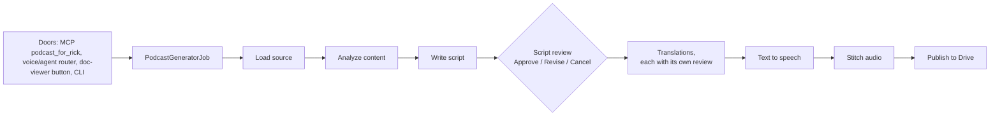

# Podcast script types: a mini plan, starting with a 5-minute status-report explainer

María, 11 November 2026. Ordered by Rick by voice at about 09:53 EST. Row `60d13c9a` quotes the order word for word. The facts in section 1 were read from the main tree on branch `wip-v0.2.3-2026.11.04-online-preference-learning`. This plan changes nothing yet. Order of work: Rick approves the plan, peer review follows, then a lupin-resident session builds it.

## Rick's approval (11 Nov, about 10:00 EST)

**Approved with D1, D2 and D4 as recommended. D3 is replaced by his ruling**, given as a comment on his yes:

> "You may want to review the ability to create English and Spanish versions because by default I'm only seeing English versions So file that as a bug Make the default English only but I want to be able to toggle that into Spanish in the future Understood? Also make sure you update the multiplexer in addition to the legacy notification client"

- **Languages**: English only is the default for every type. Spanish is a per-request switch at every door. The languages bug is row `c0c422b8`: the INI says `en` (`lupin-app.ini:359`, `:364`, `:1975`), but the code falls back to `en,es-MX`, and no door can ask for Spanish. It is built with this plan (sections 2.3 and 3).
- **Both browser clients**: every choice this plan adds (script type, Spanish, one-shot) goes into the multiplexer **and** the legacy `notifications.js`.

## Verdict

**Add one setting, `script_type`, with two values to start: `research_critical`, the default, which leaves today's behaviour unchanged, and `status_report`, the new one.** Each type is a small profile that sets four things:

- the prompts,
- the target length,
- what the analysis step extracts,
- whether the script stops for your review.

`status_report` runs in one shot by default. Every place a podcast can be started (the MCP tool, voice, the doc viewer, the CLI) passes the type through. If no type is given, you get today's podcast.

## 1. How the generator works today (measured)

| Fact | Where |
|---|---|
| **No notion of script type exists.** The only switch on content is `audience` (beginner, general, expert, academic; default academic) | `cosa/agents/podcast_generator/config.py:331` |
| The "research critical" style is the "Dynamic Duo" system prompt plus the academic audience guidelines (research gaps, methodology, limitations) | `podcast_generator/prompts/script_generation.py:116-170`, `:76-89` |
| Target length is 10 minutes, with 8 to 20 exchanges | `lupin-app.ini:2012-2014`; `config.py:289` |
| **The review stop**: the generator asks Approve, Revise or Cancel, and approves on its own if nobody answers. The INI sets the timeout to 60 seconds | `orchestrator.py:499-512`, `:1680-1733`; `lupin-app.ini:2001` |
| Each translation gets the same review | `orchestrator.py:637-650` |
| **No setting skips review on a full run.** Only `--generate-audio` (audio only) and `dry_run` bypass it | `podcast_generator/__main__.py:332-348`; `job.py:211` |
| Two hosts are fixed: a curious host and an expert host (Maria and Mr. Radio) | `config.py:284-287`; `lupin-app.ini:2052-2070`; `state.py:108` |
| The analysis output is built for the research style (`discussion_questions`, `analogies_suggested`, 10-minute coverage) | `state.py:351-383` |

**Every door hardcodes its arguments, so each one needs a small change to carry a type:**

| Door | What it passes today | Where |
|---|---|---|
| MCP tool `podcast_for_rick` | `path`, `card_id` only | `lupin_mcp/cosa_voice_mcp.py:4807-4852`; `lupin_mcp/podcast_for_rick.py:146` |
| Proxy (MCP and viewer) | `{"research": path}` only. The card checks its key set strictly, and `StartIn` refuses unknown fields | `cosa/rest/routers/podcast_proxy.py:213-221`, `:162-172`; `cosa/rest/podcast_proxy.py:386`, `:423` |
| Voice / agent router | contract: `research`, `document_path`, `audience`, `audience_context` | `runtime_argument_expeditor/agent_registry.py:102-147` |
| Job factory | `research`, `languages`, `dry_run`, `audience`, `audience_context` | `cosa/rest/agentic_job_factory.py:219-260` |
| CLI | `--research`, `--audience`, … | `podcast_generator/__main__.py:405-495` |
| Doc-viewer button | posts `{path}`; no options | `lupin_app/static/js/multiplexer/docPodcast/docPodcast.ts:17-19`, `:145` |

## 2. The design

### 2.1 One profile per script type

A new module, `podcast_generator/script_types.py`, holds a frozen `ScriptTypeProfile` for each type and a lookup function that refuses an unknown name.

| Field | `research_critical` (default) | `status_report` (new) |
|---|---|---|
| System prompt | today's "Dynamic Duo" prompt, unchanged | new: walk the accomplishments, then the outstanding items; comment on completion, tricky bits, unresolved issues and anything that threatens completion; no theory |
| Analysis | today's `ContentAnalysis` | new `StatusDigest`: done, outstanding, tricky, unresolved, blocked, next steps; each item quotes its line from the source |
| Target length | 10 min, 8–20 exchanges (INI) | **5 min**, about 6–10 exchanges |
| Review | ask (today) | **one shot**: no script review and no translation review |
| Audience | academic (INI) | general |
| Hosts | Maria and Mr. Radio | the same two: the curious host asks "where are we?", the expert answers |

**`research_critical` must stay byte-for-byte what it is today.** A test pins its system prompt and analysis prompt against the current text, so nothing changes for the default.

### 2.2 Review mode is per type, and a request can override it

- Each profile carries a `review` default: `ask` or `one_shot`.
- A request may pass `review=one_shot` or `review=ask` to override it, so any type can run either way.
- In `one_shot`, the orchestrator skips both review loops and never calls `present_choices`.
- The final card says "script generated in one shot, not reviewed", the same way `script_auto_approved` is disclosed today (`orchestrator.py:92`, `:529`).

### 2.3 Plumbing through every door

- `script_type` (and the optional `review`) is added to: `PodcastConfig`, the job, the factory, the expeditor contract (fallback `research_critical`), the CLI (`--script-type`, `--review`), the MCP tool, `AskIn`, `StartIn`, `ViewerIn`, and the router's args dict.
- `script_type` and `languages` are added to the proxy card's `PAYLOAD_KEYS`.
- **Languages (row `c0c422b8`)**: the code fallback becomes `en`, matching the INI. Each door accepts an optional `spanish: true`, which turns into `languages=en,es-MX`. The deep-research-to-podcast path also takes `script_type` and `languages`, because the legacy client's checkbox starts podcasts through it.
- A card written before this change has no `script_type` and reads as `research_critical`, so cards already in flight keep working.

### 2.4 How you choose the type

| Door | How |
|---|---|
| Voice | "make a status report podcast of …": the expeditor maps "status report" to `status_report` |
| MCP | `podcast_for_rick( path, script_type="status_report" )` |
| Doc viewer, multiplexer | the confirm step offers both types (research-critical pre-selected) and a Spanish switch (off) |
| Legacy client (`notifications.js`) | today it starts a podcast only through Deep Research's "with podcast" checkbox (`notifications.js:2830-2838`), and it has no viewer podcast button. It gets the same choices next to that checkbox, and a viewer podcast button matching the multiplexer's |
| CLI | `--script-type status_report` |

### 2.5 Not changed

- Text to speech, audio stitching and Drive publishing.
- `deep_research_to_podcast` keeps building its own config (`deep_research_to_podcast/agent.py:272-298`), but now takes `script_type` and `languages` from its request, because the legacy client reaches podcasts that way.

## 3. Build order

| # | Step | Done when |
|---|---|---|
| 1 | `script_types.py` with both profiles; `PodcastConfig.script_type` and `review` | a unit test pins the default profile's prompts to today's text; an unknown type is refused |
| 2 | Status-report prompts and the `StatusDigest` analysis | prompt tests; a dry run on a real status report lists every done and open item it contains |
| 3 | Orchestrator: the one-shot path | a test where `present_choices` raises if called passes in `one_shot` and fails in `ask` (the mutant proof) |
| 4 | Doors: CLI, factory, expeditor, proxy card and router, MCP tool | per-door contract tests; a request with no type produces today's job arguments exactly |
| 5 | Both clients: type, Spanish and one-shot choices in the multiplexer viewer button, the legacy research-with-podcast form, and a new legacy viewer button | an e2e UI test per client: picking "status report" and Spanish sends `script_type` and `languages`; with nothing picked, the request matches today's |
| 6 | Live runs | (a) a status-report podcast of a real explainer: 4 to 6 minutes of audio, no review card, English only; (b) one run with Spanish on, which produces both episodes (closes `c0c422b8`) |

Lupin's 100% line, branch and function coverage rule applies, since all of this code is under `src/cosa` and `src/lupin_mcp`. Each new definition gets a plan-time reuse lookup (`REUSE-OUTCOME` line) at review.

## 4. Decisions for Rick

| # | Question | Recommended | Pros | Cons |
|---|---|---|---|---|
| D1 | Should the doc-viewer button offer a choice of type? | **Yes**: a choice in its confirm step, research-critical pre-selected | The viewer is where you read status reports, so the button should reach the new type | One more UI change and its e2e test |
| D2 | Does one-shot also skip the translation reviews? | **Yes** | "All in one shot" means no stop at all | Translations go out unreviewed |
| D3 | Languages | **Ruled by Rick: English only by default; Spanish is a per-request switch** | — | — |
| D4 | Should the default review timeout go back from 60 s to 600 s? | **No change** (out of scope) | Keeps this plan small | — |

## 5. After your approval

1. Peer review through `/plan-review`, with reviewers in visible sessions. Skeleton crew was switched off at about 10:00, so the reviewers are spawned now.
2. The build goes to a lupin-resident session, following section 3's order, with an adversarial review before the merge.

## Sources

- Rick's order: row `60d13c9a` (verbatim).
- Survey of the generator, 11 Nov: every citation above. I spot-checked these lines myself: `lupin-app.ini:2001` and `:2012-2014`, `config.py:331`, `orchestrator.py:499-512`, `podcast_proxy.py:386`, and `docPodcast.ts:17-19`.
- Earlier podcast design docs: `../v0.2.2/2026.10.08-voice-driven-document-to-podcast-plan.md`, `../v0.2.2/2026.10.08-podcast-proxy-explainer.md`, `../v0.2.2/2026.11.01-explainer-to-podcast-to-drive-story.md`.
