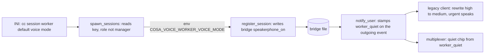

# Plan: spawned workers start quiet by default (row 92076977)

Written 2026-11-13 against `4004d2924`. Nothing here has been built or run. Every "today" claim below was read from the code at that sha, not exercised.

## What Rick ruled

- One INI key, `cc session worker default voice mode = quiet`, read through ConfigurationManager. Values: `quiet`, `speakerphone`, `inherit`.
- Quiet means speakerphone off with the ding kept. It does not mean silent.
- A worker's **urgent** notifications still speak. Medium and high may not. A test must show an urgent notify from a quiet worker speaks.
- Managers and Rick-started sessions keep today's mode-aware default (`session_bridge._get_default_speakerphone`: solo gives off, chorus gives on).
- It shows in both the multiplexer and the legacy notifications client, and Rick can still flip it per session.

## What the code does today

| Fact | Where |
|---|---|
| Every spawned child already starts with `speakerphone_on = False`, role manager or not. The spawn script forwards `COSA_VOICE_SPAWNED_BY` and `COSA_VOICE_ROLE`, and the child's SessionStart hook writes the bridge. | `register_session.py`, the `_spawned_by` block |
| `spawn_sessions` itself writes no bridge. It passes env to the child (`env` dict: `COSA_VOICE_SPAWNED_BY`, `COSA_VOICE_HEADLESS`, `COSA_VOICE_ROLE`). | `session_spawner.spawn_sessions` |
| The legacy client keeps `conversationModes[sessionId]` in localStorage. It is set only by a `speakerphone_changed` event. The legacy JS never calls `GET /api/speakerphone`. | `notifications.js` |
| With no entry the legacy client treats the session as speakerphone ON, so the card badge reads "speakerphone". | `notifications.js`, icon creation and `createSenderCard` |
| The legacy per-session DND rewrite runs only when the entry is exactly `false`. It rewrites `high` and `urgent` to `medium` and keeps the ding. | `notifications.js`, `[QUIET-MODE]` block |
| The multiplexer `SenderStore` defaults `conversation_mode_active` to false and flips it on `speakerphone_changed` or `conversation_mode_changed`. | `SenderStore.ts` |

So the bridge flag is already right for workers. The gap is the clients: no worker registration sends them an event, so the legacy client shows and treats a fresh worker as speakerphone ON and never applies its DND rewrite. The existing rewrite also silences urgent, which Rick now wants spoken.

Not measured: whether a worker's medium or high notify speaks in the live legacy client today. That needs a browser run on `:7999` and is the first thing the build does, before any change, as the baseline.

## Design

1. **Key.** Add `cc session worker default voice mode = quiet` to `lupin-app.ini`, with a splainer twin. A reader function resolves it through ConfigurationManager and refuses a value outside the three words, naming the key. It has no default in code, like the model keys.
2. **Spawn.** `spawn_sessions` reads the key when its `role` is not `manager` and adds `COSA_VOICE_WORKER_VOICE_MODE=<value>` to the child's env. A manager spawn adds nothing. The key is read where the other `cc session spawn *` keys are, so an INI edit needs no code change.
3. **Hook.** The `_spawned_by` block in `register_session.py` sets `speakerphone_on` from that variable: `quiet` gives False, `speakerphone` gives True, `inherit` gives `_get_default_speakerphone()`. An absent variable keeps today's False, so a child spawned by an older server behaves as before.
4. **Tell the clients.** `notify_user` reads the sender's bridge and adds `worker_quiet: true` to the outgoing WebSocket event when the bridge shows a spawned, non-manager session with `speakerphone_on` False. This survives page reloads and needs no event history. Rick flipping a worker to speakerphone writes the bridge, so the next notification carries false.
5. **Legacy client.** The `[QUIET-MODE]` rewrite fires when `worker_quiet` is true or the stored mode is false. When the event carries `worker_quiet`, it rewrites `high` only and `urgent` speaks. When it does not (a manager Rick quieted by hand, stored mode false), it rewrites `high` and `urgent`, as today. The sender badge reads "quiet" when `worker_quiet` is true and no stored entry says otherwise.
6. **Multiplexer.** `SenderStore` sets `conversation_mode_active` false from `worker_quiet` and the strip and sender card show the existing quiet chip. A `speakerphone_changed` from Rick still wins.
7. **/clear and re-spin.** A re-spin goes through the spawn path again, so the key applies again. `/clear` rebuilds the bridge from scratch with the env still present, so a worker returns to the key's mode. `register_session` carries no `speakerphone_on` across `/clear` today; whether Rick's per-session flip should survive `/clear` is a question below.

The notify tool itself is not changed. Quiet is applied where the notification is shown, as the per-session DND already is.

## Questions for Maria and Rick

| # | Question | Recommendation |
|---|---|---|
| 1 | Should the urgent exemption apply to every quiet session or only to quiet workers? | **Ruled by Maria, following Rick:** only when the event carries `worker_quiet`. An urgent notify from a manager Rick quieted by hand keeps today's rewrite, and a test pins that. |
| 2 | Should a worker Rick flipped to speakerphone stay there across `/clear`? | **Ruled by Maria:** file it as its own row, and say in the docs that a flip is lost at `/clear`. Row filed 2026-11-13 (see the row list in the task store, title "worker voice-mode flip survives /clear"). |
| 3 | Stamp `worker_quiet` on every notification, or only those from spawned sessions? | Open: Maria's ruling did not arrive (her DM was condensed in transit). Recommendation stands: only spawned sessions. |

## Tests

| Tier | Test |
|---|---|
| Unit | The key reader: each of the three values, blank, absent, and an unknown word, each naming the key. |
| Unit | `spawn_sessions` env: a worker role carries the variable under each value; role `manager` carries none. |
| Unit | `register_session` bridge: spawned with quiet gives False, speakerphone gives True, inherit gives the mode-aware default in solo and chorus, and an absent variable gives False. |
| Unit | `notify_user` stamping: set for a spawned non-manager quiet bridge; not set for a manager, a non-spawned session, or a worker Rick flipped on. |
| TypeScript | `SenderStore`: `worker_quiet` makes the sender quiet; a later `speakerphone_changed` on wins. |
| Integration | A spawned worker's bridge is quiet under the key and a manager's is not, through the real spawn argv. |
| E2E UI | The multiplexer shows a quiet worker chip; the legacy client shows "quiet" for it. |
| E2E UI | A high notify from a quiet worker plays no speech and keeps the ding; an **urgent** notify from the same worker queues speech (Rick's required test). |
| Unit and E2E UI | An urgent notify from a manager Rick quieted by hand, with no `worker_quiet`, is still rewritten to medium (Maria's pin). |

Acceptance: 100% lines, branches and functions on every file touched, and a mutation check on the two decisive lines (the `high`-only rewrite and the manager exclusion), each killed by a named test.

## Documentation

- `src/docs/websocket-configuration.md`: the new key, and that the legacy rewrite no longer touches urgent.
- The per-session voice personas design doc, section 5: quiet and `/clear` and re-spin, and that a per-session flip back to speakerphone is lost at `/clear` (the carry-over is its own row).
- A capability wiki page for the key and its three consumers, with pins.
- `src/docs/wiki/capabilities/mcp-session-spawn-and-reap.md`: the new env variable.

## Phases

1. Baseline: run the legacy client against `:7999` with a spawned stand-in sender and record what medium, high and urgent do today.
2. Key, reader, spawn env and hook (items 1 to 3) with their unit tests.
3. `worker_quiet` stamping and the two clients (items 4 to 6) with the TypeScript and E2E tests.
4. Docs, pins, reuse review, and the gates in the order of CLAUDE.md.

## Risks

- A bridge read in `notify_user` runs on every spawned-session notification. It is a local file read, not measured here.
- `worker_quiet` is a new field on the WebSocket event. `websocket available events` and the TypeScript types must carry it, or a client drops it.
- The legacy client keeps `conversationModes` in localStorage per browser, so a browser that holds an old `true` for a session id would out-vote the stamp unless the rule is "stamp or stored false". The plan uses that rule.
