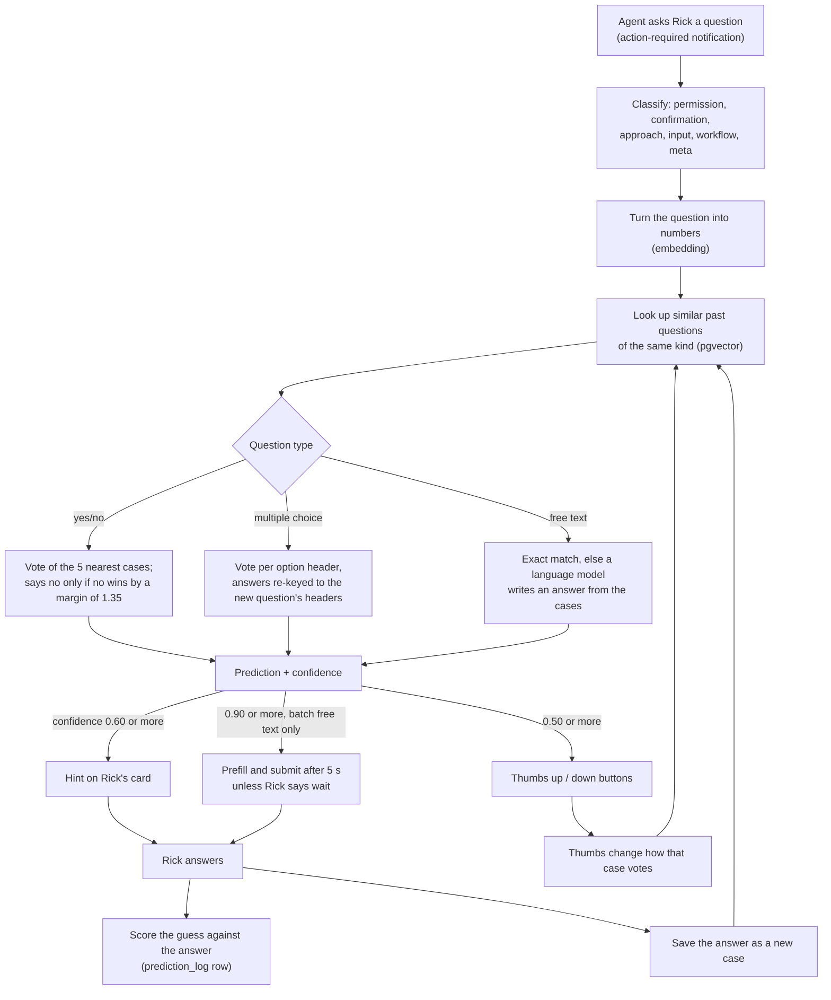

# The online preference-learning predictor: where it stands and what changed on v0.2.3

**For**: a project manager. No code reading needed.
**Asked by**: Rick, by voice on 16 Nov, through row `06ef9627`.
**Branch**: `wip-v0.2.3-2026.11.04-online-preference-learning`, tip `81194389d` when I read it. The branch forked from main at `d0180365c` (the v0.2.2 squash).

## How to read the evidence

| Tag | Meaning |
|---|---|
| **[Code]** | I read the code at `81194389d`. |
| **[Commit]** | A commit message states it, with the sha. I did not re-run it. |
| **[Measured]** | I ran it myself, with the date and time. |
| **[Inherited]** | I took it from another document or a store row. The source is named. |
| **[Gap]** | Not measured. Named so nobody assumes it. |

## 1. Summary

1. **What it is.** When an agent asks Rick a question through an action-required notification, the **Prediction Engine** guesses his answer from his past answers and shows the guess on the card. For one kind of question (a batch of free-text questions) a very confident guess is filled in and submitted after 5 seconds unless Rick steps in. [Code; baseline explainer `2026.11.03-decision-proxy-preference-learning-explainer.md` sections 4.1 to 4.3, inherited]
2. **How it learns.** It does not train a model. Every answer Rick gives is saved as a new "case", and the next similar question looks those cases up. Rick's thumbs-up and thumbs-down on a hint make a case count more or count against. [Code; inherited from baseline section 4.2]
3. **Where it started (3 Nov).** It scored below a constant "always yes" guess on yes/no questions (75.3% against 79.0% over 60 days). Its free-text accuracy figure was invalid, and multiple-choice accuracy was recorded for 2 of 2,812 rows. [Inherited: baseline section 4.4, measured 2026-11-04 01:52 UTC at `3a2ffcbc6`]
4. **What changed.** 18 numbered defects (D1 to D18) were filed against the engine and its neighbour, the SWE-team trust gate; the store holds all 18 as done (35 rows in the epic key `epic:decision-proxy-defects`, which also holds follow-ups, a mobile row and one dropped row). Rick's rulings on 6 Nov added further fixes to the predictor itself (section 4.2). [Measured 2026-11-17 about 03:10 UTC by `task_query`; commits below]
5. **What is not known.** No re-measurement of live accuracy after these fixes turned up in the commits, `history.md` or `TODO.md`. So the current accuracy is a **[Gap]**, and the only post-fix figures are test counts. Section 3 says exactly what is and is not measured.

## 2. How a question flows through it

[Code: `PredictionEngine.predict`, `.record_outcome`, `.record_hint_vote` in `src/cosa/agents/prediction_engine/prediction_engine.py`; the 0.60, 0.50, 0.90 and 1.35 are INI keys `prediction engine confidence threshold`, `prediction hint vote min confidence threshold`, `expeditor prediction auto submit confidence floor` and `prediction engine yes no no margin`, read from `src/conf/lupin-app.ini` at `81194389d`. Flow itself inherited from the baseline, sequence diagram in its section 4.1.]

**A second system sits beside it.** The SWE-team **trust gate** (the "decision proxy") decides how much freedom an agent has per decision category, levels L1 to L5. It is a different piece of code and a different job: it answers "may the agent act alone?", not "what would Rick say?". Several of the 18 defects live there, so section 4 covers both and keeps them labelled. [Inherited: baseline section 2]

## 3. Current state

### 3.1 What is true of the code now

| Fact | Evidence |
|---|---|
| Yes/no says "no" only when the no votes beat the yes votes by 1.35 | INI `prediction engine yes no no margin = 1.35`; commit `73f6b589d` [Code, Commit] |
| Free-text answers count as a match at similarity 0.75 | INI `prediction engine open ended match threshold = 0.75`; commit `ad5f8a2fb` [Code, Commit] |
| Similarity is a true cosine, so it cannot exceed 1 | `378fa901b` [Commit] |
| Multiple-choice and batch answers are scored | `487e676e6` [Commit] |
| The trust gate's learning model is chosen by INI, default `count`; Beta and BLR are selectable but **not selected** | INI `swe team trust proxy trust model = count`; `32559cd1f` [Code, Commit] |
| The open-ended and batch predictors share one code path | `369ba092f`, 11 Nov [Commit] |

### 3.2 Test evidence

| Run | Result | When |
|---|---|---|
| `src/cosa/tests/unit/agents/prediction_engine/`, `test_prediction_decision_repository.py`, `test_prediction_log_repository.py` | **217 passed**, 0 failed | [Measured] 2026-11-17 03:12 UTC, tree at `81194389d`, `LUPIN_ROOT` and `PYTHONPATH` pinned to this worktree |
| Census guards on the same tip | 1,971 passed | [Inherited] commit message of `81194389d` |
| Full unit tier | 46,327 passed, 0 failed | [Inherited] commit `aabadd221`, 15 Nov, at `2dfbc15c3`. Not re-run by me. |

### 3.3 Accuracy: what is measured and what is not

| Figure | Value | Date and source | Status |
|---|---|---|---|
| Yes/no accuracy, last 60 days | 495 right of 657 (75.3%) | 2026-11-04 01:52 UTC, `prediction_log` | **[Inherited]**, before every fix below |
| Always-"yes" baseline, same window | 519 of 657 (79.0%) | same | **[Inherited]** |
| Yes/no accuracy, quoted at the D14 ruling | 74.7%, against 79.0% | TODO Decisions Log, 6 Nov 11:55 EST | **[Inherited]**; differs from 75.3% because the window moved. I did not reconcile the two. |
| Yes/no accuracy **after** D14 | not found | none | **[Gap]** |
| Multiple-choice accuracy | rescore dry run: 2,391 would be scored, 75 match, 2,316 miss, 45 skipped | row `b3ba8f11`, Pocholo, 6 Nov 16:52 UTC, dev DB | **[Inherited]**. That counts the *old* predictions, which answered the wrong headers. |
| Multiple-choice accuracy of the **fixed** predictor | not found | none | **[Gap]** |
| Whether the `--write` rescore ran | The script's before-image exists: `io/rescore-empty-answers-mc-20261106T225620Z.jsonl`, 2,391 lines, the same count as the dry run's "would score", stamped 2026-11-06 22:56:20 UTC, one minute after Rick's ruling (about 22:55 UTC). Row `b3ba8f11` is `done` | file read 2026-11-17 about 03:20 UTC | The dump is written *before* the writes, so it shows the write was started, not that it finished. **No written count was found, and I did not query the database [Gap]** |
| Free-text match quality at 0.75 | precision 0.79, recall 0.65 on 133 hand-labelled pairs; at 0.85 recall was 0.29 | TODO Decisions Log, 6 Nov | **[Inherited]** |
| Batch auto-submit calibration (is "0.9" really 90% right?) | never checked | baseline section 4.3 and 4.4 | **[Gap]**, inherited |

**In plain terms:** the fixes target the measured weaknesses, but nobody has yet re-run the accuracy report to show the yes/no number now beats the always-yes line. I would not tell Rick it does.

## 4. Improvements, in order

Each item says what changed, why, the sha, and what was measured before and after. "After" is blank when nothing was measured. The numbered D-labels come from the baseline's defect table (its section 8).

### 4.1 Scoring made honest (5 to 6 Nov)

These do not make the engine smarter. They stop the report from lying, so later changes can be judged.

| # | Change | Why | Sha | Before | After |
|---|---|---|---|---|---|
| D16 | Multiple-choice and batch answers are decoded before scoring | The browser sends them as a JSON string, the comparator looked for a key that was not there | `487e676e6`, merged `6c41a7346` (193 of 193 pass; 3 captured-row tests fail with the fix reverted, per Maya's review) | accuracy recorded for 2 of 2,812 rows (inherited) | no re-count [Gap] |
| D15 | Similarity is a true cosine | The old one was a plain dot product; 132 of 133 stored values exceeded 1, so "100% free-text accuracy" meant nothing | `378fa901b`, merged `00f8b8aaf` (191 of 191 pass; the non-unit test fails with the fix reverted) | 100% on invalid numbers (inherited) | no re-count [Gap] |
| | Accuracy reports leave out the 132 rows scored before the cosine fix | Rick ruled 6 Nov: exclude, rescore nothing | `039194023`, merged `fb5771ffd` | | clause matches 132 rows [Commit] |
| | Accuracy reports leave out 414 rows that store a confidence above 1 | Old rows; last written 2026-06-03; new rows stay at or below 1.0 | `000786d41`, merged `3dac9c984` | average confidence read 18.37 (row `20cdca7e` title) | excluded and counted separately [Commit] |

### 4.2 Better guesses (6 Nov)

| Change | Why | Sha | Before | After |
|---|---|---|---|---|
| **D14, yes/no.** Say "no" only if no beats yes by a margin, set to 1.35 | Rick ruled it on 6 Nov: the predictor was below the always-yes line, and this was the smallest change that stops the bad "no" calls. 1.35 is ln(527/137), the log-odds of the yes rate (527 yes of 664 answered rows, 5 Nov) | `73f6b589d`, merged `8b795348d` | 74.7% against 79.0%, 60 bad "no" calls (TODO, 6 Nov; inherited) | not measured [Gap]; one test pins "lead equals margin" |
| **Multiple choice answers the right question.** A past case's answers are re-keyed under the *new* question's own headers; a header no similar case can answer gets no prediction | The old vote used the neighbour's headers, so a guess almost never shared a key with the real answer | `d0022c3cc`, merged `425e3f4e9` (row `fa884f81`) | 75 of 2,391 matched (commit message) | not measured [Gap] |
| **Free-text threshold 0.85 to 0.75, now an INI key** | At 0.85 only near-copies counted (6 of 133 pairs). Rick had the 133 pairs labelled, then ruled 0.75 at about 17:55 EST | `ad5f8a2fb`, `c5cb9a927`, merged `095bd9042` | recall 0.29 (inherited) | precision 0.79, recall 0.65 (inherited) |
| **Blank placeholder rows cast no vote** | A "shadow" row has no real answer yet, but counted as a "no" vote and as an empty verdict | `8e09544f2` (row `41f7344d`) | | not measured [Gap] |

### 4.3 The one-off cleanup of old rows (6 Nov)

`2c205b395`, merged `a436bba50`: a script that rescores old multiple-choice rows, report-only unless `--write`, with a before-image dump. 27 tests at 100% lines and branches (merge message). Rick first ruled "multiple-choice rows only", then at about 17:55 EST "write the true scores" after Cheech pointed out that most of the 2,316 misses are real. **Whether `--write` finished is a [Gap]**: its before-image of 2,391 rows exists, dated 2026-11-06 22:56:20 UTC, but no written count was found (section 3.3). Batch rows (60) stay unscored by Rick's ruling.

### 4.4 The trust gate beside it (5 to 6 Nov)

The 18-defect list was found while the baseline was written. These are the fixes, all merged after review; counts are from the commit messages. The first column is the baseline's label.

| D | What was wrong | Fix, sha |
|---|---|---|
| D1 | A human "yes" at level 1 was recorded as a proxy failure | `b921c19c3`; two new tests fail on the old code |
| D2 | Trust restarted at level 1 on every job | `120f175d1` loads stored rows by the user's email; `188403cb5` makes the stored level a ceiling so a demotion survives |
| D3 | Auto-approvals counted as successes with no human verdict | `a081de820`; two older tests that asserted the self-credit now assert none |
| D4 | Beta and BLR models could never be selected | `32559cd1f` adds the INI key (default `count`); `57021cb6f` stores BLR state so a restart keeps it (column `trust_states.blr_state`) |
| D5, D6 | BLR feature 3 was always 0; demotion did nothing to Beta and BLR | `cd7cc02a9`, `680a83fa0` |
| D7 | L3, L4, L5 behaved identically; no audit sample | `62cdf0ff0`: L3 acts at confidence 0.80 or more, L4 sends 10% of act-outcomes to the human, L5 always acts |
| D8 | Thompson sampling could raise the action level | `bcef7fea6`; four new tests fail with the fix reverted |
| D9 | Conformal calibration was not held-out data | `943609cca`; five new tests fail with the fix reverted |
| D10 | INI cap keys were read and ignored | `59e918db9` |
| D11 | Dashboard showed L1 for every row | `04ee696a8`; the three-answers test fails without the call |
| D12 | Admin guide described behaviour the code lacked | `45e839b4d`, `899191f6c`, `430bf729a`, wording passes (docs only) |
| D13 | The ratify page held only synthetic rows (67,096 synthetic, 0 organic) | `b26f35833` writes an organic row per gated confirmation; no count of organic rows since was taken [Gap] |
| D17, D18 | Base class hard-coded level 1; classifier matched substrings | `84b1ddd2a`; `597aade06` with `b5f228013` (whole words plus a suffix rule), merged `39cf5cce5` |
| follow-up | Restored history never aged out | `44454d072`: new column `trust_states.decision_history`; 8 new tests fail without the change |

**Why it matters for the PM:** these make the trust gate *capable* of learning from real answers. Before, every one of its 66,683 rows was synthetic and none was ratified (inherited, measured 2026-11-04 01:51 UTC). The default model is still plain counting, so BLR and Beta are present but off.

### 4.5 Tidying with no behaviour change

- `369ba092f`, merged `eb2243b2c` (11 Nov): the open-ended and batch predictors share one two-tier path; two new tests pin what each caller passes.
- Wiki pages for the decision proxy, learning models and prediction engine were rewritten to match the code, `73f683ffe` (6 Nov), merged `99ccc898b`.
- Comment clean-up in `prediction_engine` and its tests: `a40e3b73c`, `794a064a6` (7 Nov).

## 5. Open problems and what is next

| # | Problem | Evidence | Suggested owner step |
|---|---|---|---|
| 1 | **No post-fix accuracy report.** The yes/no, multiple-choice and free-text numbers have not been re-run since 6 Nov | Section 3.3 gaps | Run the accuracy summary on the dev database and record date, window and the always-yes line beside it |
| 2 | **The `--write` rescore is started but its result is unconfirmed** | Before-image of 2,391 rows exists (section 3.3); row `b3ba8f11` carries no written count | Ask Chloé (row owner) for the written counts, or run the script report-only to see what remains unscored |
| 3 | **The 1.35 margin is a rule of thumb, not a tuned value** | Derived from one prior, `73f6b589d` | Measure after problem 1; keep it only if accuracy is above the always-yes line |
| 4 | **Auto-submit has never been checked for calibration** | Baseline section 4.3; no accuracy data existed for batch (0 of 61, inherited) | After problem 1, check what share of 0.90-plus batch predictions Rick would have accepted. Whether each was auto-submitted is also not logged [Gap, inherited] |
| 5 | **Thumbs signal is thin** | 4 votes, all down, as of 2026-11-04 (inherited) | Re-count; the design bets on this signal |
| 6 | **BLR and Beta are off by default** | INI `= count` at `81194389d` | Rick's call whether to switch on; the store note recommended dropping the row for v0.2.3 (history 5 Nov, inherited) |
| 7 | **Bare-label multiple-choice answers are never scored** | Row `3905b9d9` dropped; the sender fix was made in lupin-mobile (row `d10ef810`, done) | Re-count after the mobile release |
| 8 | **The LLM-replacement design is not started** | The baseline's section 7 lists the seams; I found no commit that implements one | Not a defect: a decision for Rick, after problem 1 gives a baseline |

## 6. What I did not read, and why

- I did not read older R&D under `src/rnd/v0.1.5/`; `src/docs/rnd-ledger.tsv` marks those `history` or `superseded`. I read the v0.2.2 baseline explainer because the ledger had no row for it, which makes it `new`, so in force.
- I did not query the live database. Every accuracy figure is inherited or from a commit message.
- Every sha in this document except `3a2ffcbc6` was checked with `git merge-base --is-ancestor` against the branch tip (measured 2026-11-17). `3a2ffcbc6` is the baseline's code sha, inherited, and is not on this branch.
