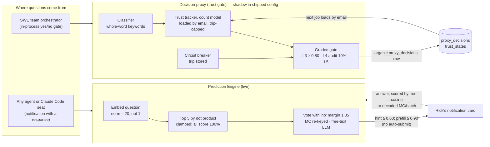

# Online preference learning after the v0.2.3 repairs: what the algorithms do now, and how well

**For**: technically oriented colleagues: ML engineers and reviewers who want the mechanism, the numbers and the critique.
**Asked by**: Rick, by voice on 17 Nov 2026, row `a59f1ac3`.
**Base document**: the 3 Nov explainer, `src/rnd/v0.2.2/2026.11.03-online-preference-learning/2026.11.03-decision-proxy-preference-learning-explainer.md` ("the baseline"). Its section 8 listed 18 defects, D1 to D18. This document keeps the baseline's structure and says, section by section, what is different now.
**Code**: main at `4164f56c5`, the squash of PR #24 (v0.2.3 → main). The learner code is byte-identical between `81194389d` (the tip the 16 Nov PM explainer read) and `4164f56c5` (`git diff --stat` over every file cited is empty), so branch shas below describe main. Branch shas are ancestors of `wip-v0.2.3-2026.11.04-online-preference-learning`, not of main, because main took a squash.
**Companion**: the 16 Nov project-manager explainer, `src/rnd/v0.2.3/2026.11.16-online-preference-learning-pm-explainer.md`. This document corrects it in three places (section 8).

## How to read this document

| Label | Meaning |
|---|---|
| **[Code]** | Read at `4164f56c5`; the file and symbol are named |
| **[Commit]** | A commit message says it; not re-run |
| **[Measured]** | A read-only query of the dev database `lupin_db_dev`, run 2026-11-18 between 00:03 and 00:15 UTC; the SQL is in appendix A |
| **[Inferred]** | Our reading of what two facts imply; the link itself was not measured |
| **[Inherited]** | Taken from the baseline or the PM explainer, with its own date |
| **[Gap]** | Not measured. Named so nobody assumes it |

## 1. Summary

1. **All 18 defects were worked, and most are fixed in code. But "fixed" splits three ways.** Some fixes are live in production: D1–D3, D10, D11, D13, D14–D16, D18 and the multiple-choice re-keying. Some are reachable only under a configuration nobody ships (D4–D9: Beta, BLR, Thompson, conformal, the L3/L4 grades). Some live in code that nothing calls (the accuracy-report exclusions). Section 2 has the table. [Code]
2. **Yes/no accuracy rose from 75.2% to 84.7%, and it still does not beat always guessing "yes".** After the "no" margin went live, the engine was right 50 times in 59 against 52 for a constant "yes" (88.1%). Before it, 501 of 666 against 528 (79.3%). The gap shrank from 27 rows to 2, because the engine now says "yes" 57 times in 59. [Measured; windows in section 3.7]
3. **The margin works by silencing "no", not by learning when Rick says "no".** In the after window it overturned 10 "no" majorities; Rick answered "yes" to 8. Its two remaining "no" calls were both wrong. [Measured] With the old rule the same window would have scored 42 of 59. [Inferred from the code]
4. **New finding: retrieval similarity is saturated, so the similarity floors filter nothing.** The stored question vectors are not unit length (median norm 19.8, range 17.2–23.0, none of 1,528 at length 1). Retrieval scores a dot product × 100 and clamps it at 100, so every neighbour scores 100%. The 0.75 yes/no floor and the 0.85 free-text floor admit every case, and the similarity factor in every confidence is 1.0. [Measured norms; Code for the formula] Every yes/no confidence in the after window is an exact vote share (0.4, 0.5, 0.6, 0.8, 1.0), which is what that predicts. [Measured]
5. **D15's cosine fix covers scoring only.** `_cosine_similarity` is a true cosine now, but only `record_outcome` uses it, to score a free-text guess against the real answer. Retrieval was never on that path. [Code]
6. **Nothing auto-submits for Rick.** The baseline and the PM explainer both said a batch prediction at 0.9 or above is submitted after a 5-second grace window. Neither client does that. The web client uses the 0.9 floor only to prefill the answers, and nothing reads the grace window. The lupin-mobile source has no `auto_submit` reference at all. Submission needs a click or the Enter key. [Code; mobile by fixed-string search, section 3.6]
7. **Multiple-choice scoring now works, and the predictor almost always abstains.** The 6 Nov rescore landed: all 2,391 old rows are scored, and 75 match (3.1%). After the re-keying fix, the predictor answered 7 of 86 questions. All 7 were right, and all 7 were the same podcast "Script Review" prompt. [Measured]
8. **The trust gate can now remember and grade, but in shipped config it only watches.** Trust now persists across jobs by user email, a circuit-breaker trip is stored and caps the level, and L3, L4 and L5 now differ. Shipped mode is `shadow` and the model is `count`. The database holds 43 organic decisions, all from one 4-minute burst on 5 Nov, and no `trust_states` row has more than one decision. [Code, Measured]
9. **D1 changed what "success" means; it did not make the gate learn Rick's preference.** `decide()` now always runs, so a success means Rick agreed with a fixed rule per category. For deployment, destructive and architecture the rule is `requires_review`, so every "yes" Rick gives there counts as a failure. [Code] We expect those categories to trip the breaker and keep the stored cap. [Inferred]
10. **Next steps for a designer, in order.** Fix retrieval similarity first (normalise, or score by cosine): every confidence depends on it. Then decide whether yes/no prediction is worth having for a user who says "yes" 88% of the time. Then build real auto-submit or stop advertising it. Section 7 has the list.



## 2. The 18 defects: where each stands at `4164f56c5`

"Live" means a production caller reaches the fix in shipped config. "Dormant" means the code is reached only under an INI value nobody ships. "Unreached" means no production code calls it.

| D | Baseline finding (3 Nov) | Fix now [Code] | Status | Shas [Commit] |
|---|---|---|---|---|
| 1 | At L1 a "yes" counted as a proxy failure | `EngineeringStrategy.evaluate` always calls `decide()`, so the value is never `None` | **Live**, with new semantics (section 4.1) | `b921c19c3` |
| 2 | Trust restarted at L1 each job | `SweTeamOrchestrator._load_trust_state` reads `trust_states` by user email at start; a stored breaker trip caps the level until new successes earn it back | **Live** | `120f175d1`; `188403cb5` superseded by `d85c0da0a` |
| 3 | Auto-approvals counted as successes | The auto-approve path writes an organic row and records no feedback | **Live**, but `act` cannot happen in shadow mode | `a081de820` |
| 4 | Beta and BLR could never be selected | INI `swe team trust proxy trust model` (`count`, `beta`, `blr`; unknown values refused); BLR state stored in `trust_states.blr_state` | Selectable; **dormant** (`= count`) | `32559cd1f`, `57021cb6f` |
| 5 | BLR feature 3 always 0 | `recent_error_rate()` over the latest 20 decisions | **Dormant** (BLR only) | `cd7cc02a9` |
| 6 | `demote` did nothing to Beta and BLR | `_shed_totals_to` lowers successes to the target Beta level and drops the BLR model | **Dormant** | `680a83fa0` |
| 7 | L3, L4 and L5 behaved alike; no audit | `_graded_action`: L3 acts at confidence ≥ 0.80, L4 refers destructive, low-confidence and a 10% audit sample to the human, L5 acts | Code reached; **dormant** in shadow mode | `62cdf0ff0` |
| 8 | Thompson bypassed level, cap and mode | Thompson may only lower the graded action | **Dormant**; the builder never enables it | `bcef7fea6` |
| 9 | Conformal calibration was not held out | BLR keeps one-step-ahead (prediction, label) pairs, newest 500 | **Unreached**: `calibrate_conformal` has no production caller | `943609cca` |
| 10 | INI cap keys ignored | `build_ini_engineering_strategy` passes `cap_levels` | **Live**; the shipped values equal the constants (3), so no visible change | `59e918db9` |
| 11 | Dashboard always showed L1 | `_persist_trust_level` writes the tracker's level after each feedback | **Live** (SWE jobs only) | `04ee696a8` |
| 12 | Admin guide described behaviour the code lacked | Guide rewritten for L3 at 0.80 and the 1.35 margin | Docs | `45e839b4d`, `899191f6c`, `430bf729a` |
| 13 | Ratify page held only synthetic rows | One organic `proxy_decisions` row per gated confirmation | **Live**; 43 such rows exist (section 4.5) | `b26f35833` |
| 14 | Yes/no below the always-yes line | Say "no" only if it leads "yes" by ≥ 1.35 | **Live**; still below the line (section 3.7) | `73f6b589d`, merged `8b795348d` |
| 15 | Free-text accuracy on non-unit vectors | `_cosine_similarity` is a true cosine | **Live for scoring only**; retrieval still saturates (section 3.5) | `378fa901b`, merged `00f8b8aaf` |
| 16 | MC and batch accuracy not recorded | `record_outcome` decodes the browser's JSON string before comparing | **Live** for MC; **never exercised** on batch (no batch row since) | `487e676e6`, merged `6c41a7346` |
| 17 | Base `evaluate` hard-coded L1 | Calls the abstract `get_trust_level` | Fixed; no production subclass uses the base method | `84b1ddd2a` |
| 18 | Classifier matched substrings | Whole words plus a suffix rule (`s`, `es`, `ed`, `ing`, `er`, `ize`…, e-drop and doubling) | **Live** | `597aade06`, `b5f228013`, merged `39cf5cce5` |

Beyond the 18, the predictor got these changes. [Code, Commit]

| Change | Mechanism | Shas |
|---|---|---|
| MC answers re-keyed to the new question's headers | `_remap_answers_to_question`; abstains (`no_evidence_for_question_headers`) if any header has no vote | `d0022c3cc`, merged `425e3f4e9` |
| Free-text match threshold 0.85 → 0.75, an INI key | Scoring only; retrieval stays 0.85 | `ad5f8a2fb`, `c5cb9a927`, merged `095bd9042` |
| Blank placeholder rows cast no vote | `is_blank_case` in the yes/no path | `8e09544f2` |
| Accuracy-report exclusions for legacy rows | `legacy_similarity_clause`, `legacy_confidence_clause` in `get_accuracy_summary` | `039194023`, `000786d41` |
| One-off MC rescore | `src/scripts/rescore_empty_answers_mc.py`, before-image dump | `2c205b395`, merged `a436bba50` |
| Free-text and batch share one path | `_predict_two_tier` | `369ba092f`, merged `eb2243b2c` |
| Restored trust history ages out | `trust_states.decision_history`, per-day counts, 90-day retention | `44454d072` |

## 3. The Prediction Engine now

The architecture is the baseline's (its sections 4.1 and 4.2): classify, embed, retrieve similar past cases filtered by category and response type, vote or synthesise, show a hint, score the answer, store the answer as a new case. Learning is still pure case accumulation, plus thumbs votes that reweight cases. [Code] What changed is the vote rules, the scoring and the measured numbers.

### 3.1 Yes/no: the "no" margin

[Code: `PredictionEngine._predict_yes_no`, `_ratified_weight`, `_bounded_consistency` in `src/cosa/agents/prediction_engine/prediction_engine.py`]

```python
binary_value = "yes" if decision_value.lower().startswith( "yes" ) else "no"
votes[ binary_value ] += self._ratified_weight( record )      # +1 | +2.0 thumbed up | -2.0 thumbed down
winner = max( votes, key=votes.get )
if winner == "no" and votes[ "no" ] - votes.get( "yes", 0.0 ) < self.yes_no_no_margin:   # 1.35
    winner = "yes"; no_suppressed = True
consistency = self._bounded_consistency( { **votes, "yes": votes.get( "yes", 0.0 ) }, winner )
confidence  = max_similarity * consistency
```

- **Population**: the top 5 cases at retrieval similarity ≥ 0.75, blank placeholder rows removed.
- **The margin is compared with raw tallies.** With ordinary cases a "no" needs a lead of 2 or more: 3–2 becomes "yes", 4–1 stays "no", a single "no" neighbour becomes "yes". One thumbed-up "no" (+2) stands alone. [Code arithmetic]
- **Where 1.35 came from.** 1.35 = ln( 527 / 137 ), the log prior odds of "yes" on 5 Nov. [Commit `73f6b589d`] It is compared with a *difference of vote counts*, which is not a log-likelihood ratio. So it acts as the integer rule "lead ≥ 2", not as a Bayesian prior. [Inferred] A principled version would compare the vote's log-likelihood ratio, with a per-neighbour reliability, against the log prior odds.
- **Confidence after an overturn is the minority share.** When a "no" is overturned, "yes" holds the smaller share, so confidence is below 0.5 × similarity, and 0.0 when the only neighbour said "no". Such a prediction is below the 0.60 hint gate, so Rick sees nothing, but it is still logged and scored as a "yes". [Code]
- **Confidence is not a probability.** It is the emitted label's share of positive vote mass, times a similarity factor that is now always 1.0 (section 3.5). [Code, Measured]

### 3.2 Multiple choice: re-keying, and abstention

[Code: `_predict_multiple_choice`, `_remap_answers_to_question`]

Before, each neighbour voted under *its own* option headers, so a guess almost never shared a key with the real answer. Now each past answer is mapped onto the new question's headers: exact header matches first, otherwise the first unclaimed past answer whose labels the new header offers; list answers are filtered to offered labels. **If any header of the new question gets no vote, the whole prediction abstains** with `no_evidence_for_question_headers`. Without parseable options, the neighbours' own headers vote as before.

The all-or-nothing abstention is why the engine now answers few MC questions: 7 of 86 after the cut-over, against 32 of 36 in the two days before it. [Measured] `prediction_log` does not store the abstention reason, so how many of the 79 abstained for this reason is a [Gap].

### 3.3 Free text and batch

Unchanged in shape: tier 1 returns the answer of an exact normalised-text match; tier 2 asks the LLM (`kaitchup/phi_4_14b`) to synthesise from the top 5 cases at retrieval similarity ≥ 0.85, and confidence is min( top similarity, the LLM's self-reported confidence ). Both now run through one function, `_predict_two_tier`. [Code]

Scoring changed: the guess and the real answer are embedded and compared by a **true cosine** (D15), and a match is cosine ≥ 0.75 (`prediction engine open ended match threshold`). Batch scores the mean across headers. [Code: `compare_open_ended`, `compare_open_ended_batch` in `accuracy_comparators.py`]

### 3.4 Thumbs votes

Unchanged: a thumbed-up case votes +2.0, a thumbed-down case −2.0 against its own answer, and the synthesis prompt marks each case `approved` or `rejected`. [Code] The signal is still almost empty: 0 thumbs up and 4 thumbs down all time, none since 4 Nov. [Measured]

### 3.5 Retrieval similarity is saturated

This is new, and it matters more than any single defect fix, because every confidence the engine reports multiplies by it.

**The code.** `PredictionDecisionRepository.find_similar` calls `vector_search.dot_topk( …, clamp=True )` with the default `metric="dot"` (pgvector `<#>`). The similarity is `dot × 100`, clamped to [0, 100]. That equals cosine × 100 only when both vectors have length 1. [Code; spot-checked by fixed-string `git grep` of `dot_topk` at `4164f56c5`]

**The data.** The stored question vectors are not unit length. [Measured, `vector_norm( question_embedding )` over `prediction_decisions`]

| Response type | Cases | Min norm | Median norm | Max norm | Unit length |
|---|---|---|---|---|---|
| yes/no | 584 | 17.8 | 19.8 | 23.0 | 0 |
| multiple choice | 919 | 17.2 | 20.1 | 22.5 | 0 |
| free text | 19 | 18.0 | 19.2 | 20.7 | 0 |
| batch | 6 | 17.6 | 19.6 | 20.2 | 0 |

The median norm was 19.7, 20.0 and 20.0 for cases created in September, October and November. With norms near 20, two vectors' dot product is about 400 × their cosine, so any pair with cosine above 0.0025 is clamped to 100%. [Inferred arithmetic on measured norms]

**What follows.** [Inferred, each consistent with the measurements]

- The 0.75 and 0.85 retrieval floors admit every case of the right category and type. "Top 5 similar" means top 5 by raw dot product, which ranks partly by cosine and partly by vector length.
- `max_similarity` is 1.0 on every prediction, so confidence equals the vote share. In the after window every yes/no confidence is exactly 0.4, 0.5, 0.6, 0.8 or 1.0, each an exact vote share among a handful of neighbours. [Measured values]
- The free-text tier-2 confidence is just the LLM's self-report, since min( 1.0, x ) = x.
- The baseline's "confidence above 1.0" rows (May to June) were this same length problem before the clamp existed. [Inferred]

**Where the length comes from.** Two docstrings disagree: `local_embedding_engine` encodes with `normalize_embeddings=True` when FastAPI owns the engine, while the `vector_search` docstring says `lupin_model_server` vectors are not normalised (norm 19.8). The stored norms match the second. Which path wrote each row is a [Gap]; the norms show the result either way.

**The fix is small**: normalise at write and at query, or score retrieval by cosine distance (`<=>`), and re-embed or re-normalise the 1,528 stored cases. The thresholds then need re-tuning, because they have never filtered anything at this length.

### 3.6 The act gate: there is no auto-submit

[Code: `notify_user` in `src/cosa/rest/routers/notifications.py`; `NotificationsUI._batchPredictedAnswers`, `renderOpenEndedBatchUI`, `attachOpenEndedBatchEventHandlers` in `src/lupin_app/static/js/notifications.js`]

| Step | What the code does |
|---|---|
| Server | A hint exists at confidence ≥ 0.60. On a hint it stamps `auto_submit_enabled` (INI `true`, but only in `[Lupin: Development]`; code default `False`), `auto_submit_min_confidence_threshold` (0.9) and `auto_submit_grace_window_seconds` (5) |
| Web client | For a batch with `auto_submit_enabled`, confidence ≥ 0.9 and all-scalar answers, it **prefills** the inputs. Below 0.9 nothing is prefilled. `submitOpenEndedBatchAnswers` is reached only from the Submit All click and the Enter key on the last input |
| Grace window | Its one reader outside the tests is the line that stamps it |
| Mobile | A fixed-string search of the lupin-mobile source finds no `auto_submit` reference; the same search finds `prediction_hint` in `lib/features/notifications/data/notification_models.dart`, so the search works |

So the baseline's summary point 7 ("fills the form and submits it after a 5-second grace window") and the PM explainer's diagram are wrong. A grep at the baseline sha found the grace-window key only on the server, so this was probably already true on 3 Nov. [Code; the 3 Nov reading is Inferred from one grep] What is true is safer than what was documented: the engine never answers for Rick. It is also less useful, and the 0.9 floor has still never been checked for calibration: no batch row has been written since 4 Nov, and none has an accuracy value. [Measured]

### 3.7 How well it predicts now

All figures are from `prediction_log` in `lupin_db_dev`, read 2026-11-18 00:03–00:08 UTC. Re-running the baseline's own 3 Nov query returns its numbers exactly (657 rows, 495 right, 519 answered "yes"), so this is the population the baseline read. [Measured]

**When each fix went live.** No log records when the `:7999` server loaded each fix, so the cut-overs come from the data. Each cut-over has two ends: the last row that only the old code could have written, and the first row that only the new code could have written. Rows in between are reported apart and never counted as after. [Measured]

| Fix | Last old-code row | First new-code row | Signature used |
|---|---|---|---|
| Yes/no margin | 2026-11-04 15:54:58 | 2026-11-11 14:59:54 | a "no" won by a lead of 1 / a "yes" at 0.4 from a 3–2 "no" majority |
| MC re-keying | 2026-11-06 22:55:45 | 2026-11-09 15:27:34 | predicted header set differs from / equals the question's |
| Free-text cosine | 2026-10-28 22:36:56 | 2026-11-14 18:38:32 | similarity above 1.0 and threshold 0.85 / at most 1.0 and 0.75 |

`predicted_at` is when the answer was recorded, not when the hint was shown: since 1 Nov it is within 0.025 s of `responded_at` on all 458 rows. [Measured]

**Yes/no.** Cold-start rows are left out, as on 3 Nov. "Always yes" is right when Rick's answer starts with "yes".

| Window (UTC) | Rows | Engine right | Accuracy | Always "yes" | Predicted "no" |
|---|---|---|---|---|---|
| Before: 60 days to 2026-11-04 15:54 | 666 | 501 | 75.2% | 528 (79.3%) | 59 (8.9%) |
| Undetermined: 2026-11-04 16:41 → 11-11 14:57 | 54 | 41 | 75.9% | 43 (79.6%) | 2 (3.7%) |
| **After: 2026-11-11 14:59 → 11-17 20:32** | **59** | **50** | **84.7%** | **52 (88.1%)** | **2 (3.4%)** |

All 59 after-window rows were answered from Rick's account. The before window includes 4 test-account rows and 90 rows from before the answering account was recorded; without them, before is 424 of 572 (74.1%) against 447 (78.1%). [Measured] Whether a person pressed the button on a Rick-account answer cannot be told from the data. [Gap]

**Reading it.** The after window is short (6 days, 59 rows), and the share of "yes" answers is higher in it (88.1% against 79.3%), so the rise from 75.2% to 84.7% is mostly the easier window and the engine saying "yes" more. The comparison that controls for the window is the always-yes line, and the engine is 2 rows under it. [Measured counts; Inferred reading] With these counts the difference is not statistically distinguishable from zero, in either direction. [Inferred]

**Calibration, after window.**

| Confidence | Rows | Right | Accuracy |
|---|---|---|---|
| 0.4 (an overturned "no") | 10 | 8 | 80.0% |
| 0.5 | 1 | 1 | — |
| 0.6 | 14 | 12 | 85.7% |
| 0.8 | 19 | 15 | 78.9% |
| 1.0 | 15 | 14 | 93.3% |

Accuracy does not rise with confidence: the lowest band is right 80% of the time. That is what you expect when confidence is a vote share and the base rate of "yes" is 88%. [Measured; Inferred reading]

**A correction to the baseline's calibration table.** It used `width_bucket( conf, 0, 1.0000001, 10 )`, which puts a value sitting exactly on a band edge in the band below. Its "0.5–0.6" row (285 rows, 60.7%) is the rows at exactly 0.6, and its "0.7–0.8" row (403, 73.9%) is the rows at exactly 0.8. So those accuracies sit below their confidence, not inside their bands. [Measured: the bucket function on the five values]

**Multiple choice.**

| Group | Rows | Scored | Matched |
|---|---|---|---|
| Old rows rescored on 6 Nov | 2,391 | 2,391 | 75 (3.1%) |
| Scored at response time before the cut-over | 13 | 13 | 1 |
| Never scorable (bare labels and the like) | 45 | 0 | — |
| Undetermined window (all cold start) | 17 | 0 | — |
| **After the cut-over, predicted** | **7** | **7** | **7** |
| After the cut-over, abstained | 79 | 0 | — |

The rescore's before-image (`io/rescore-empty-answers-mc-20261106T225620Z.jsonl`) lists 2,391 ids. Every one is now scored, and none still reads `empty_answers`, which closes the PM explainer's open question. When the write finished was not recorded. [Measured] The 7 of 7 are all one repeated prompt ("Script Review", from the podcast generator), so they support no general accuracy. [Measured]

**Free text.** Before the cosine fix, 133 rows, 132 "matches", similarities up to 535.6. After it, 3 rows, 0 matches at 0.75, cosines 0.355, 0.428 and 0.515. Three rows show that the metric is now a real cosine; they support no rate. [Measured]

**Batch.** 64 rows, none scored, 60 at confidence ≥ 0.9; the newest is from 2026-11-04 15:11, before the decoding fix. [Measured]

**Case base.** 1,528 cases (919 MC, 584 yes/no, 19 free text, 6 batch), up from 1,250 on 3 Nov; all organic. [Measured]

## 4. The decision proxy (trust gate) now

### 4.1 The pipeline, and what "success" means after D1

The sequence is the baseline's (its section 3.1), with two changes in `EngineeringStrategy.evaluate` and `SweTeamOrchestrator._gated_confirmation`. [Code]

1. `decide()` runs for every action, shadow included, so the proxy always has a value.
2. On an auto-approved `act`, no feedback is recorded (D3); an organic `proxy_decisions` row is written instead.

Step 4 is unchanged: `success = ( ( value == "approved" ) == user_answer )`. `decide()` is still a fixed rule: `approved` for testing, deps and general; `requires_review` for deployment, destructive and architecture. So **a success now means Rick agreed with that fixed rule**. [Code]

- In testing, deps and general, a "yes" is a success. That is the intended fix to the L1 inversion.
- In deployment, destructive and architecture, a "yes" is a **failure**, and only a "no" is a success.

So the gate learns whether a constant rule matches Rick, not what Rick prefers. In the three capped categories, a Rick who approves deployments drives the lifetime error rate above the breaker's 15% (after 10 decisions). The trip is now stored (section 4.2), so the cap persists across jobs. [Code for each part; Inferred for the dynamics] The fix that would make this a preference learner is to let `decide()` be the learned prediction, for example the Prediction Engine's vote on the same question. The baseline's section 7 called this seam 2b.

### 4.2 Memory across jobs

[Code: `SweTeamOrchestrator._load_trust_state`, `TrustTracker.restore_category`, `CategoryTrust.level`, `trip_active`]

- At job start the orchestrator reads every `trust_states` row for the job's user email and domain `swe`, and restores counters, the decision history and, under `blr`, the BLR state.
- **The ceiling is a recorded trip, not the stored level.** `188403cb5` first made the stored level a ceiling. `d85c0da0a` replaced that, because a stored level could only ratchet down. Now a breaker trip records `trip_level` and `trip_successes` in `circuit_breaker_state`. While the trip is active the level is min( computed, `trip_level` ). The trip lifts once new successes cover the gap between that level's threshold and the next one. [Commit for the history; Code for the rule]
- `decision_history` keeps per-day `[approved, rejected]` counts for 90 days, so restored decisions decay with their real age instead of all being stamped at `updated_at`.
- The ratify page writes to the same table under the ratifier's email. So ratifying under the email a job runs as now feeds that job's successor. [Inferred from the writer and the reader]

### 4.3 The graded gate

[Code: `EngineeringStrategy._graded_action`, `gate`]

| Level | Active mode now |
|---|---|
| L1 | shadow |
| L2 | suggest |
| L3 | act if classifier confidence ≥ 0.80, else suggest |
| L4 | suggest if `destructive`, if confidence < 0.50, or on a 10% audit draw (`swe team trust proxy l4 audit sample rate = 0.10`); else act |
| L5 | act |

Thompson sampling, when enabled, may only lower this action (D8). The 0.80 and 0.50 cut-offs have no INI keys. The confidence they test is the keyword classifier's score, min( 0.5 + 0.1 × matches, 0.95 ), plus 0.15 for a sender hint with the total capped at 0.98. So L3 acts when there are three keyword hits, or two plus a sender hint. It is a count, not a probability. [Code; Inferred for the hit counts] None of this runs in shipped config, because the mode is `shadow`.

### 4.4 The learning models

- **`count`** is still the only model selected (`swe team trust proxy trust model = count`). It counts **successes only**, decayed with a 14-day half-life inside a 30-day window, against thresholds 50, 200, 500 and 1000. Rejections never subtract; only the breaker reacts to them. [Code] The baseline's critique stands: it rewards volume, not accuracy.
- **`beta`** and **`blr`** are now selectable, and BLR state survives a restart. D5 gave BLR a real error-rate feature, D6 made demotion work by shedding successes and discarding the BLR, and D9 gave conformal calibration one-step-ahead pairs. [Code] The baseline's other BLR critiques still hold: feature 0 is constant inside a per-category model (it acts as a second bias), the level is read at the mean feature vector with no uncertainty term, and Beta, BLR and Thompson read lifetime counters while the count model reads a 30-day window. [Code]
- The trip earn-back uses the count thresholds even under `beta` or `blr`, so under those models it measures progress in units that do not set their level. [Code] It does not matter while `count` ships.

### 4.5 Is the gate live? Switches and data

| Switch | Shipped | Enforced? [Code] |
|---|---|---|
| `decision proxy enabled` | false | yes: the standalone process exits |
| `swe team enabled` | false | **no**: loaded, read only by a smoke-block `assert`. A submitted SWE job builds the proxy whenever the mode is not `disabled` |
| `swe team trust mode` | shadow | yes: nothing acts; `defer` is still possible from the breaker |
| `bug fix expediter trust mode` | shadow | the BFE builds the strategy and reads its level, but never records or loads trust, so its level is always L1 |

**Data.** [Measured]

- `proxy_decisions`: 70,058 rows. 43 are organic, all written within 3 min 47 s on 5 Nov by `swe.lead`, and none is ratified. The first three ask "should we run the unit tests?" with answers `false`, `true` and `null`; whether this was a test run is a [Gap]. The other 70,015 are synthetic pending rows, 3,409 of them written since 4 Nov.
- `trust_states`: 40,649 rows, every one under `@swe.deepily.ai`. **None has more than one decision**, none is above L1, none has a stored trip or BLR state, and 1,735 carry a decision history. No row belongs to Rick's account.

So the persistence, grading and trip machinery is built and unit-tested, and has not yet seen one category accumulate a second real decision. [Measured counts; Inferred reading]

## 5. The infrastructure

The baseline's section 5 still describes the components, tables, embeddings and the notification proxy, with these differences. [Code]

| Area | Change |
|---|---|
| `trust_states` | New JSONB columns `decision_history` and `blr_state`; `circuit_breaker_state` now written on a trip; `trust_level` now written |
| `proxy_decisions` | Organic rows from the SWE orchestrator, `metadata_json = { job_id, user_answer }` |
| One strategy builder | `build_ini_engineering_strategy` (`src/cosa/agents/swe_team/strategy_builder.py`) is used by the SWE orchestrator, the BFE orchestrator and the standalone process, so all three read the same INI keys |
| Accuracy report | `get_accuracy_summary` excludes legacy rows, but it has **no route and no production caller**. Its rate divides by every answered row, so unscored cold-start rows dilute it |
| `prediction_log.sender_id` | Null on all 4,959 rows: `record_outcome` passes `None`. The usable split is `notifications.response_value.answered_by` [Measured] |
| Embeddings | Unchanged, and not unit length (section 3.5) |

## 6. The admin UI

The dashboard's level badge is now the tracker's computed level, written after each SWE feedback (D11), and breaker state is written beside it. There is still no per-category control and no route that sets a level; the one lever is the global mode. [Code] Since no `trust_states` row has passed L1, every card would still read L1 today. [Measured; Inferred for the display]

## 7. For the designer: open problems, ranked

| # | Problem | Evidence | Suggested next step |
|---|---|---|---|
| 1 | **Retrieval similarity saturates at 100%** | norms 17–23, none unit (3.5) | Normalise, or score by cosine; re-normalise the stored cases; re-tune the 0.75 and 0.85 floors |
| 2 | **Yes/no does not beat always-yes** | 50 / 59 against 52 / 59 (3.7) | After problem 1, re-measure. If it still cannot beat the base rate, show yes/no hints only when the engine predicts "no" with real evidence, or drop them |
| 3 | **Confidence is a vote share, not a probability** | lowest band 80% right (3.7) | Calibrate against `accuracy_match`, by response type, on held-out rows (baseline 7.2 item 4) |
| 4 | **The 1.35 margin is a count rule with a log-odds label** | (3.1) | Replace with a likelihood-ratio test against the log prior odds, or say plainly that it means "lead ≥ 2" |
| 5 | **Auto-submit is documented and not built** | (3.6) | Rick's decision: build it, with the grace window, or remove the keys and the claims |
| 6 | **MC abstains on most questions** | 7 of 86 answered (3.2) | Log the abstention reason; allow partial predictions per header |
| 7 | **Trust gate learns agreement with a constant rule** | (4.1) | Make `decide()` a learned prediction before trusting any level |
| 8 | **The trust gate has no real data** | max 1 decision per row (4.5) | Find out whether SWE jobs run at all; the 43 organic rows are one burst |
| 9 | **`swe team enabled = false` is not enforced** | (4.5) | Enforce it or rename it |
| 10 | **The accuracy report is unreachable and diluted** | (5) | Route it; divide by scored rows only |
| 11 | **Thumbs signal is empty** | 0 up, 4 down (3.4) | Without it the design's main preference signal is absent |
| 12 | **Batch scoring never exercised** | no batch row since 4 Nov (3.7) | Watch the next batch row; it is the first test of D16 on batch |

## 8. Corrections to the earlier documents

| Document | Said | Correct at `4164f56c5` |
|---|---|---|
| Baseline, summary 7 and §4.3; PM explainer §2 | A batch prediction at ≥ 0.9 is submitted after 5 s; below 0.9 it prefills and waits | It prefills at ≥ 0.9 only; nothing submits without a click or Enter (3.6) |
| Baseline §4.4 | Calibration bands "0.5–0.6" and "0.7–0.8" | Those rows are at exactly 0.6 and 0.8 (3.7) |
| Baseline §5.3 | Similarity is clamped to [0, 100], read as the fix for confidences above 1 | The clamp hides the length problem rather than fixing it (3.5) |
| PM explainer §3.1 | "Similarity is a true cosine, so it cannot exceed 1" | True for scoring only; retrieval is a clamped dot product (3.5) |
| PM explainer §4.4, D2 | `188403cb5` makes the stored level a ceiling | Superseded by `d85c0da0a`: only a recorded trip caps the level (4.2) |
| PM explainer §3.3 | Whether the 6 Nov rescore write finished is a gap | All 2,391 planned rows are scored (3.7) |

## 9. Method

- **Code**: read at `4164f56c5` only, through `git show` and fixed-string `git grep`. Every sha cited was checked with `git cat-file -t` and `git merge-base --is-ancestor` against main or the v0.2.3 branch on 2026-11-17. The two claims that most change the picture, the clamped dot-product retrieval and the missing auto-submit, were spot-checked a second time by fixed-string search. lupin-mobile was searched read-only with `grep`, with a positive control.
- **Database**: `lupin_db_dev`, the database `:7999` uses, through `cosa.rest.db.database.get_db`, with `SET TRANSACTION READ ONLY` as the first statement and a rollback at the end. Only SELECT statements. Every zero reported has a positive control on the same predicate.
- **Not done**: no server call, no test run, no GPU use, no write of any kind. Whether `:7999` loaded each fix at a known moment, whether a Rick-account answer was pressed by Rick, and why the MC predictor abstained are named gaps.
- **R&D read**: the baseline and the PM explainer only, both on Rick's direction.

## Appendix A. The queries

Each ran on 2026-11-18 between 00:03 and 00:15 UTC.

```sql
-- Vector length of the case base (3.5)
SELECT response_type, count(*), min(vector_norm(question_embedding)),
       percentile_cont(0.5) WITHIN GROUP (ORDER BY vector_norm(question_embedding)),
       max(vector_norm(question_embedding)),
       sum(CASE WHEN abs(vector_norm(question_embedding) - 1.0) < 0.001 THEN 1 ELSE 0 END)
  FROM prediction_decisions WHERE question_embedding IS NOT NULL GROUP BY 1;

-- Yes/no windows, baseline and share of "no" (3.7)
WITH y AS (
  SELECT p.*, CASE WHEN p.predicted_at <= '2026-11-04 15:54:58.965194+00' THEN '1_before'
                   WHEN p.predicted_at <  '2026-11-11 14:59:54.960998+00' THEN '2_undetermined'
                   ELSE '3_after' END win
    FROM prediction_log p JOIN notifications n ON n.id = p.notification_id
   WHERE p.response_type = 'yes_no' AND p.prediction_strategy = 'cbr_majority_vote')
SELECT win, count(*), sum(CASE WHEN accuracy_match THEN 1 ELSE 0 END),
       sum(CASE WHEN actual_value->>'value' ILIKE 'yes%' THEN 1 ELSE 0 END),
       sum(CASE WHEN predicted_value->>'value' = 'no' THEN 1 ELSE 0 END)
  FROM y WHERE predicted_at > '2026-11-04 15:54:58.965194+00'::timestamptz - interval '60 days'
 GROUP BY 1 ORDER BY 1;

-- Calibration, after window, lower edge inclusive (3.7)
SELECT floor(prediction_confidence * 10) / 10, count(*), sum(CASE WHEN accuracy_match THEN 1 ELSE 0 END)
  FROM prediction_log WHERE response_type = 'yes_no' AND prediction_strategy = 'cbr_majority_vote'
   AND predicted_at >= '2026-11-11 14:59:54.960998+00' GROUP BY 1 ORDER BY 1;

-- Reproduction control of the 3 Nov figure
SELECT count(*), sum(CASE WHEN accuracy_match THEN 1 ELSE 0 END),
       sum(CASE WHEN actual_value->>'value' ILIKE 'yes%' THEN 1 ELSE 0 END)
  FROM prediction_log WHERE response_type = 'yes_no' AND prediction_strategy = 'cbr_majority_vote'
   AND predicted_at >  '2026-11-04 01:52:00+00'::timestamptz - interval '60 days'
   AND predicted_at <= '2026-11-04 01:52:00+00';

-- Multiple choice by window and strategy (3.7); the rescore check joins the 2,391 before-image ids
SELECT CASE WHEN predicted_at <= '2026-11-06 22:55:45.152915+00' THEN '1_before'
            WHEN predicted_at <  '2026-11-09 15:27:34.357296+00' THEN '2_undetermined' ELSE '3_after' END,
       prediction_strategy, count(*), sum(CASE WHEN accuracy_match IS NOT NULL THEN 1 ELSE 0 END),
       sum(CASE WHEN accuracy_match THEN 1 ELSE 0 END)
  FROM prediction_log WHERE response_type = 'multiple_choice' AND predicted_at >= '2026-11-04' GROUP BY 1, 2;

-- Trust gate (4.5)
SELECT data_origin, action, ratification_state, count(*), min(created_at), max(created_at)
  FROM proxy_decisions GROUP BY 1, 2, 3;
SELECT count(*), sum(CASE WHEN total_decisions > 1 THEN 1 ELSE 0 END),
       sum(CASE WHEN trust_level > 1 THEN 1 ELSE 0 END),
       sum(CASE WHEN blr_state IS NOT NULL THEN 1 ELSE 0 END),
       sum(CASE WHEN decision_history IS NOT NULL THEN 1 ELSE 0 END)
  FROM trust_states;

-- Thumbs votes (3.4)
SELECT ratification_state, count(*) FROM prediction_decisions WHERE id LIKE 'hintvote-%' GROUP BY 1;
```

## Appendix B. Glossary

| Term | Meaning here |
|---|---|
| Case | One stored past question with Rick's answer and, optionally, his thumbs verdict |
| Vote share | The emitted label's share of the positive vote mass among retrieved cases |
| Margin | The lead "no" must have over "yes", in weighted votes, before the engine says "no" (1.35) |
| Re-keying | Mapping a past multiple-choice answer onto the new question's option headers |
| Cut-over | The interval in which the running server began executing a fix, bounded from the data |
| Trip | A circuit-breaker event that demotes a category; now stored and used as a level cap |
| Organic row | A `proxy_decisions` row from a real gated confirmation, as opposed to the dry run's synthetic rows |
| Always-yes line | The accuracy of answering "yes" to every yes/no question in the same window |
