# Online preference learning and prediction: remediation plan (draft)

**What this is.** A plan for repairing the Prediction Engine, the system that forecasts Rick's answer to an action-required notification. It covers all twelve backlog items from the expert's review, plus the history-recovery track. The phases run one after another in the expert's order. Rick ruled this on 17 Nov (decision 1). This first cut is for tomorrow's parallel cascade review.

**What it rests on.** Three documents in this folder, and four data files in the main checkout's `io/tmp`:

| Input | What it gives the plan |
|---|---|
| `2026.11.17-online-preference-learning-technical-explainer.md` | The current mechanism and the measured state at `4164f56c5`: saturated retrieval, yes/no 50/59 against always-yes 52/59, no auto-submit in any client |
| `2026.11.18-the-baseline-that-beat-the-model-a-post-script-remediation.md` | The expert's ranked backlog (items 1–12) and the history-recovery steps. This plan's phases follow it |
| `2026.11.18-context-window-findings.md` | The expert's test of six context windows on the 50-target sample. It reorders the context work: the card itself first, then up to three earlier questions chosen by relevance |
| `io/tmp/2026.11.17-recent-predictions-285.json` and `-285-neighbours.json` | Every prediction since 4 Nov, with recomputed neighbours and the ids for a raw-vector replay |
| `io/tmp/2026.11.17-recent-predictions-sample-50.json`, `-sample-50-neighbours.json` and `-sample-50-context.json` | The 50-target stratified sample and its conversation context: 323 earlier records with ask-time answer status |

The `io/tmp` files are swept after 7 days. Phase 0 moves them somewhere durable.

## 1. Principles that hold in every phase

1. **Shadow only.** Lupin forecasts and shows the forecast; it never answers, selects, prefills, submits or votes for Rick. Act levels, Thompson sampling and automatic submission stay outside this plan.
2. **Measure before improving.** No phase that claims better predictions ships without a paired comparison against the baselines in section 4, on data the change has never seen.
3. **Ask-time honesty.** A forecast, a replay or a feature may use only what existed when the card was shown. That rules out the eventual answer, a later status, the final notification state and the target's own stored case.
4. **Keep the raw record.** Every answer is stored as received. Typed labels are derived from it, carry a version, and can be rebuilt.
5. **The usual gates.** Every phase lands through the working-branch gate: the unit tier for the changed files, `src/tests/run-census-guards.sh`, a reviewer's Merge. The 100% line, branch and function coverage mandate applies to all new code. `:8000` suites are scheduled through `/api/v2/submit`. A phase that changes a database schema adds its columns the way `trust_states.decision_history` was added (`44454d072`), with a test of the change.

## 2. Decisions

| # | Decision | State | Ruling or recommendation |
|---|---|---|---|
| 1 | Scope and order of the work | **Ruled by Rick, 17 Nov** | A comprehensive plan covering items 1–12, implemented serially in the expert's order |
| 2 | What yes/no hints show during remediation | **Open** | Recommend: keep showing them, labelled with their source and the always-yes baseline, and record visibility in the ledger |
| 3 | The legacy batch prefill and the `expeditor prediction auto submit *` keys | **Open** | Recommend: remove the prefill and retire the keys and the docs that describe auto-submit, per the expert's item 5 |
| 4 | Which model interprets context for live forecasts | **Open** | Recommend: the local model already used for free-text synthesis (`kaitchup/phi_4_14b`) for live shadow forecasts. Bounded Claude Code only for offline replay analysis, because a live hint needs well under the 2-second budget that rules bounded CC out |
| 5 | How much of the trust gate (decision proxy) is in scope | **Open** | Recommend: item 12 only, last. It covers the meaning of "success", the separate fields, and documenting the switches; no new acting behaviour |
| 6 | The four companion files the uploads link to, and their Mac-local links | **Open** | Recommend: Rick uploads `sample-50-findings.md`, `compare_context_windows.py` and `notification-history-inventory.sql` here. The `recovered-sample-50.jsonl` data stays uncommitted beside the other data files. The links are rewritten to repository paths in a marked edit |

## 3. Phases

Each phase names its goal, its changes, its acceptance tests and what it depends on. Acceptance criteria are the expert's, condensed; the backlog item gives the full text. File and symbol names were checked against `c4072524c` where the explainer had already read them. Reviewers should re-check the rest.

```mermaid
flowchart LR
    P0["0 Docs, data, inventory"] --> P1["1 Typed answers + owner"] --> P2["2 Ask-time ledger"] --> P3["3 Cosine retrieval"] --> P4["4 Replay baseline"] --> P5["5 Display never touches controls"]
    P5 --> P6["6 Card + question context"] --> P7["7 Per-field multiple choice"] --> P8["8 Three-way stance"] --> P9["9 Scoring + calibration"] --> P10["10 Free text + batch"] --> P11["11 Recall, learning, failure detection"] --> P12["12 Trust-gate semantics"]
    P4 --> H["History recovery track"]
    H -.->|"more chronological data"| P6
```

### Phase 0. Documents, durable data and the inventory

- Serialise this plan, the two expert documents and the decisions log. This document is that step.
- Move the five `io/tmp` data files to a durable, uncommitted location (`io/write-ups/online-preference-learning/`), because they hold Rick's real questions and answers.
- Run the expert's read-only notification inventory (`notification-history-inventory.sql`, once uploaded; decision 6). It answers the question every later phase depends on: how many distinct, answered, attributable asks exist, by type and era.
- **Acceptance**: the inventory's counts are recorded with their run time, and the 3 Nov and 17 Nov audit figures reproduce from the same queries.

### Phase 1. Preserve the actual answer and its owner (expert item 1)

- **Defect**: the yes/no vote counts any answer not starting with "yes" as "no", so "neither" teaches the wrong stance. The comparator ignores qualifiers. Cases carry no owner, so another account's or a proxy's answer can become Rick's precedent.
- **Change**: a versioned typed label derived from the raw answer: stance (yes / no / neither), qualifier text, per-field selections, field-level write-ins, open text. Reuse the existing tri-state parser in `cosa.utils.notification_utils`. Add owner, origin and answer source to each case in `prediction_decisions`, and filter on owner and origin before retrieval.
- **Acceptance**: round-trip all three stances with and without comments, mixed select modes, legal empty sets, write-ins and free text. A timeout default, a malformed answer, a proxy proposal or another user's answer adds zero personal votes. Qualifier-only differences show up in the scorecard. Nine single-select write-ins across seven cards in the 50-row pilot are the first fixtures.
- **Depends on**: phase 0.

### Phase 2. Record the forecast at ask time and attach the outcome later (item 2)

- **Defect**: the forecast lives in an in-memory pending map and is written together with the answer, so a restart loses it. `sender_id` is null on all 4,959 `prediction_log` rows. `predicted_at` trails the answer by milliseconds, so it cannot serve as a forecasting cutoff.
- **Change**: persist an immutable forecast row before the hint is sent, keyed by notification and predictor version. It holds ask and predict times, the build, config, encoder and context versions, owner and sender, evidence ids and scores, the abstention reason, latency and the display decision. Track created → sent → rendered → answered, and attach the answer idempotently. Write a deployment marker so cut-overs never again have to be inferred from the data.
- **Acceptance**: a restart between ask and answer, a late reply, a duplicate callback, an injected test hint, an embedding outage and a timeout each produce exactly one correct outcome. Every eligible ask reconciles to a reason.
- **Depends on**: phase 1's label and identity contract.

### Phase 3. Repair retrieval ranking, then retune admission (item 3)

- **Defect**: stored vectors have a norm of about 20, and `PredictionDecisionRepository.find_similar` ranks and filters by a dot product clamped to 100%. All 1,412 recomputed neighbour scores in the 285-row set read 100%, and 1,246 have a true cosine below 0.75.
- **Change**: use `vector_search.dot_topk`'s existing cosine mode for preference retrieval only, ordering by cosine before taking the top k. Check the other two consumers of `dot_topk` (`input_and_output_repository`, `solution_snapshot_repository`) and leave them unchanged unless measured. Handle zero, missing and wrong-dimension vectors. Benchmark exact cosine before adding a cosine index. Then retune the 0.75 and 0.85 floors and the top k on chronological development data, separately from the free-text scoring threshold.
- **Acceptance**: scaling a vector by a positive factor changes neither rank nor score; a long, less relevant case loses to a short, closer one. Report score histograms, neighbour overlap against the old order (3.77 of 5 today), the empty-result rate, held-out correctness and latency.
- **Depends on**: phase 2, so the change is measured by the ledger. The expert allows it to run in parallel with phases 1 and 2 once the contract is agreed; decision 1 keeps it serial unless the reviewers argue otherwise.

### Phase 4. The comparison every later change must beat (item 4)

- **Change**: a chronological replay harness that predicts each ask from ask-time information only, and adds a case to memory only after its human answer exists. It freezes tuning before the final window, groups retry copies, and reports exact repeats, known families with new wording and unseen families separately.
- **Baselines**: section 4.
- **Acceptance**: it reproduces the audits' old populations with their definitions, and the yes/no vote replay on the 285-row set (60 of 60 matched on 17 Nov). Every report carries denominators, the baseline, the paired difference, an uncertainty interval and the number of unique families. The 50-target context export is the first ask-time fixture.
- **Depends on**: phases 1–3.

### Phase 5. Displayed forecasts never touch the answer controls (item 5)

- **Change**: show a separate forecast on every supported card, including per-field and qualifier forecasts, and distinguish "insufficient evidence", "unavailable" and "below the display threshold". Remove the legacy batch prefill in `notifications.js` (`_batchPredictedAnswers`), and retire or rename the auto-submit keys (decision 3). Pass the qualifier to the multiplexer hint renderer. Record what was visible.
- **Acceptance**: on every supported client, a forecast never selects an option, edits a draft, casts a thumb, submits or schedules a submission. Server flags, docs, web and mobile agree; lupin-mobile changes are made in its own repository and session.
- **Depends on**: phase 2.

### Phase 6. Reconstruct the decision context and measure each part (item 6, reshaped by the context findings)

- **Finding that reorders it**: in the 50-target sample, the last five notifications exposed an earlier answer on 4 targets, and the last three questions did so on 37. Copying the most recent stance made predictions worse: 13/20 against 16/20 for always-yes.
- **Change**: one versioned ask-time representation used by both live prediction and replay. It is built in this order:
  1. The card itself: message, per-field prompts, option labels and selection mode, title, abstract, and the decision-relevant links in the abstract (does an approval link exist, and what does it point to).
  2. Up to three earlier questions in the same conversation. Each carries its answer as of ask time, or a pending status, plus match evidence: a shared task id, the same field, or a direct follow-up. A pending duplicate ask is evidence of repetition and casts no vote.
  3. Relevant informational updates: human messages and commitments. Repetitive "Done:" tool notices are down-ranked.
  4. The asker's default and timeout, as inputs and as a baseline. A timeout default is never a label.
- **Conversation scope**: explicit thread, then job, then sender session. Task-id matches across Rick's own sessions are allowed, with ask-time masking. Wire `thread_id` and `reply_to` through the response-required writer, because none of the 50 targets has one.
- **Acceptance**: on one chronological split, compare prompt only → plus options → plus title and abstract → plus question history → plus relevant updates → plus default and time budget. Include a collision test: the same wording with two different plans. Keep a layer only where it earns its cost. The four cases in the context findings (`8591a6bf`, `5a0e252a`, `7cb2120f`, `e10ce89c`) become named tests.
- **Depends on**: phase 4, and decision 4 for the model.

### Phase 7. Predict and abstain per multiple-choice field (item 7)

- **Defect**: one unsupported header makes the whole card abstain (79 of 86 multiple-choice questions since the fix). Generic labels such as "Proceed" can be remapped across fields, and the multi-select denominator spans the card.
- **Change**: the current field's schema is the authority. Match stable option ids, then unambiguous normalised labels within an aligned field, and reject ambiguous mappings. Count evidence only where a neighbour could have chosen that option. Return a candidate or a reason per field. Benchmark the explicitly recommended option as well as the first option.
- **Acceptance**: a mixed card returns a scalar for one field and a set for another; reordering fields keeps unambiguous matches; two fields sharing "Proceed" cannot swap; coverage at matched precision is reported outside the "Script Review" family.

### Phase 8. Replace the fixed "no" margin with a tested three-way predictor (item 8)

- **Change**: keep the 1.35 rule as a benchmark. The challenger estimates yes, no and neither probabilities from smoothed ask-time class frequencies and neighbours weighted by cosine, recency and independence. It backs off from family and project priors to Rick's overall prior, and predicts the qualifier separately.
- **Acceptance**: report wins over always-yes, genuine no and neither answers found, and false alarms. If it shows no lift, display the labelled baseline and keep the challenger in shadow.

### Phase 9. Fix the score definitions and calibrate (item 9)

- **Change**: dispatch scoring by field schema, not by whether any answer is a list. Report strict whole-card and partial credit separately. Keep similarity, vote share, self-rating and estimated probability of correctness as separate numbers. Fit a held-out calibration per type and strategy where samples allow. Route `get_accuracy_summary` to an admin surface and divide by scored rows only.
- **Acceptance**: exact band edges 0.4, 0.6, 0.8 and 1.0 tested; the admin report, the replay and a direct count agree on one cohort; zero scorable rows display "insufficient data".

### Phase 10. Ground free-text and batch forecasts (item 10)

- **Change**: field-level retrieval and typed output for batch, keeping the content-bearing batch key. Distinguish repeat answer, synthesis and fallback, and abstain when a fallback is unsupported. Ground names, numbers and conditions in the current card. Judge paraphrase equivalence with a small blinded rubric.
- **Acceptance**: a true paraphrase and a near-identical contradiction; two unrelated batches with the same count preamble; reordered headers; malformed synthesis; synthesis unavailable. The next organic batch is verified separately, because no batch row has been written since 4 Nov.

### Phase 11. Candidate recall, learning from answers, failure detection (item 11)

- **Change**: compare exact, lexical and cosine candidates, and try category as a ranking signal rather than a hard filter. Fix the substring matching in `NotificationCategoryClassifier`; the whole-word fix landed only in the decision proxy's classifier. Deduplicate retries and stop one template dominating. Learn incrementally in time order. Link thumbs votes to the forecast they judged. Instrument silent failures: missing embeddings, failed writes, swallowed store errors.
- **Acceptance**: a delayed answer reaches the next eligible query after it arrives; reprocessing gives the same case total; tests and hint votes alone cannot create human labels.

### Phase 12. The trust gate's meaning and documentation (item 12, decision 5)

- **Change**: keep policy disposition, human response and shadow forecast as separate fields, and record rule agreement under its own name. A human approving a deployment must not count as a failure. Audit the 43 organic rows of 5 Nov. Enforce or rename `swe team enabled`. Document which components are live, configured but dormant, or unreachable.
- **Out of scope**: act levels, Thompson sampling, automatic submission.

### History recovery track (expert, "Recovering the notification history")

It runs after phase 4, so every recovered example can be replayed:

1. Count the source population, using the phase 0 inventory.
2. Preserve the originals and derive a versioned data set.
3. Rebuild context in descending order of certainty.
4. Assign each example a use according to its evidence.
5. Recover by response family.
6. Prove the import before expanding it.

The expert's yield funnel is the acceptance test: source rows → distinct eligible asks → usable answers → unambiguous typed labels → reconstructable context → independent families.

## 4. Baselines every phase reports against

| Interaction | Baselines available at ask time | Measures |
|---|---|---|
| Yes / no / neither, with qualifier | Always yes; prior-only majority; last answer to the same prompt; the asker's default | Three-way confusion matrix, per-class precision and recall, macro recall, qualifier fidelity |
| Single-select | First offered option; explicitly recommended option; default; most frequent earlier choice in the family | Exact per field, whole card, coverage, correct fields per 100 eligible |
| Multi-select | Default set; last set for the same options; option frequencies | Exact set, per-option precision and recall, Jaccard, legal empty sets |
| Free text and batch | Earlier answer to the identical grounded question; nearest eligible response; abstention | Blinded intent and constraint agreement; exact and cosine as diagnostics only |

The asker's default matched only 5 of 21 actual stances in the 50-row pilot; thirteen questions defaulted to "no" and got "yes". So the default is a baseline to beat, not a proxy for Rick.

## 5. Risks

| Risk | Mitigation |
|---|---|
| The usable corpus is far smaller than the event count suggests | The phase 0 inventory before any modelling; report families, not rows |
| Fixing retrieval changes every confidence at once, so old thresholds mean nothing | Phase 2's deployment marker, and retune in phase 3 before any display change |
| A visible hint influences the answer it is scored against | The ledger records visibility; an unexposed evaluation if that becomes the question |
| Replay leaks the future through final notification state or linked ids | Phase 4's strict ask-time projection; named leak tests from the context findings |
| Serial order delays the measured gains | The phase boundaries are where the reviewers can argue for overlap; phases 1 and 3 are the obvious pair |
| lupin-mobile drifts from the web client | Phase 5 changes it in its own repository and session, against the same acceptance list |

## 6. Questions for the cascade review

1. Should phases 1 and 3 overlap, as the expert allows, or stay serial as decision 1 reads?
2. Is the forecast ledger (phase 2) a new table, or new columns on `prediction_log` plus a forecast row created at ask time?
3. Phase 6 needs a model for interpreting abstracts. Is the local free-text model fast enough for a live hint, and what is the measured latency budget (decision 4)?
4. Which evaluation size makes a phase's paired result decisive? The expert sizes it from observed disagreements, and today yes/no has 2 disagreements in 59.
5. Do the four named context cases cover the leak risks, or does replay need more adversarial fixtures?
6. Is item 12 worth doing in this initiative at all, given the expert's note that it has little leverage on notification prediction?
