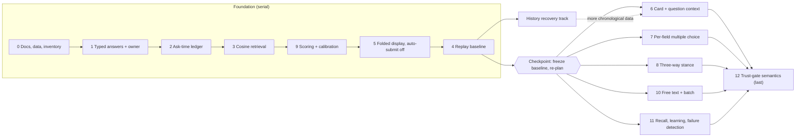

# Online preference learning and prediction: remediation plan (draft)

**What this is.** A plan for repairing the Prediction Engine, the system that forecasts Rick's answer to an action-required notification. It covers all twelve backlog items from the expert's review, plus the history-recovery track. A measurement foundation comes first: phases 0–3, the scoring fix (phase 9, moved up), phase 5's shadow-only enforcement, then the replay baseline (phase 4). A checkpoint then freezes that baseline. After it, each change sits behind its own switch and is measured alone against the frozen baseline, context work first and the trust gate last. Rick ruled all six decisions on 18 Nov in a walkthrough that incorporated his expert's advice on order (section 2). This draft is for the parallel cascade review.

**What it rests on.** Three documents in this folder, and four data files in the main checkout's `io/tmp`:

| Input | What it gives the plan |
|---|---|
| `2026.11.17-online-preference-learning-technical-explainer.md` | The current mechanism and the measured state at `4164f56c5`: saturated retrieval, yes/no 50/59 against always-yes 52/59, no auto-submit in any client |
| `2026.11.18-the-baseline-that-beat-the-model-a-post-script-remediation.md` | The expert's ranked backlog (items 1–12) and the history-recovery steps. This plan's phases follow it |
| `2026.11.18-context-window-findings.md` | The expert's test of six context windows on the 50-target sample. It reorders the context work: the card itself first, then up to three earlier questions chosen by relevance |
| `io/tmp/2026.11.17-recent-predictions-285.json` and `-285-neighbours.json` | Every prediction since 4 Nov, with recomputed neighbours and the ids for a raw-vector replay |
| `io/tmp/2026.11.17-recent-predictions-sample-50.json`, `-sample-50-neighbours.json` and `-sample-50-context.json` | The 50-target stratified sample and its conversation context: 323 earlier records with ask-time answer status |

The `io/tmp` files are swept after 7 days. Phase 0 moves them somewhere durable.

## 1. Principles that hold in every phase

1. **Shadow only.** Lupin forecasts and shows the forecast; it never answers, selects, prefills, submits or votes for Rick. Act levels, Thompson sampling and automatic submission stay outside this plan.
2. **Measure before improving.** No phase that claims better predictions ships without a paired comparison against the baselines in section 4, on data the change has never seen.
3. **Ask-time honesty.** A forecast, a replay or a feature may use only what existed when the card was shown. That rules out the eventual answer, a later status, the final notification state and the target's own stored case.
4. **Keep the raw record.** Every answer is stored as received. Typed labels are derived from it, carry a version, and can be rebuilt.
5. **The usual gates.** Every phase lands through the working-branch gate: the unit tier for the changed files, `src/tests/run-census-guards.sh`, a reviewer's Merge. The 100% line, branch and function coverage mandate applies to all new code. `:8000` suites are scheduled through `/api/v2/submit`. A phase that changes a database schema adds its columns the way `trust_states.decision_history` was added (`44454d072`), with a test of the change.

## 2. Decisions

| # | Decision | State | Ruling or recommendation |
|---|---|---|---|
| 1 | Scope and order of the work | **Ruled by Rick, 18 Nov** (replaces the 17 Nov "serial, numbered order") | The expert's order. Foundation: phases 0, 1, 2, 3, 9 (moved up, so no comparison runs on faulty scores), 5 and 4. Then a **checkpoint** that freezes the baseline and re-plans the rest. After it, each change sits behind its own switch and is measured alone against the frozen baseline, in parallel when seats allow. Priority: 6, 7, 8, 10, 11, with 12 last. The expert's reason: in the pilot, earlier questions surfaced an attributable answer on 37 of 50 targets, yet copying the previous stance cut accuracy from 16/20 to 13/20. Finding evidence and using it are separate results and must be measured separately |
| 2 | What yes/no hints show during remediation | **Ruled by Rick, 18 Nov** | Show them, labelled with their source and the always-yes baseline, but **folded**: every response-required card opens with the hint collapsed, and an accordion inside the card reveals it on click. It applies to every card type and starts collapsed each time. The ledger records whether and when the hint was expanded before the answer, so an answer given with the hint unseen is an unanchored label |
| 3 | The legacy batch prefill and the `expeditor prediction auto submit *` keys | **Ruled by Rick, 18 Nov** | **Disable, keep the code.** Set `expeditor prediction auto submit enabled` to false (it read `true` on 18 Nov) and pin it off with a test. Verify that `_batchPredictedAnswers` applies nothing while it is off. The keys and code stay; the docs are marked dormant |
| 4 | Which model interprets context for live forecasts | **Ruled by Rick, 18 Nov** | **Bounded Claude Code on Haiku** (`ClaudeAgentOptions` `model`, as Deep Research passes it). When a card appears, a background job computes the forecast from ask-time information only and stores it before the fold is opened. Startup is 1–3 s per call, the cost-model doc's planning figure, which was not timed for this plan. Decision 2's fold takes the 2-second budget out of the user's path. A forecast not ready when the fold opens shows "still forecasting", and the ledger records it as not ready |
| 5 | How much of the trust gate (decision proxy) is in scope | **Ruled by Rick, 18 Nov** | Item 12 only, last. It covers the meaning of "success", the separate fields, and documenting the switches; no new acting behaviour |
| 6 | The companion files the uploads link to, and their Mac-local links | **Ruled by Rick, 18 Nov** | Rick re-uploads `sample-50-findings.md`, `compare_context_windows.py` and `notification-history-inventory.sql` to this folder; each gets `authorized_by` frontmatter. `recovered-sample-50.jsonl` (Rick's real answers) stays uncommitted beside the other data files. The links are rewritten to repository paths in a marked edit |

## 3. Phases

Each phase names its goal, its changes, its acceptance tests and what it depends on. Acceptance criteria are the expert's, condensed; the backlog item gives the full text. File and symbol names were checked against `c4072524c` where the explainer had already read them. Reviewers should re-check the rest.

The phases keep the expert's item numbers; the order below is decision 1's.

### The checkpoint

After phase 4, the replay harness reports every baseline in section 4 against the foundation's predictor. That report is frozen, with its sha, cohort and denominators, and it becomes the reference for every later phase. Rick then re-plans phases 6–12 against it, and may drop or shrink a phase where the numbers show little headroom. After the checkpoint:

- Each change sits behind its own INI switch, off by default, and is reported as a paired difference against the **frozen** baseline, never against a baseline another change has already moved.
- Changes may be developed in parallel when seats allow, and serially while the operator has skeleton crew switched on. Either way, each one lands and is measured on its own.
- **Recovered history is held out** (history recovery track). Recovered asks never enter the frozen cohort. They are reported as a separate evaluation set beside it, and the baseline is re-frozen only on Rick's ruling at a later checkpoint.

**Acceptance and coverage conventions for every phase.** Each acceptance check carries `EXECUTOR: AI` (Claude runs it as a test or a scripted query) or `EXECUTOR: HUMAN <reason>`. The coverage assertion for every phase that changes code is the same: 100% line, branch and function coverage on each file the phase changes, measured by `src/tests/run-coverage-gate.sh` (Python) or `c8 --100` (TypeScript), with exit code 0 required. A phase that changes no code says so.
- Priority, from the expert: context and retrieval (6), then multiple-choice write-ins (7), then 8, 10 and 11; 12 has the least effect on the forecasts Rick sees, so it goes last.

### Phase 0. Documents, durable data and the inventory

- Serialise this plan, the two expert documents and the decisions log. This document is that step.
- Move the eight `io/tmp/2026.11.17-recent-predictions-*` files (the 285 set and its neighbours, the sample-50 trio, the starter-12 pair and the with-neighbours JSONL) to a durable, uncommitted location (`io/write-ups/online-preference-learning/`), because they hold Rick's real questions and answers.
- Run the expert's read-only notification inventory (`2026.11.18-notification-history-inventory.sql`, decision 6) against the dev database inside its `READ ONLY` transaction. It answers the question every later phase depends on: how many distinct, answered, attributable asks exist, by type and era.
- **Acceptance**:
  - The eight files exist at the new path with the same sha256 as before the move. `EXECUTOR: AI`.
  - The inventory's output is saved beside them with its run time and database name. `EXECUTOR: AI`.
  - The 3 Nov and 17 Nov audit figures reproduce from the same queries, or each difference is explained by a named cut-off or eligibility rule. `EXECUTOR: AI`.
- **Coverage**: no code changes, so no coverage assertion.

### Phase 1. Preserve the actual answer and its owner (expert item 1)

- **Defect**: the yes/no vote counts any answer not starting with "yes" as "no", so "neither" teaches the wrong stance. The comparator ignores qualifiers. Cases carry no owner, so another account's or a proxy's answer can become Rick's precedent.
- **Change**: a versioned typed label derived from the raw answer: stance (yes / no / neither), qualifier text, per-field selections recorded as "offered option", "offered set" or "unlisted text", and open text. Extend the existing tri-state parser `extract_qualifier_comment` in `cosa.utils.notification_utils`, and read multiple-choice answers both as direct maps and as JSON under `value`, as the expert's decoder did. Add owner, origin and answer source to each case in `prediction_decisions`, by extending `PredictionDecisionRepository.add_decision` and `find_similar` the same way `data_origin` was added, and filter on owner and origin before retrieval.
- **Acceptance**:
  - All three stances round-trip with and without comments; mixed select modes, legal empty sets, write-ins and free text round-trip. `EXECUTOR: AI` (unit tests).
  - A timeout default, a malformed answer, a proxy proposal and another user's answer each add zero personal votes. `EXECUTOR: AI` (unit tests on `find_similar` with the owner filter).
  - Qualifier-only differences appear in the scorecard. `EXECUTOR: AI`.
  - The pilot's nine single-select write-ins across seven cards are named fixtures, captured from the real export through the real parser, not hand-written. `EXECUTOR: AI`.
  - The schema change adds its columns with a migration test, as `44454d072` did. `EXECUTOR: AI`.
- **Coverage**: 100% line, branch and function coverage on every changed file, which includes `notification_utils.py`, `prediction_decision_repository.py` and `vector_store_models.py`; coverage gate exit 0. `EXECUTOR: AI`.
- **Depends on**: phase 0.

### Phase 2. Record the forecast at ask time and attach the outcome later (item 2)

- **Defect**: the forecast lives in an in-memory pending map and is written together with the answer, so a restart loses it. `sender_id` is null on all 4,959 `prediction_log` rows. `predicted_at` trails the answer by milliseconds, so it cannot serve as a forecasting cutoff.
- **Change**: persist an immutable forecast row before the hint is sent, keyed by notification and predictor version. It holds ask and predict times, the build, config, encoder and context versions, owner and sender, evidence ids and scores, the abstention reason, latency and the display decision. Track created → sent → rendered → answered, and attach the answer idempotently.
  - **Where it lives (review question 2, proposed answer)**: new columns on `prediction_log`. `PredictionLogRepository.log_prediction` is called at ask time, before the hint is sent, instead of with the answer, and `update_outcome` attaches the answer and refuses a second write. The sent and answered times come from the notification's own state transitions (`NotificationRepository.update_state` / `update_response`) rather than being copied.
  - **Rendered and fold-opened** (decision 2) are new: the client reports when the card rendered and when the hint fold was first opened, and both times are stored on the forecast row. This is the one genuinely new recording path.
  - **Deployment marker**: every forecast row carries the process provenance block already stamped on DM corpus rows (`dm._process_provenance`: boot id, git sha, writer version), so a cut-over is visible on the rows themselves. No separate marker table.
  - **Reserved for decision 4**: nullable `forecast_ready_at` and `forecast_source` columns, written by the synchronous foundation forecaster now and by phase 6's background job later, so phase 6 needs no schema change.
- **Acceptance**:
  - A restart between ask and answer, a late reply, a duplicate callback, an injected test hint, an embedding outage and a timeout each produce exactly one correct outcome row. `EXECUTOR: AI` (unit tests plus one restart test on `:8000`, scheduled through `/api/v2/submit`).
  - Every eligible ask in a test window reconciles to a forecast row or a named abstention reason. `EXECUTOR: AI` (scripted query).
  - A forecast row's `predicted_at` precedes its notification's `responded_at` on every row written after the cut-over, checked by query. `EXECUTOR: AI`.
  - The fold-open time is written when the fold is opened and stays null when it is not, on the web client. `EXECUTOR: AI` (Playwright, in an e2e half). lupin-mobile gets the same check in its own repository and session.
  - The schema change has a migration test. `EXECUTOR: AI`.
- **Coverage**: 100% line, branch and function coverage on every changed file, which includes `prediction_log_repository.py`, `postgres_models.py`, `prediction_engine.py` and the notification router, plus `c8 --100` on any changed TypeScript; gates exit 0. `EXECUTOR: AI`.
- **Depends on**: phase 1's label and identity contract.

### Phase 3. Repair retrieval ranking, then retune admission (item 3)

- **Defect**: stored vectors have a norm of about 20, and `PredictionDecisionRepository.find_similar` ranks and filters by a dot product clamped to 100%. All 1,412 recomputed neighbour scores in the 285-row set read 100%, and 1,246 have a true cosine below 0.75.
- **Change**: use `vector_search.dot_topk`'s existing cosine mode for preference retrieval only, ordering by cosine before taking the top k. Check the other two consumers of `dot_topk` (`input_and_output_repository`, `solution_snapshot_repository`) and leave them unchanged unless measured. Handle zero, missing and wrong-dimension vectors. Benchmark exact cosine before adding a cosine index. The threshold filter in `dot_topk` runs after the limit, so the order is cosine, then threshold, then top k. Retuning the 0.75 and 0.85 floors and the top k needs the chronological harness, so it moves to phase 4.
- **Acceptance** (stands alone, no replay needed):
  - Scaling a vector by a positive factor changes neither rank nor score; a long, less relevant case loses to a short, closer one; zero, missing and wrong-dimension vectors are refused with a named reason. `EXECUTOR: AI` (unit tests on synthetic vectors).
  - On the 285-row set, by direct recomputation: score histograms, neighbour overlap against the old order (3.77 of 5 today), the empty-result rate at the current floors, and latency. `EXECUTOR: AI`.
- **Coverage**: 100% line, branch and function coverage on `vector_search.py` and `prediction_decision_repository.py`; gate exit 0. `EXECUTOR: AI`.
- **Depends on**: phase 2, so the change is measured by the ledger. The expert allows it to run in parallel with phases 1 and 2 once the contract is agreed. The foundation is serial under decision 1, so overlap is a question for the reviewers (section 6). This is the phase that fixes how similarity is measured (Rick asked on 18 Nov).

### Phase 4. The comparison every later change must beat (item 4)

- **Change**: a chronological replay harness that predicts each ask from ask-time information only, and adds a case to memory only after its human answer exists. It freezes tuning before the final window, groups retry copies, and reports exact repeats, known families with new wording and unseen families separately.
- **Baselines**: section 4.
- **Also here, from phase 3**: retune the 0.75 and 0.85 floors and the top k on chronological development data, separately from the free-text scoring threshold, and freeze them before the final window.
- **Acceptance**:
  - It reproduces the audits' old populations with their definitions, and the yes/no vote replay on the 285-row set (60 of 60 matched on 17 Nov). `EXECUTOR: AI`.
  - The replay, phase 9's admin report and a direct count agree on one cohort. `EXECUTOR: AI`.
  - Every report carries denominators, the baseline, the paired difference, an uncertainty interval and the number of unique families. `EXECUTOR: AI`.
  - The 50-target context export is the first ask-time fixture, and one named leak fixture exists per leak class (section 6, question 5). `EXECUTOR: AI`.
- **Coverage**: 100% line, branch and function coverage on the harness modules; gate exit 0. `EXECUTOR: AI`.
- **Depends on**: phases 1–3, 9 and 5, the rest of the foundation. Its report is the checkpoint's frozen baseline.

### Phase 5. Displayed forecasts never touch the answer controls (item 5)

- **Change**: show a separate forecast on every supported card, including per-field and qualifier forecasts, inside a **collapsed accordion** that opens only on click (decision 2). Distinguish "insufficient evidence", "unavailable" and "below the display threshold". In the foundation the forecast is synchronous (today's engine), so it is always ready when the card renders; the "still forecasting" state arrives with phase 6's background job. Set `expeditor prediction auto submit enabled` to false and pin it off with a test. The keys, the code and `_batchPredictedAnswers` in `notifications.js` stay (decision 3), and the docs are marked dormant. Pass the qualifier to the multiplexer hint renderer. Record in the ledger whether and when the fold was opened before the answer.
- **Acceptance**: on every supported client, a forecast never selects an option, edits a draft, casts a thumb, submits or schedules a submission. With the switch off, the batch view applies no predicted answer. Every card type opens with the hint folded. Server flags, docs, web and mobile agree; lupin-mobile changes are made in its own repository and session.
- **Depends on**: phase 2.

### Phase 6. Reconstruct the decision context and measure each part (item 6, reshaped by the context findings)

- **Finding that reorders it**: in the 50-target sample, the last five notifications exposed an earlier answer on 4 targets, and the last three questions did so on 37. Copying the most recent stance made predictions worse: 13/20 against 16/20 for always-yes.
- **Change**: one versioned ask-time representation used by both live prediction and replay. It is built in this order:
  1. The card itself: message, per-field prompts, option labels and selection mode, title, abstract, and the decision-relevant links in the abstract (does an approval link exist, and what does it point to).
  2. Up to three earlier questions in the same conversation. Each carries its answer as of ask time, or a pending status, plus match evidence: a shared task id, the same field, or a direct follow-up. A pending duplicate ask is evidence of repetition and casts no vote.
  3. Relevant informational updates: human messages and commitments. Repetitive "Done:" tool notices are down-ranked.
  4. The asker's default and timeout, as inputs and as a baseline. A timeout default is never a label.
- **Conversation scope**: explicit thread, then job, then sender session. Task-id matches across Rick's own sessions are allowed, with ask-time masking. Wire `thread_id` and `reply_to` through the response-required writer, because none of the 50 targets has one.
- **Acceptance**: on one chronological split, compare prompt only → plus options → plus title and abstract → plus question history → plus relevant updates → plus default and time budget. Include a collision test: the same wording with two different plans. Keep a layer only where it earns its cost. The four cases in the context findings (`8591a6bf`, `5a0e252a`, `7cb2120f`, `e10ce89c`) become named tests.
- **Model** (decision 4): bounded Claude Code on Haiku interprets the card and its context, as a background job started when the card appears. This phase builds that job. It starts it after the notification row is persisted, writes `forecast_ready_at` and `forecast_source` (reserved in phase 2), and adds the fold's "still forecasting" state. The layer comparison above still decides whether model-read context beats structured features alone; if it does not, the model is dropped.
- **Depends on**: the checkpoint.

### Phase 7. Predict and abstain per multiple-choice field (item 7)

- **Defect**: one unsupported header makes the whole card abstain (79 of 86 multiple-choice questions since the fix). Generic labels such as "Proceed" can be remapped across fields, and the multi-select denominator spans the card.
- **Change**: the current field's schema is the authority. Match stable option ids, then unambiguous normalised labels within an aligned field, and reject ambiguous mappings. Count evidence only where a neighbour could have chosen that option. Return a candidate or a reason per field. Benchmark the explicitly recommended option as well as the first option.
- **Acceptance**: a mixed card returns a scalar for one field and a set for another; reordering fields keeps unambiguous matches; two fields sharing "Proceed" cannot swap; coverage at matched precision is reported outside the "Script Review" family.

### Phase 8. Replace the fixed "no" margin with a tested three-way predictor (item 8)

- **Change**: keep the 1.35 rule as a benchmark. The challenger estimates yes, no and neither probabilities from smoothed ask-time class frequencies and neighbours weighted by cosine, recency and independence. It backs off from family and project priors to Rick's overall prior, and predicts the qualifier separately.
- **Acceptance**: report wins over always-yes, genuine no and neither answers found, and false alarms. If it shows no lift, display the labelled baseline and keep the challenger in shadow.

### Phase 9. Fix the score definitions and calibrate (item 9)

- **Change**: dispatch scoring by field schema, not by whether any answer is a list. Report strict whole-card and partial credit separately. Keep similarity, vote share, self-rating and estimated probability of correctness as separate numbers. Fit a held-out calibration per type and strategy where samples allow. Route `get_accuracy_summary` to an admin surface and divide by scored rows only.
- **Acceptance** (stands alone, no replay needed):
  - Exact band edges 0.4, 0.6, 0.8 and 1.0 are tested. `EXECUTOR: AI`.
  - The admin report and a direct SQL count agree on one cohort. `EXECUTOR: AI`.
  - Zero scorable rows display "insufficient data". `EXECUTOR: AI`.
  - The replay's agreement with these two moves to phase 4's acceptance.
- **Coverage**: 100% line, branch and function coverage on `accuracy_comparators.py`, `prediction_log_repository.py` and the admin route; gate exit 0. `EXECUTOR: AI`.
- **Placement** (decision 1): in the foundation, after phase 3 and before phase 4, so the frozen baseline is computed with corrected scores. Calibration is fitted on the foundation's predictor and refitted per change after the checkpoint.
- **Depends on**: phases 1 and 3.

### Phase 10. Ground free-text and batch forecasts (item 10)

- **Change**: field-level retrieval and typed output for batch, keeping the content-bearing batch key. Distinguish repeat answer, synthesis and fallback, and abstain when a fallback is unsupported. Ground names, numbers and conditions in the current card. Judge paraphrase equivalence with a small blinded rubric.
- **Acceptance**: a true paraphrase and a near-identical contradiction; two unrelated batches with the same count preamble; reordered headers; malformed synthesis; synthesis unavailable. The next organic batch is verified separately, because no batch row has been written since 4 Nov.

### Phase 11. Candidate recall, learning from answers, failure detection (item 11)

- **Change**: compare exact, lexical and cosine candidates, and try category as a ranking signal rather than a hard filter. Fix the substring matching in `NotificationCategoryClassifier`; the whole-word fix landed only in the decision proxy's classifier. Deduplicate retries and stop one template dominating. Learn incrementally in time order. Link thumbs votes to the forecast they judged. Instrument silent failures: missing embeddings, failed writes, swallowed store errors.
- **Acceptance**: a delayed answer reaches the next eligible query after it arrives; reprocessing gives the same case total; tests and hint votes alone cannot create human labels.

### Phase 12. The trust gate's meaning and documentation (item 12, decision 5)

- **Change**: keep policy disposition, human response and shadow forecast as separate fields, and record rule agreement under its own name. A human approving a deployment must not count as a failure. Audit the 43 organic rows of 5 Nov. Enforce or rename `swe team enabled`. Document which components are live, configured but dormant, or unreachable.
- **Out of scope**: act levels, Thompson sampling, automatic submission.

### History recovery track (expert, "Recovering the notification history")

It runs after phase 4, so every recovered example can be replayed. Recovered asks are a **held-out evaluation set**: they never join the checkpoint's frozen cohort, and later phases report against them separately. A re-freeze that folds them in is Rick's call at a later checkpoint. The steps:

1. Count the source population, using the phase 0 inventory.
2. Preserve the originals and derive a versioned data set.
3. Rebuild context in descending order of certainty.
4. Assign each example a use according to its evidence.
5. Recover by response family.
6. Prove the import before expanding it.

The expert's yield funnel is the acceptance test: source rows → distinct eligible asks → usable answers → unambiguous typed labels → reconstructable context → independent families.

## 4. Baselines every phase reports against

| Interaction | Baselines available at ask time | Measures |
|---|---|---|
| Yes / no / neither, with qualifier | Always yes; prior-only majority; last answer to the same prompt; the asker's default | Three-way confusion matrix, per-class precision and recall, macro recall, qualifier fidelity |
| Single-select | First offered option; explicitly recommended option; default; most frequent earlier choice in the family | Exact per field, whole card, coverage, correct fields per 100 eligible |
| Multi-select | Default set; last set for the same options; option frequencies | Exact set, per-option precision and recall, Jaccard, legal empty sets |
| Free text and batch | Earlier answer to the identical grounded question; nearest eligible response; abstention | Blinded intent and constraint agreement; exact and cosine as diagnostics only |

The asker's default matched only 5 of 21 actual stances in the 50-row pilot; thirteen questions defaulted to "no" and got "yes". So the default is a baseline to beat, not a proxy for Rick.

## 5. Risks

| Risk | Mitigation |
|---|---|
| The usable corpus is far smaller than the event count suggests | The phase 0 inventory before any modelling; report families, not rows |
| Fixing retrieval changes every confidence at once, so old thresholds mean nothing | Phase 2's deployment marker, and retune in phase 3 before any display change |
| A visible hint influences the answer it is scored against | The fold (decision 2): hints start hidden, and the ledger records whether the fold was opened before the answer, so unexposed answers form their own evaluation set |
| A bounded Claude Code job per card draws on the fleet's Max plan limit | Card volume is far below the cost model's limit of about 10 calls per second; the ledger records forecast latency and not-ready counts |
| Replay leaks the future through final notification state or linked ids | Phase 4's strict ask-time projection; named leak tests from the context findings |
| Changes after the checkpoint interact, so a gain cannot be attributed | One switch per change, each measured alone against the frozen baseline; combinations are measured only after each part has been |
| lupin-mobile drifts from the web client | Phase 5 changes it in its own repository and session, against the same acceptance list |

## 6. Questions for the cascade review

Each question carries the author's proposed answer, the alternatives and a recommendation. Reviewers rule on the recommendation.

| # | Question | Alternatives | Recommendation (author) |
|---|---|---|---|
| 1 | Should phases 1 and 3 overlap inside the foundation, as the expert allows? | (a) Strict serial. (b) Develop 3 alongside 1 and 2, land after 2. (c) Land 3 first | **(b)**. Phase 3's code touches `vector_search` and `find_similar`, not the label contract, so it can be written in parallel. It lands after phase 2 so the ledger measures the change. Cost: one rebase of `find_similar`, which phase 1 also extends |
| 2 | Is the forecast ledger (phase 2) a new table, or new columns on `prediction_log`? | (a) New `forecast` table. (b) Columns on `prediction_log`, row written at ask time | **(b)**. `log_prediction` and `update_outcome` already split predict and outcome; the defect is *when* they are called, not the shape. A new table would duplicate them (reuse lookup a8b6f06b31411b9d). Risk: the 4,959 historic rows lack the new columns; they stay null and are marked pre-cut-over by the provenance stamp |
| 3 | Where does decision 4's per-card job start, what is its timeout, and what is its measured startup? | (a) Inside the notification writer, as a background task. (b) A CJ-flow queue job. (c) A separate worker | **(a)**, started after the row is persisted, with a 30-second timeout. A queue job would wait behind real work and its forecast would arrive late. Phase 6's first step times 20 cold starts on this host and records the median and the 95th percentile; if the median is over 10 s, Rick rules again on decision 4 |
| 4 | Which evaluation size makes a paired result decisive? | (a) A fixed N. (b) Decisive when the paired difference's 95% interval excludes zero | **(b)**, as the expert advises sizing from disagreements. With 2 disagreements in 59 today, most yes/no changes will not be decisive. They then stay in shadow, and the report says "not decisive", never "no effect" |
| 5 | Do the four named context cases cover the leak risks? | (a) Yes. (b) Add one fixture per leak class | **(b)**. One named fixture each for the four classes in principle 3: eventual answer, later status, final notification state, and the target's own stored case. They are captured from the real export, not hand-written |
| 6 | What does the checkpoint report contain, and what justifies dropping a later phase? | (a) Rick decides with no pre-stated rule. (b) A pre-stated rule | **(b)**. The report holds: per interaction type, every section 4 baseline against the foundation predictor, denominators, paired differences, intervals, unique families, the sha and the cohort ids. Rule: a later phase whose interaction type has fewer than 20 eligible held-out asks is deferred until the data grows. Otherwise Rick rules phase by phase |
