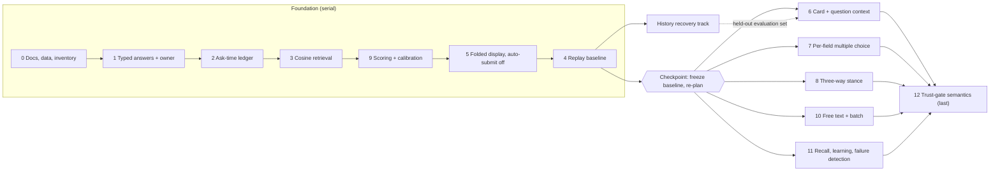

# Online preference learning and prediction: remediation plan (draft)

**What this is.** A plan for repairing the Prediction Engine, the system that forecasts Rick's answer to an action-required notification. It covers all twelve backlog items from the expert's review, plus the history-recovery track. A measurement foundation comes first: phases 0–3, the scoring fix (phase 9, moved up), phase 5's shadow-only enforcement, then the replay baseline (phase 4). A checkpoint then freezes that baseline. After it, each change sits behind its own switch and is measured alone against the frozen baseline, context work first and the trust gate last. Rick ruled all six decisions on 18 Nov in a walkthrough that incorporated his expert's advice on order (section 2). This draft is for the parallel cascade review.

**What it rests on.** Documents in this folder, and data files in the main checkout's `io/tmp` (the table names the five the plan cites; phase 0 moves all eight):

| Input | What it gives the plan |
|---|---|
| `2026.11.17-online-preference-learning-technical-explainer.md` | The current mechanism and the measured state at `4164f56c5`: saturated retrieval, yes/no 50/59 against always-yes 52/59, no auto-submit in any client |
| `2026.11.18-the-baseline-that-beat-the-model-a-post-script-remediation.md` | The expert's ranked backlog (items 1–12) and the history-recovery steps. This plan's phases follow it |
| `2026.11.18-context-window-findings.md` | The expert's test of six context windows on the 50-target sample. It reorders the context work: the card itself first, then up to three earlier questions chosen by relevance |
| `io/tmp/2026.11.17-recent-predictions-285.json` and `-285-neighbours.json` | Every prediction since 4 Nov, with recomputed neighbours and the ids for a raw-vector replay |
| `io/tmp/2026.11.17-recent-predictions-sample-50.json`, `-sample-50-neighbours.json` and `-sample-50-context.json` | The 50-target stratified sample and its conversation context: 323 earlier records with ask-time answer status |

The `io/tmp` files are swept after 7 days. Phase 0 moves them somewhere durable.

## 1. Principles that hold in every phase

1. **Shadow only.** Lupin forecasts and shows the forecast; it never answers, selects, prefills, submits or votes for Rick. Act levels, Thompson sampling and automatic submission stay outside this plan.
2. **Measure before improving.** No phase that claims better predictions ships without a paired comparison against the baselines in section 4, on data the change has never seen.
3. **Ask-time honesty.** A forecast, a replay or a feature may use only what existed when the card was shown. That rules out the eventual answer, a later status, the final notification state and the target's own stored case.
4. **Keep the raw record.** Every answer is stored as received. Typed labels are derived from it, carry a version, and can be rebuilt.
5. **The usual gates.** Every phase lands through the working-branch gate: the unit tier for the changed files, `src/tests/run-census-guards.sh`, a reviewer's Merge. The 100% line, branch and function coverage mandate applies to all new code. `:8000` suites are scheduled through `/api/v2/submit`. A phase that changes a database schema adds its columns the way `trust_states.decision_history` was added (`44454d072`), with a test of the change.

## 2. Decisions

| # | Decision | State | Ruling or recommendation |
|---|---|---|---|
| 1 | Scope and order of the work | **Ruled by Rick, 18 Nov** (replaces the 17 Nov "serial, numbered order") | The expert's order. Foundation: phases 0, 1, 2, 3, 9 (moved up, so no comparison runs on faulty scores), 5 and 4. Then a **checkpoint** that freezes the baseline and re-plans the rest. After it, each change sits behind its own switch and is measured alone against the frozen baseline, in parallel when seats allow. Priority: 6, 7, 8, 10, 11, with 12 last. The expert's reason: in the pilot, earlier questions surfaced an attributable answer on 37 of 50 targets, yet copying the previous stance cut accuracy from 16/20 to 13/20. Finding evidence and using it are separate results and must be measured separately |
| 2 | What yes/no hints show during remediation | **Ruled by Rick, 18 Nov** | Show them, labelled with their source and the always-yes baseline, but **folded**: every response-required card opens with the hint collapsed, and an accordion inside the card reveals it on click. It applies to every card type and starts collapsed each time. The ledger records whether and when the hint was expanded before the answer, so an answer given with the hint unseen is an unanchored label |
| 3 | The legacy batch prefill and the `expeditor prediction auto submit *` keys | **Ruled by Rick, 18 Nov** | **Disable, keep the code.** Set `expeditor prediction auto submit enabled` to false (it read `true` on 18 Nov) and pin it off with a test. Verify that `_batchPredictedAnswers` applies nothing while it is off. The keys and code stay; the docs are marked dormant |
| 4 | Which model interprets context for live forecasts | **Ruled by Rick, 18 Nov** | **Bounded Claude Code on Haiku** (`ClaudeAgentOptions` `model`, as Deep Research passes it). When a card appears, a background job computes the forecast from ask-time information only and stores it before the fold is opened. Startup is 1–3 s per call, the cost-model doc's planning figure, which was not timed for this plan. Decision 2's fold takes the 2-second budget out of the user's path. A forecast not ready when the fold opens shows "still forecasting", and the ledger records it as not ready |
| 5 | How much of the trust gate (decision proxy) is in scope | **Ruled by Rick, 18 Nov** | Item 12 only, last. It covers the meaning of "success", the separate fields, and documenting the switches; no new acting behaviour |
| 6 | The companion files the uploads link to, and their Mac-local links | **Ruled by Rick, 18 Nov** | Rick re-uploads `sample-50-findings.md`, `compare_context_windows.py` and `notification-history-inventory.sql` to this folder; each gets `authorized_by` frontmatter. `recovered-sample-50.jsonl` (Rick's real answers) stays uncommitted beside the other data files. The links are rewritten to repository paths in a marked edit |

## 3. Phases

Each phase names its goal, its changes, its acceptance tests and what it depends on. Acceptance criteria are the expert's, condensed; the backlog item gives the full text. File and symbol names were checked against `c4072524c` where the explainer had already read them. Reviewers should re-check the rest.

The phases keep the expert's item numbers; the order below is decision 1's.

### The checkpoint

After phase 4, the replay harness reports every baseline in section 4 against the foundation's predictor. That report is frozen, with its sha, cohort and denominators, and it becomes the reference for every later phase. Rick then re-plans phases 6–12 against it, and may drop or shrink a phase where the numbers show little headroom. After the checkpoint:

- Each change sits behind its own INI switch, off by default, and is reported as a paired difference against the **frozen** baseline, never against a baseline another change has already moved.
- Changes may be developed in parallel when seats allow, and serially while the operator has skeleton crew switched on. Either way, each one lands and is measured on its own.
- **Recovered history is held out** (history recovery track). Recovered asks never enter the frozen cohort. They are reported as a separate evaluation set beside it, and the baseline is re-frozen only on Rick's ruling at a later checkpoint.
- Priority, from the expert: context and retrieval (6), then multiple-choice write-ins (7), then 8, 10 and 11; 12 has the least effect on the forecasts Rick sees, so it goes last.

**Acceptance and coverage conventions for every phase.** Each acceptance check carries `EXECUTOR: AI` (Claude runs it as a test or a scripted query) or `EXECUTOR: HUMAN <reason>`. The coverage assertion for every phase that changes code is the same **per-file check**, and it is a command that can fail:

- **Python**: run the unit and cosa tiers with `LUPIN_COVERAGE=1` and an isolated `COVERAGE_FILE`, as `src/tests/run-coverage-gate.sh` documents, then `COVERAGE_FILE=<that file> python -m coverage report --include=<the phase's changed files> --fail-under=100 --show-missing`. Branch measurement is already on (`[tool.coverage.run] branch = true` in `pyproject.toml`), so the 100% covers lines and branches. Coverage.py has no function metric; a function whose body never ran shows as missing lines, so 100% lines covers functions. Exit 0 required.
- **TypeScript**: `c8 --100` on the changed files, exit 0 required.
- `run-coverage-gate.sh` alone is **not** this check. It enforces one global floor (`fail_under = 97` in `pyproject.toml`) and can exit 0 while a changed file sits far below 100%. It still runs, as the working-branch gate requires.
- A phase that changes no code says so.

Each phase's **Coverage** line below lists its changed files, which are the `--include` list.

### Phase 0. Documents, durable data and the inventory

- Serialise this plan, the two expert documents and the decisions log. This document is that step.
- Move the eight `io/tmp/2026.11.17-recent-predictions-*` files (the 285 set and its neighbours, the sample-50 trio, the starter-12 pair and the with-neighbours JSONL) to a durable, uncommitted location (`io/write-ups/online-preference-learning/`), because they hold Rick's real questions and answers.
- Run the expert's read-only notification inventory (`2026.11.18-notification-history-inventory.sql`, decision 6) against the dev database inside its `READ ONLY` transaction. It answers the question every later phase depends on: how many distinct, answered, attributable asks exist, by type and era.
  - **Route**: `docker exec -i lupin-postgres psql -X -v ON_ERROR_STOP=1 -U lupin_dev -d lupin_db_dev -v recipient_id=<recipient UUID> < 2026.11.18-notification-history-inventory.sql` (container, role and database as `src/scripts/run-postgresql-dev.sh` names them). The recipient UUID is the account that `notifications.recipient_id` names most often, looked up at run time and recorded with the output; it is not written into this plan.
  - Its `duplicate_log_ids` column is the count phase 2's unique-constraint migration needs (phase 2, "Depends on").
- **The SQL file itself**: Rick uploaded it on 18 Nov (decision 6) and it sits in this folder, staged. Committing it waits on Rick's ruling on a one-time `RND_GUARD_ALLOW=1` override, because the folder's guard refuses a `.sql` file. The inventory can run from the staged copy; only the commit waits.
- **Acceptance**:
  - Before the move, the sha256 of each of the eight files is written to a manifest (`sha256sum … > manifest-before.txt`) beside the source. After the move, `sha256sum -c` against that manifest passes at the new path. `EXECUTOR: AI`.
  - The inventory's output is saved beside them with its run time, database, role and recipient UUID. `EXECUTOR: AI`.
  - The 3 Nov and 17 Nov audit figures, which are in the technical explainer's Appendix A (not in the inventory SQL), reproduce from the same queries, or each difference is explained by a named cut-off or eligibility rule. `EXECUTOR: AI`.
  - The SQL file and the two other companion files are committed. `EXECUTOR: HUMAN` (Rick rules on the rnd-guard override; Claude commits once he has).
- **Coverage**: no code changes, so no coverage assertion.

### Phase 1. Preserve the actual answer and its owner (expert item 1)

- **Defect**: the yes/no vote counts any answer not starting with "yes" as "no", so "neither" teaches the wrong stance. The comparator ignores qualifiers. Cases carry no owner, so another account's or a proxy's answer can become Rick's precedent.
- **Change**: a versioned typed label derived from the raw answer: stance (yes / no / neither), qualifier text, per-field selections recorded as "offered option", "offered set" or "unlisted text", and open text.
  - **One stance parser, and the copies deleted.** The defect is in the call sites that bypass the parser, not in the parser. The vote tests `startswith( "yes" )` in `PredictionEngine` (two places), and so do `accuracy_comparators._extract_binary` and `_extract_qualifier`; `podcast_proxy.answer_word` holds a fourth copy of the split. All of them are routed through `extract_qualifier_comment` in `cosa.utils.notification_utils`, and the copies are deleted. The parser is tightened so an unrecognised string returns no stance, rather than the whole lowercased string.
  - **Per-field selections in a sibling function** in the same module, which calls the stance parser for yes/no fields and never overloads it. It decodes multiple-choice answers both as direct maps and as JSON under `value`. It wraps, and then replaces, the decoding in `PredictionEngine._parse_mc_decision_value` and the `value`-key handling in `accuracy_comparators`, so there is one decoder.
  - **Owner and answer source are new; origin is the existing `data_origin`.** `prediction_decisions` gains `owner_user_id` and `answer_source` (human, proxy, timeout default, test). `PredictionDecisionRepository.add_decision` writes them and `find_similar` filters on them, the same way `data_origin` was added. Proxy answers keep their `data_origin` (organic or synthetic) and are told apart by `answer_source = proxy`, so no new `data_origin` value is minted. Only `answer_source = human` with the recipient as owner casts a personal vote.
  - **Backfill of the 1,528 existing cases** (all organic). The migration joins each `prediction_decisions` row to its notification (`prediction_decisions.id = notifications.id::text`, the inventory's own join) and derives: `owner_user_id` from `response_value.answered_by.user_id`; `answer_source = timeout default` when `response_value.source` is `timeout_default`, `proxy` when the case row's `ratification_state` is one the decision proxy writes (`pending`, `autonomous` or `shadow`; the engine's own path writes `not_required`). A proxy row the user later ratified carries a later state such as `rejected`, so the migration first prints the count per `ratification_state`, and any state it cannot place in either group goes to `unknown`; `human` when `answered_by.user_id` is set and neither applies. A row it cannot classify (no matching notification, no `answered_by`) is **kept** and marked `answer_source = unknown`: it can still be retrieved as a neighbour, but it casts no personal vote. The migration prints the count per derived value, and the phase 0 inventory predicts those counts. `answered_by.method` is not used: it records the auth method (`jwt` or `api_key`) and cannot name the proxy.
  - **The schema path**: there is one alembic chain. `prediction_decisions` is registered on the shared `Base.metadata`, the vector tables were created by revision `d0e1f2a3b4c5`, and `auto_migrate.py` runs `alembic upgrade head`. So phase 1 adds an alembic revision. Because `d0e1f2a3b4c5` builds tables from the **current** models, a fresh database already has the new columns, so the revision checks for each column before adding it (`sa.inspect(...).get_columns`), as `c3d4e5f6a7b8` does.
- **Acceptance**:
  - All three stances round-trip with and without comments; mixed select modes, legal empty sets, write-ins and free text round-trip. `EXECUTOR: AI` (unit tests).
  - A timeout default, a malformed answer, a proxy proposal, another user's answer and an `unknown` backfilled row each add zero personal votes. `EXECUTOR: AI` (unit tests on `find_similar` with the owner filter).
  - A qualifier-only difference is scored as the right stance with a qualifier mismatch, reported in the comparator's `detail` separately from stance errors. `EXECUTOR: AI` (unit test on the comparator).
  - **Fixtures, within decision 6.** Committed fixtures are synthetic: hand-built to the export's shape, including the pilot's write-in pattern (nine single-select write-ins across seven cards). The real-data check is a **local-only tier**: a test that reads Rick's uncommitted export through the real parser when the file is present, and when it is absent skips with a named reason that the run's summary prints. A silent skip fails the tier. Committing anything derived from Rick's answers, even de-identified, would be his decision and is not planned. `EXECUTOR: AI`.
  - A grep census finds no `startswith( "yes" )` stance test left in the prediction engine, the comparators or the podcast proxy, and a "neither" answer reaches the vote as "neither". `EXECUTOR: AI` (unit test plus a census guard named `test_every_stance_split_goes_through_the_parser`).
  - The two other callers of the tightened parser keep their behaviour: `lupin_mcp/cosa_voice_mcp.py` (logs the answer it returns) and `runtime_argument_expeditor/expeditor.py` (reads only the qualifier). Their existing tests pass, and one new test each covers an unrecognised string. `EXECUTOR: AI`.
  - The alembic revision has a migration test: it applies on a database without the columns and on one that already has them, and the backfill counts match the inventory's. `EXECUTOR: AI`.
- **Coverage**: the per-file check on `notification_utils.py`, `prediction_engine.py`, `accuracy_comparators.py`, `podcast_proxy.py`, `prediction_decision_repository.py`, `vector_store_models.py` and the new alembic revision. `EXECUTOR: AI`.
- **Depends on**: phase 0.

### Phase 2. Record the forecast at ask time and attach the outcome later (item 2)

- **Defect**: the forecast lives in an in-memory pending map and is written together with the answer, so a restart loses it. `sender_id` is null on all 4,959 `prediction_log` rows. `predicted_at` trails the answer by milliseconds, so it cannot serve as a forecasting cutoff.
- **Change**: persist an immutable forecast row before the hint is sent: **exactly one row per notification**, with the predictor version as a column, enforced by a unique constraint on `prediction_log.notification_id`. `get_by_notification_id` therefore returns the one row, `update_outcome` attaches to it, and the replay (phase 4) computes its own forecasts offline rather than writing extra rows. The row holds ask and predict times, the build, config, encoder and context versions, owner and sender, evidence ids and scores, the abstention reason, latency and the display decision. Track created → sent → rendered → answered, and attach the answer idempotently.
  - **Where it lives (review question 2, proposed answer)**: new columns on `prediction_log`. `PredictionLogRepository.log_prediction` is called at ask time, before the hint is sent, instead of with the answer, and `update_outcome` attaches the answer and refuses a second write. The sent and answered times come from the notification's own state transitions (`NotificationRepository.update_state` / `update_response`) rather than being copied.
  - **The outcome is attached from the persisted row, not from memory.** Today the response handler records an outcome only when the notification id is still in the in-memory `pending_responses` map and that entry carries a `prediction_result` (`routers/notifications.py`, the outcome hook in the response route), and `PredictionEngine.record_outcome` needs that in-memory `PredictionResult`. It also calls `_store_decision`, which writes the answer case. After a restart the map is empty, so both the outcome and the case are skipped. Phase 2 changes this: the hook looks the forecast row up with `PredictionLogRepository.get_by_notification_id`, and `record_outcome` rebuilds what it needs from that row (strategy, evidence ids, scores, and the original message, which today sits in `metadata["original_message"]`). The row therefore stores the strategy, the original message and, for an open-ended batch, `batch_question_key` (which `_store_decision` needs), as well as the fields listed above. `pending_responses` stays for what it does today and is no longer read for outcomes.
  - **Every ask writes a row, including the paths that write nothing today.** The ask-time hook catches predictor errors as non-fatal and writes nothing, and a `prediction_hint_override` (the testing/debug bypass) skips prediction entirely. After phase 2, a predictor error writes a row with the abstention reason `predictor_error: <exception class>`, and an override writes a row with `forecast_source = test_override`, which accuracy reports exclude. `prediction_log`'s NOT NULL columns get stated filler values on those rows: `prediction_strategy` = `error` or `test_override`, `prediction_confidence` = 0, `similar_case_count` = 0, and `category` from the notification's classifier, or `unknown` if that failed too. Only `predicted_value` stays null.
  - **Rendered and fold-opened** (decision 2): phase 2 adds the columns and the route that stores them; the client calls land in phase 5 with the fold. The route is a sibling of the existing hint-vote route `POST /notify/prediction-vote/{notification_id}` (`vote_on_prediction_hint`), for example `POST /notify/prediction-seen/{notification_id}`, not a new route family. It stores the first rendered time and the first fold-open time and ignores later calls. This is the one genuinely new recording path, and phase 2 owns it. Until phase 5 lands, rows carry null rendered and fold-open times.
  - **Deployment marker**: every forecast row carries the code identity from the shared module `cosa.rest.code_identity` (`get_code_identity()`: git sha, branch, import time and pid, frozen at import and already served at `/api/code-identity`), so a cut-over is visible on the rows themselves. No separate marker table, and the dm router's private copy is left to its owner.
  - **Reserved for decision 4**: nullable `forecast_ready_at` and `forecast_source` columns, written by the synchronous foundation forecaster now and by phase 6's background job later, so phase 6 needs no schema change.
- **Acceptance**:
  - A restart between ask and answer, a late reply, a duplicate callback, an injected test hint, an embedding outage and a timeout each produce exactly one correct outcome row, and the restart case also writes its answer case. `EXECUTOR: AI`. **How the restart is simulated**: no server is bounced. A unit test asks, then clears `pending_responses` and builds a fresh `PredictionEngine`, which is exactly the state a restart loses, then answers, and asserts one outcome row and one case. An integration test does the same against the real database and runs in the scheduled integration tier on `:8000`.
  - Every eligible ask in a test window reconciles to a forecast row or a named abstention reason. An **eligible ask** is a response-required notification to the recipient, sent without `prediction_hint_override`; the **test window** is the time range the scripted query takes as arguments and prints with its result. `EXECUTOR: AI` (scripted query).
  - A forecast row's `predicted_at` precedes its notification's `responded_at` on every row written after the cut-over, checked by query. `EXECUTOR: AI`.
  - The seen route stores the first rendered time and the first fold-open time, ignores a second call, and leaves the fold-open time null when it is never called. `EXECUTOR: AI` (route tests through the app's test client). The browser test that opening the fold calls this route is phase 5's.
  - A second forecast write for the same notification is refused by the unique constraint, and a second outcome write is refused by `update_outcome`. `EXECUTOR: AI`.
  - Before the constraint is added, the migration counts existing duplicate `notification_id` values in `prediction_log`. If any exist, it refuses to apply and lists them, and removing duplicates becomes a separate step that Rick rules on. It never deletes rows on its own. `EXECUTOR: AI`.
  - The schema change has an alembic migration in `src/migrations/versions/` with a migration test, as `5efa1547bd37` has, and checks for each column before adding it, as phase 1's does. `EXECUTOR: AI`.
- **Coverage**: the per-file check on `prediction_log_repository.py`, `postgres_models.py`, `prediction_engine.py`, `routers/notifications.py` and the new alembic revision. Phase 2 changes no TypeScript. `EXECUTOR: AI`.
- **Depends on**: phase 1's label and identity contract, and phase 0's `duplicate_log_ids` count, which tells the migration in advance whether it will refuse.

### Phase 3. Repair retrieval ranking (item 3)

- **Defect**: stored vectors have a norm of about 20, and `PredictionDecisionRepository.find_similar` ranks and filters by a dot product clamped to 100%. All 1,412 recomputed neighbour scores in the 285-row set read 100%, and 1,246 have a true cosine below 0.75.
- **Change**: use `vector_search.dot_topk`'s existing cosine mode (`metric="cosine"`) as it is, **for preference retrieval only**. `dot_topk` orders by cosine, takes the top k, and then applies the threshold.
  - **The path has two hops, and both gain the parameter.** The engine's three call sites call `ProxyDecisionEmbeddings.find_similar` (the store `_get_embedding_store` returns), and that wrapper calls `PredictionDecisionRepository.find_similar`. The decision proxy builds the same wrapper. So the wrapper and the repository both gain an opt-in `metric` parameter, **default `"dot"`**, and the wrapper forwards it. The engine's three call sites pass `"cosine"`; the proxy's calls are untouched (decision 5 keeps the proxy out of scope until phase 12).
  - **A live switch keeps the forecasts usable until phase 4 retunes.** At today's 0.75 floor, about 88% of today's neighbours (1,246 of 1,412) fall below it once scores are true cosines, so most forecasts would abstain until the floors are retuned. The engine therefore reads a new INI key, `prediction engine retrieval metric`, default `dot`, and passes its value at the three call sites. Phase 3 lands the code with the key at `dot`; phase 4 sets it to `cosine` in the same commit that freezes the retuned floors and top k. This keeps Rick's order (3, 9, 5, 4) and needs no reordering.
  - **The guard, and how its reason travels.** On the cosine path only, the repository checks the query vector with `embedding_regeneration.validate_fresh_vector` (missing, wrong-dimension, non-finite, zero-norm, and the retired unit-norm model), and raises a typed `QueryVectorRefused( reason )` when it fails. Today the wrapper catches every exception and returns an empty list, and the engine catches again and only prints in debug, so a reason would never reach anyone. The wrapper therefore re-raises `QueryVectorRefused` before its catch-all, and the engine catches it by type and writes `query_vector_refused: <reason>` as the forecast row's abstention reason (phase 2). The dot path never raises it, so the proxy sees no new exception.
  - **Stored vectors are guarded too.** `question_embedding` is nullable, and `dot_topk` converts every returned distance to a float, so a stored NULL or zero vector in the top k would raise inside the same catch-all and silently empty the retrieval. On the cosine path the query excludes rows whose `question_embedding` is NULL or has zero norm (`vector_norm( question_embedding ) > 0`), and the phase reports how many rows that excludes today.
  - The existing HNSW index on `prediction_decisions` is a dot index, so cosine ordering will not use it; exact cosine is benchmarked before any cosine index is added.
  - No new cosine function: three already exist (`PredictionEngine._cosine_similarity`, `repair_attempt_tracker.cosine_similarity`, `SolutionSnapshotRepository._cosine_topk`), and consolidating them is out of scope. The other two consumers of `dot_topk` (`input_and_output_repository`, `solution_snapshot_repository`) are left unchanged. Retuning the 0.75 and 0.85 floors and the top k needs the chronological harness, so it is phase 4's.
- **Acceptance** (stands alone, no replay needed):
  - Scaling a vector by a positive factor changes neither rank nor score; a long, less relevant case loses to a short, closer one. `EXECUTOR: AI` (unit tests on synthetic vectors).
  - A zero, missing or wrong-dimension query vector on the cosine path raises `QueryVectorRefused` with a named reason, the wrapper lets it through, and the engine writes that reason as the abstention reason. A stored NULL row and a stored zero-norm row are planted and never returned. `EXECUTOR: AI` (unit tests).
  - **The proxy's path is unchanged, against values captured before the change.** Before any phase 3 code is written, a capture script runs the current `ProxyDecisionEmbeddings.find_similar` with its default arguments on a fixed synthetic fixture, and commits the compiled SQL statement it emits and the neighbours and scores it returns, naming the base sha. After the change, the test calls the wrapper with its defaults and asserts both equal the committed golden values. `EXECUTOR: AI` (unit test, golden file committed first).
  - With the INI key at `dot`, the engine's three call sites pass `"dot"`; at `cosine`, they pass `"cosine"`. A test fails if the committed INI value is not `dot` before phase 4. `EXECUTOR: AI`.
  - **Report-only**: on the 285-row set, by direct recomputation, score histograms, neighbour overlap against the old order (3.77 of 5 today), the empty-result rate at the current floors, the expected abstention rate between phases 3 and 4 if the key were flipped early, and latency. These are figures with no pass threshold; they are saved beside the phase 0 data as `phase3-retrieval-report.md` with the sha and run time, and phase 4 uses them to retune. `EXECUTOR: AI`.
- **Coverage**: the per-file check on `prediction_decision_repository.py`, `proxy_decision_embeddings.py` and `prediction_engine.py` (the three call sites and the INI read); `vector_search.py` and `embedding_regeneration.py` are reused unchanged. `EXECUTOR: AI`.
- **Depends on**: phase 2, for the abstention-reason column. Section 6, question 1 recommends writing it alongside phases 1 and 2 and landing it after phase 2; its acceptance does not use the ledger, so landing after phase 2 is a landing-order preference, not a test dependency. This is the phase that fixes how similarity is measured (Rick asked on 18 Nov).

### Phase 4. The comparison every later change must beat (item 4)

- **Change**: a chronological replay harness that predicts each ask from ask-time information only, and adds a case to memory only after its human answer exists. It freezes tuning before the final window, groups retry copies, and reports exact repeats, known families with new wording and unseen families separately.
  - **New**: the time-ordered replay loop itself. Case memory grows only as answers arrive; there are tune and final windows; retry copies are grouped and families split out. The existing paired harness in `cosa/research/phi4_flash_lite_study/replay_harness.py` replays a frozen list of bodies through one function per arm and keeps no case memory that grows over time, so the loop cannot be borrowed.
  - **Reused unchanged from that study**: `statistics.compare_arms` (McNemar exact plus a Wilson interval, with a discordant floor stated before the run) for every paired verdict; `replay_harness.pair_records` to pair the predictor's and each baseline's records on frozen index and snapshot sha; and `freeze_corpus.sha256_of_rows` for the frozen cohort's checksum. If a second study imports them, reviewers may prefer lifting `statistics.py` to a shared `cosa/research/` module; that move is mechanical and is not planned here.
  - **Where it lives**: an offline tool under `cosa/research/`, beside the phi4 study. It reads the phase 0 data and the phase 2 ledger and never writes to either.
- **Baselines**: section 4. The checkpoint report is a new, small renderer of section 4's table. The phi4 study's `report.per_arm_table` reports one outcome's counts per arm, with no baselines and no families, so it does not fit.
- **Also here, from phase 3**: retune the 0.75 and 0.85 floors and the top k on chronological development data, using phase 3's saved retrieval report, separately from the free-text scoring threshold, and freeze them before the final window. The commit that freezes them also sets `prediction engine retrieval metric` to `cosine`.
- **Also here, from phase 9**: the first calibration fit, on the tune window, evaluated on the final window, written to `src/conf/prediction-calibration.json` with the cohort sha. `prediction engine calibration enabled` stays false until a post-checkpoint change turns it on.
- **Acceptance**:
  - It reproduces the audits' old populations with their definitions, and the yes/no vote replay on the 285-row set (60 of 60 matched on 17 Nov). `EXECUTOR: AI`.
  - The replay, phase 9's admin report and a direct count agree on one cohort. `EXECUTOR: AI`.
  - The retuned floors and top k are frozen: one commit records their values, the INI key at `cosine`, and the sha of the tune-window cohort they were chosen on, and the checkpoint report cites that commit. A test asserts the committed INI values equal the ones the report names. `EXECUTOR: AI`.
  - Every report carries denominators, the baseline, the paired difference, `compare_arms`'s McNemar result and Wilson interval, the pre-stated discordant floor, and the number of unique families. `EXECUTOR: AI`.
  - A forecast for ask *t* never sees a case whose answer arrived after *t*: a named test plants a late answer and asserts it is absent from *t*'s neighbours. `EXECUTOR: AI`.
  - The frozen cohort's `sha256_of_rows` is recorded in the checkpoint report and re-derived from the file on disk. `EXECUTOR: AI`.
  - One named leak fixture exists per leak class (section 6, question 5), committed and synthetic. The 50-target context export is the first real ask-time check, in the local-only tier phase 1 defines (decision 6 keeps it uncommitted), and its skip is reported by name when the file is absent. `EXECUTOR: AI`.
- **Coverage**: the per-file check on the harness modules. `EXECUTOR: AI`.
- **Depends on**: phases 1–3, 9 and 5, the rest of the foundation. Its report is the checkpoint's frozen baseline.

### Phase 5. Displayed forecasts never touch the answer controls (item 5)

- **Change**: show a separate forecast on every supported card, including per-field and qualifier forecasts, inside a **collapsed accordion** that opens only on click (decision 2). Distinguish "insufficient evidence", "unavailable" and "below the display threshold". In the foundation the forecast is synchronous (today's engine), so it is always ready when the card renders; the "still forecasting" state arrives with phase 6's background job.
  - **Where the fold goes**: the two existing hint builders are extended rather than a new component written. `actionRequiredChrome.predictionHintBox` is the multiplexer TypeScript builder, and `NotificationsUI.buildPredictionHintSection` the legacy builder in `notifications.js`. Each wraps its hint box in a disclosure that starts closed on every card, every time, with no persisted state, so `ViewStateStore`'s accordion memory is deliberately not used. The vote controls stay inside the fold.
  - **Rendered and first open**: each web client calls phase 2's seen route (for example `/notify/prediction-seen/{notification_id}`) when the card renders and when the fold first opens. Phase 2 owns the route and its storage; phase 5 owns the client calls and their browser tests. The qualifier forecast is passed to `predictionHintBox` (expert item 5).
  - **Decision 3**: set `expeditor prediction auto submit enabled` to false and pin it off with a test. The keys, the code and `_batchPredictedAnswers` in `notifications.js` stay, and the docs (the splainer rows and the expeditor guide) are marked dormant.
  - **Reaching the browser**: the multiplexer TypeScript is rebuilt with `npm run build`, and the legacy `notifications.js` gets its `?v=` token bumped. Without both, the browser runs the old code.
- **Acceptance**:
  - On both web clients, a forecast never selects an option, edits a draft, casts a thumb, submits or schedules a submission, with the fold open or closed. `EXECUTOR: AI` (Playwright, one test per client, in an e2e half).
  - Every card type (yes/no, multiple choice, open text, batch) opens with the hint folded, and opening it calls the seen route once. `EXECUTOR: AI` (Playwright).
  - With the switch off, the batch view applies no predicted answer, and a unit test fails if the INI value is flipped to true. `EXECUTOR: AI`.
  - The built bundle and the `?v=` token both changed in the same commit as the source, checked by the bundle-span stamp. `EXECUTOR: AI`.
  - Opening the fold stores the fold-open time on the forecast row, and a card whose fold is never opened keeps it null. `EXECUTOR: AI` (Playwright, one test per web client, in an e2e half).
  - **lupin-mobile is outside this plan's executors and its coverage mandate** (the mandate excludes the sub-repo). When phase 5 lands, a store row is filed for the lupin-mobile session carrying this acceptance list. This plan's pass criterion is that row filed, with its id recorded here; its completion is reported, not gated. `EXECUTOR: AI` (filing the row).
- **Coverage**: `c8 --100` on `actionRequiredChrome.ts`, `NotificationsListRenderer.ts` and any other changed TypeScript; the per-file check on the INI pin test's Python; legacy `notifications.js` is covered by the Playwright checks above, which is the existing convention for that file. `EXECUTOR: AI`.
- **Depends on**: phase 2 (the seen route and the ledger columns).

### Phase 6. Reconstruct the decision context and measure each part (item 6, reshaped by the context findings)

- **Finding that reorders it**: in the 50-target sample, the last five notifications exposed an earlier answer on 4 targets, and the last three questions did so on 37. Copying the most recent stance made predictions worse: 13/20 against 16/20 for always-yes.
- **Change**: one versioned ask-time representation used by both live prediction and replay. It is built in this order:
  1. The card itself: message, per-field prompts, option labels and selection mode, title, abstract, and the decision-relevant links in the abstract (does an approval link exist, and what does it point to).
  2. Up to three earlier questions in the same conversation. Each carries its answer as of ask time, or a pending status, plus match evidence: a shared task id, the same field, or a direct follow-up. A pending duplicate ask is evidence of repetition and casts no vote.
  3. Relevant informational updates: human messages and commitments. Repetitive "Done:" tool notices are down-ranked.
  4. The asker's default and timeout, as inputs and as a baseline. A timeout default is never a label.
- **Conversation scope**: explicit thread, then job, then sender session. Task-id matches across Rick's own sessions are allowed, with ask-time masking. Wire `thread_id` and `reply_to` through the response-required writer, because none of the 50 targets has one.
- **Acceptance**: on one chronological split, compare prompt only → plus options → plus title and abstract → plus question history → plus relevant updates → plus default and time budget. Include a collision test: the same wording with two different plans. Keep a layer only where it earns its cost. The four cases in the context findings (`8591a6bf`, `5a0e252a`, `7cb2120f`, `e10ce89c`) become named tests.
- **Model** (decision 4): bounded Claude Code on Haiku interprets the card and its context, as a background job started when the card appears. This phase builds that job. It starts it after the notification row is persisted, writes `forecast_ready_at` and `forecast_source` (reserved in phase 2), and adds the fold's "still forecasting" state. The layer comparison above still decides whether model-read context beats structured features alone; if it does not, the model is dropped.
- **Depends on**: the checkpoint.

### Phase 7. Predict and abstain per multiple-choice field (item 7)

- **Defect**: one unsupported header makes the whole card abstain (79 of 86 multiple-choice questions since the fix). Generic labels such as "Proceed" can be remapped across fields, and the multi-select denominator spans the card.
- **Change**: the current field's schema is the authority. Match stable option ids, then unambiguous normalised labels within an aligned field, and reject ambiguous mappings. Count evidence only where a neighbour could have chosen that option. Return a candidate or a reason per field. Benchmark the explicitly recommended option as well as the first option.
- **Acceptance**: a mixed card returns a scalar for one field and a set for another; reordering fields keeps unambiguous matches; two fields sharing "Proceed" cannot swap; coverage at matched precision is reported outside the "Script Review" family.

### Phase 8. Replace the fixed "no" margin with a tested three-way predictor (item 8)

- **Change**: keep the 1.35 rule as a benchmark. The challenger estimates yes, no and neither probabilities from smoothed ask-time class frequencies and neighbours weighted by cosine, recency and independence. It backs off from family and project priors to Rick's overall prior, and predicts the qualifier separately.
- **Acceptance**: report wins over always-yes, genuine no and neither answers found, and false alarms. If it shows no lift, display the labelled baseline and keep the challenger in shadow.

### Phase 9. Fix the score definitions and calibrate (item 9)

- **Change**:
  - **Dispatch scoring by field schema**, not by whether any answer is a list. Today `accuracy_comparators.get_comparator` picks multi-select by scanning the answer for list values, and each `compare_*` function loops over every header of the card and returns one bool with `matches` and `total`, so neither can score a card that mixes a single-select and a multi-select field. Phase 9 extracts the loop body into a new **per-field scorer**, `score_field( field_schema, predicted, actual )`, which scores one header by the mode its schema names and reads stances and selections through phase 1's parser and its sibling (`_extract_binary` and `_extract_qualifier` are deleted in phase 1). The `compare_*` functions become loops over `score_field` and keep their signatures for their existing tests. `get_comparator`'s answer-scanning dispatch is replaced by the schema.
  - **The schema comes from the notification's stored `response_options`** (its `questions` list gives each field's header, options and `multi_select`). The response handler already loads the notification row before the outcome hook, so it passes `response_options` to `record_outcome`, which passes them on.
  - **Strict and partial credit each have a home.** `accuracy_match` stays one bool and means strict whole-card: every field exact. Partial credit is `accuracy_detail["matches"]` / `["total"]`, which exists today, and `accuracy_detail["fields"]` adds one entry per header with its own result.
  - **One order for `record_outcome`**: phase 2 rewrites it to rebuild from the forecast row; phase 9 then adds the `response_options` argument to that rewritten function. Phase 1's parser change to `accuracy_comparators.py` also lands before phase 9's edit of the same file.
  - Keep similarity, vote share, self-rating and estimated probability of correctness as separate numbers.
  - **Calibration code** (fitted in phase 4, not here). A thin module keys an isotonic fit by response type and strategy, using scikit-learn, already a core dependency: `sklearn.calibration.calibration_curve` for the binned reliability report and `IsotonicRegression` for the confidence → probability-of-correct map. The alternatives were read and do not fit: `ConformalDecisionWrapper.calibrate` gives a coverage threshold for set prediction, the BLR's `calibration_pairs` is a data log, and `lupin_mcp.reuse_stage2_fit.reliability` reads only the reuse study's row keys and has no minimum count.
    - **Minimum count**: 50 scored rows per type-and-strategy cell. Below it the module refuses to fit and reports "insufficient data" for that cell.
    - **Held-out split**: the fit uses phase 4's tune window and is evaluated on its final window, both chronological. Phase 9 ships the code and its unit tests; the first real fit is a phase 4 step, because the chronological harness is phase 4's.
    - **Storage and reader**: the fitted maps are written to `src/conf/prediction-calibration.json` (thresholds per cell, the cohort sha and the fit time), committed. The engine reads them only when a new INI key, `prediction engine calibration enabled`, is true; it is false in the foundation. While it is false, the display gate (`prediction engine confidence threshold`, 0.60) reads raw confidence; once true, it reads calibrated confidence, and that switch is measured like any other change after the checkpoint.
  - Extend `PredictionLogRepository.get_accuracy_summary` to divide by scored rows (`accuracy_match` not null) instead of answered rows (`actual_value` not null), to exclude `forecast_source = test_override` rows, and to return "insufficient data" at zero. Expose it through a **new route in `routers/system.py`**, `GET /api/prediction-engine/accuracy`, beside `/api/prediction-engine/reset`. It takes `require_admin`, not the reset route's `require_api_key_or_jwt`, because it reports across users.
- **Acceptance** (stands alone, no replay needed):
  - Exact band edges 0.4, 0.6, 0.8 and 1.0 are tested. `EXECUTOR: AI`.
  - **One cohort, named**: a committed fixture of 12 synthetic `prediction_log` rows (mixed types, three unscored, one `test_override`) is loaded into the test database; the route's numbers equal a direct SQL count over the same rows, and both equal the literal counts written in the test. `EXECUTOR: AI` (integration test, scheduled integration tier).
  - The route itself: an admin gets the summary, a non-admin key gets 403, zero scorable rows return "insufficient data". `EXECUTOR: AI` (route tests through the app's test client).
  - A card with one single-select field and one multi-select field is scored per field by schema, with the answer's shape ignored; on a half-right card `accuracy_match` is false and `matches` / `total` is 1 / 2. `EXECUTOR: AI` (unit tests on `score_field` and `record_outcome`).
  - The calibration refuses to fit below 50 rows in a cell. On deterministic synthetic data, 1,000 rows per bin with exactly the bin's correctness rate (no random draws), it recovers each bin's rate within 0.02. `EXECUTOR: AI` (unit tests).
  - With `prediction engine calibration enabled` false, the display gate reads raw confidence, and a test fails if the committed value is true before the checkpoint. `EXECUTOR: AI`.
  - The replay's agreement with these checks is phase 4's acceptance.
- **Coverage**: the per-file check on `accuracy_comparators.py`, `prediction_log_repository.py`, `prediction_engine.py`, the new calibration module and `routers/system.py`. `EXECUTOR: AI`.
- **Placement** (decision 1): in the foundation, after phase 3 and before phase 4, so the frozen baseline is computed with corrected scores. Calibration is fitted in phase 4 on the foundation's predictor and refitted per change after the checkpoint.
- **Depends on**: phases 1, 2 (the rewritten `record_outcome`) and 3.

### Phase 10. Ground free-text and batch forecasts (item 10)

- **Change**: field-level retrieval and typed output for batch, keeping the content-bearing batch key. Distinguish repeat answer, synthesis and fallback, and abstain when a fallback is unsupported. Ground names, numbers and conditions in the current card. Judge paraphrase equivalence with a small blinded rubric.
- **Acceptance**: a true paraphrase and a near-identical contradiction; two unrelated batches with the same count preamble; reordered headers; malformed synthesis; synthesis unavailable. The next organic batch is verified separately, because no batch row has been written since 4 Nov.

### Phase 11. Candidate recall, learning from answers, failure detection (item 11)

- **Change**: compare exact, lexical and cosine candidates, and try category as a ranking signal rather than a hard filter. Fix the substring matching in `NotificationCategoryClassifier`; the whole-word fix landed only in the decision proxy's classifier. Deduplicate retries and stop one template dominating. Learn incrementally in time order. Link thumbs votes to the forecast they judged. Instrument silent failures: missing embeddings, failed writes, swallowed store errors.
- **Acceptance**: a delayed answer reaches the next eligible query after it arrives; reprocessing gives the same case total; tests and hint votes alone cannot create human labels.

### Phase 12. The trust gate's meaning and documentation (item 12, decision 5)

- **Change**: keep policy disposition, human response and shadow forecast as separate fields, and record rule agreement under its own name. A human approving a deployment must not count as a failure. Audit the 43 organic rows of 5 Nov. Enforce or rename `swe team enabled`. Document which components are live, configured but dormant, or unreachable.
- **Out of scope**: act levels, Thompson sampling, automatic submission.

### History recovery track (expert, "Recovering the notification history")

It runs after phase 4, so every recovered example can be replayed. Recovered asks are a **held-out evaluation set**: they never join the checkpoint's frozen cohort, and later phases report against them separately. A re-freeze that folds them in is Rick's call at a later checkpoint. The steps:

1. Count the source population, using the phase 0 inventory.
2. Preserve the originals and derive a versioned data set.
3. Rebuild context in descending order of certainty.
4. Assign each example a use according to its evidence.
5. Recover by response family.
6. Prove the import before expanding it.

The expert's yield funnel is the acceptance test: source rows → distinct eligible asks → usable answers → unambiguous typed labels → reconstructable context → independent families.

## 4. Baselines every phase reports against

| Interaction | Baselines available at ask time | Measures |
|---|---|---|
| Yes / no / neither, with qualifier | Always yes; prior-only majority; last answer to the same prompt; the asker's default | Three-way confusion matrix, per-class precision and recall, macro recall, qualifier fidelity |
| Single-select | First offered option; explicitly recommended option; default; most frequent earlier choice in the family | Exact per field, whole card, coverage, correct fields per 100 eligible |
| Multi-select | Default set; last set for the same options; option frequencies | Exact set, per-option precision and recall, Jaccard, legal empty sets |
| Free text and batch | Earlier answer to the identical grounded question; nearest eligible response; abstention | Blinded intent and constraint agreement; exact and cosine as diagnostics only |

The asker's default matched only 5 of 21 actual stances in the 50-row pilot; thirteen questions defaulted to "no" and got "yes". So the default is a baseline to beat, not a proxy for Rick.

The recommended option is a named baseline because the pilot measured it: a unique "(Recommended)" label sat first on 31 of 32 single-select fields and matched Rick's choice on 20. The first option matched on 21 of 32. The two coincide on most cards, so the replay reports them separately only on the cards where they differ, as the expert asks (sample-50 findings, finding 2). Written answers stay in every denominator.

## 5. Risks

| Risk | Mitigation |
|---|---|
| The usable corpus is far smaller than the event count suggests | The phase 0 inventory before any modelling; report families, not rows |
| Fixing retrieval changes every confidence at once, so old thresholds mean nothing | Phase 3 lands cosine behind `prediction engine retrieval metric = dot`; phase 4 flips it in the same commit that freezes the retuned floors. Phase 2's code identity marks the cut-over on the rows |
| A visible hint influences the answer it is scored against | The fold (decision 2): hints start hidden, and the ledger records whether the fold was opened before the answer, so unexposed answers form their own evaluation set |
| A bounded Claude Code job per card draws on the fleet's Max plan limit | Card volume is far below the cost model's limit of about 10 calls per second; the ledger records forecast latency and not-ready counts |
| Replay leaks the future through final notification state or linked ids | Phase 4's strict ask-time projection; named leak tests from the context findings |
| Changes after the checkpoint interact, so a gain cannot be attributed | One switch per change, each measured alone against the frozen baseline; combinations are measured only after each part has been |
| lupin-mobile drifts from the web client | Phase 5 files a store row for the lupin-mobile session with the same acceptance list; that repository's own session makes and tests the change |

## 6. Questions for the cascade review

Each question carries the author's proposed answer, the alternatives and a recommendation. Reviewers rule on the recommendation.

| # | Question | Alternatives | Recommendation (author) |
|---|---|---|---|
| 1 | Should phases 1 and 3 overlap inside the foundation, as the expert allows? | (a) Strict serial. (b) Develop 3 alongside 1 and 2, land after 2. (c) Land 3 first | **(b)**. Phase 3's code touches `vector_search` and `find_similar`, not the label contract, so it can be written in parallel. It lands after phase 2 so the ledger measures the change. Cost: one rebase of `find_similar`, which phase 1 also extends |
| 2 | Is the forecast ledger (phase 2) a new table, or new columns on `prediction_log`? | (a) New `forecast` table. (b) Columns on `prediction_log`, row written at ask time | **(b)**. `log_prediction` and `update_outcome` already split predict and outcome; the defect is *when* they are called, not the shape. A new table would duplicate them (reuse lookup a8b6f06b31411b9d). Risk: the 4,959 historic rows lack the new columns; they stay null and are marked pre-cut-over by the provenance stamp |
| 3 | Where does decision 4's per-card job start, what is its timeout, and what is its measured startup? | (a) Inside the notification writer, as a background task. (b) A CJ-flow queue job. (c) A separate worker | **(a)**, started after the row is persisted, with a 30-second timeout. A queue job would wait behind real work and its forecast would arrive late. Phase 6's first step times 20 cold starts on this host and records the median and the 95th percentile; if the median is over 10 s, Rick rules again on decision 4 |
| 4 | Which evaluation size makes a paired result decisive? | (a) A fixed N. (b) Decisive by a paired test on the disagreements | **(b)**, as the expert advises sizing from disagreements. The test is the existing `compare_arms` (McNemar exact plus a Wilson interval on the disagreeing pairs), with the discordant floor stated before the run. Below the floor it refuses to give a verdict. With 2 disagreements in 59 today, most yes/no changes will not reach the floor. They then stay in shadow, and the report says "not decisive", never "no effect" |
| 5 | Do the four named context cases cover the leak risks? | (a) Yes. (b) Add one fixture per leak class | **(b)**. One named fixture each for the four classes in principle 3: eventual answer, later status, final notification state, and the target's own stored case. Within decision 6: the committed fixtures are synthetic, and each class also gets a check against the real export in the local-only tier (phase 1), whose skip is reported by name |
| 6 | What does the checkpoint report contain, and what justifies dropping a later phase? | (a) Rick decides with no pre-stated rule. (b) A pre-stated rule | **(b)**. The report holds: per interaction type, every section 4 baseline against the foundation predictor, denominators, paired differences, intervals, unique families, the sha and the cohort ids. Rule: a later phase whose interaction type has fewer than 20 eligible held-out asks is deferred until the data grows. Otherwise Rick rules phase by phase |
