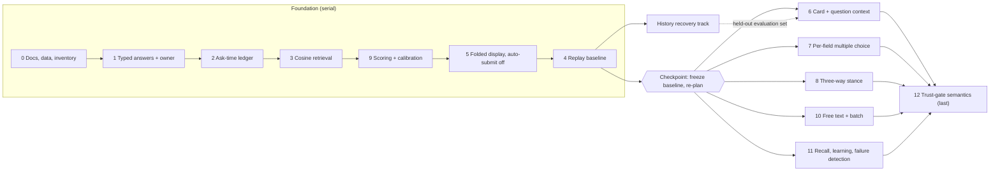

# Online preference learning and prediction: remediation plan

**What this is.** A plan for repairing the Prediction Engine, the system that forecasts Rick's answer to an action-required notification. It covers all twelve backlog items from the expert's review, plus the history-recovery track. A measurement foundation comes first: phases 0–3, the scoring fix (phase 9, moved up), phase 5's shadow-only enforcement, then the replay baseline (phase 4). A checkpoint then freezes that baseline. After it, each change sits behind its own switch and is measured alone against the frozen baseline, context work first and the trust gate last. Rick ruled all six decisions on 18 Nov in a walkthrough that incorporated his expert's advice on order (section 2). The parallel cascade review closed all four sections on 18 Nov; its handoff is `2026.11.18-cascade-revision-handoff.md` in this folder.

**What it rests on.** Documents in this folder, and data files in the main checkout's `io/tmp` (the table names the five the plan cites; phase 0 moves all eight):

| Input | What it gives the plan |
|---|---|
| `2026.11.17-online-preference-learning-technical-explainer.md` | The current mechanism and the measured state at `4164f56c5`: saturated retrieval, yes/no 50/59 against always-yes 52/59, no auto-submit in any client |
| `2026.11.18-the-baseline-that-beat-the-model-a-post-script-remediation.md` | The expert's ranked backlog (items 1–12) and the history-recovery steps. This plan's phases follow it |
| `2026.11.18-context-window-findings.md` | The expert's test of six context windows on the 50-target sample. It reorders the context work: the card itself first, then up to three earlier questions chosen by relevance |
| `io/tmp/2026.11.17-recent-predictions-285.json` and `-285-neighbours.json` | Every prediction since 4 Nov, with recomputed neighbours and the ids for a raw-vector replay |
| `io/tmp/2026.11.17-recent-predictions-sample-50.json`, `-sample-50-neighbours.json` and `-sample-50-context.json` | The 50-target stratified sample and its conversation context: 323 earlier records with ask-time answer status |

The `io/tmp` files are swept after 7 days. Phase 0 moves them somewhere durable.

## 1. Principles that hold in every phase

1. **Shadow only.** Lupin forecasts and shows the forecast; it never answers, selects, prefills, submits or votes for Rick. Act levels, Thompson sampling and automatic submission stay outside this plan.
2. **Measure before improving.** No phase that claims better predictions ships without a paired comparison against the baselines in section 4, on data the change has never seen.
3. **Ask-time honesty.** A forecast, a replay or a feature may use only what existed when the card was shown. That rules out the eventual answer, a later status, the final notification state and the target's own stored case.
4. **Keep the raw record.** Every answer is stored as received. Typed labels are derived from it, carry a version, and can be rebuilt.
5. **The usual gates.** Every phase lands through the working-branch gate: the unit tier for the changed files, `src/tests/run-census-guards.sh`, a reviewer's Merge. The 100% line, branch and function coverage mandate applies to all new code. `:8000` suites are scheduled through `/api/v2/submit`. A phase that changes a database schema adds its columns the way `trust_states.decision_history` was added (`44454d072`), with a test of the change.

## 2. Decisions

| # | Decision | State | Ruling or recommendation |
|---|---|---|---|
| 1 | Scope and order of the work | **Ruled by Rick, 18 Nov** (replaces the 17 Nov "serial, numbered order") | The expert's order. Foundation: phases 0, 1, 2, 3, 9 (moved up, so no comparison runs on faulty scores), 5 and 4. Then a **checkpoint** that freezes the baseline and re-plans the rest. After it, each change sits behind its own switch and is measured alone against the frozen baseline, in parallel when seats allow. Priority: 6, 7, 8, 10, 11, with 12 last. The expert's reason: in the pilot, earlier questions surfaced an attributable answer on 37 of 50 targets, yet copying the previous stance cut accuracy from 16/20 to 13/20. Finding evidence and using it are separate results and must be measured separately |
| 2 | What yes/no hints show during remediation | **Ruled by Rick, 18 Nov** | Show them, labelled with their source and the always-yes baseline, but **folded**: every response-required card opens with the hint collapsed, and an accordion inside the card reveals it on click. It applies to every card type and starts collapsed each time. The ledger records whether and when the hint was expanded before the answer, so an answer given with the hint unseen is an unanchored label |
| 3 | The legacy batch prefill and the `expeditor prediction auto submit *` keys | **Ruled by Rick, 18 Nov** | **Disable, keep the code.** Set `expeditor prediction auto submit enabled` to false (it read `true` on 18 Nov) and pin it off with a test. Verify that `_batchPredictedAnswers` applies nothing while it is off. The keys and code stay; the docs are marked dormant |
| 4 | Which model interprets context for live forecasts | **Ruled by Rick, 18 Nov** | **Bounded Claude Code on Haiku** (`ClaudeAgentOptions` `model`, as Deep Research passes it). When a card appears, a background job computes the forecast from ask-time information only and stores it before the fold is opened. (Phase 6 makes the call through `model_transport.complete`, the repository's hermetic door for a bounded call; same model and route.) Startup is 1–3 s per call, the cost-model doc's planning figure, which was not timed for this plan. Decision 2's fold takes the 2-second budget out of the user's path. A forecast not ready when the fold opens shows "still forecasting", and the ledger records it as not ready |
| 5 | How much of the trust gate (decision proxy) is in scope | **Ruled by Rick, 18 Nov** | Item 12 only, last. It covers the meaning of "success", the separate fields, and documenting the switches; no new acting behaviour |
| 6 | The companion files the uploads link to, and their Mac-local links | **Ruled by Rick, 18 Nov** | Rick re-uploads `sample-50-findings.md`, `compare_context_windows.py` and `notification-history-inventory.sql` to this folder; each gets `authorized_by` frontmatter. `recovered-sample-50.jsonl` (Rick's real answers) stays uncommitted beside the other data files. The links are rewritten to repository paths in a marked edit |

## 3. Phases

Each phase names its goal, its changes, its acceptance tests and what it depends on. Acceptance criteria are the expert's, condensed; the backlog item gives the full text. File and symbol names were checked against `c4072524c` where the explainer had already read them. Reviewers should re-check the rest.

The phases keep the expert's item numbers; the order below is decision 1's.



### The checkpoint

After phase 4, the replay harness reports every baseline in section 4 against the foundation's predictor. That report is frozen, with its sha, cohort and denominators, and it becomes the reference for every later phase. Rick then re-plans phases 6–12 against it, and may drop or shrink a phase where the numbers show little headroom. After the checkpoint:

- Each change sits behind its own INI switch, off by default, and is reported as a paired difference against the **frozen** baseline, never against a baseline another change has already moved.
- Changes may be developed in parallel when seats allow, and serially while the operator has skeleton crew switched on. Either way, each one lands and is measured on its own.
- **Recovered history is held out** (history recovery track). Recovered asks never enter the frozen cohort. They are reported as a separate evaluation set beside it, and the baseline is re-frozen only on Rick's ruling at a later checkpoint.
- Priority, from the expert: context and retrieval (6), then multiple-choice write-ins (7), then 8, 10 and 11; 12 has the least effect on the forecasts Rick sees, so it goes last.
- **The freeze is enforced, not remembered.** The checkpoint writes `checkpoint.json` beside the frozen report: the report's sha, the cohort's `sha256_of_rows` and the commit that froze the settings. The harness refuses to produce a post-checkpoint report, exiting non-zero with the mismatch named, when the baseline arm's `snapshot_sha256` differs from the one in `checkpoint.json`. A test plants a mismatched sha and asserts the refusal. `EXECUTOR: AI`.
- **Who does what at the checkpoint**: computing the report and applying the 20-ask deferral rule (section 6, question 6) is `EXECUTOR: AI`; dropping or shrinking a phase is `EXECUTOR: HUMAN` (Rick, a designer's decision). The checkpoint does not wait for the lupin-mobile row filed in phase 5.

**Acceptance and coverage conventions for every phase.** Each acceptance check carries `EXECUTOR: AI` (Claude runs it as a test or a scripted query) or `EXECUTOR: HUMAN <reason>`. The coverage assertion for every phase that changes code is the same **per-file check**, and it is a command that can fail:

- **Python**: run the unit and cosa tiers with `LUPIN_COVERAGE=1` and an isolated `COVERAGE_FILE`, as `src/tests/run-coverage-gate.sh` documents, then `COVERAGE_FILE=<that file> python -m coverage report --include=<the phase's changed files> --fail-under=100 --show-missing`. Branch measurement is already on (`[tool.coverage.run] branch = true` in `pyproject.toml`), so the 100% covers lines and branches. Coverage.py has no function metric; a function whose body never ran shows as missing lines, so 100% lines covers functions. Exit 0 required.
- **TypeScript**: `c8 --100` on the changed files, exit 0 required.
- `run-coverage-gate.sh` alone is **not** this check. It enforces one global floor (`fail_under = 97` in `pyproject.toml`) and can exit 0 while a changed file sits far below 100%. It still runs, as the working-branch gate requires.
- A phase that changes no code says so.

Each phase's **Coverage** line below lists its changed files, which are the `--include` list. The check is whole-file by design, because the repository's mandate is 100% on all Lupin code, not only on new lines. Some changed files are large and older (`prediction_engine.py`, `routers/notifications.py`, `postgres_models.py`), and their current figure is not measured here. So each phase's first step runs the check on its files before changing them and records the figure, which sizes the work; the phase then closes any gap on those files, because the check must exit 0 for the phase to land.

### Phase 0. Documents, durable data and the inventory

- Serialise this plan, the two expert documents and the decisions log. This document is that step.
- Move the eight `io/tmp/2026.11.17-recent-predictions-*` files (the 285 set and its neighbours, the sample-50 trio, the starter-12 pair and the with-neighbours JSONL) to a durable, uncommitted location (`io/write-ups/online-preference-learning/`), because they hold Rick's real questions and answers.
- Run the expert's read-only notification inventory (`2026.11.18-notification-history-inventory.sql`, decision 6) against the dev database inside its `READ ONLY` transaction. It answers the question every later phase depends on: how many distinct, answered, attributable asks exist, by type and era.
  - **Route**: `docker exec -i lupin-postgres psql -X -v ON_ERROR_STOP=1 -U lupin_dev -d lupin_db_dev -v recipient_id=<recipient UUID> < 2026.11.18-notification-history-inventory.sql` (container, role and database as `src/scripts/run-postgresql-dev.sh` names them). The recipient UUID is the account that `notifications.recipient_id` names most often, looked up at run time and recorded with the output; it is not written into this plan.
  - Its `duplicate_log_ids` column is the count phase 2's unique-constraint migration needs (phase 2, "Depends on").
- **The SQL file itself**: Rick uploaded it on 18 Nov (decision 6) and it sits in this folder, staged. Committing it waits on Rick's ruling on a one-time `RND_GUARD_ALLOW=1` override, because the folder's guard refuses a `.sql` file. The inventory can run from the staged copy; only the commit waits.
- **Acceptance**:
  - Before the move, the sha256 of each of the eight files is written to a manifest (`sha256sum … > manifest-before.txt`) beside the source. After the move, `sha256sum -c` against that manifest passes at the new path. `EXECUTOR: AI`.
  - The inventory's output is saved beside them with its run time, database, role and recipient UUID. `EXECUTOR: AI`.
  - The 3 Nov and 17 Nov audit figures, which are in the technical explainer's Appendix A (not in the inventory SQL), reproduce from the same queries, or each difference is explained by a named cut-off or eligibility rule. `EXECUTOR: AI`.
  - The SQL file and the two other companion files are committed. `EXECUTOR: HUMAN` (Rick rules on the rnd-guard override; Claude commits once he has).
- **The old engine's yes/no replay, recorded once.** At the plan's base sha (`c4072524c`), the implementing seat re-runs the yes/no vote replay on the 285-row set through the engine as it stands, in a detached worktree, fed from the 285-neighbours file (ask-time neighbour lists) rather than today's `prediction_decisions`, so a mismatch means engine drift and not memory leakage, and saves the per-ask outcomes and the totals beside the phase 0 data with the sha and run time. The 17 Nov "60 of 60" figure has no source in this folder, so this run is its source from now on; if it does not reproduce 60 of 60, the difference is recorded and the old figure is retired. Phase 4 checks against this artifact. `EXECUTOR: AI` (main checkout data; local-only).
- **Coverage**: no code changes, so no coverage assertion.

### Phase 1. Preserve the actual answer and its owner (expert item 1)

- **Defect**: the yes/no vote counts any answer not starting with "yes" as "no", so "neither" teaches the wrong stance. The comparator ignores qualifiers. Cases carry no owner, so another account's or a proxy's answer can become Rick's precedent.
- **Change**: a versioned typed label derived from the raw answer: stance (yes / no / neither), qualifier text, per-field selections recorded as "offered option", "offered set" or "unlisted text", and open text.
  - **One stance parser, and the copies deleted.** The defect is in the call sites that bypass the parser, not in the parser. The vote tests `startswith( "yes" )` in `PredictionEngine` (two places), and so do `accuracy_comparators._extract_binary` and `_extract_qualifier`; `podcast_proxy.answer_word` holds a fourth copy of the split. All of them are routed through `extract_qualifier_comment` in `cosa.utils.notification_utils`, and the copies are deleted. The parser is tightened so an unrecognised string returns no stance, rather than the whole lowercased string. **Measured before tightening (Chloé F2, run 18 Nov):** the parser matches with `DOTALL`, so a comment may span lines, and an unterminated comment (`yes [comment: text`) still gives its stance and text, as the comparator's copy did. The parser was run over every stored yes/no answer in `lupin_db_dev` (593 case values, 1,956 answered notifications). Four answers are unrecognised in each, all long free text, none starting "yes", so the old vote counted all four as "no" and the tightening loses no yes vote. A `local_data` test pins that. The shapes `Yes.`, `yes, but later`, `yes [comment: x] extra`, `not now`, `none` and `nope` are pinned as no-stance by synthetic tests. The engine gives a case with no recognised stance no vote, and `podcast_proxy.answer_word` reads the same parser.
  - **Per-field selections in a sibling function**, `parse_field_selections` in `cosa/utils/notification_utils.py`, beside the stance parser and never overloading it. It reads an answers map, as a JSON string or a dict, into one record per header: mode (single or multi), the picks, the text as submitted, and the stance when a string is one. An empty list and a blank string are legal empty sets, and a value that is not an answers map gives None. **It is not one decoder for everything, and the earlier sentence saying so is withdrawn.** It is the per-field reader for new code, which the learner in later phases calls. These stay, because each has a different job: `PredictionEngine._parse_mc_decision_value` and `_parse_batch_decision_value` return the raw answers dict that the comparators and the stored case values use; `option_sentinels._answer_values` checks a submitted answer against the labels a card offered and reports a malformed answer as itself; `cosa_voice_mcp._parse_multiple_choice_response` is the client side, pinned against the server by `test_both_clients_answers_read_back_the_same`; and the comparators keep their `answers` handling, which they apply to the dict the engine gives them. Nothing is replaced in this step. `test_every_mc_decoder_agrees_on_one_stored_value` gives one stored value to all five readers and asserts the same headers and picks, on the synthetic export and, in the `local_data` tier, on the 140 real multiple-choice answers and their stored neighbours. It found one real difference, now pinned by name: six real values hold their answers as JSON under `value`; the sibling reads inside that wrapper and the other four read none. A later phase that moves a caller onto the new function names that caller and brings its own test.
  - **Owner and answer source are new; origin is the existing `data_origin`.** `prediction_decisions` gains `owner_user_id` and `answer_source` (human, proxy, timeout default, test, **hint vote**, unknown). `PredictionDecisionRepository.add_decision` writes them and `find_similar` filters on them, the same way `data_origin` was added. Proxy answers keep their `data_origin` (organic or synthetic) and are told apart by `answer_source = proxy`, so no new `data_origin` value is minted. Only `answer_source = human` with the recipient as owner casts a personal vote. **The write path has more callers than first listed (Chloé F5).** `add_decision` is called from `PredictionEngine._store_decision`, from `record_hint_vote`, from `decision_proxy/responder.py` (default owner none, source `proxy`) and from `scripts/seed_proxy_decisions.py` (owner none, source `proxy`), and through the wrapper `ProxyDecisionEmbeddings.add_decision` and `find_similar`, which swallow exceptions and carry fixed keyword arguments. So the wrapper gains the two parameters, and its `_record_to_dict` field list gains the two columns. A caller that says nothing stores source `unknown`, which casts no personal vote. `record_outcome` gains `answered_by`, which the response route passes from the `answered_by` it already builds, and `_store_decision` writes `answered_by.user_id` as the owner with source `human`. The ask-time hook passes the recipient (`target_system_id`) into `predict`, and every retrieval filters on `answer_source = human` and that owner. With no recipient named, the filter fails closed: the engine gets no personal cases rather than everyone's. Filtering out `hint_vote` rows means thumbs-up and thumbs-down steering no longer reaches retrieval (4 rows today, all rejected). The checkpoint re-plan decides how that feedback should return.
  - **Backfill of every existing case** (all organic; the migration prints the count it ran on, which was 1,558 on 18 Nov, against 1,528 in the explainer and 1,556 in the phase 0 reproduction). The migration joins each `prediction_decisions` row to its notification (`prediction_decisions.id = notifications.id::text`, the inventory's own join) and derives: `owner_user_id` from `response_value.answered_by.user_id`; `answer_source = timeout default` when `response_value.source` is `timeout_default`, `proxy` when the case row's `ratification_state` is one the decision proxy writes (`pending`, `autonomous` or `shadow`; the engine's own path writes `not_required`). A proxy row the user later ratified carries a later state such as `rejected`, so the migration first prints the count per `ratification_state`, and any state it cannot place in either group goes to `unknown`; `human` when `answered_by.user_id` is set and neither applies. A row it cannot classify (no matching notification, no `answered_by`) is **kept** and marked `answer_source = unknown`: it can still be retrieved as a neighbour, but it casts no personal vote. The migration prints the count per derived value, and the phase 0 inventory predicts those counts. `answered_by.method` is not used: it records the auth method (`jwt` or `api_key`) and cannot name the proxy. **Hint-vote cases (Chloé F1).** `record_hint_vote` stores a case with the id `hintvote-<notification id>` and a `decision_value` built from the forecast, not from the user's answer. The join above never matches that id, so the migration tells these rows apart by the id prefix and gives them `answer_source = hint_vote`, with no owner. They cast no personal vote. Measured on 18 Nov: 4 such rows, all `rejected`. The measured counts on the same day, before the migration: 1,554 other rows, all `not_required`; 1,551 have a notification that names the answering account (predicted `human`), and 3 have no matching notification (predicted `unknown`).
  - **The schema path**: there is one alembic chain. `prediction_decisions` is registered on the shared `Base.metadata`, the vector tables were created by revision `d0e1f2a3b4c5`, and `auto_migrate.py` runs `alembic upgrade head`. So phase 1 adds an alembic revision. Because `d0e1f2a3b4c5` builds tables from the **current** models, a fresh database already has the new columns, so the revision checks for each column before adding it (`sa.inspect(...).get_columns`), as `c3d4e5f6a7b8` does.
- **Acceptance**:
  - All three stances round-trip with and without comments; mixed select modes, legal empty sets, write-ins and free text round-trip. `EXECUTOR: AI` (unit tests).
  - A timeout default, a malformed answer, a proxy proposal, another user's answer and an `unknown` backfilled row each add zero personal votes. `EXECUTOR: AI` (unit tests on `find_similar` with the owner filter).
  - A qualifier-only difference is scored as the right stance with a qualifier mismatch, reported in the comparator's `detail` separately from stance errors. `EXECUTOR: AI` (unit test on the comparator).
  - **Fixtures, within decision 6.** Committed fixtures are synthetic: hand-built to the export's shape, including the pilot's write-in pattern (nine single-select write-ins across seven cards). The real-data check is a **local-only tier**, and it has a mechanism. Its tests carry a new marker, `local_data`, registered in `pytest.ini` (the suite runs `--strict-markers`). A conftest hook prints every skipped `local_data` test and its reason in the terminal summary, and a run with `--require-local-data` fails on any `local_data` skip. Rick's data lives under the main checkout's gitignored `io/`, so in a worktree gate the tier always skips, visibly. The real-data run happens in the **main checkout**, by the seat implementing the phase, once per phase that names it, with `--require-local-data`; its summary line and the data file's sha are recorded on the phase's store row. Committing anything derived from Rick's answers, even de-identified, would be his decision and is not planned. `EXECUTOR: AI`.
  - A census guard named `test_every_stance_split_goes_through_the_parser` finds no `startswith` of a stance word and no split on the comment marker in the prediction engine, the comparators or the podcast proxy, and a "neither" answer reaches the vote as "neither". Two detectors, because `podcast_proxy.answer_word` split on `COMMENT_MARKER` and a `startswith` search cannot see that. The guard names the files outside its scope (`expeditor.py`, `task_promotion_gate.py`, `agent_notification_dispatcher.py`, the test-fix expediter orchestrator, `self_respin_core.py`, `crud_for_dataframes/agent.py`, `lupin_mcp/podcast_for_rick.py`) so its denominator is stated. `EXECUTOR: AI` (unit tests plus the guard).
  - The four other callers of the tightened parser keep their behaviour, and each gets one test on an unrecognised string: `lupin_mcp/cosa_voice_mcp.py` (logs the answer it returns), `runtime_argument_expeditor/expeditor.py` (reads only the qualifier), `lupin_cli/claude_code/hooks/stop.py` (acts only on "yes" and "no") and `hooks/lib/anything_else_ask.py` (maps anything else to a timeout). `cosa/tests/unit/utils/test_notification_utils.py` pinned the old fallback (`"  Maybe later  "` gave `"maybe later"`) and is rewritten by design, so "their existing tests pass" holds for the four callers, not for that one. `EXECUTOR: AI`.
  - The alembic revision has a migration test: it applies on a database without the columns and on one that already has them, and the backfill counts match the inventory's. `EXECUTOR: AI`.
- **Coverage**: the per-file check on `notification_utils.py`, `prediction_engine.py`, `accuracy_comparators.py`, `podcast_proxy.py`, `prediction_decision_repository.py`, `vector_store_models.py` and the new alembic revision. `EXECUTOR: AI`.
- **Depends on**: phase 0.

### Phase 2. Record the forecast at ask time and attach the outcome later (item 2)

- **Defect**: the forecast lives in an in-memory pending map and is written together with the answer, so a restart loses it. `sender_id` is null on all 4,959 `prediction_log` rows. `predicted_at` trails the answer by milliseconds, so it cannot serve as a forecasting cutoff.
- **Change**: persist an immutable forecast row before the hint is sent: **exactly one row per notification**, with the predictor version as a column, enforced by a unique constraint on `prediction_log.notification_id`. `get_by_notification_id` therefore returns the one row, `update_outcome` attaches to it, and the replay (phase 4) computes its own forecasts offline rather than writing extra rows. The row holds ask and predict times, the build, config, encoder and context versions, owner and sender, evidence ids and scores, the abstention reason, latency and the display decision. Track created → sent → rendered → answered, and attach the answer idempotently.
  - **Where it lives (review question 2, proposed answer)**: new columns on `prediction_log`. `PredictionLogRepository.log_prediction` is called at ask time, before the hint is sent, instead of with the answer, and `update_outcome` attaches the answer and refuses a second write. The sent and answered times come from the notification's own state transitions (`NotificationRepository.update_state` / `update_response`) rather than being copied.
  - **The outcome is attached from the persisted row, not from memory.** Today the response handler records an outcome only when the notification id is still in the in-memory `pending_responses` map and that entry carries a `prediction_result` (`routers/notifications.py`, the outcome hook in the response route), and `PredictionEngine.record_outcome` needs that in-memory `PredictionResult`. It also calls `_store_decision`, which writes the answer case. After a restart the map is empty, so both the outcome and the case are skipped. Phase 2 changes this: the hook looks the forecast row up with `PredictionLogRepository.get_by_notification_id`, and `record_outcome` rebuilds what it needs from that row (strategy, evidence ids, scores, and the original message, which today sits in `metadata["original_message"]`). The row therefore stores the strategy, the original message and, for an open-ended batch, `batch_question_key` (which `_store_decision` needs), as well as the fields listed above. `pending_responses` stays for what it does today and is no longer read for outcomes.
  - **Every ask writes a row, including the paths that write nothing today.** The ask-time hook catches predictor errors as non-fatal and writes nothing, and a `prediction_hint_override` (the testing/debug bypass) skips prediction entirely. After phase 2, a predictor error writes a row with the abstention reason `predictor_error: <exception class>`, and an override writes a row with `forecast_source = test_override`, which accuracy reports exclude. `prediction_log`'s NOT NULL columns get stated filler values on those rows: `prediction_strategy` = `error` or `test_override`, `prediction_confidence` = 0, `similar_case_count` = 0, and `category` from the notification's classifier, or `unknown` if that failed too. Only `predicted_value` stays null.
  - **Rendered and fold-opened** (decision 2): phase 2 adds the columns and the route that stores them; the client calls land in phase 5 with the fold. The route is a sibling of the existing hint-vote route `POST /notify/prediction-vote/{notification_id}` (`vote_on_prediction_hint`), for example `POST /notify/prediction-seen/{notification_id}`, not a new route family. It stores the first rendered time and the first fold-open time and ignores later calls. This is the one genuinely new recording path, and phase 2 owns it. Until phase 5 lands, rows carry null rendered and fold-open times.
  - **Deployment marker**: every forecast row carries the code identity from the shared module `cosa.rest.code_identity` (`get_code_identity()`: git sha, branch, import time and pid, frozen at import and already served at `/api/code-identity`), so a cut-over is visible on the rows themselves. No separate marker table, and the dm router's private copy is left to its owner.
  - **Reserved for decision 4**: nullable `forecast_ready_at` and `forecast_source` columns, written by the synchronous foundation forecaster now and by phase 6's background job later, so phase 6 needs no schema change.
- **Acceptance**:
  - A restart between ask and answer, a late reply, a duplicate callback, an injected test hint, an embedding outage and a timeout each produce exactly one correct outcome row, and the restart case also writes its answer case. `EXECUTOR: AI`. **How the restart is simulated**: no server is bounced. A unit test asks, then clears `pending_responses` and builds a fresh `PredictionEngine`, which is exactly the state a restart loses, then answers, and asserts one outcome row and one case. An integration test does the same against the real database and runs in the scheduled integration tier on `:8000`.
  - Every eligible ask in a test window reconciles to a forecast row or a named abstention reason. An **eligible ask** is a response-required notification to the recipient, sent without `prediction_hint_override`; the **test window** is the time range the scripted query takes as arguments and prints with its result. `EXECUTOR: AI` (scripted query).
  - A forecast row's `predicted_at` precedes its notification's `responded_at` on every row written after the cut-over, checked by query. `EXECUTOR: AI`.
  - The seen route stores the first rendered time and the first fold-open time, ignores a second call, and leaves the fold-open time null when it is never called. `EXECUTOR: AI` (route tests through the app's test client). The browser test that opening the fold calls this route is phase 5's.
  - A second forecast write for the same notification is refused by the unique constraint, and a second outcome write is refused by `update_outcome`. `EXECUTOR: AI`.
  - Before the constraint is added, the migration counts existing duplicate `notification_id` values in `prediction_log`. If any exist, it refuses to apply and lists them, and removing duplicates becomes a separate step that Rick rules on. It never deletes rows on its own. `EXECUTOR: AI`.
  - The schema change has an alembic migration in `src/migrations/versions/` with a migration test, as `5efa1547bd37` has, and checks for each column before adding it, as phase 1's does. `EXECUTOR: AI`.
- **Coverage**: the per-file check on `prediction_log_repository.py`, `postgres_models.py`, `prediction_engine.py`, `routers/notifications.py` and the new alembic revision. Phase 2 changes no TypeScript. `EXECUTOR: AI`.
- **Depends on**: phase 1's label and identity contract, and phase 0's `duplicate_log_ids` count, which tells the migration in advance whether it will refuse.

### Phase 3. Repair retrieval ranking (item 3)

- **Defect**: stored vectors have a norm of about 20, and `PredictionDecisionRepository.find_similar` ranks and filters by a dot product clamped to 100%. All 1,412 recomputed neighbour scores in the 285-row set read 100%, and 1,246 have a true cosine below 0.75.
- **Change**: use `vector_search.dot_topk`'s existing cosine mode (`metric="cosine"`) as it is, **for preference retrieval only**. `dot_topk` orders by cosine, takes the top k, and then applies the threshold.
  - **The path has two hops, and both gain the parameter.** The engine's three call sites call `ProxyDecisionEmbeddings.find_similar` (the store `_get_embedding_store` returns), and that wrapper calls `PredictionDecisionRepository.find_similar`. The decision proxy builds the same wrapper. So the wrapper and the repository both gain an opt-in `metric` parameter, **default `"dot"`**, and the wrapper forwards it. The engine's three call sites pass `"cosine"`; the proxy's calls are untouched (decision 5 keeps the proxy out of scope until phase 12).
  - **A live switch keeps the forecasts usable until phase 4 retunes.** At today's 0.75 floor, about 88% of today's neighbours (1,246 of 1,412) fall below it once scores are true cosines, so most forecasts would abstain until the floors are retuned. The engine therefore reads a new INI key, `prediction engine retrieval metric`, default `dot`, and passes its value at the three call sites. Phase 3 lands the code with the key at `dot`; phase 4 sets it to `cosine` in the same commit that freezes the retuned floors and top k. This keeps Rick's order (3, 9, 5, 4) and needs no reordering.
  - **The guard, and how its reason travels.** On the cosine path only, the repository checks the query vector with `embedding_regeneration.validate_fresh_vector` (missing, wrong-dimension, non-finite, zero-norm, and the retired unit-norm model), and raises a typed `QueryVectorRefused( reason )` when it fails. Today the wrapper catches every exception and returns an empty list, and the engine catches again and only prints in debug, so a reason would never reach anyone. The wrapper therefore re-raises `QueryVectorRefused` before its catch-all, and the engine catches it by type and writes `query_vector_refused: <reason>` as the forecast row's abstention reason (phase 2). The dot path never raises it, so the proxy sees no new exception.
  - **Stored vectors are guarded too.** `question_embedding` is nullable, and `dot_topk` converts every returned distance to a float, so a stored NULL or zero vector in the top k would raise inside the same catch-all and silently empty the retrieval. On the cosine path the query excludes rows whose `question_embedding` is NULL or has zero norm (`vector_norm( question_embedding ) > 0`), and the phase reports how many rows that excludes today.
  - The existing HNSW index on `prediction_decisions` is a dot index, so cosine ordering will not use it; exact cosine is benchmarked before any cosine index is added.
  - No new cosine function: three already exist (`PredictionEngine._cosine_similarity`, `repair_attempt_tracker.cosine_similarity`, `SolutionSnapshotRepository._cosine_topk`), and consolidating them is out of scope. The other two consumers of `dot_topk` (`input_and_output_repository`, `solution_snapshot_repository`) are left unchanged. Retuning the 0.75 and 0.85 floors and the top k needs the chronological harness, so it is phase 4's.
- **Acceptance** (stands alone, no replay needed):
  - Scaling a vector by a positive factor changes neither rank nor score; a long, less relevant case loses to a short, closer one. `EXECUTOR: AI` (unit tests on synthetic vectors).
  - A zero, missing or wrong-dimension query vector on the cosine path raises `QueryVectorRefused` with a named reason, the wrapper lets it through, and the engine writes that reason as the abstention reason. A stored NULL row and a stored zero-norm row are planted and never returned. `EXECUTOR: AI` (unit tests).
  - **The proxy's path is unchanged, against values captured before the change.** Before any phase 3 code is written, a capture script runs the current `ProxyDecisionEmbeddings.find_similar` with its default arguments on a fixed synthetic fixture, and commits the compiled SQL statement it emits and the neighbours and scores it returns, naming the base sha. After the change, the test calls the wrapper with its defaults and asserts both equal the committed golden values. `EXECUTOR: AI` (unit test, golden file committed first).
  - With the INI key at `dot`, the engine's three call sites pass `"dot"`; at `cosine`, they pass `"cosine"`. A pin test fails if the committed INI value is not `dot`; phase 4's flip commit replaces it with phase 4's equality test, in the same commit. `EXECUTOR: AI`.
  - **Report-only**: on the 285-row set, by direct recomputation, score histograms, neighbour overlap against the old order (3.77 of 5 today), the empty-result rate at the current floors, the expected abstention rate between phases 3 and 4 if the key were flipped early, and latency. These are figures with no pass threshold; they are saved beside the phase 0 data as `phase3-retrieval-report.md` with the sha and run time, and phase 4 uses them to retune. `EXECUTOR: AI`.
- **Coverage**: the per-file check on `prediction_decision_repository.py`, `proxy_decision_embeddings.py` and `prediction_engine.py` (the three call sites and the INI read); `vector_search.py` and `embedding_regeneration.py` are reused unchanged. `EXECUTOR: AI`.
- **Depends on**: phase 2, for the abstention-reason column. Section 6, question 1 recommends writing it alongside phases 1 and 2 and landing it after phase 2; its acceptance does not use the ledger, so landing after phase 2 is a landing-order preference, not a test dependency. This is the phase that fixes how similarity is measured (Rick asked on 18 Nov).

### Phase 4. The comparison every later change must beat (item 4)

- **Change**: a chronological replay harness that predicts each ask from ask-time information only, and adds a case to memory only after its human answer exists. It freezes tuning before the final window, groups retry copies, and reports exact repeats, known families with new wording and unseen families separately.
  - **What makes the predictions: the live engine.** The loop calls the real `PredictionEngine.predict()`, so the frozen baseline measures the system Rick sees, not a second implementation. The engine reads case memory only through `self._embedding_store`, which needs `find_similar` and `add_decision` (the engine's unit tests already inject a fake with those two methods). The harness sets that attribute to a **time-sliced in-memory store** that gains a case only once its notification's `responded_at` is at or before the ask being predicted; it never keys on the case's `created_at`, which is stored as text. The ask's own vector is the stored `question_embedding`. `predict( self, notification_dict )` computes its embedding inside, so phase 4 adds an optional precomputed-vector argument whose default keeps today's path.
  - **Why the loop is new**: `replay_harness.replay_arm` takes a function per arm, so a stateful function could carry growing memory, but `replay_arm` and `assert_row_is_measurable` refuse any row whose meta lacks the tutor study's `tutor_enabled` / `tutor_fired` keys and apply its `model_failed` ceiling. So the loop is written new, and the pieces below are reused.
  - **Input contract**: the harness reads the phase 0 data, the phase 2 ledger and `prediction_decisions` (ids, `question_embedding`, answers), all read-only. An ask with no stored vector (it never became a case: unanswered or timed out) is **counted and reported as not replayable**; the replay calls no embedding service. Because it reads the stored vectors directly, it can evaluate a top k above 5, which the 285-neighbours file (top 5 only) cannot.
  - **Records**: for the predictor and every baseline, in the same order, each record carries `arm`, `row_index`, `frozen_index`, `body`, `snapshot_sha256` and `meta`, which is the shape `replay_harness.pair_records` requires. Correctness is `meta["correct"]` (bool), and the loop counts its own discordant pairs from it, because `replay_harness.discordant_counts` reads only `meta["tutor_outcome"]`.
  - **Reused from the phi4 study**: `pair_records` as it is. The statistics are called as primitives, `statistics.mcnemar_exact`, `wilson_interval` and `assert_floor_pre_stated`, rather than through `compare_arms`, whose result carries prose and arm names written for the tutor study ("For fabrication_blocked that means ... REFUSED"); calling the primitives avoids touching that study. The frozen cohort uses `freeze_corpus.write_snapshot`, `verify_snapshot`, `assert_snapshot_is_not_live` and `sha256_of_rows`; `freeze()` itself is specific to the DM corpus and is not used.
  - **Where it lives**: an offline tool under `cosa/research/`, beside the phi4 study.
  - **Family and project, defined here** because the report's denominators and phase 8's back-off use them. A **family** is (`response_type`, `category`, normalised title): the title with digits, hex ids, quoted strings and paths removed, falling back to the message's first line when the title is empty. **Retry copies** are asks with the same sender and the same normalised message within 10 minutes; they count once. A **project** is the project part of the notification's `sender_id` (for example `lupin` in `claude.code@lupin.deepily.ai`); where `sender_id` is null, the project is unknown. One function computes all three, and phases 4, 8 and the history track call it. **Built in step 2**: `classify_asks` in `cosa/agents/prediction_engine/ask_family.py`, with `normalise_text` beside it. It takes ask dicts and returns, in the same order, each ask's `family`, `project`, `retry_group` (the index of the group's first ask) and `is_retry_copy`. The 10-minute window runs from the group's first ask, so a chain of retries cannot stretch it, and the edge is inclusive. An ask whose message normalises to nothing never joins a group. A hex id needs a digit and a letter, so a plain word such as `decade` survives. Measured on the 285-row export (the `local_data` test): 263 families, 4 retry copies in 281 groups, projects lupin 205, plan 54 and lupin-mobile 26, none unknown. The export's titles are cut at 50 characters, 148 of the 285 exactly that long, so a family key built from them can merge distinct asks. Counted on the export: no distinct message shares a family because of the cut, and three families hold seven different messages for other reasons. Retry grouping compares the normalised message body, never the title. Whether the cut is in the export or in the stored title is not measured here.
- **Baselines**: section 4. The checkpoint report is a new, thin renderer. Its metrics come from `sklearn.metrics` (`confusion_matrix`, `precision_recall_fscore_support`, `jaccard_score`; scikit-learn is a core dependency) and its intervals from `statistics.wilson_interval`, so no metric is hand-written. The phi4 study's `report.per_arm_table` counts one outcome per arm and prints no rates, so it does not fit. The recommended-option and first-option baselines come from one parse of each field's option labels (a new sibling of `option_sentinels.option_labels` that returns labels per field and the field's unique "(Recommended)" label, or none when no option or several are marked; `option_labels` keeps its flat return type, because the auto-answer proxy's sentinel resolver calls it).
- **Also here, from phase 3: the retune, by setting name.**
  - **Retuned now**: `prediction engine cbr similarity threshold` (0.75) and `prediction engine cbr top k` (5), which serve yes/no and multiple choice.
  - **Deferred to phase 10**: `prediction engine open ended cbr threshold` (0.85) and `open ended cbr top k` (5). Free text has 19 cases and batch 6, below section 6 question 6's floor of 20.
  - **Not touched**: `open ended match threshold` (0.75), the free-text scoring threshold.
  - **Objective**: correct forecasts per 100 eligible asks (section 4's measure, which charges abstention), on the tune window. **Grid**: threshold 0.50 to 0.90 in steps of 0.05, top k in {3, 5, 8, 10}. **Windows**: eligible asks in time order, the first 70% tune and the last 30% final; the report prints both sizes.
  - The frozen values land in one commit that writes them to `lupin-app.ini`, sets `prediction engine retrieval metric` to `cosine`, records the tune cohort's sha, and **replaces phase 3's pin test** (which holds the key at `dot` and would go red on the flip) with a test that the INI values equal the report's.
- **Also here, from phase 9**: the first calibration fit, on the tune window, evaluated on the final window, written to `src/conf/prediction-calibration.json` with the cohort sha. `prediction engine calibration enabled` stays false until a post-checkpoint change turns it on.
- **The old engine's numbers are a phase 0 artifact, not a replay mode.** The post-foundation engine no longer behaves like the one the 17 Nov "60 of 60" figure came from: phase 1 removes its `startswith( "yes" )` splits and phase 3 changes its ranking. So the old figure is re-derived once in phase 0, at the base sha (see phase 0), and phase 4 checks cohort definitions and counts against that artifact and against the recorded `prediction_log.predicted_value`, never against old engine behaviour.
- **Acceptance**:
  - The harness's cohort definitions reproduce the audits' old populations, and its counts match phase 0's recorded old-engine artifact and the recorded `prediction_log.predicted_value` on the 285-row set. `EXECUTOR: AI` (local-only tier, because the 285-row set is Rick's data).
  - The replay, phase 9's admin report and a direct count agree on one cohort. `EXECUTOR: AI` (local-only tier).
  - The retuned settings are frozen: one commit records the two retuned values, the metric key at `cosine` and the tune cohort's sha, replaces phase 3's pin test, and the checkpoint report cites that commit. A test asserts the committed INI values equal the report's. `EXECUTOR: AI`.
  - The engine under replay is the live class: a test swaps in the time-sliced store and asserts `predict()` is the production method, not a stand-in. `EXECUTOR: AI` (unit test).
  - **The store retrieves what production retrieves.** On the synthetic fixture behind phase 3's committed golden values, the time-sliced store and the repository's SQL path return the same neighbours, scores and record shape, for `dot` and for `cosine`, with the same filters (category, `data_origin`, `response_type`, owner and `answer_source`), the threshold applied after the limit, the clamp, and the NULL and zero-norm exclusion. Without this the floors could be tuned on retrieval that differs from what ships. `EXECUTOR: AI` (unit test for the store against the golden values; integration tier for the SQL side).
  - A forecast for ask *t* never sees a case whose answer arrived after *t*: a named test plants a late answer and asserts it is absent from *t*'s neighbours. `EXECUTOR: AI`.
  - Every report carries denominators, the not-replayable count, the baseline, the paired difference, McNemar's exact result and the Wilson interval, the pre-stated discordant floor (section 6, question 4), and the number of unique families. `EXECUTOR: AI`.
  - The frozen cohort is written with `write_snapshot`, its `sha256_of_rows` is recorded in the checkpoint report, and `verify_snapshot` re-derives it from the file on disk. `EXECUTOR: AI` (local-only tier for the real cohort; a committed synthetic cohort runs in the unit tier).
  - One named leak fixture exists per leak class (section 6, question 5), committed and synthetic. The 50-target context export is the first real ask-time check, in the local-only tier. `EXECUTOR: AI`.
- **Coverage**: the per-file check on the harness module, the time-sliced store, the checkpoint renderer and `option_sentinels.py`. `EXECUTOR: AI`.
- **Depends on**: phases 1–3, 9 and 5, the rest of the foundation. Its report is the checkpoint's frozen baseline.

### Phase 5. Displayed forecasts never touch the answer controls (item 5)

- **Change**: show a separate forecast on every supported card, including per-field and qualifier forecasts, inside a fold that starts **closed** and opens only on click (decision 2). In the foundation the forecast is synchronous (today's engine), so it is always ready when the card renders; the "still forecasting" state arrives with phase 6's background job.
  - **The server always sends a hint payload now.** Today the notify route sends a hint only when confidence meets the display threshold, and `PredictionResult.to_hint_dict` returns nothing on a cold start, so the states decision 2 needs never reach a client. Phase 5 changes `to_hint_dict` to always return a payload with a `state`: `ready`, `insufficient_evidence` (cold start), `below_threshold` or `unavailable` (predictor error or refused query vector). The value and confidence are included only when the state is `ready`. The payload also carries `retrieval_metric` (`dot` or `cosine`, phase 3's key), and the card says so beside the confidence, because until phase 4 flips the key the confidences are the old, saturated dot scores. The state is the forecast row's **display decision** (phase 2's column), so the ledger and the card always agree. This implements decision 2; it does not reopen it.
  - **The always-yes label.** For yes/no cards the payload carries `always_yes_rate`: of the recipient's scored yes/no answers recorded before this ask, the share that were yes, with its denominator. It is computed at ask time from `prediction_log` (phase 9's scored rows), joined through `notification_id` to the notification's recipient (older rows have no owner column), excluding `test_override` rows, with each stance read through phase 1's parser, and it is stored on the forecast row. The card shows it beside the forecast, for example "always yes would be right 52 of 59 times".
  - **Where the fold goes**: the two existing hint builders are extended rather than a new component written: `actionRequiredChrome.predictionHintBox` (multiplexer TypeScript) and `NotificationsUI.buildPredictionHintSection` (legacy `notifications.js`). Each wraps its hint in a native `<details>` / `<summary>` element, which is keyboard-operable (Enter and Space) without extra code. The existing yes/no comment toggle is not copied, because `display_qualifier_widget` can open it expanded by default, which decision 2 rules out. The fold starts closed on every new card and keeps no persisted state, so `ViewStateStore`'s accordion memory is not used. Once opened, it stays open for that card's life, including re-renders. The vote controls stay inside the fold.
  - **Rendered and first open**: each web client calls phase 2's seen route when the card renders and when the fold first opens. The route is first-write-wins. A fold-open that arrives after the answer is stored but marked as after the answer, so it does not count as exposure. Phase 2 owns the route; phase 5 owns the client calls and their browser tests. The qualifier forecast is passed to `predictionHintBox` (expert item 5).
  - **Decision 3**: set `expeditor prediction auto submit enabled` to false and pin it off with a test. The keys, the code and `_batchPredictedAnswers` in `notifications.js` stay, and the docs (the splainer rows and the expeditor guide) are marked "Dormant".
  - **Reaching the browser**: the multiplexer TypeScript is rebuilt with `npm run build`, and the legacy `notifications.js` gets its `?v=` token bumped.
- **Acceptance**:
  - On both web clients, a forecast never selects an option, edits a draft, casts a thumb, submits or schedules a submission, with the fold open or closed. `EXECUTOR: AI` (Playwright, one test per client, in an e2e half).
  - Every card type (yes/no, multiple choice, open text, batch) opens with the hint folded; each of the four states renders its own text; an opened fold survives a re-render. `EXECUTOR: AI` (Playwright).
  - Opening the fold stores the fold-open time on the forecast row, a never-opened fold keeps it null, and an open after the answer is marked as such. `EXECUTOR: AI` (Playwright, one test per web client, in an e2e half).
  - `to_hint_dict` returns a payload in every state, and the forecast row's display decision equals the payload's state. `EXECUTOR: AI` (unit tests).
  - With the switch off, the batch view applies no predicted answer, and a unit test fails if the INI value is flipped to true. `EXECUTOR: AI`.
  - **What reaches the browser**: a unit test asserts the legacy `notifications.js` reference carries a new `?v=` token (the pattern of `test_versioned_static_assets_carry_a_cache_policy.py`), and the Playwright test loads the page `:8000` serves and finds the fold element, which fails on a stale bundle. The built `dist/` is gitignored, so no commit can carry it. `EXECUTOR: AI`.
  - The splainer rows and the expeditor guide each contain the "Dormant" marker beside the auto-submit keys. `EXECUTOR: AI` (grep in a unit test).
  - **lupin-mobile is outside this plan's executors and its coverage mandate** (the mandate excludes the sub-repo). When phase 5 lands, a store row is filed for the lupin-mobile session carrying this acceptance list. This plan's pass criterion is that row filed, with its id recorded here; its completion is reported, not gated, and the checkpoint does not wait for it. `EXECUTOR: AI` (filing the row). **Filed 18 Nov: row cd94755a-7bd8-465a-86c0-5a17701cff33 (project lupin-mobile, held for approval, owner not yet reassigned from Rio).**
- **Coverage**: `c8 --100` on `actionRequiredChrome.ts`, `NotificationsListRenderer.ts` and any other changed TypeScript; the per-file check on `prediction_result.py`, `routers/notifications.py` and the INI pin test's Python; legacy `notifications.js` is covered by the Playwright checks above, which is the existing convention for that file. `EXECUTOR: AI`.
- **Depends on**: phase 2 (the seen route and the ledger columns) and phase 9 (scored rows for the always-yes rate).

### Phase 6. Reconstruct the decision context and measure each part (item 6, reshaped by the context findings)

- **Finding that reorders it**: in the 50-target sample, the last five notifications exposed an earlier answer on 4 targets, and the last three questions did so on 37. Copying the most recent stance made predictions worse: 13/20 against 16/20 for always-yes.
- **Change**: one versioned ask-time representation used by both live prediction and replay. It is built in this order:
  1. The card itself: message, per-field prompts, option labels and selection mode, title, abstract, and the decision-relevant links in the abstract (does an approval link exist, and what does it point to).
  2. Up to three earlier questions in the same conversation. Each carries its answer as of ask time, or a pending status, plus match evidence: a shared task id, the same field, or a direct follow-up. A pending duplicate ask is evidence of repetition and casts no vote.
  3. Relevant informational updates: human messages and commitments. Repetitive "Done:" tool notices are down-ranked.
  4. The asker's default and timeout, as inputs and as a baseline. A timeout default is never a label.
  - **Not yet searched**: detectors for the approval link (step 1) and "Done:" notices (step 3). The implementer checks `notification_utils.normalize_abstract` and `NotificationCategoryClassifier` before writing either.
- **The earlier-questions lookup**: a new method on `NotificationRepository` that returns earlier asks by the scope order below, each with its answer only if `responded_at` precedes the ask being predicted, and "pending" otherwise. The existing reads do not fit: `get_dm_thread` returns only AI-to-AI rows, so it misses Rick's asks, and `get_sender_conversations_by_date` has no as-of filter.
- **Conversation scope**: explicit thread, then job, then sender session. Task-id matches across Rick's own sessions are allowed, with ask-time masking. **Wiring `thread_id` and `reply_to`**: `_persist_notification_sync` already stores them, but `notify_user` does not accept them, so the route gains both parameters, and the two senders pass them: the `lupin_cli` notify client and the cosa-voice MCP tools. The MCP server is a subprocess started with each seat, so a seat sees the change only after it restarts; the acceptance runs against a freshly started MCP process.
- **Model** (decision 4, unchanged: bounded Claude Code on Haiku, as a background job). The job calls `cosa.repo.doc_lint.model_transport.complete`, the repository's text-only door for a bounded call: tools off, one turn, no hooks, no project instructions, a caller-set timeout of 30 seconds. The Haiku model id is read from a new INI key, `prediction engine context model`. `set_budget` caps calls per model, and `record_calls` records each call's wall-clock time. Deep Research's research client is not used; it carries tool lists and a thinking budget this call does not need.
- **The job's lifecycle.**
  - **Start**: a FastAPI background task, started by the notify route after the notification row and the forecast row are written.
  - **Concurrency**: at most `prediction engine context max concurrent` jobs at once (default 2). A card beyond the cap gets the not-ready reason `capacity` at once, not a queue.
  - **Timeout**: `complete` ends the call with `asyncio.wait_for` and has no explicit kill of the child CLI process, so phase 6 adds one in `complete` and tests it there.
  - **Delivery of a late forecast**: the hint is built before the push today and nothing updates it later. So when the job writes its forecast, the server sends a websocket event, `prediction_hint_updated`, with the notification id and the new payload, and an open fold replaces its content. A fold opened afterwards fetches the current payload from a new route, `GET /notify/prediction-hint/{notification_id}`, so a client that missed the event still sees it.
  - **A restart**: a bounce kills an in-flight job. The answer-time hook (phase 2) checks the forecast row; if `forecast_ready_at` is still null, it writes the terminal state `forecast_timed_out`. That path reads the database, so it survives the restart. For a card that is never answered, the fetch route reports `forecast_timed_out` once the row is still not ready 30 seconds after the ask, so an open fold does not say "still forecasting" forever.
- **Reproducibility and the call budget.** The model has no temperature setting through this call, so two calls on one ask can differ. Every model output is cached, reusing `lupin_mcp.reuse_needset.draft.ask_ledgered`, which reads a ledger entry and calls the model only on a miss, over `cosa.repo.doc_lint.harness_runner`'s `Ledger` and `ledger_key`. `ledger_key` is not changed, because six callers in `lupin_mcp/reuse_needset` share it and their saved ledgers would stop matching. Instead the job passes `system prompt + "\0" + user prompt` as `ask_ledgered`'s existing `key_new`, so a changed system prompt can never return a stale output, and passes its own stage name. **One ledger per process**: a `Ledger` is an append-only file read once when it opens, with no lock, so the live job and each replay write separate ledger files; a replay first loads the live ledger's file read-only into its own. A ledger is bound to one Claude Code binary and version (`LedgerBindingError` otherwise), so after an upgrade a new ledger starts and its outputs are recomputed; "deterministic" holds within one version. A replay reads the cache first, so a re-run is deterministic and costs no calls. The first replay makes one call per ask per model-reading layer, and the budget is stated before the run: for the 285-row set and up to six layers, at most 1,710 calls, enforced with `set_budget`; at the cap the replay stops and reports how far it got. Run-to-run variation is measured once: 20 asks, three calls each, with the agreement rate reported (report-only, `EXECUTOR: AI`).
- **Acceptance**:
  - **Layers**: on one chronological split, prompt only → plus options → plus title and abstract → plus question history → plus relevant updates → plus default and time budget. Each layer is compared with the one before it using section 6 question 4's rule (McNemar exact, floor of 10 discordant pairs). A layer is kept only when it is decisively better; "not decisive" means it is not kept. The model is kept only when model-read context decisively beats structured features alone by the same rule; otherwise it is dropped. `EXECUTOR: AI` (the rule is mechanical; the report is saved with its sha).
  - A collision test: the same wording with two different plans yields different forecasts or an abstention. `EXECUTOR: AI`.
  - The four cases in the context findings (`8591a6bf`, `5a0e252a`, `7cb2120f`, `e10ce89c`) are committed as synthetic tests of the same shape, and run as real cases in the `local_data` tier. `EXECUTOR: AI`.
  - **The job, with a test double for the model** (`complete`'s `query_fn`, so no test calls a model): the ready path writes `forecast_ready_at` and `forecast_source`; a timeout, a crash and a model refusal each write exactly one row with its not-ready reason; a card beyond the cap gets `capacity`; no notification gets two forecasts; after a simulated restart the answer-time hook writes `forecast_timed_out`; a cache hit makes no call. `EXECUTOR: AI` (unit tests).
  - A late forecast reaches an open fold through the websocket event, and a fold opened later through the fetch route. `EXECUTOR: AI` (Playwright, one test per web client).
  - The lookup shows a planted later answer as pending. `EXECUTOR: AI` (unit test).
  - A notification sent through a freshly started cosa-voice MCP process, and one through the `lupin_cli` client, each store the `thread_id` and `reply_to` they were given. `EXECUTOR: AI` (integration tier).
  - After a forced timeout through the real SDK path, with a stub prompt, no `claude` child process remains. `EXECUTOR: AI` (integration tier, scheduled).
  - The fetch route reports `forecast_timed_out` for a never-answered card past 30 seconds. `EXECUTOR: AI` (unit test).
  - **Q3's timing**: 20 cold starts of `complete` under its hermetic profile, timed by `record_calls`, median and 95th percentile reported. `EXECUTOR: AI`. If the median is over 10 seconds, Rick rules again on decision 4: `EXECUTOR: HUMAN` (a designer's decision), only in that case.
- **Coverage**: the per-file check on `notification_repository.py`, `routers/notifications.py`, the new job module, `prediction_result.py`, `prediction_engine.py`, `lupin_mcp/cosa_voice_mcp.py` and the `lupin_cli` notify client; `c8 --100` on changed TypeScript. `model_transport.py` is on the list for the kill-on-timeout change. The list is confirmed at the checkpoint re-plan. `EXECUTOR: AI`.
- **Depends on**: the checkpoint.

### Phase 7. Predict and abstain per multiple-choice field (item 7)

- **Defect**: one unsupported header makes the whole card abstain (79 of 86 multiple-choice questions since the fix). Generic labels such as "Proceed" can be remapped across fields, and the multi-select denominator spans the card.
- **Change**: the current field's schema is the authority.
  - **Labels, not ids.** `response_options` carries a label and a description per option and no id. Adding ids would change every sender and leave old rows without them, so it is not planned. Matching starts from normalised labels within an aligned field (the same header after normalisation), and ambiguous mappings are rejected.
  - **A neighbour's offered options** come from its own notification row's `response_options` (a case's id is its notification id), read in one batch per prediction and parsed by `PredictionEngine._extract_valid_options`, extended to parse a neighbour's options as well as the current card's. A neighbour with no notification row has unknown options and casts no option evidence.
  - Count evidence only where a neighbour could have chosen that option. Benchmark the recommended option and the first option (phase 4's parse).
  - **Per-field output has a home.** `PredictionResult` gains `fields`: per header, a candidate or a reason. The forecast row (phase 2) stores it in a `field_forecasts` JSON column, and the hint payload (phase 5) carries it as `fields`. In phase 9's partial credit an abstained field is not scored: it is left out of `total`, and field coverage is reported beside it.
- **Acceptance**: a mixed card returns a scalar for one field and a set for another; reordering fields keeps unambiguous matches; two fields sharing "Proceed" cannot swap; a neighbour with no notification row gives no option evidence; an abstained field is left out of `total`. `EXECUTOR: AI` (unit tests). Coverage at matched precision, outside the "Script Review" family, is report-only, with the verdict against the frozen baseline by question 4's rule. `EXECUTOR: AI`.
- **Coverage**: the per-file check on `prediction_engine.py`, `prediction_result.py` and `accuracy_comparators.py`, plus the alembic revision for `field_forecasts`; confirmed at the checkpoint re-plan. `EXECUTOR: AI`.
- **Depends on**: the checkpoint.

### Phase 8. Replace the fixed "no" margin with a tested three-way predictor (item 8)

- **Change**: keep the 1.35 rule (`prediction engine yes no no margin`) as a benchmark. The challenger estimates yes, no and neither probabilities from smoothed ask-time class frequencies and neighbours weighted by cosine, recency and independence. It backs off from family and project priors to Rick's overall prior, and predicts the qualifier separately.
  - **Recency** reuses the half-life weight `TrustTracker` already computes (`exp( -ln2 * age / half_life )`), lifted to a shared helper both call, with the half-life as an INI key, `prediction engine recency half life days`, default 14 as the trust tracker uses.
  - **Family and project** are phase 4's definitions. Where a notification has no sender id, its project is unknown and the back-off skips that level.
- **Acceptance**: the report gives wins over always-yes, genuine no and neither answers found, and false alarms, with the verdict by question 4's rule. When the result is not decisive or is worse, the labelled baseline stays on display and the challenger stays in shadow; the rule is mechanical. `EXECUTOR: AI`. Unit tests: the lifted helper gives `TrustTracker`'s weight at fixed ages, and the back-off reaches the overall prior at zero counts. `EXECUTOR: AI`.
- **Coverage**: the per-file check on `prediction_engine.py`, the shared recency helper and `trust_tracker.py`; confirmed at the checkpoint re-plan. `EXECUTOR: AI`.
- **Depends on**: the checkpoint.

### Phase 9. Fix the score definitions and calibrate (item 9)

- **Change**:
  - **Dispatch scoring by field schema**, not by whether any answer is a list. Today `accuracy_comparators.get_comparator` picks multi-select by scanning the answer for list values, and each `compare_*` function loops over every header of the card and returns one bool with `matches` and `total`, so neither can score a card that mixes a single-select and a multi-select field. Phase 9 extracts the loop body into a new **per-field scorer**, `score_field( field_schema, predicted, actual )`, which scores one header by the mode its schema names and reads stances and selections through phase 1's parser and its sibling (`_extract_binary` and `_extract_qualifier` are deleted in phase 1). The `compare_*` functions become loops over `score_field` and keep their signatures for their existing tests. `get_comparator`'s answer-scanning dispatch is replaced by the schema.
  - **The schema comes from the notification's stored `response_options`** (its `questions` list gives each field's header, options and `multi_select`). The response handler already loads the notification row before the outcome hook, so it passes `response_options` to `record_outcome`, which passes them on.
  - **Strict and partial credit each have a home.** `accuracy_match` stays one bool and means strict whole-card: every field exact, and for a multi-select field exact means the exact set. Partial credit is `accuracy_detail["matches"]` / `["total"]` (fields exactly right over fields scored), for every mode. `accuracy_detail["fields"]` holds one entry per header with its own result: exact or not, and for multi-select its Jaccard. Today multi-select matches when the average Jaccard reaches 0.5 and carries `avg_jaccard` and `header_scores` with no `matches` / `total`, so `accuracy_match` changes meaning for multi-select rows; rows written before the cut-over are told apart by their code identity (phase 2) and are not rescored.
  - **One order for `record_outcome`**: phase 2 rewrites it to rebuild from the forecast row; phase 9 then adds the `response_options` argument to that rewritten function. Phase 1's parser change to `accuracy_comparators.py` also lands before phase 9's edit of the same file.
  - Keep similarity, vote share, self-rating and estimated probability of correctness as separate numbers.
  - **Confidence bands** (Mr. Radio's ruling, 18 Nov): the accuracy summary breaks accuracy down by forecast confidence in the bands [0, 0.4), [0.4, 0.6), [0.6, 0.8) and [0.8, 1.0], lower edge inclusive, so the 0.60 display threshold is a band edge. `confidence_band` in `accuracy_comparators.py` names the band, and each edge is tested.
  - **Built in step 2, finished in the `response_options` commit**: `score_field`, `compare_multiple_choice` (the loop over `score_field`, strict `accuracy_match` plus `matches` / `total` and per-field records) and `get_comparator( ..., response_options= )`. The response handler reads the notification's stored `response_options` and passes them through `record_outcome_from_ledger` and `record_outcome` to `get_comparator`. A card with no stored schema is scored with every field as a single select. A stored schema that is malformed (not a dict, or questions that are not a list of dicts with a string header) is scored with every field as a single select, carries `schema_reason` `malformed_schema` in `accuracy_detail`, and the outcome row is still written. The answer-scanning dispatch, `compare_multiple_choice_single` and `compare_multiple_choice_multi` are deleted. `MULTI_SELECT_JACCARD_THRESHOLD` stays in `config.py` for its two config pins, and no comparator reads it.
  - **Calibration code** (fitted in phase 4, not here). A thin module keys an isotonic fit by response type and strategy, using scikit-learn, already a core dependency: `sklearn.calibration.calibration_curve` for the binned reliability report and `IsotonicRegression` for the confidence → probability-of-correct map. The alternatives were read and do not fit: `ConformalDecisionWrapper.calibrate` gives a coverage threshold for set prediction, the BLR's `calibration_pairs` is a data log, and `lupin_mcp.reuse_stage2_fit.reliability` reads only the reuse study's row keys and has no minimum count.
    - **Minimum count**: 50 scored rows per type-and-strategy cell. Below it the module refuses to fit and reports "insufficient data" for that cell.
    - **Held-out split**: the fit uses phase 4's tune window and is evaluated on its final window, both chronological. Phase 9 ships the code and its unit tests; the first real fit is a phase 4 step, because the chronological harness is phase 4's.
    - **Storage and reader**: the fitted maps are written to `src/conf/prediction-calibration.json` (thresholds per cell, the cohort sha and the fit time), committed. The engine reads them only when a new INI key, `prediction engine calibration enabled`, is true; it is false in the foundation. While it is false, the display gate (`prediction engine confidence threshold`, 0.60) reads raw confidence; once true, it reads calibrated confidence, and that switch is measured like any other change after the checkpoint.
  - Extend `PredictionLogRepository.get_accuracy_summary` to divide by scored rows (`accuracy_match` not null) instead of answered rows (`actual_value` not null), to exclude `forecast_source = test_override` rows, and to return "insufficient data" at zero. Expose it through a **new route in `routers/system.py`**, `GET /api/prediction-engine/accuracy`, beside `/api/prediction-engine/reset`. It takes `require_admin`, not the reset route's `require_api_key_or_jwt`, because it reports across users.
- **Acceptance** (stands alone, no replay needed):
  - Exact band edges 0.4, 0.6, 0.8 and 1.0 are tested. `EXECUTOR: AI`.
  - **One cohort, named**: a committed fixture of 12 synthetic `prediction_log` rows (mixed types, three unscored, one `test_override`) is loaded into the test database; the route's numbers equal a direct SQL count over the same rows, and both equal the literal counts written in the test. `EXECUTOR: AI` (integration test, scheduled integration tier).
  - The route itself: an admin gets the summary, a non-admin key gets 403, zero scorable rows return "insufficient data". `EXECUTOR: AI` (route tests through the app's test client).
  - A card with one single-select field and one multi-select field is scored per field by schema, with the answer's shape ignored; on a half-right card `accuracy_match` is false and `matches` / `total` is 1 / 2. `EXECUTOR: AI` (unit tests on `score_field` and `record_outcome`).
  - The calibration refuses to fit below 50 rows in a cell. On deterministic synthetic data, 1,000 rows per bin with exactly the bin's correctness rate (no random draws), it recovers each bin's rate within 0.02. `EXECUTOR: AI` (unit tests).
  - With `prediction engine calibration enabled` false, the display gate reads raw confidence, and a pin test fails if the committed value is true; the post-checkpoint change that turns calibration on replaces that pin in the same commit with a test that the engine reads the committed map. `EXECUTOR: AI`.
  - The replay's agreement with these checks is phase 4's acceptance.
- **Coverage**: the per-file check on `accuracy_comparators.py`, `prediction_log_repository.py`, `prediction_engine.py`, the new calibration module and `routers/system.py`. `EXECUTOR: AI`.
- **Placement** (decision 1): in the foundation, after phase 3 and before phase 4, so the frozen baseline is computed with corrected scores. Calibration is fitted in phase 4 on the foundation's predictor and refitted per change after the checkpoint.
- **Depends on**: phases 1, 2 (the rewritten `record_outcome`) and 3.

### Phase 10. Ground free-text and batch forecasts (item 10)

- **Change**: field-level retrieval and typed output for batch, keeping the content-bearing batch key. Distinguish repeat answer, synthesis and fallback, and abstain when a fallback is unsupported.
  - **Grounding reuses a measured check.** `routers/dm._fabricated_facts` already flags numbers, hex ids, paths and capitalised names in an output that are absent from its source. It is lifted, with `_fabricated_paths`, the `_FAB_NOT_PATHS` constant, the INI-overridable product-name list and `_restore_dropped_pointers`, to a shared module so engine code does not import a router; the dm router imports them from there, and its INI override keeps working. It does not check conditions ("only if", "unless", "after"), so phase 10 adds that: each conditional clause in a forecast must appear in the card, or the forecast abstains.
  - **The paraphrase judge is new, and blinded.** Nothing in the tree compares two answers for intent and constraints: `LlmAnswerVerifier.verify` judges sameness of meaning with no rubric and no blinding, `judge_comparison.py` only tabulates a finished ledger, and `dm_quality_judge` grades one message. The judge is a model call through `model_transport.complete`, cached through the same ledger as phase 6. It sees the question and two answers labelled A and B, never which is the forecast; the order is set by a hash of the pair, so it is stable and the cache key hits on a re-run. It returns intent-agrees and constraints-agree with a one-line reason. The rubric and the blinding are new; the prompt's random-suffix delimiters come from `reuse_needset/keys.py`'s `same_job_prompt`, with its delimiter step factored out so both use one, and the reply is read by `repo/duplicate_check/judge.py`'s strict `parse_reply`.
  - **Retune deferred from phase 4**: `prediction engine open ended cbr threshold` (0.85) and `open ended cbr top k` are retuned here, with phase 4's objective and windows, only once free text and batch each reach 20 eligible asks in the final window (section 6, question 6); until then they stay as they are.
- **Acceptance**:
  - On committed synthetic cases: a true paraphrase and a near-identical contradiction; two unrelated batches with the same count preamble; reordered headers; malformed synthesis; synthesis unavailable; an invented number and an invented condition, each refused. `EXECUTOR: AI` (unit tests, judge through a test double).
  - The judge agrees with a hand-labelled synthetic set of 30 pairs on at least 27. Its one real model run happens in the main checkout, and its ledger is committed with the synthetic set, so later runs replay it without calling the model. `EXECUTOR: AI`.
  - A scripted batch sent through the real notify route, in the scheduled integration tier, is forecast, grounded and scored end to end. `EXECUTOR: AI`.
  - **The next organic batch** (none since 4 Nov) does not gate the phase: a store row is filed with the query that detects it (new `prediction_log` rows of the batch response type after the phase's merge), owned by the phase's implementer. `EXECUTOR: AI` (filing the row).
- **Coverage**: the per-file check on the shared grounding module, `routers/dm.py` (its import), `prediction_engine.py` and the judge module; confirmed at the checkpoint re-plan. `EXECUTOR: AI`.
- **Depends on**: the checkpoint, and phase 6's cache.

### Phase 11. Candidate recall, learning from answers, failure detection (item 11)

- **Change**: compare exact, lexical and cosine candidates; deduplicate retries and stop one template dominating; learn incrementally in time order; link thumbs votes to the forecast they judged.
  - **Category, in a stated order.** The engine filters neighbours with `category = category`, and stored cases carry the category the old substring classifier gave. So the order is: first, category becomes a ranking signal instead of a hard filter, behind `prediction engine category as ranking`, measured alone. Second, the whole-word classifier, behind its own switch: `engineering_classifier.keyword_in_text` (whole word or phrase, common endings) moves to the shared `CategoryClassifier` base so both classifiers use one matcher, and a re-categorisation script, which prints its counts on a dry run first, rewrites stored cases before that switch is turned on.
  - **Silent failures become visible.** A missing embedding, a failed write and a swallowed store error each write a named abstention reason on the forecast row (`embedding_missing`, `store_write_failed`, `store_error: <exception class>`) and a log line beginning `[PREDICTION-FAILURE]`, and phase 9's admin route reports counts per reason.
  - **Lexical candidates**: two in-repo candidates are recorded for the checkpoint re-plan: the BM25 implementation in `cosa/repo/symindex/candidates/bm25.py` (built for the code-symbol index; whether it is generic over text is not yet read) and scikit-learn's `TfidfVectorizer`.
- **Acceptance**: each failure kind, planted, writes one row with its reason and appears in the admin counts; a keyword inside a longer word does not match; the re-categorisation dry run prints counts and writes nothing; a delayed answer reaches the next eligible query after it arrives; reprocessing gives the same case total; tests and hint votes alone cannot create human labels. `EXECUTOR: AI` (unit tests). Each switch's effect is judged against the frozen baseline by question 4's rule. `EXECUTOR: AI`.
- **Coverage**: the per-file check on both classifiers and their base, `prediction_engine.py`, `routers/system.py` and the re-categorisation script; confirmed at the checkpoint re-plan. `EXECUTOR: AI`.
- **Depends on**: the checkpoint.

### Phase 12. The trust gate's meaning and documentation (item 12, decision 5)

- **Change** (decision 5: meaning and documentation only, no new acting behaviour):
  - **Separate fields, named.** Policy disposition is the existing `proxy_decisions.action`; the shadow forecast is the existing `proxy_decisions.decision_value`; the human response stays on `notifications.response_value`, joined by `notification_id` and never copied. Rule agreement gets its own new column, `rule_agreement` (nullable bool), instead of being folded into "success". A human approving a deployment is not a failure: success means the human response agreed with the proxy's forecast.
  - Audit the 43 organic rows of 5 Nov with a read-only query, and save its output.
  - **`swe team enabled`**: nothing reads it, and enforcing it would give the SWE team orchestrator new acting behaviour, which decision 5 rules out. It is **documented as dormant**: an INI comment and a row in the components table below. It is not renamed, because a rename changes the INI contract for no gain. Enforcing it would be Rick's decision, outside this plan.
  - **Components table**: the trust-gate documentation gains a table listing each switch with its state: live, configured but dormant, or unreachable.
- **Acceptance**: the alembic revision for `rule_agreement` has a migration test and checks for the column first; a human approval of a deployment computes as success; the audit output is saved with its counts; the INI comment and the components table both mark `swe team enabled` as "Dormant", checked by grep in a unit test; a unit test fails when an INI key under the decision proxy's sections is missing from the components table. `EXECUTOR: AI`.
- **Coverage**: the per-file check on the changed decision-proxy files, `postgres_models.py` and the alembic revision. `EXECUTOR: AI`.
- **Out of scope**: act levels, Thompson sampling, automatic submission, and enforcing `swe team enabled`.
- **Depends on**: phases 6, 7, 8, 10 and 11 (decision 1: last).

### History recovery track (expert, "Recovering the notification history")

It runs after phase 4, so every recovered example can be replayed. Recovered asks are a **held-out evaluation set**: they never join the checkpoint's frozen cohort, and later phases report against them separately. A re-freeze that folds them in is Rick's call at a later checkpoint.

- **Spec**: the expert's `2026.11.18-the-baseline-that-beat-the-model-a-post-script-remediation.md`, section "Recovering the notification history", defines all six steps below; steps 3 to 5 are summarised here only as headings, and the track implements them as written there.
- **Depends on**: phase 0's inventory, phase 1's labels and phase 4's harness.

1. Count the source population, using the phase 0 inventory. **Built in step 12**: `count_source_population` in `cosa/agents/prediction_engine/history_source_count.py` reads the inventory's psql output and returns the first three funnel stages, each with its drop reason, and the asks by type and state and by month and type. It refuses a total that does not add up. Measured on the 17:53 UTC inventory run (the `local_data` test): 959,376 notification rows, 8,261 response-required, 7,831 recipient asks; by type multiple choice 3,766, yes/no 3,871, open-ended 170, batch 24; seven months, May to November 2026. It counts what the inventory printed and runs no query of its own.
2. Preserve the originals and derive a versioned data set, written with `freeze_corpus.write_snapshot` and checked with `verify_snapshot`. **Built in step 13**: `write_dataset` in `cosa/agents/prediction_engine/history_derive.py` writes `originals.jsonl` (the rows exactly as stored) and `derived.jsonl` (one example per row, schema version 1, backfill version `opl-history-1`, join method `notification_row`), each with a manifest, and both pass `verify_snapshot`. A yes/no answer goes through `extract_qualifier_comment`, a multiple-choice or batch answer through `parse_field_selections`, and a stored answer neither can read is kept as `unread` with a reason, never guessed. Each row carries an attribution tier: `recipient`, `other_account`, `unknown_actor` (no user on the answer), `timeout_default` (not a person) or `none`. Retry copies are flagged by `classify_asks` and kept. Measured on a read-only export of the 7,862 asks addressed to Rick, cut at the ask created 2026-11-18T20:16:37Z (the `local_data` test; the 17:53 inventory counted 7,831 and the table grows): 9 answers unread (4 stances, 5 field answers), tiers unknown_actor 3,130, recipient 1,972, timeout_default 1,498, none 1,261, other_account 1; 208 retry copies; two runs give identical hashes. The export is `2026.11.18-notification-asks-raw.jsonl`, taken with a `READ ONLY` `psql` over the same columns the model names. The stratified comparison to original cards is not built here.
3. Rebuild context in descending order of certainty.
4. Assign each example a use according to its evidence. **Built in step 15**: `assign_use` in `cosa/agents/prediction_engine/history_uses.py` takes a derived example and its context state and returns a use with a reason; the first rule that applies decides. No stored answer, or a timeout default, is `vocabulary_only`; an answer that could not be read, or whose actor is unknown or another account, is `sensitivity`; a recipient answer with a reconstructed context is `train_or_test`, and with any other context is `prompt_only`. Every assignment carries `frozen_cohort: False`. Synthetic cases are not assigned here: the export holds notifications only, so regression cases keep their own fixtures. The split into training and test is a later chronological cut, not made here. Measured on the two read-only exports of 18 Nov (the `local_data` test): the context window starts 4 Nov, so 535 of the 7,863 asks get a state (529 reconstructed, 3 ambiguous, 3 none); they come out train_or_test 349, prompt_only 5, vocabulary_only 181 (100 unanswered, 81 timeout default), sensitivity 0. The other 7,328 asks predate the window and are not assigned a use; their tiers are unknown_actor 3,130, recipient 1,618, timeout_default 1,417, none 1,162, other_account 1, so the recipient answers among them wait for a wider context export.
5. Recover by response family (phase 4's family key).
6. Prove the import before expanding it: one family is imported first, `verify_snapshot` passes, and the replay over it reproduces the inventory's counts for that family exactly. Only then does the next family start.

- **Acceptance**: the yield funnel (source rows → distinct eligible asks → usable answers → unambiguous typed labels → reconstructable context → independent families) prints every stage's count; each count is at most the one before it, and every dropped row carries a named reason. The counts are reported, not thresholded. `EXECUTOR: AI` (local-only tier; Rick's data). Step 6's check is `EXECUTOR: AI`.
- **Coverage**: the per-file check on the recovery scripts. `EXECUTOR: AI`.

## 4. Baselines every phase reports against

| Interaction | Baselines available at ask time | Measures |
|---|---|---|
| Yes / no / neither, with qualifier | Always yes; prior-only majority; last answer to the same prompt; the asker's default | Three-way confusion matrix, per-class precision and recall, macro recall, qualifier fidelity |
| Single-select | First offered option; explicitly recommended option; default; most frequent earlier choice in the family | Exact per field, whole card, coverage, correct fields per 100 eligible |
| Multi-select | Default set; last set for the same options; option frequencies | Exact set, per-option precision and recall, Jaccard, legal empty sets |
| Free text and batch | Earlier answer to the identical grounded question; nearest eligible response; abstention | Blinded intent and constraint agreement, which has no judge until phase 10 builds its rubric, so the checkpoint reports it as "not measured"; exact and cosine as diagnostics only |

The asker's default matched only 5 of 21 actual stances in the 50-row pilot; thirteen questions defaulted to "no" and got "yes". So the default is a baseline to beat, not a proxy for Rick.

The recommended option is a named baseline because the pilot measured it: a unique "(Recommended)" label sat first on 31 of 32 single-select fields and matched Rick's choice on 20. The first option matched on 21 of 32. The two coincide on most cards, so the replay reports them separately only on the cards where they differ, as the expert asks (sample-50 findings, finding 2). Written answers stay in every denominator.

## 5. Risks

| Risk | Mitigation |
|---|---|
| The usable corpus is far smaller than the event count suggests | The phase 0 inventory before any modelling; report families, not rows |
| Fixing retrieval changes every confidence at once, so old thresholds mean nothing | Phase 3 lands cosine behind `prediction engine retrieval metric = dot`; phase 4 flips it in the same commit that freezes the retuned floors. Phase 2's code identity marks the cut-over on the rows |
| A visible hint influences the answer it is scored against | The fold (decision 2): hints start hidden, and the ledger records whether the fold was opened before the answer, so unexposed answers form their own evaluation set |
| A bounded Claude Code job per card draws on the fleet's Max plan limit | Card volume is far below the cost model's limit of about 10 calls per second; `set_budget` caps calls per model; the concurrency cap is 2; model outputs are cached by prompt hash, and each replay states its call budget before it runs (phase 6); the ledger records forecast latency and not-ready counts |
| Replay leaks the future through final notification state or linked ids | Phase 4's strict ask-time projection; named leak tests from the context findings |
| Changes after the checkpoint interact, so a gain cannot be attributed | One switch per change, each measured alone against the frozen baseline; combinations are measured only after each part has been |
| lupin-mobile drifts from the web client | Phase 5 files a store row for the lupin-mobile session with the same acceptance list; that repository's own session makes and tests the change |

## 6. Questions for the cascade review

Each question carries the author's proposed answer, the alternatives and a recommendation. Reviewers rule on the recommendation.

| # | Question | Alternatives | Recommendation (author) |
|---|---|---|---|
| 1 | Should phases 1 and 3 overlap inside the foundation, as the expert allows? | (a) Strict serial. (b) Develop 3 alongside 1 and 2, land after 2. (c) Land 3 first | **(b)**. Phase 3's code touches `vector_search` and `find_similar`, not the label contract, so it can be written in parallel. It lands after phase 2 so the ledger measures the change. Cost: one rebase of `find_similar`, which phase 1 also extends |
| 2 | Is the forecast ledger (phase 2) a new table, or new columns on `prediction_log`? | (a) New `forecast` table. (b) Columns on `prediction_log`, row written at ask time | **(b)**. `log_prediction` and `update_outcome` already split predict and outcome; the defect is *when* they are called, not the shape. A new table would duplicate them (reuse lookup a8b6f06b31411b9d). Risk: the 4,959 historic rows lack the new columns; they stay null and are marked pre-cut-over by the provenance stamp |
| 3 | Where does decision 4's per-card job start, what is its timeout, and what is its measured startup? | (a) Inside the notification writer, as a background task. (b) A CJ-flow queue job. (c) A separate worker | **(a)**: a FastAPI background task started after the notification and forecast rows are written, calling `model_transport.complete` with a 30-second timeout, at most `prediction engine context max concurrent` (default 2) at once. A queue job would wait behind real work and its forecast would arrive late. Phase 6 times 20 cold starts under `complete`'s hermetic profile with `record_calls`, and reports the median and the 95th percentile; if the median is over 10 s, Rick rules again on decision 4 |
| 4 | Which evaluation size makes a paired result decisive? | (a) A fixed N. (b) Decisive by a paired test on the disagreements | **(b)**, as the expert advises sizing from disagreements. The test is the phi4 study's `mcnemar_exact` and `wilson_interval`, called as primitives (phase 4), with the floor checked by `assert_floor_pre_stated`. **The floor is 10 discordant pairs** between the change and the frozen baseline on the final window; below it there is no verdict. This counts disagreeing pairs, not asks. With 2 disagreements in 59 today, most yes/no changes will not reach the floor. They then stay in shadow, and the report says "not decisive", never "no effect" |
| 5 | Do the four named context cases cover the leak risks? | (a) Yes. (b) Add one fixture per leak class | **(b)**. One named fixture each for the four classes in principle 3: eventual answer, later status, final notification state, and the target's own stored case. Within decision 6: the committed fixtures are synthetic, and each class also gets a check against the real export in the local-only tier (phase 1), whose skip is reported by name |
| 6 | What does the checkpoint report contain, and what justifies dropping a later phase? | (a) Rick decides with no pre-stated rule. (b) A pre-stated rule | **(b)**. The report holds: per interaction type, every section 4 baseline against the foundation predictor, denominators, paired differences, intervals, unique families, the sha and the cohort ids. Rule: a later phase whose interaction type has fewer than 20 eligible asks in the final window is deferred until the data grows. This counts asks, not disagreeing pairs; question 4's floor applies afterwards, to the phase's own result. Otherwise Rick rules phase by phase |

## 7. Reuse outcome lines

The reuse record for this plan: one line per new or changed definition, as written during the cascade review on 18 Nov 2026 and moved here from the cascade's commons posts so it outlives them. Where a step was revised, only its latest line is kept, and step `3-P2e` (`dm._process_provenance`) was withdrawn in favour of `3-P2f`. Each line cites the `check_exists` receipt and the `record_search` id behind it.

```text
REUSE-OUTCOME 13fb83ac74b2a368 :: rs-6e6c79a967 :: EXTENDED cosa.utils.notification_utils.extract_qualifier_comment :: src/rnd/v0.2.4/2026.11.17-online-preference-learning-upgrades/2026.11.18-online-preference-learning-remediation-plan.md#3-P1a
REUSE-OUTCOME 4be1d3f70f3aefa9 :: rs-298481695f :: EXTENDED cosa.rest.db.repositories.prediction_decision_repository.PredictionDecisionRepository.find_similar :: src/rnd/v0.2.4/2026.11.17-online-preference-learning-upgrades/2026.11.18-online-preference-learning-remediation-plan.md#3-P1b
REUSE-OUTCOME 4be1d3f70f3aefa9 :: rs-298481695f :: EXTENDED cosa.rest.db.repositories.prediction_decision_repository.PredictionDecisionRepository.add_decision :: src/rnd/v0.2.4/2026.11.17-online-preference-learning-upgrades/2026.11.18-online-preference-learning-remediation-plan.md#3-P1c
REUSE-OUTCOME 13fb83ac74b2a368 :: rs-6e6c79a967 :: EXTENDED cosa.agents.prediction_engine.prediction_engine.PredictionEngine._parse_mc_decision_value :: src/rnd/v0.2.4/2026.11.17-online-preference-learning-upgrades/2026.11.18-online-preference-learning-remediation-plan.md#3-P1d
REUSE-OUTCOME a8b6f06b31411b9d :: rs-b5d72fb890 :: EXTENDED cosa.rest.db.repositories.prediction_log_repository.PredictionLogRepository.log_prediction :: src/rnd/v0.2.4/2026.11.17-online-preference-learning-upgrades/2026.11.18-online-preference-learning-remediation-plan.md#3-P2a
REUSE-OUTCOME a8b6f06b31411b9d :: rs-b5d72fb890 :: EXTENDED cosa.rest.db.repositories.prediction_log_repository.PredictionLogRepository.update_outcome :: src/rnd/v0.2.4/2026.11.17-online-preference-learning-upgrades/2026.11.18-online-preference-learning-remediation-plan.md#3-P2b
REUSE-OUTCOME de7d4f96043d0146 :: rs-b0757092ed :: EXTENDED cosa.rest.db.repositories.notification_repository.NotificationRepository.update_state :: src/rnd/v0.2.4/2026.11.17-online-preference-learning-upgrades/2026.11.18-online-preference-learning-remediation-plan.md#3-P2c
REUSE-OUTCOME de7d4f96043d0146 :: rs-b0757092ed :: WROTE_NEW client report of card-rendered and first fold-open times stored on the forecast row; the search candidates render accordions but none records a per-notification interaction time :: src/rnd/v0.2.4/2026.11.17-online-preference-learning-upgrades/2026.11.18-online-preference-learning-remediation-plan.md#3-P2d
REUSE-OUTCOME 1bb186a3b5d83922 :: rs-e0bea60fa3 :: REUSED cosa.rest.code_identity.get_code_identity :: src/rnd/v0.2.4/2026.11.17-online-preference-learning-upgrades/2026.11.18-online-preference-learning-remediation-plan.md#3-P2f
REUSE-OUTCOME 8aa2f96a451dccc2 :: rs-dbb7245c7c :: EXTENDED cosa.agents.prediction_engine.prediction_engine.PredictionEngine.record_outcome :: src/rnd/v0.2.4/2026.11.17-online-preference-learning-upgrades/2026.11.18-online-preference-learning-remediation-plan.md#3-P2g
REUSE-OUTCOME 8aa2f96a451dccc2 :: rs-dbb7245c7c :: REUSED cosa.rest.db.repositories.prediction_log_repository.PredictionLogRepository.get_by_notification_id :: src/rnd/v0.2.4/2026.11.17-online-preference-learning-upgrades/2026.11.18-online-preference-learning-remediation-plan.md#3-P2h
REUSE-OUTCOME e52a953d7fb70de4 :: rs-ed01842217 :: REUSED cosa.rest.db.repositories.vector_search.dot_topk :: src/rnd/v0.2.4/2026.11.17-online-preference-learning-upgrades/2026.11.18-online-preference-learning-remediation-plan.md#3-P3a
REUSE-OUTCOME e52a953d7fb70de4 :: rs-ed01842217 :: EXTENDED cosa.rest.db.repositories.prediction_decision_repository.PredictionDecisionRepository.find_similar :: src/rnd/v0.2.4/2026.11.17-online-preference-learning-upgrades/2026.11.18-online-preference-learning-remediation-plan.md#3-P3b
REUSE-OUTCOME 7883968370b58492 :: rs-de0a2b33d1 :: REUSED cosa.rest.db.embedding_regeneration.validate_fresh_vector :: src/rnd/v0.2.4/2026.11.17-online-preference-learning-upgrades/2026.11.18-online-preference-learning-remediation-plan.md#3-P3c
REUSE-OUTCOME bec7555d0e2f8a86 :: rs-8f6d03ac7a :: WROTE_NEW QueryVectorRefused carries validate_fresh_vector's reason past the wrapper's catch-all; no typed refusal exists on the retrieval path :: src/rnd/v0.2.4/2026.11.17-online-preference-learning-upgrades/2026.11.18-online-preference-learning-remediation-plan.md#3-P3f
REUSE-OUTCOME bec7555d0e2f8a86 :: rs-8f6d03ac7a :: EXTENDED cosa.agents.decision_proxy.proxy_decision_embeddings.ProxyDecisionEmbeddings :: src/rnd/v0.2.4/2026.11.17-online-preference-learning-upgrades/2026.11.18-online-preference-learning-remediation-plan.md#3-P3g
REUSE-OUTCOME f36b54547d129def :: rs-575e614da1 :: WROTE_NEW replay loop drives the live PredictionEngine; replay_arm and assert_row_is_measurable refuse rows without the tutor study's meta keys :: src/rnd/v0.2.4/2026.11.17-online-preference-learning-upgrades/2026.11.18-online-preference-learning-remediation-plan.md#3-P4a
REUSE-OUTCOME 7ee2b9e513b0e283 :: rs-db54cba09c :: REUSED cosa.research.phi4_flash_lite_study.statistics.mcnemar_exact :: src/rnd/v0.2.4/2026.11.17-online-preference-learning-upgrades/2026.11.18-online-preference-learning-remediation-plan.md#3-P4b
REUSE-OUTCOME 77224cffb7294b1f :: rs-9adc24e049 :: REUSED cosa.research.phi4_flash_lite_study.replay_harness.pair_records :: src/rnd/v0.2.4/2026.11.17-online-preference-learning-upgrades/2026.11.18-online-preference-learning-remediation-plan.md#3-P4c
REUSE-OUTCOME f36b54547d129def :: rs-575e614da1 :: REUSED cosa.research.phi4_flash_lite_study.freeze_corpus.write_snapshot :: src/rnd/v0.2.4/2026.11.17-online-preference-learning-upgrades/2026.11.18-online-preference-learning-remediation-plan.md#3-P4d
REUSE-OUTCOME 7ee2b9e513b0e283 :: rs-db54cba09c :: WROTE_NEW thin checkpoint renderer over sklearn.metrics and wilson_interval; per_arm_table counts one tutor outcome and prints no rates :: src/rnd/v0.2.4/2026.11.17-online-preference-learning-upgrades/2026.11.18-online-preference-learning-remediation-plan.md#3-P4e
REUSE-OUTCOME f36b54547d129def :: rs-575e614da1 :: WROTE_NEW time-sliced case store that gains a case only at its responded_at; the engine tests' FakeStore is static :: src/rnd/v0.2.4/2026.11.17-online-preference-learning-upgrades/2026.11.18-online-preference-learning-remediation-plan.md#3-P4f
REUSE-OUTCOME 971c955c1b6ae156 :: rs-84c0c6762d :: WROTE_NEW per-field sibling of option_labels returning each field's labels and unique Recommended label; option_labels keeps its flat return for the proxy's resolver :: src/rnd/v0.2.4/2026.11.17-online-preference-learning-upgrades/2026.11.18-online-preference-learning-remediation-plan.md#3-P4g
REUSE-OUTCOME 171b1225ab09a369 :: rs-45443ab509 :: EXTENDED src.lupin_app.static.js.multiplexer.render.templates.actionRequiredChrome.predictionHintBox :: src/rnd/v0.2.4/2026.11.17-online-preference-learning-upgrades/2026.11.18-online-preference-learning-remediation-plan.md#3-P5a
REUSE-OUTCOME 171b1225ab09a369 :: rs-45443ab509 :: EXTENDED src.lupin_app.static.js.notifications.NotificationsUI.buildPredictionHintSection :: src/rnd/v0.2.4/2026.11.17-online-preference-learning-upgrades/2026.11.18-online-preference-learning-remediation-plan.md#3-P5b
REUSE-OUTCOME 7379fe1aed080070 :: rs-9e0be2bfec :: REUSED cosa.repo.doc_lint.model_transport.complete :: src/rnd/v0.2.4/2026.11.17-online-preference-learning-upgrades/2026.11.18-online-preference-learning-remediation-plan.md#3-P6a
REUSE-OUTCOME a6a9793f5e812e5e :: rs-319dfa0671 :: EXTENDED cosa.rest.db.repositories.notification_repository.NotificationRepository :: src/rnd/v0.2.4/2026.11.17-online-preference-learning-upgrades/2026.11.18-online-preference-learning-remediation-plan.md#3-P6b
REUSE-OUTCOME 8aa2f96a451dccc2 :: rs-dbb7245c7c :: EXTENDED cosa.rest.routers.notifications.notify_user :: src/rnd/v0.2.4/2026.11.17-online-preference-learning-upgrades/2026.11.18-online-preference-learning-remediation-plan.md#3-P6c
REUSE-OUTCOME a045cdfaee5799e6 :: rs-0064cd40a6 :: REUSED lupin_mcp.reuse_needset.draft.ask_ledgered :: src/rnd/v0.2.4/2026.11.17-online-preference-learning-upgrades/2026.11.18-online-preference-learning-remediation-plan.md#3-P6d
REUSE-OUTCOME 7379fe1aed080070 :: rs-9e0be2bfec :: EXTENDED cosa.repo.doc_lint.model_transport.complete :: src/rnd/v0.2.4/2026.11.17-online-preference-learning-upgrades/2026.11.18-online-preference-learning-remediation-plan.md#3-P6e
REUSE-OUTCOME 971c955c1b6ae156 :: rs-84c0c6762d :: EXTENDED cosa.agents.prediction_engine.prediction_engine.PredictionEngine._extract_valid_options :: src/rnd/v0.2.4/2026.11.17-online-preference-learning-upgrades/2026.11.18-online-preference-learning-remediation-plan.md#3-P7a
REUSE-OUTCOME e9da8ad47488c6fd :: rs-6b359cd1d3 :: EXTENDED cosa.agents.decision_proxy.trust_tracker.CategoryTrust._effective_decision_count :: src/rnd/v0.2.4/2026.11.17-online-preference-learning-upgrades/2026.11.18-online-preference-learning-remediation-plan.md#3-P8a
REUSE-OUTCOME 0eacc031cc6c9648 :: rs-50ec98e1a6 :: EXTENDED cosa.agents.prediction_engine.accuracy_comparators.get_comparator :: src/rnd/v0.2.4/2026.11.17-online-preference-learning-upgrades/2026.11.18-online-preference-learning-remediation-plan.md#3-P9a
REUSE-OUTCOME 3df2e297a4dd7d29 :: rs-b1eaba0c21 :: WROTE_NEW thin wrapper over sklearn calibration_curve and IsotonicRegression keyed by type and strategy with a minimum-count refusal; lupin_mcp reliability reads only reuse-study row keys and has no minimum count :: src/rnd/v0.2.4/2026.11.17-online-preference-learning-upgrades/2026.11.18-online-preference-learning-remediation-plan.md#3-P9b
REUSE-OUTCOME 46d8ca3544821b31 :: rs-bf43d359ae :: EXTENDED cosa.rest.db.repositories.prediction_log_repository.PredictionLogRepository.get_accuracy_summary :: src/rnd/v0.2.4/2026.11.17-online-preference-learning-upgrades/2026.11.18-online-preference-learning-remediation-plan.md#3-P9c
REUSE-OUTCOME 0eacc031cc6c9648 :: rs-50ec98e1a6 :: EXTENDED cosa.agents.prediction_engine.prediction_engine.PredictionEngine.record_outcome :: src/rnd/v0.2.4/2026.11.17-online-preference-learning-upgrades/2026.11.18-online-preference-learning-remediation-plan.md#3-P9d
REUSE-OUTCOME c85a41f3137cff94 :: rs-94523fe885 :: EXTENDED cosa.agents.prediction_engine.accuracy_comparators.compare_multiple_choice_single :: src/rnd/v0.2.4/2026.11.17-online-preference-learning-upgrades/2026.11.18-online-preference-learning-remediation-plan.md#3-P9f
REUSE-OUTCOME fedde5a75154c689 :: rs-2986475921 :: EXTENDED cosa.rest.routers.dm._fabricated_facts :: src/rnd/v0.2.4/2026.11.17-online-preference-learning-upgrades/2026.11.18-online-preference-learning-remediation-plan.md#3-P10a
REUSE-OUTCOME 23a1c45f675c732c :: rs-f6702a5d62 :: WROTE_NEW blinded two-answer intent and constraint judge; LlmAnswerVerifier judges sameness unblinded with no rubric, dm_quality_judge grades one message :: src/rnd/v0.2.4/2026.11.17-online-preference-learning-upgrades/2026.11.18-online-preference-learning-remediation-plan.md#3-P10b
REUSE-OUTCOME c76eee48234df104 :: rs-aaaab25106 :: EXTENDED lupin_mcp.reuse_needset.keys.same_job_prompt :: src/rnd/v0.2.4/2026.11.17-online-preference-learning-upgrades/2026.11.18-online-preference-learning-remediation-plan.md#3-P10c
REUSE-OUTCOME c76eee48234df104 :: rs-aaaab25106 :: EXTENDED cosa.repo.duplicate_check.judge.parse_reply :: src/rnd/v0.2.4/2026.11.17-online-preference-learning-upgrades/2026.11.18-online-preference-learning-remediation-plan.md#3-P10d
REUSE-OUTCOME b4e6904708981248 :: rs-859f7451ef :: REUSED cosa.agents.swe_team.proxy.engineering_classifier.keyword_in_text :: src/rnd/v0.2.4/2026.11.17-online-preference-learning-upgrades/2026.11.18-online-preference-learning-remediation-plan.md#3-P11a
REUSE-OUTCOME f36b54547d129def :: rs-575e614da1 :: REUSED cosa.research.phi4_flash_lite_study.freeze_corpus.verify_snapshot :: src/rnd/v0.2.4/2026.11.17-online-preference-learning-upgrades/2026.11.18-online-preference-learning-remediation-plan.md#3-H2a
REUSE-OUTCOME 8b95d584c8a15f67 :: rs-49aa28579c :: WROTE_NEW cosa.rest.db.repositories.prediction_log_repository.PredictionLogRepository.record_seen stores a first-write-wins rendered and fold-open time under a row lock; update_outcome overwrites and log_prediction inserts, so neither is write-once :: src/rnd/v0.2.4/2026.11.17-online-preference-learning-upgrades/2026.11.18-online-preference-learning-remediation-plan.md#3-P2g
REUSE-OUTCOME 8b95d584c8a15f67 :: rs-49aa28579c :: WROTE_NEW cosa.rest.routers.notifications.record_prediction_seen route, the sibling of vote_on_prediction_hint; no existing route records a per-notification client interaction time :: src/rnd/v0.2.4/2026.11.17-online-preference-learning-upgrades/2026.11.18-online-preference-learning-remediation-plan.md#3-P2h
REUSE-OUTCOME 8b95d584c8a15f67 :: rs-49aa28579c :: WROTE_NEW cosa.rest.routers.notifications.PredictionSeenRequest body with two event flags; PredictionVoteRequest carries a vote and hint context, a different shape :: src/rnd/v0.2.4/2026.11.17-online-preference-learning-upgrades/2026.11.18-online-preference-learning-remediation-plan.md#3-P2i
REUSE-OUTCOME 0ff0ec1fdf9e8d35 :: rs-cec9eeac42 :: WROTE_NEW migration helpers that list duplicate notification_id values and test for a unique key before the constraint is added; no migration in the chain has a duplicate guard :: src/rnd/v0.2.4/2026.11.17-online-preference-learning-upgrades/2026.11.18-online-preference-learning-remediation-plan.md#3-P2j
REUSE-OUTCOME 6959650e02ada91b :: rs-b44a39a7a5 :: WROTE_NEW cosa.agents.prediction_engine.prediction_engine.PredictionEngine.record_forecast writes the ask-time forecast row with evidence, versions, code identity and the error and override rows; log_prediction inserts caller-supplied fields and to_log_dict only shapes a result :: src/rnd/v0.2.4/2026.11.17-online-preference-learning-upgrades/2026.11.18-online-preference-learning-remediation-plan.md#3-P2k
REUSE-OUTCOME 6959650e02ada91b :: rs-b44a39a7a5 :: WROTE_NEW cosa.agents.prediction_engine.prediction_engine.PredictionEngine.config_version names the retrieval and display settings by a short hash; nothing derives a settings identity :: src/rnd/v0.2.4/2026.11.17-online-preference-learning-upgrades/2026.11.18-online-preference-learning-remediation-plan.md#3-P2l
REUSE-OUTCOME 6959650e02ada91b :: rs-b44a39a7a5 :: WROTE_NEW cosa.agents.prediction_engine.prediction_engine.PredictionEngine._result_from_row rebuilds a PredictionResult from a stored forecast row; to_log_dict goes only the other way :: src/rnd/v0.2.4/2026.11.17-online-preference-learning-upgrades/2026.11.18-online-preference-learning-remediation-plan.md#3-P2m
REUSE-OUTCOME 6959650e02ada91b :: rs-b44a39a7a5 :: WROTE_NEW cosa.agents.prediction_engine.prediction_engine.PredictionEngine.record_outcome_from_ledger attaches an answer from the stored row; record_outcome needs the in-memory PredictionResult in hand :: src/rnd/v0.2.4/2026.11.17-online-preference-learning-upgrades/2026.11.18-online-preference-learning-remediation-plan.md#3-P2n
REUSE-OUTCOME 6959650e02ada91b :: rs-b44a39a7a5 :: EXTENDED cosa.agents.prediction_engine.prediction_engine.PredictionEngine.predict :: src/rnd/v0.2.4/2026.11.17-online-preference-learning-upgrades/2026.11.18-online-preference-learning-remediation-plan.md#3-P2o
REUSE-OUTCOME 18afb8b9149cad3f :: rs-5e3b4372b1 :: WROTE_NEW cosa.agents.prediction_engine.evidence_recorder begin, note and collect keep one thread's retrieved case ids and scores; the retrieval paths return cases and nothing keeps them past the call :: src/rnd/v0.2.4/2026.11.17-online-preference-learning-upgrades/2026.11.18-online-preference-learning-remediation-plan.md#3-P2p
REUSE-OUTCOME 3df2e297a4dd7d29 :: rs-b1eaba0c21 :: WROTE_NEW cosa.agents.prediction_engine.calibration.fit_cell fits one IsotonicRegression per cell and refuses below 50 rows; no existing fitter has a minimum-count refusal :: src/rnd/v0.2.4/2026.11.17-online-preference-learning-upgrades/2026.11.18-online-preference-learning-remediation-plan.md#3-P9b
REUSE-OUTCOME 3df2e297a4dd7d29 :: rs-b1eaba0c21 :: WROTE_NEW cosa.agents.prediction_engine.calibration.fit_calibration groups scored rows by response type and strategy and fits each cell; lupin_mcp reliability reads only reuse-study row keys :: src/rnd/v0.2.4/2026.11.17-online-preference-learning-upgrades/2026.11.18-online-preference-learning-remediation-plan.md#3-P9c
REUSE-OUTCOME 3df2e297a4dd7d29 :: rs-b1eaba0c21 :: WROTE_NEW cosa.agents.prediction_engine.calibration.calibrate maps a confidence through a fitted cell and returns None for a refused cell; no existing function applies a stored isotonic map :: src/rnd/v0.2.4/2026.11.17-online-preference-learning-upgrades/2026.11.18-online-preference-learning-remediation-plan.md#3-P9d
REUSE-OUTCOME 3df2e297a4dd7d29 :: rs-b1eaba0c21 :: WROTE_NEW cosa.agents.prediction_engine.calibration.reliability_report is a five-line wrapper over sklearn calibration_curve returning plain dicts :: src/rnd/v0.2.4/2026.11.17-online-preference-learning-upgrades/2026.11.18-online-preference-learning-remediation-plan.md#3-P9e
REUSE-OUTCOME 772392fe748a6fe1 :: rs-4224a740f6 :: WROTE_NEW cosa.agents.prediction_engine.calibration.write_calibration is a thin wrapper that calls cosa.utils.atomic_json.write_json_atomic with the committed path and format :: src/rnd/v0.2.4/2026.11.17-online-preference-learning-upgrades/2026.11.18-online-preference-learning-remediation-plan.md#3-P9f
REUSE-OUTCOME 772392fe748a6fe1 :: rs-4224a740f6 :: WROTE_NEW cosa.agents.prediction_engine.calibration.load_calibration is a thin wrapper that calls cosa.utils.util.get_file_as_json and adds the version check no helper has :: src/rnd/v0.2.4/2026.11.17-online-preference-learning-upgrades/2026.11.18-online-preference-learning-remediation-plan.md#3-P9g
REUSE-OUTCOME 772392fe748a6fe1 :: rs-4224a740f6 :: WROTE_NEW cosa.agents.prediction_engine.calibration.empty_document returns the committed pre-fit document shape; the shared JSON helpers take a document and do not build one :: src/rnd/v0.2.4/2026.11.17-online-preference-learning-upgrades/2026.11.18-online-preference-learning-remediation-plan.md#3-P9h
REUSE-OUTCOME 24a21301369af423 :: rs-d20646a700 :: WROTE_NEW cosa.agents.prediction_engine.calibration.cell_key joins a response type and a strategy with a pipe; the nearest, reuse_needset.run.cell_name, joins a different pair for another tool :: src/rnd/v0.2.4/2026.11.17-online-preference-learning-upgrades/2026.11.18-online-preference-learning-remediation-plan.md#3-P9i
REUSE-OUTCOME 46b3be9a95c9c4ac :: rs-9261e98f27 :: WROTE_NEW cosa.rest.db.vector_errors.QueryVectorRefused.__init__ keeps the refusal reason as an attribute beside the message; the nearest exceptions carry codes or statuses for other layers :: src/rnd/v0.2.4/2026.11.17-online-preference-learning-upgrades/2026.11.18-online-preference-learning-remediation-plan.md#3-P3h
REUSE-OUTCOME 44508be981ece7c0 :: rs-cb16533a7c :: WROTE_NEW cosa.rest.routers.system.prediction_engine_accuracy is the admin HTTP route over PredictionLogRepository.get_accuracy_summary, which it calls; PredictionEngine.get_accuracy_summary turns a database error into a zero and no route serves either :: src/rnd/v0.2.4/2026.11.17-online-preference-learning-upgrades/2026.11.18-online-preference-learning-remediation-plan.md#3-P9j
```

### Rulings and searches (reviewer Chloé, 18 Nov 2026, on 21e26bc21)

What the reviewer ran for the 43 lines above: a script resolved every cited symbol to its definition (all 33 exist at the file and line each line below names); the contract text of every REUSED symbol was read in source; the recorded search of each line was read; four of the eight WROTE_NEW claims were looked up again (receipts fdc1e745422b1baa, af044616193e343f, 3bac723e736302a4, f1cd72a6be0f076c) and the other four were checked with a fixed-string search. Candidates beyond those a SEARCHED line names were not read, and a `none` line records the fixed-string search, not an empty recorded search. One outcome line was corrected after the ruling: 3-P10d, from REUSED to EXTENDED.

```text
RULING 3-P1a :: EXTEND cosa.utils.notification_utils.extract_qualifier_comment :: reuse-receipt: 13fb83ac74b2a368 :: search: rs-6e6c79a967
RULING 3-P1b :: EXTEND cosa.rest.db.repositories.prediction_decision_repository.PredictionDecisionRepository.find_similar :: reuse-receipt: 4be1d3f70f3aefa9 :: search: rs-298481695f
RULING 3-P1c :: EXTEND cosa.rest.db.repositories.prediction_decision_repository.PredictionDecisionRepository.add_decision :: reuse-receipt: 4be1d3f70f3aefa9 :: search: rs-298481695f
RULING 3-P1d :: EXTEND cosa.agents.prediction_engine.prediction_engine.PredictionEngine._parse_mc_decision_value :: reuse-receipt: 13fb83ac74b2a368 :: search: rs-6e6c79a967
RULING 3-P2a :: EXTEND cosa.rest.db.repositories.prediction_log_repository.PredictionLogRepository.log_prediction :: reuse-receipt: a8b6f06b31411b9d :: search: rs-b5d72fb890
RULING 3-P2b :: EXTEND cosa.rest.db.repositories.prediction_log_repository.PredictionLogRepository.update_outcome :: reuse-receipt: a8b6f06b31411b9d :: search: rs-b5d72fb890
RULING 3-P2c :: EXTEND cosa.rest.db.repositories.notification_repository.NotificationRepository.update_state :: reuse-receipt: de7d4f96043d0146 :: search: rs-b0757092ed
RULING 3-P2d :: DISTINCT client report of card-rendered and first fold-open times stored on the forecast row; the search candidates render accordions but none record :: reuse-receipt: de7d4f96043d0146 :: search: rs-b0757092ed
RULING 3-P2f :: DUPLICATE :: reuse-receipt: 1bb186a3b5d83922 :: search: rs-e0bea60fa3
RULING 3-P2g :: EXTEND cosa.agents.prediction_engine.prediction_engine.PredictionEngine.record_outcome :: reuse-receipt: 8aa2f96a451dccc2 :: search: rs-dbb7245c7c
RULING 3-P2h :: DUPLICATE :: reuse-receipt: 8aa2f96a451dccc2 :: search: rs-dbb7245c7c
RULING 3-P3a :: DUPLICATE :: reuse-receipt: e52a953d7fb70de4 :: search: rs-ed01842217
RULING 3-P3b :: EXTEND cosa.rest.db.repositories.prediction_decision_repository.PredictionDecisionRepository.find_similar :: reuse-receipt: e52a953d7fb70de4 :: search: rs-ed01842217
RULING 3-P3c :: DUPLICATE :: reuse-receipt: 7883968370b58492 :: search: rs-de0a2b33d1
RULING 3-P3f :: DISTINCT QueryVectorRefused carries validate_fresh_vector's reason past the wrapper's catch-all; no typed refusal exists on the retrieval path :: reuse-receipt: bec7555d0e2f8a86 :: search: rs-8f6d03ac7a
RULING 3-P3g :: EXTEND cosa.agents.decision_proxy.proxy_decision_embeddings.ProxyDecisionEmbeddings :: reuse-receipt: bec7555d0e2f8a86 :: search: rs-8f6d03ac7a
RULING 3-P4a :: DISTINCT replay loop drives the live PredictionEngine; replay_arm and assert_row_is_measurable refuse rows without the tutor study's meta keys :: reuse-receipt: f36b54547d129def :: search: rs-575e614da1
RULING 3-P4b :: DUPLICATE :: reuse-receipt: 7ee2b9e513b0e283 :: search: rs-db54cba09c
RULING 3-P4c :: DUPLICATE :: reuse-receipt: 77224cffb7294b1f :: search: rs-9adc24e049
RULING 3-P4d :: DUPLICATE :: reuse-receipt: f36b54547d129def :: search: rs-575e614da1
RULING 3-P4e :: DISTINCT thin checkpoint renderer over sklearn.metrics and wilson_interval; per_arm_table counts one tutor outcome and prints no rates :: reuse-receipt: 7ee2b9e513b0e283 :: search: rs-db54cba09c
RULING 3-P4f :: DISTINCT time-sliced case store that gains a case only at its responded_at; the engine tests' FakeStore is static :: reuse-receipt: f36b54547d129def :: search: rs-575e614da1
RULING 3-P4g :: DISTINCT per-field sibling of option_labels returning each field's labels and unique Recommended label; option_labels keeps its flat return for the p :: reuse-receipt: 971c955c1b6ae156 :: search: rs-84c0c6762d
RULING 3-P5a :: EXTEND src.lupin_app.static.js.multiplexer.render.templates.actionRequiredChrome.predictionHintBox :: reuse-receipt: 171b1225ab09a369 :: search: rs-45443ab509
RULING 3-P5b :: EXTEND src.lupin_app.static.js.notifications.NotificationsUI.buildPredictionHintSection :: reuse-receipt: 171b1225ab09a369 :: search: rs-45443ab509
RULING 3-P6a :: DUPLICATE :: reuse-receipt: 7379fe1aed080070 :: search: rs-9e0be2bfec
RULING 3-P6b :: EXTEND cosa.rest.db.repositories.notification_repository.NotificationRepository :: reuse-receipt: a6a9793f5e812e5e :: search: rs-319dfa0671
RULING 3-P6c :: EXTEND cosa.rest.routers.notifications.notify_user :: reuse-receipt: 8aa2f96a451dccc2 :: search: rs-dbb7245c7c
RULING 3-P6d :: DUPLICATE :: reuse-receipt: a045cdfaee5799e6 :: search: rs-0064cd40a6
RULING 3-P6e :: EXTEND cosa.repo.doc_lint.model_transport.complete :: reuse-receipt: 7379fe1aed080070 :: search: rs-9e0be2bfec
RULING 3-P7a :: EXTEND cosa.agents.prediction_engine.prediction_engine.PredictionEngine._extract_valid_options :: reuse-receipt: 971c955c1b6ae156 :: search: rs-84c0c6762d
RULING 3-P8a :: EXTEND cosa.agents.decision_proxy.trust_tracker.CategoryTrust._effective_decision_count :: reuse-receipt: e9da8ad47488c6fd :: search: rs-6b359cd1d3
RULING 3-P9a :: EXTEND cosa.agents.prediction_engine.accuracy_comparators.get_comparator :: reuse-receipt: 0eacc031cc6c9648 :: search: rs-50ec98e1a6
RULING 3-P9b :: DISTINCT thin wrapper over sklearn calibration_curve and IsotonicRegression keyed by type and strategy with a minimum-count refusal; lupin_mcp reliab :: reuse-receipt: 3df2e297a4dd7d29 :: search: rs-b1eaba0c21
RULING 3-P9c :: EXTEND cosa.rest.db.repositories.prediction_log_repository.PredictionLogRepository.get_accuracy_summary :: reuse-receipt: 46d8ca3544821b31 :: search: rs-bf43d359ae
RULING 3-P9d :: EXTEND cosa.agents.prediction_engine.prediction_engine.PredictionEngine.record_outcome :: reuse-receipt: 0eacc031cc6c9648 :: search: rs-50ec98e1a6
RULING 3-P9f :: EXTEND cosa.agents.prediction_engine.accuracy_comparators.compare_multiple_choice_single :: reuse-receipt: c85a41f3137cff94 :: search: rs-94523fe885
RULING 3-P10a :: EXTEND cosa.rest.routers.dm._fabricated_facts :: reuse-receipt: fedde5a75154c689 :: search: rs-2986475921
RULING 3-P10b :: DISTINCT blinded two-answer intent and constraint judge; LlmAnswerVerifier judges sameness unblinded with no rubric, dm_quality_judge grades one mess :: reuse-receipt: 23a1c45f675c732c :: search: rs-f6702a5d62
RULING 3-P10c :: EXTEND lupin_mcp.reuse_needset.keys.same_job_prompt :: reuse-receipt: c76eee48234df104 :: search: rs-aaaab25106
RULING 3-P10d :: EXTEND cosa.repo.duplicate_check.judge.parse_reply :: reuse-receipt: c76eee48234df104 :: search: rs-aaaab25106
RULING 3-P11a :: DUPLICATE :: reuse-receipt: b4e6904708981248 :: search: rs-859f7451ef
RULING 3-H2a :: DUPLICATE :: reuse-receipt: f36b54547d129def :: search: rs-575e614da1
RULING cosa.rest.db.repositories.prediction_log_repository.PredictionLogRepository.record_seen :: DISTINCT write-once rendered and fold-open times under a row lock; update_outcome overwrites and log_prediction inserts :: reuse-receipt: 8b95d584c8a15f67 :: search: rs-49aa28579c
RULING cosa.rest.routers.notifications.record_prediction_seen :: DISTINCT sibling of vote_on_prediction_hint, records client event times where it records a vote :: reuse-receipt: 8b95d584c8a15f67 :: search: rs-49aa28579c
RULING cosa.rest.routers.notifications.PredictionSeenRequest :: DISTINCT two event flags where PredictionVoteRequest carries a vote and hint context :: reuse-receipt: 8b95d584c8a15f67 :: search: rs-49aa28579c
RULING 3-P2j :: DISTINCT no migration in the chain lists duplicates or checks for a unique key before adding one :: reuse-receipt: 0ff0ec1fdf9e8d35 :: search: rs-cec9eeac42
RULING cosa.agents.prediction_engine.prediction_engine.PredictionEngine.record_forecast :: DISTINCT writes the ask-time row, which nothing else in the tree does :: reuse-receipt: 6959650e02ada91b :: search: rs-b44a39a7a5
RULING cosa.agents.prediction_engine.prediction_engine.PredictionEngine.config_version :: DISTINCT names the engine's retrieval and display settings; the other settings hashes serve other tools :: reuse-receipt: 6959650e02ada91b :: search: rs-b44a39a7a5
RULING cosa.agents.prediction_engine.prediction_engine.PredictionEngine._result_from_row :: DISTINCT no existing function rebuilds a PredictionResult from a stored row :: reuse-receipt: 6959650e02ada91b :: search: rs-b44a39a7a5
RULING cosa.agents.prediction_engine.prediction_engine.PredictionEngine.record_outcome_from_ledger :: DISTINCT reads the stored row where record_outcome needs memory, then calls it :: reuse-receipt: 6959650e02ada91b :: search: rs-b44a39a7a5
RULING cosa.agents.prediction_engine.prediction_engine.PredictionEngine._predict_core :: EXTEND cosa.agents.prediction_engine.prediction_engine.PredictionEngine.predict :: reuse-receipt: 6959650e02ada91b :: search: rs-b44a39a7a5
RULING cosa.agents.prediction_engine.evidence_recorder.begin :: DISTINCT starts a per-thread evidence list, which nothing else does :: reuse-receipt: 18afb8b9149cad3f :: search: rs-5e3b4372b1
RULING cosa.agents.prediction_engine.evidence_recorder.note :: DISTINCT adds retrieved cases to that list :: reuse-receipt: 18afb8b9149cad3f :: search: rs-5e3b4372b1
RULING cosa.agents.prediction_engine.evidence_recorder.collect :: DISTINCT returns and clears that list :: reuse-receipt: 18afb8b9149cad3f :: search: rs-5e3b4372b1
SEARCHED 3-P1a :: rs-6e6c79a967 :: cosa.utils.notification_utils.extract_qualifier_comment :: RELATED :: notification_utils.py:212 is the parser the plan tightens; its regex has no DOTALL, so a multi-line comment returns no stance once tightened (findings F2 and F3 on preference-learning-build)
SEARCHED 3-P1b :: rs-298481695f :: cosa.rest.db.repositories.prediction_decision_repository.PredictionDecisionRepository.find_similar :: RELATED :: prediction_decision_repository.py:59 gains the owner and source filter; the wrapper ProxyDecisionEmbeddings.find_similar at proxy_decision_embeddings.py:114 swallows exceptions and has fixed kwargs, so it must gain them too (F5)
SEARCHED 3-P1c :: rs-298481695f :: cosa.rest.db.repositories.prediction_decision_repository.PredictionDecisionRepository.add_decision :: RELATED :: prediction_decision_repository.py:33; not among the five candidates of the recorded search, read directly; its callers are the engine, the hint vote, responder.py and the seed script (F5)
SEARCHED 3-P1d :: rs-6e6c79a967 :: cosa.agents.prediction_engine.prediction_engine.PredictionEngine._parse_mc_decision_value :: RELATED :: prediction_engine.py:1255; three other decoders stay unless the plan says otherwise: _parse_batch_decision_value, option_sentinels._answer_values and cosa_voice_mcp._parse_multiple_choice_response (F4)
SEARCHED 3-P2a :: rs-b5d72fb890 :: cosa.rest.db.repositories.prediction_log_repository.PredictionLogRepository.log_prediction :: RELATED :: prediction_log_repository.py:86; named by the recorded search
SEARCHED 3-P2b :: rs-b5d72fb890 :: cosa.rest.db.repositories.prediction_log_repository.PredictionLogRepository.update_outcome :: RELATED :: prediction_log_repository.py:119; named by the recorded search
SEARCHED 3-P2c :: rs-b0757092ed :: cosa.rest.db.repositories.notification_repository.NotificationRepository.update_state :: RELATED :: notification_repository.py:433; not among the five candidates, read directly at that line
SEARCHED 3-P2d :: rs-b0757092ed :: none :: my fixed-string search of cosa and lupin_app for prediction-seen, rendered_at, fold_opened and first_rendered found no route or column; the five candidates of the recorded search were not read
SEARCHED 3-P2f :: rs-e0bea60fa3 :: cosa.rest.code_identity.get_code_identity :: SAME_JOB :: code_identity.py:146 returns a fresh copy of a dict frozen at import holding git_sha, git_branch, git_sha_source, imported_at and pid, which is the marker the plan wants; not among the recorded candidates, read directly
SEARCHED 3-P2g :: rs-dbb7245c7c :: cosa.agents.prediction_engine.prediction_engine.PredictionEngine.record_outcome :: RELATED :: prediction_engine.py:1278; named by the recorded search; it needs the in-memory PredictionResult today, which the plan replaces with the persisted row
SEARCHED 3-P2h :: rs-dbb7245c7c :: cosa.rest.db.repositories.prediction_log_repository.PredictionLogRepository.get_by_notification_id :: SAME_JOB :: prediction_log_repository.py:150 filters by notification_id and takes .first() with no ordering; it returns the one row only once the unique constraint exists, and the inventory shows 0 duplicate_log_ids today
SEARCHED 3-P3a :: rs-ed01842217 :: cosa.rest.db.repositories.vector_search.dot_topk :: SAME_JOB :: vector_search.py:42 dot_topk takes metric=cosine, orders by cosine distance, takes the top limit and applies threshold_pct after the limit, as the plan says
SEARCHED 3-P3b :: rs-ed01842217 :: cosa.rest.db.repositories.prediction_decision_repository.PredictionDecisionRepository.find_similar :: RELATED :: prediction_decision_repository.py:59 gains the metric parameter; not among the recorded candidates, read directly
SEARCHED 3-P3c :: rs-de0a2b33d1 :: cosa.rest.db.embedding_regeneration.validate_fresh_vector :: SAME_JOB :: embedding_regeneration.py:219 returns None or a reason for a missing vector, a wrong dimension, a non-finite value or a norm outside the current band; whether classify_norm refuses a zero norm was not read
SEARCHED 3-P3f :: rs-8f6d03ac7a :: none :: my fixed-string search for QueryVectorRefused across src found no hit; the five candidates of the recorded search were not read
SEARCHED 3-P3g :: rs-8f6d03ac7a :: cosa.agents.decision_proxy.proxy_decision_embeddings.ProxyDecisionEmbeddings :: RELATED :: proxy_decision_embeddings.py:16 is the wrapper whose find_similar catches every exception and returns an empty list, so the plan must change it (F5)
SEARCHED 3-P4a :: rs-575e614da1 :: none :: replay_arm at replay_harness.py:462 and assert_row_is_measurable at :218 exist; the claim that a new loop is needed rests on the author's statement and was not re-derived by reading replay_arm
SEARCHED 3-P4b :: rs-db54cba09c :: cosa.research.phi4_flash_lite_study.statistics.mcnemar_exact :: SAME_JOB :: statistics.py:77 mcnemar_exact takes the two discordant counts and returns the exact p-value, the input the plan has
SEARCHED 3-P4c :: rs-9adc24e049 :: cosa.research.phi4_flash_lite_study.replay_harness.pair_records :: SAME_JOB :: replay_harness.py:584 pair_records joins on frozen_index and snapshot_sha256 and needs records from replay_arm, so phase 4's new loop must stamp both keys
SEARCHED 3-P4d :: rs-575e614da1 :: cosa.research.phi4_flash_lite_study.freeze_corpus.write_snapshot :: SAME_JOB :: freeze_corpus.py:311 write_snapshot writes a list of JSON dicts as sorted-key JSONL whose sha256 equals sha256_of_rows
SEARCHED 3-P4e :: rs-8b62799506 :: cosa.research.phi4_flash_lite_study.statistics.wilson_interval :: RELATED :: statistics.py:118 wilson_interval is the part the plan wraps; report.main in the same package prints counts always and rates only when licensed, so it is not a checkpoint renderer; my lookup receipt f1cd72a6be0f076c and search rs-8b62799506
SEARCHED 3-P4f :: rs-8fea67fff2 :: cosa.rest.db.repositories.prediction_decision_repository.PredictionDecisionRepository.find_similar :: RELATED :: prediction_decision_repository.py:59 find_similar is the interface the fake store must mimic and it has no responded_at cut; my lookup receipt fdc1e745422b1baa and search rs-8fea67fff2 found no time-sliced store
SEARCHED 3-P4g :: rs-84c0c6762d :: cosa.agents.notification_proxy.option_sentinels.option_labels :: RELATED :: option_sentinels.py:78 option_labels returns every label in order as one flat list, so a per-field sibling is new
SEARCHED 3-P5a :: rs-45443ab509 :: src.lupin_app.static.js.multiplexer.render.templates.actionRequiredChrome.predictionHintBox :: RELATED :: actionRequiredChrome.ts defines predictionHintBox; only its name was checked, the body was not read
SEARCHED 3-P5b :: rs-45443ab509 :: src.lupin_app.static.js.notifications.NotificationsUI.buildPredictionHintSection :: RELATED :: notifications.js defines NotificationsUI.buildPredictionHintSection; only its name was checked, the body was not read
SEARCHED 3-P6a :: rs-9e0be2bfec :: cosa.repo.doc_lint.model_transport.complete :: SAME_JOB :: model_transport.py:764 complete requires a model id with no default, disables tools and returns text, which fits a Haiku call; it lives in cosa.repo.doc_lint, so a production job imports a lint package
SEARCHED 3-P6b :: rs-319dfa0671 :: cosa.rest.db.repositories.notification_repository.NotificationRepository :: RELATED :: notification_repository.py:19 is the class; not among the recorded candidates, read directly at that line
SEARCHED 3-P6c :: rs-dbb7245c7c :: cosa.rest.routers.notifications.notify_user :: RELATED :: routers/notifications.py:881 notify_user; named by the recorded search
SEARCHED 3-P6d :: rs-0064cd40a6 :: lupin_mcp.reuse_needset.draft.ask_ledgered :: SAME_JOB :: draft.py:160 ask_ledgered reads the ledger and asks the model on a miss; its key is built with the module constant STAGE = draft, so forecast replies share a stage label with the reuse drafter unless the plan changes it
SEARCHED 3-P6e :: rs-9e0be2bfec :: cosa.repo.doc_lint.model_transport.complete :: RELATED :: model_transport.py:764 complete; the extension is the caching and budget wrapper around it
SEARCHED 3-P7a :: rs-84c0c6762d :: cosa.agents.prediction_engine.prediction_engine.PredictionEngine._extract_valid_options :: RELATED :: prediction_engine.py:507 _extract_valid_options; only its signature was read
SEARCHED 3-P8a :: rs-6b359cd1d3 :: cosa.agents.decision_proxy.trust_tracker.CategoryTrust._effective_decision_count :: RELATED :: trust_tracker.py:405 CategoryTrust._effective_decision_count; named by the recorded search
SEARCHED 3-P9a :: rs-50ec98e1a6 :: cosa.agents.prediction_engine.accuracy_comparators.get_comparator :: RELATED :: accuracy_comparators.py:306 get_comparator; only its signature was read
SEARCHED 3-P9b :: rs-4746ce93de :: cosa.agents.decision_proxy.conformal_wrapper.ConformalDecisionWrapper.calibrate :: RELATED :: conformal_wrapper.py:63 ConformalDecisionWrapper.calibrate learns a conformal threshold with a 30-point minimum, which is not a calibration curve; scikit-learn is declared at pyproject.toml:95 and imported only by cosa/training/xml_coordinator.py; my lookup receipt af044616193e343f and search rs-4746ce93de
SEARCHED 3-P9c :: rs-bf43d359ae :: cosa.rest.db.repositories.prediction_log_repository.PredictionLogRepository.get_accuracy_summary :: RELATED :: prediction_log_repository.py:165 get_accuracy_summary; named by the recorded search
SEARCHED 3-P9d :: rs-50ec98e1a6 :: cosa.agents.prediction_engine.prediction_engine.PredictionEngine.record_outcome :: RELATED :: prediction_engine.py:1278 record_outcome; only its signature was read
SEARCHED 3-P9f :: rs-94523fe885 :: cosa.agents.prediction_engine.accuracy_comparators.compare_multiple_choice_single :: RELATED :: accuracy_comparators.py:67 compare_multiple_choice_single; named by the recorded search
SEARCHED 3-P10a :: rs-2986475921 :: cosa.rest.routers.dm._fabricated_facts :: RELATED :: routers/dm.py:1165 _fabricated_facts; named by the recorded search, body not read
SEARCHED 3-P10b :: rs-7ebfd99684 :: cosa.agents.notification_proxy.verification.LlmAnswerVerifier.verify :: RELATED :: LlmAnswerVerifier.verify judges equivalence of two answers with no blinding or rubric, and duplicate_check.judge.build_prompt is blinded but compares definitions; my lookup receipt 3bac723e736302a4 and search rs-7ebfd99684
SEARCHED 3-P10c :: rs-aaaab25106 :: lupin_mcp.reuse_needset.keys.same_job_prompt :: RELATED :: keys.py:195 same_job_prompt builds a two-definition prompt with randomised delimiters and asks for a same_job yes or no; not among the recorded candidates, read directly
SEARCHED 3-P10d :: rs-aaaab25106 :: cosa.repo.duplicate_check.judge.parse_reply :: RELATED :: judge.py:76 parse_reply accepts only an object with one key verdicts whose entries carry a verdict from VERDICTS at judge.py:9 (duplicate, near_duplicate, related, distinct); a reply with intent and constraint answers is refused, so this is not a reuse as is; the outcome line was changed from REUSED to EXTENDED in the commit that follows
SEARCHED 3-P11a :: rs-859f7451ef :: cosa.agents.swe_team.proxy.engineering_classifier.keyword_in_text :: SAME_JOB :: engineering_classifier.py:65 keyword_in_text tests a lower-case keyword as a whole word in lower-case text
SEARCHED 3-H2a :: rs-575e614da1 :: cosa.research.phi4_flash_lite_study.freeze_corpus.verify_snapshot :: SAME_JOB :: freeze_corpus.py:470 verify_snapshot compares sha256 and row count with the manifest and fails a zero-row snapshot; it needs a manifest in the freeze's own format
SEARCHED cosa.rest.db.repositories.prediction_log_repository.PredictionLogRepository.record_seen :: rs-49aa28579c :: cosa.agents.decision_proxy.proxy_decision_embeddings.ProxyDecisionEmbeddings :: UNRELATED :: a wrapper over the decision-proxy case store; it stores no render or fold-open times
SEARCHED cosa.rest.db.repositories.prediction_log_repository.PredictionLogRepository.record_seen :: rs-49aa28579c :: cosa.rest.routers.notifications.submit_notification_response :: UNRELATED :: stores the user's answer to a notification; it writes no first-seen time
SEARCHED cosa.rest.db.repositories.prediction_log_repository.PredictionLogRepository.record_seen :: rs-49aa28579c :: lupin_app.main.lifespan :: UNRELATED :: application start-up, matched on generic words only
SEARCHED cosa.rest.routers.notifications.record_prediction_seen :: rs-49aa28579c :: cosa.rest.routers.notifications.submit_notification_response :: RELATED :: the nearest route; it stores an answer, where this one stores two first-seen times
SEARCHED cosa.rest.routers.notifications.PredictionSeenRequest :: rs-49aa28579c :: none :: the five candidates are the repository method, the route, a wrapper class, the answer route and start-up; none is a request body with two event flags
SEARCHED 3-P2j :: rs-cec9eeac42 :: cosa.rest.db.auto_migrate.run_migrations_to_head :: RELATED :: runs the migrations to head and refuses on a chain problem; it never counts duplicate values in a table
SEARCHED 3-P2j :: rs-cec9eeac42 :: cosa.rest.postgres_models.TaskItem :: UNRELATED :: a model class matched on the word constraint
SEARCHED cosa.agents.prediction_engine.prediction_engine.PredictionEngine.record_forecast :: rs-b44a39a7a5 :: cosa.rest.postgres_models.PredictionLog :: RELATED :: the table model the row lands in; it holds columns, not the logic that fills them
SEARCHED cosa.agents.prediction_engine.prediction_engine.PredictionEngine.record_forecast :: rs-b44a39a7a5 :: cosa.rest.routers.notifications.notify_user :: RELATED :: the caller; it decides which path wrote the forecast and has no row-writing logic of its own
SEARCHED cosa.agents.prediction_engine.prediction_engine.PredictionEngine.config_version :: rs-b44a39a7a5 :: none :: the other hashes of a settings dict in the tree (labelled_set_seeder, body_vectors, arm_run, stage2_split) hash other bodies for other tools; none names the engine's settings
SEARCHED cosa.agents.prediction_engine.prediction_engine.PredictionEngine._result_from_row :: rs-b44a39a7a5 :: cosa.rest.postgres_models.PredictionLog :: UNRELATED :: a model class; no function in the tree rebuilds a PredictionResult from a stored row
SEARCHED cosa.agents.prediction_engine.prediction_engine.PredictionEngine.record_outcome_from_ledger :: rs-b44a39a7a5 :: cosa.agents.prediction_engine.prediction_engine.PredictionEngine.record_outcome :: RELATED :: the function it calls once it has rebuilt the result from the stored row; it needs an in-memory result
SEARCHED cosa.agents.prediction_engine.prediction_engine.PredictionEngine._predict_core :: rs-b44a39a7a5 :: cosa.agents.prediction_engine.prediction_engine.PredictionEngine.predict :: SAME_JOB :: _predict_core is predict's old body moved down unchanged; predict now wraps it and stamps evidence and latency
SEARCHED cosa.agents.prediction_engine.evidence_recorder.begin :: rs-5e3b4372b1 :: cosa.agents.decision_proxy.cbr_decision_store.CBRPrediction :: UNRELATED :: a retrieval result class, not a per-thread recorder
SEARCHED cosa.agents.prediction_engine.evidence_recorder.note :: rs-5e3b4372b1 :: cosa.agents.prediction_engine.prediction_engine.PredictionEngine._predict_multiple_choice :: RELATED :: a retrieval site that calls note; it keeps the cases in local variables that predict() cannot see
SEARCHED cosa.agents.prediction_engine.evidence_recorder.collect :: rs-5e3b4372b1 :: none :: the five candidates (CBRPrediction, quick_smoke_test, get_accuracy_summary, _predict_multiple_choice, __init__) collect no per-thread evidence; the only other threading.local in cosa serves another module
```

### Reuse review of the phase 1 definitions (steps 4 and 5)

The reuse gate refused 413d10469 for new definitions with no outcome line. Each lookup below was run from Sam's seat tree. Every receipt and search id is the one the tool returned. The check index already held the new code, so each shortlist lists the new definition itself first; the entries below name only the other candidates, with what each does.

One finding changed the code. `check_exists` for a file hash returned `cosa.utils.file_hash.file_sha256`, which reads in chunks and does the same job as the `sha256_of_file` I had written. I deleted mine and the tests call `file_sha256`, so no outcome line is owed for it.

SEARCHED cosa.utils.local_data_tier.local_data_dir :: rs-286c0ea274 :: cosa.utils.util.get_project_root :: RELATED :: returns the project root; local_data_dir calls it and adds a relative folder and an environment override
SEARCHED cosa.utils.local_data_tier.local_data_dir :: rs-286c0ea274 :: lupin_mcp.reuse_refusals.default_data_dir :: UNRELATED :: resolves the reuse lookup data folder from its own variable, not a test data folder

REUSE-OUTCOME b4329652a2144b4a :: rs-286c0ea274 :: WROTE_NEW the local test-data folder: the project root plus one relative path, with an environment override that tests point at a planted or empty folder :: src/rnd/v0.2.4/2026.11.17-online-preference-learning-upgrades/2026.11.18-online-preference-learning-remediation-plan.md#1-S5

SEARCHED cosa.utils.local_data_tier.require_local_file :: rs-cb6fba4ff4 :: cosa.repo.docker_smoke_report.summarize :: UNRELATED :: counts outcomes in a junit file; it does not skip a test

REUSE-OUTCOME 4189a7ddae0f5028 :: rs-cb6fba4ff4 :: WROTE_NEW return a local data file path or skip the calling test by name with the missing path as the reason :: src/rnd/v0.2.4/2026.11.17-online-preference-learning-upgrades/2026.11.18-online-preference-learning-remediation-plan.md#1-S5

SEARCHED cosa.utils.local_data_tier.skip_reason :: rs-6198fa0002 :: cosa.utils.secret_redaction.redact_longrepr :: UNRELATED :: scrubs secrets from a report; it does not read a skip reason

REUSE-OUTCOME 5f21b38aa7352670 :: rs-6198fa0002 :: WROTE_NEW the one reader of the reason text of a skipped pytest report, without pytest's Skipped prefix :: src/rnd/v0.2.4/2026.11.17-online-preference-learning-upgrades/2026.11.18-online-preference-learning-remediation-plan.md#1-S5

SEARCHED cosa.utils.local_data_tier.LocalDataLedger :: rs-0ba47ee27c :: cosa.repo.docker_smoke_report.summarize :: RELATED :: tallies skips from a finished junit file after the run; the ledger tallies live reports during the run and decides the exit status
SEARCHED cosa.utils.local_data_tier.LocalDataLedger :: rs-0ba47ee27c :: cosa.agents.test_suite.job.TestSuiteJob._parse_junit_xml :: RELATED :: counts passed, failed and skipped from junit xml; it names no skipped test and runs after the fact

REUSE-OUTCOME b7d71f9e904c658c :: rs-0ba47ee27c :: WROTE_NEW the in-run tally of one marked tier: it names each skipped test with its reason for the terminal summary and decides whether --require-local-data fails the run (covers __init__, on_report, summary_lines and should_fail) :: src/rnd/v0.2.4/2026.11.17-online-preference-learning-upgrades/2026.11.18-online-preference-learning-remediation-plan.md#1-S5

SEARCHED cosa.utils.local_data_tier.add_require_option :: rs-8102c6fd32 :: cosa.repo.doc_lint.harness_cli.parse_args :: UNRELATED :: an argparse parser for a script, not a pytest option

REUSE-OUTCOME 60c6218ecdb145bc :: rs-8102c6fd32 :: WROTE_NEW the registration of the --require-local-data pytest option, called from the root conftest :: src/rnd/v0.2.4/2026.11.17-online-preference-learning-upgrades/2026.11.18-online-preference-learning-remediation-plan.md#1-S5

SEARCHED cosa.agents.prediction_engine.prediction_engine.PredictionEngine._personal_vote_filter :: rs-489cba47c9 :: cosa.agents.decision_proxy.proxy_decision_embeddings.ProxyDecisionEmbeddings.find_similar :: RELATED :: takes the filters this builds, owner_user_id and answer_source, and passes them on
SEARCHED cosa.agents.prediction_engine.prediction_engine.PredictionEngine._personal_vote_filter :: rs-489cba47c9 :: cosa.agents.decision_proxy.cbr_decision_store.CBRDecisionStore.predict :: UNRELATED :: the decision proxy's own predictor; it has no owner filter

REUSE-OUTCOME 330191e6f58e3a3d :: rs-489cba47c9 :: WROTE_NEW the one place that says which stored cases cast a personal vote: answer source human and the recipient as owner, failing closed with no recipient :: src/rnd/v0.2.4/2026.11.17-online-preference-learning-upgrades/2026.11.18-online-preference-learning-remediation-plan.md#1-S4
REUSE-OUTCOME 8aa85c1a94aae0e2 :: rs-37a0cd0758 :: WROTE_NEW cosa.rest.db.repositories.prediction_log_repository.PredictionLogRepository.always_yes_counts counts the recipient's yes answers over their yes/no forecast rows through notification_id and the shared stance parser; no repository query reads a recipient's past stances :: src/rnd/v0.2.4/2026.11.17-online-preference-learning-upgrades/2026.11.18-online-preference-learning-remediation-plan.md#3-P5a
REUSE-OUTCOME 8aa85c1a94aae0e2 :: rs-37a0cd0758 :: WROTE_NEW cosa.agents.prediction_engine.prediction_engine.PredictionEngine.always_yes_rate wraps always_yes_counts in a session and never raises, as the other engine ledger methods do :: src/rnd/v0.2.4/2026.11.17-online-preference-learning-upgrades/2026.11.18-online-preference-learning-remediation-plan.md#3-P5b
REUSE-OUTCOME 44e1f37a10cc04c8 :: rs-22c4cfc476 :: WROTE_NEW cosa.agents.prediction_engine.prediction_result.PredictionResult.hint_state names the card state from a result and the threshold; is_cold_start tells only the cold case :: src/rnd/v0.2.4/2026.11.17-online-preference-learning-upgrades/2026.11.18-online-preference-learning-remediation-plan.md#3-P5c
REUSE-OUTCOME 44e1f37a10cc04c8 :: rs-22c4cfc476 :: EXTENDED cosa.agents.prediction_engine.prediction_result.PredictionResult.to_hint_dict :: src/rnd/v0.2.4/2026.11.17-online-preference-learning-upgrades/2026.11.18-online-preference-learning-remediation-plan.md#3-P5d
REUSE-OUTCOME a0d1ff4e66f295dd :: rs-b8be82aa37 :: WROTE_NEW src.lupin_app.static.js.multiplexer.stores.PredictionVoteStore.PredictionVoteStoreImpl.reportSeen posts the rendered and fold-open events once per notification to the seen route; vote() posts a vote with its context, and no existing store call reports a client event :: src/rnd/v0.2.4/2026.11.17-online-preference-learning-upgrades/2026.11.18-online-preference-learning-remediation-plan.md#3-P5c
REUSE-OUTCOME a0d1ff4e66f295dd :: rs-b8be82aa37 :: WROTE_NEW src.lupin_app.static.js.multiplexer.stores.PredictionVoteStore.PredictionVoteStoreImpl.isFoldOpen answers whether a card's fold was opened in its life; getVote answers the cast vote, and ViewStateStore accordion memory is persisted, which the fold must not be :: src/rnd/v0.2.4/2026.11.17-online-preference-learning-upgrades/2026.11.18-online-preference-learning-remediation-plan.md#3-P5d
REUSE-OUTCOME 4c7718adfacb1c11 :: rs-ccecce599b :: WROTE_NEW src.lupin_app.static.js.multiplexer.render.templates.actionRequiredChrome.appendAlwaysYes adds the always-yes line to the fold; no candidate builds this line :: src/rnd/v0.2.4/2026.11.17-online-preference-learning-upgrades/2026.11.18-online-preference-learning-remediation-plan.md#3-P5e
REUSE-OUTCOME 4c7718adfacb1c11 :: rs-ccecce599b :: WROTE_NEW src.lupin_app.static.js.notifications.NotificationsUI._buildAlwaysYesLine returns the always-yes line as legacy markup; the TypeScript helper builds DOM nodes the legacy string renderer cannot use :: src/rnd/v0.2.4/2026.11.17-online-preference-learning-upgrades/2026.11.18-online-preference-learning-remediation-plan.md#3-P5f
REUSE-OUTCOME a0d1ff4e66f295dd :: rs-b8be82aa37 :: WROTE_NEW src.lupin_app.static.js.notifications.NotificationsUI._reportPredictionSeen posts the rendered and fold-open events once per id through authedFetch; votePrediction posts a vote and no legacy call reports a client event :: src/rnd/v0.2.4/2026.11.17-online-preference-learning-upgrades/2026.11.18-online-preference-learning-remediation-plan.md#3-P5g
REUSE-OUTCOME 8257c2d5946b4c29 :: rs-b0f82a5037 :: WROTE_NEW src.lupin_app.static.js.notifications.NotificationsUI._wrapPredictionFold wraps the hint markup in a closed details fold that keeps an opened id open; buildPredictionHintSection builds the inner markup and the transcript folded() helper holds plain text only :: src/rnd/v0.2.4/2026.11.17-online-preference-learning-upgrades/2026.11.18-online-preference-learning-remediation-plan.md#3-P5h

#### Rulings on the phase 1 definitions (reviewer Chloé, 18 Nov 2026, on 9501033ba)

Each of the six outcome lines above is ruled DISTINCT, and each ruling cites the author's receipt. The reviewer ran three lookups of her own (receipts 47bfaa393906ffeb, 43c6efe5c4a19443 and 5022ce5982488e7b, searches rs-6928d6f72a, rs-739ae98329 and rs-6f03083d83) and read the source of local_data_tier.py and of `_personal_vote_filter`. The index already holds the new code, so the first shortlist entry of each lookup is the new definition itself. Candidates not named in a SEARCHED line were not read.

```text
RULING cosa.utils.local_data_tier.local_data_dir :: DISTINCT resolves one test-data folder under the project root with the LUPIN_LOCAL_DATA_DIR override; the nearest resolvers, reuse_candidates.data_root, reuse_refusals.default_data_dir and storage_paths.data_subdir, locate the reuse-review data under other variables :: reuse-receipt: b4329652a2144b4a :: search: rs-286c0ea274
RULING cosa.utils.local_data_tier.require_local_file :: DISTINCT returns a path or skips the calling test with the missing path as its reason; no candidate in either lookup skips a test on a missing file :: reuse-receipt: 4189a7ddae0f5028 :: search: rs-cb6fba4ff4
RULING cosa.utils.local_data_tier.skip_reason :: DISTINCT reads the reason of a live skipped pytest report and strips pytest's Skipped prefix; docker_smoke_report.summarize reads skip reasons from a junit file after the run :: reuse-receipt: 5f21b38aa7352670 :: search: rs-6198fa0002
RULING cosa.utils.local_data_tier.LocalDataLedger.__init__ :: DISTINCT starts the in-run tally of one marked tier, which no candidate keeps :: reuse-receipt: b7d71f9e904c658c :: search: rs-0ba47ee27c
RULING cosa.utils.local_data_tier.LocalDataLedger.on_report :: DISTINCT counts one tier's live pytest reports as they arrive; docker_smoke_report.summarize and TestSuiteJob._parse_junit_xml count a finished junit file :: reuse-receipt: b7d71f9e904c658c :: search: rs-0ba47ee27c
RULING cosa.utils.local_data_tier.LocalDataLedger.summary_lines :: DISTINCT prints the tier's skips by name for the terminal summary and always prints at least one line; docker_smoke_report.render formats a finished junit summary for a runner :: reuse-receipt: b7d71f9e904c658c :: search: rs-0ba47ee27c
RULING cosa.utils.local_data_tier.LocalDataLedger.should_fail :: DISTINCT fails the run when --require-local-data is set and any tier test skipped or none ran; docker_smoke_report counts a skip as a failure for its expected files only, after the run :: reuse-receipt: b7d71f9e904c658c :: search: rs-0ba47ee27c
RULING cosa.utils.local_data_tier.add_require_option :: DISTINCT registers the --require-local-data pytest option; src/tests/smoke/conftest.py registers its own options inline and offers no shared helper to extend :: reuse-receipt: 60c6218ecdb145bc :: search: rs-8102c6fd32
RULING cosa.agents.prediction_engine.prediction_engine.PredictionEngine._personal_vote_filter :: DISTINCT is the one place that names which stored cases cast a personal vote; PredictionDecisionRepository.find_similar and the wrapper only accept the two filters it builds :: reuse-receipt: 330191e6f58e3a3d :: search: rs-489cba47c9
SEARCHED cosa.utils.local_data_tier.local_data_dir :: rs-739ae98329 :: cosa.utils.util.get_project_root :: RELATED :: returns the project root from LUPIN_ROOT; local_data_dir calls it and adds a relative folder and its own override
SEARCHED cosa.utils.local_data_tier.local_data_dir :: rs-739ae98329 :: cosa.rest.routers.reuse_candidates.data_root :: UNRELATED :: names the reuse-review vectors folder from LUPIN_REUSE_REVIEW_DATA_ROOT, not a test data folder
SEARCHED cosa.utils.local_data_tier.require_local_file :: rs-739ae98329 :: cosa.rest.v2.source_document.resolve_within_root :: UNRELATED :: refuses a path that escapes a root; it neither skips a test nor reads an environment override
SEARCHED cosa.utils.local_data_tier.skip_reason :: rs-6928d6f72a :: cosa.repo.docker_smoke_report.summarize :: RELATED :: lists skips as node id and reason strings read from a junit file after the run; skip_reason reads a live report during it
SEARCHED cosa.utils.local_data_tier.LocalDataLedger.__init__ :: rs-6928d6f72a :: cosa.repo.docker_smoke_report.summarize :: RELATED :: tallies a finished junit file; the ledger starts empty and is filled by live reports
SEARCHED cosa.utils.local_data_tier.LocalDataLedger.on_report :: rs-6928d6f72a :: cosa.agents.test_suite.job.TestSuiteJob._parse_junit_xml :: RELATED :: counts passed, failed and skipped from junit xml after the run and names no skipped test
SEARCHED cosa.utils.local_data_tier.LocalDataLedger.summary_lines :: rs-6928d6f72a :: cosa.repo.docker_smoke_report.render :: RELATED :: renders the lines of a finished junit summary, each skip on its own line; summary_lines renders the live tier and always returns a line
SEARCHED cosa.utils.local_data_tier.LocalDataLedger.should_fail :: rs-6928d6f72a :: cosa.repo.docker_smoke_report.summarize :: RELATED :: counts a skip or missing file as a failure for its expected files; should_fail does it for the marked tier and the flag
SEARCHED cosa.utils.local_data_tier.add_require_option :: rs-6928d6f72a :: cosa.agents.test_suite.job.TestSuiteJob._run_suite :: UNRELATED :: launches a suite subprocess and counts its outcomes; it registers no pytest option
SEARCHED cosa.agents.prediction_engine.prediction_engine.PredictionEngine._personal_vote_filter :: rs-6f03083d83 :: cosa.agents.prediction_engine.prediction_engine.PredictionEngine._store_decision :: RELATED :: writes the owner and source this filter later matches on; it builds no filter
SEARCHED cosa.agents.prediction_engine.prediction_engine.PredictionEngine._personal_vote_filter :: rs-6f03083d83 :: cosa.rest.db.repositories.prediction_decision_repository.PredictionDecisionRepository.add_decision :: UNRELATED :: stores a row with owner and source; it does not choose which rows vote
SEARCHED cosa.agents.prediction_engine.calibration.fit_cell :: rs-27645f0d87 :: none :: the five candidates (notify_user, _predict_multiple_choice, _predict_two_tier, run_research, quick_smoke_test) share only the words confidence and prediction; a tree search for IsotonicRegression outside this module finds nothing
SEARCHED cosa.agents.prediction_engine.calibration.fit_calibration :: rs-27645f0d87 :: none :: same search, no grouped confidence-to-correctness fitter exists
SEARCHED cosa.agents.prediction_engine.calibration.calibrate :: rs-27645f0d87 :: none :: same search, nothing applies a stored isotonic map
SEARCHED cosa.agents.prediction_engine.calibration.reliability_report :: rs-27645f0d87 :: none :: same search; a tree search for calibration_curve outside this module finds nothing
SEARCHED cosa.agents.prediction_engine.calibration.write_calibration :: rs-3e188ad77f :: cosa.utils.atomic_json.write_json_atomic :: SAME_JOB :: it is the writer, and 1670bb80f now calls it; the output is byte-identical to the committed file (checked)
SEARCHED cosa.agents.prediction_engine.calibration.load_calibration :: rs-3e188ad77f :: cosa.utils.util.get_file_as_json :: SAME_JOB :: it is the reader, and 1670bb80f now calls it; the wrapper only adds the version check
SEARCHED cosa.agents.prediction_engine.calibration.empty_document :: rs-3e188ad77f :: none :: the five candidates (_apply_transition_under_lock, second_check, query_tasks, run, replay_impl) are unrelated; the JSON helpers take a document and never build one
SEARCHED cosa.agents.prediction_engine.calibration.cell_key :: rs-6c88d36da5 :: lupin_mcp.reuse_needset.run.cell_name :: RELATED :: joins a kind and a language with a slash for another tool; different inputs, separator and consumer, and the search's own five candidates are unrelated
SEARCHED cosa.rest.db.vector_errors.QueryVectorRefused.__init__ :: rs-9935915f70 :: cosa.agents.utils.voice_io.VoiceGateNoDefaultError.__init__ :: RELATED :: a voice-gate refusal for another layer that stores a reason and the unanswered headers; the search's own five candidates are unrelated
RULING cosa.agents.prediction_engine.calibration.fit_cell :: DISTINCT no other isotonic fit or minimum-count refusal in the tree :: reuse-receipt: 3df2e297a4dd7d29 :: search: rs-27645f0d87
RULING cosa.agents.prediction_engine.calibration.fit_calibration :: DISTINCT groups by response type and strategy; no other grouped fitter :: reuse-receipt: 3df2e297a4dd7d29 :: search: rs-27645f0d87
RULING cosa.agents.prediction_engine.calibration.calibrate :: DISTINCT no other function applies a stored isotonic map :: reuse-receipt: 3df2e297a4dd7d29 :: search: rs-27645f0d87
RULING cosa.agents.prediction_engine.calibration.reliability_report :: DISTINCT thin wrapper over sklearn calibration_curve, which nothing else wraps :: reuse-receipt: 3df2e297a4dd7d29 :: search: rs-27645f0d87
RULING cosa.agents.prediction_engine.calibration.write_calibration :: DISTINCT thin wrapper that supplies the committed path and format and calls write_json_atomic :: reuse-receipt: 772392fe748a6fe1 :: search: rs-3e188ad77f
RULING cosa.agents.prediction_engine.calibration.load_calibration :: DISTINCT thin wrapper that calls get_file_as_json and adds the version check :: reuse-receipt: 772392fe748a6fe1 :: search: rs-3e188ad77f
RULING cosa.agents.prediction_engine.calibration.empty_document :: DISTINCT builds the pre-fit document shape, which the JSON helpers do not :: reuse-receipt: 772392fe748a6fe1 :: search: rs-3e188ad77f
RULING cosa.agents.prediction_engine.calibration.cell_key :: DISTINCT a response-type and strategy pair joined with a pipe; reuse_needset cell_name serves another tool :: reuse-receipt: 24a21301369af423 :: search: rs-6c88d36da5
RULING cosa.rest.db.vector_errors.QueryVectorRefused.__init__ :: DISTINCT keeps the refusal reason beside the message for the vector-retrieval layer; the voice-gate exception serves another layer :: reuse-receipt: 46b3be9a95c9c4ac :: search: rs-9935915f70
SEARCHED cosa.rest.routers.system.prediction_engine_accuracy :: rs-cb16533a7c :: cosa.rest.db.repositories.prediction_log_repository.PredictionLogRepository.get_accuracy_summary :: RELATED :: the function the route calls; it computes the summary and exposes nothing over HTTP
SEARCHED cosa.rest.routers.system.prediction_engine_accuracy :: rs-cb16533a7c :: cosa.agents.prediction_engine.prediction_engine.PredictionEngine.get_accuracy_summary :: RELATED :: wraps the repository and turns a database error into an error dict with a zero rate, so the route does not call it; it has no HTTP surface and no admin gate
SEARCHED cosa.rest.routers.system.prediction_engine_accuracy :: rs-cb16533a7c :: cosa.rest.postgres_models.PredictionLog :: UNRELATED :: the table model
RULING cosa.rest.routers.system.prediction_engine_accuracy :: DISTINCT the only HTTP route that reports prediction accuracy; it is an admin-gated thin wrapper over PredictionLogRepository.get_accuracy_summary, which has no route :: reuse-receipt: 44508be981ece7c0 :: search: rs-cb16533a7c
```

### Reuse review of the phase 1 step 3 definition

`check_exists` returned EXTEND with the older answer decoders as candidates. I read each. None returns one record per header with the mode, the picks, the text and the stance, so none can be extended to do it, and the plan above says which of them stay. The index already holds the new function, so it heads its own shortlist.

SEARCHED cosa.utils.notification_utils.parse_field_selections :: rs-c3f1cf0a16 :: cosa.agents.prediction_engine.prediction_engine.PredictionEngine._parse_mc_decision_value :: RELATED :: returns the raw answers dict for the comparators; it has no per-field mode, picks or stance
SEARCHED cosa.utils.notification_utils.parse_field_selections :: rs-c3f1cf0a16 :: cosa.agents.notification_proxy.option_sentinels._answer_values :: RELATED :: flattens an answer into labels to check against a card; it drops the header and the mode
SEARCHED cosa.utils.notification_utils.parse_field_selections :: rs-c3f1cf0a16 :: lupin_mcp.cosa_voice_mcp._parse_multiple_choice_response :: RELATED :: the client-side reader, which returns the parsed dict as is

REUSE-OUTCOME f5d76bfb51fd5803 :: rs-c3f1cf0a16 :: WROTE_NEW one record per answer header with its select mode, picks, submitted text and stance, as a sibling of the stance parser :: src/rnd/v0.2.4/2026.11.17-online-preference-learning-upgrades/2026.11.18-online-preference-learning-remediation-plan.md#1-S3

The reviewer read the three decoders the search lists. `_parse_mc_decision_value` returns the parsed dict whole, `_answer_values` flattens an answer to labels and keeps a malformed answer as itself, and `_parse_multiple_choice_response` returns the parsed dict or an error dict. None keeps the header, the select mode and the stance per field, and none can take that on without changing what its callers get. Nothing is replaced in this step, which is what finding F4 asked for: the plan stops claiming one decoder and names the ones that stay.

```text
RULING cosa.utils.notification_utils.parse_field_selections :: DISTINCT returns one record per answer header with its select mode, picks, submitted text and stance; the three older decoders return the whole parsed dict, a flat label list or an error dict, and none keeps the header, mode and stance per field :: reuse-receipt: f5d76bfb51fd5803 :: search: rs-c3f1cf0a16
```

### Reuse review of the phase 9 step 2 definitions

The index already holds the new code, so each lookup lists the new definition first. I read the older multiple-choice scorers and the reliability helper; none scores one field by schema, or names these confidence bands.

SEARCHED cosa.agents.prediction_engine.accuracy_comparators.score_field :: rs-06fc90b269 :: cosa.agents.prediction_engine.accuracy_comparators.compare_multiple_choice_multi :: RELATED :: scores a whole card as the average Jaccard against 0.5 and returns one bool; it cannot score a mixed card or report exactness per field
SEARCHED cosa.agents.prediction_engine.accuracy_comparators.score_field :: rs-06fc90b269 :: cosa.agents.prediction_engine.accuracy_comparators.compare_multiple_choice_single :: RELATED :: compares every header as one exact pick and returns one bool; it has no multi-select mode

REUSE-OUTCOME dcdba43a7bb0b685 :: rs-06fc90b269 :: WROTE_NEW the per-field scorer by schema mode (single exact, multi-select exact set with Jaccard) and the strict whole-card loop over it with matches and total (covers score_field and compare_multiple_choice) :: src/rnd/v0.2.4/2026.11.17-online-preference-learning-upgrades/2026.11.18-online-preference-learning-remediation-plan.md#9-S2

SEARCHED cosa.agents.prediction_engine.accuracy_comparators.confidence_band :: rs-e41c7f0551 :: lupin_mcp.reuse_stage2_fit.reliability :: UNRELATED :: bins a reuse-study score into fixed equal bins for twin rows; it does not name the forecast confidence bands with the 0.4, 0.6 and 0.8 edges

REUSE-OUTCOME 24200778ae19763f :: rs-e41c7f0551 :: WROTE_NEW the forecast confidence band by its lower edge, [0, 0.4), [0.4, 0.6), [0.6, 0.8) and [0.8, 1.0] :: src/rnd/v0.2.4/2026.11.17-online-preference-learning-upgrades/2026.11.18-online-preference-learning-remediation-plan.md#9-S2
\n
```text
RULING cosa.agents.prediction_engine.accuracy_comparators.score_field :: DISTINCT scores one field by its schema mode and reports exactness and Jaccard per field; compare_multiple_choice_multi and compare_multiple_choice_single each score the whole card as one bool :: reuse-receipt: dcdba43a7bb0b685 :: search: rs-06fc90b269
RULING cosa.agents.prediction_engine.accuracy_comparators.compare_multiple_choice :: DISTINCT strict whole-card loop over score_field with matches and total, bound to the stored schema; the two older comparators dispatch on answer shape :: reuse-receipt: dcdba43a7bb0b685 :: search: rs-06fc90b269
RULING cosa.agents.prediction_engine.accuracy_comparators.confidence_band :: DISTINCT names the forecast confidence band by its lower edge (0.4, 0.6, 0.8); the one binning helper found serves reuse-study scores with equal bins :: reuse-receipt: 24200778ae19763f :: search: rs-e41c7f0551
```

```text
SEARCHED cosa.agents.prediction_engine.accuracy_comparators.compare_multiple_choice :: rs-06fc90b269 :: cosa.agents.prediction_engine.accuracy_comparators.get_comparator :: RELATED :: picks a comparator by answer shape or, with the new argument, binds this one to the stored schema; it scores nothing itself
```

### Reuse review of the step 3 helper `_decode_json_text`

SEARCHED cosa.utils.notification_utils._decode_json_text :: rs-e055d3ad75 :: cosa.agents.io_models.utils.json_fields.json_or_empty :: RELATED :: returns an empty list or dict of a stated kind for anything else; this helper returns any JSON value and passes a non-string through
SEARCHED cosa.utils.notification_utils._decode_json_text :: rs-e055d3ad75 :: lupin_arbiter_app.arbiter_live_notify._parse_json_or_none :: RELATED :: parses a response body in the arbiter's live-notify module and gives None for empty or non-JSON text; it does not pass a non-string through and sits in the arbiter package
SEARCHED cosa.utils.notification_utils._decode_json_text :: rs-e055d3ad75 :: cosa.rest.routers._scope_registry._json_carried_in_a_string :: RELATED :: needs a string that opens a JSON container and strips lead-in noise; this helper decodes any non-blank string

REUSE-OUTCOME f38dc396481c7ebc :: rs-e055d3ad75 :: WROTE_NEW the decode of one JSON text that passes a non-string through and gives None for blank or invalid text, used by parse_field_selections for the answers map and for the JSON held under value :: src/rnd/v0.2.4/2026.11.17-online-preference-learning-upgrades/2026.11.18-online-preference-learning-remediation-plan.md#1-S3

The reviewer read the three candidates. `_parse_json_or_none` matches this helper on every string, blank and invalid text both giving None. It differs only in that it raises on a non-string and lives in the arbiter app, which imports `cosa`, so `cosa.utils` importing it would run against that direction. Correction to the second SEARCHED line above: the arbiter module does import `cosa`, so the "does not import cosa" reason there is withdrawn, and the ruling rests on the direction and the non-string pass-through.

```text
RULING cosa.utils.notification_utils._decode_json_text :: DISTINCT decodes one JSON text and passes a non-string through unchanged; the nearest, lupin_arbiter_app.arbiter_live_notify._parse_json_or_none, agrees on every string but raises on a non-string and sits in the arbiter app that imports cosa, and json_or_empty and _json_carried_in_a_string each restrict or reshape what they return :: reuse-receipt: f38dc396481c7ebc :: search: rs-e055d3ad75

#### Rulings on the phase 5 step 2 definitions (reviewer Clayton, 18 Nov 2026, on 5d938be60)

Each of the four outcome lines above is ruled by the reviewer, who ran his own lookups. The lines are copied as he posted them.

```text
SEARCHED cosa.rest.db.repositories.prediction_log_repository.PredictionLogRepository.always_yes_counts :: rs-37a0cd0758 :: cosa.rest.postgres_models.Notification :: RELATED :: the table model it joins through notification_id for the recipient; it holds no answer counts
SEARCHED cosa.rest.db.repositories.prediction_log_repository.PredictionLogRepository.always_yes_counts :: rs-37a0cd0758 :: cosa.rest.routers.notifications._submit_response_sync :: UNRELATED :: stores one answer; it counts nothing
SEARCHED cosa.rest.db.repositories.prediction_log_repository.PredictionLogRepository.always_yes_counts :: rs-37a0cd0758 :: none :: a fixed-string search for always_yes, always yes and yes_prior outside this change finds no existing always-yes count in the tree
SEARCHED cosa.agents.prediction_engine.prediction_engine.PredictionEngine.always_yes_rate :: rs-37a0cd0758 :: cosa.rest.db.repositories.prediction_log_repository.PredictionLogRepository.always_yes_counts :: RELATED :: the repository function it wraps, adding a session and a fail-soft None
SEARCHED cosa.agents.prediction_engine.prediction_result.PredictionResult.hint_state :: rs-22c4cfc476 :: cosa.agents.prediction_engine.prediction_engine.PredictionEngine._predict_two_tier :: RELATED :: produces the result whose reason hint_state reads; it names no display state
SEARCHED cosa.agents.prediction_engine.prediction_result.PredictionResult.hint_state :: rs-22c4cfc476 :: cosa.rest.routers.notifications.notify_user :: RELATED :: the caller; its old inline rule (show the hint only when confidence reaches the threshold) is the code hint_state replaces
RULING cosa.rest.db.repositories.prediction_log_repository.PredictionLogRepository.always_yes_counts :: DISTINCT counts a recipient's past yes answers over answers with a stance; no other always-yes count exists :: reuse-receipt: 8aa85c1a94aae0e2 :: search: rs-37a0cd0758
RULING cosa.agents.prediction_engine.prediction_engine.PredictionEngine.always_yes_rate :: DISTINCT thin fail-soft wrapper that opens a session and calls always_yes_counts :: reuse-receipt: 8aa85c1a94aae0e2 :: search: rs-37a0cd0758
RULING cosa.agents.prediction_engine.prediction_result.PredictionResult.hint_state :: DISTINCT names the card state from the result's strategy, reason and confidence; it replaces the notify route's inline confidence test and nothing else names these states :: reuse-receipt: 44e1f37a10cc04c8 :: search: rs-22c4cfc476
SEARCHED cosa.agents.prediction_engine.prediction_result.PredictionResult.to_hint_dict :: rs-22c4cfc476 :: cosa.agents.prediction_engine.prediction_result.PredictionResult.hint_state :: SAME_JOB :: the state rule that to_hint_dict now calls; to_hint_dict is the same payload builder, extended to answer in every state
RULING cosa.agents.prediction_engine.prediction_result.PredictionResult.to_hint_dict :: EXTEND cosa.agents.prediction_engine.prediction_result.PredictionResult.to_hint_dict :: reuse-receipt: 44e1f37a10cc04c8 :: search: rs-22c4cfc476
```

#### Rulings on the phase 5 step 3 definitions (reviewer Chloé, 18 Nov 2026, on df9d67d76)

Each of the six outcome lines 3-P5c to 3-P5h is ruled DISTINCT, and each ruling cites the author's receipt and search. The reviewer read the source of every candidate those searches name, plus `SessionTranscriptRenderer.folded` and `ViewStateStore`, and confirmed that `notifications.js` has no imports and that the legacy page posts to only two prediction routes. The legacy page and the multiplexer each carry their own copy of the seen report, the always-yes line and the fold, because the legacy script cannot import the TypeScript modules. The browser checks that exercise both copies are written and had not run when this review was made.

```text
SEARCHED src.lupin_app.static.js.multiplexer.stores.PredictionVoteStore.PredictionVoteStoreImpl.reportSeen :: rs-b8be82aa37 :: src.lupin_app.static.js.notifications.NotificationsUI :: RELATED :: the legacy page class; it posts to two prediction routes, the vote route in votePrediction and the seen route in the new _reportPredictionSeen, and no older method reports a client event
SEARCHED src.lupin_app.static.js.multiplexer.stores.PredictionVoteStore.PredictionVoteStoreImpl.reportSeen :: rs-b8be82aa37 :: src.lupin_app.static.js.multiplexer.boot.bootMultiplexer :: UNRELATED :: starts the multiplexer page and passes the store to the renderers; it reports no client event
SEARCHED src.lupin_app.static.js.multiplexer.stores.PredictionVoteStore.PredictionVoteStoreImpl.reportSeen :: rs-b8be82aa37 :: src.lupin_app.static.js.multiplexer.render.NotificationsListRenderer.NotificationsListRendererImpl :: RELATED :: casts a vote through the store's vote() and repaints; it reports no render and no fold-open
SEARCHED src.lupin_app.static.js.multiplexer.stores.PredictionVoteStore.PredictionVoteStoreImpl.reportSeen :: rs-b8be82aa37 :: src.lupin_app.static.js.notifications.NotificationsUI._reportPredictionSeen :: RELATED :: the legacy-page twin of reportSeen, with the same once-per-id and forget-on-failure rule; notifications.js is a classic script with no imports, so it cannot call the TypeScript store
SEARCHED src.lupin_app.static.js.multiplexer.stores.PredictionVoteStore.PredictionVoteStoreImpl.reportSeen :: rs-b8be82aa37 :: src.lupin_app.static.js.notifications.NotificationsUI._setupPredictionVoteDelegation :: RELATED :: attaches the legacy page's click and toggle listeners; it calls _reportPredictionSeen and keeps the set of opened ids, and holds no report rule of its own
SEARCHED src.lupin_app.static.js.multiplexer.stores.PredictionVoteStore.PredictionVoteStoreImpl.isFoldOpen :: rs-b8be82aa37 :: src.lupin_app.static.js.notifications.NotificationsUI :: RELATED :: the legacy page class; it posts to two prediction routes, the vote route in votePrediction and the seen route in the new _reportPredictionSeen, and no older method reports a client event
SEARCHED src.lupin_app.static.js.multiplexer.stores.PredictionVoteStore.PredictionVoteStoreImpl.isFoldOpen :: rs-b8be82aa37 :: src.lupin_app.static.js.multiplexer.boot.bootMultiplexer :: UNRELATED :: starts the multiplexer page and passes the store to the renderers; it reports no client event
SEARCHED src.lupin_app.static.js.multiplexer.stores.PredictionVoteStore.PredictionVoteStoreImpl.isFoldOpen :: rs-b8be82aa37 :: src.lupin_app.static.js.multiplexer.render.NotificationsListRenderer.NotificationsListRendererImpl :: RELATED :: casts a vote through the store's vote() and repaints; it reports no render and no fold-open
SEARCHED src.lupin_app.static.js.multiplexer.stores.PredictionVoteStore.PredictionVoteStoreImpl.isFoldOpen :: rs-b8be82aa37 :: src.lupin_app.static.js.notifications.NotificationsUI._reportPredictionSeen :: RELATED :: the legacy-page twin of reportSeen, with the same once-per-id and forget-on-failure rule; notifications.js is a classic script with no imports, so it cannot call the TypeScript store
SEARCHED src.lupin_app.static.js.multiplexer.stores.PredictionVoteStore.PredictionVoteStoreImpl.isFoldOpen :: rs-b8be82aa37 :: src.lupin_app.static.js.notifications.NotificationsUI._setupPredictionVoteDelegation :: RELATED :: attaches the legacy page's click and toggle listeners; it calls _reportPredictionSeen and keeps the set of opened ids, and holds no report rule of its own
SEARCHED src.lupin_app.static.js.notifications.NotificationsUI._reportPredictionSeen :: rs-b8be82aa37 :: src.lupin_app.static.js.notifications.NotificationsUI :: RELATED :: the legacy page class; it posts to two prediction routes, the vote route in votePrediction and the seen route in the new _reportPredictionSeen, and no older method reports a client event
SEARCHED src.lupin_app.static.js.notifications.NotificationsUI._reportPredictionSeen :: rs-b8be82aa37 :: src.lupin_app.static.js.multiplexer.boot.bootMultiplexer :: UNRELATED :: starts the multiplexer page and passes the store to the renderers; it reports no client event
SEARCHED src.lupin_app.static.js.notifications.NotificationsUI._reportPredictionSeen :: rs-b8be82aa37 :: src.lupin_app.static.js.multiplexer.render.NotificationsListRenderer.NotificationsListRendererImpl :: RELATED :: casts a vote through the store's vote() and repaints; it reports no render and no fold-open
SEARCHED src.lupin_app.static.js.notifications.NotificationsUI._reportPredictionSeen :: rs-b8be82aa37 :: src.lupin_app.static.js.notifications.NotificationsUI._reportPredictionSeen :: RELATED :: this is the definition itself
SEARCHED src.lupin_app.static.js.notifications.NotificationsUI._reportPredictionSeen :: rs-b8be82aa37 :: src.lupin_app.static.js.notifications.NotificationsUI._setupPredictionVoteDelegation :: RELATED :: attaches the legacy page's click and toggle listeners; it calls _reportPredictionSeen and keeps the set of opened ids, and holds no report rule of its own
SEARCHED src.lupin_app.static.js.multiplexer.render.templates.actionRequiredChrome.appendAlwaysYes :: rs-ccecce599b :: src.lupin_app.static.js.notifications.NotificationsUI :: RELATED :: the legacy page class, which holds buildPredictionHintSection; before this change no method in it wrote a rate line
SEARCHED src.lupin_app.static.js.multiplexer.render.templates.actionRequiredChrome.appendAlwaysYes :: rs-ccecce599b :: src.lupin_app.static.js.multiplexer.boot.bootMultiplexer :: UNRELATED :: starts the multiplexer page; it builds no hint markup
SEARCHED src.lupin_app.static.js.multiplexer.render.templates.actionRequiredChrome.appendAlwaysYes :: rs-ccecce599b :: src.lupin_app.static.js.multiplexer.render.ActionRequiredRenderer.ActionRequiredRendererImpl.buildInteractiveWidget :: RELATED :: builds the card and places the hint box through predictionHintBox; it writes no rate line
SEARCHED src.lupin_app.static.js.multiplexer.render.templates.actionRequiredChrome.appendAlwaysYes :: rs-ccecce599b :: src.lupin_app.static.js.multiplexer.render.TaskListRenderer.TaskListRendererImpl :: UNRELATED :: renders the task list; the search matched the word always in comments
SEARCHED src.lupin_app.static.js.multiplexer.render.templates.actionRequiredChrome.appendAlwaysYes :: rs-ccecce599b :: src.lupin_app.static.js.multiplexer.render.JobsPaneRenderer.JobsPaneRendererImpl :: UNRELATED :: renders the jobs pane; the search matched the word always in comments
SEARCHED src.lupin_app.static.js.notifications.NotificationsUI._buildAlwaysYesLine :: rs-ccecce599b :: src.lupin_app.static.js.notifications.NotificationsUI :: RELATED :: the legacy page class, which holds buildPredictionHintSection; before this change no method in it wrote a rate line
SEARCHED src.lupin_app.static.js.notifications.NotificationsUI._buildAlwaysYesLine :: rs-ccecce599b :: src.lupin_app.static.js.multiplexer.boot.bootMultiplexer :: UNRELATED :: starts the multiplexer page; it builds no hint markup
SEARCHED src.lupin_app.static.js.notifications.NotificationsUI._buildAlwaysYesLine :: rs-ccecce599b :: src.lupin_app.static.js.multiplexer.render.ActionRequiredRenderer.ActionRequiredRendererImpl.buildInteractiveWidget :: RELATED :: builds the card and places the hint box through predictionHintBox; it writes no rate line
SEARCHED src.lupin_app.static.js.notifications.NotificationsUI._buildAlwaysYesLine :: rs-ccecce599b :: src.lupin_app.static.js.multiplexer.render.TaskListRenderer.TaskListRendererImpl :: UNRELATED :: renders the task list; the search matched the word always in comments
SEARCHED src.lupin_app.static.js.notifications.NotificationsUI._buildAlwaysYesLine :: rs-ccecce599b :: src.lupin_app.static.js.multiplexer.render.JobsPaneRenderer.JobsPaneRendererImpl :: UNRELATED :: renders the jobs pane; the search matched the word always in comments
SEARCHED src.lupin_app.static.js.notifications.NotificationsUI._wrapPredictionFold :: rs-b0f82a5037 :: src.lupin_app.static.js.notifications.NotificationsUI :: RELATED :: the legacy page class; its buildPredictionHintSection builds the inner hint markup and has no fold of its own
SEARCHED src.lupin_app.static.js.notifications.NotificationsUI._wrapPredictionFold :: rs-b0f82a5037 :: src.lupin_app.static.js.multiplexer.boot.bootMultiplexer :: UNRELATED :: starts the multiplexer page; it builds no hint markup
SEARCHED src.lupin_app.static.js.notifications.NotificationsUI._wrapPredictionFold :: rs-b0f82a5037 :: src.lupin_app.static.js.multiplexer.render.ActionRequiredRenderer.ActionRequiredRendererImpl :: RELATED :: the multiplexer card; its fold is built in predictionHintBox, a TypeScript module the legacy page cannot import
SEARCHED src.lupin_app.static.js.notifications.NotificationsUI._wrapPredictionFold :: rs-b0f82a5037 :: src.lupin_app.static.js.multiplexer.render.templates.notificationItem.renderNotificationItem :: RELATED :: builds a list item and mounts the vote controls only; it has no hint text and no fold
SEARCHED src.lupin_app.static.js.notifications.NotificationsUI._wrapPredictionFold :: rs-b0f82a5037 :: src.lupin_app.static.js.multiplexer.render.NotificationsListRenderer.NotificationsListRendererImpl :: RELATED :: renders the list and routes votes; it builds no fold
RULING src.lupin_app.static.js.multiplexer.stores.PredictionVoteStore.PredictionVoteStoreImpl.reportSeen :: DISTINCT sends the rendered and fold-open events once per notification and forgets a failed send; vote() posts a vote and no store method reports a client event. The legacy page's _reportPredictionSeen is the same rule for a page that cannot import the store; the browser checks for both are written and not yet run :: reuse-receipt: a0d1ff4e66f295dd :: search: rs-b8be82aa37
RULING src.lupin_app.static.js.multiplexer.stores.PredictionVoteStore.PredictionVoteStoreImpl.isFoldOpen :: DISTINCT answers whether a card's fold was opened in its life, held in memory only; getVote answers the cast vote, and ViewStateStore accordion memory is saved in localStorage, which decision 2 rules out for the fold :: reuse-receipt: a0d1ff4e66f295dd :: search: rs-b8be82aa37
RULING src.lupin_app.static.js.notifications.NotificationsUI._reportPredictionSeen :: DISTINCT posts the rendered and fold-open events once per id through authedFetch; votePrediction posts a vote and no legacy call reports a client event :: reuse-receipt: a0d1ff4e66f295dd :: search: rs-b8be82aa37
RULING src.lupin_app.static.js.multiplexer.render.templates.actionRequiredChrome.appendAlwaysYes :: DISTINCT adds the always-yes line from the hint's rate, as DOM nodes; no candidate writes a rate line, and its legacy twin _buildAlwaysYesLine returns markup for the string renderer :: reuse-receipt: 4c7718adfacb1c11 :: search: rs-ccecce599b
RULING src.lupin_app.static.js.notifications.NotificationsUI._buildAlwaysYesLine :: DISTINCT returns the same always-yes line as legacy markup, which the string renderer needs; appendAlwaysYes builds DOM nodes in a module the legacy page cannot import :: reuse-receipt: 4c7718adfacb1c11 :: search: rs-ccecce599b
RULING src.lupin_app.static.js.notifications.NotificationsUI._wrapPredictionFold :: DISTINCT wraps the hint markup in a native details element that starts closed and keeps an opened id open; buildPredictionHintSection builds only the inner markup, and the transcript renderer's folded() wraps plain text in a TypeScript module the legacy page cannot import :: reuse-receipt: 8257c2d5946b4c29 :: search: rs-b0f82a5037
```

### Reuse review of the phase 4 step 2 definitions

A first version held a third helper that read the ask time. `check_exists` found `cosa.utils.iso_timestamp.parse_iso`, which already reads an ISO string with a trailing Z or no zone as an aware time, so the helper was deleted and `classify_asks` calls `parse_iso` (lookup receipt 9c3e71043efd4364). No outcome line is owed for a definition that is not in the diff.

SEARCHED cosa.agents.prediction_engine.ask_family.classify_asks :: rs-2d224991ef :: cosa.agents.heartbeat_arbiter.ping_throttle.in_window :: UNRELATED :: keeps send times inside a trailing window for rate limiting; it groups nothing and has no family or project
SEARCHED cosa.agents.prediction_engine.ask_family.classify_asks :: rs-2d224991ef :: cosa.rest.db.repositories.notification_repository.NotificationRepository :: UNRELATED :: loads a user's notifications grouped by sender for the web client; it assigns no family, retry group or project
SEARCHED cosa.agents.prediction_engine.ask_family.normalise_text :: rs-2d224991ef :: cosa.agents.podcast_generator.play_links.title_from_folder_name :: UNRELATED :: strips dates and serials from a folder name for display; it keeps case and does not remove quoted strings, paths or ids

REUSE-OUTCOME a038891f42cb1e1f :: rs-2d224991ef :: WROTE_NEW the family, retry-group and project of each ask, and the title and message normalisation they share (covers classify_asks and normalise_text) :: src/rnd/v0.2.4/2026.11.17-online-preference-learning-upgrades/2026.11.18-online-preference-learning-remediation-plan.md#4-S2

REUSE-OUTCOME 7c4b4eb09c64116a :: rs-e51851db9a :: WROTE_NEW the reader of the phase 0 inventory's psql tables and the first stages of the yield funnel by type and era (covers parse_psql_tables, count_source_population and format_source_count) :: src/rnd/v0.2.4/2026.11.17-online-preference-learning-upgrades/2026.11.18-online-preference-learning-remediation-plan.md#4-S12

REUSE-OUTCOME 303504d0db110c3a :: rs-8d0fd7a83c :: WROTE_NEW the derivation of one example per stored notification, its answer decode, actor tier and the verified write of originals and derived rows (covers attribution_tier, derive_answer, derive_dataset and write_dataset) :: src/rnd/v0.2.4/2026.11.17-online-preference-learning-upgrades/2026.11.18-online-preference-learning-remediation-plan.md#4-S13

REUSE-OUTCOME 4d08d9ebd2db2ac6 :: rs-dfcf9b2429 :: WROTE_NEW the use assigned to each recovered example from its answer, actor and context state, with the reason (covers assign_use, assign_uses and the helper _use) :: src/rnd/v0.2.4/2026.11.17-online-preference-learning-upgrades/2026.11.18-online-preference-learning-remediation-plan.md#4-S15

#### Rulings on the phase 4 step 2 definitions (reviewer Chloé, 18 Nov 2026, on f42629be7)

Both definitions are ruled DISTINCT, citing the author's receipt and search. The three SEARCHED lines above name candidates that the recorded search rs-2d224991ef does not list, and the reviewer did not read them. The recorded search lists the five candidates below, and the reviewer read each. Three nearer text normalisers outside that search were also read, and none does the job: `search_cache.normalize_query` sorts and truncates words into a filename, `EmbeddingManager.normalize_text_for_cache` extracts a gist with spaCy, and the placeholder patterns in `dm_compression/freeze.py` replace ids with typed placeholders instead of removing them, they leave quoted strings and paths alone, and they take a hex run with no digit, which `normalise_text` does not.

```text
SEARCHED cosa.agents.prediction_engine.ask_family.classify_asks :: rs-2d224991ef :: cosa.agents.prediction_engine.ask_family.classify_asks :: RELATED :: this is the definition itself
SEARCHED cosa.agents.prediction_engine.ask_family.classify_asks :: rs-2d224991ef :: lupin_mcp.session_spawner.spawn_sessions :: UNRELATED :: starts reviewer or worker sessions for a manager; the search matched the word project, and it keeps no family, retry group or text normaliser
SEARCHED cosa.agents.prediction_engine.ask_family.classify_asks :: rs-2d224991ef :: cosa.agents.shared.worktree_reaper.reconcile_worktrees :: UNRELATED :: reconciles worktrees against their age; it groups no asks and normalises no text
SEARCHED cosa.agents.prediction_engine.ask_family.classify_asks :: rs-2d224991ef :: cosa.rest.routers.dm.execute_dm_send :: UNRELATED :: sends a direct message and persists it; the only hit on family is a section heading about the DM verbs
SEARCHED cosa.agents.prediction_engine.ask_family.classify_asks :: rs-2d224991ef :: scripts.v2_eval.compute_metrics :: UNRELATED :: scores one pass over the evaluation corpus; the word family there names a group of metrics, not a group of asks
SEARCHED cosa.agents.prediction_engine.ask_family.normalise_text :: rs-2d224991ef :: cosa.agents.prediction_engine.ask_family.classify_asks :: RELATED :: this is the definition of the first symbol; for normalise_text it is the caller that applies it to a message and a title
SEARCHED cosa.agents.prediction_engine.ask_family.normalise_text :: rs-2d224991ef :: lupin_mcp.session_spawner.spawn_sessions :: UNRELATED :: starts reviewer or worker sessions for a manager; the search matched the word project, and it keeps no family, retry group or text normaliser
SEARCHED cosa.agents.prediction_engine.ask_family.normalise_text :: rs-2d224991ef :: cosa.agents.shared.worktree_reaper.reconcile_worktrees :: UNRELATED :: reconciles worktrees against their age; it groups no asks and normalises no text
SEARCHED cosa.agents.prediction_engine.ask_family.normalise_text :: rs-2d224991ef :: cosa.rest.routers.dm.execute_dm_send :: UNRELATED :: sends a direct message and persists it; the only hit on family is a section heading about the DM verbs
SEARCHED cosa.agents.prediction_engine.ask_family.normalise_text :: rs-2d224991ef :: scripts.v2_eval.compute_metrics :: UNRELATED :: scores one pass over the evaluation corpus; the word family there names a group of metrics, not a group of asks
RULING cosa.agents.prediction_engine.ask_family.classify_asks :: DISTINCT gives each ask its family, retry group and project in one pass; no candidate groups asks by sender and message inside a window from the group's first ask :: reuse-receipt: a038891f42cb1e1f :: search: rs-2d224991ef
RULING cosa.agents.prediction_engine.ask_family.normalise_text :: DISTINCT reduces a title or message to its lowercased words with quoted strings, paths, hex ids and digits removed; the nearest normalisers sort words into a filename, extract a gist, or swap ids for typed placeholders :: reuse-receipt: a038891f42cb1e1f :: search: rs-2d224991ef
SEARCHED cosa.agents.prediction_engine.history_context_rebuild.rebuild_context :: rs-f1331e9d7d :: none :: UNRELATED :: the nearest are notify_user, the proxy responder, the engine's multiple-choice path, reset_prediction_engine and PredictionLog; none joins an ask to earlier notifications
SEARCHED cosa.agents.prediction_engine.history_context_rebuild._link_for :: rs-75b6dfd996 :: none :: UNRELATED :: the nearest are notify_user, _predict_two_tier, validate_transition and is_receptionist_degrade; none ranks a thread, job or sender link
SEARCHED cosa.agents.prediction_engine.history_context_rebuild._answer_as_of :: rs-ed38eb1eb7 :: NotificationRepository.get_answers_owed_for_persona :: RELATED :: it reads answers from the database as they stand now, not as of an ask time
SEARCHED cosa.agents.prediction_engine.history_context_rebuild.reconstructable_stage :: rs-e357bbbaf9 :: none :: UNRELATED :: the nearest are notify_user, get_accuracy_summary, record_forecast and EngineeringStrategy.decide; none tallies rebuilt contexts by state
SEARCHED cosa.agents.prediction_engine.history_context_rebuild._session_of :: rs-ee34a2160d :: none :: UNRELATED :: the nearest are notify_user, a dry-run helper, EngineeringStrategy.decide and list_resume_candidates; none splits the session part off a sender id
RULING cosa.agents.prediction_engine.history_context_rebuild.rebuild_context :: DISTINCT nothing else rebuilds an ask's context from raw notification dicts as of the ask :: reuse-receipt: 1898422ea9266f3a :: search: rs-f1331e9d7d
RULING cosa.agents.prediction_engine.history_context_rebuild._link_for :: DISTINCT no other function ranks the links between an ask and an earlier notification :: reuse-receipt: 546240805004a426 :: search: rs-75b6dfd996
RULING cosa.agents.prediction_engine.history_context_rebuild._answer_as_of :: DISTINCT the repository reads current state from the database; this reads dicts as of the ask time :: reuse-receipt: 95b26bd2d7cc27ac :: search: rs-ed38eb1eb7
RULING cosa.agents.prediction_engine.history_context_rebuild.reconstructable_stage :: DISTINCT no other function counts rebuilt contexts by context_state :: reuse-receipt: 026a035f03a25c78 :: search: rs-e357bbbaf9
RULING cosa.agents.prediction_engine.history_context_rebuild._session_of :: DISTINCT no other function splits the session part off a sender id :: reuse-receipt: c235656c8810e7c9 :: search: rs-ee34a2160d
```

### Reuse review of the phase 4 step 3 definitions

The index did not hold the new store when the lookups ran, so some shortlists list its own methods. I read `ProxyDecisionEmbeddings.find_similar`, `dot_topk`, `PredictionDecisionRepository.find_similar` and `validate_fresh_vector`. Candidates not named here were not read.

REUSE-OUTCOME 09a84d9bc5da41c9 :: rs-56bd8a433f :: WROTE_NEW cosa.research.preference_replay.time_sliced_store.TimeSlicedDecisionStore.find_similar scores, filters and ranks in memory with the SQL path's clamp, threshold-after-limit and zero-norm rules; ProxyDecisionEmbeddings.find_similar and dot_topk only query pgvector :: src/rnd/v0.2.4/2026.11.17-online-preference-learning-upgrades/2026.11.18-online-preference-learning-remediation-plan.md#3-P4h
REUSE-OUTCOME d9e68611cb8e29af :: rs-a86f287421 :: WROTE_NEW cosa.rest.db.repositories.prediction_decision_repository.refuse_unusable_cosine_query is the repository's own inline cosine query check moved into a function the store also calls; it wraps validate_fresh_vector and names a zero vector :: src/rnd/v0.2.4/2026.11.17-online-preference-learning-upgrades/2026.11.18-online-preference-learning-remediation-plan.md#3-P4i
REUSE-OUTCOME c6b0633d4b45bfa6 :: rs-95cb45f9aa :: WROTE_NEW cosa.research.preference_replay.time_sliced_store.TimeSlicedDecisionStore.__init__ loads cases and answer times into a matrix; no other in-memory case store exists :: src/rnd/v0.2.4/2026.11.17-online-preference-learning-upgrades/2026.11.18-online-preference-learning-remediation-plan.md#3-P4j
REUSE-OUTCOME 46c59e73f2f2e558 :: rs-636004e5f4 :: WROTE_NEW cosa.research.preference_replay.time_sliced_store.TimeSlicedDecisionStore._visible_rows picks the cases answered at or before the ask time; the nearest hits parse timestamps or read other state :: src/rnd/v0.2.4/2026.11.17-online-preference-learning-upgrades/2026.11.18-online-preference-learning-remediation-plan.md#3-P4k
REUSE-OUTCOME 638dc9d5dc0b76bd :: rs-f02365f0ee :: WROTE_NEW cosa.research.preference_replay.time_sliced_store.TimeSlicedDecisionStore.add_decision refuses a write and counts it, where ProxyDecisionEmbeddings.add_decision inserts a row :: src/rnd/v0.2.4/2026.11.17-online-preference-learning-upgrades/2026.11.18-online-preference-learning-remediation-plan.md#3-P4l
REUSE-OUTCOME 2b7326ca1e03a93d :: rs-94411a8a59 :: WROTE_NEW cosa.research.preference_replay.time_sliced_store.TimeSlicedDecisionStore.advance_to sets the ask time the store reveals cases up to; no existing function holds a replay clock :: src/rnd/v0.2.4/2026.11.17-online-preference-learning-upgrades/2026.11.18-online-preference-learning-remediation-plan.md#3-P4m
REUSE-OUTCOME 485ae5cdd959ecd2 :: rs-4cd7ef76f2 :: WROTE_NEW cosa.research.preference_replay.time_sliced_store.TimeSlicedDecisionStore.visible_ids lists the ids of the visible cases for the leak tests; nothing else lists a store's visible ids :: src/rnd/v0.2.4/2026.11.17-online-preference-learning-upgrades/2026.11.18-online-preference-learning-remediation-plan.md#3-P4n

#### Rulings on the phase 4 step 3 definitions (reviewer Clayton, 18 Nov 2026, on 150e6be3f)

Each of the seven outcome lines above is ruled by the reviewer, who ran his own lookups. The lines are copied as he posted them.

```text
SEARCHED cosa.research.preference_replay.time_sliced_store.TimeSlicedDecisionStore.find_similar :: rs-56bd8a433f :: cosa.rest.db.repositories.vector_search.dot_topk :: RELATED :: the SQL ranking the store mirrors (order, limit, then clamp and threshold); it queries pgvector and has no in-memory path
SEARCHED cosa.research.preference_replay.time_sliced_store.TimeSlicedDecisionStore.find_similar :: rs-56bd8a433f :: cosa.agents.decision_proxy.proxy_decision_embeddings.ProxyDecisionEmbeddings.find_similar :: RELATED :: the wrapper whose signature and record shape the store reproduces; it queries the database and cannot hide cases by answer time
SEARCHED cosa.research.preference_replay.time_sliced_store.TimeSlicedDecisionStore.find_similar :: rs-56bd8a433f :: cosa.memory.two_tier_question_search.pg_hierarchical_search :: UNRELATED :: searches another table by question text
SEARCHED cosa.research.preference_replay.time_sliced_store.TimeSlicedDecisionStore.find_similar :: rs-56bd8a433f :: cosa.memory.input_and_output_table.InputAndOutputTable.get_knn_by_input :: UNRELATED :: nearest-neighbour search over another table
SEARCHED cosa.rest.db.repositories.prediction_decision_repository.refuse_unusable_cosine_query :: rs-a86f287421 :: cosa.rest.db.embedding_regeneration.validate_fresh_vector :: RELATED :: the check it wraps; the new function adds only the zero-norm naming, moved from the repository's inline code
SEARCHED cosa.research.preference_replay.time_sliced_store.TimeSlicedDecisionStore.__init__ :: rs-95cb45f9aa :: none :: no in-memory case store exists; the nearest hits are database-backed
SEARCHED cosa.research.preference_replay.time_sliced_store.TimeSlicedDecisionStore._visible_rows :: rs-636004e5f4 :: none :: nothing else selects cases by answer time at a replay moment
SEARCHED cosa.research.preference_replay.time_sliced_store.TimeSlicedDecisionStore.add_decision :: rs-f02365f0ee :: cosa.agents.decision_proxy.proxy_decision_embeddings.ProxyDecisionEmbeddings.add_decision :: RELATED :: inserts a row; the store's version refuses and counts the write instead
SEARCHED cosa.research.preference_replay.time_sliced_store.TimeSlicedDecisionStore.advance_to :: rs-94411a8a59 :: none :: no existing function holds a replay clock
SEARCHED cosa.research.preference_replay.time_sliced_store.TimeSlicedDecisionStore.visible_ids :: rs-4cd7ef76f2 :: none :: nothing else lists a store's visible ids
RULING cosa.research.preference_replay.time_sliced_store.TimeSlicedDecisionStore.find_similar :: DISTINCT in-memory ranking over cases visible at a replay moment, held to the SQL path by the parity test; the SQL path cannot hide later answers :: reuse-receipt: 09a84d9bc5da41c9 :: search: rs-56bd8a433f
RULING cosa.rest.db.repositories.prediction_decision_repository.refuse_unusable_cosine_query :: DISTINCT the repository's own inline cosine query check moved into one function that both paths call, behaviour unchanged :: reuse-receipt: d9e68611cb8e29af :: search: rs-a86f287421
RULING cosa.research.preference_replay.time_sliced_store.TimeSlicedDecisionStore.__init__ :: DISTINCT loads cases and answer times into a matrix; no other in-memory case store exists :: reuse-receipt: c6b0633d4b45bfa6 :: search: rs-95cb45f9aa
RULING cosa.research.preference_replay.time_sliced_store.TimeSlicedDecisionStore._visible_rows :: DISTINCT selects cases answered at or before the replay moment :: reuse-receipt: 46c59e73f2f2e558 :: search: rs-636004e5f4
RULING cosa.research.preference_replay.time_sliced_store.TimeSlicedDecisionStore.add_decision :: DISTINCT refuses and counts a write where the wrapper inserts a row :: reuse-receipt: 638dc9d5dc0b76bd :: search: rs-f02365f0ee
RULING cosa.research.preference_replay.time_sliced_store.TimeSlicedDecisionStore.advance_to :: DISTINCT sets the replay clock, which nothing else holds :: reuse-receipt: 2b7326ca1e03a93d :: search: rs-94411a8a59
RULING cosa.research.preference_replay.time_sliced_store.TimeSlicedDecisionStore.visible_ids :: DISTINCT lists the visible case ids for the leak tests :: reuse-receipt: 485ae5cdd959ecd2 :: search: rs-4cd7ef76f2
```
REUSE-OUTCOME c7194e4b9f4183d0 :: rs-898d82a276 :: WROTE_NEW cosa.research.preference_replay.replay_loop.replay drives the live engine over asks in time order with a store rebuilt per ask; no existing loop gives a forecast only the earlier answers, and replay_arm refuses rows without the tutor study's keys :: src/rnd/v0.2.4/2026.11.17-online-preference-learning-upgrades/2026.11.18-online-preference-learning-remediation-plan.md#3-4s1
REUSE-OUTCOME c7194e4b9f4183d0 :: rs-898d82a276 :: WROTE_NEW cosa.research.preference_replay.replay_loop._forecast_of reads the forecast dict out of a result for the arm records; the engine has no such accessor for a cold start :: src/rnd/v0.2.4/2026.11.17-online-preference-learning-upgrades/2026.11.18-online-preference-learning-remediation-plan.md#3-4s2
REUSE-OUTCOME c7194e4b9f4183d0 :: rs-898d82a276 :: WROTE_NEW cosa.research.preference_replay.replay_loop._notification_dict builds the dict predict() reads from an ask; the router builds its own from a request and cannot be called offline :: src/rnd/v0.2.4/2026.11.17-online-preference-learning-upgrades/2026.11.18-online-preference-learning-remediation-plan.md#3-4s3
REUSE-OUTCOME c7194e4b9f4183d0 :: rs-898d82a276 :: WROTE_NEW cosa.research.preference_replay.replay_loop.predicted_value_for returns the wrapped forecast the comparators read, as record_outcome does inline; record_outcome cannot be called without writing a row :: src/rnd/v0.2.4/2026.11.17-online-preference-learning-upgrades/2026.11.18-online-preference-learning-remediation-plan.md#3-4s4
REUSE-OUTCOME c3384df57955c1fd :: rs-3740f27da5 :: WROTE_NEW cosa.research.preference_replay.replay_loop.rows_as_of rebuilds each case's value and state as of an ask from its dated versions and excludes the target's retry group; the store holds one row per case and no existing reader rebuilds a case at a past time :: src/rnd/v0.2.4/2026.11.17-online-preference-learning-upgrades/2026.11.18-online-preference-learning-remediation-plan.md#3-4s5
REUSE-OUTCOME 1768e0cf14b5bd11 :: rs-bca2574d71 :: WROTE_NEW cosa.research.preference_replay.replay_loop._score runs get_comparator over a forecast and an answer and charges an abstention as a miss; record_outcome does the same inline but writes a database row :: src/rnd/v0.2.4/2026.11.17-online-preference-learning-upgrades/2026.11.18-online-preference-learning-remediation-plan.md#3-4s6
REUSE-OUTCOME 1768e0cf14b5bd11 :: rs-bca2574d71 :: WROTE_NEW cosa.research.preference_replay.replay_loop._actual_dict wraps an answer the way record_outcome does before comparing; that wrapping is inline in record_outcome and not callable alone :: src/rnd/v0.2.4/2026.11.17-online-preference-learning-upgrades/2026.11.18-online-preference-learning-remediation-plan.md#3-4s7
REUSE-OUTCOME 3b60c0d4700d67af :: rs-d469464f5c :: WROTE_NEW cosa.research.preference_replay.replay_loop.always_yes_arm is the always-yes baseline of section 4; no baseline forecaster exists :: src/rnd/v0.2.4/2026.11.17-online-preference-learning-upgrades/2026.11.18-online-preference-learning-remediation-plan.md#3-4s8
REUSE-OUTCOME 3b60c0d4700d67af :: rs-d469464f5c :: WROTE_NEW cosa.research.preference_replay.replay_loop.prior_majority_arm is the prior-only majority baseline over visible cases by stance; CBRDecisionStore.predict votes over similar cases and returns a verdict, not a prior :: src/rnd/v0.2.4/2026.11.17-online-preference-learning-upgrades/2026.11.18-online-preference-learning-remediation-plan.md#3-4s9
REUSE-OUTCOME c0381a0d66ac0995 :: rs-347d378bc6 :: WROTE_NEW cosa.research.preference_replay.replay_loop.summarize pairs the engine with one baseline and returns denominators, Wilson intervals, McNemar and the floor; compare_arms raises below the floor and carries tutor-study wording, as the plan records :: src/rnd/v0.2.4/2026.11.17-online-preference-learning-upgrades/2026.11.18-online-preference-learning-remediation-plan.md#3-4s10
REUSE-OUTCOME 652a3b6590f7089e :: rs-2aa85459a4 :: WROTE_NEW cosa.research.preference_replay.replay_loop._moment reads a datetime or an ISO string as an aware datetime; parse_iso reads strings only and returns None for a datetime, which the store rows carry :: src/rnd/v0.2.4/2026.11.17-online-preference-learning-upgrades/2026.11.18-online-preference-learning-remediation-plan.md#3-4s11
REUSE-OUTCOME 2ce299a03455e4e6 :: rs-50176405fa :: WROTE_NEW cosa.research.preference_replay.retune.retune replays the live engine at each threshold and top k, picks the best on the first 70 percent of asks and reports the last 30; no existing sweep replays the engine, and find_similar callers take one fixed setting :: src/rnd/v0.2.4/2026.11.17-online-preference-learning-upgrades/2026.11.18-online-preference-learning-remediation-plan.md#3-4t1
REUSE-OUTCOME 2ce299a03455e4e6 :: rs-50176405fa :: WROTE_NEW cosa.research.preference_replay.retune.grid lists the plan's threshold and top k points in the order they are tried; no helper builds a grid :: src/rnd/v0.2.4/2026.11.17-online-preference-learning-upgrades/2026.11.18-online-preference-learning-remediation-plan.md#3-4t2
REUSE-OUTCOME bc58297de7d594f0 :: rs-c07ed32ab5 :: WROTE_NEW cosa.research.preference_replay.retune.eligible_asks keeps the yes/no and multiple-choice asks with a stored vector, which the two retuned settings serve; replay_loop.replay filters by a caller-given type list and counts nothing about eligibility :: src/rnd/v0.2.4/2026.11.17-online-preference-learning-upgrades/2026.11.18-online-preference-learning-remediation-plan.md#3-4t3
REUSE-OUTCOME bc58297de7d594f0 :: rs-c07ed32ab5 :: WROTE_NEW cosa.research.preference_replay.retune.split_windows splits a count by position into tune and final sizes; no split helper takes a fraction of a time-ordered run :: src/rnd/v0.2.4/2026.11.17-online-preference-learning-upgrades/2026.11.18-online-preference-learning-remediation-plan.md#3-4t4
REUSE-OUTCOME bc58297de7d594f0 :: rs-c07ed32ab5 :: WROTE_NEW cosa.research.preference_replay.retune._per_hundred states correct forecasts per 100 asks with an abstention charged; summarize reports counts and intervals, not this rate :: src/rnd/v0.2.4/2026.11.17-online-preference-learning-upgrades/2026.11.18-online-preference-learning-remediation-plan.md#3-4t5
REUSE-OUTCOME bc58297de7d594f0 :: rs-c07ed32ab5 :: WROTE_NEW cosa.research.preference_replay.retune.frozen_settings names the three INI keys a retune freezes; no code maps a retune result to configuration keys :: src/rnd/v0.2.4/2026.11.17-online-preference-learning-upgrades/2026.11.18-online-preference-learning-remediation-plan.md#3-4t6

#### Rulings on the phase 4 step 4 definitions (reviewer Chloé, 18 Nov 2026, on eb2a8fa25)

Each of the 17 outcome lines 3-4s1 to 3-4s11 and 3-4t1 to 3-4t6 is ruled DISTINCT, citing the author's receipt and search. The reviewer read the five candidates of each of the eight recorded searches, and read `PredictionEngine.record_outcome` and `record_outcome_from_ledger` beside the scorer. One ruling is a judgement call. The first review asked that `_actual_dict` be ruled EXTEND, with the answer normalisation taken out of `record_outcome` into one engine method. The author fixed the defect that mattered, a multiple-choice or batch answer held as JSON text under `value` being scored as a miss, by calling the engine's own decoder, `_parse_mc_decision_value`. What stays copied is a three-line wrapper that also exists twice in the engine. The ruling is DISTINCT with that residue named; extracting one shared method remains a post-game item, and the manager may overrule it.

```text
SEARCHED cosa.research.preference_replay.replay_loop.replay :: rs-898d82a276 :: cosa.rest.routers.notifications.notify_user :: RELATED :: the live notification endpoint: it builds the dict the engine reads from a request and forecasts once; it replays nothing and cannot run offline
SEARCHED cosa.research.preference_replay.replay_loop.replay :: rs-898d82a276 :: scripts.v2_eval.compute_metrics :: UNRELATED :: scores one pass over the router evaluation corpus; it never runs the prediction engine
SEARCHED cosa.research.preference_replay.replay_loop.replay :: rs-898d82a276 :: lupin_mcp.session_spawner.dismiss_sessions :: UNRELATED :: reaps reviewer sessions a manager spawned; the search matched words only
SEARCHED cosa.research.preference_replay.replay_loop.replay :: rs-898d82a276 :: lupin_mcp.session_spawner.spawn_sessions :: UNRELATED :: starts reviewer sessions for a manager; the search matched words only
SEARCHED cosa.research.preference_replay.replay_loop.replay :: rs-898d82a276 :: cosa.rest.routers.dm.execute_dm_send :: UNRELATED :: sends and stores a direct message; the search matched words only
SEARCHED cosa.research.preference_replay.replay_loop._forecast_of :: rs-898d82a276 :: cosa.rest.routers.notifications.notify_user :: RELATED :: the live notification endpoint: it builds the dict the engine reads from a request and forecasts once; it replays nothing and cannot run offline
SEARCHED cosa.research.preference_replay.replay_loop._forecast_of :: rs-898d82a276 :: scripts.v2_eval.compute_metrics :: UNRELATED :: scores one pass over the router evaluation corpus; it never runs the prediction engine
SEARCHED cosa.research.preference_replay.replay_loop._forecast_of :: rs-898d82a276 :: lupin_mcp.session_spawner.dismiss_sessions :: UNRELATED :: reaps reviewer sessions a manager spawned; the search matched words only
SEARCHED cosa.research.preference_replay.replay_loop._forecast_of :: rs-898d82a276 :: lupin_mcp.session_spawner.spawn_sessions :: UNRELATED :: starts reviewer sessions for a manager; the search matched words only
SEARCHED cosa.research.preference_replay.replay_loop._forecast_of :: rs-898d82a276 :: cosa.rest.routers.dm.execute_dm_send :: UNRELATED :: sends and stores a direct message; the search matched words only
SEARCHED cosa.research.preference_replay.replay_loop._notification_dict :: rs-898d82a276 :: cosa.rest.routers.notifications.notify_user :: RELATED :: the live notification endpoint: it builds the dict the engine reads from a request and forecasts once; it replays nothing and cannot run offline
SEARCHED cosa.research.preference_replay.replay_loop._notification_dict :: rs-898d82a276 :: scripts.v2_eval.compute_metrics :: UNRELATED :: scores one pass over the router evaluation corpus; it never runs the prediction engine
SEARCHED cosa.research.preference_replay.replay_loop._notification_dict :: rs-898d82a276 :: lupin_mcp.session_spawner.dismiss_sessions :: UNRELATED :: reaps reviewer sessions a manager spawned; the search matched words only
SEARCHED cosa.research.preference_replay.replay_loop._notification_dict :: rs-898d82a276 :: lupin_mcp.session_spawner.spawn_sessions :: UNRELATED :: starts reviewer sessions for a manager; the search matched words only
SEARCHED cosa.research.preference_replay.replay_loop._notification_dict :: rs-898d82a276 :: cosa.rest.routers.dm.execute_dm_send :: UNRELATED :: sends and stores a direct message; the search matched words only
SEARCHED cosa.research.preference_replay.replay_loop.predicted_value_for :: rs-898d82a276 :: cosa.rest.routers.notifications.notify_user :: RELATED :: the live notification endpoint: it builds the dict the engine reads from a request and forecasts once; it replays nothing and cannot run offline
SEARCHED cosa.research.preference_replay.replay_loop.predicted_value_for :: rs-898d82a276 :: scripts.v2_eval.compute_metrics :: UNRELATED :: scores one pass over the router evaluation corpus; it never runs the prediction engine
SEARCHED cosa.research.preference_replay.replay_loop.predicted_value_for :: rs-898d82a276 :: lupin_mcp.session_spawner.dismiss_sessions :: UNRELATED :: reaps reviewer sessions a manager spawned; the search matched words only
SEARCHED cosa.research.preference_replay.replay_loop.predicted_value_for :: rs-898d82a276 :: lupin_mcp.session_spawner.spawn_sessions :: UNRELATED :: starts reviewer sessions for a manager; the search matched words only
SEARCHED cosa.research.preference_replay.replay_loop.predicted_value_for :: rs-898d82a276 :: cosa.rest.routers.dm.execute_dm_send :: UNRELATED :: sends and stores a direct message; the search matched words only
SEARCHED cosa.research.preference_replay.replay_loop.rows_as_of :: rs-3740f27da5 :: cosa.rest.job_persistence.restore_pending_jobs :: UNRELATED :: rebuilds and re-enqueues the jobs a restart left pending; it rebuilds no case at a past time
SEARCHED cosa.research.preference_replay.replay_loop.rows_as_of :: rs-3740f27da5 :: lupin_cli.claude_code.hooks.register_session.main :: UNRELATED :: the entry point of the session-registration hook, with no docstring; the search matched words only
SEARCHED cosa.research.preference_replay.replay_loop.rows_as_of :: rs-3740f27da5 :: scripts.check_bundle_freshness.check_bundle :: UNRELATED :: dry-runs one bundle and compares its hash with the shipped manifest
SEARCHED cosa.research.preference_replay.replay_loop.rows_as_of :: rs-3740f27da5 :: scripts.v2_eval.compute_metrics :: UNRELATED :: scores one pass over the router evaluation corpus; it never runs the prediction engine
SEARCHED cosa.research.preference_replay.replay_loop.rows_as_of :: rs-3740f27da5 :: lupin_app.main.lifespan :: UNRELATED :: the application's start-up and shut-down manager
SEARCHED cosa.research.preference_replay.replay_loop._score :: rs-bca2574d71 :: cosa.research.preference_replay.replay_loop._score :: RELATED :: this is the definition itself
SEARCHED cosa.research.preference_replay.replay_loop._score :: rs-bca2574d71 :: cosa.rest.routers.notifications.notify_user :: RELATED :: the live notification endpoint: it builds the dict the engine reads from a request and forecasts once; it replays nothing and cannot run offline
SEARCHED cosa.research.preference_replay.replay_loop._score :: rs-bca2574d71 :: cosa.rest.routers.notifications.submit_notification_response :: RELATED :: receives the user's answer and hands it to the engine's record_outcome; it scores nothing itself
SEARCHED cosa.research.preference_replay.replay_loop._score :: rs-bca2574d71 :: cosa.agents.prediction_engine.prediction_engine.PredictionEngine.record_outcome :: RELATED :: scores an answer with get_comparator and writes the outcome row; the answer normalisation is inline in it, so it cannot be called without a database
SEARCHED cosa.research.preference_replay.replay_loop._score :: rs-bca2574d71 :: cosa.research.preference_replay.replay_loop.predicted_value_for :: RELATED :: this module's own forwarder over the result's wrapped forecast, which the scorer reads
SEARCHED cosa.research.preference_replay.replay_loop._actual_dict :: rs-bca2574d71 :: cosa.research.preference_replay.replay_loop._score :: RELATED :: this module's own scoring function, which the replay calls for every record
SEARCHED cosa.research.preference_replay.replay_loop._actual_dict :: rs-bca2574d71 :: cosa.rest.routers.notifications.notify_user :: RELATED :: the live notification endpoint: it builds the dict the engine reads from a request and forecasts once; it replays nothing and cannot run offline
SEARCHED cosa.research.preference_replay.replay_loop._actual_dict :: rs-bca2574d71 :: cosa.rest.routers.notifications.submit_notification_response :: RELATED :: receives the user's answer and hands it to the engine's record_outcome; it scores nothing itself
SEARCHED cosa.research.preference_replay.replay_loop._actual_dict :: rs-bca2574d71 :: cosa.agents.prediction_engine.prediction_engine.PredictionEngine.record_outcome :: RELATED :: scores an answer with get_comparator and writes the outcome row; the answer normalisation is inline in it, so it cannot be called without a database
SEARCHED cosa.research.preference_replay.replay_loop._actual_dict :: rs-bca2574d71 :: cosa.research.preference_replay.replay_loop.predicted_value_for :: RELATED :: this module's own forwarder over the result's wrapped forecast, which the scorer reads
SEARCHED cosa.research.preference_replay.replay_loop.always_yes_arm :: rs-d469464f5c :: cosa.research.preference_replay.replay_loop.replay :: RELATED :: this module's own loop that calls each baseline with the visible cases
SEARCHED cosa.research.preference_replay.replay_loop.always_yes_arm :: rs-d469464f5c :: cosa.research.preference_replay.replay_loop.prior_majority_arm :: RELATED :: this module's own baseline over the visible cases
SEARCHED cosa.research.preference_replay.replay_loop.always_yes_arm :: rs-d469464f5c :: lupin_cli.claude_code.hooks.lib.cc_notification_listener.CCNotificationListener._sample_memory :: UNRELATED :: runs the listener's opt-in memory sampler
SEARCHED cosa.research.preference_replay.replay_loop.always_yes_arm :: rs-d469464f5c :: cosa.agents.heartbeat_arbiter.arbiter_job.ArbiterConsumerJob.__init__ :: UNRELATED :: constructs the arbiter consumer job
SEARCHED cosa.research.preference_replay.replay_loop.always_yes_arm :: rs-d469464f5c :: cosa.rest.routers.dm.execute_dm_send :: UNRELATED :: sends and stores a direct message; the search matched words only
SEARCHED cosa.research.preference_replay.replay_loop.prior_majority_arm :: rs-d469464f5c :: cosa.research.preference_replay.replay_loop.replay :: RELATED :: this module's own loop that calls each baseline with the visible cases
SEARCHED cosa.research.preference_replay.replay_loop.prior_majority_arm :: rs-d469464f5c :: cosa.research.preference_replay.replay_loop.prior_majority_arm :: RELATED :: this is the definition itself
SEARCHED cosa.research.preference_replay.replay_loop.prior_majority_arm :: rs-d469464f5c :: lupin_cli.claude_code.hooks.lib.cc_notification_listener.CCNotificationListener._sample_memory :: UNRELATED :: runs the listener's opt-in memory sampler
SEARCHED cosa.research.preference_replay.replay_loop.prior_majority_arm :: rs-d469464f5c :: cosa.agents.heartbeat_arbiter.arbiter_job.ArbiterConsumerJob.__init__ :: UNRELATED :: constructs the arbiter consumer job
SEARCHED cosa.research.preference_replay.replay_loop.prior_majority_arm :: rs-d469464f5c :: cosa.rest.routers.dm.execute_dm_send :: UNRELATED :: sends and stores a direct message; the search matched words only
SEARCHED cosa.research.preference_replay.replay_loop.summarize :: rs-347d378bc6 :: cosa.research.preference_replay.replay_loop.summarize :: RELATED :: this is the definition itself
SEARCHED cosa.research.preference_replay.replay_loop.summarize :: rs-347d378bc6 :: lupin_mcp.reuse_needset.report_rollup.control_section :: UNRELATED :: renders the positive control of the reuse report
SEARCHED cosa.research.preference_replay.replay_loop.summarize :: rs-347d378bc6 :: cosa.research.phi4_flash_lite_study.report.main :: RELATED :: prints the tutor study's per-arm table and its discordant cells, and only prints statistics when licensed; it returns no summary
SEARCHED cosa.research.preference_replay.replay_loop.summarize :: rs-347d378bc6 :: scripts.v2_eval.compute_metrics :: UNRELATED :: scores one pass over the router evaluation corpus; it never runs the prediction engine
SEARCHED cosa.research.preference_replay.replay_loop.summarize :: rs-347d378bc6 :: cosa.research.phi4_flash_lite_study.statistics.compare_arms :: RELATED :: the tutor study's verdict: McNemar plus a Wilson interval, and it raises when the floor is unmet and carries tutor-study wording; the replay needs a summary that reports below the floor
SEARCHED cosa.research.preference_replay.replay_loop._moment :: rs-2aa85459a4 :: cosa.agents.heartbeat_arbiter.arbiter_job.ArbiterConsumerJob.__init__ :: UNRELATED :: constructs the arbiter consumer job
SEARCHED cosa.research.preference_replay.replay_loop._moment :: rs-2aa85459a4 :: lupin_cli.claude_code.hooks.lib.heartbeat_hold_io._resolve_stamp :: RELATED :: turns a command-line timestamp flag into a UTC ISO string; it reads strings and returns text, not a datetime
SEARCHED cosa.research.preference_replay.replay_loop._moment :: rs-2aa85459a4 :: cosa.agents.heartbeat_arbiter.self_respin_observer._parse_iso :: RELATED :: reads an ISO string with an offset into an aware datetime and returns None for a naive one or a non-string, so it refuses the values the store rows carry
SEARCHED cosa.research.preference_replay.replay_loop._moment :: rs-2aa85459a4 :: cosa.rest.db.repositories.task_repository.TaskRepository._db_clock_now :: UNRELATED :: reads the database clock
SEARCHED cosa.research.preference_replay.replay_loop._moment :: rs-2aa85459a4 :: cosa.rest.notification_fifo_queue._creation_key :: RELATED :: reads an ISO stamp into epoch seconds for ordering, a naive stamp as UTC; it returns a number, not a datetime, and takes a string only
SEARCHED cosa.research.preference_replay.retune.retune :: rs-50176405fa :: cosa.rest.todo_fifo_queue.TodoFifoQueue.push_job :: UNRELATED :: pushes a voice question onto the job queue; nothing in production calls it
SEARCHED cosa.research.preference_replay.retune.retune :: rs-50176405fa :: scripts.v2_eval.compute_metrics :: UNRELATED :: scores one pass over the router evaluation corpus; it never runs the prediction engine
SEARCHED cosa.research.preference_replay.retune.retune :: rs-50176405fa :: cosa.agents.decision_proxy.proxy_decision_embeddings.ProxyDecisionEmbeddings.find_similar :: RELATED :: the vector search the engine calls through its store; a retune sets the settings that reach it and calls nothing of it directly
SEARCHED cosa.research.preference_replay.retune.retune :: rs-50176405fa :: cosa.agents.decision_proxy.cbr_decision_store.CBRDecisionStore.predict :: UNRELATED :: the decision proxy's own predictor, a majority vote over similar cases; it sweeps no settings
SEARCHED cosa.research.preference_replay.retune.retune :: rs-50176405fa :: cosa.rest.db.repositories.solution_snapshot_repository.SolutionSnapshotRepository.get_snapshots_by_code_similarity :: UNRELATED :: nearest-k over code embeddings; it tunes nothing
SEARCHED cosa.research.preference_replay.retune.grid :: rs-50176405fa :: cosa.rest.todo_fifo_queue.TodoFifoQueue.push_job :: UNRELATED :: pushes a voice question onto the job queue; nothing in production calls it
SEARCHED cosa.research.preference_replay.retune.grid :: rs-50176405fa :: scripts.v2_eval.compute_metrics :: UNRELATED :: scores one pass over the router evaluation corpus; it never runs the prediction engine
SEARCHED cosa.research.preference_replay.retune.grid :: rs-50176405fa :: cosa.agents.decision_proxy.proxy_decision_embeddings.ProxyDecisionEmbeddings.find_similar :: RELATED :: the vector search the engine calls through its store; a retune sets the settings that reach it and calls nothing of it directly
SEARCHED cosa.research.preference_replay.retune.grid :: rs-50176405fa :: cosa.agents.decision_proxy.cbr_decision_store.CBRDecisionStore.predict :: UNRELATED :: the decision proxy's own predictor, a majority vote over similar cases; it sweeps no settings
SEARCHED cosa.research.preference_replay.retune.grid :: rs-50176405fa :: cosa.rest.db.repositories.solution_snapshot_repository.SolutionSnapshotRepository.get_snapshots_by_code_similarity :: UNRELATED :: nearest-k over code embeddings; it tunes nothing
SEARCHED cosa.research.preference_replay.retune.eligible_asks :: rs-c07ed32ab5 :: cosa.research.preference_replay.retune.retune :: RELATED :: this module's own sweep that replays the engine at each grid point
SEARCHED cosa.research.preference_replay.retune.eligible_asks :: rs-c07ed32ab5 :: cosa.rest.cc_transcript_tailer.CcTranscriptTailer._loop :: UNRELATED :: polls, coalesces and emits transcript events until stopped
SEARCHED cosa.research.preference_replay.retune.eligible_asks :: rs-c07ed32ab5 :: cosa.rest.routers.tasks.query_tasks :: UNRELATED :: queries task items with exact-match filters
SEARCHED cosa.research.preference_replay.retune.eligible_asks :: rs-c07ed32ab5 :: lupin_cli.claude_code.hooks.stop.main :: UNRELATED :: the stop hook's entry point, with no docstring; the search matched words only
SEARCHED cosa.research.preference_replay.retune.eligible_asks :: rs-c07ed32ab5 :: cosa.rest.task_store_rules.validate_transition :: UNRELATED :: checks one task state transition against the structural rules
SEARCHED cosa.research.preference_replay.retune.split_windows :: rs-c07ed32ab5 :: cosa.research.preference_replay.retune.retune :: RELATED :: this module's own sweep that replays the engine at each grid point
SEARCHED cosa.research.preference_replay.retune.split_windows :: rs-c07ed32ab5 :: cosa.rest.cc_transcript_tailer.CcTranscriptTailer._loop :: UNRELATED :: polls, coalesces and emits transcript events until stopped
SEARCHED cosa.research.preference_replay.retune.split_windows :: rs-c07ed32ab5 :: cosa.rest.routers.tasks.query_tasks :: UNRELATED :: queries task items with exact-match filters
SEARCHED cosa.research.preference_replay.retune.split_windows :: rs-c07ed32ab5 :: lupin_cli.claude_code.hooks.stop.main :: UNRELATED :: the stop hook's entry point, with no docstring; the search matched words only
SEARCHED cosa.research.preference_replay.retune.split_windows :: rs-c07ed32ab5 :: cosa.rest.task_store_rules.validate_transition :: UNRELATED :: checks one task state transition against the structural rules
SEARCHED cosa.research.preference_replay.retune._per_hundred :: rs-c07ed32ab5 :: cosa.research.preference_replay.retune.retune :: RELATED :: this module's own sweep that replays the engine at each grid point
SEARCHED cosa.research.preference_replay.retune._per_hundred :: rs-c07ed32ab5 :: cosa.rest.cc_transcript_tailer.CcTranscriptTailer._loop :: UNRELATED :: polls, coalesces and emits transcript events until stopped
SEARCHED cosa.research.preference_replay.retune._per_hundred :: rs-c07ed32ab5 :: cosa.rest.routers.tasks.query_tasks :: UNRELATED :: queries task items with exact-match filters
SEARCHED cosa.research.preference_replay.retune._per_hundred :: rs-c07ed32ab5 :: lupin_cli.claude_code.hooks.stop.main :: UNRELATED :: the stop hook's entry point, with no docstring; the search matched words only
SEARCHED cosa.research.preference_replay.retune._per_hundred :: rs-c07ed32ab5 :: cosa.rest.task_store_rules.validate_transition :: UNRELATED :: checks one task state transition against the structural rules
SEARCHED cosa.research.preference_replay.retune.frozen_settings :: rs-c07ed32ab5 :: cosa.research.preference_replay.retune.retune :: RELATED :: this module's own sweep that replays the engine at each grid point
SEARCHED cosa.research.preference_replay.retune.frozen_settings :: rs-c07ed32ab5 :: cosa.rest.cc_transcript_tailer.CcTranscriptTailer._loop :: UNRELATED :: polls, coalesces and emits transcript events until stopped
SEARCHED cosa.research.preference_replay.retune.frozen_settings :: rs-c07ed32ab5 :: cosa.rest.routers.tasks.query_tasks :: UNRELATED :: queries task items with exact-match filters
SEARCHED cosa.research.preference_replay.retune.frozen_settings :: rs-c07ed32ab5 :: lupin_cli.claude_code.hooks.stop.main :: UNRELATED :: the stop hook's entry point, with no docstring; the search matched words only
SEARCHED cosa.research.preference_replay.retune.frozen_settings :: rs-c07ed32ab5 :: cosa.rest.task_store_rules.validate_transition :: UNRELATED :: checks one task state transition against the structural rules
RULING cosa.research.preference_replay.replay_loop.replay :: DISTINCT drives the live engine over past asks in time order with a store rebuilt for each ask, and its baselines beside it; no candidate loops an engine over past asks, and the tutor study's replay_arm refuses rows without its own keys, as the plan records :: reuse-receipt: c7194e4b9f4183d0 :: search: rs-898d82a276
RULING cosa.research.preference_replay.replay_loop._forecast_of :: DISTINCT reads the forecast dict out of one result for the arm records, a one-line guard over predicted_value_for; no candidate reads a forecast out of a result :: reuse-receipt: c7194e4b9f4183d0 :: search: rs-898d82a276
RULING cosa.research.preference_replay.replay_loop._notification_dict :: DISTINCT builds the dict predict() reads from a stored ask, copying its options; notify_user builds its own from a live request and cannot run offline :: reuse-receipt: c7194e4b9f4183d0 :: search: rs-898d82a276
RULING cosa.research.preference_replay.replay_loop.predicted_value_for :: DISTINCT is a one-line public name over PredictionResult._wrap_predicted_value, which the engine's record_outcome calls inline; it adds no logic and has one caller, _forecast_of :: reuse-receipt: c7194e4b9f4183d0 :: search: rs-898d82a276
RULING cosa.research.preference_replay.replay_loop.rows_as_of :: DISTINCT rebuilds each case's value and ratification state as of an ask from its dated versions and leaves out the target's retry group; no candidate rebuilds a record at a past time :: reuse-receipt: c3384df57955c1fd :: search: rs-3740f27da5
RULING cosa.research.preference_replay.replay_loop._score :: DISTINCT says whether one forecast matched one answer by calling get_comparator, charging an abstention as a miss; record_outcome calls the same comparator inline and writes a database row, with the open-ended threshold and similarity step this scorer does not apply :: reuse-receipt: 1768e0cf14b5bd11 :: search: rs-bca2574d71
RULING cosa.research.preference_replay.replay_loop._actual_dict :: DISTINCT wraps a stored answer for the comparator and, for a multiple-choice or batch answer held as JSON text, decodes it with the engine's own PredictionEngine._parse_mc_decision_value; record_outcome (and record_outcome_from_ledger) wrap the same way inline, so the three-line wrapper is copied here; the decoder is shared and pinned by the decode test, and the leftover copy is for the post-game :: reuse-receipt: 1768e0cf14b5bd11 :: search: rs-bca2574d71
RULING cosa.research.preference_replay.replay_loop.always_yes_arm :: DISTINCT forecasts yes for every yes/no ask, the always-yes baseline of section 4; no candidate forecasts a baseline :: reuse-receipt: 3b60c0d4700d67af :: search: rs-d469464f5c
RULING cosa.research.preference_replay.replay_loop.prior_majority_arm :: DISTINCT forecasts the stance most often given before, within the category, among the visible yes/no cases; CBRDecisionStore.predict votes over similar cases and returns a verdict, not a prior :: reuse-receipt: 3b60c0d4700d67af :: search: rs-d469464f5c
RULING cosa.research.preference_replay.replay_loop.summarize :: DISTINCT pairs the engine with one baseline and returns denominators, Wilson intervals, McNemar and the floor, with a verdict that reads not decisive below the floor; compare_arms raises below the floor and carries tutor-study wording, and report.main only prints :: reuse-receipt: c0381a0d66ac0995 :: search: rs-347d378bc6
RULING cosa.research.preference_replay.replay_loop._moment :: DISTINCT reads a datetime or an ISO string as an aware datetime, a naive value as UTC; parse_iso returns None for a datetime, _parse_iso returns None for a naive value, and _creation_key returns a number :: reuse-receipt: 652a3b6590f7089e :: search: rs-2aa85459a4
RULING cosa.research.preference_replay.retune.retune :: DISTINCT replays the live engine at every grid point, picks the best on the first 70 percent of eligible asks and reports the last 30; no candidate sweeps settings over a replay :: reuse-receipt: 2ce299a03455e4e6 :: search: rs-50176405fa
RULING cosa.research.preference_replay.retune.grid :: DISTINCT lists the plan's threshold and top-k points in the order they are tried; no candidate builds a grid :: reuse-receipt: 2ce299a03455e4e6 :: search: rs-50176405fa
RULING cosa.research.preference_replay.retune.eligible_asks :: DISTINCT keeps the yes/no and multiple-choice asks that carry a stored vector, which the two retuned settings serve; replay filters only by a caller's target_types and not by vector :: reuse-receipt: bc58297de7d594f0 :: search: rs-c07ed32ab5
RULING cosa.research.preference_replay.retune.split_windows :: DISTINCT splits a count by position into tune and final sizes; no candidate takes a fraction of a time-ordered run :: reuse-receipt: bc58297de7d594f0 :: search: rs-c07ed32ab5
RULING cosa.research.preference_replay.retune._per_hundred :: DISTINCT states correct forecasts per 100 asks with an abstention charged; summarize reports counts and intervals, not this rate :: reuse-receipt: bc58297de7d594f0 :: search: rs-c07ed32ab5
RULING cosa.research.preference_replay.retune.frozen_settings :: DISTINCT names the three INI keys a retune freezes, the threshold, the top k and the metric; no code maps a retune result to configuration keys :: reuse-receipt: bc58297de7d594f0 :: search: rs-c07ed32ab5
```

#### Rulings on the phase 4 steps 12 and 13 definitions (reviewer Chloé, 18 Nov 2026, on 7b540c17d)

Each of the seven definitions is ruled DISTINCT, citing the author's receipt and search. The reviewer read the five candidates of each recorded search. For `attribution_tier` she also read two neighbours that no search lists: `_stored_answered_by` in the notifications router, which returns the stored `answered_by` entry and does no tiering, and `derive_answer_source` in the phase 1 backfill migration, which reads the same `source` and `answered_by` fields but needs a ratification state and returns an owner and a source. Those two and `attribution_tier` now read one stored answer three ways; the migration is a script the application does not import, so the overlap stays.

```text
SEARCHED cosa.agents.prediction_engine.history_source_count.parse_psql_tables :: rs-e51851db9a :: cosa.agents.prediction_engine.history_source_count.count_source_population :: RELATED :: the module's own function that adds the funnel and the type and month breakdowns, and checks that the totals agree
SEARCHED cosa.agents.prediction_engine.history_source_count.parse_psql_tables :: rs-e51851db9a :: lupin_mcp.reuse_stage1_analysis.check_canary :: UNRELATED :: recomputes a canary arm's stop conditions from its rows; it reads no psql text and counts no asks
SEARCHED cosa.agents.prediction_engine.history_source_count.parse_psql_tables :: rs-e51851db9a :: cosa.agents.prediction_engine.history_source_count.parse_psql_tables :: RELATED :: this is the definition itself
SEARCHED cosa.agents.prediction_engine.history_source_count.parse_psql_tables :: rs-e51851db9a :: cosa.repo.doc_lint.reader_rig_run.score_file :: UNRELATED :: scores the questions of one file on an old and a new text through a model; it counts no source rows
SEARCHED cosa.agents.prediction_engine.history_source_count.parse_psql_tables :: rs-e51851db9a :: cosa.repo.run_git_loc_delta_global.quick_smoke_test :: UNRELATED :: a smoke test of the git line-count aggregator on temporary repositories; it parses no table
SEARCHED cosa.agents.prediction_engine.history_source_count.count_source_population :: rs-e51851db9a :: cosa.agents.prediction_engine.history_source_count.count_source_population :: RELATED :: this is the definition itself
SEARCHED cosa.agents.prediction_engine.history_source_count.count_source_population :: rs-e51851db9a :: lupin_mcp.reuse_stage1_analysis.check_canary :: UNRELATED :: recomputes a canary arm's stop conditions from its rows; it reads no psql text and counts no asks
SEARCHED cosa.agents.prediction_engine.history_source_count.count_source_population :: rs-e51851db9a :: cosa.agents.prediction_engine.history_source_count.parse_psql_tables :: RELATED :: the module's own reader of aligned psql tables, which count_source_population calls
SEARCHED cosa.agents.prediction_engine.history_source_count.count_source_population :: rs-e51851db9a :: cosa.repo.doc_lint.reader_rig_run.score_file :: UNRELATED :: scores the questions of one file on an old and a new text through a model; it counts no source rows
SEARCHED cosa.agents.prediction_engine.history_source_count.count_source_population :: rs-e51851db9a :: cosa.repo.run_git_loc_delta_global.quick_smoke_test :: UNRELATED :: a smoke test of the git line-count aggregator on temporary repositories; it parses no table
SEARCHED cosa.agents.prediction_engine.history_source_count.format_source_count :: rs-e51851db9a :: cosa.agents.prediction_engine.history_source_count.count_source_population :: RELATED :: the module's own function that adds the funnel and the type and month breakdowns, and checks that the totals agree
SEARCHED cosa.agents.prediction_engine.history_source_count.format_source_count :: rs-e51851db9a :: lupin_mcp.reuse_stage1_analysis.check_canary :: UNRELATED :: recomputes a canary arm's stop conditions from its rows; it reads no psql text and counts no asks
SEARCHED cosa.agents.prediction_engine.history_source_count.format_source_count :: rs-e51851db9a :: cosa.agents.prediction_engine.history_source_count.parse_psql_tables :: RELATED :: the module's own reader of aligned psql tables, which count_source_population calls
SEARCHED cosa.agents.prediction_engine.history_source_count.format_source_count :: rs-e51851db9a :: cosa.repo.doc_lint.reader_rig_run.score_file :: UNRELATED :: scores the questions of one file on an old and a new text through a model; it counts no source rows
SEARCHED cosa.agents.prediction_engine.history_source_count.format_source_count :: rs-e51851db9a :: cosa.repo.run_git_loc_delta_global.quick_smoke_test :: UNRELATED :: a smoke test of the git line-count aggregator on temporary repositories; it parses no table
SEARCHED cosa.agents.prediction_engine.history_derive.attribution_tier :: rs-8d0fd7a83c :: cosa.agents.notification_proxy.strategies.expediter_rules.ExpediterRuleStrategy.respond :: UNRELATED :: builds a live answer to an open notification from rules; it reads no stored answer
SEARCHED cosa.agents.prediction_engine.history_derive.attribution_tier :: rs-8d0fd7a83c :: cosa.agents.notification_proxy.strategies.llm_script_matcher.LlmScriptMatcherStrategy._handle_single :: UNRELATED :: matches a live single-question notification to an answer; it decodes no stored answer and names no actor
SEARCHED cosa.agents.prediction_engine.history_derive.attribution_tier :: rs-8d0fd7a83c :: cosa.agents.prediction_engine.history_derive.derive_dataset :: RELATED :: the module's own function that derives one example per stored notification
SEARCHED cosa.agents.prediction_engine.history_derive.attribution_tier :: rs-8d0fd7a83c :: cosa.agents.notification_proxy.strategies.llm_fallback.LLMFallbackStrategy._build_prompt :: UNRELATED :: builds the prompt that asks a model to answer a live notification
SEARCHED cosa.agents.prediction_engine.history_derive.attribution_tier :: rs-8d0fd7a83c :: cosa.rest.todo_fifo_queue.TodoFifoQueue.push_job :: UNRELATED :: pushes a voice question onto the job queue; nothing in production calls it, and it stores no example
SEARCHED cosa.agents.prediction_engine.history_derive.derive_answer :: rs-8d0fd7a83c :: cosa.agents.notification_proxy.strategies.expediter_rules.ExpediterRuleStrategy.respond :: UNRELATED :: builds a live answer to an open notification from rules; it reads no stored answer
SEARCHED cosa.agents.prediction_engine.history_derive.derive_answer :: rs-8d0fd7a83c :: cosa.agents.notification_proxy.strategies.llm_script_matcher.LlmScriptMatcherStrategy._handle_single :: UNRELATED :: matches a live single-question notification to an answer; it decodes no stored answer and names no actor
SEARCHED cosa.agents.prediction_engine.history_derive.derive_answer :: rs-8d0fd7a83c :: cosa.agents.prediction_engine.history_derive.derive_dataset :: RELATED :: the module's own function that derives one example per stored notification
SEARCHED cosa.agents.prediction_engine.history_derive.derive_answer :: rs-8d0fd7a83c :: cosa.agents.notification_proxy.strategies.llm_fallback.LLMFallbackStrategy._build_prompt :: UNRELATED :: builds the prompt that asks a model to answer a live notification
SEARCHED cosa.agents.prediction_engine.history_derive.derive_answer :: rs-8d0fd7a83c :: cosa.rest.todo_fifo_queue.TodoFifoQueue.push_job :: UNRELATED :: pushes a voice question onto the job queue; nothing in production calls it, and it stores no example
SEARCHED cosa.agents.prediction_engine.history_derive.derive_dataset :: rs-8d0fd7a83c :: cosa.agents.notification_proxy.strategies.expediter_rules.ExpediterRuleStrategy.respond :: UNRELATED :: builds a live answer to an open notification from rules; it reads no stored answer
SEARCHED cosa.agents.prediction_engine.history_derive.derive_dataset :: rs-8d0fd7a83c :: cosa.agents.notification_proxy.strategies.llm_script_matcher.LlmScriptMatcherStrategy._handle_single :: UNRELATED :: matches a live single-question notification to an answer; it decodes no stored answer and names no actor
SEARCHED cosa.agents.prediction_engine.history_derive.derive_dataset :: rs-8d0fd7a83c :: cosa.agents.prediction_engine.history_derive.derive_dataset :: RELATED :: this is the definition itself
SEARCHED cosa.agents.prediction_engine.history_derive.derive_dataset :: rs-8d0fd7a83c :: cosa.agents.notification_proxy.strategies.llm_fallback.LLMFallbackStrategy._build_prompt :: UNRELATED :: builds the prompt that asks a model to answer a live notification
SEARCHED cosa.agents.prediction_engine.history_derive.derive_dataset :: rs-8d0fd7a83c :: cosa.rest.todo_fifo_queue.TodoFifoQueue.push_job :: UNRELATED :: pushes a voice question onto the job queue; nothing in production calls it, and it stores no example
SEARCHED cosa.agents.prediction_engine.history_derive.write_dataset :: rs-8d0fd7a83c :: cosa.agents.notification_proxy.strategies.expediter_rules.ExpediterRuleStrategy.respond :: UNRELATED :: builds a live answer to an open notification from rules; it reads no stored answer
SEARCHED cosa.agents.prediction_engine.history_derive.write_dataset :: rs-8d0fd7a83c :: cosa.agents.notification_proxy.strategies.llm_script_matcher.LlmScriptMatcherStrategy._handle_single :: UNRELATED :: matches a live single-question notification to an answer; it decodes no stored answer and names no actor
SEARCHED cosa.agents.prediction_engine.history_derive.write_dataset :: rs-8d0fd7a83c :: cosa.agents.prediction_engine.history_derive.derive_dataset :: RELATED :: the module's own function that derives one example per stored notification
SEARCHED cosa.agents.prediction_engine.history_derive.write_dataset :: rs-8d0fd7a83c :: cosa.agents.notification_proxy.strategies.llm_fallback.LLMFallbackStrategy._build_prompt :: UNRELATED :: builds the prompt that asks a model to answer a live notification
SEARCHED cosa.agents.prediction_engine.history_derive.write_dataset :: rs-8d0fd7a83c :: cosa.rest.todo_fifo_queue.TodoFifoQueue.push_job :: UNRELATED :: pushes a voice question onto the job queue; nothing in production calls it, and it stores no example
RULING cosa.agents.prediction_engine.history_source_count.parse_psql_tables :: DISTINCT reads the aligned tables in psql output into dicts by column name; no candidate reads psql text, and the tree holds no other parser of it :: reuse-receipt: 7c4b4eb09c64116a :: search: rs-e51851db9a
RULING cosa.agents.prediction_engine.history_source_count.count_source_population :: DISTINCT turns the inventory's three tables into the yield funnel and the type and month counts, and refuses totals that do not add up; no candidate counts source rows :: reuse-receipt: 7c4b4eb09c64116a :: search: rs-e51851db9a
RULING cosa.agents.prediction_engine.history_source_count.format_source_count :: DISTINCT prints that funnel and the two breakdowns as plain text; no candidate prints them :: reuse-receipt: 7c4b4eb09c64116a :: search: rs-e51851db9a
RULING cosa.agents.prediction_engine.history_derive.attribution_tier :: DISTINCT names whether the answer came from the recipient, another account, a timeout default or an unknown actor, by comparing the stored answerer with the recipient; the nearest, the backfill migration's derive_answer_source, needs the ratification state, returns an owner and a source, never compares with the recipient and lives in an alembic migration script, and _stored_answered_by only returns the stored entry :: reuse-receipt: 303504d0db110c3a :: search: rs-8d0fd7a83c
RULING cosa.agents.prediction_engine.history_derive.derive_answer :: DISTINCT decodes one stored answer into a stance, fields, text or unread record by calling extract_qualifier_comment and parse_field_selections; no candidate decodes a stored answer :: reuse-receipt: 303504d0db110c3a :: search: rs-8d0fd7a83c
RULING cosa.agents.prediction_engine.history_derive.derive_dataset :: DISTINCT derives one example per stored notification, flags retry copies through classify_asks and counts what could not be read; no candidate derives training examples :: reuse-receipt: 303504d0db110c3a :: search: rs-8d0fd7a83c
RULING cosa.agents.prediction_engine.history_derive.write_dataset :: DISTINCT writes the originals and the derived rows with freeze_corpus.write_snapshot and checks both with verify_snapshot; no candidate writes a verified snapshot :: reuse-receipt: 303504d0db110c3a :: search: rs-8d0fd7a83c
```

### Reuse review of the phase 4 step 6 definitions

I read `PredictionLogRepository.get_accuracy_summary`, both legacy clauses and Rio's `replay`. Candidates not named here were not read.

REUSE-OUTCOME e53978dc87cd09c5 :: rs-f799b97e7e :: WROTE_NEW cosa.research.preference_replay.cohorts.window_of names the audit window of a forecast by its predicted_at and the audit's cut-over instants; no function in the tree names these windows :: src/rnd/v0.2.4/2026.11.17-online-preference-learning-upgrades/2026.11.18-online-preference-learning-remediation-plan.md#3-P4o
REUSE-OUTCOME 8947ff9548494fce :: rs-2b8185dbff :: WROTE_NEW cosa.research.preference_replay.cohorts.counted_scored_filter composes the report's own exclusion clauses into one scored-row condition; get_accuracy_summary builds the same rule inline and returns counts, so it cannot be reused for rows :: src/rnd/v0.2.4/2026.11.17-online-preference-learning-upgrades/2026.11.18-online-preference-learning-remediation-plan.md#3-P4p
REUSE-OUTCOME 15ec02807d3664a1 :: rs-40db0953fc :: WROTE_NEW cosa.research.preference_replay.cohorts.scored_rows lists the scored rows of one type and audit window; get_accuracy_summary counts rows over a days-back window and returns no rows :: src/rnd/v0.2.4/2026.11.17-online-preference-learning-upgrades/2026.11.18-online-preference-learning-remediation-plan.md#3-P4q
REUSE-OUTCOME 8b4733d0c30d4baf :: rs-b22acebb08 :: WROTE_NEW cosa.research.preference_replay.cohorts.cohort_asks builds the ask dicts the replay loop reads from prediction_log, notifications and prediction_decisions; replay consumes asks and builds none :: src/rnd/v0.2.4/2026.11.17-online-preference-learning-upgrades/2026.11.18-online-preference-learning-remediation-plan.md#3-P4r

#### Rulings on the phase 4 step 6 definitions (reviewer Clayton, 18 Nov 2026, on 27dfd9e50)

Each of the four outcome lines above is ruled by the reviewer. The lines are copied as he posted them.

```text
SEARCHED cosa.research.preference_replay.cohorts.window_of :: rs-f799b97e7e :: none :: UNRELATED :: the nearest are notify_user, PredictionLog, record_forecast, record_outcome and log_prediction; none names a window from the audit cut-over instants
SEARCHED cosa.research.preference_replay.cohorts.counted_scored_filter :: rs-2b8185dbff :: PredictionLogRepository.get_accuracy_summary :: RELATED :: it applies the same exclusions inline to count rows; legacy_similarity_clause is already called here
SEARCHED cosa.research.preference_replay.cohorts.scored_rows :: rs-40db0953fc :: PredictionLogRepository.get_accuracy_summary :: RELATED :: it counts rows over a days-back window and returns none
SEARCHED cosa.research.preference_replay.cohorts.cohort_asks :: rs-b22acebb08 :: replay_loop.replay :: RELATED :: replay consumes ask dicts and builds none
RULING cosa.research.preference_replay.cohorts.window_of :: DISTINCT no function names these audit windows :: reuse-receipt: e53978dc87cd09c5 :: search: rs-f799b97e7e
RULING cosa.research.preference_replay.cohorts.counted_scored_filter :: DISTINCT get_accuracy_summary returns counts and keeps its rule inline; this returns a condition for rows, and the three-way agreement test pins the two together :: reuse-receipt: 8947ff9548494fce :: search: rs-2b8185dbff
RULING cosa.research.preference_replay.cohorts.scored_rows :: DISTINCT get_accuracy_summary returns counts for a days-back window, not rows for an audit window :: reuse-receipt: 15ec02807d3664a1 :: search: rs-40db0953fc
RULING cosa.research.preference_replay.cohorts.cohort_asks :: DISTINCT replay reads ask dicts and nothing else builds them from prediction_log, notifications and prediction_decisions :: reuse-receipt: 8b4733d0c30d4baf :: search: rs-b22acebb08
```

### Reuse review of the phase 4 step 8 and step 9 definitions

I read `calibration.fit_calibration`, `fit_cell`, `reliability_report` and `cell_key`, `replay_loop.summarize`, `freeze_corpus.write_snapshot`, `sha256_of_rows` and `verify_snapshot`, and `report_rollup.table`. The grouping loop that `fit_calibration` held now lives in `group_by_cell`, which `fit_calibration` and `fit_and_evaluate` both call. The new code calls the calibration functions, the three freeze functions and `summarize`; none of them splits windows, scores a calibrated confidence, or writes the freeze file. Candidates not named here matched on one word only.

REUSE-OUTCOME 2284c3d0184574d3 :: rs-289245da30 :: WROTE_NEW cosa.research.preference_replay.calibration_fit.fit_and_evaluate fits on the tune rows with fit_calibration and scores raw against calibrated Brier on the later final rows; fit_calibration fits one set of rows and scores nothing :: src/rnd/v0.2.4/2026.11.17-online-preference-learning-upgrades/2026.11.18-online-preference-learning-remediation-plan.md#3-P4s
REUSE-OUTCOME caba146295f03941 :: rs-29ba12f060 :: EXTENDED cosa.agents.prediction_engine.calibration.fit_calibration :: src/rnd/v0.2.4/2026.11.17-online-preference-learning-upgrades/2026.11.18-online-preference-learning-remediation-plan.md#3-P4t
REUSE-OUTCOME 84c3711c12d7d3c8 :: rs-a2420f5395 :: WROTE_NEW cosa.research.preference_replay.checkpoint_report.deferral applies the plan's final-window ask floor per interaction type; no function applies that rule :: src/rnd/v0.2.4/2026.11.17-online-preference-learning-upgrades/2026.11.18-online-preference-learning-remediation-plan.md#3-P4u
REUSE-OUTCOME dfd7495bcedeb4c6 :: rs-91cd7c6c74 :: WROTE_NEW cosa.research.preference_replay.checkpoint_report.label_metrics reports per-label precision and recall from scikit-learn for the report; no function reports label metrics for replay results :: src/rnd/v0.2.4/2026.11.17-online-preference-learning-upgrades/2026.11.18-online-preference-learning-remediation-plan.md#3-P4v
REUSE-OUTCOME c94b80c12341c3fc :: rs-0a21aba963 :: WROTE_NEW cosa.research.preference_replay.checkpoint_report.render_report renders the checkpoint Markdown from summarize results, the calibration report and the findings; summarize returns numbers and report_rollup.table renders a different report :: src/rnd/v0.2.4/2026.11.17-online-preference-learning-upgrades/2026.11.18-online-preference-learning-remediation-plan.md#3-P4w
REUSE-OUTCOME 3c611565ff21a83d :: rs-e098487fb5 :: WROTE_NEW cosa.research.preference_replay.checkpoint_report.write_checkpoint freezes the cohort with write_snapshot, re-derives its sha with verify_snapshot and writes the freeze file; the freeze functions write no freeze file :: src/rnd/v0.2.4/2026.11.17-online-preference-learning-upgrades/2026.11.18-online-preference-learning-remediation-plan.md#3-P4x
REUSE-OUTCOME 5d561c40d76fcdbd :: rs-01427e6c71 :: WROTE_NEW cosa.research.preference_replay.checkpoint_report.refuse_post_checkpoint_report compares each baseline record's snapshot sha with the freeze file and refuses a mismatch or an empty list; load_frozen_rows checks a snapshot against its manifest, not records against a freeze file :: src/rnd/v0.2.4/2026.11.17-online-preference-learning-upgrades/2026.11.18-online-preference-learning-remediation-plan.md#3-P4y
REUSE-OUTCOME f6b5253fb1246977 :: rs-a058fc74ce :: WROTE_NEW cosa.research.preference_replay.checkpoint_report.main is the command line that checks a records file against the freeze file and returns refuse_post_checkpoint_report's code; the other mains drive other tools :: src/rnd/v0.2.4/2026.11.17-online-preference-learning-upgrades/2026.11.18-online-preference-learning-remediation-plan.md#3-P4z
REUSE-OUTCOME 56c960e68ee3f00d :: rs-70cb8724e3 :: WROTE_NEW cosa.research.preference_replay.checkpoint_report.CheckpointMismatch is the error write_checkpoint raises when the frozen cohort sha does not re-derive; no existing error names a freeze mismatch :: src/rnd/v0.2.4/2026.11.17-online-preference-learning-upgrades/2026.11.18-online-preference-learning-remediation-plan.md#3-P4za

#### Rulings on the phase 4 step 8 and step 9 definitions (reviewer Clayton, 18 Nov 2026)

Each outcome line above is ruled by the reviewer. The lines are copied as he posted them. The ruling for `_by_cell` led to moving its loop into `calibration.group_by_cell`; the outcome line is now EXTENDED.

```text
SEARCHED cosa.research.preference_replay.calibration_fit.fit_and_evaluate :: rs-289245da30 :: cosa.agents.prediction_engine.calibration.fit_calibration :: RELATED :: it fits one set of rows and scores nothing; reliability_report scores bins only
SEARCHED cosa.research.preference_replay.calibration_fit._by_cell :: rs-29ba12f060 :: cosa.agents.prediction_engine.calibration.fit_calibration :: SAME_JOB :: its first loop groups rows by cell_key into confidence and correctness lists, line for line the same as _by_cell
SEARCHED cosa.research.preference_replay.checkpoint_report.deferral :: rs-a2420f5395 :: none :: UNRELATED :: the nearest are render_report, queue stall handlers and compare_arms; none applies a per-type ask floor
SEARCHED cosa.research.preference_replay.checkpoint_report.label_metrics :: rs-91cd7c6c74 :: none :: UNRELATED :: the nearest are the Bayesian trust model, a trainer and compare_yes_no; none reports per-label precision and recall
SEARCHED cosa.research.preference_replay.checkpoint_report.render_report :: rs-0a21aba963 :: none :: UNRELATED :: the nearest are queue handlers, run_research and get_job_interactions; none renders this report
SEARCHED cosa.research.preference_replay.checkpoint_report.write_checkpoint :: rs-e098487fb5 :: none :: UNRELATED :: the nearest are spawn_sessions, vector build helpers and verify_manifest; none writes a freeze file
SEARCHED cosa.research.preference_replay.checkpoint_report.refuse_post_checkpoint_report :: rs-01427e6c71 :: none :: UNRELATED :: the nearest are spawn_sessions, the daily duplicate check and render_report; none compares records to a freeze file
SEARCHED cosa.research.preference_replay.checkpoint_report.main :: rs-a058fc74ce :: none :: UNRELATED :: the nearest are the v2_eval main and the arbiter job constructor; none checks a records file against a freeze file
SEARCHED cosa.research.preference_replay.checkpoint_report.CheckpointMismatch :: rs-70cb8724e3 :: none :: UNRELATED :: the nearest are write_checkpoint, refuse_post_checkpoint_report and main in the same file; no error names a freeze mismatch elsewhere
RULING cosa.research.preference_replay.calibration_fit.fit_and_evaluate :: DISTINCT it composes fit_calibration, calibrate and reliability_report to score on a later window; none of them does that :: reuse-receipt: 2284c3d0184574d3 :: search: rs-289245da30
RULING cosa.research.preference_replay.calibration_fit._by_cell :: EXTEND cosa.agents.prediction_engine.calibration.fit_calibration :: reuse-receipt: caba146295f03941 :: search: rs-29ba12f060
RULING cosa.research.preference_replay.checkpoint_report.deferral :: DISTINCT no function applies the final-window ask floor :: reuse-receipt: 84c3711c12d7d3c8 :: search: rs-a2420f5395
RULING cosa.research.preference_replay.checkpoint_report.label_metrics :: DISTINCT no function reports per-label precision and recall for replay results :: reuse-receipt: dfd7495bcedeb4c6 :: search: rs-91cd7c6c74
RULING cosa.research.preference_replay.checkpoint_report.render_report :: DISTINCT no function renders the checkpoint report :: reuse-receipt: c94b80c12341c3fc :: search: rs-0a21aba963
RULING cosa.research.preference_replay.checkpoint_report.write_checkpoint :: DISTINCT no function writes a freeze file :: reuse-receipt: 3c611565ff21a83d :: search: rs-e098487fb5
RULING cosa.research.preference_replay.checkpoint_report.refuse_post_checkpoint_report :: DISTINCT no function compares baseline records to a freeze file :: reuse-receipt: 5d561c40d76fcdbd :: search: rs-01427e6c71
RULING cosa.research.preference_replay.checkpoint_report.main :: DISTINCT no other command line checks a records file against a freeze file :: reuse-receipt: f6b5253fb1246977 :: search: rs-a058fc74ce
RULING cosa.research.preference_replay.checkpoint_report.CheckpointMismatch :: DISTINCT no other error names a freeze mismatch :: reuse-receipt: 56c960e68ee3f00d :: search: rs-70cb8724e3
SEARCHED cosa.agents.prediction_engine.calibration.group_by_cell :: rs-29ba12f060 :: cosa.agents.prediction_engine.calibration.fit_calibration :: SAME_JOB :: the function is the grouping loop moved out of fit_calibration, which now calls it, as does fit_and_evaluate
RULING cosa.agents.prediction_engine.calibration.group_by_cell :: EXTEND cosa.agents.prediction_engine.calibration.fit_calibration :: reuse-receipt: caba146295f03941 :: search: rs-29ba12f060
```

#### Rulings on the phase 4 step 15 definitions (reviewer Chloé, 18 Nov 2026, on a2de56370)

Each of the three definitions is ruled DISTINCT, citing the author's receipt and search. The reviewer read the five candidates of search rs-dfcf9b2429 and searched the tree for the four use names (`train_or_test`, `prompt_only`, `sensitivity`, `vocabulary_only`) outside `history_uses.py`; none appears elsewhere in `src/cosa`.

```text
SEARCHED cosa.agents.prediction_engine.history_uses.assign_use :: rs-dfcf9b2429 :: cosa.rest.task_promotion_resolver.reconcile_on_startup :: UNRELATED :: stalls tickets left pending when the process died; it assigns no use to an example
SEARCHED cosa.agents.prediction_engine.history_uses.assign_use :: rs-dfcf9b2429 :: cosa.rest.routers.notifications.submit_notification_response :: UNRELATED :: receives the user's answer and hands it to the engine's record_outcome; it classifies no recovered example
SEARCHED cosa.agents.prediction_engine.history_uses.assign_use :: rs-dfcf9b2429 :: cosa.rest.routers.notifications.get_user_notifications :: UNRELATED :: lists a user's stored notifications for the client; it names no use
SEARCHED cosa.agents.prediction_engine.history_uses.assign_use :: rs-dfcf9b2429 :: cosa.rest.routers.dm._serialize_dm :: UNRELATED :: turns a peer-DM row into the wire shape; the search matched words only
SEARCHED cosa.agents.prediction_engine.history_uses.assign_use :: rs-dfcf9b2429 :: cosa.agents.prediction_engine.prediction_engine.PredictionEngine.record_forecast :: UNRELATED :: writes the ask-time forecast row before the hint is sent; it reads no recovered answer and assigns no use
SEARCHED cosa.agents.prediction_engine.history_uses.assign_uses :: rs-dfcf9b2429 :: cosa.rest.task_promotion_resolver.reconcile_on_startup :: UNRELATED :: stalls tickets left pending when the process died; it assigns no use to an example
SEARCHED cosa.agents.prediction_engine.history_uses.assign_uses :: rs-dfcf9b2429 :: cosa.rest.routers.notifications.submit_notification_response :: UNRELATED :: receives the user's answer and hands it to the engine's record_outcome; it classifies no recovered example
SEARCHED cosa.agents.prediction_engine.history_uses.assign_uses :: rs-dfcf9b2429 :: cosa.rest.routers.notifications.get_user_notifications :: UNRELATED :: lists a user's stored notifications for the client; it names no use
SEARCHED cosa.agents.prediction_engine.history_uses.assign_uses :: rs-dfcf9b2429 :: cosa.rest.routers.dm._serialize_dm :: UNRELATED :: turns a peer-DM row into the wire shape; the search matched words only
SEARCHED cosa.agents.prediction_engine.history_uses.assign_uses :: rs-dfcf9b2429 :: cosa.agents.prediction_engine.prediction_engine.PredictionEngine.record_forecast :: UNRELATED :: writes the ask-time forecast row before the hint is sent; it reads no recovered answer and assigns no use
SEARCHED cosa.agents.prediction_engine.history_uses._use :: rs-dfcf9b2429 :: cosa.rest.task_promotion_resolver.reconcile_on_startup :: UNRELATED :: stalls tickets left pending when the process died; it assigns no use to an example
SEARCHED cosa.agents.prediction_engine.history_uses._use :: rs-dfcf9b2429 :: cosa.rest.routers.notifications.submit_notification_response :: UNRELATED :: receives the user's answer and hands it to the engine's record_outcome; it classifies no recovered example
SEARCHED cosa.agents.prediction_engine.history_uses._use :: rs-dfcf9b2429 :: cosa.rest.routers.notifications.get_user_notifications :: UNRELATED :: lists a user's stored notifications for the client; it names no use
SEARCHED cosa.agents.prediction_engine.history_uses._use :: rs-dfcf9b2429 :: cosa.rest.routers.dm._serialize_dm :: UNRELATED :: turns a peer-DM row into the wire shape; the search matched words only
SEARCHED cosa.agents.prediction_engine.history_uses._use :: rs-dfcf9b2429 :: cosa.agents.prediction_engine.prediction_engine.PredictionEngine.record_forecast :: UNRELATED :: writes the ask-time forecast row before the hint is sent; it reads no recovered answer and assigns no use
RULING cosa.agents.prediction_engine.history_uses.assign_use :: DISTINCT decides one recovered example's use from its answer kind, its actor tier and its context state, first matching rule wins, and returns the reason; a tree-wide search for the four use names finds no other assigner :: reuse-receipt: 4d08d9ebd2db2ac6 :: search: rs-dfcf9b2429
RULING cosa.agents.prediction_engine.history_uses.assign_uses :: DISTINCT assigns every example its use and counts them by use and then by reason, refusing an example with no context state by id; no candidate counts examples by use :: reuse-receipt: 4d08d9ebd2db2ac6 :: search: rs-dfcf9b2429
RULING cosa.agents.prediction_engine.history_uses._use :: DISTINCT builds one assignment dict that is never in the frozen cohort; no candidate builds an assignment :: reuse-receipt: 4d08d9ebd2db2ac6 :: search: rs-dfcf9b2429
```
