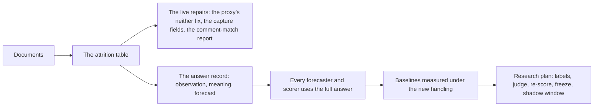

# Keeping all of Rick's answer, part 1: the pipeline

## 0. What this plan is for

Lupin stores Rick's whole answer: yes, no or neither, the comment on any of the three, typed Other text, multi-select picks and empty selections. It then loses parts of the answer at four kinds of step:

1. **The forecasters** can only answer a bare yes or a bare no, or pick a listed option. That is two of the six yes/no answer types: yes, no and neither, each with or without a comment.
2. **The scorers** grade the stance and ignore the comment, and they score typed text as a miss or leave it out.
3. **The principle writer** gets the words of the answer but not the structure linking a comment to the option it changes.
4. **The decision proxy's trust feedback** turns every answer into "approved or not".

The audit lists the 13 paths. The expert reached the same findings independently at `a1f2e67b6`, and ruled: **rebuild the answer contract and the experiment; keep the decision to stop the original layer 2 work.**

This plan is the pipeline half, which is needed whatever the research finds:

- **the live repairs**;
- **the answer record**, which gives one shape to an answer, its meaning and a forecast;
- **every forecaster and scorer using the full answer**;
- **new baselines** measured under that handling.

The research half is a separate plan in the principle learner research folder (Rick, walkthrough, 23 Nov). It covers the gold labels, the judge, the principle memory repairs, the retrospective re-score and the shadow window, and it depends on this plan.

## 1. Rulings this plan carries (Rick, walkthrough of 23 Nov)

1. **The live repairs wait for the cascade.** Nothing is built before the cascade review of both plans rules.
2. **The four experiment arms are named** *mechanical rulesets*, *no answer history*, *answer history* and *learned principles*, everywhere. No arm or track is ever called by a code letter.
3. **The boundary with the 18 Nov plan.** This plan replaces only the answer-handling parts of its phases 7, 8 and 9: what a forecast may say, and how it is scored against the whole answer. Their switches, checkpoint and frozen baseline stay with Mr. Radio.
4. **Open-ended and batch open-ended answers are fully in** (Rick, card, 23 Nov about 13:00, after María's readiness check): recorded, forecast and scored like the other two card types.
5. **Mr. Radio manages this plan** (Rick, about 12:56); Cheech manages the experiment plan.
6. **Baselines first.** The material-error rate and the accuracy rate are first measured as baselines once this plan's answer handling is in place. No target for either is set before then.

The research plan carries the other rulings: the deciding test, the worthwhile gain, the rubric bar and the anchoring test.

## 2. Principles that hold in every phase

- **Keep the whole answer as evidence, even when interpreting it is hard.** Its literal form, its operational meaning, and whether it warrants a lasting preference are three different things, recorded separately.
- **A comment can change the action.** A forecast of "yes" for "yes, but leave the configuration alone" earns the stance and fails the action.
- **No universal half-credit.** A paraphrase of an option gets full credit. A modification gets credit for the option it builds on, plus separate credit for its condition.
- **Every count names its unit.** Cards, fields and answers are different denominators:
  - 473 cards contain typed text;
  - 437 of the 528 literal departures on fully recommended cards are typed;
  - 524 typed answers are counted per question;
  - 556 typed fields are in Clayton's attrition table. The 556 is not yet reconciled against the 524, so neither figure is quoted again until it is (see the attrition table's status).
- **Ask time is a hard boundary.** A forecast is frozen when the card is asked. The annotation of the actual answer comes after it and never feeds back into it.
- **Each change sits behind its own INI switch**, off by default, and is reported as a paired difference against a frozen baseline. This is the 18 Nov plan's checkpoint rule.
- **Coverage**: 100% lines, branches and functions on every changed file, checked per file. This is the 18 Nov plan's section 3, "Acceptance and coverage conventions", and the Lupin coverage mandate. The number comes from `src/tests/run-coverage-gate.sh` and is read from its per-file table for the files the phase names, not from its exit code. Each phase lists its files by path. A phase that changes no code says so.
- **Census guards**: every phase that adds an INI key or a file runs `src/tests/run-census-guards.sh` before it asks for review.
- **The merge gate.** A repair or phase merges to the working branch only when three things hold: the unit tier is green for its changed files, the census guards are green, and a fresh reviewer seat gives a Merge verdict. Mr. Radio spawns the implementer and the reviewer and runs the merge. The `:8000` rows (the TypeScript tier and the E2E halves) are scheduled by Mr. Radio through `POST /api/v2/submit`, and they gate the PR to main, not the working-branch merge.
- **Executors**: every acceptance check is marked `EXECUTOR: AI` or `EXECUTOR: HUMAN <reason>`.

## 3. Phases



### Documents

- Serialise this plan, the research plan, the expert's response (its frontmatter was added on 23 Nov) and the audit. Cheech wrote all four and commits them, cascade revisions included. Mr. Radio commits any later change to this plan, and Cheech commits any later change to the research plan.
- Record Rick's rulings in the TODO Decisions Log. Cheech records them (TODO.md, 23 Nov, Cheech's section).
- **Status, 23 Nov**: done for the first commit (15c5a3e0d, f3f00224d), and the rulings are in the Decisions Log. Cheech commits each cascade section's revisions as soon as they are applied, so reviewers can cite a commit.
- **Acceptance**:
  - The four documents are committed and the R&D README links them. `EXECUTOR: AI` (Cheech).
  - The R&D guard passes: `pytest src/tests/unit/test_rnd_ledger_coverage_and_read_rule.py src/tests/unit/test_doc_lint_rnd_gate0.py -q` reports no failures. `EXECUTOR: AI` (Cheech).
  - Each of Rick's rulings in section 1 appears in the TODO Decisions Log under 23 Nov, checked line by line. `EXECUTOR: AI` (Cheech).
- **Coverage**: no code changes.

### The attrition table (the expert's first step)

This step counts how many units of an answer survive each step of the pipeline.

**The units**:
- the stance: yes, no, neither, or no recognised stance;
- the comment;
- typed Other text;
- each multi-select pick;
- an explicit empty selection;
- a timeout, with the default it fell back to;
- open-ended text, and each field of a batch open-ended answer.

**The steps**:
1. the raw stored outcome, read in two columns:
   - by the production readers, `notification_utils.extract_qualifier_comment` for the stance and comment and `exposure.decode_answer_fields` for every stored form;
   - by a plain first-word reader, kept as a control.

   A unit where the two columns differ is a finding: production reading loses something the raw text holds.
2. the meaningful field (`history_derive.derive_answer`);
3. the writer's input (`extractor_rules.field_answers`);
4. the stored evidence;
5. the forecaster's input;
6. the scorer's input (`accuracy_comparators`, `replay_loop._score`).

It runs on the run 2 archive and on the live database, read-only, inside a `READ ONLY` transaction. The script reuses the pattern of `retune_run.read_cohort`: the first statement sets the transaction read-only, and the transaction is always rolled back. Each figure gives its run time and sha.

**Why not the existing funnel.** `history_funnel.yield_funnel` was read. It counts one family through other stages (asks, eligible, usable, typed labels, context, families), not an answer's units across the whole pipeline. So it does not replace this table.

**The owner and the home.** Mr. Radio owns the step. The counting script is committed at `src/scripts/answer_attrition_table.py`, with its tests in `src/tests/unit/test_answer_attrition_table.py`, so the 100% rule applies to it. The table it prints is a measurement receipt. It goes in a store row and the write-up under `io/write-ups/online-preference-learning/`, never in `src/rnd`. The script is re-run whenever a later phase changes one of the six named symbols.

**Status, 23 Nov.** Clayton's table (`io/write-ups/online-preference-learning/2026.11.23-attrition-table.md`) ran with a private reader and is a first measurement, not the acceptance run.
- Done for yes/no and multiple choice.
- Open for three units:
  - timeouts, which the table leaves out of every count;
  - open-ended text;
  - each batch field. Batch and open-ended rows appear only as populations: 24 batch and 142 open-ended in the archive, 95 and 186 live.
- Open: 556 typed fields against the plan's 524 typed answers, and the 473 cards, are reconciled before either count is quoted again.
- Kept from the table: in historical data, a click cannot be told from typing for text equal to a label (somewhere from 0 to 964 fields). Only the capture fields fix that, and only going forward.

**What it answers**:
- how many yes/no texts become `unread` and are skipped by the writer;
- how often the extractor reads a pre-reveal draft instead of the final answer;
- how many typed answers equal a label character for character. In historical data, a click cannot be told from typing for those answers.

**Acceptance**:
- The table gives counts per unit per step, each step names the symbol it measured, and `src/scripts/answer_attrition_table.py` reproduces every count. `EXECUTOR: AI`.
- A positive control. One planted answer of each unit goes into a fixture database built by the test, never the live one. The test asserts a literal survive-or-drop matrix, one row per unit and one column per step, written into the test before it runs. `EXECUTOR: AI`.
- A read-only test: a write attempted inside the script's transaction fails, and the fixture is unchanged afterwards. `EXECUTOR: AI`.

**Coverage**: `src/scripts/answer_attrition_table.py`, at 100% lines, branches and functions.

### The live repairs (each independent, each behind its own switch; built only after the cascade, per ruling 1)

**The proxy's neither fix.**
- **Today**: `agent_notification_dispatcher.ask_confirmation` returns `response_value…startswith( "yes" )`, and `decision_proxy/agreement.forecast_agreement` scores against that boolean.
- **Change**:
  - A **new sibling method**, `ask_confirmation_answer`, returns the stance, the comment and the raw text, parsed through `extract_qualifier_comment`. `ask_confirmation` stays, as a thin wrapper that returns the same bool from the sibling, so its eleven callers do not change. The sibling is added at all three layers that repeat the bool contract: the dispatcher method, its role wrapper, and `swe_team/cosa_interface`. The stub in `swe_team/hooks.py` gains a sibling stub.
  - The trust feedback in `swe_team/orchestrator.py` (`_gated_confirmation`) calls the sibling and then records:
    - a neither as **no ruling**, passed as `None`. This follows the convention `agreement.rule_agreement` already uses for "no answer". `forecast_agreement` and `_persist_proxy_decision` accept `None`. A neither skips `record_decision` and writes a log line, so the trust tracker itself needs no change;
    - a qualified yes as its own outcome, logged with its comment;
    - a plain yes or no as today.
  - Behind the switch `decision proxy neither is no ruling enabled = false`.
  - *Held for Rick (cascade finding V14):* whether a neither may leave the trust counters unchanged at all. This repair is not built until he rules. The acceptance line on the counters stands only if he says yes.
- **Dispositions are kept.** The proxy keeps its shadow, suggest, act and defer dispositions. "The model deferred to Rick" and "Rick deferred the decision" are recorded as different events.
- **Acceptance** (all `EXECUTOR: AI`):
  - unit tests for all four answer shapes;
  - a test that the bool wrapper returns exactly what `ask_confirmation` returns today, for every shape;
  - a test that a neither leaves the category's trust counters unchanged and writes its log line;
  - a test that "the model deferred to Rick" and "Rick deferred the decision" are stored as different events;
  - a switch-off pin test: with the switch off, every shape is scored exactly as today;
  - a replay of the 43 organic `proxy_decisions` rows of 5 Nov (the trust-gate audit). The replay reads the dev database on `:7999` inside a read-only transaction and writes nothing. It is pinned: the first run's count of changed agreements is written into the test as a literal, and Mr. Radio reads it before the switch goes on.
- **Coverage**: `src/cosa/agents/utils/agent_notification_dispatcher.py`, `src/cosa/agents/swe_team/cosa_interface.py`, `src/cosa/agents/swe_team/hooks.py`, `src/cosa/agents/swe_team/orchestrator.py`, `src/cosa/agents/decision_proxy/agreement.py`. The two bug fix expediter call sites in `src/cosa/agents/bug_fix_expediter/orchestrator.py` keep the bool wrapper and are not changed.

**The capture fields.**
- **The fields**, recorded at ask time and on answer:
  - `recommendation`: the option or stance the asker recommended, or none;
  - the displayed highlight and option order;
  - `input_route`: a click on a listed option, typed text, a comment box, or voice.
- **What is not new.**
  - **Who answered** is already stored as `answer_source` on `prediction_decisions`: human, proxy, timeout_default, test, hint_vote or unknown (`vector_store_models.py`). It stays the actor half. A proxy answer and a timeout are recorded there, never in `input_route`. The two fields have different names because a second field named `answer_source` with a different meaning would be exactly the duplication the reuse review exists to stop.
  - **What happens on a timeout** is already stored at ask time as the card's `response_default`, a parameter of the notify route. Nothing new is stored for it.
- **Where the new fields are stored is decided by a trace first.** Before any build, the implementer traces `response_options` end to end, and `present_choices( … response_options_extra … )`, the existing merge point. The trace says whether the recommendation, the highlight and the option order fit inside the stored options with no new column. The trace is committed with the first change. A migration is written only if the trace shows a new column is needed.
- **Where they come from.** The card (`actionRequiredInteractive.ts`) already knows the input route; today it is not stored. This is from the plan's first draft and has not been checked yet (Rio, "lead, not read"). The trace checks it.
- **Why the default and the recommendation are separate fields.** The expert's subgroup check found they are not the same thing: 210 yes recommendations against 11 no recommendations on no-default cards.
- **Historical cards** keep "unknown" for any field they never recorded. No field is backfilled with "click".
- **Behind the switch** `notification capture fields enabled = false`.
- **Every day without these fields loses data for good.** Rick weighed this and ruled that they wait for the cascade anyway (ruling 1).
- **How each route is driven in a test**:
  - a click and typed text: the E2E card in Playwright;
  - a comment box: the same E2E card, answered through its comment box;
  - voice: the WebSocket answer path with a `voice` route tag, which is the same message a voice answer sends. The audio capture before it is not tested here, because it is outside this change;
  - a timeout: a card asked with a two-second timeout through the notify route's own timeout parameter. It is stored with `answer_source` timeout_default and no `input_route`;
  - proxy: the proxy's own answer path in a unit test, stored with `answer_source` proxy and no `input_route`.
- **Acceptance** (all `EXECUTOR: AI`):
  - a round-trip test per field, from the card to the stored row: unit tests for the router and repository, and an E2E test, `src/tests/e2e_ui/test_capture_fields_round_trip.py`, listed in one half of `src/tests/e2e_ui/partition/` (`half-a.txt` or `half-b.txt`). Mr. Radio schedules the `:8000` TypeScript and E2E runs;
  - a test that a typed answer identical to a label is stored as typed;
  - a test that a row written before the change reads back as "unknown" for every new field;
  - a switch-off pin test: with the switch off, the stored row is byte-identical to today's;
  - only if the trace needs a migration: an up-then-down test that leaves the schema as it was.
- **Coverage**: `src/cosa/rest/routers/notifications.py`, `src/cosa/rest/db/repositories/prediction_decision_repository.py`, `src/cosa/rest/postgres_models.py` (only if a column is added), and the TypeScript template `src/lupin_app/static/js/multiplexer/render/templates/actionRequiredInteractive.ts` (`c8 --100`). The trace may add files. If it does, they are listed here before the build starts.

**The comment-match report.**
- **Today**: `compare_yes_no` computes `qualifier_match` and nothing reads it.
- **Change**:
  - The repository's `PredictionLogRepository.get_accuracy_summary` reports a second layer, "stance right" and "stance and comment right", beside the stance-only figure. The stance-only figure is kept as the bridge.
  - `qualifier_match` sits inside the `accuracy_detail` JSONB, not in the `accuracy_match` column. So the second layer is a JSONB predicate on `accuracy_detail ->> 'qualifier_match'`.
  - Its denominator is yes/no rows only, because multiple-choice rows carry no `qualifier_match`.
  - `prediction_engine.get_accuracy_summary` and the `routers/system.py` route only pass the result through.
  - Behind the switch `prediction engine comment match report enabled = false`.
- **Sequencing**: phase 9 of the 18 Nov plan rewrites the same method (its scored-rows divisor and new admin route). This change is built after phase 9's version is merged, and on top of it (cascade finding V7).
- **Acceptance** (all `EXECUTOR: AI`):
  - a summary test over planted outcomes that asserts the denominator, with multiple-choice rows present and left out;
  - a switch-off pin test: with the switch off, the summary is identical to today's.
- **Coverage**: `src/cosa/rest/db/repositories/prediction_log_repository.py`, `src/cosa/agents/prediction_engine/accuracy_comparators.py`.

### The answer record: observation, meaning, forecast

These are the expert's three linked records ("One envelope, two native answer types").

**Observation**, never edited:
- the card as shown, with stable field and option ids and the displayed order;
- the input route and the raw final response;
- the actor and the event times;
- the forecast exposure and the draft.

**Meaning**, versioned: an annotated reading, with supporting text spans, its uncertainty, the annotator and the schema version. It holds:
- **the native answer**: per field, the selected or endorsed option ids, an explicit empty selection, write-in text, and the options merely referred to; for open-ended cards the free text, and for batch open-ended cards the text per field;
- **the conversational acts**: approve, decline, challenge the premise, request information, defer, propose an alternative. Several may co-occur, with dependencies;
- **the conditions**: each with its scope, polarity, time or order, and modality, marked when it affects execution;
- **the alignment** with the recommendation;
- **the unknowns, kept apart**: no explicit stance, neither, a cancellation, an absent field, an unreadable payload, and an uncertain annotator.

**Forecast**: the same semantic fields plus probabilities, a generated gist and the model's own abstention. It is frozen at ask time.

**One shared labeller.** A single function proposes a meaning for a stored answer, using a model. It is the only writer of meaning records apart from human annotation. This is the audit's recommendation for its row 1.

**Acceptance**:
- the schema and its migrations;
- a round-trip test per native type and per kind of unknown;
- a test that a forecast record cannot be updated after its ask time;
- the labeller's agreement with the research plan's development gold labels, reported per class, never as one overall figure.

`EXECUTOR: AI`.

**Coverage**: the new models, repositories and the labeller.

### Every forecaster and scorer uses the full answer

**The reply format.** The reply formats and parsers in `context_baseline.py` (`YES_NO_ANSWERS`, `YES_NO_FORMAT`, `CHOICE_FORMAT`, `parse_reply`) change to the forecast record. A reply then gives:
- a normalised probability vector over yes, no and neither;
- the acts, as marginals;
- the probability of a material qualification, and the conditions it asserts;
- per field, the selected set of option ids, or a write-in or re-frame;
- for open-ended and batch cards, the expected text as a gist, with its acts and conditions;
- the probability that the whole card is right;
- a gist, or an abstention.

**Which forecasters this covers.** The no answer history, answer history, learned principles and Opus forecasters all use that parser; the answer history forecaster is new, built by the experiment plan, and must use this parser from its first version. Today `context_baseline.SUPPORTED_TYPES` is yes/no and multiple choice only, so the parser gains open-ended and batch open-ended cards (ruling 4). The expert: no prompt-only change can fix it. `predictor_version` already starts a new ledger when the prompt changes.

**The lookup engine.**
- When neither wins the vote, it forecasts neither instead of abstaining under `REASON_NEITHER_MAJORITY`. This finishes the 18 Nov plan's phase 8 for answer handling.
- Typed answers that the labeller maps to an option vote for that option, and carry their condition.
- The three-way forecaster's copied qualifier is scored for whether it expresses this card's constraint.
- The open-ended and batch paths (`_predict_open_ended`, `_predict_two_tier`, `_predict_open_ended_batch`) are scored by the complete-action measure as well, not only by text similarity.

**The scorer layers** (the expert's section "What to score"):
1. **The complete-action measure.** The forecast gives the same immediate action or conversational act, keeps every material restriction or prerequisite, and invents nothing material.
   - On a multi-field card, every field that bears on the action must pass.
   - An abstention counts as no success.
   - Its coverage and its pass rate on the cards it answers are published beside the measure.
2. **The decomposition**: precision and recall over the condition atoms, with contradictions, omissions and unsupported additions flagged separately.
3. **Probability scores**: multiclass and binary Brier scores, calibration by confidence band, and neither recall and precision at a frozen threshold.
4. **The bridge**: the old stance-only score, kept.

**Acceptance**:
- a parser test per field and per refusal;
- a scorer test for each of the expert's six worked examples ("Recommended scoring examples"), with each expected verdict pinned to a literal;
- a test that an abstention scores as no success on the complete-action measure.

`EXECUTOR: AI`.

**Coverage**: `context_baseline.py`, `principles_call.py`, `opus_twins.py`, `accuracy_comparators.py`, `prediction_engine.py`, `three_way_stance.py`, the replay scorer.

### Baselines measured under the new handling (ruling 6)

With the answer record and full-answer scoring in place, re-score these on the archive and on live asks:
- the **mechanical rulesets**;
- the **no answer history** forecaster;
- the lookup engine;
- the three-way forecaster.

**Each is reported with**:
- its **accuracy rate** on the complete-action measure;
- its **material-error rate**: false permission, a missed prerequisite, an unwarranted refusal;
- the stance-only bridge.

**What the figures are for.** They are frozen as the baseline. They are the first honest numbers for the four yes/no answer types the forecasters could never produce. The research plan computes its rubric bar and its worthwhile-gain floor from them.

**Acceptance**: a frozen baseline report with its sha, cohort and denominators per unit, and a checkpoint hash the harness enforces, as the 18 Nov checkpoint does. `EXECUTOR: AI`.

**Coverage**: any harness change.

## 4. Baselines on the old labels (for reference only)

These come from the paper and the expert's recalculation. The step above restates each one under the new labels.

| Baseline | Result on the old labels |
|---|---|
| Mechanical rulesets: always yes on yes/no cards, the recommended or first option on multiple choice | 1,186 of 1,926 |
| Plain Opus | 1,176 of 1,926 |
| Always yes on yes/no cards | 621 of 769 (80.8%) |
| Always yes with no comment, scored on stance and on comment absence | 504 of 769 (65.5%) |

## 5. Risks

- **The answer schema touches the card UI.** The capture fields change the TypeScript template and the stored payload, so the c8 gate and an E2E run apply before any PR to main.
- **Two plans touch the same files as the 18 Nov plan.** The managers sequence their merges (ruling 3).
- **Richer outputs can invent conditions.** Hence precision on asserted conditions, and the contradiction flags.
- **The capture fields lose data every day they wait.** Rick accepted this in ruling 1.

## 6. Done means

- **The live repairs**: the proxy's neither fix, the capture fields and the comment-match report are each merged behind their own switch through the merge gate in section 2. That means acceptance green, 100% lines, branches and functions on their files, and a reviewer's Merge verdict. The proxy's neither fix also waits on Rick's ruling on V14.
- **The order between the two plans** (cascade finding V5). Neither plan's labelling starts until this order is met:
  1. Mr. Radio freezes meaning schema v1 (this plan, the answer record), with its version in the record.
  2. Cheech's readers label the development gold set against that frozen schema (the research plan).
  3. The shared labeller is tuned on one part of the development gold labels and accepted on a held-back slice it never saw. The research plan fixes the slice before tuning starts.
- **The answer record and full-answer forecasting** meet their acceptance.
- **The new baselines** are frozen and hashed.

## 7. Questions for the cascade review

1. Is the meaning record's act vocabulary complete enough for both card types? It is approve, decline, challenge the premise, request information, defer, and propose an alternative.
2. Should the shared labeller run once over every stored answer, with its labels then frozen, or on demand?
3. Which proxy events, beyond neither and a qualified yes, need their own trust outcome?

## 8. Reuse review of section 3, the first three phases (Rio, cascade stage 1, 23 Nov)

Rio searched for existing code for each new item in the first three phases and ruled on each. The rulings are his, sent to Cheech as bare lines and committed here because reviewers do not commit. Each outcome line says what this plan does with the ruling. The step ids name section 3's phases: `3-attrition` is the attrition table, `3-proxyfix` the proxy's neither fix, `3-capturefields` the capture fields, `3-commentmatch` the comment-match report.

```text
RULING proxy_neither_fix :: EXTEND cosa.agents.utils.agent_notification_dispatcher.AgentNotificationDispatcher.ask_confirmation :: reuse-receipt: 2e540ea1f3819fea :: search: rs-60d9f0073b
RULING capture_fields :: EXTEND cosa.rest.routers.notifications._submit_response_sync :: reuse-receipt: 032f3865e3cacac5 :: search: rs-e1a465328a
RULING comment_match_report :: EXTEND cosa.rest.db.repositories.prediction_log_repository.PredictionLogRepository.get_accuracy_summary :: reuse-receipt: 648192e81dff6c4f :: search: rs-e31155d05a
RULING attrition_table :: DISTINCT six-step cross-pipeline count of one answer's units; history_funnel.yield_funnel counts other stages, and step 1 must read through extract_qualifier_comment and decode_answer_fields :: reuse-receipt: 0fd4cb80f62dd781 :: search: rs-dd11656f82

REUSE-OUTCOME 2e540ea1f3819fea :: rs-60d9f0073b :: EXTENDED cosa.agents.utils.agent_notification_dispatcher.AgentNotificationDispatcher.ask_confirmation :: src/rnd/v0.2.4/2026.11.17-online-preference-learning-upgrades/2026.11.23-answer-signal-pipeline-plan.md#3-proxyfix
REUSE-OUTCOME 032f3865e3cacac5 :: rs-e1a465328a :: EXTENDED cosa.rest.routers.notifications._submit_response_sync :: src/rnd/v0.2.4/2026.11.17-online-preference-learning-upgrades/2026.11.23-answer-signal-pipeline-plan.md#3-capturefields
REUSE-OUTCOME 648192e81dff6c4f :: rs-e31155d05a :: EXTENDED cosa.rest.db.repositories.prediction_log_repository.PredictionLogRepository.get_accuracy_summary :: src/rnd/v0.2.4/2026.11.17-online-preference-learning-upgrades/2026.11.23-answer-signal-pipeline-plan.md#3-commentmatch
REUSE-OUTCOME 0fd4cb80f62dd781 :: rs-dd11656f82 :: WROTE_NEW a six-step count of one answer's units across the pipeline, reading step 1 through the production readers :: src/rnd/v0.2.4/2026.11.17-online-preference-learning-upgrades/2026.11.23-answer-signal-pipeline-plan.md#3-attrition
```
