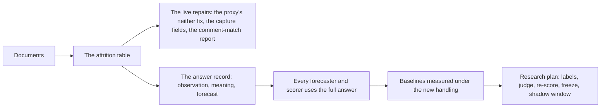

# Keeping all of Rick's answer, part 1: the pipeline

## 0. What this plan is for

Lupin stores Rick's whole answer: yes, no or neither, the comment on any of the three, typed Other text, multi-select picks and empty selections. It then loses parts of the answer at four kinds of step:

1. **The forecasters** can only answer a bare yes or a bare no, or pick a listed option. That is two of the six yes/no answer types: yes, no and neither, each with or without a comment.
2. **The scorers** grade the stance and ignore the comment, and they score typed text as a miss or leave it out.
3. **The principle writer** gets the words of the answer but not the structure linking a comment to the option it changes.
4. **The decision proxy's trust feedback** turns every answer into "approved or not".

The audit lists the 13 paths. The expert reached the same findings independently at `a1f2e67b6`, and ruled: **rebuild the answer contract and the experiment; keep the decision to stop the original layer 2 work.**

This plan is the pipeline half, which is needed whatever the research finds:

- **the live repairs**;
- **the answer record**, which gives one shape to an answer, its meaning and a forecast;
- **every forecaster and scorer using the full answer**;
- **new baselines** measured under that handling.

The research half is a separate plan in the principle learner research folder (Rick, walkthrough, 23 Nov). It covers the gold labels, the judge, the principle memory repairs, the retrospective re-score and the shadow window, and it depends on this plan.

## 1. Rulings this plan carries (Rick, walkthrough of 23 Nov)

1. **The live repairs wait for the cascade.** Nothing is built before the cascade review of both plans rules.
2. **The four experiment arms are named** *mechanical rulesets*, *no answer history*, *answer history* and *learned principles*, everywhere. No arm or track is ever called by a code letter.
3. **The boundary with the 18 Nov plan.** This plan replaces only the answer-handling parts of its phases 7, 8 and 9: what a forecast may say, and how it is scored against the whole answer. Their switches, checkpoint and frozen baseline stay with Mr. Radio. A consequence of ruling 4 and "One judge": phase 10's blinded paraphrase judge is replaced too, and phase 10 keeps only its grounding check. Mr. Radio owns phase 10. Cheech sends him the notice by direct message when this plan is approved, and records the send on the phase 10 row (Krishna, V7; Maya-N5).
4. **Open-ended and batch open-ended answers are fully in** (Rick, card, 23 Nov about 13:00, after María's readiness check): recorded, forecast and scored like the other two card types.
5. **Mr. Radio manages this plan** (Rick, about 12:56); Cheech manages the experiment plan.
6. **Baselines first.** The material-error rate and the complete-action accuracy (Rick said "accuracy rate"; renamed so it is not confused with `accuracy_match`) are first measured as baselines once this plan's answer handling is in place. No target for either is set before then.

The research plan carries the other rulings: the deciding test, the worthwhile gain, the rubric bar and the anchoring test.

## 2. Principles that hold in every phase

- **Keep the whole answer as evidence, even when interpreting it is hard.** Its literal form, its operational meaning, and whether it warrants a lasting preference are three different things, recorded separately.
- **A comment can change the action.** A forecast of "yes" for "yes, but leave the configuration alone" earns the stance and fails the action.
- **No universal half-credit.** A paraphrase of an option gets full credit. A modification gets credit for the option it builds on, plus separate credit for its condition.
- **Every count names its unit.** Cards, fields and answers are different denominators:
  - 473 cards contain typed text;
  - 437 of the 528 literal departures on fully recommended cards are typed;
  - 524 typed answers are counted per question (unreconciled, see below);
  - 556 typed fields are in Clayton's attrition table (unreconciled, see below). The 556 is not yet reconciled against the 524, so neither is quoted as a result again until it is. They are listed here only so the two units are not mixed (the attrition table's status; Rio A 5c).
- **Ask time is a hard boundary.** A forecast is frozen when the card is asked. The annotation of the actual answer comes after it and never feeds back into it.
- **Each change sits behind its own INI switch**, off by default, and is reported as a paired difference against a frozen baseline. This is the 18 Nov plan's checkpoint rule.
- **Coverage**: 100% lines, branches and functions on every changed file, checked per file. This is the 18 Nov plan's section 3, "Acceptance and coverage conventions", and the Lupin coverage mandate. The number comes from `src/tests/run-coverage-gate.sh` and is read from its per-file table for the files the phase names, not from its exit code. Each phase lists its files by path. A phase that changes no code says so.
- **Census guards**: every phase that adds an INI key or a file runs `src/tests/run-census-guards.sh` before it asks for review.
- **The merge gate.** A repair or phase merges to the working branch only when three things hold: the unit tier is green for its changed files, the census guards are green, and a fresh reviewer seat gives a Merge verdict. Mr. Radio spawns the implementer and the reviewer and runs the merge. The `:8000` rows (the TypeScript tier and the E2E halves) are scheduled by Mr. Radio through `POST /api/v2/submit`, and they gate the PR to main, not the working-branch merge.
- **Executors**: every acceptance check is marked `EXECUTOR: AI` or `EXECUTOR: HUMAN <reason>`.

## 3. Phases



### Documents

- Serialise this plan, the research plan, the expert's response (its frontmatter was added on 23 Nov) and the audit. Cheech wrote all four and commits them, cascade revisions included. Mr. Radio commits any later change to this plan, and Cheech commits any later change to the research plan.
- Record Rick's rulings in the TODO Decisions Log. Cheech records them (TODO.md, 23 Nov, Cheech's section).
- **Status, 23 Nov**: done for the first commit (15c5a3e0d, f3f00224d), and the rulings are in the Decisions Log. Cheech commits each cascade section's revisions as soon as they are applied, so reviewers can cite a commit.
- **Acceptance**:
  - The four documents are committed and the R&D README links them. `EXECUTOR: AI` (Cheech).
  - The R&D guard passes: `pytest src/tests/unit/test_rnd_ledger_coverage_and_read_rule.py src/tests/unit/test_doc_lint_rnd_gate0.py -q` reports no failures. `EXECUTOR: AI` (Cheech).
  - Each of Rick's rulings in section 1 appears in the TODO Decisions Log under 23 Nov, checked line by line. `EXECUTOR: AI` (Cheech).
- **Coverage**: no code changes.

### The attrition table (the expert's first step)

This step counts how many units of an answer survive each step of the pipeline.

**The units**:
- the stance: yes, no, neither, or no recognised stance;
- the comment;
- typed Other text;
- each multi-select pick;
- an explicit empty selection;
- a timeout, with the default it fell back to;
- open-ended text, and each field of a batch open-ended answer.

**The steps**:
1. the raw stored outcome, read in two columns:
   - by the production readers, `notification_utils.extract_qualifier_comment` for the stance and comment and `exposure.decode_answer_fields` for every stored form;
   - by a plain first-word reader, kept as a control.

   A unit where the two columns differ is a finding: production reading loses something the raw text holds.
2. the meaningful field (`history_derive.derive_answer`);
3. the writer's input (`extractor_rules.field_answers`);
4. the stored evidence (`preference_evidence` rows as read by `neighbours_of`);
5. the forecaster's input (the string `context_baseline.build_user_prompt` returns);
6. the scorer's input (`accuracy_comparators`, `replay_loop._score`).

It runs on the run 2 archive and on the live database, read-only, inside a `READ ONLY` transaction. The script reuses the pattern of `retune_run.read_cohort`: the first statement sets the transaction read-only, and the transaction is always rolled back. Each figure gives its run time and sha.

**Why not the existing funnel.** `history_funnel.yield_funnel` was read. It counts one family through other stages (asks, eligible, usable, typed labels, context, families), not an answer's units across the whole pipeline. So it does not replace this table.

**The owner and the home.** Mr. Radio owns the step. The counting script is committed at `src/scripts/answer_attrition_table.py`, with its tests in `src/tests/unit/test_answer_attrition_table.py`, so the 100% rule applies to it. The table it prints is a measurement receipt. It goes in a store row and the write-up under `io/write-ups/online-preference-learning/`, never in `src/rnd`. The script is re-run whenever a later phase changes one of the six named symbols.

**Status, 23 Nov.** Clayton's table (`io/write-ups/online-preference-learning/2026.11.23-attrition-table.md`) ran with a private reader and is a first measurement, not the acceptance run.
- Done for yes/no and multiple choice.
- Open for three units:
  - timeouts, which the table leaves out of every count;
  - open-ended text;
  - each batch field. Batch and open-ended rows appear only as populations: 24 batch and 142 open-ended in the archive, 95 and 186 live.
- Open: 556 typed fields against the plan's 524 typed answers, and the 473 cards, are reconciled before either count is quoted again.
- Kept from the table: in historical data, a click cannot be told from typing for text equal to a label (somewhere from 0 to 964 fields). Only the capture fields fix that, and only going forward.

**What it answers**:
- how many yes/no texts become `unread` and are skipped by the writer;
- how often the extractor reads a pre-reveal draft instead of the final answer;
- how many typed answers equal a label character for character. In historical data, a click cannot be told from typing for those answers.

**Acceptance**:
- The table gives counts per unit per step, each step names the symbol it measured, and `src/scripts/answer_attrition_table.py` reproduces every count. `EXECUTOR: AI`.
- A positive control. One planted answer of each unit goes into a fixture database built by the test, never the live one. The test asserts a literal survive-or-drop matrix, one row per unit and one column per step, written into the test before it runs. `EXECUTOR: AI`.
- A read-only test: a write attempted inside the script's transaction fails, and the fixture is unchanged afterwards. `EXECUTOR: AI`.

**Coverage**: `src/scripts/answer_attrition_table.py`, at 100% lines, branches and functions.

### The live repairs (each independent, each behind its own switch; built only after the cascade, per ruling 1)

**The proxy's neither fix.**
- **Today**: `agent_notification_dispatcher.ask_confirmation` returns `response_value…startswith( "yes" )`, and `decision_proxy/agreement.forecast_agreement` scores against that boolean.
- **Change**:
  - A **new sibling method**, `ask_confirmation_answer`, returns the stance, the comment and the raw text, parsed through `extract_qualifier_comment`. `ask_confirmation` stays, as a thin wrapper that returns the same bool from the sibling, so its eleven callers do not change. The sibling is added at all three layers that repeat the bool contract: the dispatcher method, its role wrapper, and `swe_team/cosa_interface`. The stub in `swe_team/hooks.py` gains a sibling stub.
  - The trust feedback in `swe_team/orchestrator.py` (`_gated_confirmation`) calls the sibling and then records:
    - a neither as **no ruling**, passed as `None`. This follows the convention `agreement.rule_agreement` already uses for "no answer". `forecast_agreement` and `_persist_proxy_decision` accept `None`. A neither skips `record_decision` and writes a log line, so the trust tracker itself needs no change;
    - a qualified yes as its own outcome, logged with its comment;
    - a plain yes or no as today.
  - Behind the switch `decision proxy neither is no ruling enabled = false` (renamed `decision proxy neither means reframe enabled` and turned on by Rick, 24 Nov 2026).
  - **Ruled (cascade finding V14)**: "No ruling, counted as a re-frame" (Rick, voice card, 23 Nov about 13:57, relayed by Rachel). A neither is recorded as no ruling, leaves the trust counters unchanged, and is logged as a request to re-frame the question. The acceptance line on the counters stands.
- **Dispositions are kept.** The proxy keeps its shadow, suggest, act and defer dispositions. "The model deferred to Rick" and "Rick deferred the decision" are recorded as different events.
- **Acceptance** (all `EXECUTOR: AI`):
  - unit tests for all four answer shapes;
  - a test that the bool wrapper returns exactly what `ask_confirmation` returns today, for every shape;
  - a test that a neither leaves the category's trust counters unchanged and writes its log line;
  - a test that "the model deferred to Rick" and "Rick deferred the decision" are stored as different events;
  - a switch-off pin test: with the switch off, every shape is scored exactly as today;
  - a replay of the 43 organic `proxy_decisions` rows of 5 Nov (the trust-gate audit). A unit test cannot reach a live database from a worktree, so the 43 rows are captured once, read-only, from the dev database on `:7999` and committed as a fixture, and the unit test replays the fixture. The capture script is `EXECUTOR: AI` and writes nothing. The test is pinned: the first run's count of changed agreements is written into it as a literal, and Mr. Radio reads it before the switch goes on (Maya-N12). Under Rick's chosen option for V14, the replay first reports three figures per category: the count of neither answers, the changed agreements, and the re-frame rate. A neither matched by the proxy's own deferral counts as a correct deferral. A re-frame rate above a placeholder of 1 in 10 over a category's last 20 asks blocks that category's promotion. The placeholder is reset from this replay's figures and recorded on the row. A test covers the block at one ask above and one ask below the bar.
- **Coverage**: `src/cosa/agents/utils/agent_notification_dispatcher.py`, `src/cosa/agents/swe_team/cosa_interface.py`, `src/cosa/agents/swe_team/hooks.py`, `src/cosa/agents/swe_team/orchestrator.py`, `src/cosa/agents/decision_proxy/agreement.py`. The two bug fix expediter call sites in `src/cosa/agents/bug_fix_expediter/orchestrator.py` keep the bool wrapper and are not changed.

**The capture fields.**
- **The fields**, recorded at ask time and on answer:
  - `recommendation`: the option or stance the asker recommended, or none;
  - the displayed highlight and option order;
  - `input_route`: a click on a listed option, typed text, a comment box, or voice.
- **What is not new.**
  - **Who answered** is already stored as `answer_source` on `prediction_decisions`: human, proxy, timeout_default, test, hint_vote or unknown (`vector_store_models.py`). It stays the actor half. It does not hold every actor. `prediction_engine` writes only `human` or `unknown` there. A timeout is marked on the notification itself, in `notifications.response_value.source` as `timeout_default` (`notification_repository.py`, function that stores `response_value`). A proxy answer is marked by the proxy's own writer (`decision_proxy/responder.py`). So the actor is read from those two places for timeouts and proxy answers, and from `answer_source` for the rest. A card with no `prediction_decisions` row (open-ended and batch cards may have none, not yet checked) is joined to its actor through `notifications` alone. The trace below checks that join first. A proxy answer or a timeout is never recorded in `input_route` (Krishna-N1). The two fields have different names because a second field named `answer_source` with a different meaning would be exactly the duplication the reuse review exists to stop.
  - **What happens on a timeout** is already stored at ask time as the card's `response_default`, a parameter of the notify route. Nothing new is stored for it.
- **Where the new fields are stored is decided by a trace first.** Before any build, the implementer traces `response_options` end to end, and `present_choices( … response_options_extra … )`, the existing merge point. The trace says whether the recommendation, the highlight and the option order fit inside the stored options with no new column. The trace is committed with the first change. A migration is written only if the trace shows a new column is needed.
- **Where they come from** (cascade finding X2). Rio read the card. It submits a typed Other as its trimmed text, in the same `{ answers: { header: value } }` shape as a clicked label, which is what makes a typed answer that equals a label look clicked. So the route needs a sibling key beside the `answers` map. Before the build, the trace checks that `notification_utils.parse_field_selections` tolerates that key, and adds a test that it does.
- **Why the default and the recommendation are separate fields.** The expert's subgroup check found they are not the same thing: 210 yes recommendations against 11 no recommendations on no-default cards.
- **Historical cards** keep "unknown" for any field they never recorded. No field is backfilled with "click". The one exception is `recommendation`, which already has a reader, `episode_view._is_recommended` (an option's `recommended` flag or the "(Recommended)" label suffix). It is **derived when the row is read**, through that reader, and nothing is written to old rows. So it is not a data migration and needs no up-then-down test (cascade finding X1, which corrects the first revision's "no home"; Maya-N1).
- **Behind the switch** `notification capture fields enabled = false`.
- **Every day without these fields loses data for good.** Rick weighed this and ruled that they wait for the cascade anyway (ruling 1).
- **How each route is driven in a test**:
  - a click and typed text: the E2E card in Playwright;
  - a comment box: the same E2E card, answered through its comment box;
  - voice: the WebSocket answer path with a `voice` route tag, which is the same message a voice answer sends. The audio capture before it is not tested here, because it is outside this change;
  - a timeout: a card asked with a two-second timeout through the notify route's own timeout parameter. It is stored with `timeout_default` in `notifications.response_value.source` and no `input_route`;
  - proxy: the proxy's own answer path in a unit test, stored with the proxy's own marker and no `input_route`.
- **Acceptance** (all `EXECUTOR: AI`):
  - a round-trip test per field, from the card to the stored row: unit tests for the router and repository, and an E2E test, `src/tests/e2e_ui/test_capture_fields_round_trip.py`, listed in one half of `src/tests/e2e_ui/partition/` (`half-a.txt` or `half-b.txt`). Mr. Radio schedules the `:8000` TypeScript and E2E runs;
  - a test that a typed answer identical to a label is stored as typed;
  - a test that a row written before the change reads back as "unknown" for every new field except `recommendation`;
  - a test of that exception: an old row whose options carry a `recommended` flag, and one whose label ends "(Recommended)", each read back with the recommended option from `episode_view._is_recommended`, and an old row with neither reads back "unknown";
  - a switch-off pin test: with the switch off, the stored row is byte-identical to today's;
  - only if the trace needs a migration: an up-then-down test that leaves the schema as it was.
- **Coverage**: `src/cosa/rest/routers/notifications.py`, `src/cosa/rest/db/repositories/prediction_decision_repository.py`, `src/cosa/rest/postgres_models.py` (only if a column is added), and the TypeScript template `src/lupin_app/static/js/multiplexer/render/templates/actionRequiredInteractive.ts` (`c8 --100`). The trace may add files. If it does, they are listed here before the build starts.

**The comment-match report.**
- **Today**: `compare_yes_no` computes `qualifier_match` and nothing reads it.
- **Change**:
  - The repository's `PredictionLogRepository.get_accuracy_summary` reports a second layer, "stance right" and "stance and comment right", beside the stance-only figure. The stance-only figure is kept as the bridge.
  - `qualifier_match` sits inside the `accuracy_detail` JSONB, not in the `accuracy_match` column. So the second layer is a JSONB predicate on `accuracy_detail ->> 'qualifier_match'`.
  - Its denominator is yes/no rows only, because multiple-choice rows carry no `qualifier_match`.
  - `prediction_engine.get_accuracy_summary` and the `routers/system.py` route only pass the result through.
  - Behind the switch `prediction engine comment match report enabled = false`.
- **Sequencing**: phase 9 of the 18 Nov plan rewrites the same method (its scored-rows divisor and new admin route). This change is built after phase 9's version is merged, and on top of it (cascade finding V7).
- **Acceptance** (all `EXECUTOR: AI`):
  - a summary test over planted outcomes that asserts the denominator, with multiple-choice rows present and left out;
  - a switch-off pin test: with the switch off, the summary is identical to today's.
- **Coverage**: `src/cosa/rest/db/repositories/prediction_log_repository.py`, `src/cosa/agents/prediction_engine/accuracy_comparators.py`.

### The answer record: observation, meaning, forecast

These are the expert's three linked records ("One envelope, two native answer types").

**Observation**, never edited:
- the card as shown, with stable field and option ids and the displayed order;
- the input route and the raw final response;
- the actor and the event times;
- the forecast exposure and the draft.

**Meaning**, versioned: an annotated reading, with supporting text spans, its uncertainty, the annotator and the schema version. It holds:
- **the native answer**: per field, the selected or endorsed option ids, an explicit empty selection, write-in text, and the options merely referred to; for open-ended cards the free text, and for batch open-ended cards the text per field;
- **the conversational acts**: approve, decline, challenge the premise, request information, defer, propose an alternative. Several may co-occur, with dependencies;
- **the conditions**: each with its scope, polarity, time or order, and modality, marked when it affects execution;
- **the alignment** with the recommendation;
- **the unknowns, kept apart**: no explicit stance, neither, a cancellation, an absent field, an unreadable payload, and an uncertain annotator.

**The link from a comment to an option** (cascade finding V3). Each condition carries `modifies_option_id`: the option id it changes, or none when it applies to the whole answer. This is how the writer gets that link (experiment plan, principle memory repairs).

**Forecast**: the same semantic fields plus probabilities, a generated gist and the model's own abstention. It is frozen at ask time.

**Where the three records live** (Rio, reuse review). Two of them already half exist, so only the meaning record is a new store.
- **Observation is a view, not a new table.** The card as shown is `notifications.response_options`. The raw answer and who posted it are `response_value` and `answered_by`. Reveal time and the draft are `prediction_log.fold_opened_at` and `draft_at_reveal`, which `exposure.py` decodes. The view adds the capture fields from the live repairs.
- **The forecast goes inside the existing `PredictionArmForecast.forecast` JSONB**: one row per notification and arm, with `input_cutoff`, `forecast_ready_at`, `abstention_reason` and `predictor_version`. A new forecast shape is a new `predictor_version`, never a new table. Its key names follow `three_way_stance.three_way_forecast`'s (`value`, `qualifier`, `confidence`, `probabilities`), so arms compare without translation.
- **The meaning record copies the design of `PreferenceEvidence`.** It is append-only, its unique key includes the schema version, it has no foreign key to notifications (so pruning never deletes it), and it keeps a snapshot of the session key. A new version is a new row, and the old row stays.

**How "cannot be updated after ask time" is enforced.** The forecast repository refuses any update to a forecast row, raising a new `ForecastAlreadyFrozen`. This follows `prediction_log_repository.update_outcome` and `OutcomeAlreadyRecorded`. The unique key and the insert-skip in `principles_forecast._write_row` stay as they are. Today they are the only guard, and neither refuses an update.

**One shared labeller.**
- A single function proposes a meaning for a stored answer, using a model. It is the only writer of meaning records apart from human annotation. This is the audit's recommendation for its row 1.
- It uses the extractor's call path: `model_transport.complete`, which is bounded Claude Code under the cost model, never the per-token SDK. Its reply is read with `recover_json_object`. Its version string is built like `extractor_version_of( model )` plus the schema version.
- **The extractor reads the meaning record.** The principle writer takes the answer's structure from the meaning record, not from its own reading through `field_answers`, so one answer is never read twice by two models.
- **When it runs** (cascade finding V11). It runs once over every stored answer, and those labels are frozen with the baseline. It then runs on each new answer as it is stored. If the labeller fails, it writes a meaning record whose unknown is "unreadable payload". It never leaves the row missing. A meaning record must exist before that card's feedback may reach a later ask (experiment plan, ask-time boundary).
- **Its tests** (cascade finding O15). One labeller reply is captured from the real model, through the real reader, for each native type and each kind of unknown. Those captured replies are committed as fixtures, and the unit tests are built on them. They never use a stub that ignores its input. A separate live run on a stated sample of 50 stored answers is `EXECUTOR: AI`. The manager records the go for its token spend on the row, and spend needs no ask to Rick.

**The labeller's pass line** (cascade finding O16). The labeller is accepted on the held-back slice of the development gold labels (see "Done means"). It needs Cohen's kappa of at least 0.7 for each class that has at least 20 cards in the held-back slice, the same bar the readers are measured against Rick on (Maya-N11). The slice size is fixed by the research plan before tuning. Classes below 20 cards (the archive holds 36 noes in 769 yes/no cards, and 108 neithers) are reported with their counts and agreement, descriptive only, and do not pass or fail the labeller. **Which classes must qualify** (Krishna-N3): the yes class must reach 20 cards and the bar, always. With slices of 60 to 80 cards, probably only the yes class does. So a pass that scored the yes class alone is stamped "yes class only" in the report, and no claim of labelling accuracy on no, neither or the conditions may rest on it. The research plan sets the held-back slice large enough for the neither class to reach 20 cards if the sample allows, and says so when it fixes the slice size. Kappa is undefined on a class with no cards, so it reads `None`, never 0 (Krishna-N2). The gold labels are human work: two readers and Rick's adjudication, `EXECUTOR: HUMAN` in the research plan, because only a human reading decides what Rick meant. So this acceptance completes only after that work lands. If a class misses the bar, the labeller is revised and re-scored on a fresh held-back slice, and the baselines wait for it.

**Acceptance** (all `EXECUTOR: AI` unless marked):
- an up-then-down migration test for the meaning table, which leaves the schema as it was;
- a census guard, `test_every_meaning_kind_round_trips`. It enumerates the native types and the kinds of unknown from one constant, asserts the list is not empty, and round-trips at least one fixture per kind, each taken from a real archive row;
- a round-trip test for `modifies_option_id`, including a comment on a multiple-choice card;
- a test that the observation view refuses a write;
- a test that a second meaning version is a new row and the first survives;
- a test that the repository refuses an update to a frozen forecast row (`ForecastAlreadyFrozen`);
- the labeller's kappa on the held-back slice, at least 0.7 for each class with at least 20 cards, and a test that a class below 20 cards is reported and not failed. `EXECUTOR: AI`, after the human gold labels land.

**Coverage**: `src/cosa/rest/postgres_models.py` (the meaning model), the meaning repository (a new file beside `src/cosa/rest/db/repositories/prediction_decision_repository.py`), the forecast repository refusal, `src/cosa/agents/prediction_engine/exposure.py` (the observation view), and the labeller module. The labeller's path and the meaning repository's path are fixed when each is written and listed here before the build, and the merge gate's reviewer confirms the list is complete against `git diff --name-only` before giving a Merge verdict (Maya-O2).

### Every forecaster and scorer uses the full answer

**The reply format.** The reply formats and parsers in `context_baseline.py` (`YES_NO_ANSWERS`, `YES_NO_FORMAT`, `CHOICE_FORMAT`, `parse_reply`) change to the forecast record. A reply then gives:
- a normalised probability vector over yes, no and neither;
- the acts, as marginals;
- the probability of a material qualification, and the conditions it asserts;
- per field, the selected set of option ids, or a write-in or re-frame;
- for open-ended and batch cards, the expected text as a gist, with its acts and conditions;
- the probability that the whole card is right;
- a gist, or an abstention.

**The change points** (Rio). `context_baseline.YES_NO_ANSWERS` is `( "yes", "no" )`, and `SUPPORTED_TYPES` is `( "yes_no", "multiple_choice" )`. So `parse_reply` raises on a neither and on an open-ended card. These two constants, `YES_NO_FORMAT` and `CHOICE_FORMAT` are what change.

**Option ids, not labels** (cascade finding V7). The 18 Nov plan's phase 7 used labels because `response_options` carries no option id. `response_options` carries no id, but `episode_view.fields_of` already gives each option a per-field id (`o1`, `o2`), a label and a `recommended` flag. This plan extends that function: the stable id is its position id plus a hash of the label, stored in the observation view (Rio E1). Phase 7's merged label matching stays as the bridge.

**The parser stays inside `parse_reply`.** `predictor_version` hashes the source of `build_user_prompt`, `parse_reply` and `_choice_of` only. Any helper the new parser calls is added to that hash, so a change to the parser always starts a new ledger.

**The refusal reasons** (cascade finding O18). Each way a reply can fail to parse has a named constant. On a refusal, **no forecast value is written, and an abstention row carrying that reason in `abstention_reason` is** (Maya-N2):
- `reply_not_json`;
- `probabilities_not_normalised`;
- `unknown_option_id`;
- `field_missing`;
- `stance_not_in_vocabulary`;
- `model_abstained`, which is the model's own abstention and not a parse failure.

**Which forecasters this covers.**
- The no answer history, answer history, learned principles and Opus forecasters all use that parser.
- The answer history forecaster is new. The experiment plan builds it, in its "answer history arm" phase, and it uses this parser from its first version. This plan only lists it. **Ruled (cascade finding V9)**: "Seed from a fresh extraction" (Rick, voice card, 23 Nov about 13:57, relayed by Rachel). The learned principles arm starts from the revised extractor's run over the same answers the answer history arm can see, so the two arms share one horizon (experiment plan, the answer history arm).
- Today `SUPPORTED_TYPES` is yes/no and multiple choice only, so the parser gains open-ended and batch open-ended cards (ruling 4). The expert: no prompt-only change can fix it.

**The lookup engine.**
- **A neither forecast.** `_predict_yes_no` calls `three_way_stance.three_way_forecast` and forecasts neither when it wins, instead of abstaining under `REASON_NEITHER_MAJORITY`. The lookup engine keeps no vote of its own beside it, so there is one vote implementation, with one set of tie-breaks. This finishes the 18 Nov plan's phase 8 for answer handling.
- **Typed answers vote.** Typed answers that the labeller maps to an option vote for that option, and carry their condition.
- **The copied qualifier.** The three-way forecaster's copied qualifier is scored by the decomposition below: its condition atoms against the actual answer's. Plain code does that comparison when the atoms are option ids or stances. The model comparison is used only for free-text conditions.
- **Open-ended paths.** The open-ended and batch paths (`_predict_open_ended`, `_predict_two_tier`, `_predict_open_ended_batch`) are scored by the complete-action measure as well, not only by text similarity.

**One switch per change** (cascade finding V8). Each switch is off by default, with a switch-off pin test showing that with the switch off, behaviour is byte-identical to today's:
- `prediction engine full answer reply enabled`: the new reply format and parser;
- `prediction engine lookup neither forecast enabled`: the lookup engine's neither forecast;
- `prediction engine typed answer votes enabled`: typed-answer votes;
- `prediction engine complete action scoring enabled`: the scorer layers.

The lookup engine is itself a baseline arm, so the baseline report states the state of every switch it was measured under.

**The scorer layers** (the expert's section "What to score"):
1. **The complete-action measure.** The forecast gives the same immediate action or conversational act, keeps every material restriction or prerequisite, and invents nothing material.
   - It enters as one more comparator through `accuracy_comparators.get_comparator( response_type )`, keeping the `( match, detail )` return. `replay_loop._score` scores every arm through it, so the arms are never split across two scorers.
   - On a multi-field card, every field that bears on the action must pass. This is a rule over `score_field`'s existing per-field output, not new per-field logic.
   - An abstention counts as no success. Phases 7 and 9 of the 18 Nov plan leave an abstained field out of `total`. The stance-only bridge keeps that old rule and the new measure uses the new one, so the two figures are never compared with each other (cascade finding V7).
   - Its coverage and its pass rate on the cards it answers are published beside the measure.
   - **Which parts are plain code, and which part is the judge** (cascade findings V2 and O14). Plain code decides the stance, the selected option ids, an abstention and the count of fields. Only "keeps every material restriction and invents nothing material", for free-text conditions, calls the research plan's validated judge. "Material" is defined by the gold labels and that judge, not by any rule in this plan. The plain-code part has its own tests and passes or fails without the judge.
2. **The decomposition**: precision and recall over the condition atoms, with contradictions, omissions and unsupported additions flagged separately.
3. **Probability scores.**
   - The binary Brier score extends `calibration_fit`.
   - Calibration by confidence band uses `accuracy_comparators.confidence_band`, the four fixed bands, not `reliability_report`'s equal-width bins.
   - The multiclass Brier score over yes, no and neither, and neither recall and precision at a frozen threshold, are new.
   - Intervals: `replay_loop.summarize` gives Wilson intervals and exact McNemar tests. No block resampling exists in the tree, so the research plan builds it before using it.
4. **The bridge**: the old stance-only score, kept.

**Naming** (cascade finding V7). The baselines' figure is the **complete-action accuracy**. It is never called "accuracy rate", because the existing `accuracy_match` means a strict whole-card match.

**The six worked examples** (cascade finding O13). The expert's table is illustrative, not taken from the archive. Three of its rows give no verdict:
- example 1 depends on the forecast;
- example 5 gives "partial diagnostic overlap";
- example 6 says to assess the reason separately.

For each of the six, this plan writes the exact forecast text, the exact answer text and the expected `( match, detail )` pair as literals in the test. Cheech writes the three open ones as a proposal. Rick rules on them in the gold-label adjudication, because only he can say what he meant, so that step is `EXECUTOR: HUMAN` (Rick). Until he rules, those three tests cover the plain-code part only.

**Acceptance** (all `EXECUTOR: AI` unless marked):
- a parser test for each field of the reply format and for each refusal reason. Each test asserts the exact `abstention_reason` string on the stored abstention row, and asserts that the row holds no forecast value, so both halves of a refusal are checked;
- plain-code scorer tests that need no judge (scorer layers, item 1): stance, selected option ids, abstention and field count, each passing or failing with the judge replaced by a transport that fails if called (Maya-O14, N14);
- a scorer test for each of the six worked examples, pinned as literals as described above; the three open ones need Rick's ruling, `EXECUTOR: HUMAN` (Rick);
- a test that an abstention scores as no success on the complete-action measure, and that the stance-only bridge still leaves it out of `total`;
- a census guard, `test_every_forecaster_arm_uses_parse_reply`. It enumerates the forecaster arms from one registry, asserts the list is not empty, and asserts that each arm routes its reply through `context_baseline.parse_reply`. `context_arms.ARMS` may list context variants rather than the four forecasters. If it does, the build adds a forecaster registry and the guard reads that instead;
- lookup engine tests, each with planted votes and an expected winner written as a literal:
  - neither wins and is forecast;
  - a typed answer votes for its mapped option and carries its condition;
  - a copied qualifier is scored by the decomposition;
  - each open-ended path is scored by the complete-action measure;
- a switch-off pin test per switch;
- **a deletion check** (cascade finding O21) for each of three guards: the frozen-forecast refusal, abstention scored as no success, and each switch-off pin. The check removes the guard, watches its named test fail, restores the guard, and reads the restored file back.

**Coverage**: `src/cosa/agents/prediction_engine/context_baseline.py`, `src/cosa/agents/principle_learner/principles_call.py`, `src/cosa/agents/prediction_engine/opus_twins.py`, `src/cosa/agents/prediction_engine/accuracy_comparators.py`, `src/cosa/agents/prediction_engine/prediction_engine.py`, `src/cosa/agents/prediction_engine/three_way_stance.py`, `src/cosa/research/preference_replay/replay_loop.py`, `src/cosa/research/preference_replay/calibration_fit.py`. Every path is checked with `git ls-files` before the build.

### Baselines measured under the new handling (ruling 6)

With the answer record and full-answer scoring in place, re-score these on the cohort of record and its second column (see "The cohort" below):
- the **mechanical rulesets**;
- the **no answer history** forecaster;
- the lookup engine;
- the three-way forecaster.

**The cohort** (cascade finding O22, and Rick's ruling below). The cohort of record is the 1,926-card window, run 2's cards. The 18 Nov plan's larger cohort, given as 3,608 rows (not re-counted here), is reported beside it as a second column. Both are fixed sets, so the baseline has no open end. The run is a host script through the replay harness, not a `:8000` job, because it reads stored rows and writes only its report. Mr. Radio runs it and records the go for its token spend on the row.

**One judge** (cascade finding V7). Ruling 4 brings open-ended and batch answers fully in, and the 18 Nov plan's phase 10 plans its own blinded paraphrase judge. The research plan's validated judge is the only judge built for answer handling. Phase 10's paraphrase judge is replaced by it, and phase 10 keeps only its grounding check.

**Each is reported with**:
- its **complete-action accuracy** on the complete-action measure;
- its **material-error rate**: false permission, a missed prerequisite, an unwarranted refusal;
- the stance-only bridge.

**What the figures are for.** They are frozen as the baseline. They are the first honest numbers for the four yes/no answer types the forecasters could never produce. The research plan computes its rubric bar and its worthwhile-gain floor from them.

**How the freeze is enforced** (Rio). It reuses the 18 Nov checkpoint: `checkpoint_report.write_checkpoint`, `refuse_post_checkpoint_report`, and `archive_replay.check_freeze` and `current_freeze`. Today `refuse_post_checkpoint_report` compares only the cohort's `snapshot_sha256`. The freeze document is extended to also bind the gold labels' sha, the judge's version and the scorer's version, and the refusal compares all four. There are therefore two checkpoints, the 18 Nov one and this plan's, as Rick ruled below. This plan's checkpoint is written to its own file, beside the 18 Nov one and never over it. The four-sha refusal applies to this plan's checkpoint only, so the 18 Nov checkpoint's cohort-only check is unchanged. No third hash is added. **Ruled (cascade finding V6)**: "Keep the 18 Nov checkpoint, add a second one" (Rick, voice card, 23 Nov about 13:57, relayed by Rachel). The 18 Nov checkpoint stays the one the harness enforces for phases 6 to 12 of that plan. Rick's chosen option adds three things. First, the results already reported for phases 6 to 11 are re-scored once under the new handling, as an added column beside the old one, from stored forecasts with no new model calls. Second, a ruling already made on one of those phases stands unless its paired difference reverses sign under the new scoring. Third, a harness check names, on every run, which checkpoint the run is scored against. This plan's baseline is a second checkpoint, which the harness enforces for every measurement under the new answer handling. **The cohort**: "The 1,926-card window, larger cohort as a second column" (same card). The 1,926-card window is the cohort of record, and the larger 18 Nov cohort is reported beside it.

**The mechanical rulesets** reuse `replay_loop.always_yes_arm` and `prior_majority_arm`, which are yes/no only. The "recommended or first option" rule for multiple choice was not found in the tree (Rio, lead not read). It is checked before the build, and written only if it is missing.

**Acceptance** (all `EXECUTOR: AI`):
- a frozen baseline report with its sha, the two cohorts' shas, the state of every switch, and denominators per unit;
- a test that the refusal rejects a report after the freeze when any one of the four bound shas changes, one case each.

**Coverage**: `src/cosa/research/preference_replay/checkpoint_report.py`, `src/cosa/research/preference_replay/archive_replay.py`, `src/cosa/research/preference_replay/replay_loop.py`.

## 4. Baselines on the old labels (for reference only)

These come from the paper and the expert's recalculation. The step above restates each one under the new labels.

| Baseline | Result on the old labels |
|---|---|
| Mechanical rulesets: always yes on yes/no cards, the recommended or first option on multiple choice | 1,186 of 1,926 |
| Plain Opus | 1,176 of 1,926 |
| Always yes on yes/no cards | 621 of 769 (80.8%) |
| Always yes with no comment, scored on stance and on comment absence | 504 of 769 (65.5%) |

## 5. Risks

- **The answer schema touches the card UI.** The capture fields change the TypeScript template and the stored payload, so the c8 gate and an E2E run apply before any PR to main.
- **Two plans touch the same files as the 18 Nov plan.** The managers sequence their merges (ruling 3).
- **Richer outputs can invent conditions.** Hence precision on asserted conditions, and the contradiction flags.
- **The capture fields lose data every day they wait.** Rick accepted this in ruling 1.
- **A repair merged and switched off produces no data.** The baseline report and every later report state each switch's state.
- **The served card can change while baselines are measured.** The bundle hash (`tree_state.bundle_hash`) is recorded with the baseline.

## 6. Done means

- **The live repairs**: the proxy's neither fix, the capture fields and the comment-match report are each merged behind their own switch through the merge gate in section 2. That means acceptance green, 100% lines, branches and functions on their files, and a reviewer's Merge verdict. Rick ruled on V14, so the proxy's neither fix waits on nothing else.
- **The order between the two plans** (cascade finding V5). Neither plan's labelling starts until this order is met:
  1. Mr. Radio freezes meaning schema v1 (this plan, the answer record), with its version in the record.
  2. Cheech's readers label the development gold set against that frozen schema (the research plan).
  3. The shared labeller is tuned on one part of the development gold labels and accepted on a held-back slice it never saw. The research plan fixes the slice before tuning starts.
  4. The research plan's judge is validated against its rubric bar (cascade finding V2).
  5. Only then are the baselines measured, because their complete-action measure calls that judge for free-text conditions. If the labeller or the judge changes after this, the baselines are re-measured before the freeze.
  6. The material-error bar is set from those baselines.
- **The answer record and full-answer forecasting** meet their acceptance. The labeller's pass line waits on the research plan's human gold labels.
- **The new baselines** are frozen and hashed.
- **Who turns switches on** (cascade finding O44). Mr. Radio turns each switch on after its merge gate and switch-off pin test pass, and records that on the row.
- **Done is a query.** When the cascade closes, each phase becomes a store row with the correlation key `epic:answer-signal-pipeline`, and each closes with its receipt. A row waiting on Rick is blocked on him. "Done" is `task_query( correlation_key="epic:answer-signal-pipeline", status=<each of queued, in_progress, blocked> )` returning no row **except** rows blocked with `blocked_by` of kind `user`, which are listed in the done report by name, so the plan is done when only Rick's decisions remain (Maya-N4). A reader who wants the stricter meaning, nothing waiting on Rick, drops the exception.
- **A calendar owed** (Krishna-N4). The chain in the order above is serial: schema v1, the readers' labels, the labeller's acceptance, the judge's validation, then baselines. Rick's labelling time is the scarce input. Mr. Radio and Cheech give a first estimate in weeks for the span before baselines exist, with the fallbacks in the experiment plan's human-step table, when the readers are named. No estimate is written here, because none has been measured. The estimate is a store row (Maya-N5): owners Mr. Radio and Cheech, blocked on Rick (`blocked_by` of kind `user`, "name the readers") with a chase date of 30 Nov 2026. The row carries the estimate in weeks when it lands.

## 7. Questions for the cascade review

1. Is the meaning record's act vocabulary complete enough for both card types? It is approve, decline, challenge the premise, request information, defer, and propose an alternative.
2. Should the shared labeller run once over every stored answer, with its labels then frozen, or on demand?
3. Which proxy events, beyond neither and a qualified yes, need their own trust outcome?

## 8. Reuse review of section 3 (Rio, cascade stage 1, 23 Nov, Sections A and B)

Rio searched for existing code for each new item in the first three phases and ruled on each. The rulings are his, sent to Cheech as bare lines and committed here because reviewers do not commit. Each outcome line says what this plan does with the ruling. The step ids name section 3's phases: `3-attrition` is the attrition table, `3-proxyfix` the proxy's neither fix, `3-capturefields` the capture fields, `3-commentmatch` the comment-match report, `3-answerrecord` the answer record, `3-fullanswer` every forecaster and scorer using the full answer, and `3-baselines` the baselines. Each ruling's `SEARCHED` lines list the candidates Rio read.

```text
RULING proxy_neither_fix :: EXTEND cosa.agents.utils.agent_notification_dispatcher.AgentNotificationDispatcher.ask_confirmation :: reuse-receipt: 2e540ea1f3819fea :: search: rs-60d9f0073b
RULING capture_fields :: EXTEND cosa.rest.routers.notifications._submit_response_sync :: reuse-receipt: 032f3865e3cacac5 :: search: rs-e1a465328a
RULING comment_match_report :: EXTEND cosa.rest.db.repositories.prediction_log_repository.PredictionLogRepository.get_accuracy_summary :: reuse-receipt: 648192e81dff6c4f :: search: rs-e31155d05a
RULING attrition_table :: DISTINCT six-step cross-pipeline count of one answer's units; history_funnel.yield_funnel counts other stages, and step 1 must read through extract_qualifier_comment and decode_answer_fields :: reuse-receipt: 0fd4cb80f62dd781 :: search: rs-dd11656f82

REUSE-OUTCOME 2e540ea1f3819fea :: rs-60d9f0073b :: EXTENDED cosa.agents.utils.agent_notification_dispatcher.AgentNotificationDispatcher.ask_confirmation :: src/rnd/v0.2.4/2026.11.17-online-preference-learning-upgrades/2026.11.23-answer-signal-pipeline-plan.md#3-proxyfix
REUSE-OUTCOME 032f3865e3cacac5 :: rs-e1a465328a :: EXTENDED cosa.rest.routers.notifications._submit_response_sync :: src/rnd/v0.2.4/2026.11.17-online-preference-learning-upgrades/2026.11.23-answer-signal-pipeline-plan.md#3-capturefields
REUSE-OUTCOME 648192e81dff6c4f :: rs-e31155d05a :: EXTENDED cosa.rest.db.repositories.prediction_log_repository.PredictionLogRepository.get_accuracy_summary :: src/rnd/v0.2.4/2026.11.17-online-preference-learning-upgrades/2026.11.23-answer-signal-pipeline-plan.md#3-commentmatch
REUSE-OUTCOME 0fd4cb80f62dd781 :: rs-dd11656f82 :: WROTE_NEW a six-step count of one answer's units across the pipeline, reading step 1 through the production readers :: src/rnd/v0.2.4/2026.11.17-online-preference-learning-upgrades/2026.11.23-answer-signal-pipeline-plan.md#3-attrition

SEARCHED proxy_neither_fix :: rs-60d9f0073b :: cosa.agents.swe_team.orchestrator.SweTeamOrchestrator._gated_confirmation :: RELATED :: the caller that records the trust feedback
SEARCHED proxy_neither_fix :: rs-60d9f0073b :: cosa.agents.prediction_engine.prediction_engine.PredictionEngine._predict_yes_no :: UNRELATED :: forecasts an answer and never asks
SEARCHED proxy_neither_fix :: rs-60d9f0073b :: cosa.agents.utils.agent_notification_dispatcher.make_role_interface_functions :: RELATED :: wrapper that repeats the bool return
SEARCHED proxy_neither_fix :: rs-60d9f0073b :: lupin_mcp.cosa_voice_mcp.ask_yes_no :: RELATED :: MCP verb with its own annotated string return
SEARCHED proxy_neither_fix :: rs-60d9f0073b :: cosa.agents.runtime_argument_expeditor.expeditor.RuntimeArgumentExpeditor._confirm_and_iterate :: UNRELATED :: argument confirmation loop
SEARCHED capture_fields :: rs-e1a465328a :: cosa.rest.routers.notifications.notify_user :: RELATED :: ask route that stores response_default and response_options
SEARCHED capture_fields :: rs-e1a465328a :: cosa.rest.routers.notifications.submit_notification_response :: RELATED :: answer route that stores the response and answered_by
SEARCHED capture_fields :: rs-e1a465328a :: cosa.rest.routers.notifications._submit_response_sync :: RELATED :: writes the stored answer with source ui
SEARCHED capture_fields :: rs-e1a465328a :: cosa.research.preference_replay.cohorts.cohort_asks :: UNRELATED :: reads asks for replay
SEARCHED capture_fields :: rs-e1a465328a :: cosa.rest.notification_fifo_queue.NotificationFifoQueue.push_notification :: RELATED :: carries response_options and default into the queue
SEARCHED comment_match_report :: rs-e31155d05a :: cosa.agents.prediction_engine.accuracy_comparators.quick_smoke_test :: UNRELATED :: smoke test of the comparators
SEARCHED comment_match_report :: rs-e31155d05a :: cosa.agents.prediction_engine.prediction_engine.PredictionEngine.record_outcome :: RELATED :: calls the comparator and stores accuracy_detail
SEARCHED comment_match_report :: rs-e31155d05a :: cosa.rest.postgres_models.PredictionLog :: RELATED :: holds the accuracy_detail column
SEARCHED comment_match_report :: rs-e31155d05a :: cosa.agents.prediction_engine.accuracy_comparators.compare_yes_no :: RELATED :: computes qualifier_match
SEARCHED comment_match_report :: rs-e31155d05a :: cosa.rest.db.repositories.prediction_log_repository.PredictionLogRepository.get_accuracy_summary :: RELATED :: the summary the second layer extends
SEARCHED attrition_table :: rs-dd11656f82 :: lupin_mcp.cosa_voice_mcp.ask_multiple_choice :: UNRELATED :: asks a question and counts nothing
SEARCHED attrition_table :: rs-dd11656f82 :: cosa.agents.prediction_engine.history_derive.derive_answer :: RELATED :: step 2 symbol the table measures
SEARCHED attrition_table :: rs-dd11656f82 :: cosa.agents.principle_learner.extractor_rules.field_answers :: RELATED :: step 3 symbol the table measures
SEARCHED attrition_table :: rs-dd11656f82 :: cosa.agents.principle_learner.review_card_sweep._answer_text :: UNRELATED :: reads review card text
SEARCHED attrition_table :: rs-dd11656f82 :: cosa.agents.principle_learner.extractor_job.PrincipleExtractorJob._extract :: RELATED :: calls field_answers

RULING b1_forecast_record :: EXTEND cosa.rest.postgres_models.PredictionArmForecast :: reuse-receipt: d0f440be4422feb8 :: search: rs-c3821730a2
RULING b1_observation_record :: EXTEND cosa.rest.routers.notifications._submit_response_sync :: reuse-receipt: d0f440be4422feb8 :: search: rs-c3821730a2
RULING b1_meaning_record :: DISTINCT nothing stores versioned annotations of an answer; copy the design of PreferenceEvidence :: reuse-receipt: d0f440be4422feb8 :: search: rs-c3821730a2
RULING b2_labeller :: DISTINCT a model reader of one stored answer into a meaning record; reuse model_transport.complete, recover_json_object and extractor_version_of :: reuse-receipt: 2b8cbc558a0a1860 :: search: rs-db6a297711
RULING b3_reply_parser :: EXTEND cosa.agents.prediction_engine.context_baseline.parse_reply :: reuse-receipt: 395763a50d43bd77 :: search: rs-cca319c358
RULING b4_complete_action_measure :: EXTEND cosa.agents.prediction_engine.accuracy_comparators.compare_yes_no :: reuse-receipt: e50de3b2267cc83c :: search: rs-c60cdd74c8
RULING b5_probability_scores :: EXTEND cosa.research.preference_replay.calibration_fit.fit_and_evaluate :: reuse-receipt: 76673a27d6a2e515 :: search: rs-ae9be204f1
RULING b6_lookup_neither :: EXTEND cosa.agents.prediction_engine.three_way_stance.three_way_forecast :: reuse-receipt: a24f2d1dc0ccd6eb :: search: rs-9467c3e98f
RULING b7_frozen_baseline :: EXTEND cosa.research.preference_replay.checkpoint_report.write_checkpoint :: reuse-receipt: ed45d1b1b5899f5e :: search: rs-f1ceb146d6
SEARCHED b1_forecast_record :: rs-c3821730a2 :: cosa.rest.postgres_models.PredictionArmForecast :: RELATED :: the forecast row to extend
SEARCHED b1_forecast_record :: rs-c3821730a2 :: cosa.rest.v2.registry.AgentSpec :: UNRELATED :: agent registry spec
SEARCHED b1_forecast_record :: rs-c3821730a2 :: cosa.research.preference_replay.arm_summary.per_arm_summary :: RELATED :: reads the arm rows
SEARCHED b1_forecast_record :: rs-c3821730a2 :: cosa.rest.db.repositories.arm_forecast_repository.displayed_arm_hook :: RELATED :: writes the arm row at ask time
SEARCHED b1_forecast_record :: rs-c3821730a2 :: cosa.agents.prediction_engine.context_hint.payload_for :: RELATED :: reads the arm row for the card hint
SEARCHED b1_observation_record :: rs-c3821730a2 :: cosa.rest.postgres_models.PredictionArmForecast :: RELATED :: the forecast row to extend
SEARCHED b1_observation_record :: rs-c3821730a2 :: cosa.rest.v2.registry.AgentSpec :: UNRELATED :: agent registry spec
SEARCHED b1_observation_record :: rs-c3821730a2 :: cosa.research.preference_replay.arm_summary.per_arm_summary :: RELATED :: reads the arm rows
SEARCHED b1_observation_record :: rs-c3821730a2 :: cosa.rest.db.repositories.arm_forecast_repository.displayed_arm_hook :: RELATED :: writes the arm row at ask time
SEARCHED b1_observation_record :: rs-c3821730a2 :: cosa.agents.prediction_engine.context_hint.payload_for :: RELATED :: reads the arm row for the card hint
SEARCHED b1_meaning_record :: rs-c3821730a2 :: cosa.rest.postgres_models.PredictionArmForecast :: RELATED :: the forecast row to extend
SEARCHED b1_meaning_record :: rs-c3821730a2 :: cosa.rest.v2.registry.AgentSpec :: UNRELATED :: agent registry spec
SEARCHED b1_meaning_record :: rs-c3821730a2 :: cosa.research.preference_replay.arm_summary.per_arm_summary :: RELATED :: reads the arm rows
SEARCHED b1_meaning_record :: rs-c3821730a2 :: cosa.rest.db.repositories.arm_forecast_repository.displayed_arm_hook :: RELATED :: writes the arm row at ask time
SEARCHED b1_meaning_record :: rs-c3821730a2 :: cosa.agents.prediction_engine.context_hint.payload_for :: RELATED :: reads the arm row for the card hint
SEARCHED b2_labeller :: rs-db6a297711 :: cosa.agents.presentation_generator.prompts.elaboration.parse_elaboration_response :: UNRELATED :: another generator's reply parser
SEARCHED b2_labeller :: rs-db6a297711 :: cosa.agents.presentation_generator.prompts.narrative.parse_analysis_response :: UNRELATED :: another generator's reply parser
SEARCHED b2_labeller :: rs-db6a297711 :: cosa.agents.presentation_generator.prompts.outline.parse_outline_response :: UNRELATED :: another generator's reply parser
SEARCHED b2_labeller :: rs-db6a297711 :: cosa.rest.routers.queues.get_queue :: UNRELATED :: queue listing route
SEARCHED b2_labeller :: rs-db6a297711 :: scripts.v2_eval.compute_metrics :: UNRELATED :: router evaluation metrics
SEARCHED b3_reply_parser :: rs-cca319c358 :: cosa.agents.prediction_engine.context_baseline.build_user_prompt :: RELATED :: prompt builder hashed into predictor_version
SEARCHED b3_reply_parser :: rs-cca319c358 :: cosa.agents.prediction_engine.context_baseline.parse_reply :: RELATED :: the parser to extend
SEARCHED b3_reply_parser :: rs-cca319c358 :: lupin_mcp.reap_memento.coordinate_mementos :: UNRELATED :: memento reaping
SEARCHED b3_reply_parser :: rs-cca319c358 :: cosa.agents.decision_proxy.conformal_wrapper.ConformalDecisionWrapper.predict_set :: UNRELATED :: proxy conformal set
SEARCHED b3_reply_parser :: rs-cca319c358 :: cosa.agents.presentation_generator.renderers.matplotlib_renderer.quick_smoke_test :: UNRELATED :: renderer smoke test
SEARCHED b4_complete_action_measure :: rs-c60cdd74c8 :: cosa.rest.queue_consumer.start_todo_producer_run_consumer_thread :: UNRELATED :: queue consumer thread
SEARCHED b4_complete_action_measure :: rs-c60cdd74c8 :: cosa.rest.routers.notifications.notify_user :: UNRELATED :: ask route
SEARCHED b4_complete_action_measure :: rs-c60cdd74c8 :: lupin_mcp.session_spawner.dismiss_sessions :: UNRELATED :: reaps seats
SEARCHED b4_complete_action_measure :: rs-c60cdd74c8 :: lupin_cli.notifications.notify_user_async.notify_user_async :: UNRELATED :: sends a notification
SEARCHED b4_complete_action_measure :: rs-c60cdd74c8 :: cosa.agents.prediction_engine.accuracy_comparators.compare_yes_no :: RELATED :: the stance comparator the measure enters through
SEARCHED b5_probability_scores :: rs-ae9be204f1 :: cosa.research.preference_replay.before_after_report.column_rows :: RELATED :: report rows with Brier and reliability
SEARCHED b5_probability_scores :: rs-ae9be204f1 :: cosa.research.preference_replay.calibration_fit.fit_and_evaluate :: RELATED :: binary Brier and reliability on confidence
SEARCHED b5_probability_scores :: rs-ae9be204f1 :: cosa.research.preference_replay.checkpoint_report.render_report :: RELATED :: checkpoint report with calibration
SEARCHED b5_probability_scores :: rs-ae9be204f1 :: cosa.agents.prediction_engine.calibration.reliability_report :: RELATED :: equal-width confidence bins
SEARCHED b5_probability_scores :: rs-ae9be204f1 :: cosa.agents.decision_proxy.conformal_wrapper.ConformalDecisionWrapper.__init__ :: UNRELATED :: proxy conformal setup
SEARCHED b6_lookup_neither :: rs-9467c3e98f :: cosa.agents.prediction_engine.prediction_engine.PredictionEngine._predict_multiple_choice_per_field :: RELATED :: counts typed Other apart as other_mass
SEARCHED b6_lookup_neither :: rs-9467c3e98f :: cosa.agents.prediction_engine.three_way_stance.three_way_forecast :: SAME_JOB :: forecasts yes, no or neither with probabilities
SEARCHED b6_lookup_neither :: rs-9467c3e98f :: cosa.agents.prediction_engine.prediction_engine.PredictionEngine.three_way_forecast :: RELATED :: shadow wrapper over the three-way forecast
SEARCHED b6_lookup_neither :: rs-9467c3e98f :: cosa.agents.prediction_engine.prediction_engine.PredictionEngine._predict_yes_no :: RELATED :: the vote that abstains on a neither majority
SEARCHED b6_lookup_neither :: rs-9467c3e98f :: cosa.agents.prediction_engine.prediction_engine.PredictionEngine.record_three_way_shadow :: RELATED :: stores the shadow stance on the row
SEARCHED b7_frozen_baseline :: rs-f1ceb146d6 :: cosa.research.preference_replay.checkpoint_report.refuse_post_checkpoint_report :: RELATED :: refuses on the cohort sha only
SEARCHED b7_frozen_baseline :: rs-f1ceb146d6 :: cosa.research.preference_replay.archive_replay.check_freeze :: RELATED :: refuses a restart under different settings
SEARCHED b7_frozen_baseline :: rs-f1ceb146d6 :: cosa.research.preference_replay.archive_replay.run_first_stage :: RELATED :: calls check_freeze
SEARCHED b7_frozen_baseline :: rs-f1ceb146d6 :: cosa.research.preference_replay.checkpoint_report.write_checkpoint :: RELATED :: writes the freeze document
SEARCHED b7_frozen_baseline :: rs-f1ceb146d6 :: cosa.research.preference_replay.archive_replay.run_twin_stage :: RELATED :: calls check_freeze

REUSE-OUTCOME d0f440be4422feb8 :: rs-c3821730a2 :: EXTENDED cosa.rest.postgres_models.PredictionArmForecast :: src/rnd/v0.2.4/2026.11.17-online-preference-learning-upgrades/2026.11.23-answer-signal-pipeline-plan.md#3-answerrecord
REUSE-OUTCOME d0f440be4422feb8 :: rs-c3821730a2 :: EXTENDED cosa.rest.routers.notifications._submit_response_sync :: src/rnd/v0.2.4/2026.11.17-online-preference-learning-upgrades/2026.11.23-answer-signal-pipeline-plan.md#3-answerrecord
REUSE-OUTCOME d0f440be4422feb8 :: rs-c3821730a2 :: WROTE_NEW a versioned, append-only meaning record that copies the design of PreferenceEvidence :: src/rnd/v0.2.4/2026.11.17-online-preference-learning-upgrades/2026.11.23-answer-signal-pipeline-plan.md#3-answerrecord
REUSE-OUTCOME 2b8cbc558a0a1860 :: rs-db6a297711 :: WROTE_NEW a model reader of one stored answer into a meaning record, on the extractor's call path :: src/rnd/v0.2.4/2026.11.17-online-preference-learning-upgrades/2026.11.23-answer-signal-pipeline-plan.md#3-answerrecord
REUSE-OUTCOME 395763a50d43bd77 :: rs-cca319c358 :: EXTENDED cosa.agents.prediction_engine.context_baseline.parse_reply :: src/rnd/v0.2.4/2026.11.17-online-preference-learning-upgrades/2026.11.23-answer-signal-pipeline-plan.md#3-fullanswer
REUSE-OUTCOME e50de3b2267cc83c :: rs-c60cdd74c8 :: EXTENDED cosa.agents.prediction_engine.accuracy_comparators.compare_yes_no :: src/rnd/v0.2.4/2026.11.17-online-preference-learning-upgrades/2026.11.23-answer-signal-pipeline-plan.md#3-fullanswer
REUSE-OUTCOME 76673a27d6a2e515 :: rs-ae9be204f1 :: EXTENDED cosa.research.preference_replay.calibration_fit.fit_and_evaluate :: src/rnd/v0.2.4/2026.11.17-online-preference-learning-upgrades/2026.11.23-answer-signal-pipeline-plan.md#3-fullanswer
REUSE-OUTCOME a24f2d1dc0ccd6eb :: rs-9467c3e98f :: EXTENDED cosa.agents.prediction_engine.three_way_stance.three_way_forecast :: src/rnd/v0.2.4/2026.11.17-online-preference-learning-upgrades/2026.11.23-answer-signal-pipeline-plan.md#3-fullanswer
REUSE-OUTCOME ed45d1b1b5899f5e :: rs-f1ceb146d6 :: EXTENDED cosa.research.preference_replay.checkpoint_report.write_checkpoint :: src/rnd/v0.2.4/2026.11.17-online-preference-learning-upgrades/2026.11.23-answer-signal-pipeline-plan.md#3-baselines

RULING e1_option_ids :: EXTEND cosa.agents.prediction_engine.episode_view.fields_of :: reuse-receipt: 40e698287ea187b9 :: search: rs-39fa0c15a7
SEARCHED e1_option_ids :: rs-39fa0c15a7 :: cosa.agents.prediction_engine.episode_view.fields_of :: RELATED :: already gives each option an id (o1, o2 per field), a label and a recommended flag; the stable id extends it
SEARCHED e1_option_ids :: rs-39fa0c15a7 :: cosa.rest.routers.notifications.notify_user :: RELATED :: stores the options as sent
SEARCHED e1_option_ids :: rs-39fa0c15a7 :: cosa.agents.notification_proxy.responder.NotificationResponder._handle_notification_update :: UNRELATED :: proxy answer routing
SEARCHED e1_option_ids :: rs-39fa0c15a7 :: lupin_cli.notifications.notification_models.NotificationRequest :: RELATED :: the request shape that carries the options
SEARCHED e1_option_ids :: rs-39fa0c15a7 :: cosa.rest.v2.flow.AskFlow.ask :: UNRELATED :: routes a typed question
RULING e2_forecast_frozen_refusal :: DISTINCT no repository refuses an update to an arm forecast row; copy the lock-and-refuse design of PredictionLogRepository.update_outcome and OutcomeAlreadyRecorded :: reuse-receipt: dcc93a9aa619ca12 :: search: rs-1aac1b2317
SEARCHED e2_forecast_frozen_refusal :: rs-1aac1b2317 :: cosa.agents.heartbeat_arbiter.arbiter_job.ArbiterConsumerJob._poll_once :: UNRELATED :: arbiter polling
SEARCHED e2_forecast_frozen_refusal :: rs-1aac1b2317 :: lupin_mcp.duplicate_check_daily.run :: UNRELATED :: daily duplicate check
SEARCHED e2_forecast_frozen_refusal :: rs-1aac1b2317 :: lupin_mcp.session_spawner.spawn_sessions :: UNRELATED :: spawns seats
SEARCHED e2_forecast_frozen_refusal :: rs-1aac1b2317 :: cosa.research.preference_replay.archive_replay.run_first_stage :: RELATED :: refuses a restart under changed settings, not a row update
SEARCHED e2_forecast_frozen_refusal :: rs-1aac1b2317 :: cosa.research.preference_replay.archive_replay.run_twin_stage :: RELATED :: same refusal for the twin arms

REUSE-OUTCOME 40e698287ea187b9 :: rs-39fa0c15a7 :: EXTENDED cosa.agents.prediction_engine.episode_view.fields_of :: src/rnd/v0.2.4/2026.11.17-online-preference-learning-upgrades/2026.11.23-answer-signal-pipeline-plan.md#3-fullanswer
REUSE-OUTCOME dcc93a9aa619ca12 :: rs-1aac1b2317 :: WROTE_NEW a refusal of any update to an arm forecast row, copying the lock-and-refuse design of update_outcome :: src/rnd/v0.2.4/2026.11.17-online-preference-learning-upgrades/2026.11.23-answer-signal-pipeline-plan.md#3-answerrecord

Reuse lookups for the full-answer reply slice (commit 60b31c78d, row 5eca85f8). The first lookups of ReplyRefused.__init__, stable_option_id, _probability, _acts and _selection answered CALL_FAILED and their receipts below are reruns. The lookups of _text and _qualification answered CALL_FAILED twice (no shortlist), so those two rulings rest on the tree search and the source.

SEARCHED cosa.agents.prediction_engine.full_answer.ReplyRefused :: rs-0d3491df01 :: cosa.rest.routers.tasks.create_task :: UNRELATED :: HTTP route that creates a task row
SEARCHED cosa.agents.prediction_engine.full_answer.ReplyRefused :: rs-0d3491df01 :: cosa.rest.task_promotion_gate.approval_from_the_ask :: UNRELATED :: owner approval gate for task moves
SEARCHED cosa.agents.prediction_engine.full_answer.ReplyRefused :: rs-0d3491df01 :: cosa.rest.routers.dm._apply_dm_tutor :: UNRELATED :: rewrites a direct message body
SEARCHED cosa.agents.prediction_engine.full_answer.ReplyRefused :: rs-0d3491df01 :: cosa.agents.prediction_engine.prediction_engine.PredictionEngine._predict_two_tier :: UNRELATED :: forecasts from neighbours and refuses nothing by name
SEARCHED cosa.agents.prediction_engine.full_answer.ReplyRefused :: rs-0d3491df01 :: cosa.rest.running_fifo_queue.RunningFifoQueue._process_job :: UNRELATED :: runs one queued job
RULING cosa.agents.prediction_engine.full_answer.ReplyRefused :: DISTINCT a ValueError subclass that carries one reason from the closed list of six; the other refusal types are HTTP or door level (SubmitRefused, DoorRefusal) or belong to other tools, and none carries these reasons :: reuse-receipt: 438c841ad49b9a9e :: search: rs-0d3491df01

SEARCHED cosa.agents.prediction_engine.full_answer.ReplyRefused.__init__ :: rs-a8cc0b8912 :: cosa.rest.routers.tasks.create_task :: UNRELATED :: HTTP route that creates a task row
SEARCHED cosa.agents.prediction_engine.full_answer.ReplyRefused.__init__ :: rs-a8cc0b8912 :: cosa.agents.prediction_engine.prediction_engine.PredictionEngine._predict_multiple_choice :: UNRELATED :: forecasts a choice card from neighbours
SEARCHED cosa.agents.prediction_engine.full_answer.ReplyRefused.__init__ :: rs-a8cc0b8912 :: cosa.rest.task_promotion_gate.approval_from_the_ask :: UNRELATED :: owner approval gate for task moves
SEARCHED cosa.agents.prediction_engine.full_answer.ReplyRefused.__init__ :: rs-a8cc0b8912 :: cosa.agents.prediction_engine.prediction_engine.PredictionEngine._predict_two_tier :: UNRELATED :: forecasts from neighbours
SEARCHED cosa.agents.prediction_engine.full_answer.ReplyRefused.__init__ :: rs-a8cc0b8912 :: cosa.agents.prediction_engine.prediction_engine.PredictionEngine._predict_yes_no :: UNRELATED :: forecasts a yes or no card from neighbours
RULING cosa.agents.prediction_engine.full_answer.ReplyRefused.__init__ :: DISTINCT sets the message to reason, a colon and detail and keeps the reason as an attribute; the nearest code-and-detail error constructors (NeedsetError, CandidateError, DoorRefusal) belong to other tools and do not check against this reason list :: reuse-receipt: 03e90ffccbabf037 :: search: rs-a8cc0b8912

SEARCHED cosa.agents.prediction_engine.full_answer.full_answer_enabled :: rs-99f489e22f :: lupin_app.main.lifespan :: UNRELATED :: server start-up
SEARCHED cosa.agents.prediction_engine.full_answer.full_answer_enabled :: rs-99f489e22f :: cosa.rest.routers.notifications._arm_forecast_ledger_enabled :: RELATED :: reads another switch in its own way, in the router; a different key
SEARCHED cosa.agents.prediction_engine.full_answer.full_answer_enabled :: rs-99f489e22f :: cosa.agents.prediction_engine.principles_forecast.principles_forecast_enabled :: RELATED :: same shape for the principles key, reaching read_switch through switch_enabled, which full_answer cannot import without a cycle
SEARCHED cosa.agents.prediction_engine.full_answer.full_answer_enabled :: rs-99f489e22f :: cosa.agents.prediction_engine.context_baseline.context_forecast_enabled :: RELATED :: same shape for the baseline key; a different key
SEARCHED cosa.agents.prediction_engine.full_answer.full_answer_enabled :: rs-99f489e22f :: lupin_cli.claude_code.hooks.lib.heartbeat_settings.load_heartbeat_settings :: UNRELATED :: loads the heartbeat settings dict
RULING cosa.agents.prediction_engine.full_answer.full_answer_enabled :: DISTINCT one more key reader beside principles_forecast_enabled and context_forecast_enabled, calling the shared read_switch for the read and the fall-back to off; it cannot call principles_forecast.switch_enabled because principles_forecast imports episode_view, which imports full_answer, a cycle; only the key and the warning text differ :: reuse-receipt: 049a0bf39b6cd568 :: search: rs-99f489e22f

SEARCHED cosa.agents.prediction_engine.full_answer.stable_option_id :: rs-7a6c2a520a :: cosa.agents.heartbeat_arbiter.respin_wake_check.describe_block :: UNRELATED :: measures a memento block
SEARCHED cosa.agents.prediction_engine.full_answer.stable_option_id :: rs-7a6c2a520a :: cosa.agents.prediction_engine.episode_view.fields_of :: RELATED :: the caller: with stable_ids it sets each option's stable_id by calling this function
SEARCHED cosa.agents.prediction_engine.full_answer.stable_option_id :: rs-7a6c2a520a :: cosa.agents.prediction_engine.prediction_engine.PredictionEngine._predict_multiple_choice :: UNRELATED :: forecasts a choice card from neighbours
SEARCHED cosa.agents.prediction_engine.full_answer.stable_option_id :: rs-7a6c2a520a :: cosa.agents.dm_quality_judge.judge._extract_unclosed_fields :: UNRELATED :: recovers tag values from a judge reply
SEARCHED cosa.agents.prediction_engine.full_answer.stable_option_id :: rs-7a6c2a520a :: lupin_app.main.lifespan :: UNRELATED :: server start-up
RULING cosa.agents.prediction_engine.full_answer.stable_option_id :: DISTINCT the position id plus a six-digit sha-256 of the stripped label, so an id survives a reordering and changes with a reworded label; exposure.option_ids_of is position-only by design and no existing function hashes a label into an id; fields_of and context_baseline call this function and add no second copy :: reuse-receipt: f20e61095d26f4a5 :: search: rs-7a6c2a520a

SEARCHED cosa.agents.prediction_engine.full_answer.option_ids_of :: rs-9d95869369 :: cosa.rest.routers.notifications.notify_user :: UNRELATED :: HTTP route that sends a notification
SEARCHED cosa.agents.prediction_engine.full_answer.option_ids_of :: rs-9d95869369 :: cosa.rest.routers.notifications.submit_notification_response :: UNRELATED :: HTTP route that stores an answer
SEARCHED cosa.agents.prediction_engine.full_answer.option_ids_of :: rs-9d95869369 :: cosa.agents.prediction_engine.prediction_engine.PredictionEngine._predict_two_tier :: UNRELATED :: forecasts from neighbours
SEARCHED cosa.agents.prediction_engine.full_answer.option_ids_of :: rs-9d95869369 :: cosa.research.preference_replay.replay_loop.replay :: UNRELATED :: replays a set of asks through the engine
SEARCHED cosa.agents.prediction_engine.full_answer.option_ids_of :: rs-9d95869369 :: lupin_arbiter_app.app.assemble_app :: UNRELATED :: builds the arbiter web app
RULING cosa.agents.prediction_engine.full_answer.option_ids_of :: DISTINCT lists the label-hashed stable ids of one episode field by calling stable_option_id; exposure.option_ids_of takes response_options and returns header-keyed position-only ids that deliberately ignore labels, so it would not catch a reworded option; fields_of with stable_ids stores the same value in each option, but the parser must also read an episode built without it :: reuse-receipt: 1f93360c022fd5c7 :: search: rs-9d95869369

SEARCHED cosa.agents.prediction_engine.full_answer._probability :: rs-5700f0abae :: cosa.agents.prediction_engine.full_answer._stance_probabilities :: RELATED :: calls this function for each stance
SEARCHED cosa.agents.prediction_engine.full_answer._probability :: rs-5700f0abae :: cosa.agents.prediction_engine.full_answer._qualification :: RELATED :: calls this function for the qualification probability
SEARCHED cosa.agents.prediction_engine.full_answer._probability :: rs-5700f0abae :: cosa.agents.prediction_engine.full_answer._acts :: RELATED :: calls this function for each act
SEARCHED cosa.agents.prediction_engine.full_answer._probability :: rs-5700f0abae :: cosa.agents.decision_proxy.conformal_wrapper.ConformalDecisionWrapper.predict_set :: UNRELATED :: turns a probability into a conformal set
SEARCHED cosa.agents.prediction_engine.full_answer._probability :: rs-5700f0abae :: cosa.rest.postgres_models.PredictionLog :: UNRELATED :: table row that stores a prediction
RULING cosa.agents.prediction_engine.full_answer._probability :: DISTINCT the same three-line number check as context_baseline._confidence_of (not a bool, a number, 0 to 1) but it takes a value and a name and raises ReplyRefused with a reason, where _confidence_of reads the confidence key and raises a plain ValueError for today's reply; _confidence_of is part of the hashed predictor version, so it is left as it is :: reuse-receipt: 599ce22a15d26114 :: search: rs-5700f0abae

SEARCHED cosa.agents.prediction_engine.full_answer._object :: rs-878d3314c4 :: cosa.rest.routers.notifications.notify_user :: UNRELATED :: HTTP route that sends a notification
SEARCHED cosa.agents.prediction_engine.full_answer._object :: rs-878d3314c4 :: cosa.rest.routers.notifications.submit_notification_response :: UNRELATED :: HTTP route that stores an answer
SEARCHED cosa.agents.prediction_engine.full_answer._object :: rs-878d3314c4 :: cosa.rest.task_store_rules.validate_transition :: UNRELATED :: checks a task status move
SEARCHED cosa.agents.prediction_engine.full_answer._object :: rs-878d3314c4 :: cosa.rest.db.repositories.prediction_decision_repository.PredictionDecisionRepository.find_similar :: UNRELATED :: nearest-neighbour query
SEARCHED cosa.agents.prediction_engine.full_answer._object :: rs-878d3314c4 :: cosa.rest.v2.flow.AskFlow._submit_agentic :: UNRELATED :: queues an agentic job
RULING cosa.agents.prediction_engine.full_answer._object :: DISTINCT takes one required dict member out of a parsed reply and raises ReplyRefused field_missing; no existing function does this, and recover_json_object, which reads the whole reply, is called by parse_full_reply and not copied :: reuse-receipt: b1109c1f20e9905c :: search: rs-878d3314c4

SEARCHED cosa.agents.prediction_engine.full_answer._text :: rs-af5b052031 :: cosa.rest.routers.notifications.notify_user :: UNRELATED :: HTTP route that sends a notification
SEARCHED cosa.agents.prediction_engine.full_answer._text :: rs-af5b052031 :: cosa.rest.routers.notifications.submit_notification_response :: UNRELATED :: HTTP route that stores an answer
SEARCHED cosa.agents.prediction_engine.full_answer._text :: rs-af5b052031 :: lupin_app.main.lifespan :: UNRELATED :: server start-up
SEARCHED cosa.agents.prediction_engine.full_answer._text :: rs-af5b052031 :: cosa.repo.code_health_settings.model_id :: UNRELATED :: reads a model id from the settings
SEARCHED cosa.agents.prediction_engine.full_answer._text :: rs-af5b052031 :: scripts.sweep_persona_slug_canonicalization.scan_topic_mismatches :: UNRELATED :: scans commons topics
RULING cosa.agents.prediction_engine.full_answer._text :: DISTINCT takes one required non-blank string out of a dict and raises ReplyRefused field_missing; the nearest hits are routes and settings readers that do not read a member of a model reply :: reuse-receipt: 8b9f9598ad7b1188 :: search: rs-af5b052031

SEARCHED cosa.agents.prediction_engine.full_answer._stance_probabilities :: rs-472d9cca4b :: cosa.agents.prediction_engine.full_answer._acts :: RELATED :: reads the six act marginals in the same way, which need not add up to 1
SEARCHED cosa.agents.prediction_engine.full_answer._stance_probabilities :: rs-472d9cca4b :: cosa.rest.postgres_models.PredictionLog :: UNRELATED :: table row that stores a prediction
SEARCHED cosa.agents.prediction_engine.full_answer._stance_probabilities :: rs-472d9cca4b :: cosa.agents.prediction_engine.prediction_engine.PredictionEngine.record_three_way_shadow :: UNRELATED :: records the neighbour-based three-way forecast
SEARCHED cosa.agents.prediction_engine.full_answer._stance_probabilities :: rs-472d9cca4b :: cosa.agents.prediction_engine.prediction_engine.PredictionEngine._predict_multiple_choice_per_field :: UNRELATED :: forecasts per field from neighbours
SEARCHED cosa.agents.prediction_engine.full_answer._stance_probabilities :: rs-472d9cca4b :: cosa.agents.prediction_engine.prediction_engine.PredictionEngine._extract_valid_options :: UNRELATED :: reads the options of a stored card
RULING cosa.agents.prediction_engine.full_answer._stance_probabilities :: DISTINCT reads yes, no and neither from a reply, refusing a stance outside the three, a missing one, a value outside 0 to 1 or a sum off 1 by more than the tolerance; three_way_stance builds these probabilities from neighbours and never reads a model reply :: reuse-receipt: e97ba8e7feabc050 :: search: rs-472d9cca4b

SEARCHED cosa.agents.prediction_engine.full_answer._acts :: rs-abb7b3d934 :: cosa.agents.prediction_engine.full_answer._stance_probabilities :: RELATED :: reads the stance probabilities of the same reply
SEARCHED cosa.agents.prediction_engine.full_answer._acts :: rs-abb7b3d934 :: cosa.agents.prediction_engine.full_answer._qualification :: RELATED :: reads the qualification part of the same reply
SEARCHED cosa.agents.prediction_engine.full_answer._acts :: rs-abb7b3d934 :: cosa.agents.swe_team.proxy.engineering_strategy.EngineeringStrategy.calibrate_conformal :: UNRELATED :: calibrates a conformal threshold
SEARCHED cosa.agents.prediction_engine.full_answer._acts :: rs-abb7b3d934 :: cosa.agents.prediction_engine.full_answer._probability :: RELATED :: the number check this function calls
SEARCHED cosa.agents.prediction_engine.full_answer._acts :: rs-abb7b3d934 :: cosa.agents.decision_proxy.conformal_wrapper.ConformalDecisionWrapper.predict_set :: UNRELATED :: turns a probability into a conformal set
RULING cosa.agents.prediction_engine.full_answer._acts :: DISTINCT reads the six act marginals of a reply, refusing a missing or foreign act and a value outside 0 to 1; no existing function reads acts :: reuse-receipt: 4e6afe1170a643fe :: search: rs-abb7b3d934

SEARCHED cosa.agents.prediction_engine.full_answer._qualification :: rs-752c63a6b0 :: cosa.agents.prediction_engine.full_answer.parse_full_reply :: RELATED :: the caller
SEARCHED cosa.agents.prediction_engine.full_answer._qualification :: rs-752c63a6b0 :: cosa.agents.prediction_engine.full_answer._stance_probabilities :: RELATED :: reads the stance part of the same reply
SEARCHED cosa.agents.prediction_engine.full_answer._qualification :: rs-752c63a6b0 :: cosa.agents.swe_team.proxy.engineering_strategy.EngineeringStrategy.calibrate_conformal :: UNRELATED :: calibrates a conformal threshold
SEARCHED cosa.agents.prediction_engine.full_answer._qualification :: rs-752c63a6b0 :: cosa.agents.prediction_engine.full_answer._probability :: RELATED :: the number check this function calls
SEARCHED cosa.agents.prediction_engine.full_answer._qualification :: rs-752c63a6b0 :: cosa.agents.prediction_engine.full_answer._acts :: RELATED :: reads the acts part of the same reply
RULING cosa.agents.prediction_engine.full_answer._qualification :: DISTINCT reads the chance of a material condition and the conditions asserted, each naming an option id of the card or none; no existing function reads this part of a reply :: reuse-receipt: 899d433676b53e0c :: search: rs-752c63a6b0

SEARCHED cosa.agents.prediction_engine.full_answer._selection :: rs-794ffa1990 :: cosa.rest.routers.notifications.notify_user :: UNRELATED :: HTTP route that sends a notification
SEARCHED cosa.agents.prediction_engine.full_answer._selection :: rs-794ffa1990 :: cosa.rest.db.repositories.prediction_log_repository.PredictionLogRepository.get_accuracy_summary :: UNRELATED :: summarises stored prediction accuracy
SEARCHED cosa.agents.prediction_engine.full_answer._selection :: rs-794ffa1990 :: cosa.agents.prediction_engine.prediction_engine.PredictionEngine.record_outcome :: UNRELATED :: stores the outcome of a prediction
SEARCHED cosa.agents.prediction_engine.full_answer._selection :: rs-794ffa1990 :: cosa.rest.postgres_models.PredictionLog :: UNRELATED :: table row that stores a prediction
SEARCHED cosa.agents.prediction_engine.full_answer._selection :: rs-794ffa1990 :: cosa.rest.db.repositories.prediction_log_repository.PredictionLogRepository.log_prediction :: UNRELATED :: stores one prediction row
RULING cosa.agents.prediction_engine.full_answer._selection :: DISTINCT reads one multiple-choice field of a full-answer reply as option ids, a write-in or a re-frame, checked against the field's stable ids; context_baseline._choice_of checks today's labels for a reply that names labels and cannot take ids, a write-in or a re-frame, and is left as it is :: reuse-receipt: c23989c4bf251cb2 :: search: rs-794ffa1990

SEARCHED cosa.agents.prediction_engine.full_answer._fields :: rs-c3fe87aa20 :: cosa.rest.routers.notifications.notify_user :: UNRELATED :: HTTP route that sends a notification
SEARCHED cosa.agents.prediction_engine.full_answer._fields :: rs-c3fe87aa20 :: cosa.rest.db.repositories.prediction_log_repository.PredictionLogRepository.get_accuracy_summary :: UNRELATED :: summarises stored prediction accuracy
SEARCHED cosa.agents.prediction_engine.full_answer._fields :: rs-c3fe87aa20 :: cosa.agents.prediction_engine.prediction_engine.PredictionEngine.record_outcome :: UNRELATED :: stores the outcome of a prediction
SEARCHED cosa.agents.prediction_engine.full_answer._fields :: rs-c3fe87aa20 :: cosa.rest.postgres_models.PredictionLog :: UNRELATED :: table row that stores a prediction
SEARCHED cosa.agents.prediction_engine.full_answer._fields :: rs-c3fe87aa20 :: cosa.rest.db.repositories.prediction_log_repository.PredictionLogRepository.log_prediction :: UNRELATED :: stores one prediction row
RULING cosa.agents.prediction_engine.full_answer._fields :: DISTINCT reads the per-field part of a choice or batch reply, one selection or gist per card field, refusing a missing field; the decoders of a stored answer (decode_answer_fields, parse_field_selections) read what a person gave, not what a model forecast :: reuse-receipt: f29f97a05fd63c4a :: search: rs-c3fe87aa20

SEARCHED cosa.agents.prediction_engine.full_answer.parse_full_reply :: rs-4d30d7d4e4 :: cosa.agents.prediction_engine.full_answer._qualification :: RELATED :: a helper this function calls
SEARCHED cosa.agents.prediction_engine.full_answer.parse_full_reply :: rs-4d30d7d4e4 :: cosa.repo.symindex.verdict.decide :: UNRELATED :: decides a code-reuse verdict from model answers
SEARCHED cosa.agents.prediction_engine.full_answer.parse_full_reply :: rs-4d30d7d4e4 :: cosa.rest.postgres_models.PredictionLog :: UNRELATED :: table row that stores a prediction
SEARCHED cosa.agents.prediction_engine.full_answer.parse_full_reply :: rs-4d30d7d4e4 :: cosa.agents.prediction_engine.three_way_stance.three_way_forecast :: UNRELATED :: forecasts yes, no or neither from neighbours, never from a reply
SEARCHED cosa.agents.prediction_engine.full_answer.parse_full_reply :: rs-4d30d7d4e4 :: cosa.repo.symindex.verdict.call_facts :: UNRELATED :: reads the facts of a code-reuse answer
RULING cosa.agents.prediction_engine.full_answer.parse_full_reply :: DISTINCT the reader of the full-answer reply format, calling recover_json_object and the helpers above; context_baseline.parse_reply is the entry point and delegates here when the switch is on, which section 8 already rules EXTEND under b3_reply_parser, so this is the new body that EXTEND calls and not a second parser of today's reply :: reuse-receipt: daf139f02c94c7af :: search: rs-4d30d7d4e4

SEARCHED cosa.agents.prediction_engine.full_answer._labels_of :: rs-66f30cd510 :: cosa.rest.routers.notifications.notify_user :: UNRELATED :: HTTP route that sends a notification
SEARCHED cosa.agents.prediction_engine.full_answer._labels_of :: rs-66f30cd510 :: cosa.rest.routers.notifications.submit_notification_response :: UNRELATED :: HTTP route that stores an answer
SEARCHED cosa.agents.prediction_engine.full_answer._labels_of :: rs-66f30cd510 :: cosa.research.preference_replay.replay_loop.replay :: UNRELATED :: replays a set of asks through the engine
SEARCHED cosa.agents.prediction_engine.full_answer._labels_of :: rs-66f30cd510 :: cosa.agents.prediction_engine.prediction_engine.PredictionEngine.three_way_forecast :: UNRELATED :: forecasts yes, no or neither from neighbours
SEARCHED cosa.agents.prediction_engine.full_answer._labels_of :: rs-66f30cd510 :: cosa.rest.db.repositories.prediction_log_repository.PredictionLogRepository.get_accuracy_summary :: UNRELATED :: summarises stored prediction accuracy
RULING cosa.agents.prediction_engine.full_answer._labels_of :: DISTINCT turns the chosen option ids back into the card's labels, one label or a list per field, for the answers entry that today's reply also carries; no existing function maps stable ids to labels :: reuse-receipt: e75f60b2cbb0ad07 :: search: rs-66f30cd510

SEARCHED cosa.agents.prediction_engine.forecaster_arms.own_parse :: rs-e2e1d16a9a :: cosa.rest.routers.notifications.notify_user :: UNRELATED :: HTTP route that sends a notification
SEARCHED cosa.agents.prediction_engine.forecaster_arms.own_parse :: rs-e2e1d16a9a :: cosa.research.preference_replay.replay_loop.replay :: UNRELATED :: replays a set of asks through the engine
SEARCHED cosa.agents.prediction_engine.forecaster_arms.own_parse :: rs-e2e1d16a9a :: cosa.agents.prediction_engine.principles_forecast.run_arm :: RELATED :: the consumer of the parse function; it calls c0.parse and holds no registry
SEARCHED cosa.agents.prediction_engine.forecaster_arms.own_parse :: rs-e2e1d16a9a :: cosa.agents.prediction_engine.forecaster_arms.opus_parse :: RELATED :: the sibling registry entry for the Opus twins
SEARCHED cosa.agents.prediction_engine.forecaster_arms.own_parse :: rs-e2e1d16a9a :: cosa.agents.prediction_engine.opus_twins.OpusBaseline.__init__ :: RELATED :: builds the wrapper that opus_parse reads the parse of
RULING cosa.agents.prediction_engine.forecaster_arms.own_parse :: DISTINCT one registry entry that names baseline.parse as the parse function a Haiku arm calls, so a guard can check every forecaster reads its reply through parse_reply; principles_forecast.run_arm calls c0.parse directly and has no table :: reuse-receipt: 515786835ed81558 :: search: rs-e2e1d16a9a

SEARCHED cosa.agents.prediction_engine.forecaster_arms.opus_parse :: rs-763a95946b :: cosa.rest.routers.notifications.notify_user :: UNRELATED :: HTTP route that sends a notification
SEARCHED cosa.agents.prediction_engine.forecaster_arms.opus_parse :: rs-763a95946b :: cosa.research.preference_replay.replay_loop.replay :: UNRELATED :: replays a set of asks through the engine
SEARCHED cosa.agents.prediction_engine.forecaster_arms.opus_parse :: rs-763a95946b :: cosa.agents.prediction_engine.principles_forecast.run_arm :: RELATED :: the consumer of the parse function; it calls c0.parse and holds no registry
SEARCHED cosa.agents.prediction_engine.forecaster_arms.opus_parse :: rs-763a95946b :: cosa.agents.prediction_engine.forecaster_arms.own_parse :: RELATED :: the sibling registry entry for the Haiku arms
SEARCHED cosa.agents.prediction_engine.forecaster_arms.opus_parse :: rs-763a95946b :: cosa.agents.prediction_engine.opus_twins.OpusBaseline.__init__ :: RELATED :: builds the wrapper whose parse this function names
RULING cosa.agents.prediction_engine.forecaster_arms.opus_parse :: DISTINCT one registry entry that wraps the baseline in OpusBaseline and names that wrapper's parse, which is what run_arm calls for a twin; OpusBaseline.__init__ builds the wrapper and lists nothing :: reuse-receipt: d9b17c8fe89b3771 :: search: rs-763a95946b

REUSE-OUTCOME 438c841ad49b9a9e :: rs-0d3491df01 :: WROTE_NEW a ValueError subclass that carries one reason from the closed list of six :: src/rnd/v0.2.4/2026.11.17-online-preference-learning-upgrades/2026.11.23-answer-signal-pipeline-plan.md#3-fullanswer
REUSE-OUTCOME 03e90ffccbabf037 :: rs-a8cc0b8912 :: WROTE_NEW sets the message to reason, a colon and detail and keeps the reason as an attribute :: src/rnd/v0.2.4/2026.11.17-online-preference-learning-upgrades/2026.11.23-answer-signal-pipeline-plan.md#3-fullanswer
REUSE-OUTCOME 049a0bf39b6cd568 :: rs-99f489e22f :: WROTE_NEW one more key reader beside principles_forecast_enabled and context_forecast_enabled, calling the shared read_switch for the read and the fall-back to off :: src/rnd/v0.2.4/2026.11.17-online-preference-learning-upgrades/2026.11.23-answer-signal-pipeline-plan.md#3-fullanswer
REUSE-OUTCOME f20e61095d26f4a5 :: rs-7a6c2a520a :: WROTE_NEW the position id plus a six-digit sha-256 of the stripped label, so an id survives a reordering and changes with a reworded label :: src/rnd/v0.2.4/2026.11.17-online-preference-learning-upgrades/2026.11.23-answer-signal-pipeline-plan.md#3-fullanswer
REUSE-OUTCOME 1f93360c022fd5c7 :: rs-9d95869369 :: WROTE_NEW lists the label-hashed stable ids of one episode field by calling stable_option_id :: src/rnd/v0.2.4/2026.11.17-online-preference-learning-upgrades/2026.11.23-answer-signal-pipeline-plan.md#3-fullanswer
REUSE-OUTCOME 599ce22a15d26114 :: rs-5700f0abae :: WROTE_NEW the same three-line number check as context_baseline._confidence_of (not a bool, a number, 0 to 1) but it takes a value and a name and raises ReplyRefused with a reason, where _confidence_of reads the confidence key and raises a plain ValueError for today's reply :: src/rnd/v0.2.4/2026.11.17-online-preference-learning-upgrades/2026.11.23-answer-signal-pipeline-plan.md#3-fullanswer
REUSE-OUTCOME b1109c1f20e9905c :: rs-878d3314c4 :: WROTE_NEW takes one required dict member out of a parsed reply and raises ReplyRefused field_missing :: src/rnd/v0.2.4/2026.11.17-online-preference-learning-upgrades/2026.11.23-answer-signal-pipeline-plan.md#3-fullanswer
REUSE-OUTCOME 8b9f9598ad7b1188 :: rs-af5b052031 :: WROTE_NEW takes one required non-blank string out of a dict and raises ReplyRefused field_missing :: src/rnd/v0.2.4/2026.11.17-online-preference-learning-upgrades/2026.11.23-answer-signal-pipeline-plan.md#3-fullanswer
REUSE-OUTCOME e97ba8e7feabc050 :: rs-472d9cca4b :: WROTE_NEW reads yes, no and neither from a reply, refusing a stance outside the three, a missing one, a value outside 0 to 1 or a sum off 1 by more than the tolerance :: src/rnd/v0.2.4/2026.11.17-online-preference-learning-upgrades/2026.11.23-answer-signal-pipeline-plan.md#3-fullanswer
REUSE-OUTCOME 4e6afe1170a643fe :: rs-abb7b3d934 :: WROTE_NEW reads the six act marginals of a reply, refusing a missing or foreign act and a value outside 0 to 1 :: src/rnd/v0.2.4/2026.11.17-online-preference-learning-upgrades/2026.11.23-answer-signal-pipeline-plan.md#3-fullanswer
REUSE-OUTCOME 899d433676b53e0c :: rs-752c63a6b0 :: WROTE_NEW reads the chance of a material condition and the conditions asserted, each naming an option id of the card or none :: src/rnd/v0.2.4/2026.11.17-online-preference-learning-upgrades/2026.11.23-answer-signal-pipeline-plan.md#3-fullanswer
REUSE-OUTCOME c23989c4bf251cb2 :: rs-794ffa1990 :: WROTE_NEW reads one multiple-choice field of a full-answer reply as option ids, a write-in or a re-frame, checked against the field's stable ids :: src/rnd/v0.2.4/2026.11.17-online-preference-learning-upgrades/2026.11.23-answer-signal-pipeline-plan.md#3-fullanswer
REUSE-OUTCOME f29f97a05fd63c4a :: rs-c3fe87aa20 :: WROTE_NEW reads the per-field part of a choice or batch reply, one selection or gist per card field, refusing a missing field :: src/rnd/v0.2.4/2026.11.17-online-preference-learning-upgrades/2026.11.23-answer-signal-pipeline-plan.md#3-fullanswer
REUSE-OUTCOME daf139f02c94c7af :: rs-4d30d7d4e4 :: WROTE_NEW the reader of the full-answer reply format, calling recover_json_object and the helpers above :: src/rnd/v0.2.4/2026.11.17-online-preference-learning-upgrades/2026.11.23-answer-signal-pipeline-plan.md#3-fullanswer
REUSE-OUTCOME e75f60b2cbb0ad07 :: rs-66f30cd510 :: WROTE_NEW turns the chosen option ids back into the card's labels, one label or a list per field, for the answers entry that today's reply also carries :: src/rnd/v0.2.4/2026.11.17-online-preference-learning-upgrades/2026.11.23-answer-signal-pipeline-plan.md#3-fullanswer
REUSE-OUTCOME 515786835ed81558 :: rs-e2e1d16a9a :: WROTE_NEW one registry entry that names baseline.parse as the parse function a Haiku arm calls, so a guard can check every forecaster reads its reply through parse_reply :: src/rnd/v0.2.4/2026.11.17-online-preference-learning-upgrades/2026.11.23-answer-signal-pipeline-plan.md#3-fullanswer
REUSE-OUTCOME d9b17c8fe89b3771 :: rs-763a95946b :: WROTE_NEW one registry entry that wraps the baseline in OpusBaseline and names that wrapper's parse, which is what run_arm calls for a twin :: src/rnd/v0.2.4/2026.11.17-online-preference-learning-upgrades/2026.11.23-answer-signal-pipeline-plan.md#3-fullanswer

SEARCHED cosa.agents.prediction_engine.context_baseline.build_full_user_prompt :: rs-afb1af9816 :: cosa.rest.routers.notifications.notify_user :: UNRELATED :: HTTP route that sends a notification
SEARCHED cosa.agents.prediction_engine.context_baseline.build_full_user_prompt :: rs-afb1af9816 :: cosa.rest.routers.notifications.submit_notification_response :: UNRELATED :: HTTP route that stores an answer
SEARCHED cosa.agents.prediction_engine.context_baseline.build_full_user_prompt :: rs-afb1af9816 :: cosa.research.preference_replay.replay_loop.replay :: UNRELATED :: replays a set of asks through the engine
SEARCHED cosa.agents.prediction_engine.context_baseline.build_full_user_prompt :: rs-afb1af9816 :: cosa.agents.prediction_engine.context_hint.settle_unfinished :: UNRELATED :: settles an unfinished context hint row
SEARCHED cosa.agents.prediction_engine.context_baseline.build_full_user_prompt :: rs-afb1af9816 :: cosa.research.preference_replay.extractor_replay.run_replay :: UNRELATED :: replays the extractor over stored asks
RULING cosa.agents.prediction_engine.context_baseline.build_full_user_prompt :: DISTINCT calls build_user_prompt for the card text and swaps only its reply-format suffix for the full-answer format, then adds the option-id block; the swap lives here and not in build_user_prompt because editing build_user_prompt would change its hashed source and so the switch-off predictor_version, which the commit keeps byte for byte :: reuse-receipt: aae2cc97149e676a :: search: rs-afb1af9816
REUSE-OUTCOME aae2cc97149e676a :: rs-afb1af9816 :: WROTE_NEW calls build_user_prompt for the card text and swaps only its reply-format suffix for the full-answer format, then adds the option-id block :: src/rnd/v0.2.4/2026.11.17-online-preference-learning-upgrades/2026.11.23-answer-signal-pipeline-plan.md#3-fullanswer

SEARCHED cosa.agents.prediction_engine.context_baseline.parse_full :: rs-0d2d36588c :: cosa.rest.routers.notifications.notify_user :: UNRELATED :: HTTP route that sends a notification
SEARCHED cosa.agents.prediction_engine.context_baseline.parse_full :: rs-0d2d36588c :: cosa.rest.routers.notifications.submit_notification_response :: UNRELATED :: HTTP route that stores an answer
SEARCHED cosa.agents.prediction_engine.context_baseline.parse_full :: rs-0d2d36588c :: cosa.research.preference_replay.replay_loop.replay :: UNRELATED :: replays a set of asks through the engine
SEARCHED cosa.agents.prediction_engine.context_baseline.parse_full :: rs-0d2d36588c :: cosa.agents.prediction_engine.context_hint.settle_unfinished :: UNRELATED :: settles an unfinished context hint row
SEARCHED cosa.agents.prediction_engine.context_baseline.parse_full :: rs-0d2d36588c :: cosa.agents.prediction_engine.context_baseline.parse_reply :: RELATED :: reads today's reply format; parse_full is the switch-on path beside it and calls the full-answer parser instead of copying it
RULING cosa.agents.prediction_engine.context_baseline.parse_full :: DISTINCT a type check against full_answer.FULL_ANSWER_TYPES and one call to full_answer.parse_full_reply; it is the switch-on counterpart of parse_reply, which stays as it was so the switch-off version does not move, and it holds no parsing of its own :: reuse-receipt: 2032a8c5dd89eb93 :: search: rs-0d2d36588c
REUSE-OUTCOME 2032a8c5dd89eb93 :: rs-0d2d36588c :: WROTE_NEW a type check against full_answer.FULL_ANSWER_TYPES and one call to full_answer.parse_full_reply :: src/rnd/v0.2.4/2026.11.17-online-preference-learning-upgrades/2026.11.23-answer-signal-pipeline-plan.md#3-fullanswer
```

### Proxy neither fix build (Sam, 23 Nov)

Sam looked for existing code for each definition the proxy's neither fix added (commits 107562333 and ba58cdc61, row 5eca85f8), and every ruling is DISTINCT. The first lookups of the nested role wrapper and of `main` answered `CALL_FAILED` (receipts 7336da2abc38bd45 and 3e76255240ffe7de, no shortlist); the receipts below are the repeats. The step id `3-proxyfix` is section 3's proxy neither fix.

```text
SEARCHED cosa.agents.utils.agent_notification_dispatcher.ConfirmationAnswer :: rs-d315c6397a :: cosa.agents.utils.agent_notification_dispatcher.AgentNotificationDispatcher.ask_confirmation_answer :: RELATED :: the method that returns this class; it builds the instance and adds no second copy of the type
SEARCHED cosa.agents.utils.agent_notification_dispatcher.ConfirmationAnswer :: rs-d315c6397a :: cosa.rest.routers.notifications.notify_user :: UNRELATED :: the HTTP route that carries the card; this class holds an answer after it came back
SEARCHED cosa.agents.utils.agent_notification_dispatcher.ConfirmationAnswer :: rs-d315c6397a :: lupin_cli.notifications.notify_user_sync._send_sync_notification :: UNRELATED :: transport that returns a NotificationResponse; the class splits the response text into stance, comment and raw
RULING cosa.agents.utils.agent_notification_dispatcher.ConfirmationAnswer :: DISTINCT a three-field answer record (stance, comment, raw text) beside the stance parser; extract_qualifier_comment is called, not copied; no existing type carries the raw text with its parsed stance :: reuse-receipt: b59ab088e68d52a1 :: search: rs-d315c6397a
REUSE-OUTCOME b59ab088e68d52a1 :: rs-d315c6397a :: WROTE_NEW a three-field answer record (stance, comment, raw text) beside the stance parser; extract_qualifier_comment is called, not copied; no existing type carries the raw text with its parsed stance :: src/rnd/v0.2.4/2026.11.17-online-preference-learning-upgrades/2026.11.23-answer-signal-pipeline-plan.md#3-proxyfix

SEARCHED cosa.agents.utils.agent_notification_dispatcher.ConfirmationAnswer.approved :: rs-99af2c0f6f :: cosa.agents.utils.feedback_analysis.is_approval :: UNRELATED :: a looser keyword reading of a spoken reply; approved is the exact startswith yes rule ask_confirmation returned before, and the bool wrapper must match it for every shape
SEARCHED cosa.agents.utils.agent_notification_dispatcher.ConfirmationAnswer.approved :: rs-99af2c0f6f :: cosa.rest.task_promotion_gate.approval_from_the_ask :: UNRELATED :: owner-approval gate for task moves, not a reading of one yes/no answer
RULING cosa.agents.utils.agent_notification_dispatcher.ConfirmationAnswer.approved :: DISTINCT one property holding the startswith yes rule ask_confirmation always used, so the wrapper and the orchestrator share one definition; is_approval is a different, looser rule and would change the bool for shapes such as yesterday :: reuse-receipt: 1eedc3874b009d37 :: search: rs-99af2c0f6f
REUSE-OUTCOME 1eedc3874b009d37 :: rs-99af2c0f6f :: WROTE_NEW one property holding the startswith yes rule ask_confirmation always used, so the wrapper and the orchestrator share one definition; is_approval is a different, looser rule and would change the bool for shapes such as yesterday :: src/rnd/v0.2.4/2026.11.17-online-preference-learning-upgrades/2026.11.23-answer-signal-pipeline-plan.md#3-proxyfix

SEARCHED cosa.agents.utils.agent_notification_dispatcher.AgentNotificationDispatcher.ask_confirmation_answer :: rs-2d88e0c46d :: cosa.agents.utils.agent_notification_dispatcher.AgentNotificationDispatcher.ask_confirmation :: RELATED :: now a thin wrapper that awaits this method and returns its approved value; the ask, timeouts and error handling moved here, not copied
SEARCHED cosa.agents.utils.agent_notification_dispatcher.AgentNotificationDispatcher.ask_confirmation_answer :: rs-2d88e0c46d :: cosa.agents.utils.agent_notification_dispatcher.AgentNotificationDispatcher.present_choices :: UNRELATED :: multiple-choice ask with a different response shape
RULING cosa.agents.utils.agent_notification_dispatcher.AgentNotificationDispatcher.ask_confirmation_answer :: DISTINCT the former body of ask_confirmation, moved and returning a ConfirmationAnswer instead of a bool; ask_confirmation now calls it, so there is one copy of the ask :: reuse-receipt: ac2ddd0a7606b9e9 :: search: rs-2d88e0c46d
REUSE-OUTCOME ac2ddd0a7606b9e9 :: rs-2d88e0c46d :: WROTE_NEW the former body of ask_confirmation, moved and returning a ConfirmationAnswer instead of a bool; ask_confirmation now calls it, so there is one copy of the ask :: src/rnd/v0.2.4/2026.11.17-online-preference-learning-upgrades/2026.11.23-answer-signal-pipeline-plan.md#3-proxyfix

SEARCHED cosa.agents.utils.agent_notification_dispatcher.make_role_interface_functions.<locals>.ask_confirmation_answer :: rs-760101fc9e :: cosa.agents.utils.agent_notification_dispatcher.make_role_interface_functions :: RELATED :: the factory this wrapper is built inside; it returns it as the fifth wrapper
SEARCHED cosa.agents.utils.agent_notification_dispatcher.make_role_interface_functions.<locals>.ask_confirmation_answer :: rs-760101fc9e :: cosa.agents.utils.agent_notification_dispatcher.make_interface_functions :: UNRELATED :: the non-role factory; the slice names only the role-aware layer
RULING cosa.agents.utils.agent_notification_dispatcher.make_role_interface_functions.<locals>.ask_confirmation_answer :: DISTINCT the role-aware wrapper for the sibling, the same push_identity then await shape as its neighbour ask_confirmation, forwarding to the dispatcher sibling :: reuse-receipt: 70ebca04dbbc5f08 :: search: rs-760101fc9e
REUSE-OUTCOME 70ebca04dbbc5f08 :: rs-760101fc9e :: WROTE_NEW the role-aware wrapper for the sibling, the same push_identity then await shape as its neighbour ask_confirmation, forwarding to the dispatcher sibling :: src/rnd/v0.2.4/2026.11.17-online-preference-learning-upgrades/2026.11.23-answer-signal-pipeline-plan.md#3-proxyfix

SEARCHED cosa.agents.decision_proxy.config.neither_is_no_ruling_enabled :: rs-fdad5e5cb6 :: cosa.agents.swe_team.orchestrator.SweTeamOrchestrator._gated_confirmation :: RELATED :: the one caller; it reads this switch once per ask
SEARCHED cosa.agents.decision_proxy.config.neither_is_no_ruling_enabled :: rs-fdad5e5cb6 :: cosa.rest.routers.notifications.notify_user :: UNRELATED :: a route, matched on common words only
RULING cosa.agents.decision_proxy.config.neither_is_no_ruling_enabled :: DISTINCT one more key reader beside shadow_forecast_recording_enabled, calling the shared read_switch for the read and the fall-back to off; only the key, default and printed line are new :: reuse-receipt: 454be693115fa9f7 :: search: rs-fdad5e5cb6
REUSE-OUTCOME 454be693115fa9f7 :: rs-fdad5e5cb6 :: WROTE_NEW one more key reader beside shadow_forecast_recording_enabled, calling the shared read_switch for the read and the fall-back to off; only the key, default and printed line are new :: src/rnd/v0.2.4/2026.11.17-online-preference-learning-upgrades/2026.11.23-answer-signal-pipeline-plan.md#3-proxyfix

SEARCHED cosa.agents.decision_proxy.agreement.reframe_rate :: rs-f74384eee2 :: cosa.agents.swe_team.proxy.engineering_strategy.EngineeringStrategy.note_stance :: RELATED :: the only caller, through reframe_blocks_promotion
SEARCHED cosa.agents.decision_proxy.agreement.reframe_rate :: rs-f74384eee2 :: cosa.agents.heartbeat_arbiter.ping_throttle.prune_window :: UNRELATED :: a time-window prune; this counts the last N entries by position, not by age
RULING cosa.agents.decision_proxy.agreement.reframe_rate :: DISTINCT share of neithers over the last 20 stances; no existing function counts a stance in a window, and the nearest rate helpers divide other counts :: reuse-receipt: fb68a800190aac4f :: search: rs-f74384eee2
REUSE-OUTCOME fb68a800190aac4f :: rs-f74384eee2 :: WROTE_NEW share of neithers over the last 20 stances; no existing function counts a stance in a window, and the nearest rate helpers divide other counts :: src/rnd/v0.2.4/2026.11.17-online-preference-learning-upgrades/2026.11.23-answer-signal-pipeline-plan.md#3-proxyfix

SEARCHED cosa.agents.decision_proxy.agreement.reframe_blocks_promotion :: rs-ffebfa5a69 :: cosa.agents.decision_proxy.agreement.reframe_rate :: RELATED :: this predicate calls it and compares it with the bar
SEARCHED cosa.agents.decision_proxy.agreement.reframe_blocks_promotion :: rs-ffebfa5a69 :: cosa.agents.swe_team.proxy.engineering_strategy.EngineeringStrategy.note_stance :: RELATED :: the caller that sets or clears the promotion ceiling
RULING cosa.agents.decision_proxy.agreement.reframe_blocks_promotion :: DISTINCT the strictly-above-the-bar test over reframe_rate; nothing else holds the re-frame bar, and the trust tracker's own thresholds are about success rate :: reuse-receipt: 4115df200cb00271 :: search: rs-ffebfa5a69
REUSE-OUTCOME 4115df200cb00271 :: rs-ffebfa5a69 :: WROTE_NEW the strictly-above-the-bar test over reframe_rate; nothing else holds the re-frame bar, and the trust tracker's own thresholds are about success rate :: src/rnd/v0.2.4/2026.11.17-online-preference-learning-upgrades/2026.11.23-answer-signal-pipeline-plan.md#3-proxyfix

Reuse lookups for the durable re-frame history (Chloe, row 5eca85f8, step 3-proxyfix).
SEARCHED cosa.rest.db.repositories.proxy_decision_repository.ProxyDecisionRepository.iter_answered_newest_first :: rs-95eab91ad3 :: cosa.rest.db.repositories.proxy_decision_repository.ProxyDecisionRepository.get_by_domain_category :: RELATED :: returns a fixed-size list with no answered filter, so a caller cannot stop early
SEARCHED cosa.rest.db.repositories.proxy_decision_repository.ProxyDecisionRepository.iter_answered_newest_first :: rs-95eab91ad3 :: cosa.rest.routers.decision_proxy.get_decisions_by_domain_category :: RELATED :: the route over get_by_domain_category
SEARCHED cosa.rest.db.repositories.proxy_decision_repository.ProxyDecisionRepository.iter_answered_newest_first :: rs-95eab91ad3 :: cosa.agents.decision_proxy.decision_writer.write_proxy_decision :: UNRELATED :: writes a row and reads none
RULING cosa.rest.db.repositories.proxy_decision_repository.ProxyDecisionRepository.iter_answered_newest_first :: DISTINCT a newest-first generator of answered rows that fetches in batches; get_by_domain_category returns a fixed-size list of every row, answered or not :: reuse-receipt: 79203d9ba952bd30 :: search: rs-95eab91ad3
SEARCHED cosa.agents.swe_team.proxy.engineering_strategy.EngineeringStrategy._rebuild_stance_history :: rs-824dd4b875 :: cosa.agents.swe_team.proxy.engineering_strategy.EngineeringStrategy.note_stance :: RELATED :: appends one live stance; the rebuild refills a whole window from stored rows
SEARCHED cosa.agents.swe_team.proxy.engineering_strategy.EngineeringStrategy._rebuild_stance_history :: rs-824dd4b875 :: cosa.agents.swe_team.strategy_builder.build_ini_engineering_strategy :: RELATED :: builds the strategy that is handed the stored-row reader
RULING cosa.agents.swe_team.proxy.engineering_strategy.EngineeringStrategy._rebuild_stance_history :: DISTINCT refills each category's window from stored rows at construction, reading the human rule through answer_source_is_human; note_stance takes one live stance and nothing else rebuilds a window :: reuse-receipt: c83abb55d6df48d3 :: search: rs-824dd4b875
SEARCHED cosa.agents.swe_team.strategy_builder.stored_answers_for :: rs-24f3580013 :: cosa.agents.swe_team.orchestrator.SweTeamOrchestrator._persist_trust_feedback :: RELATED :: the orchestrator's non-fatal database writer for the trust table
SEARCHED cosa.agents.swe_team.strategy_builder.stored_answers_for :: rs-24f3580013 :: cosa.rest.db.repositories.proxy_decision_repository.ProxyDecisionRepository.iter_answered_newest_first :: RELATED :: the repository stream this reader wraps
RULING cosa.agents.swe_team.strategy_builder.stored_answers_for :: DISTINCT the builder's database reader that streams one category's stored decision metadata and logs a failure instead of raising; the orchestrator's readers and writers handle the trust table and none reads decision rows :: reuse-receipt: 9dd7efc0bd268dca :: search: rs-24f3580013
REUSE-OUTCOME 79203d9ba952bd30 :: rs-95eab91ad3 :: WROTE_NEW a newest-first generator of answered rows that fetches in batches :: src/rnd/v0.2.4/2026.11.17-online-preference-learning-upgrades/2026.11.23-answer-signal-pipeline-plan.md#3-proxyfix
REUSE-OUTCOME c83abb55d6df48d3 :: rs-824dd4b875 :: WROTE_NEW refills each category's window from stored rows at construction through the one predicate :: src/rnd/v0.2.4/2026.11.17-online-preference-learning-upgrades/2026.11.23-answer-signal-pipeline-plan.md#3-proxyfix
REUSE-OUTCOME 9dd7efc0bd268dca :: rs-24f3580013 :: WROTE_NEW the builder's database reader that streams one category's stored decision metadata and logs a failure instead of raising :: src/rnd/v0.2.4/2026.11.17-online-preference-learning-upgrades/2026.11.23-answer-signal-pipeline-plan.md#3-proxyfix

SEARCHED scripts.capture_proxy_decisions_fixture.capture :: rs-183aa3addb :: scripts.swe_workload_runner.capture_decisions_for_job :: UNRELATED :: queries by job id, any data origin, in a normal transaction, and drops user_answer; this reads one day of organic rows in a read-only transaction and keeps user_answer
SEARCHED scripts.capture_proxy_decisions_fixture.capture :: rs-183aa3addb :: cosa.agents.decision_proxy.decision_writer.write_proxy_decision :: UNRELATED :: the writer of a row; this script writes nothing
RULING scripts.capture_proxy_decisions_fixture.capture :: DISTINCT a read-only one-day reader of organic proxy_decisions rows, run once to commit the replay fixture; the nearest reader selects by job id and swallows failures :: reuse-receipt: a5c459b4f81155c9 :: search: rs-183aa3addb
REUSE-OUTCOME a5c459b4f81155c9 :: rs-183aa3addb :: WROTE_NEW a read-only one-day reader of organic proxy_decisions rows, run once to commit the replay fixture; the nearest reader selects by job id and swallows failures :: src/rnd/v0.2.4/2026.11.17-online-preference-learning-upgrades/2026.11.23-answer-signal-pipeline-plan.md#3-proxyfix

SEARCHED scripts.capture_proxy_decisions_fixture.main :: rs-6a1f848efe :: scripts.swe_workload_runner.run_workload :: UNRELATED :: runs a workload and records decisions; this prints one captured day as JSON
SEARCHED scripts.capture_proxy_decisions_fixture.main :: rs-6a1f848efe :: scripts.capture_proxy_decisions_fixture.capture :: RELATED :: the function main calls and prints
RULING scripts.capture_proxy_decisions_fixture.main :: DISTINCT argument parsing and one print of capture's rows; the repository's other command entry points are for other commands :: reuse-receipt: dba71066fc57e065 :: search: rs-6a1f848efe
REUSE-OUTCOME dba71066fc57e065 :: rs-6a1f848efe :: WROTE_NEW argument parsing and one print of capture's rows; the repository's other command entry points are for other commands :: src/rnd/v0.2.4/2026.11.17-online-preference-learning-upgrades/2026.11.23-answer-signal-pipeline-plan.md#3-proxyfix

SEARCHED cosa.agents.swe_team.proxy.engineering_strategy.EngineeringStrategy.note_stance :: rs-502069be85 :: cosa.agents.swe_team.proxy.engineering_strategy.EngineeringStrategy.get_trust_level :: RELATED :: reads the ceiling this method sets; it was edited, not added
SEARCHED cosa.agents.swe_team.proxy.engineering_strategy.EngineeringStrategy.note_stance :: rs-502069be85 :: cosa.agents.swe_team.orchestrator.SweTeamOrchestrator._gated_confirmation :: RELATED :: the caller, switch on only, with each answer's stance
SEARCHED cosa.agents.swe_team.proxy.engineering_strategy.EngineeringStrategy.note_stance :: rs-502069be85 :: cosa.agents.decision_proxy.agreement.reframe_blocks_promotion :: RELATED :: the bar test this method calls on the kept stances
SEARCHED cosa.agents.swe_team.proxy.engineering_strategy.EngineeringStrategy.note_stance :: rs-502069be85 :: cosa.agents.decision_proxy.trust_tracker.TrustTracker.record_decision :: UNRELATED :: records a success or failure into the counters; the plan keeps the counters unchanged for a neither
RULING cosa.agents.swe_team.proxy.engineering_strategy.EngineeringStrategy.note_stance :: DISTINCT keeps the last 20 stances per category and sets or clears a promotion ceiling at the current level; no existing code holds answer stances or a ceiling, and the tracker's own cap and trip level are about success rate and safety trips :: reuse-receipt: ef06806e6b85de44 :: search: rs-502069be85
REUSE-OUTCOME ef06806e6b85de44 :: rs-502069be85 :: WROTE_NEW keeps the last 20 stances per category and sets or clears a promotion ceiling at the current level, leaving the trust counters unchanged :: src/rnd/v0.2.4/2026.11.17-online-preference-learning-upgrades/2026.11.23-answer-signal-pipeline-plan.md#3-proxyfix

SEARCHED cosa.agents.swe_team.proxy.engineering_strategy.EngineeringStrategy.reframe_blocked :: rs-d4fcf824dd :: cosa.agents.swe_team.proxy.engineering_strategy.EngineeringStrategy.note_stance :: RELATED :: sets and clears the ceiling this method reports
SEARCHED cosa.agents.swe_team.proxy.engineering_strategy.EngineeringStrategy.reframe_blocked :: rs-d4fcf824dd :: cosa.agents.decision_proxy.circuit_breaker.CircuitBreaker.is_tripped :: RELATED :: the same kind of question for a safety trip with a cooldown; it reads another state and cannot answer for the re-frame ceiling
SEARCHED cosa.agents.swe_team.proxy.engineering_strategy.EngineeringStrategy.reframe_blocked :: rs-d4fcf824dd :: cosa.agents.swe_team.proxy.engineering_strategy.EngineeringStrategy.gate :: UNRELATED :: chooses an action from a level; it does not report a block
RULING cosa.agents.swe_team.proxy.engineering_strategy.EngineeringStrategy.reframe_blocked :: DISTINCT a one-line membership test on the ceiling dict; is_tripped reads the circuit breaker's own state :: reuse-receipt: 3194a6326b57a91b :: search: rs-d4fcf824dd
REUSE-OUTCOME 3194a6326b57a91b :: rs-d4fcf824dd :: WROTE_NEW a one-line membership test on the re-frame ceiling, used by the orchestrator's log line and the tests :: src/rnd/v0.2.4/2026.11.17-online-preference-learning-upgrades/2026.11.23-answer-signal-pipeline-plan.md#3-proxyfix
SEARCHED cosa.agents.utils.agent_notification_dispatcher.answer_source_is_human :: rs-8892169336 :: cosa.agents.utils.agent_notification_dispatcher.answer_source_of :: RELATED :: decides the label from a response at answer time; the new function reads that label back from a stored row, which holds no response object
SEARCHED cosa.agents.utils.agent_notification_dispatcher.answer_source_is_human :: rs-8892169336 :: cosa.agents.utils.agent_notification_dispatcher.ConfirmationAnswer :: RELATED :: carries the label this function reads
RULING cosa.agents.utils.agent_notification_dispatcher.answer_source_is_human :: DISTINCT reads the stored label back as human or not; answer_source_of decides the label from a live response and cannot run on a stored row, so the rule stays in answer_source_of and three call sites share this one reader :: reuse-receipt: b7917882d008ad87 :: search: rs-8892169336
SEARCHED cosa.agents.swe_team.proxy.engineering_strategy.EngineeringStrategy._settle_restored :: rs-d487ebd6e9 :: cosa.agents.swe_team.proxy.engineering_strategy.EngineeringStrategy.get_trust_level :: RELATED :: the reader that applies the ceiling and now settles first
SEARCHED cosa.agents.swe_team.proxy.engineering_strategy.EngineeringStrategy._settle_restored :: rs-d487ebd6e9 :: cosa.agents.swe_team.orchestrator.SweTeamOrchestrator._load_trust_state :: RELATED :: restores the trust level after construction, which is why the ceiling waits for the first read
RULING cosa.agents.swe_team.proxy.engineering_strategy.EngineeringStrategy._settle_restored :: DISTINCT sets a rebuilt category's ceiling at the first read, after _load_trust_state has restored the level; note_stance sets its ceiling at once and would read the unrestored level at construction :: reuse-receipt: 262e1e58258e82c8 :: search: rs-d487ebd6e9
REUSE-OUTCOME b7917882d008ad87 :: rs-8892169336 :: WROTE_NEW reads the stored answer label back as human or not, leaving the rule in answer_source_of :: src/rnd/v0.2.4/2026.11.17-online-preference-learning-upgrades/2026.11.23-answer-signal-pipeline-plan.md#3-proxyfix
REUSE-OUTCOME 262e1e58258e82c8 :: rs-d487ebd6e9 :: WROTE_NEW sets a rebuilt category's ceiling at the first read, after the trust level is restored :: src/rnd/v0.2.4/2026.11.17-online-preference-learning-upgrades/2026.11.23-answer-signal-pipeline-plan.md#3-proxyfix
```

### Capture fields slice (23 Nov, Chloé)

Three definitions are new in indexed Python files. The three lookups name no symbol that does the same job.

- `normalize_input_route` checks a request key against four route words. The nearest candidates validate commands and task states, not a route.
- `_capture_fields_enabled` mirrors `_arm_forecast_ledger_enabled`, which sits in the same router and reads the router's own loaded config. `read_switch` in `cosa.config.switch_reader` builds a fresh manager on each call, which this router does not do.
- `capture_fields` reads a stored answer and its stored options for two fields. It calls `_is_recommended` and does not repeat it.

REUSE-OUTCOME 54a58e6556f42e08 :: rs-41944347af :: WROTE_NEW checks one request key against four route words and drops anything else; no validator for it exists :: src/rnd/v0.2.4/2026.11.17-online-preference-learning-upgrades/2026.11.23-answer-signal-pipeline-plan.md#diff
REUSE-OUTCOME 2c9d3ac65d02ef4b :: rs-4ebff42f46 :: WROTE_NEW mirrors the neighbouring _arm_forecast_ledger_enabled on the router's own loaded config; read_switch builds a new manager per call :: src/rnd/v0.2.4/2026.11.17-online-preference-learning-upgrades/2026.11.23-answer-signal-pipeline-plan.md#diff
REUSE-OUTCOME ee5df882beb2125f :: rs-4bff3b7ab4 :: WROTE_NEW reads the stored route and the recommended options of one answered card, calling _is_recommended rather than repeating it :: src/rnd/v0.2.4/2026.11.17-online-preference-learning-upgrades/2026.11.23-answer-signal-pipeline-plan.md#diff
REUSE-OUTCOME 0c3bb2fde70be32e :: rs-43404354f6 :: WROTE_NEW sets a data attribute on the one card text field the microphone fills; the lookup call failed and the search found no such helper :: src/rnd/v0.2.4/2026.11.17-online-preference-learning-upgrades/2026.11.23-answer-signal-pipeline-plan.md#diff
REUSE-OUTCOME 0c3bb2fde70be32e :: rs-43404354f6 :: WROTE_NEW removes that data attribute when the person types; pairs with the set helper :: src/rnd/v0.2.4/2026.11.17-online-preference-learning-upgrades/2026.11.23-answer-signal-pipeline-plan.md#diff
REUSE-OUTCOME 0c3bb2fde70be32e :: rs-43404354f6 :: WROTE_NEW names an input's route as voice or typed from that attribute :: src/rnd/v0.2.4/2026.11.17-online-preference-learning-upgrades/2026.11.23-answer-signal-pipeline-plan.md#diff

RULING cosa.utils.notification_utils.normalize_input_route :: DISTINCT no validator for a route word or a header-to-route map exists :: reuse-receipt: 54a58e6556f42e08
RULING cosa.rest.routers.notifications._capture_fields_enabled :: DISTINCT mirrors the in-file switch reader on the router's own loaded config; read_switch builds a new manager per call :: reuse-receipt: 2c9d3ac65d02ef4b
RULING cosa.agents.prediction_engine.episode_view.capture_fields :: DISTINCT reads the stored route and recommended options of one card and calls _is_recommended :: reuse-receipt: ee5df882beb2125f
RULING src.lupin_app.static.js.multiplexer.render.templates.actionRequiredInteractive.markVoice :: DISTINCT sets one data attribute on the card's text field; no such helper exists :: reuse-receipt: 0c3bb2fde70be32e
RULING src.lupin_app.static.js.multiplexer.render.templates.actionRequiredInteractive.clearVoice :: DISTINCT removes that attribute when the person types :: reuse-receipt: 0c3bb2fde70be32e
RULING src.lupin_app.static.js.multiplexer.render.templates.actionRequiredInteractive.commentRoute :: DISTINCT names a field's route as voice or typed from that attribute :: reuse-receipt: 0c3bb2fde70be32e

SEARCHED cosa.utils.notification_utils.normalize_input_route :: rs-41944347af :: cosa.rest.routers.notifications.notify_user :: UNRELATED :: a larger function that shares words with it and does not do this job
SEARCHED cosa.utils.notification_utils.normalize_input_route :: rs-41944347af :: cosa.rest.task_approval_settings.refusal_for_admission :: UNRELATED :: a larger function that shares words with it and does not do this job
SEARCHED cosa.utils.notification_utils.normalize_input_route :: rs-41944347af :: cosa.rest.routers.notifications.submit_notification_response :: UNRELATED :: a larger function that shares words with it and does not do this job
SEARCHED cosa.utils.notification_utils.normalize_input_route :: rs-41944347af :: lupin_mcp.cosa_voice_mcp.ask_multiple_choice :: UNRELATED :: a larger function that shares words with it and does not do this job
SEARCHED cosa.utils.notification_utils.normalize_input_route :: rs-41944347af :: cosa.rest.routers.tasks.record_request_verdict :: UNRELATED :: a larger function that shares words with it and does not do this job
SEARCHED cosa.rest.routers.notifications._capture_fields_enabled :: rs-4ebff42f46 :: lupin_app.main.lifespan :: UNRELATED :: a larger function that shares words with it and does not do this job
SEARCHED cosa.rest.routers.notifications._capture_fields_enabled :: rs-4ebff42f46 :: cosa.agents.chained_pipeline_state.ChainedDeepResearchAgent._run_deep_research :: UNRELATED :: a larger function that shares words with it and does not do this job
SEARCHED cosa.rest.routers.notifications._capture_fields_enabled :: rs-4ebff42f46 :: lupin_cli.notifications.notify_user_sync._send_sync_notification :: UNRELATED :: a larger function that shares words with it and does not do this job
SEARCHED cosa.rest.routers.notifications._capture_fields_enabled :: rs-4ebff42f46 :: lupin_cli.claude_code.hooks.lib.heartbeat_settings.load_heartbeat_settings :: UNRELATED :: a larger function that shares words with it and does not do this job
SEARCHED cosa.rest.routers.notifications._capture_fields_enabled :: rs-4ebff42f46 :: lupin_app.main.notification_expiry_sweep_loop :: UNRELATED :: a larger function that shares words with it and does not do this job
SEARCHED cosa.agents.prediction_engine.episode_view.capture_fields :: rs-4bff3b7ab4 :: cosa.rest.routers.notifications.notify_user :: UNRELATED :: a larger function that shares words with it and does not do this job
SEARCHED cosa.agents.prediction_engine.episode_view.capture_fields :: rs-4bff3b7ab4 :: cosa.rest.routers.notifications.submit_notification_response :: UNRELATED :: a larger function that shares words with it and does not do this job
SEARCHED cosa.agents.prediction_engine.episode_view.capture_fields :: rs-4bff3b7ab4 :: cosa.agents.prediction_engine.episode_view.capture_fields :: UNRELATED :: the definition itself
SEARCHED cosa.agents.prediction_engine.episode_view.capture_fields :: rs-4bff3b7ab4 :: cosa.rest.notification_fifo_queue.NotificationItem.__init__ :: UNRELATED :: a larger function that shares words with it and does not do this job
SEARCHED cosa.agents.prediction_engine.episode_view.capture_fields :: rs-4bff3b7ab4 :: lupin_mcp.cosa_voice_mcp.ask_multiple_choice :: UNRELATED :: a larger function that shares words with it and does not do this job
SEARCHED src.lupin_app.static.js.multiplexer.render.templates.actionRequiredInteractive.markVoice :: rs-43404354f6 :: src.lupin_app.static.js.notifications.NotificationsUI :: UNRELATED :: a larger function that shares words with it and does not do this job
SEARCHED src.lupin_app.static.js.multiplexer.render.templates.actionRequiredInteractive.markVoice :: rs-43404354f6 :: src.lupin_app.static.js.multiplexer.boot.bootMultiplexer :: UNRELATED :: a larger function that shares words with it and does not do this job
SEARCHED src.lupin_app.static.js.multiplexer.render.templates.actionRequiredInteractive.markVoice :: rs-43404354f6 :: src.lupin_app.static.js.multiplexer.stores.QaStore.QaStoreImpl :: UNRELATED :: a larger function that shares words with it and does not do this job
SEARCHED src.lupin_app.static.js.multiplexer.render.templates.actionRequiredInteractive.markVoice :: rs-43404354f6 :: src.lupin_app.static.js.multiplexer.render.ActionRequiredRenderer.ActionRequiredRendererImpl :: UNRELATED :: a larger function that shares words with it and does not do this job
SEARCHED src.lupin_app.static.js.multiplexer.render.templates.actionRequiredInteractive.markVoice :: rs-43404354f6 :: src.lupin_app.static.js.notifications.NotificationsUI.renderActionRequiredNotification :: UNRELATED :: a larger function that shares words with it and does not do this job
SEARCHED src.lupin_app.static.js.multiplexer.render.templates.actionRequiredInteractive.clearVoice :: rs-43404354f6 :: src.lupin_app.static.js.notifications.NotificationsUI :: UNRELATED :: a larger function that shares words with it and does not do this job
SEARCHED src.lupin_app.static.js.multiplexer.render.templates.actionRequiredInteractive.clearVoice :: rs-43404354f6 :: src.lupin_app.static.js.multiplexer.boot.bootMultiplexer :: UNRELATED :: a larger function that shares words with it and does not do this job
SEARCHED src.lupin_app.static.js.multiplexer.render.templates.actionRequiredInteractive.clearVoice :: rs-43404354f6 :: src.lupin_app.static.js.multiplexer.stores.QaStore.QaStoreImpl :: UNRELATED :: a larger function that shares words with it and does not do this job
SEARCHED src.lupin_app.static.js.multiplexer.render.templates.actionRequiredInteractive.clearVoice :: rs-43404354f6 :: src.lupin_app.static.js.multiplexer.render.ActionRequiredRenderer.ActionRequiredRendererImpl :: UNRELATED :: a larger function that shares words with it and does not do this job
SEARCHED src.lupin_app.static.js.multiplexer.render.templates.actionRequiredInteractive.clearVoice :: rs-43404354f6 :: src.lupin_app.static.js.notifications.NotificationsUI.renderActionRequiredNotification :: UNRELATED :: a larger function that shares words with it and does not do this job
SEARCHED src.lupin_app.static.js.multiplexer.render.templates.actionRequiredInteractive.commentRoute :: rs-43404354f6 :: src.lupin_app.static.js.notifications.NotificationsUI :: UNRELATED :: a larger function that shares words with it and does not do this job
SEARCHED src.lupin_app.static.js.multiplexer.render.templates.actionRequiredInteractive.commentRoute :: rs-43404354f6 :: src.lupin_app.static.js.multiplexer.boot.bootMultiplexer :: UNRELATED :: a larger function that shares words with it and does not do this job
SEARCHED src.lupin_app.static.js.multiplexer.render.templates.actionRequiredInteractive.commentRoute :: rs-43404354f6 :: src.lupin_app.static.js.multiplexer.stores.QaStore.QaStoreImpl :: UNRELATED :: a larger function that shares words with it and does not do this job
SEARCHED src.lupin_app.static.js.multiplexer.render.templates.actionRequiredInteractive.commentRoute :: rs-43404354f6 :: src.lupin_app.static.js.multiplexer.render.ActionRequiredRenderer.ActionRequiredRendererImpl :: UNRELATED :: a larger function that shares words with it and does not do this job
SEARCHED src.lupin_app.static.js.multiplexer.render.templates.actionRequiredInteractive.commentRoute :: rs-43404354f6 :: src.lupin_app.static.js.notifications.NotificationsUI.renderActionRequiredNotification :: UNRELATED :: a larger function that shares words with it and does not do this job

### Second checkpoint build (Tiberius, 23 Nov)

Tiberius looked for existing code for each definition the second checkpoint slice added to `checkpoint_report.py` (row 5eca85f8). The slice first added a `_load` helper to read a freeze file. The reuse lookup found `cosa.utils.util.get_file_as_json`, which does the same job, so `_load` was removed and the file is read through it. The multiple-choice rule "the recommended option, else the first" already exists as `archive_replay.fixed_rules_arm` (through `_pick`), with a test, so no new arm was written. The step id `3-baselines` is section 3's baselines phase.

```text
RULING cosa.research.preference_replay.checkpoint_report.checkpoint_name :: DISTINCT nothing else says which kind of freeze file a path is; the 18 Nov file has no bindings and the answer-handling one has them, and the file is read through cosa.utils.util.get_file_as_json :: reuse-receipt: f135b7c4db4edb27 :: search: rs-facdd9b498
SEARCHED cosa.research.preference_replay.checkpoint_report.checkpoint_name :: rs-facdd9b498 :: cosa.research.preference_replay.checkpoint_report.write_checkpoint :: RELATED :: writes the freeze file; names nothing
SEARCHED cosa.research.preference_replay.checkpoint_report.checkpoint_name :: rs-facdd9b498 :: cosa.research.preference_replay.checkpoint_report.refuse_post_checkpoint_report :: RELATED :: compares the freeze file's shas; does not name its kind
SEARCHED cosa.research.preference_replay.checkpoint_report.checkpoint_name :: rs-facdd9b498 :: cosa.research.preference_replay.checkpoint_report._load :: RELATED :: a reader this slice added and then removed, replaced by get_file_as_json
SEARCHED cosa.research.preference_replay.checkpoint_report.checkpoint_name :: rs-facdd9b498 :: cosa.agents.deep_research.cli.run_research :: UNRELATED :: a research run
SEARCHED cosa.research.preference_replay.checkpoint_report.checkpoint_name :: rs-facdd9b498 :: cosa.research.preference_replay.archive_replay.run_first_stage :: RELATED :: the stage that records the name through current_freeze
RULING cosa.research.preference_replay.checkpoint_report._matches :: EXTEND cosa.repo.duplicate_check.config.is_empty :: reuse-receipt: 2300c444f121c9c1
SEARCHED cosa.research.preference_replay.checkpoint_report._matches :: rs-d88836d3fd :: cosa.repo.duplicate_check.config.is_empty :: RELATED :: the unset test for None, empty and blank; _matches calls it for both sides and adds equality
SEARCHED cosa.research.preference_replay.checkpoint_report._matches :: rs-d88836d3fd :: cosa.research.preference_replay.checkpoint_report.refuse_post_checkpoint_report :: RELATED :: the caller
SEARCHED cosa.research.preference_replay.checkpoint_report._matches :: rs-d88836d3fd :: cosa.research.preference_replay.checkpoint_report.write_checkpoint :: UNRELATED :: writes the file
SEARCHED cosa.research.preference_replay.checkpoint_report._matches :: rs-d88836d3fd :: lupin_mcp.session_spawner.spawn_sessions :: UNRELATED :: spawns seats
SEARCHED cosa.research.preference_replay.checkpoint_report._matches :: rs-d88836d3fd :: lupin_mcp.cosa_voice_mcp.task_create :: UNRELATED :: creates a task row

REUSE-OUTCOME f135b7c4db4edb27 :: rs-facdd9b498 :: WROTE_NEW a name for the kind of a freeze file, read through get_file_as_json :: src/rnd/v0.2.4/2026.11.17-online-preference-learning-upgrades/2026.11.23-answer-signal-pipeline-plan.md#3-baselines
REUSE-OUTCOME 2300c444f121c9c1 :: rs-d88836d3fd :: EXTENDED cosa.repo.duplicate_check.config.is_empty :: src/rnd/v0.2.4/2026.11.17-online-preference-learning-upgrades/2026.11.23-answer-signal-pipeline-plan.md#3-baselines
```

### The attrition table's 37 definitions (Krishna, author seat for Mr. Radio, 23 Nov, commit `9c5ccf697`)

The reuse gate listed 37 definitions of `src/scripts/answer_attrition_table.py` with no outcome line. This subsection covers 21 of them, each looked up with the `fetch_similar` and `record_search` tools in the author's own session, with the source of the close candidates read. Two rule EXTEND: `as_json` and `provenance`. The code was not changed. The other 19 here are DISTINCT. The remaining 16 are still owed.

```text
RULING scripts.answer_attrition_table.norm_id :: DISTINCT folds hyphens and case of two id spellings; remove_non_alphanumerics is deprecated and strips every non-alphanumeric, classify_task_ref classifies a task reference, neither folds an id for comparison :: reuse-receipt: 6d739072a9ef10f8 :: search: rs-a1e7c0286e
RULING scripts.answer_attrition_table.as_json :: EXTEND cosa.utils.notification_utils._decode_json_text :: reuse-receipt: e222360806753c88 :: search: rs-cc076b7714
RULING scripts.answer_attrition_table.set_read_only :: DISTINCT dialect-aware read-only statement for PostgreSQL and SQLite; read_cohort inlines a PostgreSQL-only SET TRANSACTION READ ONLY and offers no helper to call :: reuse-receipt: 1eab0ef0b4e333d3 :: search: rs-f22d98da9f
RULING scripts.answer_attrition_table.clean_row :: DISTINCT shapes one notifications row (ids as text, recipient hyphenated, two JSON columns decoded); no other reader returns that row shape :: reuse-receipt: 37fdbf5782d8fd75 :: search: rs-f4844f4879
RULING scripts.answer_attrition_table.read_tables :: DISTINCT reads the answered rows, evidence rows and reveal log in one read-only transaction; read_cohort reads the scored cohort of asks, a different table set :: reuse-receipt: c242da6648993d55 :: search: rs-4ba4a06e46
RULING scripts.answer_attrition_table.open_archive_session :: DISTINCT opens the run 2 archive through a read-only SQLite URI; scratch_session builds a writable replay copy :: reuse-receipt: e59e713b02c6c87d :: search: rs-e137fb3a82
RULING scripts.answer_attrition_table.provenance :: EXTEND scripts.check_bundle_freshness.current_sha :: reuse-receipt: e07b151ddd50ba58 :: search: rs-509c88340d
RULING scripts.answer_attrition_table.schema_of :: DISTINCT reads the stored card schema with plain json as an independent reader, because _extract_valid_options and offered_labels are the engine's and scorer's own readers that steps 5 and 6 measure :: reuse-receipt: 6c67b38dcfd6acd9 :: search: rs-614fb23004
RULING scripts.answer_attrition_table.field_units :: DISTINCT tags one field value as a unit (multi_pick, typed_other, batch_field, ...) independent of the code under test; decode_answer_fields returns picks with no unit tag :: reuse-receipt: 222dd4e0f61e88bf :: search: rs-c23d02e361
RULING scripts.answer_attrition_table.answers_map :: DISTINCT plain-json control reader of the answers map, kept apart from parse_field_selections and decode_answer_fields, the production readers step 1 compares against :: reuse-receipt: b83d508d106c32dd :: search: rs-f1da746209
RULING scripts.answer_attrition_table.timeout_units :: DISTINCT builds the single timeout unit from the stored default; no other code makes units :: reuse-receipt: ac483275ee5b8269 :: search: rs-5cea7a536a
RULING scripts.answer_attrition_table.plain_units :: DISTINCT step 1 control column: a first-word reader written apart from the production parsers on purpose, so a difference is a finding :: reuse-receipt: 677d9da598b33374 :: search: rs-25c294f0d1
RULING scripts.answer_attrition_table.writer_units :: DISTINCT checks which derived units survive field_answers' entry text for step 3; field_answers returns entries, not survival :: reuse-receipt: f3ef71a95722a5b3 :: search: rs-2f21cc14b7
RULING scripts.answer_attrition_table.StubStore.add_decision :: DISTINCT records the keyword arguments of one call and stores nothing; ProxyDecisionEmbeddings.add_decision writes a real case :: reuse-receipt: 80d3db06c5971ec1 :: search: rs-bfe95ac6dd
RULING scripts.answer_attrition_table.is_timeout :: DISTINCT one-line predicate that calls history_derive.attribution_tier and names its timeout_default result :: reuse-receipt: f0f6efe33919279e :: search: rs-01f632e959
RULING scripts.answer_attrition_table.stance_units :: DISTINCT wraps extract_qualifier_comment, which it calls, and maps its result to stance and comment unit tags :: reuse-receipt: 1829dd7ff73c0f13 :: search: rs-77406bf0f7
RULING scripts.answer_attrition_table.production_units :: DISTINCT step 1 production column: calls decode_answer_fields and extract_qualifier_comment and tags the result as units :: reuse-receipt: e065b7ff08e54dd0 :: search: rs-3cbdd6094e
RULING scripts.answer_attrition_table.derived_units :: DISTINCT tags derive_answer's output as units for step 2; derive_answer itself yields no unit tags :: reuse-receipt: 206d210d2d688e71 :: search: rs-7481d87922
RULING scripts.answer_attrition_table.StubStore.__init__ :: DISTINCT initialises a recording test double; ProxyDecisionEmbeddings is the real embedding store and writes :: reuse-receipt: 84784673ed9f92d1 :: search: rs-cad4a4668a
RULING scripts.answer_attrition_table.stored_decision :: DISTINCT runs the real PredictionEngine._store_decision against a stub store to capture its decision_value; no other harness does this :: reuse-receipt: 471ec5e23a4cd5bc :: search: rs-904c73e826
RULING scripts.answer_attrition_table.store_units :: DISTINCT reads a stored decision_value as the engine reads it, by calling extract_qualifier_comment and _parse_mc_decision_value, and tags units :: reuse-receipt: 93a3b34e2c3a5359 :: search: rs-c2e669dbce
RULING scripts.answer_attrition_table.vote_units :: DISTINCT keeps the stored units the lookup forecaster counts as a vote (a stance, or a pick whose normalised text is an offered label); decode_answer_fields decodes picks per field and filters nothing :: reuse-receipt: 104fd288ebe14afa :: search: rs-be124b957c
RULING scripts.answer_attrition_table.neighbour_units :: DISTINCT feeds one stored yes/no decision through three_way_stance.neighbours_of and tags the stance and comment units it returns; neighbours_of ranks cases for a forecast and tags nothing :: reuse-receipt: ed72705e3a134495 :: search: rs-3497673925
RULING scripts.answer_attrition_table.blank_episode :: DISTINCT builds a synthetic card with no answer in the shape build_user_prompt reads; episode_view reads a real row from the database and fields_of reads stored options :: reuse-receipt: 9aeb220f2ebd4115 :: search: rs-e2bb157feb

REUSE-OUTCOME 6d739072a9ef10f8 :: rs-a1e7c0286e :: WROTE_NEW folds hyphens and case of two id spellings :: src/rnd/v0.2.4/2026.11.17-online-preference-learning-upgrades/2026.11.23-answer-signal-pipeline-plan.md#3-attrition
REUSE-OUTCOME e222360806753c88 :: rs-cc076b7714 :: EXTENDED cosa.utils.notification_utils._decode_json_text :: src/rnd/v0.2.4/2026.11.17-online-preference-learning-upgrades/2026.11.23-answer-signal-pipeline-plan.md#3-attrition
REUSE-OUTCOME 1eab0ef0b4e333d3 :: rs-f22d98da9f :: WROTE_NEW dialect-aware read-only statement for PostgreSQL and SQLite :: src/rnd/v0.2.4/2026.11.17-online-preference-learning-upgrades/2026.11.23-answer-signal-pipeline-plan.md#3-attrition
REUSE-OUTCOME 37fdbf5782d8fd75 :: rs-f4844f4879 :: WROTE_NEW shapes one notifications row (ids as text, recipient hyphenated, two JSON columns decoded) :: src/rnd/v0.2.4/2026.11.17-online-preference-learning-upgrades/2026.11.23-answer-signal-pipeline-plan.md#3-attrition
REUSE-OUTCOME c242da6648993d55 :: rs-4ba4a06e46 :: WROTE_NEW reads the answered rows, evidence rows and reveal log in one read-only transaction :: src/rnd/v0.2.4/2026.11.17-online-preference-learning-upgrades/2026.11.23-answer-signal-pipeline-plan.md#3-attrition
REUSE-OUTCOME e59e713b02c6c87d :: rs-e137fb3a82 :: WROTE_NEW opens the run 2 archive through a read-only SQLite URI :: src/rnd/v0.2.4/2026.11.17-online-preference-learning-upgrades/2026.11.23-answer-signal-pipeline-plan.md#3-attrition
REUSE-OUTCOME e07b151ddd50ba58 :: rs-509c88340d :: EXTENDED scripts.check_bundle_freshness.current_sha :: src/rnd/v0.2.4/2026.11.17-online-preference-learning-upgrades/2026.11.23-answer-signal-pipeline-plan.md#3-attrition
REUSE-OUTCOME 6c67b38dcfd6acd9 :: rs-614fb23004 :: WROTE_NEW reads the stored card schema with plain json as an independent reader, because _extract_valid_options and offered_labels are the engine's and scorer's own readers that steps 5 and 6 measure :: src/rnd/v0.2.4/2026.11.17-online-preference-learning-upgrades/2026.11.23-answer-signal-pipeline-plan.md#3-attrition
REUSE-OUTCOME 222dd4e0f61e88bf :: rs-c23d02e361 :: WROTE_NEW tags one field value as a unit (multi_pick, typed_other, batch_field, ...) independent of the code under test :: src/rnd/v0.2.4/2026.11.17-online-preference-learning-upgrades/2026.11.23-answer-signal-pipeline-plan.md#3-attrition
REUSE-OUTCOME b83d508d106c32dd :: rs-f1da746209 :: WROTE_NEW plain-json control reader of the answers map, kept apart from parse_field_selections and decode_answer_fields, the production readers step 1 compares against :: src/rnd/v0.2.4/2026.11.17-online-preference-learning-upgrades/2026.11.23-answer-signal-pipeline-plan.md#3-attrition
REUSE-OUTCOME ac483275ee5b8269 :: rs-5cea7a536a :: WROTE_NEW builds the single timeout unit from the stored default :: src/rnd/v0.2.4/2026.11.17-online-preference-learning-upgrades/2026.11.23-answer-signal-pipeline-plan.md#3-attrition
REUSE-OUTCOME 677d9da598b33374 :: rs-25c294f0d1 :: WROTE_NEW step 1 control column: a first-word reader written apart from the production parsers on purpose, so a difference is a finding :: src/rnd/v0.2.4/2026.11.17-online-preference-learning-upgrades/2026.11.23-answer-signal-pipeline-plan.md#3-attrition
REUSE-OUTCOME f3ef71a95722a5b3 :: rs-2f21cc14b7 :: WROTE_NEW checks which derived units survive field_answers' entry text for step 3 :: src/rnd/v0.2.4/2026.11.17-online-preference-learning-upgrades/2026.11.23-answer-signal-pipeline-plan.md#3-attrition
REUSE-OUTCOME 80d3db06c5971ec1 :: rs-bfe95ac6dd :: WROTE_NEW records the keyword arguments of one call and stores nothing :: src/rnd/v0.2.4/2026.11.17-online-preference-learning-upgrades/2026.11.23-answer-signal-pipeline-plan.md#3-attrition
REUSE-OUTCOME f0f6efe33919279e :: rs-01f632e959 :: WROTE_NEW one-line predicate that calls history_derive.attribution_tier and names its timeout_default result :: src/rnd/v0.2.4/2026.11.17-online-preference-learning-upgrades/2026.11.23-answer-signal-pipeline-plan.md#3-attrition
REUSE-OUTCOME 1829dd7ff73c0f13 :: rs-77406bf0f7 :: WROTE_NEW wraps extract_qualifier_comment, which it calls, and maps its result to stance and comment unit tags :: src/rnd/v0.2.4/2026.11.17-online-preference-learning-upgrades/2026.11.23-answer-signal-pipeline-plan.md#3-attrition
REUSE-OUTCOME e065b7ff08e54dd0 :: rs-3cbdd6094e :: WROTE_NEW step 1 production column: calls decode_answer_fields and extract_qualifier_comment and tags the result as units :: src/rnd/v0.2.4/2026.11.17-online-preference-learning-upgrades/2026.11.23-answer-signal-pipeline-plan.md#3-attrition
REUSE-OUTCOME 206d210d2d688e71 :: rs-7481d87922 :: WROTE_NEW tags derive_answer's output as units for step 2 :: src/rnd/v0.2.4/2026.11.17-online-preference-learning-upgrades/2026.11.23-answer-signal-pipeline-plan.md#3-attrition
REUSE-OUTCOME 84784673ed9f92d1 :: rs-cad4a4668a :: WROTE_NEW initialises a recording test double :: src/rnd/v0.2.4/2026.11.17-online-preference-learning-upgrades/2026.11.23-answer-signal-pipeline-plan.md#3-attrition
REUSE-OUTCOME 471ec5e23a4cd5bc :: rs-904c73e826 :: WROTE_NEW runs the real PredictionEngine._store_decision against a stub store to capture its decision_value :: src/rnd/v0.2.4/2026.11.17-online-preference-learning-upgrades/2026.11.23-answer-signal-pipeline-plan.md#3-attrition
REUSE-OUTCOME 93a3b34e2c3a5359 :: rs-c2e669dbce :: WROTE_NEW reads a stored decision_value as the engine reads it, by calling extract_qualifier_comment and _parse_mc_decision_value, and tags units :: src/rnd/v0.2.4/2026.11.17-online-preference-learning-upgrades/2026.11.23-answer-signal-pipeline-plan.md#3-attrition
REUSE-OUTCOME 104fd288ebe14afa :: rs-be124b957c :: WROTE_NEW keeps the stored units the lookup forecaster counts as a vote (a stance, or a pick whose normalised text is an offered label); decode_answer_fields decodes picks per field and filters nothing :: src/rnd/v0.2.4/2026.11.17-online-preference-learning-upgrades/2026.11.23-answer-signal-pipeline-plan.md#3-attrition
REUSE-OUTCOME ed72705e3a134495 :: rs-3497673925 :: WROTE_NEW feeds one stored yes/no decision through three_way_stance.neighbours_of and tags the stance and comment units it returns; neighbours_of ranks cases for a forecast and tags nothing :: src/rnd/v0.2.4/2026.11.17-online-preference-learning-upgrades/2026.11.23-answer-signal-pipeline-plan.md#3-attrition
REUSE-OUTCOME 9aeb220f2ebd4115 :: rs-e2bb157feb :: WROTE_NEW builds a synthetic card with no answer in the shape build_user_prompt reads; episode_view reads a real row from the database and fields_of reads stored options :: src/rnd/v0.2.4/2026.11.17-online-preference-learning-upgrades/2026.11.23-answer-signal-pipeline-plan.md#3-attrition

SEARCHED scripts.answer_attrition_table.norm_id :: rs-a1e7c0286e :: lupin_mcp.commons_store.CommonsStore._archive_topic_paths :: UNRELATED :: its name and signature show a different job; not opened
SEARCHED scripts.answer_attrition_table.norm_id :: rs-a1e7c0286e :: scripts.answer_attrition_table.main :: RELATED :: another step or helper of this script, which calls or is called by it
SEARCHED scripts.answer_attrition_table.norm_id :: rs-a1e7c0286e :: cosa.rest.routers.io_files.get_io_file :: UNRELATED :: its name and signature show a different job; not opened
SEARCHED scripts.answer_attrition_table.norm_id :: rs-a1e7c0286e :: lupin_mcp.commons_store.CommonsStore.read :: UNRELATED :: its name and signature show a different job; not opened
SEARCHED scripts.answer_attrition_table.norm_id :: rs-a1e7c0286e :: cosa.repo.doc_lint.reader_rig_run.score_file :: UNRELATED :: its name and signature show a different job; not opened
SEARCHED scripts.answer_attrition_table.as_json :: rs-cc076b7714 :: cosa.rest.routers.io_files.get_io_file :: UNRELATED :: its name and signature show a different job; not opened
SEARCHED scripts.answer_attrition_table.as_json :: rs-cc076b7714 :: cosa.agents.podcast_generator.orchestrator.PodcastOrchestratorAgent._generate_translated_script_async :: UNRELATED :: its name and signature show a different job; not opened
SEARCHED scripts.answer_attrition_table.as_json :: rs-cc076b7714 :: lupin_mcp.session_spawner.persona_chain_csv :: UNRELATED :: its name and signature show a different job; not opened
SEARCHED scripts.answer_attrition_table.as_json :: rs-cc076b7714 :: cosa.agents.heartbeat_arbiter.arbiter_job.ArbiterConsumerJob.__init__ :: UNRELATED :: its name and signature show a different job; not opened
SEARCHED scripts.answer_attrition_table.as_json :: rs-cc076b7714 :: cosa.rest.auth.verify_mock_token :: UNRELATED :: its name and signature show a different job; not opened
SEARCHED scripts.answer_attrition_table.set_read_only :: rs-f22d98da9f :: scripts.backfill_missing_question_vectors.run :: UNRELATED :: its name and signature show a different job; not opened
SEARCHED scripts.answer_attrition_table.set_read_only :: rs-f22d98da9f :: cosa.research.preference_replay.retune_run.read_cohort :: RELATED :: reads a cohort in a read-only transaction, but of scored asks, not this table's rows
SEARCHED scripts.answer_attrition_table.set_read_only :: rs-f22d98da9f :: scripts.answer_attrition_table.read_tables :: RELATED :: another step or helper of this script, which calls or is called by it
SEARCHED scripts.answer_attrition_table.set_read_only :: rs-f22d98da9f :: scripts.dump_solution_cache.psql_argv :: UNRELATED :: its name and signature show a different job; not opened
SEARCHED scripts.answer_attrition_table.set_read_only :: rs-f22d98da9f :: cosa.rest.db.embedding_regeneration.bulk_update_shadow_sql :: UNRELATED :: its name and signature show a different job; not opened
SEARCHED scripts.answer_attrition_table.clean_row :: rs-f4844f4879 :: lupin_app.main.lifespan :: UNRELATED :: its name and signature show a different job; not opened
SEARCHED scripts.answer_attrition_table.clean_row :: rs-f4844f4879 :: cosa.rest.routers.notifications.notify_user :: UNRELATED :: its name and signature show a different job; not opened
SEARCHED scripts.answer_attrition_table.clean_row :: rs-f4844f4879 :: cosa.rest.routers.notifications.submit_notification_response :: UNRELATED :: its name and signature show a different job; not opened
SEARCHED scripts.answer_attrition_table.clean_row :: rs-f4844f4879 :: cosa.rest.routers.notifications._submit_response_sync :: UNRELATED :: its name and signature show a different job; not opened
SEARCHED scripts.answer_attrition_table.clean_row :: rs-f4844f4879 :: cosa.rest.routers.queues.send_job_message :: UNRELATED :: its name and signature show a different job; not opened
SEARCHED scripts.answer_attrition_table.read_tables :: rs-4ba4a06e46 :: cosa.research.preference_replay.extractor_replay.principle_list :: UNRELATED :: its name and signature show a different job; not opened
SEARCHED scripts.answer_attrition_table.read_tables :: rs-4ba4a06e46 :: cosa.research.preference_replay.retune_run.read_cohort :: RELATED :: reads a cohort in a read-only transaction, but of scored asks, not this table's rows
SEARCHED scripts.answer_attrition_table.read_tables :: rs-4ba4a06e46 :: cosa.research.preference_replay.extractor_replay.run_replay :: UNRELATED :: its name and signature show a different job; not opened
SEARCHED scripts.answer_attrition_table.read_tables :: rs-4ba4a06e46 :: cosa.rest.routers.notifications.notify_user :: UNRELATED :: its name and signature show a different job; not opened
SEARCHED scripts.answer_attrition_table.read_tables :: rs-4ba4a06e46 :: cosa.agents.prediction_engine.prediction_engine.PredictionEngine._predict_multiple_choice :: UNRELATED :: its name and signature show a different job; not opened
SEARCHED scripts.answer_attrition_table.open_archive_session :: rs-e137fb3a82 :: cosa.rest.routers.notifications.notify_user :: UNRELATED :: its name and signature show a different job; not opened
SEARCHED scripts.answer_attrition_table.open_archive_session :: rs-e137fb3a82 :: cosa.rest.websocket_manager.WebSocketManager.connect :: UNRELATED :: its name and signature show a different job; not opened
SEARCHED scripts.answer_attrition_table.open_archive_session :: rs-e137fb3a82 :: cosa.rest.websocket_manager.WebSocketManager.__init__ :: UNRELATED :: its name and signature show a different job; not opened
SEARCHED scripts.answer_attrition_table.open_archive_session :: rs-e137fb3a82 :: lupin_cli.claude_code.hooks.lib.task_store_client._count_on_connection :: UNRELATED :: its name and signature show a different job; not opened
SEARCHED scripts.answer_attrition_table.open_archive_session :: rs-e137fb3a82 :: lupin_mcp.commons_store.CommonsStore._archive_topic_paths :: UNRELATED :: its name and signature show a different job; not opened
SEARCHED scripts.answer_attrition_table.provenance :: rs-509c88340d :: cosa.agents.test_suite.job.TestSuiteJob._run_suite :: UNRELATED :: its name and signature show a different job; not opened
SEARCHED scripts.answer_attrition_table.provenance :: rs-509c88340d :: scripts.v2_eval.compute_metrics :: UNRELATED :: its name and signature show a different job; not opened
SEARCHED scripts.answer_attrition_table.provenance :: rs-509c88340d :: cosa.rest.routers.notifications.notify_user :: UNRELATED :: its name and signature show a different job; not opened
SEARCHED scripts.answer_attrition_table.provenance :: rs-509c88340d :: cosa.agents.podcast_generator.orchestrator.PodcastOrchestratorAgent.do_all_async :: UNRELATED :: its name and signature show a different job; not opened
SEARCHED scripts.answer_attrition_table.provenance :: rs-509c88340d :: cosa.rest.notification_fifo_queue.NotificationItem.__init__ :: UNRELATED :: its name and signature show a different job; not opened
SEARCHED scripts.answer_attrition_table.schema_of :: rs-614fb23004 :: cosa.rest.routers.notifications.notify_user :: UNRELATED :: its name and signature show a different job; not opened
SEARCHED scripts.answer_attrition_table.schema_of :: rs-614fb23004 :: cosa.rest.routers.notifications.submit_notification_response :: UNRELATED :: its name and signature show a different job; not opened
SEARCHED scripts.answer_attrition_table.schema_of :: rs-614fb23004 :: cosa.agents.prediction_engine.prediction_engine.PredictionEngine._predict_multiple_choice :: UNRELATED :: its name and signature show a different job; not opened
SEARCHED scripts.answer_attrition_table.schema_of :: rs-614fb23004 :: cosa.agents.utils.voice_io.choose :: UNRELATED :: its name and signature show a different job; not opened
SEARCHED scripts.answer_attrition_table.schema_of :: rs-614fb23004 :: cosa.agents.utils.voice_io.present_choices :: UNRELATED :: its name and signature show a different job; not opened
SEARCHED scripts.answer_attrition_table.field_units :: rs-c23d02e361 :: cosa.agents.deep_research.cli.run_research :: UNRELATED :: its name and signature show a different job; not opened
SEARCHED scripts.answer_attrition_table.field_units :: rs-c23d02e361 :: cosa.agents.heartbeat_arbiter.arbiter_job.ArbiterConsumerJob.__init__ :: UNRELATED :: its name and signature show a different job; not opened
SEARCHED scripts.answer_attrition_table.field_units :: rs-c23d02e361 :: cosa.rest.routers.tasks.query_tasks :: UNRELATED :: its name and signature show a different job; not opened
SEARCHED scripts.answer_attrition_table.field_units :: rs-c23d02e361 :: lupin_mcp.reap_memento.coordinate_mementos :: UNRELATED :: its name and signature show a different job; not opened
SEARCHED scripts.answer_attrition_table.field_units :: rs-c23d02e361 :: lupin_mcp.reuse_needset.loss_trace.trace_need :: UNRELATED :: its name and signature show a different job; not opened
SEARCHED scripts.answer_attrition_table.answers_map :: rs-f1da746209 :: cosa.rest.routers.io_files.get_io_file :: UNRELATED :: its name and signature show a different job; not opened
SEARCHED scripts.answer_attrition_table.answers_map :: rs-f1da746209 :: cosa.agents.notification_proxy.responder.NotificationResponder.__init__ :: UNRELATED :: its name and signature show a different job; not opened
SEARCHED scripts.answer_attrition_table.answers_map :: rs-f1da746209 :: cosa.rest.routers.notifications.notify_user :: UNRELATED :: its name and signature show a different job; not opened
SEARCHED scripts.answer_attrition_table.answers_map :: rs-f1da746209 :: cosa.agents.prediction_engine.prediction_engine.PredictionEngine._predict_multiple_choice :: UNRELATED :: its name and signature show a different job; not opened
SEARCHED scripts.answer_attrition_table.answers_map :: rs-f1da746209 :: cosa.agents.utils.voice_io.present_choices :: UNRELATED :: its name and signature show a different job; not opened
SEARCHED scripts.answer_attrition_table.timeout_units :: rs-5cea7a536a :: lupin_arbiter_app.app.assemble_app :: UNRELATED :: its name and signature show a different job; not opened
SEARCHED scripts.answer_attrition_table.timeout_units :: rs-5cea7a536a :: cosa.agents.test_suite.job.TestSuiteJob._run_suite :: UNRELATED :: its name and signature show a different job; not opened
SEARCHED scripts.answer_attrition_table.timeout_units :: rs-5cea7a536a :: cosa.agents.podcast_generator.orchestrator.PodcastOrchestratorAgent.do_all_async :: UNRELATED :: its name and signature show a different job; not opened
SEARCHED scripts.answer_attrition_table.timeout_units :: rs-5cea7a536a :: lupin_mcp.self_respin_core._default_last_call_check :: UNRELATED :: its name and signature show a different job; not opened
SEARCHED scripts.answer_attrition_table.timeout_units :: rs-5cea7a536a :: lupin_cli.claude_code.hooks.lib.memento_verify_tick.verify_tick_line :: UNRELATED :: its name and signature show a different job; not opened
SEARCHED scripts.answer_attrition_table.plain_units :: rs-25c294f0d1 :: cosa.rest.routers.notifications.notify_user :: UNRELATED :: its name and signature show a different job; not opened
SEARCHED scripts.answer_attrition_table.plain_units :: rs-25c294f0d1 :: lupin_app.main.lifespan :: UNRELATED :: its name and signature show a different job; not opened
SEARCHED scripts.answer_attrition_table.plain_units :: rs-25c294f0d1 :: cosa.rest.todo_fifo_queue.TodoFifoQueue.push_job :: UNRELATED :: its name and signature show a different job; not opened
SEARCHED scripts.answer_attrition_table.plain_units :: rs-25c294f0d1 :: cosa.rest.task_approval_settings.refusal_for_pull :: UNRELATED :: its name and signature show a different job; not opened
SEARCHED scripts.answer_attrition_table.plain_units :: rs-25c294f0d1 :: lupin_cli.claude_code.hooks.stop._ask_anything_else :: UNRELATED :: its name and signature show a different job; not opened
SEARCHED scripts.answer_attrition_table.writer_units :: rs-2f21cc14b7 :: cosa.rest.routers.tasks.query_tasks :: UNRELATED :: its name and signature show a different job; not opened
SEARCHED scripts.answer_attrition_table.writer_units :: rs-2f21cc14b7 :: cosa.rest.routers.tasks.patch_task :: UNRELATED :: its name and signature show a different job; not opened
SEARCHED scripts.answer_attrition_table.writer_units :: rs-2f21cc14b7 :: cosa.agents.prediction_engine.prediction_engine.PredictionEngine._predict_multiple_choice :: UNRELATED :: its name and signature show a different job; not opened
SEARCHED scripts.answer_attrition_table.writer_units :: rs-2f21cc14b7 :: scripts.answer_attrition_table.measure :: RELATED :: another step or helper of this script, which calls or is called by it
SEARCHED scripts.answer_attrition_table.writer_units :: rs-2f21cc14b7 :: scripts.answer_attrition_table.measure_row :: RELATED :: another step or helper of this script, which calls or is called by it
SEARCHED scripts.answer_attrition_table.StubStore.add_decision :: rs-bfe95ac6dd :: cosa.agents.runtime_argument_expeditor.expeditor.RuntimeArgumentExpeditor._batch_collect_args :: UNRELATED :: its name and signature show a different job; not opened
SEARCHED scripts.answer_attrition_table.StubStore.add_decision :: rs-bfe95ac6dd :: cosa.agents.runtime_argument_expeditor.expeditor.RuntimeArgumentExpeditor._ask_for_arg :: UNRELATED :: its name and signature show a different job; not opened
SEARCHED scripts.answer_attrition_table.StubStore.add_decision :: rs-bfe95ac6dd :: cosa.agents.decision_proxy.decision_writer.write_proxy_decision :: UNRELATED :: its name and signature show a different job; not opened
SEARCHED scripts.answer_attrition_table.StubStore.add_decision :: rs-bfe95ac6dd :: cosa.rest.v2.flow.AskFlow.ask :: UNRELATED :: its name and signature show a different job; not opened
SEARCHED scripts.answer_attrition_table.StubStore.add_decision :: rs-bfe95ac6dd :: cosa.agents.notification_proxy.responder.NotificationResponder.__init__ :: UNRELATED :: its name and signature show a different job; not opened
SEARCHED scripts.answer_attrition_table.is_timeout :: rs-01f632e959 :: cosa.rest.routers.notifications.notify_user :: UNRELATED :: its name and signature show a different job; not opened
SEARCHED scripts.answer_attrition_table.is_timeout :: rs-01f632e959 :: cosa.rest.postgres_models.TaskItem :: UNRELATED :: its name and signature show a different job; not opened
SEARCHED scripts.answer_attrition_table.is_timeout :: rs-01f632e959 :: cosa.rest.task_promotion_gate.approval_from_the_ask :: UNRELATED :: its name and signature show a different job; not opened
SEARCHED scripts.answer_attrition_table.is_timeout :: rs-01f632e959 :: cosa.rest.postgres_models.JobHistory :: UNRELATED :: its name and signature show a different job; not opened
SEARCHED scripts.answer_attrition_table.is_timeout :: rs-01f632e959 :: cosa.rest.routers.dm._apply_dm_tutor :: UNRELATED :: its name and signature show a different job; not opened
SEARCHED scripts.answer_attrition_table.stance_units :: rs-77406bf0f7 :: cosa.training.peft_trainer.PeftTrainer._update_lora_env :: UNRELATED :: its name and signature show a different job; not opened
SEARCHED scripts.answer_attrition_table.stance_units :: rs-77406bf0f7 :: cosa.agents.prediction_engine.accuracy_comparators.compare_yes_no :: UNRELATED :: its name and signature show a different job; not opened
SEARCHED scripts.answer_attrition_table.stance_units :: rs-77406bf0f7 :: scripts.answer_attrition_table.measure_row :: RELATED :: another step or helper of this script, which calls or is called by it
SEARCHED scripts.answer_attrition_table.stance_units :: rs-77406bf0f7 :: cosa.agents.heartbeat_arbiter.arbiter_job.ArbiterConsumerJob.__init__ :: UNRELATED :: its name and signature show a different job; not opened
SEARCHED scripts.answer_attrition_table.stance_units :: rs-77406bf0f7 :: lupin_arbiter_app.app.assemble_app :: UNRELATED :: its name and signature show a different job; not opened
SEARCHED scripts.answer_attrition_table.production_units :: rs-3cbdd6094e :: lupin_cli.claude_code.hooks.stop._ask_anything_else :: UNRELATED :: its name and signature show a different job; not opened
SEARCHED scripts.answer_attrition_table.production_units :: rs-3cbdd6094e :: cosa.rest.routers.notifications.notify_user :: UNRELATED :: its name and signature show a different job; not opened
SEARCHED scripts.answer_attrition_table.production_units :: rs-3cbdd6094e :: scripts.answer_attrition_table.measure_row :: RELATED :: another step or helper of this script, which calls or is called by it
SEARCHED scripts.answer_attrition_table.production_units :: rs-3cbdd6094e :: cosa.agents.heartbeat_arbiter.arbiter_job.ArbiterConsumerJob.__init__ :: UNRELATED :: its name and signature show a different job; not opened
SEARCHED scripts.answer_attrition_table.production_units :: rs-3cbdd6094e :: scripts.answer_attrition_table.score_units :: RELATED :: another step or helper of this script, which calls or is called by it
SEARCHED scripts.answer_attrition_table.derived_units :: rs-7481d87922 :: lupin_mcp.session_spawner.spawn_sessions :: UNRELATED :: its name and signature show a different job; not opened
SEARCHED scripts.answer_attrition_table.derived_units :: rs-7481d87922 :: cosa.rest.routers.tasks.create_task :: UNRELATED :: its name and signature show a different job; not opened
SEARCHED scripts.answer_attrition_table.derived_units :: rs-7481d87922 :: cosa.agents.prediction_engine.history_recover.recover_example :: UNRELATED :: its name and signature show a different job; not opened
SEARCHED scripts.answer_attrition_table.derived_units :: rs-7481d87922 :: cosa.agents.podcast_generator.orchestrator.PodcastOrchestratorAgent.do_all_async :: UNRELATED :: its name and signature show a different job; not opened
SEARCHED scripts.answer_attrition_table.derived_units :: rs-7481d87922 :: cosa.agents.prediction_engine.history_uses.assign_use :: UNRELATED :: its name and signature show a different job; not opened
SEARCHED scripts.answer_attrition_table.StubStore.__init__ :: rs-cad4a4668a :: lupin_mcp.session_spawner.spawn_sessions :: UNRELATED :: its name and signature show a different job; not opened
SEARCHED scripts.answer_attrition_table.StubStore.__init__ :: rs-cad4a4668a :: cosa.rest.routers.tasks._apply_transition_under_lock :: UNRELATED :: its name and signature show a different job; not opened
SEARCHED scripts.answer_attrition_table.StubStore.__init__ :: rs-cad4a4668a :: cosa.rest.routers.notifications.submit_notification_response :: UNRELATED :: its name and signature show a different job; not opened
SEARCHED scripts.answer_attrition_table.StubStore.__init__ :: rs-cad4a4668a :: cosa.rest.routers.tasks.create_task :: UNRELATED :: its name and signature show a different job; not opened
SEARCHED scripts.answer_attrition_table.StubStore.__init__ :: rs-cad4a4668a :: lupin_mcp.podcast_for_rick.podcast_for_rick_impl :: UNRELATED :: its name and signature show a different job; not opened
SEARCHED scripts.answer_attrition_table.stored_decision :: rs-904c73e826 :: cosa.rest.routers.notifications.notify_user :: UNRELATED :: its name and signature show a different job; not opened
SEARCHED scripts.answer_attrition_table.stored_decision :: rs-904c73e826 :: cosa.agents.prediction_engine.prediction_engine.PredictionEngine._predict_multiple_choice :: UNRELATED :: its name and signature show a different job; not opened
SEARCHED scripts.answer_attrition_table.stored_decision :: rs-904c73e826 :: cosa.agents.prediction_engine.prediction_engine.PredictionEngine._predict_two_tier :: UNRELATED :: its name and signature show a different job; not opened
SEARCHED scripts.answer_attrition_table.stored_decision :: rs-904c73e826 :: cosa.agents.prediction_engine.prediction_engine.PredictionEngine.record_forecast :: UNRELATED :: its name and signature show a different job; not opened
SEARCHED scripts.answer_attrition_table.stored_decision :: rs-904c73e826 :: cosa.agents.prediction_engine.prediction_engine.PredictionEngine.record_outcome :: UNRELATED :: its name and signature show a different job; not opened
SEARCHED scripts.answer_attrition_table.store_units :: rs-c2e669dbce :: cosa.rest.task_promotion_gate.approval_from_the_ask :: UNRELATED :: its name and signature show a different job; not opened
SEARCHED scripts.answer_attrition_table.store_units :: rs-c2e669dbce :: lupin_mcp.self_respin_core.perform_self_respin :: UNRELATED :: its name and signature show a different job; not opened
SEARCHED scripts.answer_attrition_table.store_units :: rs-c2e669dbce :: cosa.rest.routers._scope_registry.credential_verdict :: UNRELATED :: its name and signature show a different job; not opened
SEARCHED scripts.answer_attrition_table.store_units :: rs-c2e669dbce :: cosa.rest.routers.notifications.notify_user :: UNRELATED :: its name and signature show a different job; not opened
SEARCHED scripts.answer_attrition_table.store_units :: rs-c2e669dbce :: lupin_cli.claude_code.hooks.lib.session_bridge.find_active_sessions :: UNRELATED :: its name and signature show a different job; not opened
SEARCHED scripts.answer_attrition_table.vote_units :: rs-be124b957c :: cosa.repo.gate_reachability._resolve_script_dir_tokens :: UNRELATED :: its name and signature show a different job; not opened
SEARCHED scripts.answer_attrition_table.vote_units :: rs-be124b957c :: cosa.repo.branch_analyzer.line_classifier.LineClassifier._classify_javascript_line :: UNRELATED :: its name and signature show a different job; not opened
SEARCHED scripts.answer_attrition_table.vote_units :: rs-be124b957c :: cosa.training.peft_trainer.PeftTrainer._update_lora_env :: UNRELATED :: its name and signature show a different job; not opened
SEARCHED scripts.answer_attrition_table.vote_units :: rs-be124b957c :: cosa.repo.doc_lint.dart_pairs.build_pairs :: UNRELATED :: its name and signature show a different job; not opened
SEARCHED scripts.answer_attrition_table.vote_units :: rs-be124b957c :: cosa.repo.doc_lint.docs_only_diff.python_directives :: UNRELATED :: its name and signature show a different job; not opened
SEARCHED scripts.answer_attrition_table.neighbour_units :: rs-3497673925 :: cosa.agents.prediction_engine.three_way_stance.neighbours_of :: RELATED :: called by it; read, it reads one stance per case and is the code under measurement
SEARCHED scripts.answer_attrition_table.neighbour_units :: rs-3497673925 :: cosa.rest.postgres_models.PredictionLog :: UNRELATED :: its name and signature show a different job; not opened
SEARCHED scripts.answer_attrition_table.neighbour_units :: rs-3497673925 :: cosa.agents.prediction_engine.prediction_engine.PredictionEngine._predict_multiple_choice_per_field :: UNRELATED :: its name and signature show a different job; not opened
SEARCHED scripts.answer_attrition_table.neighbour_units :: rs-3497673925 :: cosa.agents.prediction_engine.three_way_stance.three_way_forecast :: UNRELATED :: its name and signature show a different job; not opened
SEARCHED scripts.answer_attrition_table.neighbour_units :: rs-3497673925 :: cosa.agents.prediction_engine.three_way_stance.predict_qualifier :: UNRELATED :: its name and signature show a different job; not opened
SEARCHED scripts.answer_attrition_table.blank_episode :: rs-e2bb157feb :: cosa.agents.heartbeat_arbiter.arbiter_job.ArbiterConsumerJob.__init__ :: UNRELATED :: its name and signature show a different job; not opened
SEARCHED scripts.answer_attrition_table.blank_episode :: rs-e2bb157feb :: cosa.agents.prediction_engine.context_baseline.build_user_prompt :: RELATED :: read; consumes the episode shape this builds
SEARCHED scripts.answer_attrition_table.blank_episode :: rs-e2bb157feb :: cosa.research.preference_replay.replay_loop.replay :: UNRELATED :: its name and signature show a different job; not opened
SEARCHED scripts.answer_attrition_table.blank_episode :: rs-e2bb157feb :: cosa.rest.routers.io_files.get_io_file :: UNRELATED :: its name and signature show a different job; not opened
SEARCHED scripts.answer_attrition_table.blank_episode :: rs-e2bb157feb :: cosa.agents.prediction_engine.episode_view.episode_view :: RELATED :: read in the lookup; builds the same shape from a database row, which this cannot use
RULING scripts.answer_attrition_table.prompt_units :: DISTINCT plants each unit's text in an episode and keeps the units that change the prompt build_user_prompt returns; build_user_prompt is the code under measurement and builds one prompt, it compares nothing :: reuse-receipt: 19cc46d9d1663c21 :: search: rs-858223384b
RULING scripts.answer_attrition_table.perfect_forecast :: DISTINCT builds the forecast that equals the stored answer, using extract_qualifier_comment for a yes/no; _actual_dict wraps an answer for comparison and takes no stance out of it, and the predicted_value builders forecast from similar cases :: reuse-receipt: 56068fdd6ce0a0cb :: search: rs-bbe55d7e4e
REUSE-OUTCOME 19cc46d9d1663c21 :: rs-858223384b :: WROTE_NEW plants each unit's text in an episode and keeps the units that change the prompt; build_user_prompt only builds one prompt :: src/rnd/v0.2.4/2026.11.17-online-preference-learning-upgrades/2026.11.23-answer-signal-pipeline-plan.md#3-attrition
REUSE-OUTCOME 56068fdd6ce0a0cb :: rs-bbe55d7e4e :: WROTE_NEW builds the forecast equal to the stored answer (stance, text or answers map); _actual_dict wraps an answer and extracts no stance :: src/rnd/v0.2.4/2026.11.17-online-preference-learning-upgrades/2026.11.23-answer-signal-pipeline-plan.md#3-attrition
SEARCHED scripts.answer_attrition_table.prompt_units :: rs-858223384b :: cosa.training.peft_trainer.PeftTrainer._print_training_summary :: UNRELATED :: its name and signature show a different job; not opened
SEARCHED scripts.answer_attrition_table.prompt_units :: rs-858223384b :: cosa.training.peft_trainer.PeftTrainer._write_training_summary_to_file :: UNRELATED :: its name and signature show a different job; not opened
SEARCHED scripts.answer_attrition_table.prompt_units :: rs-858223384b :: lupin_mcp.duplicate_check_daily.run :: UNRELATED :: its name and signature show a different job; not opened
SEARCHED scripts.answer_attrition_table.prompt_units :: rs-858223384b :: cosa.agents.io_models.utils.util_xml_pydantic.XMLUtilities.compare_with_baseline :: UNRELATED :: its name and signature show a different job; not opened
SEARCHED scripts.answer_attrition_table.prompt_units :: rs-858223384b :: cosa.rest.routers.notifications.notify_user :: UNRELATED :: its name and signature show a different job; not opened
SEARCHED scripts.answer_attrition_table.perfect_forecast :: rs-bbe55d7e4e :: cosa.rest.db.repositories.prediction_log_repository.PredictionLogRepository.always_yes_counts :: UNRELATED :: its name and signature show a different job; not opened
SEARCHED scripts.answer_attrition_table.perfect_forecast :: rs-bbe55d7e4e :: cosa.rest.routers.notifications.notify_user :: UNRELATED :: its name and signature show a different job; not opened
SEARCHED scripts.answer_attrition_table.perfect_forecast :: rs-bbe55d7e4e :: cosa.agents.prediction_engine.accuracy_comparators.compare_multiple_choice :: UNRELATED :: its name and signature show a different job; not opened
SEARCHED scripts.answer_attrition_table.perfect_forecast :: rs-bbe55d7e4e :: cosa.agents.prediction_engine.context_baseline.parse_reply :: UNRELATED :: its name and signature show a different job (turns a model reply into a forecast, not a stored answer); not opened
SEARCHED scripts.answer_attrition_table.perfect_forecast :: rs-bbe55d7e4e :: cosa.agents.prediction_engine.prediction_engine.PredictionEngine._predict_multiple_choice_per_field :: UNRELATED :: its name and signature show a different job; not opened
RULING scripts.answer_attrition_table.score_units :: DISTINCT probes replay_loop._score and the comparators with forecasts built from the answer and tags which units move the score, the detail or the typed-answer count; _score, get_comparator and score_field score one forecast and tag no unit :: reuse-receipt: 67b2272733d8ac00 :: search: rs-a7ecffe3e8
REUSE-OUTCOME 67b2272733d8ac00 :: rs-a7ecffe3e8 :: WROTE_NEW probes the real scorers with forecasts built from the answer and tags the units that move the score; _score and the comparators score one forecast and tag no unit :: src/rnd/v0.2.4/2026.11.17-online-preference-learning-upgrades/2026.11.23-answer-signal-pipeline-plan.md#3-attrition
SEARCHED scripts.answer_attrition_table.score_units :: rs-a7ecffe3e8 :: cosa.agents.prediction_engine.context_baseline.build_user_prompt :: UNRELATED :: builds a prompt for a model forecaster, scores nothing; not opened
SEARCHED scripts.answer_attrition_table.score_units :: rs-a7ecffe3e8 :: cosa.agents.prediction_engine.prediction_engine.PredictionEngine.record_forecast :: UNRELATED :: its name and signature show a different job (writes a forecast row); not opened
SEARCHED scripts.answer_attrition_table.score_units :: rs-a7ecffe3e8 :: cosa.rest.postgres_models.PredictionLog :: UNRELATED :: a table model, scores nothing; not opened
SEARCHED scripts.answer_attrition_table.score_units :: rs-a7ecffe3e8 :: cosa.research.preference_replay.replay_loop.replay :: UNRELATED :: runs a whole replay over asks; this function calls its _score on one row and does not repeat it; not opened
SEARCHED scripts.answer_attrition_table.score_units :: rs-a7ecffe3e8 :: cosa.research.preference_replay.archive_replay.rerun_bound_failures :: UNRELATED :: its name and signature show a different job; not opened
```

RULING scripts.answer_attrition_table.with_source :: DISTINCT copies a row with response_value.source replaced and leaves the original untouched; _stored_response_dict builds the stored shape on the way in from a reply, and attribution_tier only reads the source :: reuse-receipt: 0133da6024dff91d :: search: rs-3aca873668
REUSE-OUTCOME 0133da6024dff91d :: rs-3aca873668 :: WROTE_NEW copies a row with a different response_value.source, original untouched; no existing code rewrites the source of a stored row :: src/rnd/v0.2.4/2026.11.17-online-preference-learning-upgrades/2026.11.23-answer-signal-pipeline-plan.md#3-attrition
SEARCHED scripts.answer_attrition_table.with_source :: rs-3aca873668 :: cosa.agents.prediction_engine.history_derive.attribution_tier :: RELATED :: read; reads the source field of a row to name a trust tier, writes nothing
SEARCHED scripts.answer_attrition_table.with_source :: rs-3aca873668 :: cosa.rest.routers.notifications.submit_notification_response :: UNRELATED :: its name and signature show a different job (a request handler); not opened
SEARCHED scripts.answer_attrition_table.with_source :: rs-3aca873668 :: cosa.rest.routers.notifications.notify_user :: UNRELATED :: its name and signature show a different job; not opened
SEARCHED scripts.answer_attrition_table.with_source :: rs-3aca873668 :: cosa.agents.runtime_argument_expeditor.expeditor.RuntimeArgumentExpeditor.collect :: UNRELATED :: its name and signature show a different job; not opened
SEARCHED scripts.answer_attrition_table.with_source :: rs-3aca873668 :: lupin_app.main.lifespan :: UNRELATED :: app startup, a different job; not opened
RULING scripts.answer_attrition_table.timeout_steps :: DISTINCT compares derive_answer and field_answers output for a timeout row against the same row marked as an on-screen answer, to see which steps a timeout survives; writer_units and derived_units run one step on one unit list and compare nothing, and timeout_units only names the timeout unit :: reuse-receipt: b603f00ac06e9fd1 :: search: rs-f31ec46b54
REUSE-OUTCOME b603f00ac06e9fd1 :: rs-f31ec46b54 :: WROTE_NEW compares step outputs of a timeout row with its on-screen twin; the step helpers it sits beside each run one step and compare nothing :: src/rnd/v0.2.4/2026.11.17-online-preference-learning-upgrades/2026.11.23-answer-signal-pipeline-plan.md#3-attrition
SEARCHED scripts.answer_attrition_table.timeout_steps :: rs-f31ec46b54 :: cosa.rest.task_approval_settings.refusal_for_admission :: UNRELATED :: its name and signature show a different job; not opened
SEARCHED scripts.answer_attrition_table.timeout_steps :: rs-f31ec46b54 :: cosa.rest.routers.tasks.query_tasks :: UNRELATED :: its name and signature show a different job; not opened
SEARCHED scripts.answer_attrition_table.timeout_steps :: rs-f31ec46b54 :: lupin_arbiter_app.app.assemble_app :: UNRELATED :: its name and signature show a different job; not opened
SEARCHED scripts.answer_attrition_table.timeout_steps :: rs-f31ec46b54 :: cosa.agents.heartbeat_arbiter.respin_wake_check.arm_watches_for_spawn :: UNRELATED :: its name and signature show a different job; not opened
SEARCHED scripts.answer_attrition_table.timeout_steps :: rs-f31ec46b54 :: lupin_mcp.session_spawner.dismiss_sessions :: UNRELATED :: its name and signature show a different job; not opened
RULING scripts.answer_attrition_table.measure_row :: DISTINCT counts one answered or timed-out row's units at every step by calling the step helpers (derive_answer, field_answers, score_units and the rest) and returns the per-step Counters; measure is its only caller and sums them over a population, field_answers and derive_answer are steps it measures, and nothing else counts units per step :: reuse-receipt: 85e2854124808948 :: search: rs-c0284fdcbb
REUSE-OUTCOME 85e2854124808948 :: rs-c0284fdcbb :: WROTE_NEW counts one row's units at every step through the step helpers; measure sums these over a population, field_answers and derive_answer are steps under measurement :: src/rnd/v0.2.4/2026.11.17-online-preference-learning-upgrades/2026.11.23-answer-signal-pipeline-plan.md#3-attrition
SEARCHED scripts.answer_attrition_table.measure_row :: rs-c0284fdcbb :: scripts.answer_attrition_table.measure :: RELATED :: read; loops over rows and calls measure_row once per row, then sums its steps; it does not repeat the per-row count
SEARCHED scripts.answer_attrition_table.measure_row :: rs-c0284fdcbb :: cosa.rest.routers.notifications.submit_notification_response :: UNRELATED :: its name and signature show a different job (stores a user's answer); not opened
SEARCHED scripts.answer_attrition_table.measure_row :: rs-c0284fdcbb :: cosa.research.preference_replay.replay_loop.replay :: UNRELATED :: runs a whole replay over asks; counts no answer units per step; not opened
SEARCHED scripts.answer_attrition_table.measure_row :: rs-c0284fdcbb :: cosa.rest.routers.notifications.notify_user :: UNRELATED :: its name and signature show a different job (sends a notification); not opened
SEARCHED scripts.answer_attrition_table.measure_row :: rs-c0284fdcbb :: cosa.agents.prediction_engine.principle_status.derive_statuses :: UNRELATED :: its name and signature show a different job (derives principle status from evidence); not opened
RULING scripts.answer_attrition_table.label_equality :: DISTINCT sorts each single-text field of a card answer into five grades against its card's labels (exact, except spaces, except case or the (Recommended) suffix, starts with a label, no label); _normalise_text folds one text and strips punctuation, offered_labels lists a field's labels, and _choice_of accepts or rejects one label, none of them grades the match :: reuse-receipt: baac866f970fc109 :: search: rs-96b687ace0
REUSE-OUTCOME baac866f970fc109 :: rs-96b687ace0 :: WROTE_NEW grades each field's text against its labels in five grades; _normalise_text, offered_labels and _choice_of fold, list or validate and grade nothing :: src/rnd/v0.2.4/2026.11.17-online-preference-learning-upgrades/2026.11.23-answer-signal-pipeline-plan.md#3-attrition
SEARCHED scripts.answer_attrition_table.label_equality :: rs-96b687ace0 :: cosa.agents.prediction_engine.exposure.classify_exposure :: UNRELATED :: its signature shows it classifies a draft against a revealed answer (exposure), not a field against labels; not opened
SEARCHED scripts.answer_attrition_table.label_equality :: rs-96b687ace0 :: scripts.check_schema_at_head.classify :: UNRELATED :: its name and signature show a schema check, a different job; not opened
SEARCHED scripts.answer_attrition_table.label_equality :: rs-96b687ace0 :: cosa.research.preference_replay.arm_summary.summarize_arm :: UNRELATED :: its name and signature show a total over forecast rows of one arm; not opened
SEARCHED scripts.answer_attrition_table.label_equality :: rs-96b687ace0 :: cosa.repo.doc_lint.judge_comparison.check_unanswered :: UNRELATED :: a documentation lint check, a different job; not opened
SEARCHED scripts.answer_attrition_table.label_equality :: rs-96b687ace0 :: cosa.agents.dm_compression.freeze.validate :: UNRELATED :: its name and signature show a message compression check, a different job; not opened

Seat B, six more definitions (Krishna, author seat for Mr. Radio, 23 Nov): `typed_denominators`, `draft_summary`, `measure`, `render_markdown`, `run`, `main`. All six are DISTINCT. For `render_markdown` the one possible EXTEND, `lupin_mcp.reuse_needset.report_rollup.table`, was read: it formats only a header row and rows, while `render_markdown` also writes the run header, the step legend, per-population prose lines and the step 1 findings, and it writes the separator as `|---|`, not `| --- |`. The two table blocks inside it could call `table`; that is a small adoption for the author to weigh, not a ruling that the whole function exists elsewhere.

```text
RULING scripts.answer_attrition_table.typed_denominators :: DISTINCT counts typed_other units under five denominators (fields, cards, card and header pairs, header and text pairs, fields per response type); measure, decode_answer_fields and loss_trace._count do not count by these denominators :: reuse-receipt: 5ea0883a44a0e2e0 :: search: rs-1a0946553b
RULING scripts.answer_attrition_table.draft_summary :: DISTINCT totals reveals, reveals before the answer, stored drafts and each draft's outcome over a population by calling revealed_before_answer and compare_draft_to_answer; those two and classify_exposure judge one card :: reuse-receipt: 6d9e49fc4de29973 :: search: rs-1ab4276231
RULING scripts.answer_attrition_table.measure :: DISTINCT totals the units, timeouts, unread shapes, label equality, typed denominators and drafts of one population by calling measure_row per row; no other code counts answer units per step :: reuse-receipt: fe6433d5fd1b697a :: search: rs-1bf16f21ad
RULING scripts.answer_attrition_table.render_markdown :: DISTINCT writes the attrition result as one markdown document (run header, step legend, a table and prose per population, step 1 findings); report_rollup.table formats only a header and rows, and no other renderer takes this result :: reuse-receipt: 571013a67223d288 :: search: rs-78dfec0426
RULING scripts.answer_attrition_table.run :: DISTINCT measures the run 2 archive and the live database read only into measure results; replay_loop and archive_replay.render_report serve the replay, and read_tables and measure are this script's own steps :: reuse-receipt: 73733fc3031eef27 :: search: rs-95df933c00
RULING scripts.answer_attrition_table.main :: DISTINCT command line entry that runs the attrition measurement and writes its JSON and markdown receipt; the other mains and run_cli entries are other tools' command lines :: reuse-receipt: 5b91d2d640c9103c :: search: rs-2e39167fad

REUSE-OUTCOME 5ea0883a44a0e2e0 :: rs-1a0946553b :: WROTE_NEW counts typed_other units under five denominators; no existing counter does :: src/rnd/v0.2.4/2026.11.17-online-preference-learning-upgrades/2026.11.23-answer-signal-pipeline-plan.md#3-attrition
REUSE-OUTCOME 6d9e49fc4de29973 :: rs-1ab4276231 :: WROTE_NEW totals reveals, stored drafts and each draft's outcome over a population, calling compare_draft_to_answer and revealed_before_answer; those judge one card :: src/rnd/v0.2.4/2026.11.17-online-preference-learning-upgrades/2026.11.23-answer-signal-pipeline-plan.md#3-attrition
REUSE-OUTCOME fe6433d5fd1b697a :: rs-1bf16f21ad :: WROTE_NEW totals answer units per step for one population over measure_row; no other code counts units per step :: src/rnd/v0.2.4/2026.11.17-online-preference-learning-upgrades/2026.11.23-answer-signal-pipeline-plan.md#3-attrition
REUSE-OUTCOME 571013a67223d288 :: rs-78dfec0426 :: WROTE_NEW renders the attrition result as one markdown document; report_rollup.table formats only a header and rows :: src/rnd/v0.2.4/2026.11.17-online-preference-learning-upgrades/2026.11.23-answer-signal-pipeline-plan.md#3-attrition
REUSE-OUTCOME 73733fc3031eef27 :: rs-95df933c00 :: WROTE_NEW measures the archive and the live database read only; the replay entries serve the replay, not this count :: src/rnd/v0.2.4/2026.11.17-online-preference-learning-upgrades/2026.11.23-answer-signal-pipeline-plan.md#3-attrition
REUSE-OUTCOME 5b91d2d640c9103c :: rs-2e39167fad :: WROTE_NEW command line entry that writes the attrition JSON and markdown receipt; the other entries are other tools' command lines :: src/rnd/v0.2.4/2026.11.17-online-preference-learning-upgrades/2026.11.23-answer-signal-pipeline-plan.md#3-attrition

SEARCHED scripts.answer_attrition_table.typed_denominators :: rs-1a0946553b :: scripts.v2_eval.compute_metrics :: UNRELATED :: its name and signature show a different job (v2 evaluation metrics); not opened
SEARCHED scripts.answer_attrition_table.typed_denominators :: rs-1a0946553b :: cosa.research.phi4_flash_lite_study.replay_harness.latency_ratio :: UNRELATED :: its name and signature show a different job (latency of two arms); not opened
SEARCHED scripts.answer_attrition_table.typed_denominators :: rs-1a0946553b :: scripts.answer_attrition_table.measure :: RELATED :: read; its caller, which passes the answered rows and their production units
SEARCHED scripts.answer_attrition_table.typed_denominators :: rs-1a0946553b :: scripts.answer_attrition_table.render_markdown :: RELATED :: read; prints this function's result
SEARCHED scripts.answer_attrition_table.typed_denominators :: rs-1a0946553b :: cosa.research.preference_replay.checkpoint_report.render_report :: UNRELATED :: its name and signature show a different report; not opened
SEARCHED scripts.answer_attrition_table.draft_summary :: rs-1ab4276231 :: cosa.rest.routers.notifications.submit_notification_response :: UNRELATED :: its name and signature show a different job (a response route); not opened
SEARCHED scripts.answer_attrition_table.draft_summary :: rs-1ab4276231 :: cosa.rest.routers.notifications._submit_response_sync :: UNRELATED :: its name and signature show a different job (a response route); not opened
SEARCHED scripts.answer_attrition_table.draft_summary :: rs-1ab4276231 :: cosa.rest.agentic_job_factory._build_principle_extractor :: UNRELATED :: its name and signature show a different job (a job builder); not opened
SEARCHED scripts.answer_attrition_table.draft_summary :: rs-1ab4276231 :: cosa.agents.prediction_engine.prediction_engine.PredictionEngine.record_outcome :: UNRELATED :: its name and signature show a different job (stores one outcome); not opened
SEARCHED scripts.answer_attrition_table.draft_summary :: rs-1ab4276231 :: cosa.agents.prediction_engine.principle_status.derive_statuses :: UNRELATED :: its name and signature show a different job (principle status); not opened
SEARCHED scripts.answer_attrition_table.measure :: rs-1bf16f21ad :: scripts.answer_attrition_table.render_markdown :: RELATED :: read; prints measure's result
SEARCHED scripts.answer_attrition_table.measure :: rs-1bf16f21ad :: cosa.agents.prediction_engine.principles_forecast.run_arm :: UNRELATED :: its name and signature show a different job (runs one forecast arm); not opened
SEARCHED scripts.answer_attrition_table.measure :: rs-1bf16f21ad :: scripts.answer_attrition_table.run :: RELATED :: read; calls measure for each population
SEARCHED scripts.answer_attrition_table.measure :: rs-1bf16f21ad :: cosa.rest.db.auto_migrate.run_migrations_to_head :: UNRELATED :: its name and signature show a different job (database migration); not opened
SEARCHED scripts.answer_attrition_table.measure :: rs-1bf16f21ad :: cosa.research.preference_replay.replay_loop.summarize :: UNRELATED :: its name and signature show a different job (totals forecast scores per arm, not answer units); not opened
SEARCHED scripts.answer_attrition_table.render_markdown :: rs-78dfec0426 :: cosa.rest.routers.notifications.notify_user :: UNRELATED :: its name and signature show a different job (a notify route); not opened
SEARCHED scripts.answer_attrition_table.render_markdown :: rs-78dfec0426 :: cosa.rest.routers.tasks.query_tasks :: UNRELATED :: its name and signature show a different job (a task query route); not opened
SEARCHED scripts.answer_attrition_table.render_markdown :: rs-78dfec0426 :: cosa.repo.coupling_census.render :: UNRELATED :: its name and signature show a different job (renders a coupling census); not opened
SEARCHED scripts.answer_attrition_table.render_markdown :: rs-78dfec0426 :: cosa.repo.doc_lint.doc_metrics.main :: UNRELATED :: its name and signature show a different job (a command line entry); not opened
SEARCHED scripts.answer_attrition_table.render_markdown :: rs-78dfec0426 :: cosa.utils.import_origin.import_origin_field :: UNRELATED :: its name and signature show a different job; not opened
SEARCHED scripts.answer_attrition_table.run :: rs-95df933c00 :: cosa.rest.routers.notifications.notify_user :: UNRELATED :: its name and signature show a different job (a notify route); not opened
SEARCHED scripts.answer_attrition_table.run :: rs-95df933c00 :: cosa.rest.routers.notifications.submit_notification_response :: UNRELATED :: its name and signature show a different job (a response route); not opened
SEARCHED scripts.answer_attrition_table.run :: rs-95df933c00 :: cosa.research.preference_replay.archive_replay.render_report :: UNRELATED :: its name and signature show a different job (renders the replay report); not opened
SEARCHED scripts.answer_attrition_table.run :: rs-95df933c00 :: scripts.answer_attrition_table.measure :: RELATED :: read; run calls it for each population
SEARCHED scripts.answer_attrition_table.run :: rs-95df933c00 :: scripts.answer_attrition_table.render_markdown :: RELATED :: read; prints run's result
SEARCHED scripts.answer_attrition_table.main :: rs-2e39167fad :: cosa.agents.runtime_argument_expeditor.expeditor.RuntimeArgumentExpeditor._build_request_context :: UNRELATED :: its name and signature show a different job; not opened
SEARCHED scripts.answer_attrition_table.main :: rs-2e39167fad :: cosa.agents.runtime_argument_expeditor.expeditor.RuntimeArgumentExpeditor._batch_collect_args :: UNRELATED :: its name and signature show a different job; not opened
SEARCHED scripts.answer_attrition_table.main :: rs-2e39167fad :: cosa.repo.doc_lint.doc_metrics.main :: UNRELATED :: another tool's command line entry; not opened
SEARCHED scripts.answer_attrition_table.main :: rs-2e39167fad :: cosa.repo.doc_lint.md_lint.main :: UNRELATED :: another tool's command line entry; not opened
SEARCHED scripts.answer_attrition_table.main :: rs-2e39167fad :: cosa.rest.v2.flow.AskFlow.submit :: UNRELATED :: its name and signature show a different job (submits a job); not opened
```

### Answer source agrees with the promotion gate (Pocholo, 23 Nov)

Pocholo looked for existing code for the one definition this slice added, `answer_source_of`, which names who gave an answer from the ask's own response (row 5eca85f8). The lookup found `cosa.rest.task_promotion_gate.answer_posted_by_the_operator`, which already decides whether a stamp is the operator's own login. The new function calls it and adds the layers around it that the gate has no use for: a server-applied default, and an answer with no stamp.

```text
RULING cosa.agents.utils.agent_notification_dispatcher.answer_source_of :: EXTEND cosa.rest.task_promotion_gate.answer_posted_by_the_operator :: reuse-receipt: 3e3f47402c8f2c63
SEARCHED cosa.agents.utils.agent_notification_dispatcher.answer_source_of :: rs-5f3566d32d :: cosa.rest.routers.notifications.submit_notification_response :: RELATED :: the door that stamps the answer; it records who posted and classifies nothing
SEARCHED cosa.agents.utils.agent_notification_dispatcher.answer_source_of :: rs-5f3566d32d :: cosa.rest.task_promotion_gate.approval_from_the_ask :: RELATED :: the gate's caller of the operator predicate; it refuses a promotion and stores no answer source
SEARCHED cosa.agents.utils.agent_notification_dispatcher.answer_source_of :: rs-5f3566d32d :: cosa.rest.postgres_models.Notification :: UNRELATED :: the card's table model
SEARCHED cosa.agents.utils.agent_notification_dispatcher.answer_source_of :: rs-5f3566d32d :: cosa.rest.db.repositories.notification_repository.NotificationRepository.get_answers_owed_for_persona :: UNRELATED :: lists owed answers for a persona
SEARCHED cosa.agents.utils.agent_notification_dispatcher.answer_source_of :: rs-5f3566d32d :: cosa.rest.routers.tasks.ask_to_unpark :: UNRELATED :: posts an un-park card
REUSE-OUTCOME 3e3f47402c8f2c63 :: rs-5f3566d32d :: EXTENDED cosa.rest.task_promotion_gate.answer_posted_by_the_operator :: src/rnd/v0.2.4/2026.11.17-online-preference-learning-upgrades/2026.11.23-answer-signal-pipeline-plan.md#diff
```

### Scorer layers and lookup neither forecast build (Sam, 23 Nov)

Sam looked for existing code for each of the 15 definitions the scorer-layers slice added (commit 68a5b57d8, row 5eca85f8). Seven extend a symbol the lookup named, and eight are DISTINCT. Every lookup was made on index sha 837d3876d149. The first calls of this seat answered `CALL_FAILED` (receipts 5b267626cb37a6d7 and eff283965e747455, route none, no entry asked) and are not cited; the repeats, receipts 5a2388876f51d78b and efb53779b9246e38, are.

```text
SEARCHED cosa.agents.prediction_engine.accuracy_comparators.compare_complete_action_yes_no :: rs-c60ae3e135 :: cosa.agents.prediction_engine.accuracy_comparators.compare_yes_no :: SAME_JOB :: scores the stance and the qualifier match; the complete-action comparator calls it for the stance and adds the condition step
SEARCHED cosa.agents.prediction_engine.accuracy_comparators.compare_complete_action_yes_no :: rs-c60ae3e135 :: cosa.rest.db.repositories.prediction_decision_repository.PredictionDecisionRepository.find_similar :: UNRELATED :: nearest-case search over embeddings, matched on common words
SEARCHED cosa.agents.prediction_engine.accuracy_comparators.compare_complete_action_yes_no :: rs-c60ae3e135 :: cosa.rest.routers.notifications.notify_user :: UNRELATED :: the ask route, matched on common words
SEARCHED cosa.agents.prediction_engine.accuracy_comparators.compare_complete_action_yes_no :: rs-c60ae3e135 :: cosa.rest.db.repositories.prediction_log_repository.PredictionLogRepository.get_accuracy_summary :: RELATED :: reads the accuracy_detail the comparators write; unchanged
SEARCHED cosa.agents.prediction_engine.accuracy_comparators.compare_complete_action_yes_no :: rs-c60ae3e135 :: cosa.agents.prediction_engine.prediction_engine.PredictionEngine.record_forecast :: UNRELATED :: writes the ask-time forecast row and its abstention reason; scores nothing
SEARCHED cosa.agents.prediction_engine.accuracy_comparators.compare_complete_action_yes_no :: rs-c60ae3e135 :: cosa.agents.prediction_engine.prediction_engine.PredictionEngine.record_outcome :: RELATED :: the caller that reaches the comparator through get_comparator
RULING cosa.agents.prediction_engine.accuracy_comparators.compare_complete_action_yes_no :: EXTEND cosa.agents.prediction_engine.accuracy_comparators.compare_yes_no :: reuse-receipt: 5a2388876f51d78b
REUSE-OUTCOME 5a2388876f51d78b :: rs-c60ae3e135 :: EXTENDED cosa.agents.prediction_engine.accuracy_comparators.compare_yes_no :: src/rnd/v0.2.4/2026.11.17-online-preference-learning-upgrades/2026.11.23-answer-signal-pipeline-plan.md#3-fullanswer

SEARCHED cosa.agents.prediction_engine.accuracy_comparators.compare_complete_action_open_ended :: rs-955e586607 :: cosa.agents.prediction_engine.accuracy_comparators.compare_open_ended :: SAME_JOB :: the similarity-or-exact-text comparator; the complete-action comparator keeps its verdict beside the measure and adds the judge step
SEARCHED cosa.agents.prediction_engine.accuracy_comparators.compare_complete_action_open_ended :: rs-955e586607 :: cosa.agents.prediction_engine.accuracy_comparators.compare_complete_action_open_ended_batch :: RELATED :: the batch sibling, one question at a time over the same rule
SEARCHED cosa.agents.prediction_engine.accuracy_comparators.compare_complete_action_open_ended :: rs-955e586607 :: cosa.agents.prediction_engine.prediction_engine.PredictionEngine.record_outcome :: RELATED :: the caller that reaches the comparator through get_comparator
SEARCHED cosa.agents.prediction_engine.accuracy_comparators.compare_complete_action_open_ended :: rs-955e586607 :: cosa.agents.prediction_engine.prediction_engine.PredictionEngine._predict_multiple_choice_per_field :: UNRELATED :: a forecaster that abstains per field; it scores nothing
SEARCHED cosa.agents.prediction_engine.accuracy_comparators.compare_complete_action_open_ended :: rs-955e586607 :: cosa.agents.prediction_engine.accuracy_comparators.compare_complete_action_yes_no :: RELATED :: the yes/no sibling
SEARCHED cosa.agents.prediction_engine.accuracy_comparators.compare_complete_action_open_ended :: rs-955e586607 :: cosa.rest.routers.notifications.notify_user :: UNRELATED :: the ask route, matched on common words
RULING cosa.agents.prediction_engine.accuracy_comparators.compare_complete_action_open_ended :: EXTEND cosa.agents.prediction_engine.accuracy_comparators.compare_open_ended :: reuse-receipt: fcd9887cfda6608a
REUSE-OUTCOME fcd9887cfda6608a :: rs-955e586607 :: EXTENDED cosa.agents.prediction_engine.accuracy_comparators.compare_open_ended :: src/rnd/v0.2.4/2026.11.17-online-preference-learning-upgrades/2026.11.23-answer-signal-pipeline-plan.md#3-fullanswer

SEARCHED cosa.agents.prediction_engine.accuracy_comparators.compare_complete_action_multiple_choice :: rs-6bed3e6306 :: cosa.agents.prediction_engine.accuracy_comparators.compare_multiple_choice :: SAME_JOB :: scores each field through score_field; the complete-action comparator reads those records and fails the card on any abstained or inexact field
SEARCHED cosa.agents.prediction_engine.accuracy_comparators.compare_complete_action_multiple_choice :: rs-6bed3e6306 :: cosa.agents.prediction_engine.prediction_engine.PredictionEngine.record_outcome :: RELATED :: the caller that reaches the comparator through get_comparator
SEARCHED cosa.agents.prediction_engine.accuracy_comparators.compare_complete_action_multiple_choice :: rs-6bed3e6306 :: cosa.research.preference_replay.replay_loop.predicted_value_for :: RELATED :: wraps a forecast the way the comparators read it; unchanged
SEARCHED cosa.agents.prediction_engine.accuracy_comparators.compare_complete_action_multiple_choice :: rs-6bed3e6306 :: cosa.agents.prediction_engine.accuracy_comparators.quick_smoke_test :: UNRELATED :: smoke test of the comparators
SEARCHED cosa.agents.prediction_engine.accuracy_comparators.compare_complete_action_multiple_choice :: rs-6bed3e6306 :: cosa.agents.prediction_engine.accuracy_comparators.get_comparator :: RELATED :: binds the comparator by response type; now binds the complete-action one when the switch is on
SEARCHED cosa.agents.prediction_engine.accuracy_comparators.compare_complete_action_multiple_choice :: rs-6bed3e6306 :: cosa.research.preference_replay.replay_loop.replay :: RELATED :: the replay that calls the scorer
RULING cosa.agents.prediction_engine.accuracy_comparators.compare_complete_action_multiple_choice :: EXTEND cosa.agents.prediction_engine.accuracy_comparators.compare_multiple_choice :: reuse-receipt: 7326b14ba4d2949f
REUSE-OUTCOME 7326b14ba4d2949f :: rs-6bed3e6306 :: EXTENDED cosa.agents.prediction_engine.accuracy_comparators.compare_multiple_choice :: src/rnd/v0.2.4/2026.11.17-online-preference-learning-upgrades/2026.11.23-answer-signal-pipeline-plan.md#3-fullanswer

SEARCHED cosa.agents.prediction_engine.accuracy_comparators.compare_complete_action_open_ended_batch :: rs-6265a6b3eb :: cosa.agents.prediction_engine.accuracy_comparators.compare_open_ended_batch :: SAME_JOB :: compares each question's answer by similarity or exact text; the complete-action comparator adds the judge step and the card-wide rule
SEARCHED cosa.agents.prediction_engine.accuracy_comparators.compare_complete_action_open_ended_batch :: rs-6265a6b3eb :: cosa.agents.prediction_engine.accuracy_comparators.compare_complete_action_open_ended :: RELATED :: the single-question sibling
SEARCHED cosa.agents.prediction_engine.accuracy_comparators.compare_complete_action_open_ended_batch :: rs-6265a6b3eb :: cosa.agents.prediction_engine.prediction_engine.PredictionEngine.record_outcome :: RELATED :: the caller that reaches the comparator through get_comparator
SEARCHED cosa.agents.prediction_engine.accuracy_comparators.compare_complete_action_open_ended_batch :: rs-6265a6b3eb :: cosa.agents.prediction_engine.prediction_engine.PredictionEngine._predict_multiple_choice_per_field :: UNRELATED :: a forecaster that abstains per field; it scores nothing
SEARCHED cosa.agents.prediction_engine.accuracy_comparators.compare_complete_action_open_ended_batch :: rs-6265a6b3eb :: cosa.agents.prediction_engine.accuracy_comparators.compare_complete_action_yes_no :: RELATED :: the yes/no sibling
SEARCHED cosa.agents.prediction_engine.accuracy_comparators.compare_complete_action_open_ended_batch :: rs-6265a6b3eb :: cosa.rest.routers.notifications.notify_user :: UNRELATED :: the ask route, matched on common words
RULING cosa.agents.prediction_engine.accuracy_comparators.compare_complete_action_open_ended_batch :: EXTEND cosa.agents.prediction_engine.accuracy_comparators.compare_open_ended_batch :: reuse-receipt: 25f3a0dfbc791260
REUSE-OUTCOME 25f3a0dfbc791260 :: rs-6265a6b3eb :: EXTENDED cosa.agents.prediction_engine.accuracy_comparators.compare_open_ended_batch :: src/rnd/v0.2.4/2026.11.17-online-preference-learning-upgrades/2026.11.23-answer-signal-pipeline-plan.md#3-fullanswer

SEARCHED cosa.agents.prediction_engine.accuracy_comparators.decompose_atoms :: rs-7625dc23ef :: cosa.agents.prediction_engine.prediction_engine.PredictionEngine.record_outcome :: RELATED :: calls the comparators; it stores a verdict and never splits an answer
SEARCHED cosa.agents.prediction_engine.accuracy_comparators.decompose_atoms :: rs-7625dc23ef :: cosa.agents.prediction_engine.prediction_engine.PredictionEngine._predict_core :: UNRELATED :: dispatches a forecast by response type; scores nothing
SEARCHED cosa.agents.prediction_engine.accuracy_comparators.decompose_atoms :: rs-7625dc23ef :: cosa.research.preference_replay.replay_loop.predicted_value_for :: RELATED :: wraps a forecast into the dict the comparators read; keeps the answer whole
SEARCHED cosa.agents.prediction_engine.accuracy_comparators.decompose_atoms :: rs-7625dc23ef :: cosa.rest.routers.embeddings.generate_embedding :: UNRELATED :: text embedding route, matched on common words
SEARCHED cosa.agents.prediction_engine.accuracy_comparators.decompose_atoms :: rs-7625dc23ef :: cosa.rest.routers.notifications.notify_user :: UNRELATED :: the ask route, matched on common words
RULING cosa.agents.prediction_engine.accuracy_comparators.decompose_atoms :: DISTINCT splits one answer into its atoms (stance and condition, or header and pick) for the complete-action measure; no existing code splits an answer into atoms :: reuse-receipt: 22dfe84869d1f8b7 :: search: rs-7625dc23ef
REUSE-OUTCOME 22dfe84869d1f8b7 :: rs-7625dc23ef :: WROTE_NEW the atom split of one answer (stance and condition, or header and pick), written for the complete-action measure :: src/rnd/v0.2.4/2026.11.17-online-preference-learning-upgrades/2026.11.23-answer-signal-pipeline-plan.md#3-fullanswer

SEARCHED cosa.agents.prediction_engine.accuracy_comparators._ask_judge :: rs-d6450182b4 :: cosa.agents.prediction_engine.prediction_engine.PredictionEngine.record_outcome :: RELATED :: the caller above the comparators; it holds no judge
SEARCHED cosa.agents.prediction_engine.accuracy_comparators._ask_judge :: rs-d6450182b4 :: cosa.agents.prediction_engine.accuracy_comparators.compare_complete_action_yes_no :: RELATED :: calls this helper for two different conditions
SEARCHED cosa.agents.prediction_engine.accuracy_comparators._ask_judge :: rs-d6450182b4 :: cosa.rest.db.repositories.prediction_decision_repository.PredictionDecisionRepository.find_similar :: UNRELATED :: nearest-case search, matched on common words
SEARCHED cosa.agents.prediction_engine.accuracy_comparators._ask_judge :: rs-d6450182b4 :: cosa.research.preference_replay.replay_loop.predicted_value_for :: RELATED :: wraps a forecast for the comparators
SEARCHED cosa.agents.prediction_engine.accuracy_comparators._ask_judge :: rs-d6450182b4 :: cosa.agents.prediction_engine.accuracy_comparators._same_text :: RELATED :: the exact-words check that runs first; the judge is asked only when it fails
RULING cosa.agents.prediction_engine.accuracy_comparators._ask_judge :: DISTINCT the one call point for the injected judge, returning ( passed, verdict ) from its two booleans; no judge call exists yet and the research plan's judge is not built :: reuse-receipt: 5f79958a351155d4 :: search: rs-d6450182b4
REUSE-OUTCOME 5f79958a351155d4 :: rs-d6450182b4 :: WROTE_NEW the single call point for the injected free-text judge, passing only when it says both keeps_every_restriction and invents_nothing :: src/rnd/v0.2.4/2026.11.17-online-preference-learning-upgrades/2026.11.23-answer-signal-pipeline-plan.md#3-fullanswer

SEARCHED cosa.agents.prediction_engine.accuracy_comparators._complete_action_comparator :: rs-6fa34662e5 :: cosa.agents.prediction_engine.prediction_engine.PredictionEngine.record_outcome :: RELATED :: the caller that asks get_comparator for a comparator
SEARCHED cosa.agents.prediction_engine.accuracy_comparators._complete_action_comparator :: rs-6fa34662e5 :: cosa.agents.prediction_engine.prediction_engine.PredictionEngine.record_forecast :: UNRELATED :: writes the forecast row; binds no comparator
SEARCHED cosa.agents.prediction_engine.accuracy_comparators._complete_action_comparator :: rs-6fa34662e5 :: cosa.agents.prediction_engine.accuracy_comparators.get_comparator :: SAME_JOB :: chooses the comparator by response type; with the switch on it returns this binding, with it off the old one
SEARCHED cosa.agents.prediction_engine.accuracy_comparators._complete_action_comparator :: rs-6fa34662e5 :: cosa.research.preference_replay.replay_loop.predicted_value_for :: RELATED :: wraps a forecast for the comparators
SEARCHED cosa.agents.prediction_engine.accuracy_comparators._complete_action_comparator :: rs-6fa34662e5 :: cosa.rest.routers.notifications.notify_user :: UNRELATED :: the ask route, matched on common words
RULING cosa.agents.prediction_engine.accuracy_comparators._complete_action_comparator :: EXTEND cosa.agents.prediction_engine.accuracy_comparators.get_comparator :: reuse-receipt: abbc5cedc25240a0
REUSE-OUTCOME abbc5cedc25240a0 :: rs-6fa34662e5 :: EXTENDED cosa.agents.prediction_engine.accuracy_comparators.get_comparator :: src/rnd/v0.2.4/2026.11.17-online-preference-learning-upgrades/2026.11.23-answer-signal-pipeline-plan.md#3-fullanswer

SEARCHED cosa.research.preference_replay.calibration_fit.band_calibration :: rs-82292eb643 :: cosa.research.preference_replay.calibration_fit.fit_and_evaluate :: RELATED :: reports equal-width bins through reliability_report, not the four bands
SEARCHED cosa.research.preference_replay.calibration_fit.band_calibration :: rs-82292eb643 :: cosa.agents.prediction_engine.calibration.group_by_cell :: UNRELATED :: groups rows by response type and strategy
SEARCHED cosa.research.preference_replay.calibration_fit.band_calibration :: rs-82292eb643 :: cosa.agents.prediction_engine.calibration.reliability_report :: RELATED :: equal-width bins over 0 to 1; a different edge set
SEARCHED cosa.research.preference_replay.calibration_fit.band_calibration :: rs-82292eb643 :: cosa.research.preference_replay.before_after_columns._rows :: UNRELATED :: turns records into fit rows
SEARCHED cosa.research.preference_replay.calibration_fit.band_calibration :: rs-82292eb643 :: cosa.research.preference_replay.calibration_fit.binary_brier :: UNRELATED :: scores confidence against correctness; reports no bands
RULING cosa.research.preference_replay.calibration_fit.band_calibration :: DISTINCT groups confidences into the four fixed bands from confidence_band, which it calls; reliability_report uses equal-width bins from calibration_curve and cannot report the plan's bands :: reuse-receipt: aedcef359eb09e0c :: search: rs-82292eb643
REUSE-OUTCOME aedcef359eb09e0c :: rs-82292eb643 :: WROTE_NEW calibration reported in the four fixed confidence bands, with edges read from confidence_band :: src/rnd/v0.2.4/2026.11.17-online-preference-learning-upgrades/2026.11.23-answer-signal-pipeline-plan.md#3-fullanswer

SEARCHED cosa.research.preference_replay.calibration_fit.multiclass_brier :: rs-ea66ec6393 :: cosa.research.preference_replay.calibration_fit.neither_recall_precision :: RELATED :: the neither-detection sibling over the same probabilities
SEARCHED cosa.research.preference_replay.calibration_fit.multiclass_brier :: rs-ea66ec6393 :: cosa.agents.decision_proxy.conformal_wrapper.ConformalDecisionWrapper.calibrate :: UNRELATED :: learns a conformal threshold on binary probabilities
SEARCHED cosa.research.preference_replay.calibration_fit.multiclass_brier :: rs-ea66ec6393 :: cosa.agents.prediction_engine.prediction_engine.PredictionEngine._predict_yes_no_three_way :: RELATED :: produces the three probabilities this scores
SEARCHED cosa.research.preference_replay.calibration_fit.multiclass_brier :: rs-ea66ec6393 :: cosa.agents.prediction_engine.three_way_stance.three_way_forecast :: RELATED :: the forecast whose probabilities this scores
SEARCHED cosa.research.preference_replay.calibration_fit.multiclass_brier :: rs-ea66ec6393 :: cosa.agents.swe_team.proxy.engineering_strategy.EngineeringStrategy.calibrate_conformal :: UNRELATED :: runs the conformal calibration
RULING cosa.research.preference_replay.calibration_fit.multiclass_brier :: DISTINCT the three-stance Brier over yes, no and neither probabilities; binary_brier scores one confidence against right or wrong and cannot read a three-way forecast :: reuse-receipt: 7607113a252d917a :: search: rs-ea66ec6393
REUSE-OUTCOME 7607113a252d917a :: rs-ea66ec6393 :: WROTE_NEW the multiclass Brier over yes, no and neither probabilities :: src/rnd/v0.2.4/2026.11.17-online-preference-learning-upgrades/2026.11.23-answer-signal-pipeline-plan.md#3-fullanswer

SEARCHED cosa.agents.prediction_engine.accuracy_comparators._same_text :: rs-8aefd04d13 :: cosa.agents.prediction_engine.prediction_engine.PredictionEngine.record_outcome :: RELATED :: the caller above the comparators
SEARCHED cosa.agents.prediction_engine.accuracy_comparators._same_text :: rs-8aefd04d13 :: cosa.rest.db.repositories.prediction_log_repository.PredictionLogRepository.get_accuracy_summary :: RELATED :: reads accuracy_detail; does not compare conditions
SEARCHED cosa.agents.prediction_engine.accuracy_comparators._same_text :: rs-8aefd04d13 :: cosa.rest.postgres_models.PredictionLog :: UNRELATED :: the forecast row model
SEARCHED cosa.agents.prediction_engine.accuracy_comparators._same_text :: rs-8aefd04d13 :: cosa.rest.db.repositories.prediction_log_repository.PredictionLogRepository.log_prediction :: UNRELATED :: writes a prediction row
SEARCHED cosa.agents.prediction_engine.accuracy_comparators._same_text :: rs-8aefd04d13 :: cosa.agents.prediction_engine.accuracy_comparators.quick_smoke_test :: UNRELATED :: smoke test of the comparators
RULING cosa.agents.prediction_engine.accuracy_comparators._same_text :: DISTINCT strip-and-lower-case equality of two free-text conditions, with two empty sides equal; the normalisers the shortlist offers fold text for other matches and none treats None as empty :: reuse-receipt: 1f99233ac1d845a6 :: search: rs-8aefd04d13
REUSE-OUTCOME 1f99233ac1d845a6 :: rs-8aefd04d13 :: WROTE_NEW the same-words test for two free-text conditions, ignoring case and outer space, with None equal to empty :: src/rnd/v0.2.4/2026.11.17-online-preference-learning-upgrades/2026.11.23-answer-signal-pipeline-plan.md#3-fullanswer

SEARCHED cosa.agents.prediction_engine.accuracy_comparators._abstained_detail :: rs-984946eff8 :: cosa.agents.prediction_engine.prediction_engine.PredictionEngine.record_outcome :: RELATED :: the caller above the comparators; stores whatever detail it is given
SEARCHED cosa.agents.prediction_engine.accuracy_comparators._abstained_detail :: rs-984946eff8 :: cosa.rest.db.repositories.prediction_log_repository.PredictionLogRepository.get_accuracy_summary :: RELATED :: reads the stored detail
SEARCHED cosa.agents.prediction_engine.accuracy_comparators._abstained_detail :: rs-984946eff8 :: cosa.rest.postgres_models.PredictionLog :: UNRELATED :: the forecast row model
SEARCHED cosa.agents.prediction_engine.accuracy_comparators._abstained_detail :: rs-984946eff8 :: cosa.rest.db.repositories.prediction_log_repository.PredictionLogRepository.log_prediction :: UNRELATED :: writes a prediction row
SEARCHED cosa.agents.prediction_engine.accuracy_comparators._abstained_detail :: rs-984946eff8 :: cosa.agents.prediction_engine.prediction_engine.PredictionEngine.record_outcome_from_ledger :: UNRELATED :: attaches an outcome from the ask ledger; builds no detail
SEARCHED cosa.agents.prediction_engine.accuracy_comparators._abstained_detail :: rs-984946eff8 :: cosa.agents.prediction_engine.three_way_shadow.unavailable :: UNRELATED :: names why the challenger gave no stance, for the shadow row
RULING cosa.agents.prediction_engine.accuracy_comparators._abstained_detail :: DISTINCT the detail dict of a forecast that gave no answer to score, failing the plain-code part so an abstention is no success; three_way_shadow.unavailable builds a status dict for the challenger row and is read by nobody who scores :: reuse-receipt: 86828d9211554b87 :: search: rs-984946eff8
REUSE-OUTCOME 86828d9211554b87 :: rs-984946eff8 :: WROTE_NEW the detail of an abstained forecast, which scores no success :: src/rnd/v0.2.4/2026.11.17-online-preference-learning-upgrades/2026.11.23-answer-signal-pipeline-plan.md#3-fullanswer

SEARCHED cosa.research.preference_replay.replay_loop.complete_action_summary :: rs-5a21b09bfc :: scripts.v2_eval.compute_metrics :: UNRELATED :: router evaluation metrics
SEARCHED cosa.research.preference_replay.replay_loop.complete_action_summary :: rs-5a21b09bfc :: cosa.rest.db.embedding_regeneration._verify :: UNRELATED :: checks regenerated embeddings
SEARCHED cosa.research.preference_replay.replay_loop.complete_action_summary :: rs-5a21b09bfc :: scripts.v2_eval.is_outcome_observed :: UNRELATED :: router outcome test
SEARCHED cosa.research.preference_replay.replay_loop.complete_action_summary :: rs-5a21b09bfc :: scripts.v2_eval.render_report :: UNRELATED :: router evaluation report
SEARCHED cosa.research.preference_replay.replay_loop.complete_action_summary :: rs-5a21b09bfc :: cosa.research.preference_replay.checkpoint_report.render_report :: RELATED :: renders the checkpoint report; it counts none of the complete-action flags
SEARCHED cosa.research.preference_replay.replay_loop.complete_action_summary :: rs-5a21b09bfc :: cosa.research.preference_replay.archive_replay._coverage :: RELATED :: coverage and accuracy_on_answered over forecasts offered, not over cards judged
RULING cosa.research.preference_replay.replay_loop.complete_action_summary :: DISTINCT counts cards, cards judged and cards passed from the complete-action flags in a replay run; archive_replay._coverage counts forecasts offered and accuracy_on_answered, another measure :: reuse-receipt: d4782facf5b7a713 :: search: rs-5a21b09bfc
REUSE-OUTCOME d4782facf5b7a713 :: rs-5a21b09bfc :: WROTE_NEW the complete-action summary of a replay run: coverage, pass rate and complete-action accuracy :: src/rnd/v0.2.4/2026.11.17-online-preference-learning-upgrades/2026.11.23-answer-signal-pipeline-plan.md#3-fullanswer

SEARCHED cosa.agents.prediction_engine.prediction_engine.PredictionEngine._predict_yes_no_three_way :: rs-85e73207e5 :: cosa.agents.prediction_engine.prediction_engine.PredictionEngine._predict_core :: RELATED :: dispatches to the yes/no forecaster that now reaches this method
SEARCHED cosa.agents.prediction_engine.prediction_engine.PredictionEngine._predict_yes_no_three_way :: rs-85e73207e5 :: cosa.agents.prediction_engine.prediction_engine.PredictionEngine.record_three_way_shadow :: RELATED :: runs the same three-way forecast in shadow and stores it; never serves a card
SEARCHED cosa.agents.prediction_engine.prediction_engine.PredictionEngine._predict_yes_no_three_way :: rs-85e73207e5 :: cosa.agents.prediction_engine.three_way_stance.three_way_forecast :: SAME_JOB :: forecasts yes, no or neither with probabilities; this method calls it over three_way_shadow.live_cases and adds no second vote
SEARCHED cosa.agents.prediction_engine.prediction_engine.PredictionEngine._predict_yes_no_three_way :: rs-85e73207e5 :: cosa.rest.routers.notifications.notify_user :: UNRELATED :: the ask route, matched on common words
SEARCHED cosa.agents.prediction_engine.prediction_engine.PredictionEngine._predict_yes_no_three_way :: rs-85e73207e5 :: cosa.agents.prediction_engine.prediction_engine.PredictionEngine.__init__ :: UNRELATED :: engine setup, matched on common words
RULING cosa.agents.prediction_engine.prediction_engine.PredictionEngine._predict_yes_no_three_way :: EXTEND cosa.agents.prediction_engine.three_way_stance.three_way_forecast :: reuse-receipt: 01480f225f241e77
REUSE-OUTCOME 01480f225f241e77 :: rs-85e73207e5 :: EXTENDED cosa.agents.prediction_engine.three_way_stance.three_way_forecast :: src/rnd/v0.2.4/2026.11.17-online-preference-learning-upgrades/2026.11.23-answer-signal-pipeline-plan.md#3-fullanswer

SEARCHED cosa.research.preference_replay.calibration_fit.binary_brier :: rs-bce9f767b8 :: cosa.research.preference_replay.calibration_fit.fit_and_evaluate :: SAME_JOB :: held the inline brier_score_loss call; binary_brier is that call extracted, and fit_and_evaluate now calls it
SEARCHED cosa.research.preference_replay.calibration_fit.binary_brier :: rs-bce9f767b8 :: cosa.agents.prediction_engine.calibration.group_by_cell :: UNRELATED :: groups rows by cell
SEARCHED cosa.research.preference_replay.calibration_fit.binary_brier :: rs-bce9f767b8 :: cosa.research.preference_replay.calibration_fit.band_calibration :: RELATED :: fixed-band calibration; reports no Brier
SEARCHED cosa.research.preference_replay.calibration_fit.binary_brier :: rs-bce9f767b8 :: cosa.rest.routers.notifications.notify_user :: UNRELATED :: the ask route, matched on common words
SEARCHED cosa.research.preference_replay.calibration_fit.binary_brier :: rs-bce9f767b8 :: cosa.research.preference_replay.archive_replay.rerun_bound_failures :: UNRELATED :: reruns failed chunks
RULING cosa.research.preference_replay.calibration_fit.binary_brier :: EXTEND cosa.research.preference_replay.calibration_fit.fit_and_evaluate :: reuse-receipt: efb53779b9246e38
REUSE-OUTCOME efb53779b9246e38 :: rs-bce9f767b8 :: EXTENDED cosa.research.preference_replay.calibration_fit.fit_and_evaluate :: src/rnd/v0.2.4/2026.11.17-online-preference-learning-upgrades/2026.11.23-answer-signal-pipeline-plan.md#3-fullanswer

SEARCHED cosa.research.preference_replay.calibration_fit.neither_recall_precision :: rs-004fdcbcb9 :: cosa.agents.decision_proxy.conformal_wrapper.ConformalDecisionWrapper.calibrate :: UNRELATED :: learns a conformal threshold on binary probabilities
SEARCHED cosa.research.preference_replay.calibration_fit.neither_recall_precision :: rs-004fdcbcb9 :: cosa.agents.swe_team.proxy.engineering_strategy.EngineeringStrategy.calibrate_conformal :: UNRELATED :: runs the conformal calibration
SEARCHED cosa.research.preference_replay.calibration_fit.neither_recall_precision :: rs-004fdcbcb9 :: cosa.research.preference_replay.calibration_fit.multiclass_brier :: RELATED :: scores the same probabilities by Brier; no threshold
SEARCHED cosa.research.preference_replay.calibration_fit.neither_recall_precision :: rs-004fdcbcb9 :: cosa.agents.prediction_engine.three_way_stance.three_way_forecast :: RELATED :: produces the probabilities
SEARCHED cosa.research.preference_replay.calibration_fit.neither_recall_precision :: rs-004fdcbcb9 :: cosa.repo.symindex.verdict.call_facts :: UNRELATED :: a verdict helper in the symbol index, matched on common words
SEARCHED cosa.research.preference_replay.calibration_fit.neither_recall_precision :: rs-004fdcbcb9 :: cosa.research.preference_replay.three_way_report._stance_counts :: RELATED :: counts what an arm found and falsely raised from forecast values, with no probability threshold
SEARCHED cosa.research.preference_replay.calibration_fit.neither_recall_precision :: rs-004fdcbcb9 :: cosa.research.preference_replay.checkpoint_report.label_metrics :: RELATED :: scikit-learn per-label precision and recall over hard labels, zero_division=0; cannot threshold a probability
RULING cosa.research.preference_replay.calibration_fit.neither_recall_precision :: DISTINCT recall and precision for neither at a frozen probability threshold, None when a side is empty; label_metrics scores hard labels with zero for an empty side and cannot cut a probability, and _stance_counts counts forecasts by stance :: reuse-receipt: d216f3df322c5528 :: search: rs-004fdcbcb9
REUSE-OUTCOME d216f3df322c5528 :: rs-004fdcbcb9 :: WROTE_NEW recall and precision of the neither call at a frozen probability threshold :: src/rnd/v0.2.4/2026.11.17-online-preference-learning-upgrades/2026.11.23-answer-signal-pipeline-plan.md#3-fullanswer

SEARCHED cosa.agents.prediction_engine.accuracy_comparators.predicted_answers_of :: rs-fde82a53a5 :: cosa.agents.prediction_engine.prediction_engine.PredictionEngine.record_outcome :: UNRELATED :: scores a stored forecast through get_comparator; reads no field of a forecast
SEARCHED cosa.agents.prediction_engine.accuracy_comparators.predicted_answers_of :: rs-fde82a53a5 :: cosa.rest.db.repositories.prediction_log_repository.PredictionLogRepository.get_accuracy_summary :: UNRELATED :: summarises stored accuracy rows
SEARCHED cosa.agents.prediction_engine.accuracy_comparators.predicted_answers_of :: rs-fde82a53a5 :: cosa.rest.postgres_models.PredictionLog :: UNRELATED :: the row a forecast is stored in
RULING cosa.agents.prediction_engine.accuracy_comparators.predicted_answers_of :: DISTINCT reads a multiple-choice forecast's answers plus the write-in or re-frame text of its fields map, which parse_full_reply leaves out of answers; the shortlisted _selection and _fields parse the model's reply and exposure.decode_answer_fields decodes the stored answer side as tuples, none reads the forecast the comparators score :: reuse-receipt: 3df133745e79dda4 :: search: rs-fde82a53a5
REUSE-OUTCOME 3df133745e79dda4 :: rs-fde82a53a5 :: WROTE_NEW the typed fields of a multiple-choice forecast read as picks for the comparators :: src/rnd/v0.2.4/2026.11.17-online-preference-learning-upgrades/2026.11.23-answer-signal-pipeline-plan.md#3-auditfix

SEARCHED cosa.research.preference_replay.three_way_report.probability_scores :: rs-ed3ee9ae50 :: cosa.research.preference_replay.calibration_fit.multiclass_brier :: RELATED :: scores the three probabilities; probability_scores filters the replay records to those that carry them and calls it
SEARCHED cosa.research.preference_replay.three_way_report.probability_scores :: rs-ed3ee9ae50 :: cosa.research.preference_replay.calibration_fit.neither_recall_precision :: RELATED :: the neither sibling probability_scores calls at a frozen threshold
SEARCHED cosa.research.preference_replay.three_way_report.probability_scores :: rs-ed3ee9ae50 :: cosa.agents.decision_proxy.conformal_wrapper.ConformalDecisionWrapper.calibrate :: UNRELATED :: learns a conformal threshold on binary probabilities
RULING cosa.research.preference_replay.three_way_report.probability_scores :: DISTINCT adapts one arm's replay records to the two scorers, leaving out a record with no probabilities or an answer that is not a stance and counting it; the scorers take bare lists and cannot read a record :: reuse-receipt: f48a6b8619ec94dc :: search: rs-ed3ee9ae50
REUSE-OUTCOME f48a6b8619ec94dc :: rs-ed3ee9ae50 :: WROTE_NEW the replay report's call to the Brier and neither scorers over an arm's recorded probabilities :: src/rnd/v0.2.4/2026.11.17-online-preference-learning-upgrades/2026.11.23-answer-signal-pipeline-plan.md#3-auditfix
```

### One-time re-score build (author seat for Mr. Radio, 23 Nov, commit `35e343cb0`)

The author seat looked for existing code for three of the 11 definitions that `one_time_rescore.py` adds (row 5eca85f8). The seat's limit of three lookups is spent. The other eight definitions (`read_switches`, `score_ask`, `score_arm`, `tally`, `load_per_ask`, `build_report`, `render_markdown`, `main`) are owed to Mr. Radio's seat, as the brief says. The step id `3-baselines` is section 3's baselines phase. Lookups were made on index sha a52bbdf4467e.

```text
SEARCHED cosa.research.preference_replay.one_time_rescore.rescore :: rs-02074dad04 :: cosa.research.preference_replay.context_arms_report.compare_arms :: RELATED :: scores every arm against Q and always-yes on one column, through summarize; this adds a second column and the decided-in-both rule
SEARCHED cosa.research.preference_replay.one_time_rescore.rescore :: rs-02074dad04 :: cosa.research.preference_replay.replay_loop.always_yes_arm :: RELATED :: the always-yes forecast; rescore scores the same constant forecast by the complete-action measure
SEARCHED cosa.research.preference_replay.one_time_rescore.rescore :: rs-02074dad04 :: cosa.research.preference_replay.one_time_rescore.score_ask :: RELATED :: this file's own scorer, called by rescore
SEARCHED cosa.research.preference_replay.one_time_rescore.rescore :: rs-02074dad04 :: scripts.rescore_empty_answers_mc.classify :: UNRELATED :: re-scores stored multiple-choice rows for empty answers; no arm pairing
RULING cosa.research.preference_replay.one_time_rescore.rescore :: DISTINCT compare_arms and summarize pair one stored correct flag; rescore pairs an old and a new column of the same forecasts, drops asks undecided in either arm from the new pairing, and flags a sign reversal :: reuse-receipt: de1c3a3202d627fc :: search: rs-02074dad04
SEARCHED cosa.research.preference_replay.one_time_rescore.paired :: rs-267d9291cc :: cosa.utils.agreement_stats.mcnemar_exact :: SAME_JOB :: the exact two-sided McNemar p of two discordant counts; paired calls it
SEARCHED cosa.research.preference_replay.one_time_rescore.paired :: rs-267d9291cc :: cosa.research.preference_replay.replay_loop.summarize :: RELATED :: pairs two arms on one stored flag and returns a verdict word; paired returns counts, sign and p for either column
SEARCHED cosa.research.preference_replay.one_time_rescore.paired :: rs-267d9291cc :: cosa.research.phi4_flash_lite_study.replay_harness.discordant_counts :: RELATED :: counts discordant rows between two arms' records; paired counts the same cells from score dicts
RULING cosa.research.preference_replay.one_time_rescore.paired :: EXTEND cosa.utils.agreement_stats.mcnemar_exact :: reuse-receipt: 744ddb1a193cf35c
SEARCHED cosa.research.preference_replay.one_time_rescore.read_answers :: rs-2e26a8aea5 :: cosa.research.preference_replay.retune_run.read_cohort :: SAME_JOB :: reads the scored cohort in a read-only transaction; read_answers calls it and keeps each ask's answer and schema
SEARCHED cosa.research.preference_replay.one_time_rescore.read_answers :: rs-2e26a8aea5 :: cosa.research.preference_replay.cohorts.cohort_asks :: RELATED :: builds the ask dicts read_cohort returns
SEARCHED cosa.research.preference_replay.one_time_rescore.read_answers :: rs-2e26a8aea5 :: scripts.answer_attrition_table.set_read_only :: RELATED :: sets a session read-only for the attrition script; read_cohort already does it for this path
RULING cosa.research.preference_replay.one_time_rescore.read_answers :: EXTEND cosa.research.preference_replay.retune_run.read_cohort :: reuse-receipt: 8dce22887ae4ae6a

REUSE-OUTCOME de1c3a3202d627fc :: rs-02074dad04 :: WROTE_NEW a re-score that pairs the old and new column of the same stored forecasts and flags a sign reversal :: src/rnd/v0.2.4/2026.11.17-online-preference-learning-upgrades/2026.11.23-answer-signal-pipeline-plan.md#3-baselines
REUSE-OUTCOME 744ddb1a193cf35c :: rs-267d9291cc :: EXTENDED cosa.utils.agreement_stats.mcnemar_exact :: src/rnd/v0.2.4/2026.11.17-online-preference-learning-upgrades/2026.11.23-answer-signal-pipeline-plan.md#3-baselines
REUSE-OUTCOME 8dce22887ae4ae6a :: rs-2e26a8aea5 :: EXTENDED cosa.research.preference_replay.retune_run.read_cohort :: src/rnd/v0.2.4/2026.11.17-online-preference-learning-upgrades/2026.11.23-answer-signal-pipeline-plan.md#3-baselines
```

The author seat's second share of the same file's definitions (`load_per_ask`, `build_report`, `render_markdown`, `main`) was looked up the same way, one `fetch_similar` call each, on index sha a52bbdf4467e. `load_per_ask` reads the same five per-ask files that `context_arms_report.main` opens inline, but that function has no separable reader to extend, so it is a related candidate and not an extension. No extension is owed to Mr. Radio from these four.

```text
SEARCHED cosa.research.preference_replay.one_time_rescore.load_per_ask :: rs-c90630dd95 :: cosa.research.preference_replay.context_arms_report.main :: RELATED :: opens the same five per-ask files inside its own body and expands them for compare_arms; it has no reader function to call, and it does not check that the arms scored the same ids in the same order
SEARCHED cosa.research.preference_replay.one_time_rescore.load_per_ask :: rs-c90630dd95 :: cosa.research.preference_replay.arm_scoring.main :: RELATED :: writes the per-ask file this function reads
SEARCHED cosa.research.preference_replay.one_time_rescore.load_per_ask :: rs-c90630dd95 :: cosa.utils.file_hash.file_sha256 :: SAME_JOB :: the sha256 of a file; load_per_ask calls it for each file
RULING cosa.research.preference_replay.one_time_rescore.load_per_ask :: DISTINCT the one reader of the five per-ask files that returns each arm's asks with the file's sha, code sha and frozen-id count, and refuses arms whose ids differ in order; context_arms_report.main reads the same files inline and checks neither :: reuse-receipt: 3d852d5491fde3da :: search: rs-c90630dd95
SEARCHED cosa.research.preference_replay.one_time_rescore.build_report :: rs-df464f5e95 :: cosa.research.preference_replay.retune_run.build_report :: RELATED :: assembles a tuning report from a retune result and a sweep; this one assembles a re-score report from the per-ask files and the answers
SEARCHED cosa.research.preference_replay.one_time_rescore.build_report :: rs-df464f5e95 :: cosa.research.preference_replay.one_time_rescore.rescore :: RELATED :: produces the figures that build_report wraps
SEARCHED cosa.research.preference_replay.one_time_rescore.build_report :: rs-df464f5e95 :: cosa.research.preference_replay.context_arms_report.render_arm_report :: UNRELATED :: renders Markdown from compared rows; it builds no report document
RULING cosa.research.preference_replay.one_time_rescore.build_report :: DISTINCT it wraps rescore's figures with the provenance, switch states and the list of arms whose paired sign reverses; retune_run.build_report takes a retune result and sweep points, which this job does not have :: reuse-receipt: 096fe7e0b4d227c2 :: search: rs-df464f5e95
SEARCHED cosa.research.preference_replay.one_time_rescore.render_markdown :: rs-f770985dcb :: cosa.research.preference_replay.context_arms_report.render_arm_report :: RELATED :: renders per-type accuracy and pairs against Q from compare_arms rows; this one renders an old and a new column with coverage beside each figure
SEARCHED cosa.research.preference_replay.one_time_rescore.render_markdown :: rs-f770985dcb :: cosa.research.preference_replay.before_after_report.render_before_after :: RELATED :: renders four columns of one figure set with changes between adjacent columns; this report has two columns per arm and a paired test
SEARCHED cosa.research.preference_replay.one_time_rescore.render_markdown :: rs-f770985dcb :: lupin_mcp.reuse_needset.report_rollup.table :: RELATED :: formats headers and rows as a Markdown table inside the held reuse package; this file writes its three tables line by line and does not import from that package
RULING cosa.research.preference_replay.one_time_rescore.render_markdown :: DISTINCT the layout of the re-score report: old against new per arm and type with decided coverage, the paired differences with the sign reversed flag, the reversals and the phases with nothing stored; the nearest renderers take other row shapes :: reuse-receipt: 5970a6e6dd7a0d9e :: search: rs-f770985dcb
SEARCHED cosa.research.preference_replay.one_time_rescore.main :: rs-26abb59047 :: cosa.research.preference_replay.retune_run.main :: RELATED :: the same driver shape (arguments, run facts, a read-only cohort read, a file write); it runs the grid and writes one JSON file
SEARCHED cosa.research.preference_replay.one_time_rescore.main :: rs-26abb59047 :: cosa.research.preference_replay.context_arms_report.main :: RELATED :: reads the same per-ask files and writes a Markdown report only; it reads no database
SEARCHED cosa.research.preference_replay.one_time_rescore.main :: rs-26abb59047 :: cosa.research.preference_replay.arm_scoring.main :: RELATED :: writes the per-ask file this driver reads; its run-facts block is the same four lines
SEARCHED cosa.research.preference_replay.one_time_rescore.main :: rs-26abb59047 :: scripts.v2_eval.write_outputs :: UNRELATED :: writes report.md and records.jsonl for a different eval; this driver writes a Markdown and a JSON copy through write_json_atomic
RULING cosa.research.preference_replay.one_time_rescore.main :: DISTINCT the one command line for the re-score: it refuses an output folder under src/rnd, reads the answers read-only, makes no model call and writes the Markdown and a JSON copy; each sibling driver is bound to its own inputs and no shared run-facts helper exists to extend :: reuse-receipt: aaea4d19373e634c :: search: rs-26abb59047

REUSE-OUTCOME 3d852d5491fde3da :: rs-c90630dd95 :: WROTE_NEW the one reader of the five per-ask files that returns each arm's asks with its shas and refuses arms scored on different ids :: src/rnd/v0.2.4/2026.11.17-online-preference-learning-upgrades/2026.11.23-answer-signal-pipeline-plan.md#3-baselines
REUSE-OUTCOME 096fe7e0b4d227c2 :: rs-df464f5e95 :: WROTE_NEW the re-score report document with provenance, switch states and the sign reversals :: src/rnd/v0.2.4/2026.11.17-online-preference-learning-upgrades/2026.11.23-answer-signal-pipeline-plan.md#3-baselines
REUSE-OUTCOME 5970a6e6dd7a0d9e :: rs-f770985dcb :: WROTE_NEW the Markdown layout of the re-score report, old against new with decided coverage beside each figure :: src/rnd/v0.2.4/2026.11.17-online-preference-learning-upgrades/2026.11.23-answer-signal-pipeline-plan.md#3-baselines
REUSE-OUTCOME aaea4d19373e634c :: rs-26abb59047 :: WROTE_NEW the command line for the one-time re-score, read-only and with no model call :: src/rnd/v0.2.4/2026.11.17-online-preference-learning-upgrades/2026.11.23-answer-signal-pipeline-plan.md#3-baselines
```

The author seat's third share of the same file's definitions (`read_switches`, `score_ask`, `score_arm`, `tally`) was looked up the same way, one `fetch_similar` call each, on index sha a52bbdf4467e. `read_switches` has an EXTEND ruling: `cosa.utils.util.get_file_as_dictionary` read the 16 prediction switches in `src/conf/lupin-app.ini` at `d26e9a312` with the same keys and values as `read_switches`, once the keys were filtered by their start and end (measured by comparing both dicts on that file; the match depends on none of those lines carrying an inline comment, which the pattern would have cut and the loader keeps). It is reported to Mr. Radio and not coded here. The other three are distinct, as the rulings say. The step id `3-baselines` is section 3's baselines phase.

```text
SEARCHED cosa.research.preference_replay.one_time_rescore.read_switches :: rs-bd87d03522 :: cosa.utils.util.get_file_as_dictionary :: SAME_JOB :: loads a key = value file into a dict, skipping # and // lines; read_switches loads the same lines, then keeps the keys that start with prediction and end enabled or switch
SEARCHED cosa.research.preference_replay.one_time_rescore.read_switches :: rs-bd87d03522 :: cosa.agents.prediction_engine.principles_forecast.switch_enabled :: RELATED :: answers whether one named switch is on, through the configuration manager; read_switches lists every switch with its text
SEARCHED cosa.research.preference_replay.one_time_rescore.read_switches :: rs-bd87d03522 :: cosa.config.switch_reader.read_switch :: RELATED :: reads one named boolean switch through the configuration manager; read_switches reads the file text and returns every switch
SEARCHED cosa.research.preference_replay.one_time_rescore.read_switches :: rs-bd87d03522 :: lupin_mcp.fleet_cap_ini_io.read_value_from_disk :: RELATED :: reads one named key from a file, fresh; read_switches needs every key of a family
RULING cosa.research.preference_replay.one_time_rescore.read_switches :: EXTEND cosa.utils.util.get_file_as_dictionary :: reuse-receipt: ddedf64738bb6347 :: search: rs-bd87d03522
SEARCHED cosa.research.preference_replay.one_time_rescore.score_ask :: rs-3e0a7ed814 :: cosa.research.preference_replay.replay_loop._score :: SAME_JOB :: builds the same comparator with complete_action True and the same answer dict, then returns match is True, so an undecided result reads False; score_ask keeps None apart as undecided
SEARCHED cosa.research.preference_replay.one_time_rescore.score_ask :: rs-3e0a7ed814 :: cosa.agents.prediction_engine.accuracy_comparators.get_comparator :: RELATED :: returns the comparator that score_ask calls
SEARCHED cosa.research.preference_replay.one_time_rescore.score_ask :: rs-3e0a7ed814 :: cosa.research.preference_replay.replay_loop.complete_action_summary :: RELATED :: counts decided and passed from a replay run's stored flags; score_ask produces the per-ask verdict from a stored forecast
SEARCHED cosa.research.preference_replay.one_time_rescore.score_ask :: rs-3e0a7ed814 :: cosa.research.preference_replay.replay_loop._actual_dict :: RELATED :: wraps the stored answer before the comparison; score_ask calls it
RULING cosa.research.preference_replay.one_time_rescore.score_ask :: DISTINCT replay_loop._score returns only match is True and so cannot tell an undecided ask from a miss, which the re-score must report; score_ask calls get_comparator and _actual_dict as _score does and also returns the stored old flag and the decided flag :: reuse-receipt: 4a6cf34d1ba27a62 :: search: rs-3e0a7ed814
SEARCHED cosa.research.preference_replay.one_time_rescore.score_arm :: rs-dbf52ef1fa :: cosa.research.preference_replay.one_time_rescore.score_ask :: RELATED :: this file's per-ask scorer, called once per record by score_arm
SEARCHED cosa.research.preference_replay.one_time_rescore.score_arm :: rs-dbf52ef1fa :: cosa.research.preference_replay.arm_scoring.score_arm :: RELATED :: replays an arm's asks through the engine against a frozen setting and snapshot sha; score_arm reads stored forecasts and runs no engine
SEARCHED cosa.research.preference_replay.one_time_rescore.score_arm :: rs-dbf52ef1fa :: cosa.research.preference_replay.arm_scoring.main :: UNRELATED :: scores one arm from the command line and writes the per-ask run file
RULING cosa.research.preference_replay.one_time_rescore.score_arm :: DISTINCT arm_scoring.score_arm replays asks through the engine; score_arm applies score_ask to the stored forecasts of one arm, keyed by id, with no engine :: reuse-receipt: a11fcdb158845331 :: search: rs-dbf52ef1fa
SEARCHED cosa.research.preference_replay.one_time_rescore.tally :: rs-6e5af0cfb1 :: cosa.research.preference_replay.replay_loop.complete_action_summary :: RELATED :: counts cards, decided and passed, with coverage and pass rate, from a replay run's per-record meta flags for one arm; tally counts the old column, the new column and decided coverage from score dicts, for all asks or one response type
SEARCHED cosa.research.preference_replay.one_time_rescore.tally :: rs-6e5af0cfb1 :: cosa.research.preference_replay.one_time_rescore.paired :: RELATED :: pairs two arms on one column; tally counts one arm
SEARCHED cosa.research.preference_replay.one_time_rescore.tally :: rs-6e5af0cfb1 :: cosa.rest.task_store_prose_refs.aggregate_counts :: UNRELATED :: sums bucket counts across task rows
RULING cosa.research.preference_replay.one_time_rescore.tally :: DISTINCT complete_action_summary reads a replay run's record flags for the engine arm and has no old column and no per-type cut; tally reads score_arm's dicts and returns both columns by response type :: reuse-receipt: eb019b0a39fa0bd7 :: search: rs-6e5af0cfb1

REUSE-OUTCOME ddedf64738bb6347 :: rs-bd87d03522 :: EXTENDED cosa.utils.util.get_file_as_dictionary :: src/rnd/v0.2.4/2026.11.17-online-preference-learning-upgrades/2026.11.23-answer-signal-pipeline-plan.md#3-baselines
REUSE-OUTCOME 4a6cf34d1ba27a62 :: rs-3e0a7ed814 :: WROTE_NEW the per-ask complete-action verdict that keeps an undecided ask apart from a miss and carries the stored old flag :: src/rnd/v0.2.4/2026.11.17-online-preference-learning-upgrades/2026.11.23-answer-signal-pipeline-plan.md#3-baselines
REUSE-OUTCOME a11fcdb158845331 :: rs-dbf52ef1fa :: WROTE_NEW the scoring of one arm's stored forecasts keyed by ask id, with no engine :: src/rnd/v0.2.4/2026.11.17-online-preference-learning-upgrades/2026.11.23-answer-signal-pipeline-plan.md#3-baselines
REUSE-OUTCOME eb019b0a39fa0bd7 :: rs-6e5af0cfb1 :: WROTE_NEW the count of one arm's old and new columns with decided coverage, by response type :: src/rnd/v0.2.4/2026.11.17-online-preference-learning-upgrades/2026.11.23-answer-signal-pipeline-plan.md#3-baselines
```

Step `3-auditfix`, slice P (Pocholo, row 1b3202de): one new definition, the one-shot reader of who gave the latest open-ended or multiple-choice answer.

SEARCHED cosa.agents.utils.agent_notification_dispatcher.take_last_ask_answer_source :: rs-152f984277 :: cosa.agents.utils.agent_notification_dispatcher.make_role_interface_functions :: RELATED :: builds the role interface from the dispatcher's methods; it does not hold or read an answer label, and does not export the new reader
SEARCHED cosa.agents.utils.agent_notification_dispatcher.take_last_ask_answer_source :: rs-152f984277 :: cosa.agents.utils.agent_notification_dispatcher.make_interface_functions :: RELATED :: the same wrapping for a plain namespace; neither holds a per-task label
SEARCHED cosa.agents.utils.agent_notification_dispatcher.take_last_ask_answer_source :: rs-152f984277 :: cosa.agents.prediction_engine.prediction_engine.PredictionEngine.record_outcome :: UNRELATED :: a consumer of an answer label passed in; it stores the outcome and reads no per-task slot
SEARCHED cosa.agents.utils.agent_notification_dispatcher.take_last_ask_answer_source :: rs-152f984277 :: cosa.agents.swe_team.orchestrator.SweTeamOrchestrator._gated_confirmation :: UNRELATED :: a consumer of ConfirmationAnswer.source for the yes/no card; open-ended and multiple-choice asks return no such object
SEARCHED cosa.agents.utils.agent_notification_dispatcher.take_last_ask_answer_source :: rs-152f984277 :: cosa.agents.prediction_engine.prediction_engine.PredictionEngine._store_decision :: UNRELATED :: writes the case store from a label handed to it; it reads no per-task slot
RULING cosa.agents.utils.agent_notification_dispatcher.take_last_ask_answer_source :: DISTINCT it only holds and hands back, once per task, the label answer_source_of already decides; answer_source_of is a pure function of one response and cannot carry a value across the get_feedback and present_choices return types; the sibling take_last_ask_notification_id holds a different value :: reuse-receipt: 54bd3a796b944c3a :: search: rs-152f984277
REUSE-OUTCOME 54bd3a796b944c3a :: rs-152f984277 :: WROTE_NEW a per-task slot and one-shot reader for the label that answer_source_of decides, since get_feedback and present_choices return a string and a dict and cannot carry it :: src/rnd/v0.2.4/2026.11.17-online-preference-learning-upgrades/2026.11.23-answer-signal-pipeline-plan.md#3-auditfix
