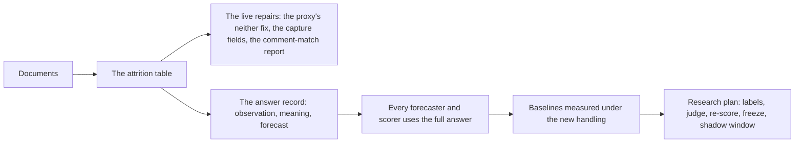

# Keeping all of Rick's answer, part 1: the pipeline

## 0. What this plan is for

Lupin stores Rick's whole answer: yes, no or neither, the comment on any of the three, typed Other text, multi-select picks and empty selections. It then loses parts of the answer at four kinds of step:

1. **The forecasters** can only answer a bare yes or a bare no, or pick a listed option. That is two of the six yes/no answer types: yes, no and neither, each with or without a comment.
2. **The scorers** grade the stance and ignore the comment, and they score typed text as a miss or leave it out.
3. **The principle writer** gets the words of the answer but not the structure linking a comment to the option it changes.
4. **The decision proxy's trust feedback** turns every answer into "approved or not".

The audit lists the 13 paths. The expert reached the same findings independently at `a1f2e67b6`, and ruled: **rebuild the answer contract and the experiment; keep the decision to stop the original layer 2 work.**

This plan is the pipeline half, which is needed whatever the research finds:

- **the live repairs**;
- **the answer record**, which gives one shape to an answer, its meaning and a forecast;
- **every forecaster and scorer using the full answer**;
- **new baselines** measured under that handling.

The research half is a separate plan in the principle learner research folder (Rick, ruling 7). It covers the gold labels, the judge, the principle memory repairs, the retrospective re-score and the shadow window, and it depends on this plan.

## 1. Rulings this plan carries (Rick, walkthrough of 23 Nov)

1. **The live repairs wait for the cascade.** Nothing is built before the cascade review of both plans rules.
2. **The four experiment arms are named** *mechanical rulesets*, *no answer history*, *answer history* and *learned principles*, everywhere. No arm or track is ever called by a code letter.
3. **The boundary with the 18 Nov plan.** This plan replaces only the answer-handling parts of its phases 7, 8 and 9: what a forecast may say, and how it is scored against the whole answer. Their switches, checkpoint and frozen baseline stay with Mr. Radio.
4. **Baselines first.** The material-error rate and the accuracy rate are first measured as baselines once this plan's answer handling is in place. No target for either is set before then.

The research plan carries the other rulings: the deciding test, the worthwhile gain, the rubric bar and the anchoring test.

## 2. Principles that hold in every phase

- **Keep the whole answer as evidence, even when interpreting it is hard.** Its literal form, its operational meaning, and whether it warrants a lasting preference are three different things, recorded separately.
- **A comment can change the action.** A forecast of "yes" for "yes, but leave the configuration alone" earns the stance and fails the action.
- **No universal half-credit.** A paraphrase of an option gets full credit. A modification gets credit for the option it builds on, plus separate credit for its condition.
- **Every count names its unit.** Cards, fields and answers are different denominators:
  - 473 cards contain typed text;
  - 437 of the 528 literal departures on fully recommended cards are typed;
  - 524 typed answers are counted per question.
- **Ask time is a hard boundary.** A forecast is frozen when the card is asked. The annotation of the actual answer comes after it and never feeds back into it.
- **Each change sits behind its own INI switch**, off by default, and is reported as a paired difference against a frozen baseline. This is the 18 Nov plan's checkpoint rule.
- **Coverage**: 100% lines and branches on every changed file, checked per file. This is the 18 Nov plan's section 3, "Acceptance and coverage conventions". A phase that changes no code says so.
- **Executors**: every acceptance check is marked `EXECUTOR: AI` or `EXECUTOR: HUMAN <reason>`.

## 3. Phases

### Documents

- Serialise this plan, the research plan, the expert's response (its frontmatter was added on 23 Nov) and the audit.
- Record Rick's rulings in the TODO Decisions Log.
- **Acceptance**: both plans and the response are committed, the R&D guard passes, and the R&D README links them. `EXECUTOR: AI`.
- **Coverage**: no code changes.

### The attrition table (the expert's first step)

This step counts how many units of an answer survive each step of the pipeline.

**The units**:
- the stance: yes, no, neither, or no recognised stance;
- the comment;
- typed Other text;
- each multi-select pick;
- an explicit empty selection.

**The steps**:
1. the raw stored outcome;
2. the meaningful field (`history_derive.derive_answer`);
3. the writer's input (`extractor_rules.field_answers`);
4. the stored evidence;
5. the forecaster's input;
6. the scorer's input (`accuracy_comparators`, `replay_loop._score`).

It runs on the run 2 archive and on the live database, read-only, inside a `READ ONLY` transaction. Each figure gives its run time and sha.

**What it answers**:
- how many yes/no texts become `unread` and are skipped by the writer;
- how often the extractor reads a pre-reveal draft instead of the final answer;
- how many typed answers equal a label character for character. In historical data, a click cannot be told from typing for those answers.

**Acceptance**:
- The table gives counts per unit per step, each step names the symbol it measured, and each count is reproduced by a committed read-only query or script. `EXECUTOR: AI`.
- A positive control: one planted answer of each kind is seen to survive, or not survive, at each step. `EXECUTOR: AI`.

**Coverage**: any helper code kept in the tree is at 100%.

### The live repairs (each independent, each behind its own switch; built only after the cascade, per ruling 1)

**The proxy's neither fix.**
- **Today**: `agent_notification_dispatcher.ask_confirmation` returns `response_value…startswith( "yes" )`, and `decision_proxy/agreement.forecast_agreement` scores against that boolean.
- **Change**: `ask_confirmation` also returns the parsed stance and comment through `extract_qualifier_comment`. The trust feedback in `swe_team/orchestrator.py` then records:
  - a neither as **no ruling**: no trust update, logged;
  - a qualified yes as its own outcome, logged with its comment;
  - a plain yes or no as today.
- **Dispositions are kept.** The proxy keeps its shadow, suggest, act and defer dispositions. "The model deferred to Rick" and "Rick deferred the decision" are recorded as different events.
- **Acceptance**:
  - unit tests for all four answer shapes;
  - a test that a neither leaves the category's trust counters unchanged;
  - a replay of the 5 Nov organic `proxy_decisions` rows (the trust-gate audit), reporting how many agreements change under the new rule.

  `EXECUTOR: AI`.
- **Coverage**: `agent_notification_dispatcher.py`, `swe_team/orchestrator.py`, `decision_proxy/agreement.py`.

**The capture fields.**
- **The fields**, recorded at ask time and on answer:
  - `recommendation`: the option or stance the asker recommended, or none;
  - `timeout_action`: what happens on a timeout, which the card's "default" holds today;
  - the displayed highlight and option order;
  - `answer_source`: a click on a listed option, typed text, a comment box, voice, or a timeout.
- **Where they come from.** The card (`actionRequiredInteractive.ts`) already knows the input route; today it is not stored.
- **Why the default and the recommendation are separate fields.** The expert's subgroup check found they are not the same thing: 210 yes recommendations against 11 no recommendations on no-default cards.
- **Historical cards** keep "unknown" for any field they never recorded.
- **Every day without these fields loses data for good.** Rick weighed this and ruled that they wait for the cascade anyway (ruling 1).
- **Acceptance**:
  - a round-trip test per field, from card to stored row;
  - a test that a typed answer identical to a label is stored as typed;
  - a reversible migration.

  `EXECUTOR: AI`.
- **Coverage**: the router, the model and repository, and the TypeScript template (`c8 --100`).

**The comment-match report.**
- **Today**: `compare_yes_no` computes `qualifier_match` and nothing reads it.
- **Change**: `get_accuracy_summary` reports it as a second layer, "stance right" and "stance and comment right", beside the stance-only figure, which is kept as the bridge.
- **Acceptance**: a summary test over planted outcomes. `EXECUTOR: AI`.
- **Coverage**: `prediction_engine.py` (the summary method), `accuracy_comparators.py`.

### The answer record: observation, meaning, forecast

These are the expert's three linked records ("One envelope, two native answer types").

**Observation**, never edited:
- the card as shown, with stable field and option ids and the displayed order;
- the input route and the raw final response;
- the actor and the event times;
- the forecast exposure and the draft.

**Meaning**, versioned: an annotated reading, with supporting text spans, its uncertainty, the annotator and the schema version. It holds:
- **the native answer**: per field, the selected or endorsed option ids, an explicit empty selection, write-in text, and the options merely referred to;
- **the conversational acts**: approve, decline, challenge the premise, request information, defer, propose an alternative. Several may co-occur, with dependencies;
- **the conditions**: each with its scope, polarity, time or order, and modality, marked when it affects execution;
- **the alignment** with the recommendation;
- **the unknowns, kept apart**: no explicit stance, neither, a cancellation, an absent field, an unreadable payload, and an uncertain annotator.

**Forecast**: the same semantic fields plus probabilities, a generated gist and the model's own abstention. It is frozen at ask time.

**One shared labeller.** A single function proposes a meaning for a stored answer, using a model. It is the only writer of meaning records apart from human annotation. This is the audit's recommendation for its row 1.

**Acceptance**:
- the schema and its migrations;
- a round-trip test per native type and per kind of unknown;
- a test that a forecast record cannot be updated after its ask time;
- the labeller's agreement with the research plan's development gold labels, reported per class, never as one overall figure.

`EXECUTOR: AI`.

**Coverage**: the new models, repositories and the labeller.

### Every forecaster and scorer uses the full answer

**The reply format.** The reply formats and parsers in `context_baseline.py` (`YES_NO_ANSWERS`, `YES_NO_FORMAT`, `CHOICE_FORMAT`, `parse_reply`) change to the forecast record. A reply then gives:
- a normalised probability vector over yes, no and neither;
- the acts, as marginals;
- the probability of a material qualification, and the conditions it asserts;
- per field, the selected set of option ids, or a write-in or re-frame;
- the probability that the whole card is right;
- a gist, or an abstention.

**Which forecasters this covers.** The no answer history, learned principles and Opus forecasters share that parser. The expert: no prompt-only change can fix it. `predictor_version` already starts a new ledger when the prompt changes.

**The lookup engine.**
- When neither wins the vote, it forecasts neither instead of abstaining under `REASON_NEITHER_MAJORITY`. This finishes the 18 Nov plan's phase 8 for answer handling.
- Typed answers that the labeller maps to an option vote for that option, and carry their condition.
- The three-way forecaster's copied qualifier is scored for whether it expresses this card's constraint.

**The scorer layers** (the expert's section "What to score"):
1. **The complete-action measure.** The forecast gives the same immediate action or conversational act, keeps every material restriction or prerequisite, and invents nothing material.
   - On a multi-field card, every field that bears on the action must pass.
   - An abstention counts as no success.
   - Its coverage and its pass rate on the cards it answers are published beside the measure.
2. **The decomposition**: precision and recall over the condition atoms, with contradictions, omissions and unsupported additions flagged separately.
3. **Probability scores**: multiclass and binary Brier scores, calibration by confidence band, and neither recall and precision at a frozen threshold.
4. **The bridge**: the old stance-only score, kept.

**Acceptance**:
- a parser test per field and per refusal;
- a scorer test for each of the expert's six worked examples ("Recommended scoring examples"), with each expected verdict pinned to a literal;
- a test that an abstention scores as no success on the complete-action measure.

`EXECUTOR: AI`.

**Coverage**: `context_baseline.py`, `principles_call.py`, `opus_twins.py`, `accuracy_comparators.py`, `prediction_engine.py`, `three_way_stance.py`, the replay scorer.

### Baselines measured under the new handling (ruling 4)

With the answer record and full-answer scoring in place, re-score these on the archive and on live asks:
- the **mechanical rulesets**;
- the **no answer history** forecaster;
- the lookup engine;
- the three-way forecaster.

**Each is reported with**:
- its **accuracy rate** on the complete-action measure;
- its **material-error rate**: false permission, a missed prerequisite, an unwarranted refusal;
- the stance-only bridge.

**What the figures are for.** They are frozen as the baseline. They are the first honest numbers for the four yes/no answer types the forecasters could never produce. The research plan computes its rubric bar and its worthwhile-gain floor from them.

**Acceptance**: a frozen baseline report with its sha, cohort and denominators per unit, and a checkpoint hash the harness enforces, as the 18 Nov checkpoint does. `EXECUTOR: AI`.

**Coverage**: any harness change.

## 4. Baselines on the old labels (for reference only)

These come from the paper and the expert's recalculation. The step above restates each one under the new labels.

| Baseline | Result on the old labels |
|---|---|
| Mechanical rulesets: always yes on yes/no cards, the recommended or first option on multiple choice | 1,186 of 1,926 |
| Plain Opus | 1,176 of 1,926 |
| Always yes on yes/no cards | 621 of 769 (80.8%) |
| Always yes with no comment, scored on stance and on comment absence | 504 of 769 (65.5%) |

## 5. Risks

- **The answer schema touches the card UI.** The capture fields change the TypeScript template and the stored payload, so the c8 gate and an E2E run apply before any PR to main.
- **Two plans touch the same files as the 18 Nov plan.** The managers sequence their merges (ruling 3).
- **Richer outputs can invent conditions.** Hence precision on asserted conditions, and the contradiction flags.
- **The capture fields lose data every day they wait.** Rick accepted this in ruling 1.

## 6. Done means

- **The live repairs**: the proxy's neither fix, the capture fields and the comment-match report are each merged behind their own switch, with acceptance green and 100% coverage on their files.
- **The answer record and full-answer forecasting** meet their acceptance.
- **The new baselines** are frozen and hashed.

## 7. Questions for the cascade review

1. Is the meaning record's act vocabulary complete enough for both card types? It is approve, decline, challenge the premise, request information, defer, and propose an alternative.
2. Should the shared labeller run once over every stored answer, with its labels then frozen, or on demand?
3. Which proxy events, beyond neither and a qualified yes, need their own trust outcome?
