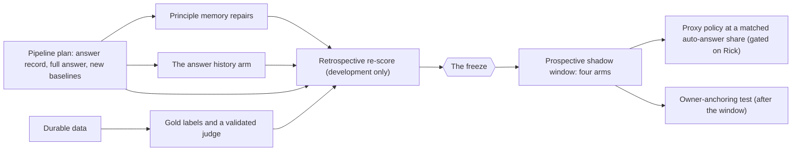

# Keeping all of Rick's answer, part 2: the experiment

## 0. What this plan is for

The first principle learner experiment was stopped on 21 Nov. Its forecasters could produce only two of the six yes/no answer types (a bare yes or a bare no), and its scorer ignored comments and typed text. So it measured a narrower question than the one the learner exists for.

The expert's ruling, which this plan adopts, is to keep the stop and to rebuild the experiment around a better question:

- Given exactly what Lupin could see when it asked, does a memory of Rick's earlier decisions improve its forecast of what he authorizes, including the conditions that change the next action?
- And do learned principles add anything over showing the forecaster his answer history directly?

This plan depends on the pipeline plan, which builds the answer record, the full-answer reply and scoring, and the new baselines. Nothing here runs before that is in place, except the durable-data step. Labelling starts only once meaning schema v1 is frozen (see Done means; Krishna-N3).

## 1. Rulings this plan carries (Rick, walkthrough of 23 Nov)

1. **The four arms are named**, everywhere:
   - *mechanical rulesets*: no model;
   - *no answer history*: plain Haiku;
   - *answer history*: Haiku shown Rick's earlier answers, retrieved whole;
   - *learned principles*: Haiku shown the learned principles.

   No arm or track is ever called by a code letter.
2. **The deciding test is learned principles against answer history**, on complete-action accuracy. Every other comparison is reported as an estimate.
3. **The smallest worthwhile gain is set at the freeze.** Its floor is a formula, ruled now: the gain is never smaller than the minimum the shadow window can detect at 80% power. That minimum is computed from the disagreement rate between the two arms, measured after the pipeline fixes and the retrospective re-score, and from the window's planned card count. Because it is computed after the fixes, it recalibrates by construction. Today's figures (2.5 to 3.5 points on 1,926 cards) come from the old labels and are placeholders only.
4. **The rubric bar** has two parts:
   - two human readers must agree on the action at Cohen's kappa of at least 0.7;
   - the bar for material errors is set only after the material-error rate and the complete-action accuracy (Rick said "accuracy rate"; renamed so it is not confused with `accuracy_match`) have been measured as baselines under the new answer handling. Today nobody knows those rates, because four of the six yes/no answer types were never forecast.
5. **The owner-anchoring test**, randomising the recommended badge and option order on live cards, runs **after** the shadow window, never inside it.
6. **The live repairs and all code wait for the cascade review.**
7. **Open-ended and batch open-ended answers are fully in** (Rick, card, 23 Nov about 13:00): all four arms forecast them, and the gold labels and the judge cover free text.
8. **Managers**: Cheech manages this plan; Mr. Radio manages the pipeline plan (Rick, about 12:56).

## 2. Principles that hold in every phase

- **Every count names its unit**: cards, fields or answers. One owner's correlated stream is never generalised beyond this stream and this period.
- **Ask-time is a hard boundary.** Every arm's forecast is committed before the outcome is released, and no arm sees a pending answer.
- **The archive is development data.** It has already shaped the new design and the re-spin fix, so it can never be the confirmatory test.
- **Coverage**: 100% lines, branches and functions on every changed file, checked per file. This is the 18 Nov plan's convention and the Lupin coverage mandate. The number comes from `src/tests/run-coverage-gate.sh` and is read from its per-file table for the files a phase names, not from its exit code.
- **The merge gate.** Code merges to the working branch only when three things hold: the unit tier is green for its changed files, `src/tests/run-census-guards.sh` is green, and a fresh reviewer seat gives a Merge verdict. Cheech spawns the implementer and the reviewer and runs the merge.
- **Executors**: every acceptance check is marked `EXECUTOR: AI` or `EXECUTOR: HUMAN <reason>`.

**Every human step** (cascade finding O29). Each Rick batch is a store row, blocked on him with a chase date, so an offline day is a deferral. The volumes are planning estimates, re-stated once the sample size is computed.

| Step | Executor | Expected volume | Fallback if it is not delivered by its chase date |
|---|---|---|---|
| Who the readers are and where Rick labels | Rick, one ruling | one decision | the plan waits; no labelling starts |
| Rick's blind share of the gold labels | `EXECUTOR: HUMAN` (Rick) | 0.2 of the development sample, about 60 to 80 cards, in batches of about 20 | the two AI readers' agreement is reported alone, marked as not human-anchored; Cheech decides |
| Disputes between readers | `EXECUTOR: HUMAN` (Rick) | estimated 10 to 20% of the sample | the card is marked unresolved and counted in the best and worst bounds |
| The three open worked examples (pipeline plan) | `EXECUTOR: HUMAN` (Rick) | 3 cards | the three tests cover the plain-code part only |
| The re-spin decision-stage example | `EXECUTOR: HUMAN` (Rick) | 1 card, in the first batch | the re-spin fixture stands on Cheech's proposed stage, marked as unadjudicated |
| The applicable principle for the diagnostic arm | `EXECUTOR: HUMAN` (Rick) | about 20 cards | that diagnostic arm is not run, and the report says so |
| The material-error bar | `EXECUTOR: HUMAN` (Rick) | one number | the freeze waits |
| The worthwhile gain, and whether a cheaper tie counts | `EXECUTOR: HUMAN` (Rick) | one number and one yes or no | the freeze waits |
| Human adjudication of every paired card, if he wants it | `EXECUTOR: HUMAN` (Rick), optional | the window's paired cards | the judge's difference plus the weighted residual (the default) |
| Opting in to the anchoring test, and confirming its consent and design | `EXECUTOR: HUMAN` (Rick) | one decision | the test does not run |
| Choosing the proxy's acceptable risk | `EXECUTOR: HUMAN` (Rick) | one number | no acting proxy; the proxy stays in shadow |
| The weekly audit of window pairs | `EXECUTOR: HUMAN` (Rick) | about 10 pairs a week for the window's length (about ten weeks, ruled on V10) | the week is marked unaudited and the judge's difference plus the weighted residual stands |
| Installing the daily health timer | `EXECUTOR: HUMAN` (a person; a seat installs none) | one install, then one test of the missing-day alarm | the window does not open; Cheech holds the row |
| The result decision after the window: adopt principles, keep answer history, or stop | `EXECUTOR: HUMAN` (Rick) | one decision | the row stays blocked with a chase date; nothing is adopted |

## 3. Phases



### Durable data

- The expert could not find the raw run 2 database, the per-card records or the paper's scripts at the paths the paper names. The scripts live only in `io/tmp/principle-learner-briefs/paper-scripts/`, which is swept after 7 days, around 28 Nov.
- **The new root** is `projects-data/lupin/principle-learner/`. Under it, the copy keeps the main checkout's relative layout (`io/…`). The paper scripts build every path from `LUPIN_ROOT`, and `source-hashes.txt` records each input relative to that root. So with `LUPIN_ROOT` set to the new root, the scripts run unchanged and their outputs can be compared byte for byte.
- **Steps**:
  1. Save today's outputs: copy `paper-scripts/out/` to `out-before/` in the session scratchpad.
  2. Copy four sources, all of which the scripts read (`common.py`):
     - the paper scripts, `io/tmp/principle-learner-briefs/paper-scripts/`;
     - the run 2 archive, `io/phase4-archive-run-2/`;
     - the model sample, `io/model-sample-run/`;
     - the asks file, `io/write-ups/online-preference-learning/2026.11.18-notification-asks-raw.jsonl` (20 MB).
  3. Leave out two things: the stray file `archive.sqlite?mode=ro`, which is an empty file made when a database address was opened as a path, and every `__pycache__`. Nothing is deleted at the source.
  4. Write the sha256 manifest, `MANIFEST.sha256`, at the new root over everything copied. If a hashing script is kept, it calls `cosa.utils.file_hash.file_sha256`. Plain `sha256sum` needs no script.
  5. In the copies only, change the default root in `common.py` and `run-all.sh` from the main checkout to the new root. That is two lines, so a run without `LUPIN_ROOT` set cannot fall back to the old files.
  6. Repoint section 10 in two places: the committed paper (`2026.11.21-principle-learner-negative-result-paper.md`, this folder) and the copied `paper-template.md`, which `build_paper.py` fills to make the paper. The change covers the "Every figure … was computed by" line and the "Source files read" paragraph, as a dated correction note naming the new root. It changes no figure and no finding.
- **Who and when.** Cheech runs it by 26 Nov. That is two days before the sweep of `io/tmp/` around 28 Nov, whether or not the cascade has closed, because waiting deletes the evidence. It changes no Lupin code.
- **Custody.** Cheech owns the new folder. It is kept with no end date, because the paper cites it. `src/scripts/sync-data-to-backup.sh` copies the whole of `projects-data` to the second disk, but no cron or timer entry runs it (checked 23 Nov: `crontab -l` and `systemctl --user list-timers`). So the folder is backed up only when that script is run by hand. **What one run does**: the script is an rsync mirror with `--delete` of the whole of `projects-data`, not an archive. Run without `--write` it is a dry run that previews and changes nothing, and with `--write` it makes the destination match the source, deleting at the destination whatever the source no longer holds. So Cheech reads the dry run's list of deletions first and runs `--write` only when it deletes nothing that belongs to a peer. **Who runs it again and when** (Maya-N7): Cheech, after the copy, after the gold labels freeze, after the freeze, and after the window closes. Each run is recorded on the row with its date. No timer is installed by this plan, because a seat installs none; a person may install one with the script's own instructions.
- **Who owns the paper.** Cheech owns the paper. Tiberius wrote it as Cheech's author seat, at Rick's request. The repoint in step 6 corrects where the inputs live, so Cheech makes it. An addendum, meaning any change to a figure or a finding, still waits for Rick's word (see the retrospective re-score).
- **Acceptance** (all `EXECUTOR: AI`, Cheech):
  - `sha256sum -c MANIFEST.sha256` passes at the new root, and the manifest names neither the stray file nor any `__pycache__`.
  - The run cannot read the old files. A fixed-string search of the copied scripts for the main checkout's path, `grep -rn -F '/projects/lupin' <new root>/io/tmp/principle-learner-briefs/paper-scripts/`, finds nothing. The old paths are not renamed, because peers read them. The search is shown able to find a hit by running it first on the uncopied scripts, where it finds the two default-root lines.
  - With `LUPIN_ROOT` set to the new root, `run-all.sh` runs, and `diff -r out-before/ <new root>/io/tmp/principle-learner-briefs/paper-scripts/out/` prints nothing.
  - A check script reads every path in the paper's section 10, in its "computed by" line and its "Source files read" paragraph, and every path exists under the new root. The script lives in the scratchpad.
- **Coverage**: no Lupin code changes. The two edited lines are in the copied paper scripts, which live outside the git tree and are not Lupin code, so the coverage gate does not apply to them.

### Gold labels and a validated judge

- **The development sample** covers all four card types (yes/no, multiple choice, open-ended, batch open-ended), multi-select, typed paraphrases, negation, questions, deferral, missing context and cancellation.
- **Two independent readers** map the fields, cite supporting spans, name the action-critical conditions and record any ambiguity. They build the references before seeing any prediction.
- **Who the readers are: held for Rick** (cascade finding O28). Ruling 4 asks for "two human readers", and Rick is the only person either plan names. The proposal, for Rick to rule on:
  - Two fresh AI reader seats each label the whole development sample, blind to each other and to every forecast.
  - Rick labels a blind share of it himself. That is the existing `repo/labelling/confirm.py` mode, with `BLIND_SHARE` at 0.2. He also settles every dispute.
  - The 0.7 kappa bar is measured between Rick and each AI reader on his blind share, so the bar stays anchored to a human. Agreement between the two AI readers on the whole sample is reported beside it, as a reproducibility figure, not as a human bar.
  - If Rick rules instead that a second person reads, this section names that person and tags their work `EXECUTOR: HUMAN`.
- **Rick settles disputed intent, and a random sample of the agreements.**
  - **Where he labels: held for Rick, with the readers question** (cascade finding C1b). The existing tools write packet files (`packets.export_packets`). The plan's "short voice batches" would need a bridge that turns a packet into batch open-ended cards, and that bridge is new. The proposal is the cards, about 20 items per batch.
  - His later recollection may clarify a reading. It must not make private facts look foreseeable at ask time.
  - The original disagreements, the adjudication and the schema version are all kept.
- **The protocol already exists** (Rio). It is `repo/labelling`:
  - `confirm.py` (`blind_sample_ids`, `export_confirm_packet`, `confirm_report`);
  - `adjudicate.py` (`disputes`, `resolve`);
  - `pair_labels.save_label`, whose append-only log, where the latest answer wins, is the correction log;
  - `labelled_set_seeder.check_plan_hash`, which refuses a sample plan edited after it was drawn.
- **Agreement on the action** uses `agreement.cohen_kappa` once the acts are a closed list. **Agreement on condition atoms** has no tool, and it is new: atom-level precision and recall between the readers. When kappa is undefined because both readers used one category, the report gives `None` and says why, following `confirm_report`. It is never given as zero or one.
- **The labels are frozen** for an analysis version, with a correction log. The unresolved fraction is reported, with best-case and worst-case bounds on the paired result.
- **Custody** (cascade finding O30). The frozen labels, the sealed answer key, the correction log and the judge validation report live under `projects-data/lupin/principle-learner/gold/`, with a sha256 manifest. The answer key is written once by `label_prep.prepare`, which refuses to overwrite it. It is held by Cheech, never by the seat that builds or tunes the judge.
- **The judge.** A model judge proposes the mappings and the condition comparisons, by atomic scoring with coverage and contradiction checks in both directions.
  - **Validation** uses a stratified probability sample of forecast-and-answer pairs from every arm. That includes easy cases, and forecasts that invent conditions on plain answers. Arm, principle and model identity are blinded.
  - **Minimal pairs** test it: "before" against "after", staging against production, "must" against "may", and a negated permission.
  - **Fixtures** (Maya-N13). The judge harness's unit tests use judge replies captured from the real model, through the real reader, with one committed fixture per kind of pair: each of the six minimal-pair kinds, an easy case, and an invented condition on a plain answer. They never use a stub that ignores its input. The live validation run is separate.
  - **Published**: judge-against-human and human-against-human agreement, sensitivity to material errors, specificity, class counts, intervals, and any bias by arm.
  - **Existing pieces** (Rio). The judge reuses:
    - kappa and positive and negative agreement from `duplicate_check/proof/ledger_agreement` (`kappa`, `positive_negative`);
    - intervals by resampling whole groups (`ledger_agreement.bootstrap`);
    - recall and precision per stratum (`against_labels`);
    - Clopper-Pearson intervals (`doc_lint/harness_report.interval`);
    - bias by arm, from `doc_lint/judge_comparison.group_rows` with the arm as the group;
    - blind packets and a sealed key from `label_prep.prepare`.
- **The judge's pass line** (cascade finding O31), stated now and frozen before validation starts:
  - sensitivity to material errors of at least 0.90, and specificity of at least 0.90, each with its lower 95% Clopper-Pearson bound reported;
  - at least 30 cards in every stratum that is scored;
  - 24 minimal pairs, four of each kind: "before" against "after", staging against production, "must" against "may", a negated permission, a scope change and a time change. The judge must flip its verdict on every pair. It is run once per pair. The judge runs through bounded Claude Code, which may not expose a temperature, so the plan does not promise one (Maya-N1). The report records the model, the prompt and rubric hash, and any sampling setting the transport does expose, read from the request it sends, with a test on that request; if the transport does expose a temperature it is set to zero and the same test reads it back. A miss fails the bar. One re-run of the whole minimal-pair set is allowed after a prompt or rubric change, which starts a new hash and so a new validation, and a re-run with only a new random seed does not count (Maya-N6).
  - **The sample size** is computed first, from the planned strata and the two 0.90 floors. Cheech computes it and records it on the row, before any validation card is drawn. This answers open question 1.
  - **Who adopts it**: Cheech declares the judge adopted when every line passes, and records the report's sha on the row.
- **A missed bar goes back to Rick** (Rachel, 23 Nov). If the readers' kappa or any judge pass line is missed, a store row is filed for Rick's decision, blocked on him with a chase date. Nobody changes the deciding measure alone, because it is his ruling 2. One possible answer is an annotation study plus a structured-action forecasting result.
- **Calibration and validation sets are separate**, and the validation set is sealed.
  - **The primary difference between arms.** The default uses the judge's paired difference, plus the probability-weighted residual between human and judge from the audit (stratified prediction-powered inference). Human adjudication of every paired card is used only if Rick chooses it at the freeze, after seeing the card count. "Affordable" is his decision, not the plan's.
  - **The estimator** extends `lupin_mcp.duplicate_check_sample_rejudge.estimate`, adding inverse-inclusion weights for the strata. It is not a second estimator.
  - **Re-validation is enforced, not remembered** (cascade finding O32). The validated judge's model, prompt and rubric are hashed into the freeze, and the harness refuses to score with any other hash. A test changes one character of the rubric and watches the refusal.
- **The rubric bar** (ruling 4):
  - kappa of at least 0.7 on the action, as the readers question above is settled;
  - **the material-error bar** is set from the pipeline plan's new baselines. Rick sets the number, after the baselines and before the freeze. It is recorded in the freeze document, `EXECUTOR: HUMAN` (Rick), because it is a judgement of how much error he will accept.
- **Acceptance**:
  - The labels. The readers' work, and Rick's blind share and adjudications, are human input, `EXECUTOR: HUMAN` (Rick's reading of his own intent; the AI readers are `EXECUTOR: AI`).
  - Freezing the labels, the manifest and the judge validation report. `EXECUTOR: AI` (Cheech).
  - Each judge pass line above, read from the report. `EXECUTOR: AI`.
  - The known-answer tests in the "Statistical code" list under the retrospective re-score. `EXECUTOR: AI`.
- **Coverage**, at 100% lines, branches and functions:
  - `src/cosa/repo/labelling/` (any change);
  - the new condition-atom agreement tool;
  - the inclusion-weighted extension of `src/lupin_mcp/duplicate_check_sample_rejudge.py`;
  - the judge harness and the sampling code.

  Each is named by path before it is built, and the merge gate's reviewer confirms the list is complete against `git diff --name-only` before giving a Merge verdict (Maya-O2). Rio's reuse search for the stratified draw (`stratified_sample`, `quota.draw`) and for the packet-to-card bridge is in section 8.

### Principle memory repairs

These follow the expert's rows "Principle extraction", "Evidence update", "Retrieval and application" and "Memory update".

**The writer's model path.** The extractor keeps its call path, `model_transport.complete`, which is bounded Claude Code under the cost model. It takes the answer's structure from the pipeline plan's meaning record, not from its own reading through `field_answers`. So one answer is read by one model, once.

**Model-dependent tests** (cascade finding O15). One extractor reply is captured from the real model, through the real reader, for each new relation and each new field. The replies are committed as fixtures, and the unit tests are built on them. A separate live check is named in row 3 below.

**The ten changes**, each behind its own switch, off by default, with a switch-off pin test showing behaviour is unchanged with the switch off. All are `EXECUTOR: AI`.

| # | Change | Switch | What a test asserts | Test file |
|---|---|---|---|---|
| 1 | **A bare yes may contradict or refine a principle.** Today `extractor_rules.check_field` refuses every relation except support for a bare yes | `principle learner bare yes relations enabled` | a planted bare yes with a contradicting principle is stored as `contradicts` | `test_extractor_rules.py` |
| 2 | **A fourth relation word, `uninformative`**, for a bare yes whose principle's antecedent is not in the card. It touches `RELATIONS`, `check_field`, the extractor's reply schema, `PreferenceEvidence.relation`'s documented values, and `derive_statuses`, which must not count it. Whether the antecedent is in the card is decided by the extractor, whose reply must quote the antecedent and state that the card lacks it; a reply without the quote is refused | `principle learner uninformative relation enabled` | the row is stored as `uninformative` with the quote; `derive_statuses` gives the same statuses with and without it | `test_extractor_rules.py`, `test_principle_status.py` |
| 3 | **Unread answers are not skipped.** An unrecognised yes/no text reaches the writer as raw text with the flag `unread_stance` | `principle learner unread answers enabled` | a planted unread text reaches the writer with the flag. **Live check** (cascade finding O26): the 4 unread yes/no texts the attrition table found are run through the real extractor. Registered now: each produces a stored row, either a relation or `uninformative`, and none is skipped | `test_principle_extractor_job.py` |
| 4 | **The structure reaches the writer.** Option ids and `modifies_option_id` come from the meaning record, not as a comma-joined string | `principle learner meaning record input enabled` | the writer's input carries the ids and the link for a comment on a multiple-choice card | `test_principle_extractor_job.py` |
| 5 | **Draft or final is explicit.** The log field `answer_read` is `final` or `draft`. It is the same change as row 4, delivered by the same switch, so it needs no key of its own (Maya-N15) | (row 4's switch) | the field is present on every extraction, with each value planted once | `test_principle_extractor_job.py` |
| 6 | **The decision stage is annotated, as a condition** (cascade finding X2, which replaces the vocabulary heading of the first revision). The stage is a condition on the principle, with two values: `who_decides` ("Ask me before re-spinning") and `what_to_do_once_asked` ("Yes, re-spin this agent now"). `principle_block` already prints "applies when: …". A 15th vocabulary heading would change the vocabulary and the extractor's rows, and `derive_statuses` counts only current-version evidence, so the vocabulary is not changed. The extractor's prompt changes, so `PROMPT_VERSION` rises | `principle learner decision stage enabled` | the planted re-spin fixture (below) | `test_principle_retrieval.py` |
| 7 | **Applicability is checked at retrieval.** `select_principles` already drops contested, retracted and unsupported principles, and zero principles is already legal. The two new checks are antecedent and decision stage. Both compare fields the extractor stored, so retrieval makes no model call | `principle learner applicability checks enabled` | the log field `applicability` lists each dropped principle with its rule, `antecedent` or `stage` | `test_principle_retrieval.py` |
| 8 | **A caveat reaches the forecaster.** This deliberately reverses `principle_block`'s rule that no rationale enters the prompt. That rule was a guard, so only a new stored `caveat` field, at most 200 characters, enters, inside the same suffix tags as the statements | `principle learner caveats enabled` | a caveat containing a closing tag and an instruction stays inside the tags and is cut at 200 characters | `test_principle_retrieval.py` |
| 9 | **Semantic condition equivalence**, computed when the evidence row is written and stored on it as `condition_key`. `derive_statuses` compares stored keys only, so the as-of replay stays repeatable | `principle learner condition keys enabled` | `derive_statuses` runs with a model transport that fails if it is called. A second test checks the key itself: a planted pair of semantically equal conditions gets one key, and a planted pair of different conditions gets two. The pairs are captured from real writer replies through the real reader and committed as fixtures (Maya-N10) | `test_principle_status.py` |
| 10 | **Evidence deduplicated by source.** Session-level independence already exists (`_sessions`, `MIN_SESSIONS = 2`). The new part is a finer `source_key`, so the same card asked twice, or one instruction restated, counts once. It follows the one-vote-per-copy shape of `three_way_stance.neighbours_of`. An explicit standing instruction and an inferred refusal are counted in separate tallies, each reported. An answer is an explicit standing instruction when the extractor's reply quotes words that state a rule beyond this card ("always", "never", "from now on" or the same sense) and names its scope; otherwise it is an inferred refusal. The quote is stored, and a reply that marks a standing instruction without one is refused (Maya-O24) | `principle learner source dedup enabled` | two rows sharing a `source_key` count once; the two tallies are reported separately | `test_principle_status.py` |

**The re-spin fixture** (cascade finding O25). This is a committed fixture, so the unit tier never reads `io/`. Its assertion is a retrieval result: for the card at the `what_to_do_once_asked` stage, the re-spin principle is absent from `principle_block`, and the `applicability` log names the rule `stage`.

**Re-annotating the 23 evidence rows** (cascade finding O25).
- A fresh AI seat annotates each row's decision stage, `EXECUTOR: AI`. It is given a file with the relation labels removed.
- The annotation file and its sha are written before the labels are opened.
- Both shas, the annotations' and the labels', go in the re-score report.
- The rows are in the run 2 archive, so this step waits for the durable-data copy.

**Coverage**: `src/cosa/agents/principle_learner/extractor_rules.py`, `extractor_prompt.py`, `extractor_job.py`; `src/cosa/agents/prediction_engine/history_derive.py`, `principle_retrieval.py`, `principle_status.py`, `principles_forecast.py`; and `src/cosa/rest/postgres_models.py` for the new evidence fields and for `applicability` on `prediction_arm_forecast` (row 7's log field, migration `b3f7d1a94e62`), each with an up-then-down migration test. The six evidence columns, in one migration (`a9d4e7b2c615`): `source_key` (row 10), `condition_key` (row 9), `caveat` (row 8), `decision_stage` (row 6), `antecedent` (row 2), and `standing_quote` (row 10's stored quote; NULL means an inferred refusal). `vocabulary.py` is not changed (row 6).

### The answer history arm (cascade finding V1)

The pipeline plan lists this arm, and this phase builds it. It is built before the retrospective re-score, which runs it on development data.

- **What it shows the model.** Rick's earlier answers, whole, each as its card's question, the options as shown with their ids, the recommendation, and his raw final response: stance, comment, typed text and picks, from the pipeline plan's observation view. It does not show the labeller's reading, so it never inherits the labeller's errors.
- **The retrieval rule** (cascade finding C5b). It does not reuse `context_arms._history_section`, which renders only the latest earlier answer on the same thread or session. It is built on `three_way_stance.neighbours_of`, over `time_sliced_store.TimeSlicedDecisionStore`. `neighbours_of` ranks earlier cards by question similarity with its independence weight, and ties are broken by recency. The store makes an answer visible only as of the ask. It follows `extractor_replay.principles_as_of` for the as-of rule. It uses the encoder and the owner and scope filters that principle retrieval uses. A card is eligible only if its answer and its meaning record existed before the ask, which is the ask-time boundary. The matched token budget is new.
- **The horizon.** Every card answered from 10 Sep up to one cutoff time: the window's opening time, recorded in the freeze as `window_start`. Inside the window, each ask also sees the answers that arrived after `window_start` and before that ask. The learned principles arm's store covers the same horizon. **Ruled (cascade finding V9)**: "Seed from a fresh extraction" (Rick, voice card, 23 Nov about 13:57, relayed by Rachel). The live principle store holds no principles today. Before the freeze, the revised extractor runs once over every answer this arm could retrieve when the window opens, from the same live table, with the same ask-time cutoff. The freeze time is the window's opening: `window_start` is set equal to the freeze time, so the seed snapshot, taken at that moment, and the freeze record are one event and carry one time stamp. The snapshot's hash is in the freeze. The seed extraction takes time, so answers can arrive while it runs. When it finishes, a catch-up pass extracts every answer stored after the run's start. The pass repeats until it finds none, and only then are the snapshot taken and the freeze written. So the principle store and the answer history arm see the same answers up to `window_start`. Run 2's archive principles are not used, and the store does not start empty. Both arms therefore start from the same evidence and the same horizon.
- **The budget.** The evidence-token budget matches the learned principles arm. It is the arm's mean evidence tokens on development data, fixed at the freeze. An unmatched run, with whatever budget answer history needs, is reported as an estimate with its cost. This is a proposed answer to open question 2.
- **The parser.** It replies through `context_baseline.parse_reply` from its first version.
- **How it runs** (cascade finding D1). It extends `principles_forecast.run_arm` with a block provider for the history, so it inherits that function's cap and failure handling rather than copying them. Its `version_suffix` includes a hash of the history-rendering code, so a change to how the history is shown starts a new ledger (the same trap as the parser, in Section B).
- **Acceptance** (all `EXECUTOR: AI`):
  - an emit test: this arm can produce a neither, a qualified answer and a write-in;
  - a boundary test: an answer stored after the ask is never retrieved;
  - a budget test: the rendered history never exceeds the budget;
  - a switch-off pin test for `principle learner answer history arm enabled`.
- **Coverage**: the new module `src/cosa/agents/prediction_engine/answer_history_forecast.py` and its tests.
- The retrieval rule, the horizon and the budget join the freeze list.

### Retrospective re-score (development and diagnosis only)

- Re-score the existing forecasts for literal against semantic choice, using the gold labels.
- **Adjudicate the re-spin decision-stage example.** Rick does this, `EXECUTOR: HUMAN` (his intent), as one card in his first labelling batch.
- **The arms already run** (Rio). Three of the four exist, so no seat builds a fifth:
  - *mechanical rulesets* are `replay_loop.BASELINE_ARMS` (`always_yes_arm`, `prior_majority_arm`), plus the counted prior;
  - *no answer history* and *learned principles* are arms of `archive_replay.ModelArms`, run by `replay_loop.replay`;
  - only *answer history* is new, and is built in its own phase above.

  The build writes each code arm name beside its plan name in the report header.
- **Run the expert's diagnostic arms, on development data only**:
  - **learned principles and answer history drawn from the same sources**, to separate selection from compression. The helper that shares the sources is new and small;
  - **historical qualifiers removed**, to measure their incremental signal;
  - **an adjudicated applicable principle supplied**, to separate a retrieval failure from misuse downstream. Rick adjudicates which principle applies, `EXECUTOR: HUMAN`, in the same batch;
  - **a model-only anchoring check**: the badge and the position cue hidden, each option's identity kept. It touches no live card. Hiding the badge changes `episode_view` (`_is_recommended`). `predictor_version` does not hash `episode_view`, so `episode_view` is added to the hash, and the change starts a new ledger.
- **Cost and latency of each arm** (cascade finding O36). The report gives tokens and elapsed seconds per arm, from `phi4_flash_lite_study/report.per_arm_table`'s `elapsed_seconds` pattern. It gives no dollars, because on bounded Claude Code the SDK's `cost_usd` is a notional figure.
- **Re-check the expert's corrections to the paper** ("Conclusions to keep, narrow, and remeasure"). Each restated figure appears in the report with its unit:
  - the mechanical rulesets become a benchmark, not a ceiling;
  - the yes/no headroom is restated with neither recall.
- This step's disagreement rate between learned principles and answer history feeds the worthwhile-gain floor (ruling 3).
- **Pairing** (cascade finding C4c). Arms are paired by ask id and snapshot sha, copying `phi4_flash_lite_study/replay_harness.pair_records`, never by position.
- **Statistical code with known answers** (cascade finding O33). Each piece gets a test on synthetic data with a planted effect and an expected result written as a literal:
  - **block resampling** extends `ledger_agreement.bootstrap`, with sessions or contiguous time blocks as the groups. `newcombe` is not used, because it assumes independent proportions. Test: over 1,000 simulated runs, a stated 95% interval covers a planted effect in 930 to 970 runs (93 to 97 percent), and the test runs inside the unit tier's time (Maya-N6);
  - **the weighted estimator**: test that it gives the unweighted `estimate` answer when every weight is one, and the exact answer on a planted two-stratum case;
  - **the power function and the minimum detectable gain** are new; no power code exists in the tree. Test: checked against the closed-form two-proportion answer at two parameter sets;
  - **the discordant counts**: planted pairs whose exact counts are known.
- **The report is checked by a program, not by review** (cascade finding O34). A report lint fails the report if a table has no unit or denominator, if a paired difference has no interval, or if a denominator's unit differs from its header. It is tested on a planted bad table it must refuse. Every archive-cohort table is stamped "development". The confirmatory path refuses an archive cohort, with a test.
- **Acceptance**:
  - The re-score report passes the report lint. `EXECUTOR: AI`.
  - Each known-answer test above passes. `EXECUTOR: AI`.
  - The report lint refuses its planted bad table, and the confirmatory path refuses an archive cohort. `EXECUTOR: AI` (Maya-N14).
  - An addendum to the paper only on Rick's word. `EXECUTOR: HUMAN` (Rick).
- **Coverage**, at 100% lines, branches and functions. The estimator, the resampling, the power code and the report lint are kept in the tree, so this line binds. They are `src/cosa/research/preference_replay/replay_loop.py`, `src/cosa/repo/duplicate_check/proof/ledger_agreement.py`, a new `src/cosa/research/preference_replay/power.py`, a new `src/cosa/research/preference_replay/report_lint.py`, and their tests.

### The freeze

- **Frozen and hashed before the shadow window opens**:
  - the revised learner;
  - the answer history arm's retrieval rule, horizon and evidence-token budget;
  - the baselines, including the counted prior's number and ceiling;
  - the labels and the judge;
  - the thresholds;
  - the worthwhile gain (at or above its floor);
  - any margin and cost target for a tie at lower cost;
  - the deciding test and the stop rule;
  - the judge's model, prompt and rubric hash, and the material-error bar;
  - the served card bundle's hash, `tree_state.bundle_hash`, so a card change during the window shows as a changed hash (cascade finding D8);
  - the owner-anchoring test's design.
- **One freeze document** (Rio). It extends `archive_replay.current_freeze`, which already lists the code commit, the vocabulary and extractor versions, the encoder, k, the principle limit, the lag, the window start and the model ids. `checkpoint_report.write_checkpoint` writes the extended record. This is the second checkpoint Rick ruled for (V6): the 18 Nov checkpoint stays for that plan's phases, whose results for phases 6 to 11 are re-scored once as an added column (pipeline plan, "How the freeze is enforced"), and this one is what the harness enforces for the experiment. Every run names the checkpoint it is scored against. No third hash is added.
- **Every threshold is inside the hash.** `judge_comparison.check_report_binds` leaves thresholds out of its report, so a run at other thresholds passes. This freeze does not repeat that gap.
- **The two exceptions in `check_freeze` do not apply in the window.** Those are `accept_code_change`, and a higher principle limit when the multiplier was 0. Inside the shadow window any change refuses.
- **The harness refuses to report against a hash that differs.**
- **"Floor" names** (cascade finding C4b). The code's `operational_floor` is a count of discordant pairs. This plan's floor for the worthwhile gain is an effect size, so it is called the **minimum detectable gain**, and "floor" is never used for both in one report. `assert_floor_pre_stated` is reused for the stated-before-run rule.
- **Acceptance** (all `EXECUTOR: AI` unless marked):
  - Rick sets the worthwhile gain, and decides whether a cheaper tie counts. `EXECUTOR: HUMAN` (Rick), because it is the size of gain worth acting on.
  - **One refusal test per frozen item** (cascade finding O35). Changing that item alone makes the harness refuse. The tests are built from one list constant, `FROZEN_ITEMS`, which is asserted to be non-empty, so an item added later is tested too.
  - The harness refuses a worthwhile gain below the minimum detectable gain. It is tested at one step below that value and at the value.
  - The harness refuses to write a forecast row for one of the shadow window's arms unless a freeze record with an earlier time stamp exists, with a test. It applies to the window's arms only. The 18 Nov forecasters (the phase 6 and 7 switches and the three-way shadow) write `PredictionArmForecast` rows live today with no freeze record, and a second test asserts that such a live arm still writes its row (Maya-N3).
- **Coverage**: `src/cosa/research/preference_replay/archive_replay.py`, `src/cosa/research/preference_replay/checkpoint_report.py`, at 100% lines, branches and functions.

### Prospective shadow window: four arms

- **The arms**:
  - **mechanical rulesets**: always yes or the recommended option, plus the strongest model-free baseline chosen on development data. That baseline is an online prior counted by card type, question family and recommendation. It extends `three_way_stance.backoff_prior`, which already backs off from family to project to overall counts with recency weighting, by adding card type, recommendation and comment counts. The live three-way shadow arm calls that function, so the extension is reached only through a new keyword argument whose default reproduces today's behaviour. No INI switch is needed, because only this window's arm passes the argument. A switch-off pin test runs the three-way shadow arm on a fixed fixture of cards, with and without the extension in the tree, and asserts byte-identical output (Krishna-N1). It also counts how often answers carry no comment or a qualification. It is counting, not modelling (cascade finding V4):
    - **What it can say**: yes, no or neither, with or without "a condition applies", and one listed option per field. It cannot name a condition and cannot write in.
    - **Where it comes from**: it is chosen by complete-action accuracy on development data from three candidates: always yes, the recommended option, and the counted prior.
    - **Its ceiling**: the share of cards whose complete action needs no named condition and no write-in. The retrospective re-score measures that share, and it is stated before the freeze.
    - **Its counts are frozen at each ask**: only answers released before the ask are counted, as for every arm. A test asserts that the count at ask time leaves out that ask and every later one (cascade finding O41).
    - **Who chooses it**: Cheech, by complete-action accuracy on development data. The choice is recorded in the freeze.
    - **It stores a forecast row** in the live window, like every other arm, in `PredictionArmForecast` (cascade finding D3). It is never recomputed afterwards, so the freeze refusal and the ask-time boundary apply to it too.
    - **Its baseline number** is measured in the retrospective re-score and frozen at the freeze. The pipeline plan's baselines re-score only the old rulesets.
  - **no answer history**: plain Haiku, with the full output space.
  - **answer history**: Haiku plus Rick's earlier complete answers, at the same history horizon and a matched evidence-token budget. This is the comparison the first experiment lacked.
  - **learned principles**: Haiku plus the learned principles.
- **The deciding test** is learned principles against answer history (ruling 2). Learned principles against no answer history replicates the earlier product question, and the mechanical rulesets are the adoption benchmark.
- **The temporal protocol.**
  - For each ask, the rendered card, its session context, the model and the store snapshot are frozen. Every arm's prediction is committed before the outcome is released.
  - An earlier card's feedback is admitted only after both its answer and its extraction exist. Overlapping asks never see each other's pending answers.
  - Answers Rick wrote, proxy-generated answers, revealed forecasts, rows of unknown origin and timeout rows stay distinguishable. Forecasts stay hidden for the unaided target.
  - **The mechanics** (cascade finding D2):
    - "On time" is `forecast_ready_at <= responded_at`. `preference_replay/arm_summary.summarize_arm` already partitions rows into timely, late, not ready and capped. Late, not-ready and capped rows are left out of the paired test and counted in the report.
    - Origin is read from the existing fields: `exposure.UNAIDED` and `revealed_before_answer` for exposure, and `answered_by` with the pipeline plan's `answer_source` for who answered.
  - **Each promise has a refusal and a test** (cascade finding O38). The promises are listed in one constant, `PROTOCOL_PROMISES`, and a census guard, `test_every_protocol_promise_refuses`, asserts the list is not empty and runs one refusal test per promise. The promises are:
    - a late forecast is refused as a timely row;
    - an overlapping ask never sees another ask's pending answer;
    - every origin value round-trips;
    - a shadow forecast never appears in a notification payload;
    - an earlier card's feedback is not admitted before its answer and extraction both exist.

    A sixth promise added later is covered by the guard.
- **The decision rule.**
  - The paired risk difference on all eligible cards. The arms are paired by ask id and snapshot sha (`pair_records`), never by position.
  - It reuses `replay_loop.summarize`'s pairing and discordant counts, but not its verdict (cascade finding C4a). That verdict is McNemar at p below 0.05 on pairs treated as independent, and one owner's cards are correlated.
  - Intact sessions or contiguous time blocks are resampled, through the extended `ledger_agreement.bootstrap`, with sensitivity to the block length and to removing each high-volume family.
  - The horizon is fixed by simulating from development sessions (burst lengths, arrival rates, disagreement, audit fraction, missingness), or an explicit sequential design is used. The simulation is new code, in `power.py`, with the known-answer tests above.
  - Secondary tests are estimates only.
- **Running the window** (cascade finding O39). **Ruled (cascade finding V10)**: "About ten weeks, 1,926 cards, then re-plan" (Rick, voice card, 23 Nov about 13:57, relayed by Rachel). The window runs for about ten weeks or 1,926 cards asked, whichever comes first, and the plan is then revisited. The 1,926 counts cards asked, from Krishna's rate of about 29 a day. The eligible pairs the deciding test uses are fewer, and the report gives both counts.
  - **Owner**: Cheech owns it as a store row, checked on the manager's 10-minute tick.
  - **Where it runs**: on the dev server, `:7999`, where Rick's live asks arrive. It is not a `:8000` job.
  - **Daily health**: a daily per-arm table of asks, timely rows, late, not ready and capped. If any arm misses more than 5% of a day's asks, an urgent notify goes to Rick and the row is marked. The 10-minute tick is the context-pressure check and does not produce this table. A durable job does: a systemd user timer or a crontab entry running a script that reads `arm_summary.py`, writes the table to `io/write-ups/online-preference-learning/window-health/<date>.md`, and posts the urgent notify. A person installs the timer, because a seat installs none, and Cheech owns the row until it is installed. The install is a line in the human-step table, and "timer installed, and its missing-day alarm seen to fire once" is a condition of the freeze record, so the window cannot open without it (Maya-N2). A second check, run by the same timer, raises the same urgent notify if a day's file is missing, so a missed day is an alarm (Maya-N8).
  - **No bounce during the window.** A bounce of `:7999` while the window runs changes the served code, and the standing policy lets any seat bounce it, so nothing prevents a bounce; asking Cheech first is a convention. The control is detection: the bundle hash and the code hash are checked against the freeze at each ask, and by the daily timer's script, which raises the urgent notify on a mismatch. A change to arm code refuses, as the freeze section says (Krishna-N2; Maya-O39, N3).
  - **Missed cards**: a card that any arm missed is left out of every arm's paired test, and counted.
  - **What is logged at each ask**: the served bundle hash (`tree_state.bundle_hash`) and the card type, so a UI change or a change in the card-type mix shows up in the record.
- **The recurring human audit** (cascade finding O40). Rick audits about 10 window pairs a week, `EXECUTOR: HUMAN` (Rick), as a store row blocked on him with a chase date. Each week's result returns to him as that row. The arms' model spend is recorded on the row by the manager, and it needs no ask to Rick.
- **The result is a row for Rick** (Maya-N9). When the report lands, Cheech opens a store row for Rick's decision on the result, with the three options: adopt the learned principles, keep the answer history, or stop. The row is blocked on him (`blocked_by` of kind `user`) with a chase date, and carries the report's path and sha. Which option is chosen is Rick's alone, and this plan makes none of them.
- **Acceptance**: the window runs to its frozen horizon. The report gives the deciding test with its interval, the effective number of blocks and disagreements, and every secondary measure as an estimate. `EXECUTOR: AI`. Also, with their tags (Maya-N14): the prior's as-of test (`EXECUTOR: AI`); the census guard `test_every_protocol_promise_refuses` (`EXECUTOR: AI`); a test that each per-arm health counter is counted from planted timely, late, not-ready and capped rows (`EXECUTOR: AI`).
- **Coverage** (cascade finding O45), at 100% lines, branches and functions, read from `src/tests/run-coverage-gate.sh`'s per-file table: `src/cosa/agents/prediction_engine/answer_history_forecast.py`, the counted prior (an extension of `three_way_stance.backoff_prior` in `src/cosa/agents/prediction_engine/three_way_stance.py`, not a new file; Rio E7), `src/cosa/research/preference_replay/arm_summary.py` (the per-arm health counters) and `src/cosa/agents/prediction_engine/principles_forecast.py` (the block provider).

### Proxy policy at a matched auto-answer share (gated on Rick)

- **Two words for two quantities** (cascade finding D5). "Coverage" in this plan means the share of asks an arm forecast. The share of cards the proxy answers on its own is the **auto-answer share**.
- **Which proxy** (cascade finding D4). The policy is carried by `decision_proxy`, which holds the trust modes and the conformal wrapper. `notification_proxy/responder.py` is not part of this. Whether live cards ever reach it was not verified (Rio D 5c); the build runs a one-off query that counts live cards answered through it, and records the count on the proxy policy row (no code is kept). If the count is above zero, it is added to this policy's scope (Maya-N4).
- **The window runs the proxy in `shadow` trust mode only**: it records what it would have done and acts on nothing.
- **The threshold** extends `decision_proxy/conformal_wrapper.ConformalDecisionWrapper.calibrate`. It is fixed on development data.
- **The risk bound** is the one-sided exact upper bound on the error rate. The tree has two candidates, `doc_lint/harness_report.upper_bound` and `symindex/candidates/shadow_audit.audit_bound`. Before the build, both are read, and the report names the one that computes that bound. They are not interchangeable: they give different bounds once there is one miss, so the choice is fixed before the first run and a test pins the chosen function's bound at zero and at one miss (Rio D 6).
- Compare material errors per auto-answered card at the same auto-answer share, and report them per eligible ask too. The error kinds are false permission, a missed prerequisite and an unwarranted refusal.
- The confidence threshold is frozen on development data.
- **No acting proxy until Rick has chosen the acceptable risk.** For scale (the expert's figure): zero material errors in 100 independent auto-answers still leaves an upper risk near 3%. About 299 error-free answers are needed to bring it below 1%.
- **The act disposition refuses without Rick's record** (cascade finding O42). The proxy's acting disposition refuses unless a record of Rick's chosen risk exists, with its date and the threshold's hash. A test shows the refusal. The module holding the act disposition is found by the build's first step, written here by path before the build, and checked by the merge gate's reviewer like the other coverage lists (Maya-O2).
- **A zero-error claim** is worded as the judge's finding at its measured sensitivity, unless every auto-answered card has had a human audit.
- **Executors**: Rick chooses the risk, `EXECUTOR: HUMAN`; the measurement is `EXECUTOR: AI`.
- **Acceptance** (all `EXECUTOR: AI`): the refusal test above, and the bound's pin test (Rio D 6).
- **Coverage**: `src/cosa/agents/decision_proxy/conformal_wrapper.py` and the module holding the act disposition (path listed before the build), at 100% lines, branches and functions.

### Owner-anchoring test (after the window, ruling 5)

- On consenting, eligible, low-stakes cards (**low-stakes is one predicate in code**, written by Cheech as part of the design and added to the freeze list; the proposal is a card whose options all leave the running system unchanged, with a destructive, outward-facing or production action excluded, and Rick confirms it when he opts in; Maya-O43), randomise the badge's visibility and the option order, holding the advice and the timeout action constant.
- Measure semantic endorsement, qualification, time to answer and cancellation. **Where each comes from** (Rio D 10): endorsement and qualification come from the pipeline plan's meaning record, the stance and the conditions of the answer; time to answer is the answer's time stamp minus the ask's, from the notification row; cancellation comes from the capture fields' answer route and the meaning record's cancellation unknown. So the test depends on the pipeline plan's capture fields being merged and switched on, and its done means says so.
- It starts only after the shadow window closes. The randomiser refuses to start while the window is open, with a test.
- **Consent** (cascade finding O43b). **Ruled**: "One opt-in you can withdraw" (Rick, voice card, 23 Nov about 13:57, relayed by Rachel). One opt-in by Rick covers the test, and he can withdraw it at any time by turning the switch off. There is no consent card by card.
- **Assignment** (cascade finding D6). It copies the shape of `src/cosa/rest/dm_experiment.py`: a seeded schedule committed before the start, an `assignment_at` that never reads the clock, inactive by default, and one eligibility chokepoint. It does not copy that file's unit, a clock interval. Each card is assigned by a hash of its card id with the committed seed, and the arm is stored when the card is sent.
- **Three traps** (cascade finding D7):
  - the default highlight could reveal the recommendation, so cards whose default equals the recommended option are not eligible;
  - the option shuffle is render-only, and cards answered by position, such as document choices, are not eligible;
  - both the `recommended` flag and the "(Recommended)" label suffix are hidden in the hidden-badge arm.
- **The design** (cascade finding O43):
  - about 390 cards per arm, the paper's two-proportion figure for a 10-point difference;
  - the analysis is the difference in endorsement, with block-resampled intervals;
  - it stops at the planned count, or after 8 weeks, whichever comes first;
  - eligibility is one predicate in code, behind `notification anchoring test enabled = false`, which is also the kill switch;
  - a guard refuses an ineligible card;
  - a test asserts that the advice text and the timeout action are identical across arms;
  - the seed and the assignment log are kept with the report.
- The design joins the freeze list.
- **Acceptance**: Rick opts in, `EXECUTOR: HUMAN`; the measurement is `EXECUTOR: AI`.
- **Coverage**: the randomiser and its guard (a new `src/cosa/rest/anchoring_experiment.py`), at 100% lines, branches and functions.

## 4. What the counts can support (the expert's planning figures, not measurements)

| Eligible pairs | Detectable gain if 15% of pairs disagree | if 30% disagree |
|---|---:|---:|
| 1,926 cards | 2.5 points | 3.5 points |
| 769 yes/no cards | 4.0 | 5.6 |
| 473 multiple-choice cards with typed text | 5.1 | 7.2 |
| 108 neither answers | 10.6 | 15.3 |
| 36 no answers | not reachable | 25.3 |

Strata as small as the 36 noes are reported descriptively only.

## 5. Risks

- **Free-text cards add labelling work.** Ruling 7 brings open-ended and batch cards in, so the reference labels and the judge validation cover free text. That may roughly double the human reading, so the judge validation sizes it first.
- **Rick's labelling time is the scarce input.** Each of his batches is a store row, blocked on him with a chase date, so an offline day defers the work and does not stall it. If a batch is not delivered by its chase date, the manager, Cheech, decides the fallback: the measure falls back to what the two readers can reproduce, and the report says so.
- **The judge can be dominated by plain yeses.** Hence the stratified audit and the per-class figures.
- **Richer outputs can invent conditions.** Hence precision on asserted conditions.
- **One owner, correlated cards.** Every conclusion is about this stream and this period.
- **The served card can change during the window** (open question 3). The bundle hash is logged at each ask and frozen, so a change is visible, and the report splits the window at it.
- **Capped rows shrink the paired sample unevenly by arm.** The shared `CapGate` writes rows with `CAPPED_ARM_REASON` ("capacity"). The report counts capped rows per arm, and the paired test uses only cards that every arm forecast.
- **A repair merged and switched off produces no data.** Each switch's state is logged at each ask, and the freeze records which switches are on.

## 6. Done means

- The durable-data step is verified, by 26 Nov.
- **The order between the two plans** (cascade finding V5). Labelling starts only after this order is met:
  1. Mr. Radio freezes meaning schema v1 in the pipeline plan.
  2. Cheech's readers label the development gold set against that frozen schema.
  3. Before any tuning, Cheech sets aside a held-back slice of the development gold labels. The shared labeller is tuned on the rest and accepted on that slice only, the same separation the judge already has.
  4. to 6. The judge is validated, the baselines are measured and the material-error bar is set, as in the pipeline plan's Done means, steps 4 to 6 (Krishna-V2).
- Every merge of code goes through the merge gate in section 2.
- **The answer history arm is merged** through that gate, behind `principle learner answer history arm enabled`, before the retrospective re-score runs it (Rio D 11b). Its acceptance (emit, boundary, budget and switch-off pin tests) is green and it has 100% lines, branches and functions.
- **The anchoring test depends on the pipeline plan's capture fields** being merged and switched on, because its measures read them (Rio D 10).
- The labels and the judge are frozen and validated against the rubric bar.
- The principle memory repairs are merged behind their switches.
- The retrospective re-score is reported.
- The freeze is hashed, with Rick's numbers.
- The shadow window reports the deciding test at its frozen horizon.
- The proxy policy and the anchoring test wait on Rick. Each is a store row, blocked on him with a chase date.
- **Who turns switches on** (cascade finding O44). The plan's manager turns each switch on after its merge gate and switch-off pin test pass, and records that on the row. Rick turns on the acting proxy and the anchoring test.
- **Done is a query.** When the cascade closes, each phase becomes a store row with the correlation key `epic:answer-signal-experiment`. Each bullet above maps to one row, and each row closes with its receipt (a commit, a test run or a report path). Rows waiting on Rick (the proxy policy, the anchoring test, the result decision) are blocked on him. "Done" is `task_query( correlation_key="epic:answer-signal-experiment", status=<each of queued, in_progress, blocked> )` returning no row **except** rows blocked with `blocked_by` of kind `user`, which the done report lists by name. The plan is done when only Rick's decisions remain. A reader who wants the stricter meaning, nothing waiting on Rick, drops the exception (Maya-N4).

## 7. Questions for the cascade review

1. Is a development sample of a few hundred cards enough to reach the rubric bar, or does the judge validation need its own sample size computed first?
2. Should the answer history arm's token budget match the learned principles arm exactly, or match what answer history needs, with the cost reported?
3. How long can the shadow window run before case-mix drift and UI revisions outweigh the gain in power?

## 8. Reuse review of section 3 (Rio, cascade stage 1, 23 Nov, Sections A to D)

Rio searched for existing code for the durable-data step and ruled on it. His ruling is sent to Cheech as a bare line and committed here, because reviewers do not commit. The step ids name section 3's phases: `3-durabledata` the durable-data step, `3-memoryrepairs` the principle memory repairs, `3-goldlabels` the gold labels and the judge, `3-rescore` the retrospective re-score, `3-freeze` the freeze, `3-historyarm` the answer history arm, `3-shadowwindow` the prospective shadow window, `3-proxypolicy` the proxy policy and `3-anchoring` the owner-anchoring test. Each ruling's `SEARCHED` lines list the candidates Rio read.

```text
RULING durable_data_copy :: DISTINCT no code is written, plain sha256sum -c; any kept script must call cosa.utils.file_hash.file_sha256 :: reuse-receipt: 91e7d058bbbfa4e8 :: search: rs-7b4254bbd3

REUSE-OUTCOME 91e7d058bbbfa4e8 :: rs-7b4254bbd3 :: WROTE_NEW no code; a plain sha256sum manifest, and any kept hashing script calls file_sha256 :: src/rnd/v0.2.4/2026.11.17-principle-learner-research/2026.11.23-answer-signal-experiment-plan.md#3-durabledata

SEARCHED durable_data_copy :: rs-7b4254bbd3 :: cosa.research.phi4_flash_lite_study.replay_harness.load_frozen_rows :: RELATED :: verifies a snapshot against its manifest on load
SEARCHED durable_data_copy :: rs-7b4254bbd3 :: cosa.agents.prediction_engine.history_derive.write_dataset :: RELATED :: writes a dataset with a sha256 manifest
SEARCHED durable_data_copy :: rs-7b4254bbd3 :: lupin_mcp.session_spawner.spawn_sessions :: UNRELATED :: spawns seats
SEARCHED durable_data_copy :: rs-7b4254bbd3 :: cosa.research.phi4_flash_lite_study.freeze_corpus.freeze :: RELATED :: manifest freeze of one corpus file
SEARCHED durable_data_copy :: rs-7b4254bbd3 :: cosa.research.phi4_flash_lite_study.freeze_corpus.verify_snapshot :: RELATED :: re-derives a checksum from a manifest

RULING b8_uninformative_relation :: EXTEND cosa.agents.principle_learner.extractor_rules.check_field :: reuse-receipt: db7c85b59f6a5136 :: search: rs-282dd23f38
RULING b9_evidence_dedupe :: EXTEND cosa.agents.prediction_engine.principle_status.derive_statuses :: reuse-receipt: db7c85b59f6a5136 :: search: rs-282dd23f38
RULING b10_rationale_and_semantic_conditions :: EXTEND cosa.agents.prediction_engine.principle_retrieval.principle_block :: reuse-receipt: db7c85b59f6a5136 :: search: rs-282dd23f38
RULING b11_applicability_check :: EXTEND cosa.agents.prediction_engine.principle_retrieval.select_principles :: reuse-receipt: db7c85b59f6a5136 :: search: rs-282dd23f38
RULING b12_decision_stage :: EXTEND cosa.agents.principle_learner.extractor_rules.check_field :: reuse-receipt: db7c85b59f6a5136 :: search: rs-282dd23f38
SEARCHED b8_uninformative_relation :: rs-282dd23f38 :: scripts.eval_provenance.compute_sample_signature :: UNRELATED :: sample signature
SEARCHED b8_uninformative_relation :: rs-282dd23f38 :: cosa.rest.routers.tasks.query_tasks :: UNRELATED :: task store query
SEARCHED b8_uninformative_relation :: rs-282dd23f38 :: cosa.agents.heartbeat_arbiter.arbiter_job.ArbiterConsumerJob.__init__ :: UNRELATED :: arbiter setup
SEARCHED b8_uninformative_relation :: rs-282dd23f38 :: cosa.agents.swe_team.orchestrator.SweTeamOrchestrator._verify_result :: UNRELATED :: crew result check
SEARCHED b8_uninformative_relation :: rs-282dd23f38 :: cosa.agents.decision_proxy.trust_tracker.TrustTracker :: UNRELATED :: proxy trust counters
SEARCHED b9_evidence_dedupe :: rs-282dd23f38 :: scripts.eval_provenance.compute_sample_signature :: UNRELATED :: sample signature
SEARCHED b9_evidence_dedupe :: rs-282dd23f38 :: cosa.rest.routers.tasks.query_tasks :: UNRELATED :: task store query
SEARCHED b9_evidence_dedupe :: rs-282dd23f38 :: cosa.agents.heartbeat_arbiter.arbiter_job.ArbiterConsumerJob.__init__ :: UNRELATED :: arbiter setup
SEARCHED b9_evidence_dedupe :: rs-282dd23f38 :: cosa.agents.swe_team.orchestrator.SweTeamOrchestrator._verify_result :: UNRELATED :: crew result check
SEARCHED b9_evidence_dedupe :: rs-282dd23f38 :: cosa.agents.decision_proxy.trust_tracker.TrustTracker :: UNRELATED :: proxy trust counters
SEARCHED b10_rationale_and_semantic_conditions :: rs-282dd23f38 :: scripts.eval_provenance.compute_sample_signature :: UNRELATED :: sample signature
SEARCHED b10_rationale_and_semantic_conditions :: rs-282dd23f38 :: cosa.rest.routers.tasks.query_tasks :: UNRELATED :: task store query
SEARCHED b10_rationale_and_semantic_conditions :: rs-282dd23f38 :: cosa.agents.heartbeat_arbiter.arbiter_job.ArbiterConsumerJob.__init__ :: UNRELATED :: arbiter setup
SEARCHED b10_rationale_and_semantic_conditions :: rs-282dd23f38 :: cosa.agents.swe_team.orchestrator.SweTeamOrchestrator._verify_result :: UNRELATED :: crew result check
SEARCHED b10_rationale_and_semantic_conditions :: rs-282dd23f38 :: cosa.agents.decision_proxy.trust_tracker.TrustTracker :: UNRELATED :: proxy trust counters
SEARCHED b11_applicability_check :: rs-282dd23f38 :: scripts.eval_provenance.compute_sample_signature :: UNRELATED :: sample signature
SEARCHED b11_applicability_check :: rs-282dd23f38 :: cosa.rest.routers.tasks.query_tasks :: UNRELATED :: task store query
SEARCHED b11_applicability_check :: rs-282dd23f38 :: cosa.agents.heartbeat_arbiter.arbiter_job.ArbiterConsumerJob.__init__ :: UNRELATED :: arbiter setup
SEARCHED b11_applicability_check :: rs-282dd23f38 :: cosa.agents.swe_team.orchestrator.SweTeamOrchestrator._verify_result :: UNRELATED :: crew result check
SEARCHED b11_applicability_check :: rs-282dd23f38 :: cosa.agents.decision_proxy.trust_tracker.TrustTracker :: UNRELATED :: proxy trust counters
SEARCHED b12_decision_stage :: rs-282dd23f38 :: scripts.eval_provenance.compute_sample_signature :: UNRELATED :: sample signature
SEARCHED b12_decision_stage :: rs-282dd23f38 :: cosa.rest.routers.tasks.query_tasks :: UNRELATED :: task store query
SEARCHED b12_decision_stage :: rs-282dd23f38 :: cosa.agents.heartbeat_arbiter.arbiter_job.ArbiterConsumerJob.__init__ :: UNRELATED :: arbiter setup
SEARCHED b12_decision_stage :: rs-282dd23f38 :: cosa.agents.swe_team.orchestrator.SweTeamOrchestrator._verify_result :: UNRELATED :: crew result check
SEARCHED b12_decision_stage :: rs-282dd23f38 :: cosa.agents.decision_proxy.trust_tracker.TrustTracker :: UNRELATED :: proxy trust counters

REUSE-OUTCOME db7c85b59f6a5136 :: rs-282dd23f38 :: EXTENDED cosa.agents.principle_learner.extractor_rules.check_field :: src/rnd/v0.2.4/2026.11.17-principle-learner-research/2026.11.23-answer-signal-experiment-plan.md#3-memoryrepairs
REUSE-OUTCOME db7c85b59f6a5136 :: rs-282dd23f38 :: EXTENDED cosa.agents.prediction_engine.principle_status.derive_statuses :: src/rnd/v0.2.4/2026.11.17-principle-learner-research/2026.11.23-answer-signal-experiment-plan.md#3-memoryrepairs
REUSE-OUTCOME db7c85b59f6a5136 :: rs-282dd23f38 :: EXTENDED cosa.agents.prediction_engine.principle_retrieval.principle_block :: src/rnd/v0.2.4/2026.11.17-principle-learner-research/2026.11.23-answer-signal-experiment-plan.md#3-memoryrepairs
REUSE-OUTCOME db7c85b59f6a5136 :: rs-282dd23f38 :: EXTENDED cosa.agents.prediction_engine.principle_retrieval.select_principles :: src/rnd/v0.2.4/2026.11.17-principle-learner-research/2026.11.23-answer-signal-experiment-plan.md#3-memoryrepairs
REUSE-OUTCOME db7c85b59f6a5136 :: rs-282dd23f38 :: EXTENDED cosa.agents.principle_learner.extractor_rules.check_field :: src/rnd/v0.2.4/2026.11.17-principle-learner-research/2026.11.23-answer-signal-experiment-plan.md#3-memoryrepairs

RULING c1_gold_label_process :: EXTEND cosa.repo.labelling.confirm.export_confirm_packet :: reuse-receipt: ae2ac3d28f62bf19 :: search: rs-36475edc3e
RULING c2_judge_validation :: EXTEND cosa.repo.duplicate_check.proof.ledger_agreement.compare :: reuse-receipt: fa46584d448d68d2 :: search: rs-61d4277c8a
RULING c3_stratified_estimate :: EXTEND lupin_mcp.duplicate_check_sample_rejudge.estimate :: reuse-receipt: 4ab6a033a316882a :: search: rs-7c4a1ea5c8
RULING c4_paired_interval :: EXTEND cosa.repo.duplicate_check.proof.ledger_agreement.bootstrap :: reuse-receipt: 03a064f7df24d70d :: search: rs-982b0d9440
RULING c4_power_and_horizon :: DISTINCT no power, minimum detectable gain or horizon simulation exists; reuse assert_floor_pre_stated for the stated-before-run rule :: reuse-receipt: 14566b0f06c8c4f2 :: search: rs-04ff09ca6d
RULING c5_retrospective_rescore :: EXTEND cosa.research.preference_replay.replay_loop.replay :: reuse-receipt: 7194350a2e419cb5 :: search: rs-dc274f19c9
RULING c6_freeze :: EXTEND cosa.research.preference_replay.archive_replay.current_freeze :: reuse-receipt: 63fa12949754962f :: search: rs-38ff7a6cc3
SEARCHED c1_gold_label_process :: rs-36475edc3e :: cosa.repo.duplicate_check.proof.label_prep.prepare :: RELATED :: blind packets plus sealed answer key
SEARCHED c1_gold_label_process :: rs-36475edc3e :: cosa.repo.labelling.packets.export_subset_packet :: RELATED :: packet export for a subset
SEARCHED c1_gold_label_process :: rs-36475edc3e :: cosa.repo.duplicate_check.proof.flag_items.stage :: UNRELATED :: stages flagged items
SEARCHED c1_gold_label_process :: rs-36475edc3e :: cosa.repo.labelling.confirm.export_confirm_packet :: RELATED :: second reader confirm packet to extend
SEARCHED c1_gold_label_process :: rs-36475edc3e :: cosa.repo.labelling.packets.export_packets :: RELATED :: base packet export
SEARCHED c2_judge_validation :: rs-61d4277c8a :: cosa.repo.labelling.agreement.agreement_report :: RELATED :: reader agreement report
SEARCHED c2_judge_validation :: rs-61d4277c8a :: cosa.repo.labelling.agreement.cohen_kappa :: RELATED :: kappa between two readers
SEARCHED c2_judge_validation :: rs-61d4277c8a :: cosa.repo.duplicate_check.proof.ledger_agreement.bootstrap :: RELATED :: interval by resampling groups
SEARCHED c2_judge_validation :: rs-61d4277c8a :: cosa.repo.duplicate_check.proof.ledger_agreement.compare :: RELATED :: judge against human comparison to extend
SEARCHED c2_judge_validation :: rs-61d4277c8a :: cosa.repo.doc_lint.harness_report.build_report :: RELATED :: report with intervals
SEARCHED c3_stratified_estimate :: rs-7c4a1ea5c8 :: cosa.agents.deep_research.prompts.planning.quick_smoke_test :: UNRELATED :: smoke test of a prompt
SEARCHED c3_stratified_estimate :: rs-7c4a1ea5c8 :: cosa.agents.deep_research.cli.run_research :: UNRELATED :: research command line
SEARCHED c3_stratified_estimate :: rs-7c4a1ea5c8 :: cosa.agents.test_fix_expediter.orchestrator.TFEOrchestrator._write_multi_cluster_plan_doc :: UNRELATED :: writes a fix plan document
SEARCHED c3_stratified_estimate :: rs-7c4a1ea5c8 :: cosa.agents.test_fix_expediter.prompts.fix.quick_smoke_test :: UNRELATED :: smoke test of a prompt
SEARCHED c3_stratified_estimate :: rs-7c4a1ea5c8 :: cosa.agents.test_fix_expediter.prompts.proposal.build_proposal_system_prompt :: UNRELATED :: builds a system prompt
SEARCHED c4_paired_interval :: rs-982b0d9440 :: cosa.rest.routers.notifications.notify_user :: UNRELATED :: sends a notification
SEARCHED c4_paired_interval :: rs-982b0d9440 :: cosa.agents.calculator.xml_models.CalcIntent :: UNRELATED :: calculator model
SEARCHED c4_paired_interval :: rs-982b0d9440 :: cosa.research.phi4_flash_lite_study.statistics.compare_arms :: RELATED :: paired arm comparison, McNemar
SEARCHED c4_paired_interval :: rs-982b0d9440 :: lupin_mcp.reuse_needset.stage_c_score.bootstrap :: RELATED :: bootstrap of a score
SEARCHED c4_paired_interval :: rs-982b0d9440 :: cosa.agents.calculator.xml_models.CalcIntent.get_example_for_template :: UNRELATED :: calculator example
SEARCHED c4_power_and_horizon :: rs-04ff09ca6d :: cosa.research.phi4_flash_lite_study.statistics.assert_floor_pre_stated :: RELATED :: floor stated before the run, a count not a gain
SEARCHED c4_power_and_horizon :: rs-04ff09ca6d :: cosa.rest.task_store_rules.ratio_gate_advisory :: UNRELATED :: task store ratio advisory
SEARCHED c4_power_and_horizon :: rs-04ff09ca6d :: cosa.research.phi4_flash_lite_study.report.main :: UNRELATED :: report entry point
SEARCHED c4_power_and_horizon :: rs-04ff09ca6d :: cosa.rest.task_store_rules.ratio_gate_headroom :: UNRELATED :: task store headroom
SEARCHED c4_power_and_horizon :: rs-04ff09ca6d :: lupin_cli.claude_code.hooks.lib.roster_consistency.find_roster_disagreements :: UNRELATED :: roster check
SEARCHED c5_retrospective_rescore :: rs-dc274f19c9 :: cosa.research.preference_replay.replay_loop.replay :: RELATED :: the replay to extend
SEARCHED c5_retrospective_rescore :: rs-dc274f19c9 :: cosa.research.preference_replay.archive_replay.run_first_stage :: RELATED :: runs the model arms
SEARCHED c5_retrospective_rescore :: rs-dc274f19c9 :: cosa.research.preference_replay.extractor_replay.run_replay :: RELATED :: replays the extractor
SEARCHED c5_retrospective_rescore :: rs-dc274f19c9 :: cosa.agents.model_registry.ModelRegistry._initialize_default_models :: UNRELATED :: model registry defaults
SEARCHED c5_retrospective_rescore :: rs-dc274f19c9 :: cosa.agents.deep_research.cli.main :: UNRELATED :: research command line
SEARCHED c6_freeze :: rs-38ff7a6cc3 :: cosa.repo.doc_lint.harness_runner.run_pair :: UNRELATED :: runs a doc lint pair
SEARCHED c6_freeze :: rs-38ff7a6cc3 :: cosa.repo.doc_lint.labelled_set_seeder.cmd_redraw :: RELATED :: redraws a hashed sample plan
SEARCHED c6_freeze :: rs-38ff7a6cc3 :: cosa.repo.doc_lint.harness_cli.run_after_checks :: UNRELATED :: checks after a harness run
SEARCHED c6_freeze :: rs-38ff7a6cc3 :: cosa.repo.doc_lint.labelled_set_seeder.cmd_plan :: RELATED :: writes the hashed sample plan
SEARCHED c6_freeze :: rs-38ff7a6cc3 :: cosa.repo.doc_lint.labelled_set_seeder.cmd_write :: RELATED :: writes labelled set

REUSE-OUTCOME ae2ac3d28f62bf19 :: rs-36475edc3e :: EXTENDED cosa.repo.labelling.confirm.export_confirm_packet :: src/rnd/v0.2.4/2026.11.17-principle-learner-research/2026.11.23-answer-signal-experiment-plan.md#3-goldlabels
REUSE-OUTCOME fa46584d448d68d2 :: rs-61d4277c8a :: EXTENDED cosa.repo.duplicate_check.proof.ledger_agreement.compare :: src/rnd/v0.2.4/2026.11.17-principle-learner-research/2026.11.23-answer-signal-experiment-plan.md#3-goldlabels
REUSE-OUTCOME 4ab6a033a316882a :: rs-7c4a1ea5c8 :: EXTENDED lupin_mcp.duplicate_check_sample_rejudge.estimate :: src/rnd/v0.2.4/2026.11.17-principle-learner-research/2026.11.23-answer-signal-experiment-plan.md#3-goldlabels
REUSE-OUTCOME 03a064f7df24d70d :: rs-982b0d9440 :: EXTENDED cosa.repo.duplicate_check.proof.ledger_agreement.bootstrap :: src/rnd/v0.2.4/2026.11.17-principle-learner-research/2026.11.23-answer-signal-experiment-plan.md#3-rescore
REUSE-OUTCOME 14566b0f06c8c4f2 :: rs-04ff09ca6d :: WROTE_NEW power, minimum detectable gain and horizon simulation in a new power.py, with known-answer tests :: src/rnd/v0.2.4/2026.11.17-principle-learner-research/2026.11.23-answer-signal-experiment-plan.md#3-rescore
REUSE-OUTCOME 7194350a2e419cb5 :: rs-dc274f19c9 :: EXTENDED cosa.research.preference_replay.replay_loop.replay :: src/rnd/v0.2.4/2026.11.17-principle-learner-research/2026.11.23-answer-signal-experiment-plan.md#3-rescore
REUSE-OUTCOME 63fa12949754962f :: rs-38ff7a6cc3 :: EXTENDED cosa.research.preference_replay.archive_replay.current_freeze :: src/rnd/v0.2.4/2026.11.17-principle-learner-research/2026.11.23-answer-signal-experiment-plan.md#3-freeze

RULING d1_answer_history_arm :: EXTEND cosa.agents.prediction_engine.principles_forecast.run_arm :: reuse-receipt: b3702aeeaf6a4ece :: search: rs-005afc228c
RULING d2_proxy_threshold :: EXTEND cosa.agents.decision_proxy.conformal_wrapper.ConformalDecisionWrapper.calibrate :: reuse-receipt: 64424b9b39ff2d11 :: search: rs-c264592e0c
RULING d3_anchoring_card_assignment :: DISTINCT no code assigns a test arm to each card; copy the design of dm_experiment, which assigns by clock interval :: reuse-receipt: 147ff4604274b4d6 :: search: rs-abcb767683
SEARCHED d1_answer_history_arm :: rs-005afc228c :: cosa.agents.prediction_engine.principles_forecast.run_arm :: RELATED :: the one path that stores an arm's row, to extend with a block provider
SEARCHED d1_answer_history_arm :: rs-005afc228c :: cosa.agents.prediction_engine.context_baseline.run_context_forecast :: RELATED :: the no answer history arm's runner
SEARCHED d1_answer_history_arm :: rs-005afc228c :: cosa.agents.prediction_engine.opus_twins.run_principles_opus :: RELATED :: twin arm that calls run_arm
SEARCHED d1_answer_history_arm :: rs-005afc228c :: cosa.agents.principle_learner.opus_call.run_principles_twin :: RELATED :: twin job wrapper
SEARCHED d1_answer_history_arm :: rs-005afc228c :: cosa.agents.prediction_engine.principles_forecast._write_row :: RELATED :: stores the arm row
SEARCHED d2_proxy_threshold :: rs-c264592e0c :: cosa.agents.swe_team.proxy.engineering_strategy.EngineeringStrategy.gate :: RELATED :: routes by trust level and confidence
SEARCHED d2_proxy_threshold :: rs-c264592e0c :: cosa.agents.decision_proxy.conformal_wrapper.ConformalDecisionWrapper.calibrate :: RELATED :: learns the threshold from held-out probabilities and labels
SEARCHED d2_proxy_threshold :: rs-c264592e0c :: cosa.agents.decision_proxy.conformal_wrapper.ConformalDecisionWrapper.predict_set :: RELATED :: applies the threshold
SEARCHED d2_proxy_threshold :: rs-c264592e0c :: cosa.agents.swe_team.proxy.engineering_strategy.EngineeringStrategy.calibrate_conformal :: RELATED :: calibrates from logged predictions
SEARCHED d2_proxy_threshold :: rs-c264592e0c :: cosa.agents.decision_proxy.conformal_wrapper.ConformalDecisionWrapper.get_status :: RELATED :: reports calibration status
SEARCHED d3_anchoring_card_assignment :: rs-abcb767683 :: cosa.utils.util_gcs.validate_gcs_bucket_access :: UNRELATED :: storage bucket check
SEARCHED d3_anchoring_card_assignment :: rs-abcb767683 :: cosa.rest.dm_experiment.load_default_policy :: RELATED :: loads the committed schedule once
SEARCHED d3_anchoring_card_assignment :: rs-abcb767683 :: cosa.rest.routers.dm._execute_experiment :: RELATED :: runs the in-window send and writes one row
SEARCHED d3_anchoring_card_assignment :: rs-abcb767683 :: lupin_arbiter_app.context_pressure_writer.build_context_pressure_section :: UNRELATED :: context pressure report
SEARCHED d3_anchoring_card_assignment :: rs-abcb767683 :: cosa.rest.dm_experiment.make_inactive_policy :: RELATED :: the off state when no schedule exists

REUSE-OUTCOME b3702aeeaf6a4ece :: rs-005afc228c :: EXTENDED cosa.agents.prediction_engine.principles_forecast.run_arm :: src/rnd/v0.2.4/2026.11.17-principle-learner-research/2026.11.23-answer-signal-experiment-plan.md#3-historyarm
REUSE-OUTCOME 64424b9b39ff2d11 :: rs-c264592e0c :: EXTENDED cosa.agents.decision_proxy.conformal_wrapper.ConformalDecisionWrapper.calibrate :: src/rnd/v0.2.4/2026.11.17-principle-learner-research/2026.11.23-answer-signal-experiment-plan.md#3-proxypolicy
REUSE-OUTCOME 147ff4604274b4d6 :: rs-abcb767683 :: WROTE_NEW per-card assignment by a hash of the card id with a committed seed, copying the shape of dm_experiment but not its clock-interval unit :: src/rnd/v0.2.4/2026.11.17-principle-learner-research/2026.11.23-answer-signal-experiment-plan.md#3-anchoring

RULING e3_condition_atom_agreement :: EXTEND cosa.repo.labelling.agreement.agreement_report :: reuse-receipt: 6a1d859067e401cd :: search: rs-61bc9a94f7
SEARCHED e3_condition_atom_agreement :: rs-61bc9a94f7 :: cosa.repo.labelling.agreement.agreement_report :: RELATED :: reader agreement with a symbol-set comparison to extend to atoms
SEARCHED e3_condition_atom_agreement :: rs-61bc9a94f7 :: cosa.repo.labelling.confirm.confirm_report :: RELATED :: reports kappa as None when undefined
SEARCHED e3_condition_atom_agreement :: rs-61bc9a94f7 :: lupin_mcp.reuse_needset.finalize.finalize :: UNRELATED :: closes a duplicate-check need set
SEARCHED e3_condition_atom_agreement :: rs-61bc9a94f7 :: cosa.repo.duplicate_check.proof.ledger_agreement.against_labels :: RELATED :: recall and precision per stratum against labels
SEARCHED e3_condition_atom_agreement :: rs-61bc9a94f7 :: cosa.research.preference_replay.checkpoint_report.label_metrics :: RELATED :: per-label precision and recall over a closed label list
RULING e4_packet_to_cards :: DISTINCT nothing turns a labelling packet into open-ended batch cards for the owner and reads the answers back as labels; reuse ask_open_ended_batch, its response parser and pair_labels.save_label :: reuse-receipt: 29b1b83c2f43cb51 :: search: rs-21bdeadb64
SEARCHED e4_packet_to_cards :: rs-21bdeadb64 :: cosa.repo.duplicate_check.proof.proof_cli._main :: UNRELATED :: proof command line
SEARCHED e4_packet_to_cards :: rs-21bdeadb64 :: cosa.repo.labelling.confirm.export_confirm_packet :: RELATED :: writes the packet the cards would carry
SEARCHED e4_packet_to_cards :: rs-21bdeadb64 :: cosa.repo.duplicate_check.proof.proof_cli.main :: UNRELATED :: proof command line
SEARCHED e4_packet_to_cards :: rs-21bdeadb64 :: cosa.repo.labelling.pair_labels.save_label :: RELATED :: the append-only label store the answers go to
SEARCHED e4_packet_to_cards :: rs-21bdeadb64 :: cosa.utils.notification_utils.quick_smoke_test :: UNRELATED :: smoke test of the answer parsers
RULING e5_judge_sampling :: EXTEND cosa.research.phi4_flash_lite_study.label_sheet.build_items :: reuse-receipt: aeb9f763ce934e06 :: search: rs-3e76ab7fc5
SEARCHED e5_judge_sampling :: rs-3e76ab7fc5 :: scripts.v2_eval.main :: UNRELATED :: router evaluation entry point
SEARCHED e5_judge_sampling :: rs-3e76ab7fc5 :: cosa.research.phi4_flash_lite_study.label_sheet.build_items :: RELATED :: draws paired outputs and writes a blinded sheet with a separate answer key; four arms and inclusion weights are the extension
SEARCHED e5_judge_sampling :: rs-3e76ab7fc5 :: cosa.research.phi4_flash_lite_study.replay_harness.main :: UNRELATED :: harness entry point
SEARCHED e5_judge_sampling :: rs-3e76ab7fc5 :: scripts.v2_eval.render_report :: UNRELATED :: renders an evaluation report
SEARCHED e5_judge_sampling :: rs-3e76ab7fc5 :: cosa.research.phi4_flash_lite_study.replay_harness.draw_seeded_subset :: RELATED :: seeded draw that keeps each row's origin
RULING e6_report_lint :: DISTINCT no check refuses a report whose table has no unit or denominator or whose paired difference has no interval; copy the refusal shape of judge_comparison.check_report_binds :: reuse-receipt: b0461a4df3530936 :: search: rs-22e40ce512
SEARCHED e6_report_lint :: rs-22e40ce512 :: scripts.v2_eval.main :: UNRELATED :: router evaluation entry point
SEARCHED e6_report_lint :: rs-22e40ce512 :: cosa.repo.doc_lint.gate.scope_check :: UNRELATED :: lints docstrings in a changed range
SEARCHED e6_report_lint :: rs-22e40ce512 :: cosa.repo.doc_lint.gate.main :: UNRELATED :: docstring gate entry point
SEARCHED e6_report_lint :: rs-22e40ce512 :: cosa.agents.test_suite.job.TestSuiteJob :: UNRELATED :: runs test suites
SEARCHED e6_report_lint :: rs-22e40ce512 :: scripts.v2_eval.compute_metrics :: UNRELATED :: computes metrics and checks nothing about a report
RULING e7_counted_prior :: EXTEND cosa.agents.prediction_engine.three_way_stance.backoff_prior :: reuse-receipt: 630723ab12c146f3 :: search: rs-7f2b33c4de
SEARCHED e7_counted_prior :: rs-7f2b33c4de :: cosa.agents.prediction_engine.three_way_stance.backoff_prior :: RELATED :: backs off from family to project to overall counts, recency-weighted; card type, recommendation and comment counts extend it
SEARCHED e7_counted_prior :: rs-7f2b33c4de :: cosa.agents.prediction_engine.three_way_stance.three_way_forecast :: RELATED :: calls the prior and forecasts a stance
SEARCHED e7_counted_prior :: rs-7f2b33c4de :: lupin_cli.claude_code.hooks.lib.heartbeat_work_owed.format_owed_summary :: UNRELATED :: formats an owed-work summary
SEARCHED e7_counted_prior :: rs-7f2b33c4de :: cosa.rest.routers.tasks._apply_transition_under_lock :: UNRELATED :: task store transition
SEARCHED e7_counted_prior :: rs-7f2b33c4de :: scripts.v2_eval.compute_metrics :: UNRELATED :: router evaluation metrics
RULING e8_shared_sources_helper :: DISTINCT nothing selects one set of source cards for two arms; reuse principles_forecast._prepare and extractor_replay.principles_as_of :: reuse-receipt: c57142a8e1354c8b :: search: rs-20bf4afba1
SEARCHED e8_shared_sources_helper :: rs-20bf4afba1 :: cosa.agents.prediction_engine.principles_forecast._prepare :: RELATED :: gathers each arm's inputs as of the ask
SEARCHED e8_shared_sources_helper :: rs-20bf4afba1 :: cosa.agents.prediction_engine.principles_forecast.run_arm :: RELATED :: stores one arm's row
SEARCHED e8_shared_sources_helper :: rs-20bf4afba1 :: cosa.research.preference_replay.replay_loop.replay :: RELATED :: replays the arms in time order
SEARCHED e8_shared_sources_helper :: rs-20bf4afba1 :: cosa.agents.heartbeat_arbiter.arbiter_job.ArbiterConsumerJob.__init__ :: UNRELATED :: arbiter setup
SEARCHED e8_shared_sources_helper :: rs-20bf4afba1 :: cosa.research.preference_replay.archive_replay.run_first_stage :: RELATED :: runs the arms over archived asks
RULING e9_act_refusal :: DISTINCT no refusal keyed to a stored record of the owner's chosen risk exists; copy the shape of task_approval_settings.refusal_for_admission and podcast_proxy.start_refusal :: reuse-receipt: 2060a8b0338268fa :: search: rs-70cd7e32bf
SEARCHED e9_act_refusal :: rs-70cd7e32bf :: cosa.rest.routers.tasks._apply_transition_under_lock :: RELATED :: refuses a transition without the needed authority
SEARCHED e9_act_refusal :: rs-70cd7e32bf :: cosa.rest.routers.tasks.create_task :: UNRELATED :: creates a task row
SEARCHED e9_act_refusal :: rs-70cd7e32bf :: cosa.rest.task_approval_settings.refusal_for_admission :: RELATED :: refuses a status change unless an approval record exists
SEARCHED e9_act_refusal :: rs-70cd7e32bf :: cosa.rest.routers.tasks.ask_to_unpark :: RELATED :: asks the owner through a card before a state change
SEARCHED e9_act_refusal :: rs-70cd7e32bf :: cosa.rest.task_promotion_resolver.resolve_ticket :: RELATED :: resolves a ticket from the owner's approval

REUSE-OUTCOME 6a1d859067e401cd :: rs-61bc9a94f7 :: EXTENDED cosa.repo.labelling.agreement.agreement_report :: src/rnd/v0.2.4/2026.11.17-principle-learner-research/2026.11.23-answer-signal-experiment-plan.md#3-goldlabels
REUSE-OUTCOME 29b1b83c2f43cb51 :: rs-21bdeadb64 :: WROTE_NEW a bridge from a labelling packet to batch open-ended cards, reusing ask_open_ended_batch and save_label :: src/rnd/v0.2.4/2026.11.17-principle-learner-research/2026.11.23-answer-signal-experiment-plan.md#3-goldlabels
REUSE-OUTCOME aeb9f763ce934e06 :: rs-3e76ab7fc5 :: EXTENDED cosa.research.phi4_flash_lite_study.label_sheet.build_items :: src/rnd/v0.2.4/2026.11.17-principle-learner-research/2026.11.23-answer-signal-experiment-plan.md#3-goldlabels
REUSE-OUTCOME b0461a4df3530936 :: rs-22e40ce512 :: WROTE_NEW a report lint copying the refusal shape of judge_comparison.check_report_binds :: src/rnd/v0.2.4/2026.11.17-principle-learner-research/2026.11.23-answer-signal-experiment-plan.md#3-rescore
REUSE-OUTCOME 630723ab12c146f3 :: rs-7f2b33c4de :: EXTENDED cosa.agents.prediction_engine.three_way_stance.backoff_prior :: src/rnd/v0.2.4/2026.11.17-principle-learner-research/2026.11.23-answer-signal-experiment-plan.md#3-shadowwindow
REUSE-OUTCOME c57142a8e1354c8b :: rs-20bf4afba1 :: WROTE_NEW a shared-sources helper, reusing _prepare and principles_as_of :: src/rnd/v0.2.4/2026.11.17-principle-learner-research/2026.11.23-answer-signal-experiment-plan.md#3-rescore
REUSE-OUTCOME 2060a8b0338268fa :: rs-70cd7e32bf :: WROTE_NEW an act refusal keyed to the owner's stored risk record, copying refusal_for_admission :: src/rnd/v0.2.4/2026.11.17-principle-learner-research/2026.11.23-answer-signal-experiment-plan.md#3-proxypolicy
```

### 3-historyarm build seat (María, 24 Nov)

```text
RULING cosa.agents.prediction_engine.answer_history_forecast.answer_history_enabled :: DUPLICATE :: reuse-receipt: 587509cf3080bbb2 :: search: rs-fd5d2aa387
SEARCHED cosa.agents.prediction_engine.answer_history_forecast.answer_history_enabled :: rs-fd5d2aa387 :: cosa.rest.routers.notifications._arm_forecast_ledger_enabled :: RELATED :: reads a different switch for the ledger, with its own key
SEARCHED cosa.agents.prediction_engine.answer_history_forecast.answer_history_enabled :: rs-fd5d2aa387 :: cosa.agents.prediction_engine.principles_forecast.principles_forecast_enabled :: RELATED :: the same one-line wrapper for the principles arm's key; the key is fixed in it
SEARCHED cosa.agents.prediction_engine.answer_history_forecast.answer_history_enabled :: rs-fd5d2aa387 :: lupin_app.main.lifespan :: UNRELATED :: app start-up
SEARCHED cosa.agents.prediction_engine.answer_history_forecast.answer_history_enabled :: rs-fd5d2aa387 :: cosa.research.preference_replay.archive_replay.main :: UNRELATED :: replay command entry point
SEARCHED cosa.agents.prediction_engine.answer_history_forecast.answer_history_enabled :: rs-fd5d2aa387 :: cosa.research.preference_replay.retune.retune :: UNRELATED :: retunes thresholds
SEARCHED cosa.agents.prediction_engine.answer_history_forecast.answer_history_enabled :: rs-fd5d2aa387 :: cosa.agents.prediction_engine.principles_forecast.switch_enabled :: SAME_JOB :: reads any one learner switch by key and reads an unreadable key as off; the new function passes its key to it
REUSE-OUTCOME 587509cf3080bbb2 :: rs-fd5d2aa387 :: REUSED cosa.agents.prediction_engine.principles_forecast.switch_enabled :: src/rnd/v0.2.4/2026.11.17-principle-learner-research/2026.11.23-answer-signal-experiment-plan.md#3-historyarm

RULING cosa.agents.prediction_engine.answer_history_forecast.approx_tokens :: DISTINCT a one-line text estimate, ceil( characters / 4 ), injectable as count_tokens; TokenCounter needs a model name and may floor, the other two take objects not text and live in other packages :: reuse-receipt: f910465a3012e9f9 :: search: rs-7bde4ed4ec
SEARCHED cosa.agents.prediction_engine.answer_history_forecast.approx_tokens :: rs-7bde4ed4ec :: cosa.rest.routers.notifications.notify_user :: UNRELATED :: sends a notification
SEARCHED cosa.agents.prediction_engine.answer_history_forecast.approx_tokens :: rs-7bde4ed4ec :: cosa.agents.prediction_engine.prediction_engine.PredictionEngine.record_forecast :: UNRELATED :: writes a forecast row
SEARCHED cosa.agents.prediction_engine.answer_history_forecast.approx_tokens :: rs-7bde4ed4ec :: cosa.agents.prediction_engine.prediction_engine.PredictionEngine.__init__ :: UNRELATED :: engine set-up
SEARCHED cosa.agents.prediction_engine.answer_history_forecast.approx_tokens :: rs-7bde4ed4ec :: cosa.rest.db.repositories.prediction_log_repository.PredictionLogRepository.get_accuracy_summary :: UNRELATED :: accuracy summary
SEARCHED cosa.agents.prediction_engine.answer_history_forecast.approx_tokens :: rs-7bde4ed4ec :: cosa.agents.prediction_engine.prediction_engine.PredictionEngine.record_outcome :: UNRELATED :: writes an outcome row
SEARCHED cosa.agents.prediction_engine.answer_history_forecast.approx_tokens :: rs-7bde4ed4ec :: cosa.agents.token_counter.TokenCounter.count_tokens :: RELATED :: counts per named model with tiktoken, and falls back to len // 4 (floor); the arm needs one fixed whole-number rule with no model name and no package, so the budget cannot move between runs
SEARCHED cosa.agents.prediction_engine.answer_history_forecast.approx_tokens :: rs-7bde4ed4ec :: cosa.agents.model_window.count_tokens :: UNRELATED :: asks a vLLM server over the network
SEARCHED cosa.agents.prediction_engine.answer_history_forecast.approx_tokens :: rs-7bde4ed4ec :: cosa.agents.heartbeat_arbiter.context_pressure._estimate_message_tokens :: RELATED :: ceil( len / 4 ) over one transcript message object, private to the arbiter
SEARCHED cosa.agents.prediction_engine.answer_history_forecast.approx_tokens :: rs-7bde4ed4ec :: lupin_mcp.reuse_pair_request.estimate_tokens :: RELATED :: ceil( len / 4 ) over the canonical JSON of a request body, in the reuse tooling package
REUSE-OUTCOME f910465a3012e9f9 :: rs-7bde4ed4ec :: WROTE_NEW a one-line text estimate, ceil( characters / 4 ), injectable as count_tokens; TokenCounter needs a model name and may floor, the other two take objects not text and live in other packages :: src/rnd/v0.2.4/2026.11.17-principle-learner-research/2026.11.23-answer-signal-experiment-plan.md#3-historyarm

RULING cosa.agents.prediction_engine.answer_history_forecast._plain :: DISTINCT a one-line json default that turns observation_view's read-only mapping into a dict; _freeze is its inverse and nothing thaws :: reuse-receipt: cd4024165051fb39 :: search: rs-2dde94ca00
SEARCHED cosa.agents.prediction_engine.answer_history_forecast._plain :: rs-2dde94ca00 :: cosa.rest.routers.notifications.notify_user :: UNRELATED :: sends a notification
SEARCHED cosa.agents.prediction_engine.answer_history_forecast._plain :: rs-2dde94ca00 :: cosa.rest.db.repositories.prediction_log_repository.PredictionLogRepository.always_yes_counts :: UNRELATED :: counts always-yes rows
SEARCHED cosa.agents.prediction_engine.answer_history_forecast._plain :: rs-2dde94ca00 :: cosa.agents.prediction_engine.exposure.observation_view :: RELATED :: builds the read-only mapping that json cannot write; it has no function that turns it back
SEARCHED cosa.agents.prediction_engine.answer_history_forecast._plain :: rs-2dde94ca00 :: cosa.research.preference_replay.archive_replay.main :: UNRELATED :: replay command entry point
SEARCHED cosa.agents.prediction_engine.answer_history_forecast._plain :: rs-2dde94ca00 :: cosa.agents.prediction_engine.prediction_engine.PredictionEngine.record_forecast :: UNRELATED :: writes a forecast row
SEARCHED cosa.agents.prediction_engine.answer_history_forecast._plain :: rs-2dde94ca00 :: cosa.agents.prediction_engine.exposure._freeze :: RELATED :: the inverse, dict to read-only mapping; exposure.py holds no thaw, unfreeze or plain function (grep of def names)
REUSE-OUTCOME cd4024165051fb39 :: rs-2dde94ca00 :: WROTE_NEW a one-line json default that turns observation_view's read-only mapping into a dict; _freeze is its inverse and nothing thaws :: src/rnd/v0.2.4/2026.11.17-principle-learner-research/2026.11.23-answer-signal-experiment-plan.md#3-historyarm

RULING cosa.agents.prediction_engine.answer_history_forecast.render_answer :: DISTINCT the card and answer text the arm shows, built on observation_view and fields_of, with option ids and the owner's raw response that no existing renderer prints :: reuse-receipt: 9b9f701438c15fcb :: search: rs-916ea0213b
SEARCHED cosa.agents.prediction_engine.answer_history_forecast.render_answer :: rs-916ea0213b :: cosa.agents.prediction_engine.exposure.observation_view :: RELATED :: builds the view that render_answer reads (card, option_ids, raw_response); it shows nothing as text
SEARCHED cosa.agents.prediction_engine.answer_history_forecast.render_answer :: rs-916ea0213b :: cosa.rest.routers.notifications.notify_user :: UNRELATED :: sends a notification
SEARCHED cosa.agents.prediction_engine.answer_history_forecast.render_answer :: rs-916ea0213b :: cosa.agents.prediction_engine.prediction_engine.PredictionEngine.record_forecast :: UNRELATED :: writes a forecast row
SEARCHED cosa.agents.prediction_engine.answer_history_forecast.render_answer :: rs-916ea0213b :: cosa.agents.prediction_engine.prediction_engine.PredictionEngine.__init__ :: UNRELATED :: engine set-up
SEARCHED cosa.agents.prediction_engine.answer_history_forecast.render_answer :: rs-916ea0213b :: cosa.rest.db.repositories.prediction_log_repository.PredictionLogRepository.get_accuracy_summary :: UNRELATED :: accuracy summary
SEARCHED cosa.agents.prediction_engine.answer_history_forecast.render_answer :: rs-916ea0213b :: cosa.agents.prediction_engine.episode_view.fields_of :: RELATED :: reads a card's fields and options with recommended flags; render_answer calls it
SEARCHED cosa.agents.prediction_engine.answer_history_forecast.render_answer :: rs-916ea0213b :: cosa.research.preference_replay.context_arms._option_lines :: RELATED :: prints a card's options for the embedded text of a context arm, with no option ids and no answer; its output is frozen into that arm's vectors, so changing it would move that arm
SEARCHED cosa.agents.prediction_engine.answer_history_forecast.render_answer :: rs-916ea0213b :: cosa.research.preference_replay.context_arms._answer_text :: RELATED :: a string stays as it is and anything else is sorted JSON; render_answer always writes JSON, so a typed string shows in quotes, one form per answer
REUSE-OUTCOME 9b9f701438c15fcb :: rs-916ea0213b :: WROTE_NEW the card and answer text the arm shows, built on observation_view and fields_of, with option ids and the owner's raw response that no existing renderer prints :: src/rnd/v0.2.4/2026.11.17-principle-learner-research/2026.11.23-answer-signal-experiment-plan.md#3-historyarm

RULING cosa.agents.prediction_engine.answer_history_forecast.render_history :: DISTINCT a strongest-first, whole-or-nothing packer that stops at the first answer that does not fit; fit_fragments_to_budget packs newest-first and drops the oldest :: reuse-receipt: 934b421672356b1a :: search: rs-bc974221cb
SEARCHED cosa.agents.prediction_engine.answer_history_forecast.render_history :: rs-bc974221cb :: cosa.rest.postgres_models.PredictionLog :: UNRELATED :: a table class
SEARCHED cosa.agents.prediction_engine.answer_history_forecast.render_history :: rs-bc974221cb :: cosa.rest.db.repositories.prediction_log_repository.PredictionLogRepository.record_seen :: UNRELATED :: records that a card was rendered
SEARCHED cosa.agents.prediction_engine.answer_history_forecast.render_history :: rs-bc974221cb :: cosa.rest.routers.notifications.record_prediction_seen :: UNRELATED :: endpoint that records a card was seen
SEARCHED cosa.agents.prediction_engine.answer_history_forecast.render_history :: rs-bc974221cb :: cosa.agents.prediction_engine.prediction_engine.PredictionEngine._predict_yes_no :: UNRELATED :: yes/no vote
SEARCHED cosa.agents.prediction_engine.answer_history_forecast.render_history :: rs-bc974221cb :: cosa.rest.routers.notifications.notify_user :: UNRELATED :: sends a notification
SEARCHED cosa.agents.prediction_engine.answer_history_forecast.render_history :: rs-bc974221cb :: cosa.agents.receptionist_agent.fit_fragments_to_budget :: RELATED :: packs the newest fragments that fit a token budget, dropping the oldest, by binary search; render_history takes the strongest first and stops at the first that does not fit, so a weaker answer never replaces a stronger one
REUSE-OUTCOME 934b421672356b1a :: rs-bc974221cb :: WROTE_NEW a strongest-first, whole-or-nothing packer that stops at the first answer that does not fit; fit_fragments_to_budget packs newest-first and drops the oldest :: src/rnd/v0.2.4/2026.11.17-principle-learner-research/2026.11.23-answer-signal-experiment-plan.md#3-historyarm

RULING cosa.agents.prediction_engine.answer_history_forecast.history_code_hash :: EXTEND cosa.repo.doc_lint.model_transport.prompt_version :: reuse-receipt: 82674bc2cf71941a :: search: rs-b9ff2717a6
SEARCHED cosa.agents.prediction_engine.answer_history_forecast.history_code_hash :: rs-b9ff2717a6 :: cosa.agents.prediction_engine.prediction_engine.PredictionEngine.__init__ :: UNRELATED :: engine set-up
SEARCHED cosa.agents.prediction_engine.answer_history_forecast.history_code_hash :: rs-b9ff2717a6 :: cosa.agents.prediction_engine.prediction_engine.PredictionEngine.record_outcome :: UNRELATED :: writes an outcome row
SEARCHED cosa.agents.prediction_engine.answer_history_forecast.history_code_hash :: rs-b9ff2717a6 :: cosa.research.preference_replay.replay_loop.replay :: UNRELATED :: replay loop
SEARCHED cosa.agents.prediction_engine.answer_history_forecast.history_code_hash :: rs-b9ff2717a6 :: cosa.rest.db.repositories.arm_forecast_repository.update_arm_forecast :: UNRELATED :: updates a ledger row
SEARCHED cosa.agents.prediction_engine.answer_history_forecast.history_code_hash :: rs-b9ff2717a6 :: cosa.rest.db.repositories.prediction_log_repository.PredictionLogRepository.record_seen :: UNRELATED :: records that a card was rendered
SEARCHED cosa.agents.prediction_engine.answer_history_forecast.history_code_hash :: rs-b9ff2717a6 :: cosa.repo.doc_lint.model_transport.prompt_version :: SAME_JOB :: returns name + "-" + ten hex digits of sha256 over the parts joined by NUL, with CALL_PROFILE first; the same construction as history_code_hash over the same kind of parts (text and source), so it is a drop-in
SEARCHED cosa.agents.prediction_engine.answer_history_forecast.history_code_hash :: rs-b9ff2717a6 :: cosa.agents.prediction_engine.context_baseline.predictor_version :: RELATED :: the baseline's own call of prompt_version over its prompt and parser source
REUSE-OUTCOME 82674bc2cf71941a :: rs-b9ff2717a6 :: EXTENDED cosa.repo.doc_lint.model_transport.prompt_version :: src/rnd/v0.2.4/2026.11.17-principle-learner-research/2026.11.23-answer-signal-experiment-plan.md#3-historyarm

RULING cosa.agents.prediction_engine.answer_history_forecast.version_suffix :: DISTINCT a one-line suffix, VERSION_PREFIX plus history_code_hash(), which run_arm adds to the baseline's version like the principles arm's suffix :: reuse-receipt: bfd8ae45ef945dda :: search: rs-395e086671
SEARCHED cosa.agents.prediction_engine.answer_history_forecast.version_suffix :: rs-395e086671 :: cosa.rest.routers.notifications.notify_user :: UNRELATED :: sends a notification
SEARCHED cosa.agents.prediction_engine.answer_history_forecast.version_suffix :: rs-395e086671 :: cosa.agents.prediction_engine.prediction_engine.PredictionEngine.record_forecast :: UNRELATED :: writes a forecast row
SEARCHED cosa.agents.prediction_engine.answer_history_forecast.version_suffix :: rs-395e086671 :: cosa.agents.prediction_engine.context_hint.settle_unfinished :: UNRELATED :: settles an unfinished hint
SEARCHED cosa.agents.prediction_engine.answer_history_forecast.version_suffix :: rs-395e086671 :: cosa.research.preference_replay.replay_loop.replay :: UNRELATED :: replay loop
SEARCHED cosa.agents.prediction_engine.answer_history_forecast.version_suffix :: rs-395e086671 :: cosa.rest.routers.notifications.submit_notification_response :: UNRELATED :: endpoint that stores an answer
SEARCHED cosa.agents.prediction_engine.answer_history_forecast.version_suffix :: rs-395e086671 :: cosa.agents.prediction_engine.context_baseline.predictor_version :: RELATED :: the baseline's version; run_arm already adds the suffix to it, so the suffix is a separate string this arm owns
REUSE-OUTCOME bfd8ae45ef945dda :: rs-395e086671 :: WROTE_NEW a one-line suffix, VERSION_PREFIX plus history_code_hash(), which run_arm adds to the baseline's version like the principles arm's suffix :: src/rnd/v0.2.4/2026.11.17-principle-learner-research/2026.11.23-answer-signal-experiment-plan.md#3-historyarm

RULING cosa.agents.prediction_engine.answer_history_forecast.eligible_cases :: EXTEND cosa.agents.prediction_engine.history_context_rebuild.answer_known_at_ask :: reuse-receipt: f34f5d8353d4753e :: search: rs-70d9ba9da8
SEARCHED cosa.agents.prediction_engine.answer_history_forecast.eligible_cases :: rs-70d9ba9da8 :: cosa.rest.routers.notifications.notify_user :: UNRELATED :: sends a notification
SEARCHED cosa.agents.prediction_engine.answer_history_forecast.eligible_cases :: rs-70d9ba9da8 :: cosa.rest.routers.notifications.submit_notification_response :: UNRELATED :: endpoint that stores an answer
SEARCHED cosa.agents.prediction_engine.answer_history_forecast.eligible_cases :: rs-70d9ba9da8 :: cosa.rest.routers.notifications.get_answers_owed :: UNRELATED :: lists answers owed to a persona
SEARCHED cosa.agents.prediction_engine.answer_history_forecast.eligible_cases :: rs-70d9ba9da8 :: lupin_app.main.lifespan :: UNRELATED :: app start-up
SEARCHED cosa.agents.prediction_engine.answer_history_forecast.eligible_cases :: rs-70d9ba9da8 :: cosa.rest.routers.notifications.get_prediction_hint :: UNRELATED :: endpoint that returns a hint
SEARCHED cosa.agents.prediction_engine.answer_history_forecast.eligible_cases :: rs-70d9ba9da8 :: cosa.agents.prediction_engine.three_way_stance.usable_cases :: RELATED :: the same human, owner, not-rejected and as-of filters, but it keeps yes/no cases with a readable stance only, and needs ask owner_user_id; it drops every other answer type, so it cannot serve this arm
SEARCHED cosa.agents.prediction_engine.answer_history_forecast.eligible_cases :: rs-70d9ba9da8 :: cosa.agents.prediction_engine.history_context_rebuild.answer_known_at_ask :: SAME_JOB :: says whether an answer was given at or before the ask by the one as-of rule, None giving False; eligible_cases writes its own aware_moment(...) <= asked_at, so the boundary can differ; the call is a drop-in for that clause
SEARCHED cosa.agents.prediction_engine.answer_history_forecast.eligible_cases :: rs-70d9ba9da8 :: cosa.agents.prediction_engine.principle_status.usable_at :: RELATED :: the same boundary for principle evidence rows (answer, extraction, retraction); it calls answer_known_at_ask, which is the precedent
REUSE-OUTCOME f34f5d8353d4753e :: rs-70d9ba9da8 :: EXTENDED cosa.agents.prediction_engine.history_context_rebuild.answer_known_at_ask :: src/rnd/v0.2.4/2026.11.17-principle-learner-research/2026.11.23-answer-signal-experiment-plan.md#3-historyarm

RULING cosa.agents.prediction_engine.answer_history_forecast.history_provider :: DISTINCT the block provider for the history arm, composing store.advance_to, eligible_cases, three_way_stance.neighbours_of, observation_view and render_history; its nested provider has no index entry (UNKNOWN_ENTRY) and is covered by this line :: reuse-receipt: e6a86050badaa532 :: search: rs-4f905a68e1
SEARCHED cosa.agents.prediction_engine.answer_history_forecast.history_provider :: rs-4f905a68e1 :: cosa.agents.prediction_engine.prediction_engine.PredictionEngine.record_three_way_shadow :: RELATED :: reads neighbours for the yes/no shadow forecast and stores it; shows no earlier answer to a model
SEARCHED cosa.agents.prediction_engine.answer_history_forecast.history_provider :: rs-4f905a68e1 :: cosa.agents.principle_learner.extractor_store.apply_field :: UNRELATED :: applies an extractor field to principles
SEARCHED cosa.agents.prediction_engine.answer_history_forecast.history_provider :: rs-4f905a68e1 :: cosa.rest.postgres_models.PredictionLog :: UNRELATED :: a table class
SEARCHED cosa.agents.prediction_engine.answer_history_forecast.history_provider :: rs-4f905a68e1 :: cosa.research.preference_replay.extractor_replay.main :: UNRELATED :: extractor replay entry point
SEARCHED cosa.agents.prediction_engine.answer_history_forecast.history_provider :: rs-4f905a68e1 :: cosa.research.preference_replay.replay_loop.replay :: RELATED :: takes a principles_provider the way run_arm now takes a block_provider; it provides principles, not answers
SEARCHED cosa.agents.prediction_engine.answer_history_forecast.history_provider :: rs-4f905a68e1 :: cosa.agents.prediction_engine.principle_retrieval.principle_block :: RELATED :: the principles arm's block of distilled statements; this arm needs whole earlier answers, which that block deliberately excludes
REUSE-OUTCOME e6a86050badaa532 :: rs-4f905a68e1 :: WROTE_NEW the block provider for the history arm, composing store.advance_to, eligible_cases, three_way_stance.neighbours_of, observation_view and render_history; its nested provider has no index entry (UNKNOWN_ENTRY) and is covered by this line :: src/rnd/v0.2.4/2026.11.17-principle-learner-research/2026.11.23-answer-signal-experiment-plan.md#3-historyarm

RULING cosa.agents.prediction_engine.answer_history_forecast.run_answer_history :: DUPLICATE :: reuse-receipt: e2d89cc93178c077 :: search: rs-6251dff143
SEARCHED cosa.agents.prediction_engine.answer_history_forecast.run_answer_history :: rs-6251dff143 :: cosa.agents.prediction_engine.principles_forecast._prepare :: RELATED :: gathers the inputs as of the ask; run_arm calls it with the block_provider
SEARCHED cosa.agents.prediction_engine.answer_history_forecast.run_answer_history :: rs-6251dff143 :: cosa.rest.routers.notifications.notify_user :: UNRELATED :: sends a notification
SEARCHED cosa.agents.prediction_engine.answer_history_forecast.run_answer_history :: rs-6251dff143 :: cosa.rest.routers.notifications.submit_notification_response :: UNRELATED :: endpoint that stores an answer
SEARCHED cosa.agents.prediction_engine.answer_history_forecast.run_answer_history :: rs-6251dff143 :: cosa.agents.prediction_engine.principles_forecast.run_arm :: SAME_JOB :: the one path that gates, calls and stores an arm's row; run_answer_history calls it with the arm name, switch, suffix and block_provider
SEARCHED cosa.agents.prediction_engine.answer_history_forecast.run_answer_history :: rs-6251dff143 :: cosa.research.preference_replay.replay_loop.replay :: RELATED :: replays arms in time order; it does not make one ask's row
SEARCHED cosa.agents.prediction_engine.answer_history_forecast.run_answer_history :: rs-6251dff143 :: cosa.agents.prediction_engine.context_baseline.run_context_forecast :: RELATED :: the same thin wrapper over run_arm for the baseline arm
REUSE-OUTCOME e2d89cc93178c077 :: rs-6251dff143 :: REUSED cosa.agents.prediction_engine.principles_forecast.run_arm :: src/rnd/v0.2.4/2026.11.17-principle-learner-research/2026.11.23-answer-signal-experiment-plan.md#3-historyarm

RULING cosa.research.preference_replay.time_sliced_store.TimeSlicedDecisionStore.visible_cases :: DISTINCT whole copies of the visible cases, built on _visible_rows like visible_ids, so no caller reads store internals :: reuse-receipt: d28e1f2772cb5ffa :: search: rs-39781b0721
SEARCHED cosa.research.preference_replay.time_sliced_store.TimeSlicedDecisionStore.visible_cases :: rs-39781b0721 :: cosa.agents.prediction_engine.three_way_shadow.live_cases :: UNRELATED :: loads answered yes/no cases of one owner from the database, not from the store
SEARCHED cosa.research.preference_replay.time_sliced_store.TimeSlicedDecisionStore.visible_cases :: rs-39781b0721 :: cosa.rest.routers.notifications.notify_user :: UNRELATED :: sends a notification
SEARCHED cosa.research.preference_replay.time_sliced_store.TimeSlicedDecisionStore.visible_cases :: rs-39781b0721 :: cosa.research.preference_replay.replay_loop.rows_as_of :: RELATED :: rebuilds case rows as they stood at an ask before they are loaded; it does not read the store's visible set
SEARCHED cosa.research.preference_replay.time_sliced_store.TimeSlicedDecisionStore.visible_cases :: rs-39781b0721 :: lupin_mcp.cosa_voice_mcp.ask_multiple_choice :: UNRELATED :: asks a question card
SEARCHED cosa.research.preference_replay.time_sliced_store.TimeSlicedDecisionStore.visible_cases :: rs-39781b0721 :: cosa.agents.prediction_engine.three_way_stance.usable_cases :: RELATED :: filters a list of cases for the yes/no vote
SEARCHED cosa.research.preference_replay.time_sliced_store.TimeSlicedDecisionStore.visible_cases :: rs-39781b0721 :: cosa.research.preference_replay.time_sliced_store.TimeSlicedDecisionStore.visible_ids :: RELATED :: the sibling that lists ids only; visible_cases returns whole case copies with responded_at, both over _visible_rows
REUSE-OUTCOME d28e1f2772cb5ffa :: rs-39781b0721 :: WROTE_NEW whole copies of the visible cases, built on _visible_rows like visible_ids, so no caller reads store internals :: src/rnd/v0.2.4/2026.11.17-principle-learner-research/2026.11.23-answer-signal-experiment-plan.md#3-historyarm

RULING cosa.agents.prediction_engine.principles_forecast._prepare :: EXTEND cosa.agents.prediction_engine.principles_forecast._prepare :: reuse-receipt: 20cc9883ee581725 :: search: rs-359d90904a
SEARCHED cosa.agents.prediction_engine.principles_forecast._prepare :: rs-359d90904a :: cosa.agents.prediction_engine.principle_retrieval.retrieve_principles :: RELATED :: the principle retrieval _prepare still calls when no block_provider is given
SEARCHED cosa.agents.prediction_engine.principles_forecast._prepare :: rs-359d90904a :: cosa.research.preference_replay.archive_replay.run_first_stage :: UNRELATED :: first stage of the archive replay
SEARCHED cosa.agents.prediction_engine.principles_forecast._prepare :: rs-359d90904a :: cosa.agents.prediction_engine.principles_forecast.run_arm :: RELATED :: calls _prepare and now passes block_provider through
SEARCHED cosa.agents.prediction_engine.principles_forecast._prepare :: rs-359d90904a :: cosa.research.preference_replay.extractor_replay.run_replay :: UNRELATED :: replays the extractor
SEARCHED cosa.agents.prediction_engine.principles_forecast._prepare :: rs-359d90904a :: cosa.agents.prediction_engine.principles_forecast.run_b1 :: RELATED :: the principles arm, which leaves block_provider None
REUSE-OUTCOME 20cc9883ee581725 :: rs-359d90904a :: EXTENDED cosa.agents.prediction_engine.principles_forecast._prepare :: src/rnd/v0.2.4/2026.11.17-principle-learner-research/2026.11.23-answer-signal-experiment-plan.md#3-historyarm

RULING cosa.agents.prediction_engine.principles_forecast.with_principles :: EXTEND cosa.agents.prediction_engine.principles_forecast.with_principles :: reuse-receipt: fd5fe8419171e245 :: search: rs-8bae1c3c6b
SEARCHED cosa.agents.prediction_engine.principles_forecast.with_principles :: rs-8bae1c3c6b :: cosa.rest.routers.notifications.notify_user :: UNRELATED :: sends a notification
SEARCHED cosa.agents.prediction_engine.principles_forecast.with_principles :: rs-8bae1c3c6b :: cosa.research.preference_replay.replay_loop.replay :: UNRELATED :: replay loop
SEARCHED cosa.agents.prediction_engine.principles_forecast.with_principles :: rs-8bae1c3c6b :: cosa.agents.prediction_engine.principles_forecast.run_arm :: RELATED :: passes the block to the prompt builders through _prepare
SEARCHED cosa.agents.prediction_engine.principles_forecast.with_principles :: rs-8bae1c3c6b :: cosa.agents.principle_learner.opus_call.run_principles_twin :: UNRELATED :: runs the Opus twin
SEARCHED cosa.agents.prediction_engine.principles_forecast.with_principles :: rs-8bae1c3c6b :: cosa.research.preference_replay.extractor_replay.main :: UNRELATED :: extractor replay entry point
SEARCHED cosa.agents.prediction_engine.principles_forecast.with_principles :: rs-8bae1c3c6b :: cosa.agents.prediction_engine.principle_retrieval.principle_block :: RELATED :: builds the block with no heading key, so the default BLOCK_HEADING still applies to the principles arm
REUSE-OUTCOME fd5fe8419171e245 :: rs-8bae1c3c6b :: EXTENDED cosa.agents.prediction_engine.principles_forecast.with_principles :: src/rnd/v0.2.4/2026.11.17-principle-learner-research/2026.11.23-answer-signal-experiment-plan.md#3-historyarm
```

### Principle memory repairs, rows 4 to 6 (Rio, author seat, 24 Nov)

```text
RULING cosa.agents.prediction_engine.history_derive.meaning_structure :: DISTINCT it projects one field of a stored meaning record, which no existing function does :: reuse-receipt: 093553f8a9686999 :: search: rs-7094362355
RULING cosa.agents.principle_learner.extractor_job.PrincipleExtractorJob._attach_meaning :: EXTEND cosa.rest.db.repositories.answer_meaning_repository.AnswerMeaningRepository.versions :: reuse-receipt: 093553f8a9686999
RULING cosa.agents.principle_learner.extractor_job.PrincipleExtractorJob._flag :: EXTEND cosa.config.switch_reader.read_switch :: reuse-receipt: 212649ec5b2e2a8f

REUSE-OUTCOME 093553f8a9686999 :: rs-7094362355 :: WROTE_NEW meaning_structure projects one field of a stored meaning record; no existing function reads a record's native_answer and conditions per field :: src/rnd/v0.2.4/2026.11.17-principle-learner-research/2026.11.23-answer-signal-experiment-plan.md#3-memoryrepairs
REUSE-OUTCOME 093553f8a9686999 :: rs-7094362355 :: EXTENDED cosa.rest.db.repositories.answer_meaning_repository.AnswerMeaningRepository.versions :: src/rnd/v0.2.4/2026.11.17-principle-learner-research/2026.11.23-answer-signal-experiment-plan.md#3-memoryrepairs
REUSE-OUTCOME 212649ec5b2e2a8f :: rs-adbf573bcf :: EXTENDED cosa.config.switch_reader.read_switch :: src/rnd/v0.2.4/2026.11.17-principle-learner-research/2026.11.23-answer-signal-experiment-plan.md#3-memoryrepairs

SEARCHED cosa.agents.prediction_engine.history_derive.meaning_structure :: rs-7094362355 :: cosa.rest.db.repositories.answer_meaning_repository.AnswerMeaningRepository.add :: RELATED :: writes a record, never reads a field
SEARCHED cosa.agents.prediction_engine.history_derive.meaning_structure :: rs-7094362355 :: cosa.rest.postgres_models.AnswerMeaning :: RELATED :: the table the helper reads
SEARCHED cosa.agents.prediction_engine.history_derive.meaning_structure :: rs-7094362355 :: cosa.agents.prediction_engine.full_answer._qualification :: UNRELATED :: parses a forecaster reply, not a stored record
SEARCHED cosa.agents.prediction_engine.history_derive.meaning_structure :: rs-7094362355 :: cosa.agents.principle_learner.extractor_store.apply_field :: UNRELATED :: writes evidence
SEARCHED cosa.agents.prediction_engine.history_derive.meaning_structure :: rs-7094362355 :: cosa.agents.prediction_engine.principle_status.derive_statuses :: UNRELATED :: counts evidence
SEARCHED cosa.agents.principle_learner.extractor_job.PrincipleExtractorJob._attach_meaning :: rs-7094362355 :: cosa.rest.db.repositories.answer_meaning_repository.AnswerMeaningRepository.add :: RELATED :: writes a record, never reads a field
SEARCHED cosa.agents.principle_learner.extractor_job.PrincipleExtractorJob._attach_meaning :: rs-7094362355 :: cosa.rest.postgres_models.AnswerMeaning :: RELATED :: the table the helper reads
SEARCHED cosa.agents.principle_learner.extractor_job.PrincipleExtractorJob._attach_meaning :: rs-7094362355 :: cosa.agents.prediction_engine.full_answer._qualification :: UNRELATED :: parses a forecaster reply, not a stored record
SEARCHED cosa.agents.principle_learner.extractor_job.PrincipleExtractorJob._attach_meaning :: rs-7094362355 :: cosa.agents.principle_learner.extractor_store.apply_field :: UNRELATED :: writes evidence
SEARCHED cosa.agents.principle_learner.extractor_job.PrincipleExtractorJob._attach_meaning :: rs-7094362355 :: cosa.agents.prediction_engine.principle_status.derive_statuses :: UNRELATED :: counts evidence
SEARCHED cosa.agents.principle_learner.extractor_job.PrincipleExtractorJob._flag :: rs-adbf573bcf :: cosa.config.switch_reader.read_switch :: RELATED :: the one reader of a boolean switch; _flag delegates to it
SEARCHED cosa.agents.principle_learner.extractor_job.PrincipleExtractorJob._flag :: rs-adbf573bcf :: lupin_arbiter_app.app.assemble_app :: UNRELATED :: builds the arbiter app
SEARCHED cosa.agents.principle_learner.extractor_job.PrincipleExtractorJob._flag :: rs-adbf573bcf :: cosa.agents.prediction_engine.prediction_engine.PredictionEngine.__init__ :: UNRELATED :: reads many keys into attributes
SEARCHED cosa.agents.principle_learner.extractor_job.PrincipleExtractorJob._flag :: rs-adbf573bcf :: cosa.agents.decision_proxy.config.trust_proxy_config_from_config_mgr :: UNRELATED :: builds a proxy config
RULING cosa.agents.prediction_engine.card_stage.card_stage_of :: DISTINCT it names the stage of the asking card from its question words, which no existing function does :: reuse-receipt: a4898f08504a9fd4 :: search: rs-f70a97a1a7
RULING cosa.agents.prediction_engine.card_stage.question_text :: DISTINCT it reads only title, message and field prompts, where episode_view.card_text and extractor_rules.card_text also read the abstract or option labels :: reuse-receipt: a4898f08504a9fd4 :: search: rs-f70a97a1a7
RULING cosa.agents.principle_learner.extractor_prompt.switch_on :: EXTEND cosa.config.switch_reader.read_switch :: reuse-receipt: 212649ec5b2e2a8f
RULING cosa.agents.principle_learner.extractor_prompt.active_tags :: EXTEND cosa.agents.principle_learner.extractor_prompt.extractor_version_of :: reuse-receipt: 702e6427c8909de8
RULING cosa.agents.principle_learner.extractor_prompt.current_extractor_version :: EXTEND cosa.agents.principle_learner.extractor_prompt.extractor_version_of :: reuse-receipt: 702e6427c8909de8
RULING cosa.agents.principle_learner.extractor_prompt.active_prompt_version :: EXTEND cosa.agents.principle_learner.extractor_prompt.extractor_version_of :: reuse-receipt: 702e6427c8909de8

REUSE-OUTCOME a4898f08504a9fd4 :: rs-f70a97a1a7 :: WROTE_NEW card_stage_of and question_text read the asking card's question words only, a rule the two card_text functions cannot give :: src/rnd/v0.2.4/2026.11.17-principle-learner-research/2026.11.23-answer-signal-experiment-plan.md#3-memoryrepairs
REUSE-OUTCOME 702e6427c8909de8 :: rs-5c99004569 :: EXTENDED cosa.agents.principle_learner.extractor_prompt.extractor_version_of :: src/rnd/v0.2.4/2026.11.17-principle-learner-research/2026.11.23-answer-signal-experiment-plan.md#3-memoryrepairs

SEARCHED cosa.agents.prediction_engine.card_stage.card_stage_of :: rs-f70a97a1a7 :: cosa.agents.prediction_engine.principle_retrieval.retrieve_principles :: UNRELATED :: retrieves principles; takes the stage, never names it
SEARCHED cosa.agents.prediction_engine.card_stage.card_stage_of :: rs-f70a97a1a7 :: cosa.agents.prediction_engine.principle_retrieval.applicability_rules :: RELATED :: the consumer of the stage this function supplies
SEARCHED cosa.agents.prediction_engine.card_stage.card_stage_of :: rs-f70a97a1a7 :: cosa.agents.prediction_engine.principles_forecast._prepare :: RELATED :: the one caller, which passes the stage on
SEARCHED cosa.agents.prediction_engine.card_stage.card_stage_of :: rs-f70a97a1a7 :: cosa.agents.prediction_engine.prediction_engine.PredictionEngine._select_retrieval_case :: UNRELATED :: picks a similar case for a forecast
SEARCHED cosa.agents.prediction_engine.card_stage.card_stage_of :: rs-f70a97a1a7 :: cosa.agents.prediction_engine.episode_view.card_text :: RELATED :: reads the abstract; the stage rule must not
SEARCHED cosa.agents.prediction_engine.card_stage.card_stage_of :: rs-f70a97a1a7 :: cosa.agents.principle_learner.extractor_rules.card_text :: RELATED :: reads option labels; the stage rule must not
SEARCHED cosa.agents.prediction_engine.card_stage.question_text :: rs-f70a97a1a7 :: cosa.agents.prediction_engine.principle_retrieval.retrieve_principles :: UNRELATED :: retrieves principles; takes the stage, never names it
SEARCHED cosa.agents.prediction_engine.card_stage.question_text :: rs-f70a97a1a7 :: cosa.agents.prediction_engine.principle_retrieval.applicability_rules :: RELATED :: the consumer of the stage this function supplies
SEARCHED cosa.agents.prediction_engine.card_stage.question_text :: rs-f70a97a1a7 :: cosa.agents.prediction_engine.principles_forecast._prepare :: RELATED :: the one caller, which passes the stage on
SEARCHED cosa.agents.prediction_engine.card_stage.question_text :: rs-f70a97a1a7 :: cosa.agents.prediction_engine.prediction_engine.PredictionEngine._select_retrieval_case :: UNRELATED :: picks a similar case for a forecast
SEARCHED cosa.agents.prediction_engine.card_stage.question_text :: rs-f70a97a1a7 :: cosa.agents.prediction_engine.episode_view.card_text :: RELATED :: reads the abstract; the stage rule must not
SEARCHED cosa.agents.prediction_engine.card_stage.question_text :: rs-f70a97a1a7 :: cosa.agents.principle_learner.extractor_rules.card_text :: RELATED :: reads option labels; the stage rule must not
SEARCHED cosa.agents.principle_learner.extractor_prompt.active_tags :: rs-5c99004569 :: cosa.agents.principle_learner.extractor_prompt.extractor_version_of :: RELATED :: the function these extend
SEARCHED cosa.agents.principle_learner.extractor_prompt.active_tags :: rs-5c99004569 :: cosa.repo.doc_lint.harness_report.build_report :: UNRELATED :: builds a doc-lint report
SEARCHED cosa.agents.principle_learner.extractor_prompt.active_tags :: rs-5c99004569 :: cosa.agents.principle_learner.extractor_store.apply_field :: UNRELATED :: writes evidence
SEARCHED cosa.agents.principle_learner.extractor_prompt.active_tags :: rs-5c99004569 :: cosa.repo.doc_lint.harness_runner.run_pair :: UNRELATED :: runs a doc-lint pair
SEARCHED cosa.agents.principle_learner.extractor_prompt.active_tags :: rs-5c99004569 :: cosa.research.preference_replay.extractor_replay.principles_as_of :: UNRELATED :: reads principles as of a moment
SEARCHED cosa.agents.principle_learner.extractor_prompt.current_extractor_version :: rs-5c99004569 :: cosa.agents.principle_learner.extractor_prompt.extractor_version_of :: RELATED :: the function these extend
SEARCHED cosa.agents.principle_learner.extractor_prompt.current_extractor_version :: rs-5c99004569 :: cosa.repo.doc_lint.harness_report.build_report :: UNRELATED :: builds a doc-lint report
SEARCHED cosa.agents.principle_learner.extractor_prompt.current_extractor_version :: rs-5c99004569 :: cosa.agents.principle_learner.extractor_store.apply_field :: UNRELATED :: writes evidence
SEARCHED cosa.agents.principle_learner.extractor_prompt.current_extractor_version :: rs-5c99004569 :: cosa.repo.doc_lint.harness_runner.run_pair :: UNRELATED :: runs a doc-lint pair
SEARCHED cosa.agents.principle_learner.extractor_prompt.current_extractor_version :: rs-5c99004569 :: cosa.research.preference_replay.extractor_replay.principles_as_of :: UNRELATED :: reads principles as of a moment
SEARCHED cosa.agents.principle_learner.extractor_prompt.active_prompt_version :: rs-5c99004569 :: cosa.agents.principle_learner.extractor_prompt.extractor_version_of :: RELATED :: the function these extend
SEARCHED cosa.agents.principle_learner.extractor_prompt.active_prompt_version :: rs-5c99004569 :: cosa.repo.doc_lint.harness_report.build_report :: UNRELATED :: builds a doc-lint report
SEARCHED cosa.agents.principle_learner.extractor_prompt.active_prompt_version :: rs-5c99004569 :: cosa.agents.principle_learner.extractor_store.apply_field :: UNRELATED :: writes evidence
SEARCHED cosa.agents.principle_learner.extractor_prompt.active_prompt_version :: rs-5c99004569 :: cosa.repo.doc_lint.harness_runner.run_pair :: UNRELATED :: runs a doc-lint pair
SEARCHED cosa.agents.principle_learner.extractor_prompt.active_prompt_version :: rs-5c99004569 :: cosa.research.preference_replay.extractor_replay.principles_as_of :: UNRELATED :: reads principles as of a moment
SEARCHED cosa.agents.principle_learner.extractor_prompt.switch_on :: rs-adbf573bcf :: cosa.config.switch_reader.read_switch :: RELATED :: the one reader of a boolean switch; switch_on delegates to it
SEARCHED cosa.agents.principle_learner.extractor_prompt.switch_on :: rs-adbf573bcf :: cosa.agents.principle_learner.extractor_job.PrincipleExtractorJob._flag :: RELATED :: delegates to switch_on
SEARCHED cosa.agents.principle_learner.extractor_prompt.switch_on :: rs-adbf573bcf :: lupin_arbiter_app.app.assemble_app :: UNRELATED :: builds the arbiter app
SEARCHED cosa.agents.principle_learner.extractor_prompt.switch_on :: rs-adbf573bcf :: cosa.agents.prediction_engine.prediction_engine.PredictionEngine.__init__ :: UNRELATED :: reads many keys into attributes
SEARCHED cosa.agents.principle_learner.extractor_prompt.switch_on :: rs-adbf573bcf :: cosa.agents.decision_proxy.config.trust_proxy_config_from_config_mgr :: UNRELATED :: builds a proxy config
```

### Principle memory repairs, rows 9 and 10, and the evidence columns (Clayton, author-4, 24 Nov)

SEARCHED cosa.agents.prediction_engine.principle_status.normalise_key :: rs-6abaf2ac66 :: cosa.agents.prediction_engine.prediction_engine.PredictionEngine._normalise_text :: SAME_JOB :: folds case, whitespace and . : ; ! ? at the ends; normalise_key calls it
SEARCHED cosa.agents.prediction_engine.principle_status.normalise_key :: rs-6abaf2ac66 :: cosa.agents.dm_quality_judge.xml_models_v2._normalize_for_match :: RELATED :: keeps punctuation on purpose, so it cannot give one form to differently punctuated conditions
SEARCHED cosa.agents.prediction_engine.principle_status.normalise_key :: rs-6abaf2ac66 :: cosa.agents.dm_tutor.sentences.is_bare_row_id :: UNRELATED :: tests whether a value is a row id
SEARCHED cosa.agents.prediction_engine.principle_status.normalise_key :: rs-6abaf2ac66 :: cosa.rest.multimodal_munger.MultiModalMunger.munge_text_broadcast :: UNRELATED :: rewrites a voice transcription
SEARCHED cosa.agents.prediction_engine.principle_status.normalise_key :: rs-6abaf2ac66 :: cosa.repo.doc_lint.labelled_set_rules.lead_in_rejection :: UNRELATED :: judges a cut lead-in in a labelled set
SEARCHED cosa.agents.prediction_engine.principle_status.compute_condition_key :: rs-9702d20cfe :: cosa.agents.heartbeat_arbiter.arbiter_job.ArbiterConsumerJob.__init__ :: UNRELATED :: builds the arbiter job
SEARCHED cosa.agents.prediction_engine.principle_status.compute_condition_key :: rs-9702d20cfe :: cosa.agents.heartbeat_arbiter.fleet_render.build_snapshot :: UNRELATED :: renders the fleet view
SEARCHED cosa.agents.prediction_engine.principle_status.compute_condition_key :: rs-9702d20cfe :: cosa.agents.prediction_engine.full_answer._qualification :: UNRELATED :: reads a forecast reply's condition probability; it gives no key
SEARCHED cosa.agents.prediction_engine.principle_status.compute_condition_key :: rs-9702d20cfe :: lupin_mcp.task_store_tools.task_query_impl :: UNRELATED :: queries the task store
SEARCHED cosa.agents.prediction_engine.principle_status._condition_group :: rs-9702d20cfe :: cosa.agents.heartbeat_arbiter.arbiter_job.ArbiterConsumerJob.__init__ :: UNRELATED :: builds the arbiter job
SEARCHED cosa.agents.prediction_engine.principle_status._condition_group :: rs-9702d20cfe :: cosa.agents.heartbeat_arbiter.fleet_render.build_snapshot :: UNRELATED :: renders the fleet view
SEARCHED cosa.agents.prediction_engine.principle_status._condition_group :: rs-9702d20cfe :: cosa.agents.prediction_engine.full_answer._qualification :: UNRELATED :: reads a forecast reply's condition probability; it gives no key
SEARCHED cosa.agents.prediction_engine.principle_status._condition_group :: rs-9702d20cfe :: lupin_mcp.task_store_tools.task_query_impl :: UNRELATED :: queries the task store
SEARCHED cosa.agents.prediction_engine.principle_status._once_per_source :: rs-31d08226af :: cosa.rest.postgres_models.PreferenceEvidence :: RELATED :: the row whose columns the dedup reads
SEARCHED cosa.agents.prediction_engine.principle_status._once_per_source :: rs-31d08226af :: cosa.agents.prediction_engine.principle_status.derive_statuses :: RELATED :: the caller that applies the filter
SEARCHED cosa.agents.prediction_engine.principle_status._once_per_source :: rs-31d08226af :: scripts.v2_eval.compute_metrics :: UNRELATED :: computes evaluation metrics for another feature
SEARCHED cosa.agents.prediction_engine.principle_status._once_per_source :: rs-31d08226af :: cosa.agents.heartbeat_arbiter.arbiter_job.ArbiterConsumerJob._attention_workers :: UNRELATED :: picks workers needing attention
SEARCHED cosa.agents.prediction_engine.principle_status._once_per_source :: rs-31d08226af :: scripts.v2_eval.render_report :: UNRELATED :: renders an evaluation report
SEARCHED cosa.agents.prediction_engine.principle_status._tallies :: rs-31d08226af :: cosa.rest.postgres_models.PreferenceEvidence :: RELATED :: the row whose columns the dedup reads
SEARCHED cosa.agents.prediction_engine.principle_status._tallies :: rs-31d08226af :: cosa.agents.prediction_engine.principle_status.derive_statuses :: RELATED :: the caller that applies the filter
SEARCHED cosa.agents.prediction_engine.principle_status._tallies :: rs-31d08226af :: scripts.v2_eval.compute_metrics :: UNRELATED :: computes evaluation metrics for another feature
SEARCHED cosa.agents.prediction_engine.principle_status._tallies :: rs-31d08226af :: cosa.agents.heartbeat_arbiter.arbiter_job.ArbiterConsumerJob._attention_workers :: UNRELATED :: picks workers needing attention
SEARCHED cosa.agents.prediction_engine.principle_status._tallies :: rs-31d08226af :: scripts.v2_eval.render_report :: UNRELATED :: renders an evaluation report
SEARCHED cosa.agents.prediction_engine.principle_status.switch_on :: rs-32e5437ff7 :: cosa.config.switch_reader.read_switch :: RELATED :: switch_on calls it
SEARCHED cosa.agents.prediction_engine.principle_status.switch_on :: rs-32e5437ff7 :: cosa.agents.prediction_engine.principles_forecast.switch_enabled :: SAME_JOB :: same read, but principles_forecast imports principle_retrieval, which imports principle_status, so it cannot be imported here
SEARCHED cosa.agents.prediction_engine.principle_status.switch_on :: rs-32e5437ff7 :: cosa.agents.decision_proxy.config.neither_is_no_ruling_enabled :: RELATED :: the same read for another switch in another package
SEARCHED cosa.agents.prediction_engine.principle_status.switch_on :: rs-32e5437ff7 :: cosa.agents.decision_proxy.config.shadow_forecast_recording_enabled :: RELATED :: the same read for another switch in another package
SEARCHED cosa.agents.principle_learner.extractor_store.source_key_for :: rs-8505d8ad22 :: lupin_mcp.reuse_candidates.CandidateStage.shortlist :: UNRELATED :: ranks reuse candidates
SEARCHED cosa.agents.principle_learner.extractor_store.source_key_for :: rs-8505d8ad22 :: cosa.agents.prediction_engine.prediction_engine.PredictionEngine._predict_multiple_choice_per_field :: UNRELATED :: forecasts a multiple-choice field
SEARCHED cosa.agents.principle_learner.extractor_store.source_key_for :: rs-8505d8ad22 :: cosa.research.preference_replay.retune.retune :: UNRELATED :: retunes replay thresholds
SEARCHED cosa.agents.principle_learner.extractor_store.source_key_for :: rs-8505d8ad22 :: cosa.research.preference_replay.checkpoint_report.render_report :: UNRELATED :: renders a checkpoint report
SEARCHED cosa.agents.principle_learner.extractor_store.evidence_keys :: rs-8505d8ad22 :: lupin_mcp.reuse_candidates.CandidateStage.shortlist :: UNRELATED :: ranks reuse candidates
SEARCHED cosa.agents.principle_learner.extractor_store.evidence_keys :: rs-8505d8ad22 :: cosa.agents.prediction_engine.prediction_engine.PredictionEngine._predict_multiple_choice_per_field :: UNRELATED :: forecasts a multiple-choice field
SEARCHED cosa.agents.principle_learner.extractor_store.evidence_keys :: rs-8505d8ad22 :: cosa.research.preference_replay.retune.retune :: UNRELATED :: retunes replay thresholds
SEARCHED cosa.agents.principle_learner.extractor_store.evidence_keys :: rs-8505d8ad22 :: cosa.research.preference_replay.checkpoint_report.render_report :: UNRELATED :: renders a checkpoint report
SEARCHED cosa.agents.principle_learner.extractor_job.PrincipleExtractorJob._complete_sync :: rs-8505d8ad22 :: lupin_mcp.reuse_candidates.CandidateStage.shortlist :: UNRELATED :: ranks reuse candidates
SEARCHED cosa.agents.principle_learner.extractor_job.PrincipleExtractorJob._complete_sync :: rs-8505d8ad22 :: cosa.agents.prediction_engine.prediction_engine.PredictionEngine._predict_multiple_choice_per_field :: UNRELATED :: forecasts a multiple-choice field
SEARCHED cosa.agents.principle_learner.extractor_job.PrincipleExtractorJob._complete_sync :: rs-8505d8ad22 :: cosa.research.preference_replay.retune.retune :: UNRELATED :: retunes replay thresholds
SEARCHED cosa.agents.principle_learner.extractor_job.PrincipleExtractorJob._complete_sync :: rs-8505d8ad22 :: cosa.research.preference_replay.checkpoint_report.render_report :: UNRELATED :: renders a checkpoint report
RULING cosa.agents.prediction_engine.principle_status.normalise_key :: EXTEND cosa.agents.prediction_engine.prediction_engine.PredictionEngine._normalise_text :: reuse-receipt: 4235f9649acd69f8 :: search: rs-6abaf2ac66
RULING cosa.agents.prediction_engine.principle_status.compute_condition_key :: DISTINCT a writer-time key step that asks the model once and reuses an existing key :: reuse-receipt: 81fad1f764d4c168 :: search: rs-9702d20cfe
RULING cosa.agents.prediction_engine.principle_status._condition_group :: DISTINCT a group name for a row's condition, by stored key or by case-folded text :: reuse-receipt: 81fad1f764d4c168 :: search: rs-9702d20cfe
RULING cosa.agents.prediction_engine.principle_status._once_per_source :: DISTINCT a one-row-per-source filter; neighbours_of dedups question vectors by cosine, not stored keys :: reuse-receipt: 91a76c7924ce1c8a :: search: rs-31d08226af
RULING cosa.agents.prediction_engine.principle_status._tallies :: DISTINCT a standing against inferred count over evidence rows; nothing counts by stored quote :: reuse-receipt: 91a76c7924ce1c8a :: search: rs-31d08226af
RULING cosa.agents.prediction_engine.principle_status.switch_on :: DISTINCT a switch read over read_switch, because principles_forecast.switch_enabled cannot be imported here: it imports principle_retrieval, which imports principle_status :: reuse-receipt: 8ace8d8c9df8aca8 :: search: rs-32e5437ff7
RULING cosa.agents.principle_learner.extractor_store.source_key_for :: DISTINCT a source key from the normalised card and answer; the hash helpers found take one text and cut the hash short :: reuse-receipt: 80b3292e2be8f81a :: search: rs-8505d8ad22
RULING cosa.agents.principle_learner.extractor_store.evidence_keys :: DISTINCT the writer's pick of the stored keys behind each switch :: reuse-receipt: 80b3292e2be8f81a :: search: rs-8505d8ad22
RULING cosa.agents.principle_learner.extractor_job.PrincipleExtractorJob._complete_sync :: DISTINCT a thread-and-loop wrapper so synchronous apply_field can await model_transport.complete inside the running loop :: reuse-receipt: 80b3292e2be8f81a :: search: rs-8505d8ad22
REUSE-OUTCOME 4235f9649acd69f8 :: rs-6abaf2ac66 :: EXTENDED cosa.agents.prediction_engine.prediction_engine.PredictionEngine._normalise_text :: src/rnd/v0.2.4/2026.11.17-principle-learner-research/2026.11.23-answer-signal-experiment-plan.md#3-memoryrepairs
REUSE-OUTCOME 81fad1f764d4c168 :: rs-9702d20cfe :: WROTE_NEW a writer-time key step that asks the model once and reuses an existing key :: src/rnd/v0.2.4/2026.11.17-principle-learner-research/2026.11.23-answer-signal-experiment-plan.md#3-memoryrepairs
REUSE-OUTCOME 81fad1f764d4c168 :: rs-9702d20cfe :: WROTE_NEW a group name for a row's condition, by stored key or by case-folded text :: src/rnd/v0.2.4/2026.11.17-principle-learner-research/2026.11.23-answer-signal-experiment-plan.md#3-memoryrepairs
REUSE-OUTCOME 91a76c7924ce1c8a :: rs-31d08226af :: WROTE_NEW a one-row-per-source filter over evidence rows :: src/rnd/v0.2.4/2026.11.17-principle-learner-research/2026.11.23-answer-signal-experiment-plan.md#3-memoryrepairs
REUSE-OUTCOME 91a76c7924ce1c8a :: rs-31d08226af :: WROTE_NEW a standing against inferred count over evidence rows :: src/rnd/v0.2.4/2026.11.17-principle-learner-research/2026.11.23-answer-signal-experiment-plan.md#3-memoryrepairs
REUSE-OUTCOME 8ace8d8c9df8aca8 :: rs-32e5437ff7 :: WROTE_NEW a switch read over read_switch, as principles_forecast.switch_enabled cannot be imported here (import cycle) :: src/rnd/v0.2.4/2026.11.17-principle-learner-research/2026.11.23-answer-signal-experiment-plan.md#3-memoryrepairs
REUSE-OUTCOME 80b3292e2be8f81a :: rs-8505d8ad22 :: WROTE_NEW a source key from the normalised card and answer :: src/rnd/v0.2.4/2026.11.17-principle-learner-research/2026.11.23-answer-signal-experiment-plan.md#3-memoryrepairs
REUSE-OUTCOME 80b3292e2be8f81a :: rs-8505d8ad22 :: WROTE_NEW the writer's pick of the stored keys behind each switch :: src/rnd/v0.2.4/2026.11.17-principle-learner-research/2026.11.23-answer-signal-experiment-plan.md#3-memoryrepairs
REUSE-OUTCOME 80b3292e2be8f81a :: rs-8505d8ad22 :: WROTE_NEW a thread-and-loop wrapper so synchronous apply_field can await the model inside the running loop :: src/rnd/v0.2.4/2026.11.17-principle-learner-research/2026.11.23-answer-signal-experiment-plan.md#3-memoryrepairs

### Principle memory repairs, rows 7 and 8 (Tiberius, author seat, 24 Nov)

Rio's outcome lines for `principle_block` and `select_principles` above are confirmed: both were extended in place. Four helpers the plan does not list were added; each has its own line.

```text
SEARCHED cosa.agents.prediction_engine.principle_retrieval.supporting_rows :: rs-14e6266ea8 :: cosa.agents.principle_learner.review_card_sweep._contested_pairs :: RELATED :: inlines the same extractor, version, usable_at filter, but private and bound to contested logic
SEARCHED cosa.agents.prediction_engine.principle_retrieval.supporting_rows :: rs-14e6266ea8 :: cosa.agents.prediction_engine.principle_status.derive_statuses :: RELATED :: applies the same filter inside a larger derivation, returns statuses not rows
SEARCHED cosa.agents.prediction_engine.principle_retrieval.supporting_rows :: rs-14e6266ea8 :: cosa.research.preference_replay.extractor_replay.principles_as_of :: UNRELATED :: lists principles with status, not one principle's support rows
REUSE-OUTCOME 2cf7aecf1a267bf7 :: rs-14e6266ea8 :: WROTE_NEW supporting_rows; _contested_pairs repeats its filter and could call it, which is a change outside this slice :: src/rnd/v0.2.4/2026.11.17-principle-learner-research/2026.11.23-answer-signal-experiment-plan.md#3-memoryrepairs

SEARCHED cosa.agents.prediction_engine.principle_retrieval.applicability_rules :: rs-79618f2be0 :: cosa.agents.principle_learner.extractor_rules.ground_condition :: RELATED :: the same case-folded containment test, but it returns a condition or the unknown label, not a pass or fail
SEARCHED cosa.agents.prediction_engine.principle_retrieval.applicability_rules :: rs-79618f2be0 :: cosa.agents.prediction_engine.episode_view.card_text :: RELATED :: builds the card text the check reads; the forecast calls it
REUSE-OUTCOME aea79431540d91b8 :: rs-79618f2be0 :: WROTE_NEW applicability_rules; the containment test is one expression and ground_condition's return value does not fit :: src/rnd/v0.2.4/2026.11.17-principle-learner-research/2026.11.23-answer-signal-experiment-plan.md#3-memoryrepairs

SEARCHED cosa.agents.prediction_engine.principle_retrieval.latest_caveat :: rs-c86486d55b :: cosa.agents.principle_learner.review_card_sweep.apply_splits :: UNRELATED :: splits contested principles
SEARCHED cosa.agents.prediction_engine.principle_retrieval.latest_caveat :: rs-c86486d55b :: cosa.agents.prediction_engine.principle_status._ruled :: RELATED :: picks the latest ruling by answer time; it reads rulings, not support rows
REUSE-OUTCOME 2ce5d5bd64aaeceb :: rs-c86486d55b :: WROTE_NEW latest_caveat over supporting_rows :: src/rnd/v0.2.4/2026.11.17-principle-learner-research/2026.11.23-answer-signal-experiment-plan.md#3-memoryrepairs

SEARCHED cosa.agents.prediction_engine.principle_retrieval.clean_caveat :: rs-a9734d3cc1 :: cosa.repo.symindex.extractor_contract.fold_doc :: RELATED :: folds whitespace and cuts, but appends a marker and lives in repo tooling
SEARCHED cosa.agents.prediction_engine.principle_retrieval.clean_caveat :: rs-a9734d3cc1 :: cosa.rest.task_approve_link.approve_link_line :: UNRELATED :: builds a card link line
REUSE-OUTCOME c39706b7d95d03eb :: rs-a9734d3cc1 :: WROTE_NEW clean_caveat; a caveat in a prompt must not gain a marker, so fold_doc does not fit :: src/rnd/v0.2.4/2026.11.17-principle-learner-research/2026.11.23-answer-signal-experiment-plan.md#3-memoryrepairs
```

### Principle memory repairs, rows 1 to 3 (John, author seat, 24 Nov)

```text
RULING cosa.agents.principle_learner.extractor_rules.unread_entries :: DISTINCT it reads the unread answer derive_answer returns and adds the flag; nothing else makes an unread yes/no text a writer entry :: reuse-receipt: a41357767d4a13ed :: search: rs-a279e7ee62
RULING cosa.agents.principle_learner.extractor_rules._check_relation :: EXTEND cosa.agents.principle_learner.extractor_rules.check_field :: reuse-receipt: 21029a1ddb79554b :: search: rs-8cc355a1be
RULING cosa.agents.principle_learner.extractor_prompt.system_prompt_for :: DISTINCT it appends one addendum per switched-on tag to SYSTEM_PROMPT, and no other builder composes this prompt :: reuse-receipt: 774b8f949905bc15 :: search: rs-4a0582f22d

REUSE-OUTCOME a41357767d4a13ed :: rs-a279e7ee62 :: WROTE_NEW unread_entries reads the unread answer derive_answer already returns and adds the flag; no other code turns an unread yes/no text into a writer entry :: src/rnd/v0.2.4/2026.11.17-principle-learner-research/2026.11.23-answer-signal-experiment-plan.md#3-memoryrepairs
REUSE-OUTCOME 21029a1ddb79554b :: rs-8cc355a1be :: EXTENDED cosa.agents.principle_learner.extractor_rules.check_field :: src/rnd/v0.2.4/2026.11.17-principle-learner-research/2026.11.23-answer-signal-experiment-plan.md#3-memoryrepairs
REUSE-OUTCOME 774b8f949905bc15 :: rs-4a0582f22d :: WROTE_NEW system_prompt_for appends one addendum per switched-on tag to SYSTEM_PROMPT, so a switch off returns it unchanged; no other builder composes this prompt :: src/rnd/v0.2.4/2026.11.17-principle-learner-research/2026.11.23-answer-signal-experiment-plan.md#3-memoryrepairs

SEARCHED cosa.agents.principle_learner.extractor_rules.unread_entries :: rs-a279e7ee62 :: cosa.agents.prediction_engine.history_derive.derive_answer :: RELATED :: produces the unread answer this function reads, and returns it with no entry
SEARCHED cosa.agents.principle_learner.extractor_rules.unread_entries :: rs-a279e7ee62 :: cosa.rest.task_promotion_gate.approval_from_the_ask :: UNRELATED :: approval gate
SEARCHED cosa.agents.principle_learner.extractor_rules.unread_entries :: rs-a279e7ee62 :: cosa.repo.doc_lint.harness_runner.run_pair :: UNRELATED :: doc-lint harness
SEARCHED cosa.agents.principle_learner.extractor_rules._check_relation :: rs-8cc355a1be :: cosa.agents.principle_learner.extractor_rules.check_field :: SAME_JOB :: held the relation loop inline; _check_relation is that loop body moved out
SEARCHED cosa.agents.principle_learner.extractor_rules._check_relation :: rs-8cc355a1be :: cosa.agents.principle_learner.extractor_store.apply_field :: UNRELATED :: writes rows, does not check words
SEARCHED cosa.agents.principle_learner.extractor_prompt.system_prompt_for :: rs-4a0582f22d :: cosa.agents.principle_learner.extractor_job.PrincipleExtractorJob._extract :: RELATED :: sends the prompt, builds nothing
SEARCHED cosa.agents.principle_learner.extractor_prompt.system_prompt_for :: rs-4a0582f22d :: cosa.repo.doc_lint.harness_report.build_report :: UNRELATED :: harness report
```

### Decision-stage annotation of the 23 evidence rows (John, author seat, 24 Nov)

```text
RULING src.tests.fixtures.principle_learner.stage_annotation.extract_rows.extract :: DISTINCT it reads one named 23-row population and splits labels from the label-free input; read_tables reads whole tables and has no split :: reuse-receipt: 24075c9acc694cd0 :: search: rs-8149a275b0

REUSE-OUTCOME 24075c9acc694cd0 :: rs-8149a275b0 :: WROTE_NEW extract reads one named 23-row population from the run 2 archive and splits the labels from the label-free input; read_tables reads whole tables through a session and has no label split :: src/rnd/v0.2.4/2026.11.17-principle-learner-research/2026.11.23-answer-signal-experiment-plan.md#3-memoryrepairs

SEARCHED src.tests.fixtures.principle_learner.stage_annotation.extract_rows.extract :: rs-8149a275b0 :: scripts.answer_attrition_table.read_tables :: RELATED :: reads the same archive read-only, but returns every answered row, evidence row and log row, and has no label split
SEARCHED src.tests.fixtures.principle_learner.stage_annotation.extract_rows.extract :: rs-8149a275b0 :: cosa.research.preference_replay.extractor_replay.run_replay :: UNRELATED :: replays the extractor, does not select rows
SEARCHED src.tests.fixtures.principle_learner.stage_annotation.extract_rows.extract :: rs-8149a275b0 :: cosa.research.phi4_flash_lite_study.label_sheet.build_items :: RELATED :: blinds items and keeps a separate key, for paired model outputs, not evidence rows
SEARCHED src.tests.fixtures.principle_learner.stage_annotation.extract_rows.answer_text :: rs-8149a275b0 :: cosa.agents.prediction_engine.history_derive.derive_answer :: RELATED :: decodes an answer by response type; this reads only the stored value text of an archived row
SEARCHED src.tests.fixtures.principle_learner.stage_annotation.extract_rows.main :: rs-8149a275b0 :: none :: a two-file writer for this one script

RULING cosa.agents.prediction_engine.principle_retrieval.supporting_rows :: DISTINCT it returns one principle's support rows, which derive_statuses (principle_status.py:203-207) and _contested_pairs (review_card_sweep.py:153-155) each filter inline without returning them; a follow-up should make both call it :: reuse-receipt: 2cf7aecf1a267bf7 :: search: rs-14e6266ea8
RULING cosa.agents.prediction_engine.principle_retrieval.applicability_rules :: DISTINCT ground_condition returns a condition or the unknown label, not a pass or fail per principle, and the check also reads the stage :: reuse-receipt: aea79431540d91b8 :: search: rs-79618f2be0
RULING cosa.agents.prediction_engine.principle_retrieval.latest_caveat :: DISTINCT _ruled picks the latest ruling, and this picks the latest non-blank caveat among support rows :: reuse-receipt: 2ce5d5bd64aaeceb :: search: rs-c86486d55b
RULING cosa.agents.prediction_engine.principle_retrieval.clean_caveat :: DISTINCT fold_doc appends a marker and lives in repo tooling, and a caveat in a prompt must gain none :: reuse-receipt: c39706b7d95d03eb :: search: rs-a9734d3cc1
```

### Duplicate-check follow-up, row 20b74d8a: the two EXTEND changes in full_answer.py and context_baseline.py (John, 24 Nov)

```text
RULING cosa.agents.prediction_engine.full_answer._named_probabilities :: EXTEND cosa.agents.prediction_engine.full_answer._stance_probabilities :: reuse-receipt: 94c61266bad3ad5a :: search: rs-ad74cde6f3

REUSE-OUTCOME 94c61266bad3ad5a :: rs-ad74cde6f3 :: EXTENDED cosa.agents.prediction_engine.full_answer._stance_probabilities :: src/rnd/v0.2.4/2026.11.17-principle-learner-research/2026.11.23-answer-signal-experiment-plan.md#3-memoryrepairs

SEARCHED cosa.agents.prediction_engine.full_answer._named_probabilities :: rs-ad74cde6f3 :: cosa.agents.prediction_engine.full_answer._stance_probabilities :: SAME_JOB :: its object, unknown, missing and per-name steps are the helper's body, moved out; it keeps its sum-to-1 check
SEARCHED cosa.agents.prediction_engine.full_answer._named_probabilities :: rs-ad74cde6f3 :: cosa.agents.prediction_engine.full_answer._acts :: SAME_JOB :: the same four steps with the act vocabulary; now returns the helper
SEARCHED cosa.agents.prediction_engine.full_answer._named_probabilities :: rs-ad74cde6f3 :: cosa.agents.prediction_engine.full_answer.parse_full_reply :: RELATED :: calls both readers, reads no vocabulary object itself
SEARCHED cosa.agents.prediction_engine.full_answer._named_probabilities :: rs-ad74cde6f3 :: cosa.agents.prediction_engine.full_answer._qualification :: UNRELATED :: reads one probability and a conditions list, not a vocabulary object
```

### Duplicate-check follow-up, row 55d61869 (John, author seat, 24 Nov)

Six refactors, one commit each. Behaviour is unchanged and no switch is added. The three new definitions carry a lookup; each changed caller carries an EXTEND line that cites the lookup of the helper it now calls.

```text
RULING cosa.repo.doc_lint.model_transport.complete_sync :: EXTEND lupin_mcp.reuse_expansion.ask_model :: reuse-receipt: 6def87781192c04d :: search: rs-6682bf8e9e
RULING cosa.agents.prediction_engine.three_way_stance.is_owners_human_answer :: EXTEND cosa.agents.prediction_engine.answer_history_forecast.eligible_cases :: reuse-receipt: daca381ef2e136c8 :: search: rs-84fd3bb23c
RULING cosa.research.preference_replay.cohorts.notification_ask_fields :: EXTEND cosa.research.preference_replay.cohorts.cohort_asks :: reuse-receipt: 6620907ded45b390 :: search: rs-c2cf169cfb

REUSE-OUTCOME 6def87781192c04d :: rs-6682bf8e9e :: EXTENDED lupin_mcp.reuse_expansion.ask_model :: src/rnd/v0.2.4/2026.11.17-principle-learner-research/2026.11.23-answer-signal-experiment-plan.md#3-memoryrepairs
REUSE-OUTCOME daca381ef2e136c8 :: rs-84fd3bb23c :: EXTENDED cosa.agents.prediction_engine.answer_history_forecast.eligible_cases :: src/rnd/v0.2.4/2026.11.17-principle-learner-research/2026.11.23-answer-signal-experiment-plan.md#3-memoryrepairs
REUSE-OUTCOME 6620907ded45b390 :: rs-c2cf169cfb :: EXTENDED cosa.research.preference_replay.cohorts.cohort_asks :: src/rnd/v0.2.4/2026.11.17-principle-learner-research/2026.11.23-answer-signal-experiment-plan.md#3-memoryrepairs

SEARCHED cosa.repo.doc_lint.model_transport.complete_sync :: rs-6682bf8e9e :: lupin_mcp.reuse_expansion.ask_model :: SAME_JOB :: runs complete on a worker thread and loop; now calls complete_sync
SEARCHED cosa.repo.doc_lint.model_transport.complete_sync :: rs-6682bf8e9e :: cosa.agents.principle_learner.extractor_job.PrincipleExtractorJob._complete_sync :: SAME_JOB :: the same thread-and-loop call with query_fn and timeout; now calls complete_sync
SEARCHED cosa.repo.doc_lint.model_transport.complete_sync :: rs-6682bf8e9e :: cosa.agents.base_llm_client.BaseLlmClient.complete_sync :: UNRELATED :: wraps the LlmRequest client path, not model_transport.complete
SEARCHED cosa.repo.doc_lint.model_transport.complete_sync :: rs-6682bf8e9e :: lupin_mcp.reuse_needset.stage_c_opus.opus_ask :: UNRELATED :: builds an Opus asker for a running-loop-free caller, not a thread-hopping door
SEARCHED cosa.agents.prediction_engine.three_way_stance.is_owners_human_answer :: rs-84fd3bb23c :: cosa.agents.prediction_engine.answer_history_forecast.eligible_cases :: SAME_JOB :: held the human, owner and not-rejected test inline; now calls the helper
SEARCHED cosa.agents.prediction_engine.three_way_stance.is_owners_human_answer :: rs-84fd3bb23c :: cosa.agents.prediction_engine.three_way_stance.usable_cases :: SAME_JOB :: held the same test inline; now calls the helper
SEARCHED cosa.agents.prediction_engine.three_way_stance.is_owners_human_answer :: rs-84fd3bb23c :: cosa.agents.prediction_engine.prediction_engine.PredictionEngine._personal_vote_filter :: RELATED :: builds retrieval filters for the same rule as a dict, not a per-case test
SEARCHED cosa.research.preference_replay.cohorts.notification_ask_fields :: rs-c2cf169cfb :: cosa.research.preference_replay.cohorts.cohort_asks :: SAME_JOB :: built the six notification fields inline; now spreads the helper
SEARCHED cosa.research.preference_replay.cohorts.notification_ask_fields :: rs-c2cf169cfb :: cosa.research.preference_replay.extractor_replay.asks_from_session :: SAME_JOB :: built the same six fields inline; now spreads the helper, keeping its own recipient-tier answer_source
SEARCHED cosa.research.preference_replay.cohorts.notification_ask_fields :: rs-c2cf169cfb :: cosa.agents.prediction_engine.history_derive.attribution_tier :: RELATED :: called by the helper for timeout_default; names a tier, builds no fields
```

Changed callers (an EXTEND of the helper above, no new definition):

```text
EXTEND PrincipleExtractorJob._complete_sync :: calls model_transport.complete_sync :: reuse-receipt: 6def87781192c04d :: search: rs-6682bf8e9e
EXTEND lupin_mcp.reuse_expansion.ask_model :: calls model_transport.complete_sync :: reuse-receipt: 6def87781192c04d :: search: rs-6682bf8e9e
EXTEND three_way_stance.usable_cases :: calls is_owners_human_answer :: reuse-receipt: daca381ef2e136c8 :: search: rs-84fd3bb23c
EXTEND answer_history_forecast.eligible_cases :: calls is_owners_human_answer :: reuse-receipt: daca381ef2e136c8 :: search: rs-84fd3bb23c
EXTEND cohorts.cohort_asks :: spreads notification_ask_fields; keeps the source ui answer_source rule :: reuse-receipt: 6620907ded45b390 :: search: rs-c2cf169cfb
EXTEND extractor_replay.asks_from_session :: spreads notification_ask_fields; keeps the recipient tier answer_source rule :: reuse-receipt: 6620907ded45b390 :: search: rs-c2cf169cfb
EXTEND decision_proxy.config.neither_forecast_shadow_enabled :: passes the module's _configuration_manager :: no new definition, no lookup
EXTEND zero_model_proof.install_guards.no_outside_net :: calls unit_network_guard.is_loopback :: no new definition, no lookup
EXTEND zero_model_proof.pick_slice :: loops over retune.eligible_asks :: no new definition, no lookup
```

### Unit-file list helper, row 919c3cfb (John, 24 Nov)

Rick adopted P3 on the receipt for the exit 4 run. One helper lists the tracked unit test files that reach given modules, limited to `.py`.

```text
RULING tests.helpers.unit_files_reaching.unit_files_reaching :: DISTINCT it lists whole files that hold any of several terms, case-sensitive, tracked only, .py only, plus the staged .py files; reuse_search.git_grep returns line hits for one term, case-insensitive, over a caller-built path list, with untracked files :: reuse-receipt: 44da5b9d0dffdaf3 :: search: rs-09fc844cf0

REUSE-OUTCOME 44da5b9d0dffdaf3 :: rs-09fc844cf0 :: WROTE_NEW a file list over several terms limited to .py by name, which git_grep does not give :: src/rnd/v0.2.4/2026.11.17-principle-learner-research/2026.11.23-answer-signal-experiment-plan.md#3-memoryrepairs

SEARCHED tests.helpers.unit_files_reaching.unit_files_reaching :: rs-09fc844cf0 :: lupin_mcp.reuse_search.git_grep :: RELATED :: runs git grep with one term and returns ( path, line ) pairs; it would need a prebuilt path list and cannot say which files hold any of several terms without a regroup, and it searches untracked files
SEARCHED tests.helpers.unit_files_reaching.unit_files_reaching :: rs-09fc844cf0 :: cosa.rest.routers._dir_listing.list_directory :: UNRELATED :: lists a directory for the doc viewer
SEARCHED tests.helpers.unit_files_reaching.unit_files_reaching :: rs-09fc844cf0 :: cosa.repo.symindex.build._prune :: UNRELATED :: prunes index output, not test files
```

### Rick's gold page and importer (Tiberius, author seat, 24 Nov)

```text
RULING cosa.repo.labelling.rick_export._bad :: DISTINCT raises BAD_LABEL with one reason; packets._bad takes path, line and reason and gold_store._bad takes where and why, so each module keeps its own private raiser :: reuse-receipt: 511587144e082c9f :: search: rs-204082033f
RULING cosa.repo.labelling.rick_export._fail :: DISTINCT prints a message to stderr and returns an exit code; voice_batches._fail and rick_page._fail have the same two lines, kept private per module and a candidate for one shared helper :: reuse-receipt: e8cfcf87a8594005 :: search: rs-2cbec6ba93
RULING cosa.repo.labelling.rick_export.batch_id_of :: DISTINCT names one page section's batch id from the page id and a section slug; voice_batches.batch_id hashes a packet name, seed and index and has no section :: reuse-receipt: b40f0fd3074a1882 :: search: rs-7c5714e2e3
RULING cosa.repo.labelling.rick_export.gold_lines :: DISTINCT turns a page export into gold lines and refuses a relation the card type does not allow; voice_batches.main turns a spoken batch answer into gold lines and checks no card type :: reuse-receipt: 60dfaba5bec8e003 :: search: rs-fd55d27b10
RULING cosa.repo.labelling.rick_export.main :: DISTINCT records Rick's page export in the gold store and archives the file; voice_batches.main does the same for a spoken batch and takes no page export :: reuse-receipt: b9c8c71a3f3de501 :: search: rs-7592f12132
RULING cosa.repo.labelling.rick_export.read_export :: DISTINCT checks the five-field export of the offline page; no other reader parses that file :: reuse-receipt: 672dae02ed4cf75e :: search: rs-c53be401a0
RULING cosa.repo.labelling.rick_page._fail :: DISTINCT prints a message to stderr and returns an exit code; voice_batches._fail and rick_export._fail have the same two lines, kept private per module and a candidate for one shared helper :: reuse-receipt: fa7ce0f57e03d12d :: search: rs-5dc291959c
RULING cosa.repo.labelling.rick_page.draw_share :: EXTEND cosa.repo.labelling.confirm.blind_sample_ids :: reuse-receipt: 074fcf3156bfd827
RULING cosa.repo.labelling.rick_page.embed_json :: DISTINCT writes JSON as ASCII with < > and & escaped so it cannot close a script element; reuse_tools.canonical and write_json have no escaping for HTML :: reuse-receipt: 95e87c077192cdb0 :: search: rs-5fe65adc4c
RULING cosa.repo.labelling.rick_page.ids_sha256 :: DISTINCT it is the one definition of this hash: it moved here from scripts.rerun_phases_7_to_11.sha256_of_ids, whose copy was removed, and the script now imports this function under its old name :: reuse-receipt: c71398e984c0f877 :: search: rs-1d882741fb
RULING cosa.repo.labelling.rick_page.kind_of :: DISTINCT reads an answer item's kind from its stance class and options; no other code classifies an answer_meaning_card :: reuse-receipt: 7fe9b9b59e4101a3 :: search: rs-4bfa120136
RULING cosa.repo.labelling.rick_page.main :: DISTINCT builds the page and its two files from a draw and id lists; no other command builds an offline page :: reuse-receipt: 2ed58d698f762b85 :: search: rs-be320c4c33
RULING cosa.repo.labelling.rick_page.merge_sections :: DISTINCT orders named id lists and drops an id an earlier list holds; no other code merges sections of item ids :: reuse-receipt: c439a51c890e9105 :: search: rs-a1f6327871
RULING cosa.repo.labelling.rick_page.page_id :: DISTINCT names a page by the first 12 characters of its ids hash; voice_batches names batches from a packet name, seed and index :: reuse-receipt: f712f533a1c5a626 :: search: rs-d3a4184694
RULING cosa.repo.labelling.rick_page.page_items :: DISTINCT builds the blind page items with their valid relations from a packet and sections; voice_batches builds spoken batches, a different output :: reuse-receipt: 8a05ec963f002846 :: search: rs-8c92acd64e
RULING cosa.repo.labelling.rick_page.read_ids :: DISTINCT reads item ids from a JSON list or a whitespace file; no other reader takes both :: reuse-receipt: 3e0963f04a02bbf8 :: search: rs-7194bf26bd
RULING cosa.repo.labelling.rick_page.relations_for :: DISTINCT lists the relations valid for one answer item by card kind and recommendation; no other code partitions the 13 answer labels by card kind :: reuse-receipt: a0a2676d32730417 :: search: rs-87d03b451f
RULING cosa.repo.labelling.rick_page.render_page :: DISTINCT builds the one-file offline HTML page from the template; no other code renders this page :: reuse-receipt: 519291391c2f1d46 :: search: rs-1263f0c4ec

REUSE-OUTCOME 511587144e082c9f :: rs-204082033f :: WROTE_NEW raises BAD_LABEL with one reason; packets._bad takes path, line and reason and gold_store._bad takes where and why, so each module keeps its own private raiser :: src/rnd/v0.2.4/2026.11.17-principle-learner-research/2026.11.23-answer-signal-experiment-plan.md#3-goldpage
REUSE-OUTCOME e8cfcf87a8594005 :: rs-2cbec6ba93 :: WROTE_NEW prints a message to stderr and returns an exit code; voice_batches._fail and rick_page._fail have the same two lines, kept private per module and a candidate for one shared helper :: src/rnd/v0.2.4/2026.11.17-principle-learner-research/2026.11.23-answer-signal-experiment-plan.md#3-goldpage
REUSE-OUTCOME b40f0fd3074a1882 :: rs-7c5714e2e3 :: WROTE_NEW names one page section's batch id from the page id and a section slug; voice_batches.batch_id hashes a packet name, seed and index and has no section :: src/rnd/v0.2.4/2026.11.17-principle-learner-research/2026.11.23-answer-signal-experiment-plan.md#3-goldpage
REUSE-OUTCOME 60dfaba5bec8e003 :: rs-fd55d27b10 :: WROTE_NEW turns a page export into gold lines and refuses a relation the card type does not allow; voice_batches.main turns a spoken batch answer into gold lines and checks no card type :: src/rnd/v0.2.4/2026.11.17-principle-learner-research/2026.11.23-answer-signal-experiment-plan.md#3-goldpage
REUSE-OUTCOME b9c8c71a3f3de501 :: rs-7592f12132 :: WROTE_NEW records Rick's page export in the gold store and archives the file; voice_batches.main does the same for a spoken batch and takes no page export :: src/rnd/v0.2.4/2026.11.17-principle-learner-research/2026.11.23-answer-signal-experiment-plan.md#3-goldpage
REUSE-OUTCOME 672dae02ed4cf75e :: rs-c53be401a0 :: WROTE_NEW checks the five-field export of the offline page; no other reader parses that file :: src/rnd/v0.2.4/2026.11.17-principle-learner-research/2026.11.23-answer-signal-experiment-plan.md#3-goldpage
REUSE-OUTCOME fa7ce0f57e03d12d :: rs-5dc291959c :: WROTE_NEW prints a message to stderr and returns an exit code; voice_batches._fail and rick_export._fail have the same two lines, kept private per module and a candidate for one shared helper :: src/rnd/v0.2.4/2026.11.17-principle-learner-research/2026.11.23-answer-signal-experiment-plan.md#3-goldpage
REUSE-OUTCOME 074fcf3156bfd827 :: rs-8b7b9c40ca :: EXTENDED cosa.repo.labelling.confirm.blind_sample_ids :: src/rnd/v0.2.4/2026.11.17-principle-learner-research/2026.11.23-answer-signal-experiment-plan.md#3-goldpage
REUSE-OUTCOME 95e87c077192cdb0 :: rs-5fe65adc4c :: WROTE_NEW writes JSON as ASCII with < > and & escaped so it cannot close a script element; reuse_tools.canonical and write_json have no escaping for HTML :: src/rnd/v0.2.4/2026.11.17-principle-learner-research/2026.11.23-answer-signal-experiment-plan.md#3-goldpage
REUSE-OUTCOME c71398e984c0f877 :: rs-1d882741fb :: WROTE_NEW moved from scripts.rerun_phases_7_to_11.sha256_of_ids into the importable package; the script's copy is deleted and it imports this one under its old name :: src/rnd/v0.2.4/2026.11.17-principle-learner-research/2026.11.23-answer-signal-experiment-plan.md#3-goldpage
REUSE-OUTCOME 7fe9b9b59e4101a3 :: rs-4bfa120136 :: WROTE_NEW reads an answer item's kind from its stance class and options; no other code classifies an answer_meaning_card :: src/rnd/v0.2.4/2026.11.17-principle-learner-research/2026.11.23-answer-signal-experiment-plan.md#3-goldpage
REUSE-OUTCOME 2ed58d698f762b85 :: rs-be320c4c33 :: WROTE_NEW builds the page and its two files from a draw and id lists; no other command builds an offline page :: src/rnd/v0.2.4/2026.11.17-principle-learner-research/2026.11.23-answer-signal-experiment-plan.md#3-goldpage
REUSE-OUTCOME c439a51c890e9105 :: rs-a1f6327871 :: WROTE_NEW orders named id lists and drops an id an earlier list holds; no other code merges sections of item ids :: src/rnd/v0.2.4/2026.11.17-principle-learner-research/2026.11.23-answer-signal-experiment-plan.md#3-goldpage
REUSE-OUTCOME f712f533a1c5a626 :: rs-d3a4184694 :: WROTE_NEW names a page by the first 12 characters of its ids hash; voice_batches names batches from a packet name, seed and index :: src/rnd/v0.2.4/2026.11.17-principle-learner-research/2026.11.23-answer-signal-experiment-plan.md#3-goldpage
REUSE-OUTCOME 8a05ec963f002846 :: rs-8c92acd64e :: WROTE_NEW builds the blind page items with their valid relations from a packet and sections; voice_batches builds spoken batches, a different output :: src/rnd/v0.2.4/2026.11.17-principle-learner-research/2026.11.23-answer-signal-experiment-plan.md#3-goldpage
REUSE-OUTCOME 3e0963f04a02bbf8 :: rs-7194bf26bd :: WROTE_NEW reads item ids from a JSON list or a whitespace file; no other reader takes both :: src/rnd/v0.2.4/2026.11.17-principle-learner-research/2026.11.23-answer-signal-experiment-plan.md#3-goldpage
REUSE-OUTCOME a0a2676d32730417 :: rs-87d03b451f :: WROTE_NEW lists the relations valid for one answer item by card kind and recommendation; no other code partitions the 13 answer labels by card kind :: src/rnd/v0.2.4/2026.11.17-principle-learner-research/2026.11.23-answer-signal-experiment-plan.md#3-goldpage
REUSE-OUTCOME 519291391c2f1d46 :: rs-1263f0c4ec :: WROTE_NEW builds the one-file offline HTML page from the template; no other code renders this page :: src/rnd/v0.2.4/2026.11.17-principle-learner-research/2026.11.23-answer-signal-experiment-plan.md#3-goldpage

SEARCHED cosa.repo.labelling.rick_export._bad :: rs-204082033f :: cosa.repo.labelling.confirm.export_confirm_packet :: UNRELATED :: writes a reviewer packet, raises nothing of its own
SEARCHED cosa.repo.labelling.rick_export._bad :: rs-204082033f :: lupin_mcp.reuse_needset.finalize.select_for_labelling :: UNRELATED :: selects needs for labelling, a different domain
SEARCHED cosa.repo.labelling.rick_export._bad :: rs-204082033f :: cosa.repo.labelling.packets.export_subset_packet :: UNRELATED :: writes a subset packet
SEARCHED cosa.repo.labelling.rick_export._bad :: rs-204082033f :: cosa.repo.labelling.rick_export.read_export :: UNRELATED :: the caller of this helper
SEARCHED cosa.repo.labelling.rick_export._bad :: rs-204082033f :: cosa.repo.labelling.packets.export_packets :: UNRELATED :: writes packets
SEARCHED cosa.repo.labelling.rick_export._fail :: rs-2cbec6ba93 :: cosa.repo.doc_lint.gate.main :: UNRELATED :: gate entry point, prints findings
SEARCHED cosa.repo.labelling.rick_export._fail :: rs-2cbec6ba93 :: lupin_cli.claude_code.hooks.register_session.main :: UNRELATED :: hook entry point
SEARCHED cosa.repo.labelling.rick_export._fail :: rs-2cbec6ba93 :: lupin_cli.notifications.notify_user_async.notify_user_async :: UNRELATED :: sends a notification
SEARCHED cosa.repo.labelling.rick_export._fail :: rs-2cbec6ba93 :: lupin_cli.notifications.notify_user_sync.consume_sse_stream :: UNRELATED :: reads a notification stream
SEARCHED cosa.repo.labelling.rick_export._fail :: rs-2cbec6ba93 :: cosa.repo.labelling.rick_export.main :: RELATED :: the caller of this helper
SEARCHED cosa.repo.labelling.rick_export.batch_id_of :: rs-7c5714e2e3 :: cosa.repo.labelling.rick_export.gold_lines :: RELATED :: the caller of this function
SEARCHED cosa.repo.labelling.rick_export.batch_id_of :: rs-7c5714e2e3 :: cosa.repo.labelling.rick_export.main :: UNRELATED :: command entry point
SEARCHED cosa.repo.labelling.rick_export.batch_id_of :: rs-7c5714e2e3 :: cosa.agents.tfe_to_cc.prompts.bundle_phase3.build_fix_bundle_prompt :: UNRELATED :: builds a prompt
SEARCHED cosa.repo.labelling.rick_export.batch_id_of :: rs-7c5714e2e3 :: cosa.repo.doc_lint.gate.collect :: UNRELATED :: collects lint findings
SEARCHED cosa.repo.labelling.rick_export.batch_id_of :: rs-7c5714e2e3 :: cosa.repo.labelling.confirm.export_confirm_packet :: UNRELATED :: writes a reviewer packet
SEARCHED cosa.repo.labelling.rick_export.gold_lines :: rs-fd55d27b10 :: cosa.repo.labelling.rick_page.page_items :: RELATED :: builds the page items from the same packet, no gold lines
SEARCHED cosa.repo.labelling.rick_export.gold_lines :: rs-fd55d27b10 :: cosa.repo.labelling.voice_batches.main :: RELATED :: builds gold lines from a spoken batch answer, a different input and no card-type check
SEARCHED cosa.repo.labelling.rick_export.gold_lines :: rs-fd55d27b10 :: cosa.rest.routers.notifications.notify_user :: UNRELATED :: REST endpoint
SEARCHED cosa.repo.labelling.rick_export.gold_lines :: rs-fd55d27b10 :: cosa.rest.routers.notifications.submit_notification_response :: UNRELATED :: REST endpoint
SEARCHED cosa.repo.labelling.rick_export.gold_lines :: rs-fd55d27b10 :: lupin_app.main.lifespan :: UNRELATED :: application start-up
SEARCHED cosa.repo.labelling.rick_export.main :: rs-7592f12132 :: cosa.repo.labelling.confirm.export_confirm_packet :: UNRELATED :: writes a reviewer packet
SEARCHED cosa.repo.labelling.rick_export.main :: rs-7592f12132 :: cosa.repo.labelling.adjudicate.resolve :: UNRELATED :: resolves pair-label disputes in a different vocabulary
SEARCHED cosa.repo.labelling.rick_export.main :: rs-7592f12132 :: lupin_mcp.session_spawner.spawn_sessions :: UNRELATED :: spawns sessions
SEARCHED cosa.repo.labelling.rick_export.main :: rs-7592f12132 :: cosa.repo.labelling.confirm.confirm_report :: UNRELATED :: reports kappa on pair labels
SEARCHED cosa.repo.labelling.rick_export.main :: rs-7592f12132 :: cosa.repo.labelling.gold_store.append_gold :: RELATED :: called by this function to write the lines
SEARCHED cosa.repo.labelling.rick_export.read_export :: rs-c53be401a0 :: cosa.rest.routers.tasks.query_tasks :: UNRELATED :: REST endpoint
SEARCHED cosa.repo.labelling.rick_export.read_export :: rs-c53be401a0 :: cosa.repo.labelling.packets.export_packets :: UNRELATED :: writes packets
SEARCHED cosa.repo.labelling.rick_export.read_export :: rs-c53be401a0 :: cosa.rest.routers.tasks.create_task :: UNRELATED :: REST endpoint
SEARCHED cosa.repo.labelling.rick_export.read_export :: rs-c53be401a0 :: cosa.repo.labelling.rick_page.page_items :: UNRELATED :: builds page items
SEARCHED cosa.repo.labelling.rick_export.read_export :: rs-c53be401a0 :: cosa.rest.routers.tasks.correlate_task :: UNRELATED :: REST endpoint
SEARCHED cosa.repo.labelling.rick_page._fail :: rs-5dc291959c :: lupin_cli.notifications.notify_user_async.notify_user_async :: UNRELATED :: sends a notification
SEARCHED cosa.repo.labelling.rick_page._fail :: rs-5dc291959c :: lupin_cli.notifications.notify_user_sync.consume_sse_stream :: UNRELATED :: reads a notification stream
SEARCHED cosa.repo.labelling.rick_page._fail :: rs-5dc291959c :: lupin_cli.notifications.notify_user_sync.notify_user_sync :: UNRELATED :: sends a notification
SEARCHED cosa.repo.labelling.rick_page._fail :: rs-5dc291959c :: cosa.training.peft_trainer.PeftTrainer._start_vllm_server :: UNRELATED :: starts a training server
SEARCHED cosa.repo.labelling.rick_page._fail :: rs-5dc291959c :: cosa.repo.doc_lint.tool_runners.run_ruff :: UNRELATED :: runs ruff
SEARCHED cosa.repo.labelling.rick_page.draw_share :: rs-8b7b9c40ca :: cosa.agents.swe_team.orchestrator.SweTeamOrchestrator._persist_proxy_decision :: UNRELATED :: stores a proxy decision
SEARCHED cosa.repo.labelling.rick_page.draw_share :: rs-8b7b9c40ca :: cosa.rest.todo_fifo_queue.TodoFifoQueue.push_job :: UNRELATED :: queues a job
SEARCHED cosa.repo.labelling.rick_page.draw_share :: rs-8b7b9c40ca :: cosa.repo.labelling.confirm.export_confirm_packet :: RELATED :: draws the blind share of items with blind_sample_ids; this function draws it over cards and adds a seeded field pick
SEARCHED cosa.repo.labelling.rick_page.draw_share :: rs-8b7b9c40ca :: lupin_app.main.lifespan :: UNRELATED :: application start-up
SEARCHED cosa.repo.labelling.rick_page.draw_share :: rs-8b7b9c40ca :: cosa.rest.routers.notifications.vote_on_prediction_hint :: UNRELATED :: REST endpoint
SEARCHED cosa.repo.labelling.rick_page.embed_json :: rs-5fe65adc4c :: cosa.rest.routers.notifications.notify_user :: UNRELATED :: REST endpoint
SEARCHED cosa.repo.labelling.rick_page.embed_json :: rs-5fe65adc4c :: lupin_mcp.session_spawner.spawn_sessions :: UNRELATED :: spawns sessions
SEARCHED cosa.repo.labelling.rick_page.embed_json :: rs-5fe65adc4c :: cosa.agents.notification_proxy.xml_models.BatchScriptMatcherResponse :: UNRELATED :: a response model
SEARCHED cosa.repo.labelling.rick_page.embed_json :: rs-5fe65adc4c :: cosa.repo.labelling.run_check.sandbox_command :: UNRELATED :: builds a sandbox command
SEARCHED cosa.repo.labelling.rick_page.embed_json :: rs-5fe65adc4c :: cosa.repo.labelling.rick_page.render_page :: RELATED :: the caller of this function
SEARCHED cosa.repo.labelling.rick_page.ids_sha256 :: rs-1d882741fb :: cosa.repo.duplicate_check.proof.flag_items.stage :: UNRELATED :: stages a flag run
SEARCHED cosa.repo.labelling.rick_page.ids_sha256 :: rs-1d882741fb :: cosa.research.preference_replay.before_after_columns.main :: UNRELATED :: command entry point
SEARCHED cosa.repo.labelling.rick_page.ids_sha256 :: rs-1d882741fb :: cosa.utils.atomic_json.write_json_atomic :: UNRELATED :: writes JSON atomically
SEARCHED cosa.repo.labelling.rick_page.ids_sha256 :: rs-1d882741fb :: scripts.dead_rnd_citations.wrap_head :: UNRELATED :: wraps a line
SEARCHED cosa.repo.labelling.rick_page.ids_sha256 :: rs-1d882741fb :: cosa.agents.prediction_engine.calibration.write_calibration :: UNRELATED :: writes a calibration file
SEARCHED cosa.repo.labelling.rick_page.kind_of :: rs-4bfa120136 :: cosa.repo.labelling.rick_page.page_items :: RELATED :: calls this function
SEARCHED cosa.repo.labelling.rick_page.kind_of :: rs-4bfa120136 :: cosa.agents.runtime_argument_expeditor.expeditor.RuntimeArgumentExpeditor._batch_collect_args :: UNRELATED :: collects arguments
SEARCHED cosa.repo.labelling.rick_page.kind_of :: rs-4bfa120136 :: cosa.repo.labelling.items.validate_item :: UNRELATED :: validates an item, classes none
SEARCHED cosa.repo.labelling.rick_page.kind_of :: rs-4bfa120136 :: cosa.agents.prediction_engine.prediction_engine.PredictionEngine._extract_valid_options :: UNRELATED :: reads card options for the engine
SEARCHED cosa.repo.labelling.rick_page.kind_of :: rs-4bfa120136 :: cosa.repo.labelling.voice_batches.voice_batches :: UNRELATED :: splits a packet into batches
SEARCHED cosa.repo.labelling.rick_page.main :: rs-be320c4c33 :: lupin_arbiter_app.app.assemble_app :: UNRELATED :: assembles a web app
SEARCHED cosa.repo.labelling.rick_page.main :: rs-be320c4c33 :: cosa.repo.labelling.rick_page.merge_sections :: RELATED :: called by this function
SEARCHED cosa.repo.labelling.rick_page.main :: rs-be320c4c33 :: cosa.repo.labelling.rick_export.main :: UNRELATED :: imports the export, the reverse direction
SEARCHED cosa.repo.labelling.rick_page.main :: rs-be320c4c33 :: lupin_cli.notifications.notify_user_sync._send_sync_notification :: UNRELATED :: sends a notification
SEARCHED cosa.repo.labelling.rick_page.main :: rs-be320c4c33 :: cosa.repo.duplicate_check.proof.flag_items.main :: UNRELATED :: command entry point for another job
SEARCHED cosa.repo.labelling.rick_page.merge_sections :: rs-a1f6327871 :: cosa.repo.labelling.rick_page.main :: RELATED :: calls this function
SEARCHED cosa.repo.labelling.rick_page.merge_sections :: rs-a1f6327871 :: lupin_mcp.duplicate_check_daily.run :: UNRELATED :: runs a daily check
SEARCHED cosa.repo.labelling.rick_page.merge_sections :: rs-a1f6327871 :: cosa.rest.task_store_rules.validate_transition :: UNRELATED :: validates a task transition
SEARCHED cosa.repo.labelling.rick_page.merge_sections :: rs-a1f6327871 :: cosa.repo.doc_lint.labelled_set_seeder.run_writer :: UNRELATED :: runs a writer job
SEARCHED cosa.repo.labelling.rick_page.merge_sections :: rs-a1f6327871 :: cosa.repo.labelling.confirm.export_confirm_packet :: UNRELATED :: writes a reviewer packet
SEARCHED cosa.repo.labelling.rick_page.page_id :: rs-d3a4184694 :: lupin_app.main.lifespan :: UNRELATED :: application start-up
SEARCHED cosa.repo.labelling.rick_page.page_id :: rs-d3a4184694 :: lupin_mcp.session_spawner.spawn_sessions :: UNRELATED :: spawns sessions
SEARCHED cosa.repo.labelling.rick_page.page_id :: rs-d3a4184694 :: lupin_mcp.session_spawner.dismiss_sessions :: UNRELATED :: dismisses sessions
SEARCHED cosa.repo.labelling.rick_page.page_id :: rs-d3a4184694 :: cosa.repo.labelling.voice_batches.voice_batches :: UNRELATED :: splits a packet into batches
SEARCHED cosa.repo.labelling.rick_page.page_id :: rs-d3a4184694 :: cosa.rest.routers.tasks.query_tasks :: UNRELATED :: REST endpoint
SEARCHED cosa.repo.labelling.rick_page.page_items :: rs-8c92acd64e :: cosa.repo.labelling.voice_batches.voice_batches :: RELATED :: reads the same packet and builds spoken batches, no relations or sections
SEARCHED cosa.repo.labelling.rick_page.page_items :: rs-8c92acd64e :: cosa.repo.labelling.rick_export.gold_lines :: RELATED :: reads the same packet to build gold lines
SEARCHED cosa.repo.labelling.rick_page.page_items :: rs-8c92acd64e :: scripts.build_answer_card_sample.card_items :: RELATED :: builds the items this function reads
SEARCHED cosa.repo.labelling.rick_page.page_items :: rs-8c92acd64e :: cosa.rest.postgres_models.TaskItem :: UNRELATED :: a task row model
SEARCHED cosa.repo.labelling.rick_page.page_items :: rs-8c92acd64e :: cosa.repo.labelling.rick_page.relations_for :: RELATED :: called by this function
SEARCHED cosa.repo.labelling.rick_page.read_ids :: rs-7194bf26bd :: cosa.rest.voice_persona_helpers.pick_persona_chain_from_env :: UNRELATED :: reads persona settings
SEARCHED cosa.repo.labelling.rick_page.read_ids :: rs-7194bf26bd :: cosa.rest.voice_persona_helpers.pick_declared_managers_from_env :: UNRELATED :: reads persona settings
SEARCHED cosa.repo.labelling.rick_page.read_ids :: rs-7194bf26bd :: cosa.repo.doc_lint.claim_extractor.uncovered_runs :: UNRELATED :: finds text runs
SEARCHED cosa.repo.labelling.rick_page.read_ids :: rs-7194bf26bd :: cosa.rest.dm_experiment._load_config :: UNRELATED :: loads an experiment config
SEARCHED cosa.repo.labelling.rick_page.read_ids :: rs-7194bf26bd :: cosa.rest.task_priority_firewall.session_id_from_actor :: UNRELATED :: parses an actor name
SEARCHED cosa.repo.labelling.rick_page.relations_for :: rs-87d03b451f :: cosa.rest.postgres_models.TaskItem :: UNRELATED :: a task row model
SEARCHED cosa.repo.labelling.rick_page.relations_for :: rs-87d03b451f :: cosa.repo.labelling.rick_page.page_items :: RELATED :: calls this function
SEARCHED cosa.repo.labelling.rick_page.relations_for :: rs-87d03b451f :: cosa.agents.heartbeat_arbiter.arbiter_job.ArbiterConsumerJob.__init__ :: UNRELATED :: builds an arbiter job
SEARCHED cosa.repo.labelling.rick_page.relations_for :: rs-87d03b451f :: lupin_mcp.memento_slot_audit.verdict_for :: UNRELATED :: judges a memento slot
SEARCHED cosa.repo.labelling.rick_page.relations_for :: rs-87d03b451f :: cosa.repo.labelling.items.validate_item :: UNRELATED :: validates an item, lists no relations
SEARCHED cosa.repo.labelling.rick_page.render_page :: rs-1263f0c4ec :: cosa.rest.sqlite_database.init_auth_database :: UNRELATED :: creates a database
SEARCHED cosa.repo.labelling.rick_page.render_page :: rs-1263f0c4ec :: cosa.repo.symindex.candidates.arm_run.run_all_arms :: UNRELATED :: runs index arms
SEARCHED cosa.repo.labelling.rick_page.render_page :: rs-1263f0c4ec :: cosa.utils.speech_text.strip_markdown_links_for_speech :: UNRELATED :: cleans speech text
SEARCHED cosa.repo.labelling.rick_page.render_page :: rs-1263f0c4ec :: scripts.zero_model_proof.install_guards :: UNRELATED :: installs test guards
SEARCHED cosa.repo.labelling.rick_page.render_page :: rs-1263f0c4ec :: cosa.agents.prediction_engine.principle_retrieval.reembed_principles :: UNRELATED :: re-embeds principles
```

### Agreement report and card-type mapping (Tiberius, author seat, 24 Nov)

```text
RULING cosa.repo.labelling.agreement_report.compare :: DISTINCT it splits two labellers' kappa by card type over gold-store relations; no other code reports kappa per type :: reuse-receipt: a82e7a08dba7f950 :: search: rs-8a509f7cba
RULING cosa.repo.labelling.agreement_report.kappa_or_none :: EXTEND cosa.repo.labelling.agreement.cohen_kappa :: reuse-receipt: 807a17a2cf5ee3c2
RULING cosa.repo.labelling.agreement_report.main :: DISTINCT prints the agreement report for one types file and the gold store; no other command does :: reuse-receipt: ed0dca1ddb010dc5 :: search: rs-a4e92b6b54
RULING cosa.repo.labelling.agreement_report.relations_by_item :: EXTEND cosa.repo.labelling.gold_store.latest_lines :: reuse-receipt: f856e8d9c0577fc5
RULING cosa.repo.labelling.agreement_report.report :: DISTINCT it reads gold-store lines of Rick and two readers by source and reader; agreement.agreement_report takes two pair-label lists in the choice vocabulary :: reuse-receipt: 85a69b14156521b3 :: search: rs-43f1df6d1a
RULING cosa.repo.labelling.agreement_report.rick_blind_share :: DISTINCT it keeps Rick's latest line of each item in his blind-share batches only; no other code reads that section apart :: reuse-receipt: 19b6f14eeebe54ef :: search: rs-7e1aef203e
RULING scripts.build_item_card_types.card_types :: DISTINCT it maps each sample item to the type of its card from the draw's population; no other code does :: reuse-receipt: 3fada43df82401b4 :: search: rs-954544ed30
RULING scripts.build_item_card_types.main :: DISTINCT it writes the item-to-type mapping once and refuses to overwrite it, so it opens the file for exclusive creation; write_json_atomic replaces a file :: reuse-receipt: 5319b6e7b4ecc42a :: search: rs-8a956e738f

REUSE-OUTCOME a82e7a08dba7f950 :: rs-8a509f7cba :: WROTE_NEW it splits two labellers' kappa by card type over gold-store relations; no other code reports kappa per type :: src/rnd/v0.2.4/2026.11.17-principle-learner-research/2026.11.23-answer-signal-experiment-plan.md#3-agreementreport
REUSE-OUTCOME 807a17a2cf5ee3c2 :: rs-372d828010 :: EXTENDED cosa.repo.labelling.agreement.cohen_kappa :: src/rnd/v0.2.4/2026.11.17-principle-learner-research/2026.11.23-answer-signal-experiment-plan.md#3-agreementreport
REUSE-OUTCOME ed0dca1ddb010dc5 :: rs-a4e92b6b54 :: WROTE_NEW prints the agreement report for one types file and the gold store; no other command does :: src/rnd/v0.2.4/2026.11.17-principle-learner-research/2026.11.23-answer-signal-experiment-plan.md#3-agreementreport
REUSE-OUTCOME f856e8d9c0577fc5 :: rs-c752cb8b44 :: EXTENDED cosa.repo.labelling.gold_store.latest_lines :: src/rnd/v0.2.4/2026.11.17-principle-learner-research/2026.11.23-answer-signal-experiment-plan.md#3-agreementreport
REUSE-OUTCOME 85a69b14156521b3 :: rs-43f1df6d1a :: WROTE_NEW it reads gold-store lines of Rick and two readers by source and reader; agreement.agreement_report takes two pair-label lists in the choice vocabulary :: src/rnd/v0.2.4/2026.11.17-principle-learner-research/2026.11.23-answer-signal-experiment-plan.md#3-agreementreport
REUSE-OUTCOME 19b6f14eeebe54ef :: rs-7e1aef203e :: WROTE_NEW it keeps Rick's latest line of each item in his blind-share batches only; no other code reads that section apart :: src/rnd/v0.2.4/2026.11.17-principle-learner-research/2026.11.23-answer-signal-experiment-plan.md#3-agreementreport
REUSE-OUTCOME 3fada43df82401b4 :: rs-954544ed30 :: WROTE_NEW it maps each sample item to the type of its card from the draw's population; no other code does :: src/rnd/v0.2.4/2026.11.17-principle-learner-research/2026.11.23-answer-signal-experiment-plan.md#3-agreementreport
REUSE-OUTCOME 5319b6e7b4ecc42a :: rs-8a956e738f :: WROTE_NEW it writes the item-to-type mapping once and refuses to overwrite it, so it opens the file for exclusive creation; write_json_atomic replaces a file :: src/rnd/v0.2.4/2026.11.17-principle-learner-research/2026.11.23-answer-signal-experiment-plan.md#3-agreementreport

SEARCHED cosa.repo.labelling.agreement_report.compare :: rs-8a509f7cba :: cosa.repo.labelling.confirm.confirm_report :: RELATED :: reports kappa on pair labels in the choice vocabulary, no type split
SEARCHED cosa.repo.labelling.agreement_report.compare :: rs-8a509f7cba :: cosa.repo.labelling.agreement.agreement_report :: RELATED :: summarises two reviewers' pair labels, no type split
SEARCHED cosa.repo.labelling.agreement_report.compare :: rs-8a509f7cba :: cosa.repo.labelling.agreement_report.report :: RELATED :: calls this function
SEARCHED cosa.repo.labelling.agreement_report.compare :: rs-8a509f7cba :: cosa.repo.labelling.confirm.export_confirm_packet :: UNRELATED :: writes a reviewer packet
SEARCHED cosa.repo.labelling.agreement_report.compare :: rs-8a509f7cba :: cosa.repo.duplicate_check.proof.label_load.resolved_labels :: UNRELATED :: resolves duplicate-check labels
SEARCHED cosa.repo.labelling.agreement_report.kappa_or_none :: rs-372d828010 :: cosa.repo.labelling.confirm.confirm_report :: RELATED :: also returns None when kappa is undefined, for pair labels
SEARCHED cosa.repo.labelling.agreement_report.kappa_or_none :: rs-372d828010 :: cosa.repo.labelling.agreement.cohen_kappa :: RELATED :: computes the kappa this function wraps and reports undefined as None with a reason
SEARCHED cosa.repo.labelling.agreement_report.kappa_or_none :: rs-372d828010 :: cosa.repo.doc_lint.counts.check_table :: UNRELATED :: checks a count table
SEARCHED cosa.repo.labelling.agreement_report.kappa_or_none :: rs-372d828010 :: cosa.repo.labelling.agreement_report.report :: RELATED :: calls this function
SEARCHED cosa.repo.labelling.agreement_report.kappa_or_none :: rs-372d828010 :: cosa.utils.import_origin.import_origin_field :: UNRELATED :: reads import origins
SEARCHED cosa.repo.labelling.agreement_report.main :: rs-a4e92b6b54 :: cosa.rest.v2.registry.AgentSpec :: UNRELATED :: an agent registry record
SEARCHED cosa.repo.labelling.agreement_report.main :: rs-a4e92b6b54 :: cosa.rest.routers.tasks.query_tasks :: UNRELATED :: REST endpoint
SEARCHED cosa.repo.labelling.agreement_report.main :: rs-a4e92b6b54 :: cosa.rest.postgres_models.ProxyDecision :: UNRELATED :: a row model
SEARCHED cosa.repo.labelling.agreement_report.main :: rs-a4e92b6b54 :: cosa.agents.swe_team.orchestrator.SweTeamOrchestrator._gated_confirmation :: UNRELATED :: asks a confirmation
SEARCHED cosa.repo.labelling.agreement_report.main :: rs-a4e92b6b54 :: lupin_mcp.session_spawner.spawn_sessions :: UNRELATED :: spawns sessions
SEARCHED cosa.repo.labelling.agreement_report.relations_by_item :: rs-c752cb8b44 :: cosa.repo.labelling.rick_page.page_items :: UNRELATED :: builds page items
SEARCHED cosa.repo.labelling.agreement_report.relations_by_item :: rs-c752cb8b44 :: cosa.repo.labelling.rick_export.gold_lines :: UNRELATED :: builds gold lines
SEARCHED cosa.repo.labelling.agreement_report.relations_by_item :: rs-c752cb8b44 :: cosa.repo.labelling.voice_batches._make_batch :: UNRELATED :: builds one voice batch
SEARCHED cosa.repo.labelling.agreement_report.relations_by_item :: rs-c752cb8b44 :: cosa.repo.labelling.agreement_report.rick_blind_share :: RELATED :: calls this function
SEARCHED cosa.repo.labelling.agreement_report.relations_by_item :: rs-c752cb8b44 :: cosa.repo.labelling.agreement_report.compare :: RELATED :: takes this function's result
SEARCHED cosa.repo.labelling.agreement_report.report :: rs-43f1df6d1a :: cosa.repo.labelling.confirm.confirm_report :: RELATED :: reports a confirm round on pair labels
SEARCHED cosa.repo.labelling.agreement_report.report :: rs-43f1df6d1a :: cosa.repo.labelling.agreement_report.kappa_or_none :: RELATED :: called by this function through compare
SEARCHED cosa.repo.labelling.agreement_report.report :: rs-43f1df6d1a :: cosa.repo.labelling.agreement.agreement_report :: RELATED :: summarises pair labels, not gold lines
SEARCHED cosa.repo.labelling.agreement_report.report :: rs-43f1df6d1a :: cosa.repo.labelling.confirm.export_confirm_packet :: UNRELATED :: writes a reviewer packet
SEARCHED cosa.repo.labelling.agreement_report.report :: rs-43f1df6d1a :: cosa.repo.duplicate_check.proof.label_load.resolved_labels :: UNRELATED :: resolves duplicate-check labels
SEARCHED cosa.repo.labelling.agreement_report.rick_blind_share :: rs-7e1aef203e :: cosa.rest.task_store_rules.ratio_gate_advisory :: UNRELATED :: a task-store rule
SEARCHED cosa.repo.labelling.agreement_report.rick_blind_share :: rs-7e1aef203e :: lupin_cli.claude_code.hooks.lib.heartbeat_hold.classify_hold_file :: UNRELATED :: classifies a hold file
SEARCHED cosa.repo.labelling.agreement_report.rick_blind_share :: rs-7e1aef203e :: cosa.repo.doc_lint.harness_report.build_report :: UNRELATED :: builds a lint report
SEARCHED cosa.repo.labelling.agreement_report.rick_blind_share :: rs-7e1aef203e :: cosa.agents.swe_team.orchestrator.SweTeamOrchestrator._gated_confirmation :: UNRELATED :: asks a confirmation
SEARCHED cosa.repo.labelling.agreement_report.rick_blind_share :: rs-7e1aef203e :: cosa.repo.labelling.confirm.confirm_report :: UNRELATED :: reports a confirm round
SEARCHED scripts.build_item_card_types.card_types :: rs-954544ed30 :: lupin_mcp.session_spawner.spawn_sessions :: UNRELATED :: spawns sessions
SEARCHED scripts.build_item_card_types.card_types :: rs-954544ed30 :: lupin_mcp.session_spawner.render_task_prompt :: UNRELATED :: renders a prompt
SEARCHED scripts.build_item_card_types.card_types :: rs-954544ed30 :: cosa.agents.podcast_generator.orchestrator.PodcastOrchestratorAgent.do_all_async :: UNRELATED :: runs a podcast job
SEARCHED scripts.build_item_card_types.card_types :: rs-954544ed30 :: scripts.build_answer_card_sample.card_items :: RELATED :: builds the items whose cards this function types
SEARCHED scripts.build_item_card_types.card_types :: rs-954544ed30 :: cosa.repo.labelling.voice_batches.main :: UNRELATED :: reads a spoken batch into the store
SEARCHED scripts.build_item_card_types.main :: rs-8a956e738f :: lupin_mcp.session_spawner.spawn_sessions :: UNRELATED :: spawns sessions
SEARCHED scripts.build_item_card_types.main :: rs-8a956e738f :: scripts.rerun_phases_7_to_11.main :: UNRELATED :: another script's entry point
SEARCHED scripts.build_item_card_types.main :: rs-8a956e738f :: cosa.research.phi4_flash_lite_study.replay_harness.pair_records :: UNRELATED :: pairs replay records
SEARCHED scripts.build_item_card_types.main :: rs-8a956e738f :: cosa.rest.db.repositories.task_repository.TaskRepository._db_clock_now :: UNRELATED :: reads the database clock
SEARCHED scripts.build_item_card_types.main :: rs-8a956e738f :: scripts.v2_eval.main :: UNRELATED :: another script's entry point
```

### Reuse pairs, JS lane, row c33f699e (Maya, author 1, 24 Nov)

Nine findings named the draft-at-reveal code kept twice, in the TypeScript multiplexer and in the legacy `notifications.js`. Commit 79cb942fa had already moved the rules into `shared/draft-at-reveal.js`, so five of the nine were gone before this pass. `batchAnswers`, `_draftRouteLength` and the `routeLength` body no longer exist as copies. The multiplexer module only re-exports the shared `routeLength`. `draftAtReveal` and `_readDraftAtReveal` now hand what they read to the shared `buildDraft`. Two pairs remain. Both are ruled distinct below, on reading both sources: the two guard wrappers, and the two choice readers. No code changed in this lane.

```text
RULING src.lupin_app.static.js.multiplexer.render.templates.actionRequiredDraft.draftAtReveal :: EXTEND src.lupin_app.static.js.shared.draft-at-reveal.buildDraft :: reuse-receipt: 9bfffb60f8d0ce2f
RULING src.lupin_app.static.js.notifications.NotificationsUI._readDraftAtReveal :: EXTEND src.lupin_app.static.js.shared.draft-at-reveal.buildDraft :: reuse-receipt: d9481c5de92e39a7
RULING src.lupin_app.static.js.multiplexer.render.templates.actionRequiredDraft.visibleChoice :: DISTINCT it reads one question from item.questions with the TS selector .action-required-option-input through checkedChoices, and a missing question block is null; _peekCurrentQuestionAnswer reads state.currentQuestionIndex and the .mc-input markup, and answers undefined for a missing card, and sits on the submit path, which must not depend on a late-loaded global :: reuse-receipt: edd437b78f06122b :: search: rs-8f04218f43
RULING src.lupin_app.static.js.notifications.NotificationsUI._peekCurrentQuestionAnswer :: DISTINCT it reads the classic page's .mc-input markup and state.currentQuestionIndex, returns undefined for a missing card, and getCurrentQuestionAnswer uses it to save an answer, so it cannot rest on window.LUPIN_DRAFT_AT_REVEAL; the TS twin shares only a four-line pick rule, and sharing it would add a name to the shared module, which src/tests/unit/shared/draft_at_reveal.test.ts pins at three :: reuse-receipt: 625dec2c6d48309f :: search: rs-d49bfeaf07
RULING src.lupin_app.static.js.multiplexer.render.ActionRequiredRenderer.ActionRequiredRendererImpl.draftOf :: DISTINCT it looks the card up in the TS stores and the widget root, and swallows a throw silently; the legacy wrapper looks it up in actionRequiredNotifications and logs the throw, and the shared part (what a draft is) is already buildDraft, so only a three-line try and catch is left :: reuse-receipt: 72edcb6f8cebede5 :: search: rs-29b4ab23e5
RULING src.lupin_app.static.js.notifications.NotificationsUI._draftAtReveal :: DISTINCT it guards _readDraftAtReveal, reads the classic page's state, and logs the throw, which draftOf does not; the rules are shared in buildDraft, so only the try and catch remains twice :: reuse-receipt: 6d40edebf97209bb :: search: rs-bb7ae56d07

REUSE-OUTCOME 9bfffb60f8d0ce2f :: rs-379dc9e797 :: EXTENDED src.lupin_app.static.js.shared.draft-at-reveal.buildDraft :: src/rnd/v0.2.4/2026.11.17-principle-learner-research/2026.11.23-answer-signal-experiment-plan.md#3-jsdraft
REUSE-OUTCOME d9481c5de92e39a7 :: rs-025a850408 :: EXTENDED src.lupin_app.static.js.shared.draft-at-reveal.buildDraft :: src/rnd/v0.2.4/2026.11.17-principle-learner-research/2026.11.23-answer-signal-experiment-plan.md#3-jsdraft
REUSE-OUTCOME edd437b78f06122b :: rs-8f04218f43 :: WROTE_NEW reads the TS card's choice by its own markup and question source, with checkedChoices shared inside the TS side only :: src/rnd/v0.2.4/2026.11.17-principle-learner-research/2026.11.23-answer-signal-experiment-plan.md#3-jsdraft
REUSE-OUTCOME 625dec2c6d48309f :: rs-d49bfeaf07 :: WROTE_NEW reads the legacy card's choice by its own markup and state, and sits on the submit path :: src/rnd/v0.2.4/2026.11.17-principle-learner-research/2026.11.23-answer-signal-experiment-plan.md#3-jsdraft
REUSE-OUTCOME 72edcb6f8cebede5 :: rs-29b4ab23e5 :: WROTE_NEW silent guarded read of the TS card, with the draft rules in the shared buildDraft :: src/rnd/v0.2.4/2026.11.17-principle-learner-research/2026.11.23-answer-signal-experiment-plan.md#3-jsdraft
REUSE-OUTCOME 6d40edebf97209bb :: rs-bb7ae56d07 :: WROTE_NEW logged guarded read of the legacy card, with the draft rules in the shared buildDraft :: src/rnd/v0.2.4/2026.11.17-principle-learner-research/2026.11.23-answer-signal-experiment-plan.md#3-jsdraft

SEARCHED src.lupin_app.static.js.multiplexer.render.templates.actionRequiredDraft.visibleChoice :: rs-8f04218f43 :: src.lupin_app.static.js.notifications.NotificationsUI :: RELATED :: the class that holds _peekCurrentQuestionAnswer, the twin ruled above
SEARCHED src.lupin_app.static.js.multiplexer.render.templates.actionRequiredDraft.visibleChoice :: rs-8f04218f43 :: src.lupin_app.static.js.multiplexer.boot.bootMultiplexer :: UNRELATED :: wires the multiplexer; no choice reading
SEARCHED src.lupin_app.static.js.multiplexer.render.templates.actionRequiredDraft.visibleChoice :: rs-8f04218f43 :: src.lupin_app.static.js.multiplexer.render.templates.actionRequiredInteractive.buildMultipleChoice :: RELATED :: builds the stepped form and calls checkedChoices, which visibleChoice also calls
SEARCHED src.lupin_app.static.js.multiplexer.render.templates.actionRequiredDraft.visibleChoice :: rs-8f04218f43 :: src.lupin_app.static.js.multiplexer.render.SubmitJobsPaneRenderer.SubmitJobsPaneRendererImpl.wireResearch :: UNRELATED :: reads checkboxes of the submit-jobs pane
SEARCHED src.lupin_app.static.js.multiplexer.render.templates.actionRequiredDraft.visibleChoice :: rs-8f04218f43 :: src.lupin_app.static.js.multiplexer.render.TaskListRenderer.TaskListRendererImpl :: UNRELATED :: draws the task list
SEARCHED src.lupin_app.static.js.notifications.NotificationsUI._peekCurrentQuestionAnswer :: rs-d49bfeaf07 :: src.lupin_app.static.js.multiplexer.render.templates.actionRequiredInteractive.buildMultipleChoice :: RELATED :: builds the TS stepped form with checkedChoices, the TS twin's reader
SEARCHED src.lupin_app.static.js.notifications.NotificationsUI._peekCurrentQuestionAnswer :: rs-d49bfeaf07 :: src.lupin_app.static.js.notifications.NotificationsUI :: RELATED :: the class that holds this method
SEARCHED src.lupin_app.static.js.notifications.NotificationsUI._peekCurrentQuestionAnswer :: rs-d49bfeaf07 :: src.lupin_app.static.js.multiplexer.boot.bootMultiplexer :: UNRELATED :: wires the multiplexer; no choice reading
SEARCHED src.lupin_app.static.js.notifications.NotificationsUI._peekCurrentQuestionAnswer :: rs-d49bfeaf07 :: src.lupin_app.static.js.notifications.NotificationsUI.renderMultipleChoiceUI :: RELATED :: writes the .mc-input markup this method reads; it draws and does not read
SEARCHED src.lupin_app.static.js.notifications.NotificationsUI._peekCurrentQuestionAnswer :: rs-d49bfeaf07 :: src.lupin_app.static.js.multiplexer.render.TaskListRenderer.TaskListRendererImpl :: UNRELATED :: draws the task list
SEARCHED src.lupin_app.static.js.multiplexer.render.ActionRequiredRenderer.ActionRequiredRendererImpl.draftOf :: rs-29b4ab23e5 :: src.lupin_app.static.js.multiplexer.boot.bootMultiplexer :: UNRELATED :: wires the multiplexer; holds no draft code
SEARCHED src.lupin_app.static.js.multiplexer.render.ActionRequiredRenderer.ActionRequiredRendererImpl.draftOf :: rs-29b4ab23e5 :: src.lupin_app.static.js.notifications.NotificationsUI :: RELATED :: the class that holds _draftAtReveal, the twin ruled above
SEARCHED src.lupin_app.static.js.multiplexer.render.ActionRequiredRenderer.ActionRequiredRendererImpl.draftOf :: rs-29b4ab23e5 :: src.lupin_app.static.js.multiplexer.render.ActionRequiredRenderer.ActionRequiredRendererImpl :: RELATED :: the class that holds draftOf and calls it on fold open
SEARCHED src.lupin_app.static.js.multiplexer.render.ActionRequiredRenderer.ActionRequiredRendererImpl.draftOf :: rs-29b4ab23e5 :: src.lupin_app.static.js.notifications.NotificationsUI.constructor :: UNRELATED :: builds the legacy page object
SEARCHED src.lupin_app.static.js.multiplexer.render.ActionRequiredRenderer.ActionRequiredRendererImpl.draftOf :: rs-29b4ab23e5 :: src.lupin_app.static.js.multiplexer.render.NotificationsListRenderer.NotificationsListRendererImpl :: UNRELATED :: draws the notification list
SEARCHED src.lupin_app.static.js.notifications.NotificationsUI._draftAtReveal :: rs-bb7ae56d07 :: src.lupin_app.static.js.notifications.NotificationsUI :: RELATED :: the class that holds this method
SEARCHED src.lupin_app.static.js.notifications.NotificationsUI._draftAtReveal :: rs-bb7ae56d07 :: src.lupin_app.static.js.multiplexer.boot.bootMultiplexer :: UNRELATED :: wires the multiplexer; holds no draft code
SEARCHED src.lupin_app.static.js.notifications.NotificationsUI._draftAtReveal :: rs-bb7ae56d07 :: src.lupin_app.static.js.multiplexer.render.ActionRequiredRenderer.ActionRequiredRendererImpl :: RELATED :: the class that holds draftOf, the twin ruled above
SEARCHED src.lupin_app.static.js.notifications.NotificationsUI._draftAtReveal :: rs-bb7ae56d07 :: src.lupin_app.static.js.notifications.NotificationsUI.constructor :: UNRELATED :: builds the legacy page object
SEARCHED src.lupin_app.static.js.notifications.NotificationsUI._draftAtReveal :: rs-bb7ae56d07 :: src.lupin_app.static.js.ws-channel.createChannel :: UNRELATED :: opens a websocket channel
SEARCHED src.lupin_app.static.js.multiplexer.render.templates.actionRequiredDraft.draftAtReveal :: rs-379dc9e797 :: src.lupin_app.static.js.multiplexer.boot.bootMultiplexer :: UNRELATED :: wires the multiplexer; holds no draft code
SEARCHED src.lupin_app.static.js.multiplexer.render.templates.actionRequiredDraft.draftAtReveal :: rs-379dc9e797 :: src.lupin_app.static.js.notifications.NotificationsUI :: RELATED :: holds the legacy reader, which also hands what it read to buildDraft
SEARCHED src.lupin_app.static.js.multiplexer.render.templates.actionRequiredDraft.draftAtReveal :: rs-379dc9e797 :: src.lupin_app.static.js.multiplexer.render.ActionRequiredRenderer.ActionRequiredRendererImpl.buildInteractiveWidget :: UNRELATED :: builds the card, reads no draft
SEARCHED src.lupin_app.static.js.multiplexer.render.templates.actionRequiredDraft.draftAtReveal :: rs-379dc9e797 :: src.lupin_app.static.js.multiplexer.render.ActionRequiredRenderer.ActionRequiredRendererImpl :: RELATED :: holds draftOf, which calls this function
SEARCHED src.lupin_app.static.js.multiplexer.render.templates.actionRequiredDraft.draftAtReveal :: rs-379dc9e797 :: src.lupin_app.static.js.multiplexer.render.NotificationsListRenderer.NotificationsListRendererImpl :: UNRELATED :: draws the notification list
SEARCHED src.lupin_app.static.js.notifications.NotificationsUI._readDraftAtReveal :: rs-025a850408 :: src.lupin_app.static.js.notifications.NotificationsUI :: RELATED :: the class that holds this method
SEARCHED src.lupin_app.static.js.notifications.NotificationsUI._readDraftAtReveal :: rs-025a850408 :: src.lupin_app.static.js.multiplexer.render.ActionRequiredRenderer.ActionRequiredRendererImpl :: RELATED :: holds draftOf, which reaches the TS reader that also calls buildDraft
SEARCHED src.lupin_app.static.js.notifications.NotificationsUI._readDraftAtReveal :: rs-025a850408 :: src.lupin_app.static.js.multiplexer.boot.bootMultiplexer :: UNRELATED :: wires the multiplexer; holds no draft code
SEARCHED src.lupin_app.static.js.notifications.NotificationsUI._readDraftAtReveal :: rs-025a850408 :: src.lupin_app.static.js.notifications.NotificationsUI.constructor :: UNRELATED :: builds the legacy page object
SEARCHED src.lupin_app.static.js.notifications.NotificationsUI._readDraftAtReveal :: rs-025a850408 :: src.lupin_app.static.js.multiplexer.render.NotificationsListRenderer.NotificationsListRendererImpl :: UNRELATED :: draws the notification list
```


### Reuse pairs, Python lane (Rio, author seat, row c33f699e, 24 Nov)

The brief took the 18 Python `FINDING` lines of `2026.11.21-principle-learner-reuse-lane-reuse-review.md` and asked for a ruling on each after reading both sources. Ten of the 18 finding lines were already merged on the branch by earlier commits of this row (`b8c730f0a`, `7fadc0140`, `7ccfff930`, `cf1386fc5`, `0268c9533`); this pass checked each against the code as committed. It added three changes covering 5 lines (`44e6671e7` the three gate lines, `a607618f3` the ledger switch, `a0a795b7a` the checkpoint writer), ruled two pairs DISTINCT, and held one (`fixed_rules_arm`) at the manager's word because another seat has open edits in `replay_loop.py`. Receipts and search ids are the ones logged for each symbol in the review document, except `cap_gate` and `_arm_forecast_ledger_enabled`, which were looked up fresh.

```text
RULING cosa.agents.prediction_engine.episode_view.pool_limit :: EXTEND cosa.agents.prediction_engine.principles_forecast.read_cap :: reuse-receipt: 78810273db43fc0d :: search: rs-1710ca56b5

REUSE-OUTCOME 78810273db43fc0d :: rs-1710ca56b5 :: EXTENDED cosa.agents.prediction_engine.principles_forecast.read_cap :: c33f699e#diff

RULING cosa.agents.prediction_engine.principles_forecast.cap_gate :: EXTEND cosa.agents.prediction_engine.principles_forecast.read_cap :: reuse-receipt: 8f515188438f0fa8 :: search: rs-da44159f63

REUSE-OUTCOME 8f515188438f0fa8 :: rs-da44159f63 :: EXTENDED cosa.agents.prediction_engine.principles_forecast.read_cap :: c33f699e#diff

RULING cosa.agents.prediction_engine.opus_twins.baseline_gate :: DUPLICATE :: reuse-receipt: 9f21ed56eb95e055

REUSE-OUTCOME 9f21ed56eb95e055 :: rs-f8b38ded76 :: REUSED cosa.agents.prediction_engine.principles_forecast.cap_gate :: c33f699e#diff

RULING cosa.agents.prediction_engine.opus_twins.principles_gate :: DUPLICATE :: reuse-receipt: 2721e91c57b89d7c

REUSE-OUTCOME 2721e91c57b89d7c :: rs-e1b6610464 :: REUSED cosa.agents.prediction_engine.principles_forecast.cap_gate :: c33f699e#diff

RULING cosa.agents.prediction_engine.opus_twins.opus_model :: DUPLICATE :: reuse-receipt: 102233a951532743

REUSE-OUTCOME 102233a951532743 :: rs-caa36db3b2 :: REUSED cosa.agents.shared.config_loader.required_model_id :: c33f699e#diff

RULING cosa.agents.prediction_engine.principle_features.feature_lookup :: DUPLICATE :: reuse-receipt: 53a6d12de0dddaa0

REUSE-OUTCOME 53a6d12de0dddaa0 :: rs-7551a09d32 :: REUSED cosa.agents.prediction_engine.principle_features.notification_lookup :: c33f699e#diff

RULING cosa.agents.prediction_engine.principle_retrieval.embedding_text :: DUPLICATE :: reuse-receipt: 0563875ef1a08070

REUSE-OUTCOME 0563875ef1a08070 :: rs-fd760432cd :: REUSED cosa.agents.prediction_engine.principle_retrieval.embedding_text :: c33f699e#diff

RULING cosa.agents.principle_learner.extractor_rules.card_text :: EXTEND cosa.agents.prediction_engine.episode_view.card_text :: reuse-receipt: e50c5e0f495d11cc :: search: rs-745c411558

REUSE-OUTCOME e50c5e0f495d11cc :: rs-745c411558 :: EXTENDED cosa.agents.prediction_engine.episode_view.card_text :: c33f699e#diff

RULING cosa.rest.routers.notifications._arm_forecast_ledger_enabled :: DUPLICATE :: reuse-receipt: 8cf77703592615dc

REUSE-OUTCOME 8cf77703592615dc :: rs-da0a1ea728 :: REUSED cosa.config.switch_reader.read_switch :: c33f699e#diff

RULING cosa.agents.principle_learner.extractor_rules._names_project :: DISTINCT it is case-insensitive and counts a hyphen as a word character, so lupin-mobile is not a hit for lupin; need_writer.name_hits is case-sensitive, letters digits and underscore only, returns the names found and raises on an empty name, and serves member names in prose, so making it serve both takes two options and a second contract :: reuse-receipt: 6f10e3acaac3dd19 :: search: rs-0857adac05

REUSE-OUTCOME 6f10e3acaac3dd19 :: rs-0857adac05 :: WROTE_NEW a whole-word test for a project slug that is case-insensitive and treats a hyphen as a word character, which need_writer.name_hits does not do :: c33f699e#diff

RULING cosa.agents.principle_learner.review_cards.cards_in_window :: DUPLICATE :: reuse-receipt: 2bc6cf185616ba5b

REUSE-OUTCOME 2bc6cf185616ba5b :: rs-f0eb6804f6 :: REUSED cosa.agents.heartbeat_arbiter.ping_throttle.prune_window :: c33f699e#diff

RULING cosa.agents.principle_learner.review_cards._owners_own_answer :: DUPLICATE :: reuse-receipt: b49e2b2d41a9509a

REUSE-OUTCOME b49e2b2d41a9509a :: rs-1be5865528 :: REUSED cosa.agents.principle_learner.extractor_rules.owners_own_answer :: c33f699e#diff

RULING cosa.agents.principle_learner.review_card_sweep.extractor_version_of :: DUPLICATE :: reuse-receipt: 295d8e1543ed29f5

REUSE-OUTCOME 295d8e1543ed29f5 :: rs-96b3d869eb :: REUSED cosa.agents.principle_learner.extractor_prompt.extractor_version_of :: c33f699e#diff

RULING cosa.agents.principle_learner.review_card_sweep._remember_send :: DUPLICATE :: reuse-receipt: a5431e4dfb71a676

REUSE-OUTCOME a5431e4dfb71a676 :: rs-2c5a5e901e :: REUSED cosa.agents.heartbeat_arbiter.ping_throttle.prune_window :: c33f699e#diff

RULING cosa.research.preference_replay.archive_replay.append_lines :: DISTINCT it appends many objects in input key order and never makes the folder or returns the path; lupin_mcp.duplicate_check_history.append_line writes one dict with sorted keys, so using it would change the bytes of every replay ledger line, and cosa.research would import the lupin_mcp package for five lines :: reuse-receipt: 3e0268ccf06ce3f9 :: search: rs-337972dbce

REUSE-OUTCOME 3e0268ccf06ce3f9 :: rs-337972dbce :: WROTE_NEW a many-object JSON-lines appender in input key order, which the one-dict sorted-key append_line in lupin_mcp does not do :: c33f699e#diff

RULING cosa.research.preference_replay.archive_replay.save_state :: DUPLICATE :: reuse-receipt: 66bcfeb16fd46f84

REUSE-OUTCOME 66bcfeb16fd46f84 :: rs-2aa0ac3548 :: REUSED cosa.utils.atomic_json.write_json_atomic :: c33f699e#diff

RULING cosa.research.preference_replay.archive_replay.fixed_rules_arm :: EXTEND cosa.research.preference_replay.replay_loop.always_yes_arm :: reuse-receipt: 1c1a1e21cc049468 :: search: rs-ea920bf285
```

`fixed_rules_arm`: the manager held the change until the seat with open edits in `replay_loop.py` had merged (it landed as `9eff24e4b`). The yes/no branch now calls `always_yes_arm`, in its own commit with this outcome line:

```text
REUSE-OUTCOME 1c1a1e21cc049468 :: rs-ea920bf285 :: EXTENDED cosa.research.preference_replay.replay_loop.always_yes_arm :: c33f699e#diff
```

```text
SEARCHED cosa.agents.principle_learner.extractor_rules._names_project :: rs-0857adac05 :: cosa.agents.principle_learner.extractor_store._find_or_create_principle :: UNRELATED :: DB find-or-insert of a principle
SEARCHED cosa.agents.principle_learner.extractor_rules._names_project :: rs-0857adac05 :: cosa.research.preference_replay.extractor_replay.principles_as_of :: UNRELATED :: lists principles with status as of a moment
SEARCHED cosa.agents.principle_learner.extractor_rules._names_project :: rs-0857adac05 :: cosa.research.preference_replay.extractor_replay.principle_list :: UNRELATED :: lists every principle with counts for the owner
SEARCHED cosa.agents.principle_learner.extractor_rules._names_project :: rs-0857adac05 :: cosa.rest.postgres_models.PreferencePrinciple :: UNRELATED :: ORM table class for principles
SEARCHED cosa.agents.principle_learner.extractor_rules._names_project :: rs-0857adac05 :: cosa.agents.principle_learner.extractor_job.PrincipleExtractorJob._extract :: RELATED :: builds the projects list that check_field passes down to _names_project
SEARCHED cosa.research.preference_replay.archive_replay.append_lines :: rs-337972dbce :: lupin_mcp.session_spawner.spawn_sessions :: UNRELATED :: spawns headless sessions and writes a manifest, not a JSON-lines appender
SEARCHED cosa.research.preference_replay.archive_replay.append_lines :: rs-337972dbce :: cosa.agents.principle_learner.extractor_store._find_or_create_principle :: UNRELATED :: database find-or-insert of a principle row
SEARCHED cosa.research.preference_replay.archive_replay.append_lines :: rs-337972dbce :: cosa.agents.deep_research.cli.run_research :: UNRELATED :: runs the research workflow with voice interaction
SEARCHED cosa.research.preference_replay.archive_replay.append_lines :: rs-337972dbce :: cosa.agents.deep_research.orchestrator.ResearchOrchestratorAgent.do_all_async :: UNRELATED :: runs the six step research workflow
SEARCHED cosa.research.preference_replay.archive_replay.append_lines :: rs-337972dbce :: cosa.agents.shared.worktree_reaper.sweep_merged_branches :: UNRELATED :: retires merged git branches
SEARCHED cosa.agents.prediction_engine.principles_forecast.cap_gate :: rs-da44159f63 :: cosa.rest.routers.notifications.notify_user :: UNRELATED :: REST endpoint that sends a notification
SEARCHED cosa.agents.prediction_engine.principles_forecast.cap_gate :: rs-da44159f63 :: cosa.research.preference_replay.replay_loop.replay :: UNRELATED :: replays asks through the engine
SEARCHED cosa.agents.prediction_engine.principles_forecast.cap_gate :: rs-da44159f63 :: cosa.agents.prediction_engine.principles_forecast.concurrency_cap :: RELATED :: reads the principles forecast's own cap key, the one caller of the same read_cap and CapGate pair that keeps its own key
SEARCHED cosa.agents.prediction_engine.principles_forecast.cap_gate :: rs-da44159f63 :: cosa.agents.prediction_engine.prediction_engine.PredictionEngine.record_forecast :: UNRELATED :: writes a forecast row
SEARCHED cosa.agents.prediction_engine.principles_forecast.cap_gate :: rs-da44159f63 :: cosa.rest.db.repositories.prediction_log_repository.PredictionLogRepository.get_accuracy_summary :: UNRELATED :: reads accuracy figures
SEARCHED cosa.rest.routers.notifications._arm_forecast_ledger_enabled :: rs-da0a1ea728 :: cosa.rest.routers.notifications.notify_user :: UNRELATED :: REST endpoint that sends a notification
SEARCHED cosa.rest.routers.notifications._arm_forecast_ledger_enabled :: rs-da0a1ea728 :: cosa.rest.postgres_models.PredictionArmForecast :: UNRELATED :: ORM table class for the arm forecasts
SEARCHED cosa.rest.routers.notifications._arm_forecast_ledger_enabled :: rs-da0a1ea728 :: cosa.rest.db.repositories.arm_forecast_repository.notifications_missing_displayed_sibling :: UNRELATED :: audits rows with no sibling
SEARCHED cosa.rest.routers.notifications._arm_forecast_ledger_enabled :: rs-da0a1ea728 :: cosa.rest.postgres_models.PredictionLog :: UNRELATED :: ORM table class for the prediction log
SEARCHED cosa.rest.routers.notifications._arm_forecast_ledger_enabled :: rs-da0a1ea728 :: cosa.rest.db.repositories.arm_forecast_repository.displayed_arm_hook :: UNRELATED :: builds the pre-commit hook for the displayed arm row
```

### Gold page scripts, one `_fail`, row 3d74befd (Clayton, author seat, 24 Nov)

```text
RULING cosa.repo.labelling.errors.fail :: DISTINCT it prints the message unchanged and returns the code the caller passes, and rick_page, rick_export and voice_batches pass 2 and 3; doc_lint.reader_rig_run.refuse prefixes "REFUSED: " and always returns 2, and scripts.lupin_config.print_error prefixes a cross mark and returns nothing, so using either would change the stderr text or the exit code the callers' tests pin. The new function replaces three identical private copies :: reuse-receipt: 846232e00c56cf1f :: search: rs-3ff52e094b

SEARCHED cosa.repo.labelling.errors.fail :: rs-3ff52e094b :: lupin_mcp.session_spawner.spawn_sessions :: UNRELATED :: spawns headless sessions, no stderr message and no exit code
SEARCHED cosa.repo.labelling.errors.fail :: rs-3ff52e094b :: cosa.agents.test_suite.job.TestSuiteJob._run_suite :: UNRELATED :: runs a test suite inside a job, not a command-line failure report
SEARCHED cosa.repo.labelling.errors.fail :: rs-3ff52e094b :: cosa.repo.doc_lint.harness_cli.run_after_checks :: UNRELATED :: runs the doc-lint harness checks, matched on the words stderr and exit code only
SEARCHED cosa.repo.labelling.errors.fail :: rs-3ff52e094b :: lupin_cli.claude_code.hooks.lib.session_bridge.atomic_write_json :: UNRELATED :: writes a JSON file atomically
SEARCHED cosa.repo.labelling.errors.fail :: rs-3ff52e094b :: lupin_cli.notifications.notify_user_sync.notify_user_sync :: UNRELATED :: sends a notification to the server

REUSE-OUTCOME 846232e00c56cf1f :: rs-3ff52e094b :: WROTE_NEW one stderr-and-exit-code reporter for the labelling commands, replacing three identical private copies; refuse adds a prefix and fixes the code at 2, print_error returns nothing :: 3d74befd#diff
```

### lane 2: judge minimal pairs and fixtures (Tiberius, author seat, 27 Nov, row d05b85be)

```text
SEARCHED cosa.research.judge_validation.capture._request_key :: rs-33f43de189 :: lupin_mcp.session_spawner.spawn_sessions :: UNRELATED :: spawns headless sessions; matched on capture, committed and transport
SEARCHED cosa.research.judge_validation.capture._request_key :: rs-33f43de189 :: lupin_cli.notifications.notify_user_sync.consume_sse_stream :: UNRELATED :: reads a server-sent event stream
SEARCHED cosa.research.judge_validation.capture._request_key :: rs-33f43de189 :: scripts.v2_eval.run_pass :: UNRELATED :: runs an eval corpus through an ask function and records no model prompt
SEARCHED cosa.research.judge_validation.capture._request_key :: rs-33f43de189 :: cosa.agents.heartbeat_arbiter.arbiter_job.ArbiterConsumerJob.__init__ :: UNRELATED :: builds the arbiter job
SEARCHED cosa.research.judge_validation.capture._request_key :: rs-33f43de189 :: cosa.rest.v2.flow.AskFlow.ask :: UNRELATED :: routes a user question
SEARCHED cosa.research.judge_validation.capture.capture_case :: rs-33f43de189 :: lupin_mcp.session_spawner.spawn_sessions :: UNRELATED :: spawns headless sessions; matched on capture, committed and transport
SEARCHED cosa.research.judge_validation.capture.capture_case :: rs-33f43de189 :: lupin_cli.notifications.notify_user_sync.consume_sse_stream :: UNRELATED :: reads a server-sent event stream
SEARCHED cosa.research.judge_validation.capture.capture_case :: rs-33f43de189 :: scripts.v2_eval.run_pass :: UNRELATED :: runs an eval corpus through an ask function and records no model prompt
SEARCHED cosa.research.judge_validation.capture.capture_case :: rs-33f43de189 :: cosa.agents.heartbeat_arbiter.arbiter_job.ArbiterConsumerJob.__init__ :: UNRELATED :: builds the arbiter job
SEARCHED cosa.research.judge_validation.capture.capture_case :: rs-33f43de189 :: cosa.rest.v2.flow.AskFlow.ask :: UNRELATED :: routes a user question
SEARCHED cosa.research.judge_validation.capture.load_cases :: rs-33f43de189 :: lupin_mcp.session_spawner.spawn_sessions :: UNRELATED :: spawns headless sessions; matched on capture, committed and transport
SEARCHED cosa.research.judge_validation.capture.load_cases :: rs-33f43de189 :: lupin_cli.notifications.notify_user_sync.consume_sse_stream :: UNRELATED :: reads a server-sent event stream
SEARCHED cosa.research.judge_validation.capture.load_cases :: rs-33f43de189 :: scripts.v2_eval.run_pass :: UNRELATED :: runs an eval corpus through an ask function and records no model prompt
SEARCHED cosa.research.judge_validation.capture.load_cases :: rs-33f43de189 :: cosa.agents.heartbeat_arbiter.arbiter_job.ArbiterConsumerJob.__init__ :: UNRELATED :: builds the arbiter job
SEARCHED cosa.research.judge_validation.capture.load_cases :: rs-33f43de189 :: cosa.rest.v2.flow.AskFlow.ask :: UNRELATED :: routes a user question
SEARCHED cosa.research.judge_validation.capture.replay_complete :: rs-33f43de189 :: lupin_mcp.session_spawner.spawn_sessions :: UNRELATED :: spawns headless sessions; matched on capture, committed and transport
SEARCHED cosa.research.judge_validation.capture.replay_complete :: rs-33f43de189 :: lupin_cli.notifications.notify_user_sync.consume_sse_stream :: UNRELATED :: reads a server-sent event stream
SEARCHED cosa.research.judge_validation.capture.replay_complete :: rs-33f43de189 :: scripts.v2_eval.run_pass :: UNRELATED :: runs an eval corpus through an ask function and records no model prompt
SEARCHED cosa.research.judge_validation.capture.replay_complete :: rs-33f43de189 :: cosa.agents.heartbeat_arbiter.arbiter_job.ArbiterConsumerJob.__init__ :: UNRELATED :: builds the arbiter job
SEARCHED cosa.research.judge_validation.capture.replay_complete :: rs-33f43de189 :: cosa.rest.v2.flow.AskFlow.ask :: UNRELATED :: routes a user question
SEARCHED cosa.research.judge_validation.capture.main :: rs-33f43de189 :: lupin_mcp.session_spawner.spawn_sessions :: UNRELATED :: spawns headless sessions; matched on capture, committed and transport
SEARCHED cosa.research.judge_validation.capture.main :: rs-33f43de189 :: lupin_cli.notifications.notify_user_sync.consume_sse_stream :: UNRELATED :: reads a server-sent event stream
SEARCHED cosa.research.judge_validation.capture.main :: rs-33f43de189 :: scripts.v2_eval.run_pass :: UNRELATED :: runs an eval corpus through an ask function and records no model prompt
SEARCHED cosa.research.judge_validation.capture.main :: rs-33f43de189 :: cosa.agents.heartbeat_arbiter.arbiter_job.ArbiterConsumerJob.__init__ :: UNRELATED :: builds the arbiter job
SEARCHED cosa.research.judge_validation.capture.main :: rs-33f43de189 :: cosa.rest.v2.flow.AskFlow.ask :: UNRELATED :: routes a user question
RULING cosa.research.judge_validation.capture._request_key :: DISTINCT a replay key that names a request without its random tag suffix; reader_rig_run.CallTracker and ContextBaseline.complete are tied to their own callers :: reuse-receipt: 22bc9958f4c531ce :: search: rs-33f43de189
RULING cosa.research.judge_validation.capture.capture_case :: DISTINCT a recorder that runs one case through the real judge and keeps each request and raw reply; reader_rig_run.CallTracker and ContextBaseline.complete are tied to their own callers :: reuse-receipt: 22bc9958f4c531ce :: search: rs-33f43de189
RULING cosa.research.judge_validation.capture.load_cases :: DISTINCT a reader of the fixture cases keyed by kind; reader_rig_run.CallTracker and ContextBaseline.complete are tied to their own callers :: reuse-receipt: 22bc9958f4c531ce :: search: rs-33f43de189
RULING cosa.research.judge_validation.capture.replay_complete :: DISTINCT a transport that answers only the requests one fixture recorded; reader_rig_run.CallTracker and ContextBaseline.complete are tied to their own callers :: reuse-receipt: 22bc9958f4c531ce :: search: rs-33f43de189
RULING cosa.research.judge_validation.capture.main :: DISTINCT the command that captures one fixture per kind; reader_rig_run.CallTracker and ContextBaseline.complete are tied to their own callers :: reuse-receipt: 22bc9958f4c531ce :: search: rs-33f43de189
REUSE-OUTCOME 22bc9958f4c531ce :: rs-33f43de189 :: WROTE_NEW a replay key that names a request without its random tag suffix (_request_key) :: src/rnd/v0.2.4/2026.11.17-principle-learner-research/2026.11.23-answer-signal-experiment-plan.md#3-goldlabels
REUSE-OUTCOME 22bc9958f4c531ce :: rs-33f43de189 :: WROTE_NEW a recorder that runs one case through the real judge and keeps each request and raw reply (capture_case) :: src/rnd/v0.2.4/2026.11.17-principle-learner-research/2026.11.23-answer-signal-experiment-plan.md#3-goldlabels
REUSE-OUTCOME 22bc9958f4c531ce :: rs-33f43de189 :: WROTE_NEW a reader of the fixture cases keyed by kind (load_cases) :: src/rnd/v0.2.4/2026.11.17-principle-learner-research/2026.11.23-answer-signal-experiment-plan.md#3-goldlabels
REUSE-OUTCOME 22bc9958f4c531ce :: rs-33f43de189 :: WROTE_NEW a transport that answers only the requests one fixture recorded (replay_complete) :: src/rnd/v0.2.4/2026.11.17-principle-learner-research/2026.11.23-answer-signal-experiment-plan.md#3-goldlabels
REUSE-OUTCOME 22bc9958f4c531ce :: rs-33f43de189 :: WROTE_NEW the command that captures one fixture per kind (main) :: src/rnd/v0.2.4/2026.11.17-principle-learner-research/2026.11.23-answer-signal-experiment-plan.md#3-goldlabels
```
