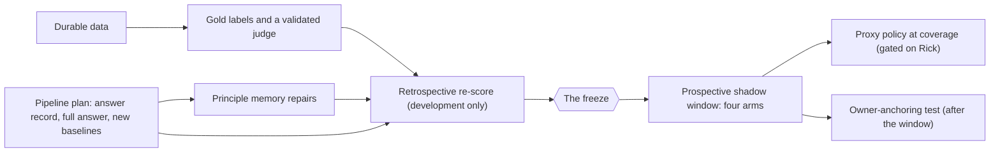

# Keeping all of Rick's answer, part 2: the experiment

## 0. What this plan is for

The first principle learner experiment was stopped on 21 Nov. Its forecasters could produce only two of the six yes/no answer types (a bare yes or a bare no), and its scorer ignored comments and typed text. So it measured a narrower question than the one the learner exists for.

The expert's ruling, which this plan adopts, is to keep the stop and to rebuild the experiment around a better question:

- Given exactly what Lupin could see when it asked, does a memory of Rick's earlier decisions improve its forecast of what he authorizes, including the conditions that change the next action?
- And do learned principles add anything over showing the forecaster his answer history directly?

This plan depends on the pipeline plan, which builds the answer record, the full-answer reply and scoring, and the new baselines. Nothing here runs before that is in place, except the durable-data step and the development labelling.

## 1. Rulings this plan carries (Rick, walkthrough of 23 Nov)

1. **The four arms are named**, everywhere:
   - *mechanical rulesets*: no model;
   - *no answer history*: plain Haiku;
   - *answer history*: Haiku shown Rick's earlier answers, retrieved whole;
   - *learned principles*: Haiku shown the learned principles.

   No arm or track is ever called by a code letter.
2. **The deciding test is learned principles against answer history**, on complete-action accuracy. Every other comparison is reported as an estimate.
3. **The smallest worthwhile gain is set at the freeze.** Its floor is a formula, ruled now: the gain is never smaller than the minimum the shadow window can detect at 80% power. That minimum is computed from the disagreement rate between the two arms, measured after the pipeline fixes and the retrospective re-score, and from the window's planned card count. Because it is computed after the fixes, it recalibrates by construction. Today's figures (2.5 to 3.5 points on 1,926 cards) come from the old labels and are placeholders only.
4. **The rubric bar** has two parts:
   - two human readers must agree on the action at Cohen's kappa of at least 0.7;
   - the bar for material errors is set only after the material-error rate and the accuracy rate have been measured as baselines under the new answer handling. Today nobody knows those rates, because four of the six yes/no answer types were never forecast.
5. **The owner-anchoring test**, randomising the recommended badge and option order on live cards, runs **after** the shadow window, never inside it.
6. **The live repairs and all code wait for the cascade review.**
7. **Open-ended and batch open-ended answers are fully in** (Rick, card, 23 Nov about 13:00): all four arms forecast them, and the gold labels and the judge cover free text.
8. **Managers**: Cheech manages this plan; Mr. Radio manages the pipeline plan (Rick, about 12:56).

## 2. Principles that hold in every phase

- **Every count names its unit**: cards, fields or answers. One owner's correlated stream is never generalised beyond this stream and this period.
- **Ask-time is a hard boundary.** Every arm's forecast is committed before the outcome is released, and no arm sees a pending answer.
- **The archive is development data.** It has already shaped the new design and the re-spin fix, so it can never be the confirmatory test.
- **Coverage**: 100% lines and branches on every changed file, checked per file. This is the 18 Nov plan's convention.
- **Executors**: every acceptance check is marked `EXECUTOR: AI` or `EXECUTOR: HUMAN <reason>`.

## 3. Phases

### Durable data

- The expert could not find the raw run 2 database, the per-card records or the paper's scripts at the paths the paper names. The scripts live only in `io/tmp/principle-learner-briefs/paper-scripts/`, which is swept after 7 days, around 28 Nov.
- **Steps**:
  - Copy the paper scripts and the run 2 archive (`io/phase4-archive-run-2/`) to `projects-data/lupin/principle-learner/`, with a sha256 manifest.
  - Repoint the paper's "Source files read" lines and its "every figure was computed by" line to the new place.
- **This step runs at once, before the cascade finishes**, because waiting deletes the evidence. It changes no code.
- **Acceptance**:
  - `sha256sum -c` passes at the new path.
  - `run-all.sh` regenerates the paper's tables from there with the same numbers.
  - The paper's citations resolve.
  - `EXECUTOR: AI`.

### Gold labels and a validated judge

- **The development sample** covers all four card types (yes/no, multiple choice, open-ended, batch open-ended), multi-select, typed paraphrases, negation, questions, deferral, missing context and cancellation.
- **Two independent readers** map the fields, cite supporting spans, name the action-critical conditions and record any ambiguity. They build the references before seeing any prediction.
- **Rick settles disputed intent, and a random sample of the agreements**, in short voice batches.
  - His later recollection may clarify a reading. It must not make private facts look foreseeable at ask time.
  - The original disagreements, the adjudication and the schema version are all kept.
- **The labels are frozen** for an analysis version, with a correction log. The unresolved fraction is reported, with best-case and worst-case bounds on the paired result.
- **The judge.** A model judge proposes the mappings and the condition comparisons, by atomic scoring with coverage and contradiction checks in both directions.
  - **Validation** uses a stratified probability sample of forecast-and-answer pairs from every arm. That includes easy cases, and forecasts that invent conditions on plain answers. Arm, principle and model identity are blinded.
  - **Minimal pairs** test it: "before" against "after", staging against production, "must" against "may", and a negated permission.
  - **Published**: judge-against-human and human-against-human agreement, sensitivity to material errors, specificity, class counts, intervals, and any bias by arm.
- **Calibration and validation sets are separate**, and the validation set is sealed.
  - The primary difference between arms uses human adjudication where that is affordable.
  - Otherwise it uses the judge's paired difference, plus the probability-weighted residual between human and judge from the audit (stratified prediction-powered inference).
  - The judge is re-validated after any change to the rubric or to the judge.
- **The rubric bar** (ruling 4):
  - kappa of at least 0.7 on the action between two human readers;
  - the material-error bar is set from the pipeline plan's new baselines.
- **If the bar is not reached**, the honest deliverable is an annotation study plus a structured-action forecasting result, and the deciding measure changes to match.
- **Acceptance**:
  - The frozen labels and the judge validation report. `EXECUTOR: AI`.
  - Rick's adjudications. `EXECUTOR: HUMAN` (a designer's reading of his own intent).
- **Coverage**: the judge harness and the sampling code.

### Principle memory repairs

These follow the expert's rows "Principle extraction", "Evidence update", "Retrieval and application" and "Memory update". Each sits behind its own switch.

- **A bare yes may count against a principle.** Today `extractor_rules.check_field` refuses every relation except support for a bare yes. After the change a bare yes may also:
  - contradict or refine a principle;
  - be marked "uninformative" when the principle's antecedent was absent or unobservable.
- **Unread answers are not skipped.** An unrecognised yes/no text reaches the writer as raw text with a flag.
- **The structure reaches the writer.** Option ids and the link from a comment to its option come from the meaning record, not as a comma-joined string. Whether the writer read the final answer or the pre-reveal draft is explicit and logged.
- **The decision stage is annotated.** The re-spin case is the test:
  - "Ask me before re-spinning" is about **who decides**.
  - "Yes, re-spin this agent now" is about **what to do once asked**.

  Re-annotate the 23 evidence rows by decision stage before reading their labels.
- **Applicability is checked at retrieval.** Candidates are ranked by similarity, then checked for antecedent, stage and scope, and zero applicable principles is a legal result. The log says which rule changed which output.
  - A caveat that sits only in a principle's rationale reaches the forecaster too. Today `principle_block` drops the rationale.
  - Condition equivalence in `principle_status.py` becomes semantic, not string equality.
- **Evidence is deduplicated by source** before it counts as independent support. An explicit standing instruction is weighted apart from an inferred refusal.
- **Acceptance**: one test per change, including a planted re-spin case that the new rule keeps out of the unattended decision. `EXECUTOR: AI`.
- **Coverage**: `extractor_rules.py`, `extractor_prompt.py`, `history_derive.py`, `principle_retrieval.py`, `principle_status.py`, `principles_forecast.py`.

### Retrospective re-score (development and diagnosis only)

- Re-score the existing forecasts for literal against semantic choice, using the gold labels.
- Adjudicate the re-spin decision-stage example.
- Run the expert's diagnostic arms, on development data only:
  - **learned principles and answer history drawn from the same sources**, to separate selection from compression;
  - **historical qualifiers removed**, to measure their incremental signal;
  - **an adjudicated applicable principle supplied**, to separate a retrieval failure from misuse downstream;
  - **a model-only anchoring check**: the badge and the position cue hidden, each option's identity kept. This touches no live card.
- Record the cost and latency of each arm.
- Re-check the expert's corrections to the paper ("Conclusions to keep, narrow, and remeasure"):
  - the mechanical rulesets become a benchmark, not a ceiling;
  - the yes/no headroom is restated with neither recall.
- This step's disagreement rate between learned principles and answer history feeds the worthwhile-gain floor (ruling 3).
- **Acceptance**:
  - A report in which every table names its unit and denominator, and each paired difference has block-resampled intervals. `EXECUTOR: AI`.
  - An addendum to the paper only on Rick's word. `EXECUTOR: HUMAN` (Rick).
- **Coverage**: the re-score scripts kept in the tree.

### The freeze

- **Frozen and hashed before the shadow window opens**:
  - the revised learner;
  - the baselines;
  - the labels and the judge;
  - the thresholds;
  - the worthwhile gain (at or above its floor);
  - any margin and cost target for a tie at lower cost;
  - the deciding test and the stop rule.
- The harness refuses to report against a hash that differs.
- **Acceptance**:
  - Rick sets the worthwhile gain, and decides whether a cheaper tie counts. `EXECUTOR: HUMAN`.
  - The hash and its refusal test. `EXECUTOR: AI`.

### Prospective shadow window: four arms

- **The arms**:
  - **mechanical rulesets**: always yes or the recommended option, plus the strongest model-free baseline chosen on development data. That baseline is an online prior counted by card type, question family and recommendation. It also counts how often answers carry no comment or a qualification. It is counting, not modelling.
  - **no answer history**: plain Haiku, with the full output space.
  - **answer history**: Haiku plus Rick's earlier complete answers, at the same history horizon and a matched evidence-token budget. This is the comparison the first experiment lacked.
  - **learned principles**: Haiku plus the learned principles.
- **The deciding test** is learned principles against answer history (ruling 2). Learned principles against no answer history replicates the earlier product question, and the mechanical rulesets are the adoption benchmark.
- **The temporal protocol.**
  - For each ask, the rendered card, its session context, the model and the store snapshot are frozen. Every arm's prediction is committed before the outcome is released.
  - An earlier card's feedback is admitted only after both its answer and its extraction exist. Overlapping asks never see each other's pending answers.
  - Answers Rick wrote, proxy-generated answers, revealed forecasts, rows of unknown origin and timeout rows stay distinguishable. Forecasts stay hidden for the unaided target.
- **The decision rule.**
  - The paired risk difference on all eligible cards.
  - Intact sessions or contiguous time blocks are resampled, with sensitivity to the block length and to removing each high-volume family.
  - The horizon is fixed by simulating from development sessions (burst lengths, arrival rates, disagreement, audit fraction, missingness), or an explicit sequential design is used.
  - Secondary tests are estimates only.
- **Acceptance**: the window runs to its frozen horizon. The report gives the deciding test with its interval, the effective number of blocks and disagreements, and every secondary measure as an estimate. `EXECUTOR: AI`.
- **Coverage**: the answer history retrieval code and any harness change.

### Proxy policy at coverage (gated on Rick)

- Compare material errors per auto-answered card at the same coverage, and report them per eligible ask too. The error kinds are false permission, a missed prerequisite and an unwarranted refusal.
- The confidence threshold is frozen on development data.
- **No acting proxy until Rick has chosen the acceptable risk.** For scale (the expert's figure): zero material errors in 100 independent auto-answers still leaves an upper risk near 3%. About 299 error-free answers are needed to bring it below 1%.
- **Executors**: Rick chooses the risk, `EXECUTOR: HUMAN`; the measurement is `EXECUTOR: AI`.

### Owner-anchoring test (after the window, ruling 5)

- On consenting, eligible, low-stakes cards, randomise the badge's visibility and the option order, holding the advice and the timeout action constant.
- Measure semantic endorsement, qualification, time to answer and cancellation.
- It starts only after the shadow window closes.
- **Acceptance**: Rick opts in, `EXECUTOR: HUMAN`; the measurement is `EXECUTOR: AI`.

## 4. What the counts can support (the expert's planning figures, not measurements)

| Eligible pairs | Detectable gain if 15% of pairs disagree | if 30% disagree |
|---|---:|---:|
| 1,926 cards | 2.5 points | 3.5 points |
| 769 yes/no cards | 4.0 | 5.6 |
| 473 multiple-choice cards with typed text | 5.1 | 7.2 |
| 108 neither answers | 10.6 | 15.3 |
| 36 no answers | not reachable | 25.3 |

Strata as small as the 36 noes are reported descriptively only.

## 5. Risks

- **Free-text cards add labelling work.** Ruling 7 brings open-ended and batch cards in, so the reference labels and the judge validation cover free text. That may roughly double the human reading, so the judge validation sizes it first.
- **Rick's labelling time is the scarce input.** Without his adjudication, the measure falls back to what two readers can reproduce, and the report says so.
- **The judge can be dominated by plain yeses.** Hence the stratified audit and the per-class figures.
- **Richer outputs can invent conditions.** Hence precision on asserted conditions.
- **One owner, correlated cards.** Every conclusion is about this stream and this period.

## 6. Done means

- The durable-data step is verified.
- The labels and the judge are frozen and validated against the rubric bar.
- The principle memory repairs are merged behind their switches.
- The retrospective re-score is reported.
- The freeze is hashed, with Rick's numbers.
- The shadow window reports the deciding test at its frozen horizon.
- The proxy policy and the anchoring test wait on Rick.

## 7. Questions for the cascade review

1. Is a development sample of a few hundred cards enough to reach the rubric bar, or does the judge validation need its own sample size computed first?
2. Should the answer history arm's token budget match the learned principles arm exactly, or match what answer history needs, with the cost reported?
3. How long can the shadow window run before case-mix drift and UI revisions outweigh the gain in power?
