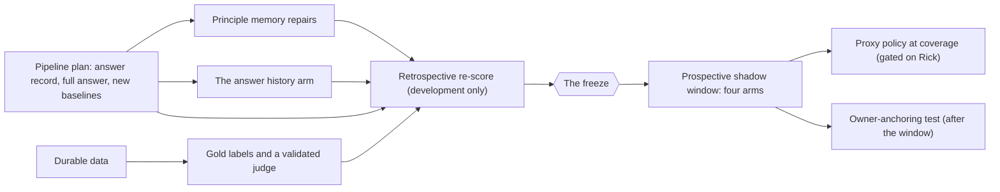

# Keeping all of Rick's answer, part 2: the experiment

## 0. What this plan is for

The first principle learner experiment was stopped on 21 Nov. Its forecasters could produce only two of the six yes/no answer types (a bare yes or a bare no), and its scorer ignored comments and typed text. So it measured a narrower question than the one the learner exists for.

The expert's ruling, which this plan adopts, is to keep the stop and to rebuild the experiment around a better question:

- Given exactly what Lupin could see when it asked, does a memory of Rick's earlier decisions improve its forecast of what he authorizes, including the conditions that change the next action?
- And do learned principles add anything over showing the forecaster his answer history directly?

This plan depends on the pipeline plan, which builds the answer record, the full-answer reply and scoring, and the new baselines. Nothing here runs before that is in place, except the durable-data step and the development labelling.

## 1. Rulings this plan carries (Rick, walkthrough of 23 Nov)

1. **The four arms are named**, everywhere:
   - *mechanical rulesets*: no model;
   - *no answer history*: plain Haiku;
   - *answer history*: Haiku shown Rick's earlier answers, retrieved whole;
   - *learned principles*: Haiku shown the learned principles.

   No arm or track is ever called by a code letter.
2. **The deciding test is learned principles against answer history**, on complete-action accuracy. Every other comparison is reported as an estimate.
3. **The smallest worthwhile gain is set at the freeze.** Its floor is a formula, ruled now: the gain is never smaller than the minimum the shadow window can detect at 80% power. That minimum is computed from the disagreement rate between the two arms, measured after the pipeline fixes and the retrospective re-score, and from the window's planned card count. Because it is computed after the fixes, it recalibrates by construction. Today's figures (2.5 to 3.5 points on 1,926 cards) come from the old labels and are placeholders only.
4. **The rubric bar** has two parts:
   - two human readers must agree on the action at Cohen's kappa of at least 0.7;
   - the bar for material errors is set only after the material-error rate and the complete-action accuracy (Rick said "accuracy rate"; renamed so it is not confused with `accuracy_match`) have been measured as baselines under the new answer handling. Today nobody knows those rates, because four of the six yes/no answer types were never forecast.
5. **The owner-anchoring test**, randomising the recommended badge and option order on live cards, runs **after** the shadow window, never inside it.
6. **The live repairs and all code wait for the cascade review.**
7. **Open-ended and batch open-ended answers are fully in** (Rick, card, 23 Nov about 13:00): all four arms forecast them, and the gold labels and the judge cover free text.
8. **Managers**: Cheech manages this plan; Mr. Radio manages the pipeline plan (Rick, about 12:56).

## 2. Principles that hold in every phase

- **Every count names its unit**: cards, fields or answers. One owner's correlated stream is never generalised beyond this stream and this period.
- **Ask-time is a hard boundary.** Every arm's forecast is committed before the outcome is released, and no arm sees a pending answer.
- **The archive is development data.** It has already shaped the new design and the re-spin fix, so it can never be the confirmatory test.
- **Coverage**: 100% lines, branches and functions on every changed file, checked per file. This is the 18 Nov plan's convention and the Lupin coverage mandate. The number comes from `src/tests/run-coverage-gate.sh` and is read from its per-file table for the files a phase names, not from its exit code.
- **The merge gate.** Code merges to the working branch only when three things hold: the unit tier is green for its changed files, `src/tests/run-census-guards.sh` is green, and a fresh reviewer seat gives a Merge verdict. Cheech spawns the implementer and the reviewer and runs the merge.
- **Executors**: every acceptance check is marked `EXECUTOR: AI` or `EXECUTOR: HUMAN <reason>`.

## 3. Phases



### Durable data

- The expert could not find the raw run 2 database, the per-card records or the paper's scripts at the paths the paper names. The scripts live only in `io/tmp/principle-learner-briefs/paper-scripts/`, which is swept after 7 days, around 28 Nov.
- **The new root** is `projects-data/lupin/principle-learner/`. Under it, the copy keeps the main checkout's relative layout (`io/…`). The paper scripts build every path from `LUPIN_ROOT`, and `source-hashes.txt` records each input relative to that root. So with `LUPIN_ROOT` set to the new root, the scripts run unchanged and their outputs can be compared byte for byte.
- **Steps**:
  1. Save today's outputs: copy `paper-scripts/out/` to `out-before/` in the session scratchpad.
  2. Copy four sources, all of which the scripts read (`common.py`):
     - the paper scripts, `io/tmp/principle-learner-briefs/paper-scripts/`;
     - the run 2 archive, `io/phase4-archive-run-2/`;
     - the model sample, `io/model-sample-run/`;
     - the asks file, `io/write-ups/online-preference-learning/2026.11.18-notification-asks-raw.jsonl` (20 MB).
  3. Leave out two things: the stray file `archive.sqlite?mode=ro`, which is an empty file made when a database address was opened as a path, and every `__pycache__`. Nothing is deleted at the source.
  4. Write the sha256 manifest, `MANIFEST.sha256`, at the new root over everything copied. If a hashing script is kept, it calls `cosa.utils.file_hash.file_sha256`. Plain `sha256sum` needs no script.
  5. In the copies only, change the default root in `common.py` and `run-all.sh` from the main checkout to the new root. That is two lines, so a run without `LUPIN_ROOT` set cannot fall back to the old files.
  6. Repoint section 10 in two places: the committed paper (`2026.11.21-principle-learner-negative-result-paper.md`, this folder) and the copied `paper-template.md`, which `build_paper.py` fills to make the paper. The change covers the "Every figure … was computed by" line and the "Source files read" paragraph, as a dated correction note naming the new root. It changes no figure and no finding.
- **Who and when.** Cheech runs it by 26 Nov. That is two days before the sweep of `io/tmp/` around 28 Nov, whether or not the cascade has closed, because waiting deletes the evidence. It changes no Lupin code.
- **Custody.** Cheech owns the new folder. It is kept with no end date, because the paper cites it. `src/scripts/sync-data-to-backup.sh` copies the whole of `projects-data` to the second disk, but no cron or timer entry runs it (checked 23 Nov: `crontab -l` and `systemctl --user list-timers`). So the folder is backed up only when that script is run by hand. Cheech runs it once after the copy.
- **Who owns the paper.** Cheech owns the paper. Tiberius wrote it as Cheech's author seat, at Rick's request. The repoint in step 6 corrects where the inputs live, so Cheech makes it. An addendum, meaning any change to a figure or a finding, still waits for Rick's word (see the retrospective re-score).
- **Acceptance** (all `EXECUTOR: AI`, Cheech):
  - `sha256sum -c MANIFEST.sha256` passes at the new root, and the manifest names neither the stray file nor any `__pycache__`.
  - The run cannot read the old files. A fixed-string search of the copied scripts for the main checkout's path, `grep -rn -F '/projects/lupin' <new root>/io/tmp/principle-learner-briefs/paper-scripts/`, finds nothing. The old paths are not renamed, because peers read them. The search is shown able to find a hit by running it first on the uncopied scripts, where it finds the two default-root lines.
  - With `LUPIN_ROOT` set to the new root, `run-all.sh` runs, and `diff -r out-before/ <new root>/io/tmp/principle-learner-briefs/paper-scripts/out/` prints nothing.
  - A check script reads every path in the paper's section 10, in its "computed by" line and its "Source files read" paragraph, and every path exists under the new root. The script lives in the scratchpad.
- **Coverage**: no Lupin code changes. The two edited lines are in the copied paper scripts, which live outside the git tree and are not Lupin code, so the coverage gate does not apply to them.

### Gold labels and a validated judge

- **The development sample** covers all four card types (yes/no, multiple choice, open-ended, batch open-ended), multi-select, typed paraphrases, negation, questions, deferral, missing context and cancellation.
- **Two independent readers** map the fields, cite supporting spans, name the action-critical conditions and record any ambiguity. They build the references before seeing any prediction.
- **Rick settles disputed intent, and a random sample of the agreements**, in short voice batches.
  - His later recollection may clarify a reading. It must not make private facts look foreseeable at ask time.
  - The original disagreements, the adjudication and the schema version are all kept.
- **The labels are frozen** for an analysis version, with a correction log. The unresolved fraction is reported, with best-case and worst-case bounds on the paired result.
- **The judge.** A model judge proposes the mappings and the condition comparisons, by atomic scoring with coverage and contradiction checks in both directions.
  - **Validation** uses a stratified probability sample of forecast-and-answer pairs from every arm. That includes easy cases, and forecasts that invent conditions on plain answers. Arm, principle and model identity are blinded.
  - **Minimal pairs** test it: "before" against "after", staging against production, "must" against "may", and a negated permission.
  - **Published**: judge-against-human and human-against-human agreement, sensitivity to material errors, specificity, class counts, intervals, and any bias by arm.
- **Calibration and validation sets are separate**, and the validation set is sealed.
  - The primary difference between arms uses human adjudication where that is affordable.
  - Otherwise it uses the judge's paired difference, plus the probability-weighted residual between human and judge from the audit (stratified prediction-powered inference).
  - The judge is re-validated after any change to the rubric or to the judge.
- **The rubric bar** (ruling 4):
  - kappa of at least 0.7 on the action between two human readers;
  - the material-error bar is set from the pipeline plan's new baselines.
- **If the bar is not reached**, the honest deliverable is an annotation study plus a structured-action forecasting result, and the deciding measure changes to match.
- **Acceptance**:
  - The frozen labels and the judge validation report. `EXECUTOR: AI`.
  - Rick's adjudications. `EXECUTOR: HUMAN` (a designer's reading of his own intent).
- **Coverage**: the judge harness and the sampling code.

### Principle memory repairs

These follow the expert's rows "Principle extraction", "Evidence update", "Retrieval and application" and "Memory update".

**The writer's model path.** The extractor keeps its call path, `model_transport.complete`, which is bounded Claude Code under the cost model. It takes the answer's structure from the pipeline plan's meaning record, not from its own reading through `field_answers`. So one answer is read by one model, once.

**Model-dependent tests** (cascade finding O15). One extractor reply is captured from the real model, through the real reader, for each new relation and each new field. The replies are committed as fixtures, and the unit tests are built on them. A separate live check is named in row 3 below.

**The ten changes**, each behind its own switch, off by default, with a switch-off pin test showing behaviour is unchanged with the switch off. All are `EXECUTOR: AI`.

| # | Change | Switch | What a test asserts | Test file |
|---|---|---|---|---|
| 1 | **A bare yes may contradict or refine a principle.** Today `extractor_rules.check_field` refuses every relation except support for a bare yes | `principle learner bare yes relations enabled` | a planted bare yes with a contradicting principle is stored as `contradicts` | `test_extractor_rules.py` |
| 2 | **A fourth relation word, `uninformative`**, for a bare yes whose principle's antecedent is not in the card. It touches `RELATIONS`, `check_field`, the extractor's reply schema, `PreferenceEvidence.relation`'s documented values, and `derive_statuses`, which must not count it. Whether the antecedent is in the card is decided by the extractor, whose reply must quote the antecedent and state that the card lacks it; a reply without the quote is refused | `principle learner uninformative relation enabled` | the row is stored as `uninformative` with the quote; `derive_statuses` gives the same statuses with and without it | `test_extractor_rules.py`, `test_principle_status.py` |
| 3 | **Unread answers are not skipped.** An unrecognised yes/no text reaches the writer as raw text with the flag `unread_stance` | `principle learner unread answers enabled` | a planted unread text reaches the writer with the flag. **Live check** (cascade finding O26): the 4 unread yes/no texts the attrition table found are run through the real extractor. Registered now: each produces a stored row, either a relation or `uninformative`, and none is skipped | `test_principle_extractor_job.py` |
| 4 | **The structure reaches the writer.** Option ids and `modifies_option_id` come from the meaning record, not as a comma-joined string | `principle learner meaning record input enabled` | the writer's input carries the ids and the link for a comment on a multiple-choice card | `test_principle_extractor_job.py` |
| 5 | **Draft or final is explicit.** The log field `answer_read` is `final` or `draft` | (row 4's switch) | the field is present on every extraction, with each value planted once | `test_principle_extractor_job.py` |
| 6 | **The decision stage is annotated.** A new vocabulary dimension `decision_stage` with two values: `who_decides` ("Ask me before re-spinning") and `what_to_do_once_asked` ("Yes, re-spin this agent now"). It lives in `principle_learner/vocabulary.py`, raises `VOCABULARY_VERSION`, and so starts a new extractor version | `principle learner decision stage enabled` | the planted re-spin fixture (below) | `test_principle_retrieval.py` |
| 7 | **Applicability is checked at retrieval.** `select_principles` already drops contested, retracted and unsupported principles, and zero principles is already legal. The two new checks are antecedent and decision stage. Both compare fields the extractor stored, so retrieval makes no model call | `principle learner applicability checks enabled` | the log field `applicability` lists each dropped principle with its rule, `antecedent` or `stage` | `test_principle_retrieval.py` |
| 8 | **A caveat reaches the forecaster.** This deliberately reverses `principle_block`'s rule that no rationale enters the prompt. That rule was a guard, so only a new stored `caveat` field, at most 200 characters, enters, inside the same suffix tags as the statements | `principle learner caveats enabled` | a caveat containing a closing tag and an instruction stays inside the tags and is cut at 200 characters | `test_principle_retrieval.py` |
| 9 | **Semantic condition equivalence**, computed when the evidence row is written and stored on it as `condition_key`. `derive_statuses` compares stored keys only, so the as-of replay stays repeatable | `principle learner condition keys enabled` | `derive_statuses` runs with a model transport that fails if it is called | `test_principle_status.py` |
| 10 | **Evidence deduplicated by source.** Session-level independence already exists (`_sessions`, `MIN_SESSIONS = 2`). The new part is a finer `source_key`, so the same card asked twice, or one instruction restated, counts once. It follows the one-vote-per-copy shape of `three_way_stance.neighbours_of`. An explicit standing instruction and an inferred refusal are counted in separate tallies, each reported | `principle learner source dedup enabled` | two rows sharing a `source_key` count once; the two tallies are reported separately | `test_principle_status.py` |

**The re-spin fixture** (cascade finding O25). This is a committed fixture, so the unit tier never reads `io/`. Its assertion is a retrieval result: for the card at the `what_to_do_once_asked` stage, the re-spin principle is absent from `principle_block`, and the `applicability` log names the rule `stage`.

**Re-annotating the 23 evidence rows** (cascade finding O25).
- A fresh AI seat annotates each row's decision stage, `EXECUTOR: AI`. It is given a file with the relation labels removed.
- The annotation file and its sha are written before the labels are opened.
- Both shas, the annotations' and the labels', go in the re-score report.
- The rows are in the run 2 archive, so this step waits for the durable-data copy.

**Coverage**: `src/cosa/agents/principle_learner/extractor_rules.py`, `extractor_prompt.py`, `extractor_job.py`, `vocabulary.py`; `src/cosa/agents/prediction_engine/history_derive.py`, `principle_retrieval.py`, `principle_status.py`, `principles_forecast.py`; and `src/cosa/rest/postgres_models.py` for the new evidence fields (`source_key`, `condition_key`, `caveat`, `decision_stage`), with an up-then-down migration test.

### The answer history arm (cascade finding V1)

The pipeline plan lists this arm, and this phase builds it. It is built before the retrospective re-score, which runs it on development data.

- **What it shows the model.** Rick's earlier answers, whole, each as its card's question, the options as shown with their ids, the recommendation, and his raw final response: stance, comment, typed text and picks, from the pipeline plan's observation view. It does not show the labeller's reading, so it never inherits the labeller's errors.
- **The retrieval rule.** It uses the encoder and the owner and scope filters that principle retrieval uses. Earlier cards are ranked by question similarity, with ties broken by recency. A card is eligible only if its answer and its meaning record existed before the ask, which is the ask-time boundary.
- **The horizon.** Every answered card since 10 Sep before the ask, the same horizon the learned principles arm's store covers.
- **The budget.** The evidence-token budget matches the learned principles arm. It is the arm's mean evidence tokens on development data, fixed at the freeze. An unmatched run, with whatever budget answer history needs, is reported as an estimate with its cost. This is a proposed answer to open question 2.
- **The parser.** It replies through `context_baseline.parse_reply` from its first version.
- **Acceptance** (all `EXECUTOR: AI`):
  - an emit test: this arm can produce a neither, a qualified answer and a write-in;
  - a boundary test: an answer stored after the ask is never retrieved;
  - a budget test: the rendered history never exceeds the budget;
  - a switch-off pin test for `principle learner answer history arm enabled`.
- **Coverage**: the new module `src/cosa/agents/prediction_engine/answer_history_forecast.py` and its tests.
- The retrieval rule, the horizon and the budget join the freeze list.

### Retrospective re-score (development and diagnosis only)

- Re-score the existing forecasts for literal against semantic choice, using the gold labels.
- Adjudicate the re-spin decision-stage example.
- Run the expert's diagnostic arms, on development data only:
  - **learned principles and answer history drawn from the same sources**, to separate selection from compression;
  - **historical qualifiers removed**, to measure their incremental signal;
  - **an adjudicated applicable principle supplied**, to separate a retrieval failure from misuse downstream;
  - **a model-only anchoring check**: the badge and the position cue hidden, each option's identity kept. This touches no live card.
- Record the cost and latency of each arm.
- Re-check the expert's corrections to the paper ("Conclusions to keep, narrow, and remeasure"):
  - the mechanical rulesets become a benchmark, not a ceiling;
  - the yes/no headroom is restated with neither recall.
- This step's disagreement rate between learned principles and answer history feeds the worthwhile-gain floor (ruling 3).
- **Acceptance**:
  - A report in which every table names its unit and denominator, and each paired difference has block-resampled intervals. `EXECUTOR: AI`.
  - An addendum to the paper only on Rick's word. `EXECUTOR: HUMAN` (Rick).
- **Coverage**: the re-score scripts kept in the tree.

### The freeze

- **Frozen and hashed before the shadow window opens**:
  - the revised learner;
  - the answer history arm's retrieval rule, horizon and evidence-token budget;
  - the baselines, including the counted prior's number and ceiling;
  - the labels and the judge;
  - the thresholds;
  - the worthwhile gain (at or above its floor);
  - any margin and cost target for a tie at lower cost;
  - the deciding test and the stop rule.
- The harness refuses to report against a hash that differs.
- **Acceptance**:
  - Rick sets the worthwhile gain, and decides whether a cheaper tie counts. `EXECUTOR: HUMAN`.
  - The hash and its refusal test. `EXECUTOR: AI`.

### Prospective shadow window: four arms

- **The arms**:
  - **mechanical rulesets**: always yes or the recommended option, plus the strongest model-free baseline chosen on development data. That baseline is an online prior counted by card type, question family and recommendation. It also counts how often answers carry no comment or a qualification. It is counting, not modelling (cascade finding V4):
    - **What it can say**: yes, no or neither, with or without "a condition applies", and one listed option per field. It cannot name a condition and cannot write in.
    - **Where it comes from**: it is chosen by complete-action accuracy on development data from three candidates: always yes, the recommended option, and the counted prior.
    - **Its ceiling**: the share of cards whose complete action needs no named condition and no write-in. The retrospective re-score measures that share, and it is stated before the freeze.
    - **Its counts are frozen at each ask**: only answers released before the ask are counted, as for every arm.
    - **Its baseline number** is measured in the retrospective re-score and frozen at the freeze. The pipeline plan's baselines re-score only the old rulesets.
  - **no answer history**: plain Haiku, with the full output space.
  - **answer history**: Haiku plus Rick's earlier complete answers, at the same history horizon and a matched evidence-token budget. This is the comparison the first experiment lacked.
  - **learned principles**: Haiku plus the learned principles.
- **The deciding test** is learned principles against answer history (ruling 2). Learned principles against no answer history replicates the earlier product question, and the mechanical rulesets are the adoption benchmark.
- **The temporal protocol.**
  - For each ask, the rendered card, its session context, the model and the store snapshot are frozen. Every arm's prediction is committed before the outcome is released.
  - An earlier card's feedback is admitted only after both its answer and its extraction exist. Overlapping asks never see each other's pending answers.
  - Answers Rick wrote, proxy-generated answers, revealed forecasts, rows of unknown origin and timeout rows stay distinguishable. Forecasts stay hidden for the unaided target.
- **The decision rule.**
  - The paired risk difference on all eligible cards.
  - Intact sessions or contiguous time blocks are resampled, with sensitivity to the block length and to removing each high-volume family.
  - The horizon is fixed by simulating from development sessions (burst lengths, arrival rates, disagreement, audit fraction, missingness), or an explicit sequential design is used.
  - Secondary tests are estimates only.
- **Acceptance**: the window runs to its frozen horizon. The report gives the deciding test with its interval, the effective number of blocks and disagreements, and every secondary measure as an estimate. `EXECUTOR: AI`.
- **Coverage**: `src/cosa/agents/prediction_engine/answer_history_forecast.py` (built in its own phase above) and any harness change, listed by file before it is built.

### Proxy policy at coverage (gated on Rick)

- Compare material errors per auto-answered card at the same coverage, and report them per eligible ask too. The error kinds are false permission, a missed prerequisite and an unwarranted refusal.
- The confidence threshold is frozen on development data.
- **No acting proxy until Rick has chosen the acceptable risk.** For scale (the expert's figure): zero material errors in 100 independent auto-answers still leaves an upper risk near 3%. About 299 error-free answers are needed to bring it below 1%.
- **Executors**: Rick chooses the risk, `EXECUTOR: HUMAN`; the measurement is `EXECUTOR: AI`.

### Owner-anchoring test (after the window, ruling 5)

- On consenting, eligible, low-stakes cards, randomise the badge's visibility and the option order, holding the advice and the timeout action constant.
- Measure semantic endorsement, qualification, time to answer and cancellation.
- It starts only after the shadow window closes.
- **Acceptance**: Rick opts in, `EXECUTOR: HUMAN`; the measurement is `EXECUTOR: AI`.

## 4. What the counts can support (the expert's planning figures, not measurements)

| Eligible pairs | Detectable gain if 15% of pairs disagree | if 30% disagree |
|---|---:|---:|
| 1,926 cards | 2.5 points | 3.5 points |
| 769 yes/no cards | 4.0 | 5.6 |
| 473 multiple-choice cards with typed text | 5.1 | 7.2 |
| 108 neither answers | 10.6 | 15.3 |
| 36 no answers | not reachable | 25.3 |

Strata as small as the 36 noes are reported descriptively only.

## 5. Risks

- **Free-text cards add labelling work.** Ruling 7 brings open-ended and batch cards in, so the reference labels and the judge validation cover free text. That may roughly double the human reading, so the judge validation sizes it first.
- **Rick's labelling time is the scarce input.** Without his adjudication, the measure falls back to what two readers can reproduce, and the report says so.
- **The judge can be dominated by plain yeses.** Hence the stratified audit and the per-class figures.
- **Richer outputs can invent conditions.** Hence precision on asserted conditions.
- **One owner, correlated cards.** Every conclusion is about this stream and this period.

## 6. Done means

- The durable-data step is verified, by 26 Nov.
- **The order between the two plans** (cascade finding V5). Labelling starts only after this order is met:
  1. Mr. Radio freezes meaning schema v1 in the pipeline plan.
  2. Cheech's readers label the development gold set against that frozen schema.
  3. Before any tuning, Cheech sets aside a held-back slice of the development gold labels. The shared labeller is tuned on the rest and accepted on that slice only, the same separation the judge already has.
- Every merge of code goes through the merge gate in section 2.
- The labels and the judge are frozen and validated against the rubric bar.
- The principle memory repairs are merged behind their switches.
- The retrospective re-score is reported.
- The freeze is hashed, with Rick's numbers.
- The shadow window reports the deciding test at its frozen horizon.
- The proxy policy and the anchoring test wait on Rick.

## 7. Questions for the cascade review

1. Is a development sample of a few hundred cards enough to reach the rubric bar, or does the judge validation need its own sample size computed first?
2. Should the answer history arm's token budget match the learned principles arm exactly, or match what answer history needs, with the cost reported?
3. How long can the shadow window run before case-mix drift and UI revisions outweigh the gain in power?

## 8. Reuse review of the durable-data step and the principle memory repairs (Rio, cascade stage 1, 23 Nov)

Rio searched for existing code for the durable-data step and ruled on it. His ruling is sent to Cheech as a bare line and committed here, because reviewers do not commit. The step ids name section 3's phases: `3-durabledata` the durable-data step and `3-memoryrepairs` the principle memory repairs. Each ruling's `SEARCHED` lines list the candidates Rio read.

```text
RULING durable_data_copy :: DISTINCT no code is written, plain sha256sum -c; any kept script must call cosa.utils.file_hash.file_sha256 :: reuse-receipt: 91e7d058bbbfa4e8 :: search: rs-7b4254bbd3

REUSE-OUTCOME 91e7d058bbbfa4e8 :: rs-7b4254bbd3 :: WROTE_NEW no code; a plain sha256sum manifest, and any kept hashing script calls file_sha256 :: src/rnd/v0.2.4/2026.11.17-principle-learner-research/2026.11.23-answer-signal-experiment-plan.md#3-durabledata

SEARCHED durable_data_copy :: rs-7b4254bbd3 :: cosa.research.phi4_flash_lite_study.replay_harness.load_frozen_rows :: RELATED :: verifies a snapshot against its manifest on load
SEARCHED durable_data_copy :: rs-7b4254bbd3 :: cosa.agents.prediction_engine.history_derive.write_dataset :: RELATED :: writes a dataset with a sha256 manifest
SEARCHED durable_data_copy :: rs-7b4254bbd3 :: lupin_mcp.session_spawner.spawn_sessions :: UNRELATED :: spawns seats
SEARCHED durable_data_copy :: rs-7b4254bbd3 :: cosa.research.phi4_flash_lite_study.freeze_corpus.freeze :: RELATED :: manifest freeze of one corpus file
SEARCHED durable_data_copy :: rs-7b4254bbd3 :: cosa.research.phi4_flash_lite_study.freeze_corpus.verify_snapshot :: RELATED :: re-derives a checksum from a manifest

RULING b8_uninformative_relation :: EXTEND cosa.agents.principle_learner.extractor_rules.check_field :: reuse-receipt: db7c85b59f6a5136 :: search: rs-282dd23f38
RULING b9_evidence_dedupe :: EXTEND cosa.agents.prediction_engine.principle_status.derive_statuses :: reuse-receipt: db7c85b59f6a5136 :: search: rs-282dd23f38
RULING b10_rationale_and_semantic_conditions :: EXTEND cosa.agents.prediction_engine.principle_retrieval.principle_block :: reuse-receipt: db7c85b59f6a5136 :: search: rs-282dd23f38
RULING b11_applicability_check :: EXTEND cosa.agents.prediction_engine.principle_retrieval.select_principles :: reuse-receipt: db7c85b59f6a5136 :: search: rs-282dd23f38
RULING b12_decision_stage :: EXTEND cosa.agents.principle_learner.extractor_rules.check_field :: reuse-receipt: db7c85b59f6a5136 :: search: rs-282dd23f38
SEARCHED b8_uninformative_relation :: rs-282dd23f38 :: scripts.eval_provenance.compute_sample_signature :: UNRELATED :: sample signature
SEARCHED b8_uninformative_relation :: rs-282dd23f38 :: cosa.rest.routers.tasks.query_tasks :: UNRELATED :: task store query
SEARCHED b8_uninformative_relation :: rs-282dd23f38 :: cosa.agents.heartbeat_arbiter.arbiter_job.ArbiterConsumerJob.__init__ :: UNRELATED :: arbiter setup
SEARCHED b8_uninformative_relation :: rs-282dd23f38 :: cosa.agents.swe_team.orchestrator.SweTeamOrchestrator._verify_result :: UNRELATED :: crew result check
SEARCHED b8_uninformative_relation :: rs-282dd23f38 :: cosa.agents.decision_proxy.trust_tracker.TrustTracker :: UNRELATED :: proxy trust counters
SEARCHED b9_evidence_dedupe :: rs-282dd23f38 :: scripts.eval_provenance.compute_sample_signature :: UNRELATED :: sample signature
SEARCHED b9_evidence_dedupe :: rs-282dd23f38 :: cosa.rest.routers.tasks.query_tasks :: UNRELATED :: task store query
SEARCHED b9_evidence_dedupe :: rs-282dd23f38 :: cosa.agents.heartbeat_arbiter.arbiter_job.ArbiterConsumerJob.__init__ :: UNRELATED :: arbiter setup
SEARCHED b9_evidence_dedupe :: rs-282dd23f38 :: cosa.agents.swe_team.orchestrator.SweTeamOrchestrator._verify_result :: UNRELATED :: crew result check
SEARCHED b9_evidence_dedupe :: rs-282dd23f38 :: cosa.agents.decision_proxy.trust_tracker.TrustTracker :: UNRELATED :: proxy trust counters
SEARCHED b10_rationale_and_semantic_conditions :: rs-282dd23f38 :: scripts.eval_provenance.compute_sample_signature :: UNRELATED :: sample signature
SEARCHED b10_rationale_and_semantic_conditions :: rs-282dd23f38 :: cosa.rest.routers.tasks.query_tasks :: UNRELATED :: task store query
SEARCHED b10_rationale_and_semantic_conditions :: rs-282dd23f38 :: cosa.agents.heartbeat_arbiter.arbiter_job.ArbiterConsumerJob.__init__ :: UNRELATED :: arbiter setup
SEARCHED b10_rationale_and_semantic_conditions :: rs-282dd23f38 :: cosa.agents.swe_team.orchestrator.SweTeamOrchestrator._verify_result :: UNRELATED :: crew result check
SEARCHED b10_rationale_and_semantic_conditions :: rs-282dd23f38 :: cosa.agents.decision_proxy.trust_tracker.TrustTracker :: UNRELATED :: proxy trust counters
SEARCHED b11_applicability_check :: rs-282dd23f38 :: scripts.eval_provenance.compute_sample_signature :: UNRELATED :: sample signature
SEARCHED b11_applicability_check :: rs-282dd23f38 :: cosa.rest.routers.tasks.query_tasks :: UNRELATED :: task store query
SEARCHED b11_applicability_check :: rs-282dd23f38 :: cosa.agents.heartbeat_arbiter.arbiter_job.ArbiterConsumerJob.__init__ :: UNRELATED :: arbiter setup
SEARCHED b11_applicability_check :: rs-282dd23f38 :: cosa.agents.swe_team.orchestrator.SweTeamOrchestrator._verify_result :: UNRELATED :: crew result check
SEARCHED b11_applicability_check :: rs-282dd23f38 :: cosa.agents.decision_proxy.trust_tracker.TrustTracker :: UNRELATED :: proxy trust counters
SEARCHED b12_decision_stage :: rs-282dd23f38 :: scripts.eval_provenance.compute_sample_signature :: UNRELATED :: sample signature
SEARCHED b12_decision_stage :: rs-282dd23f38 :: cosa.rest.routers.tasks.query_tasks :: UNRELATED :: task store query
SEARCHED b12_decision_stage :: rs-282dd23f38 :: cosa.agents.heartbeat_arbiter.arbiter_job.ArbiterConsumerJob.__init__ :: UNRELATED :: arbiter setup
SEARCHED b12_decision_stage :: rs-282dd23f38 :: cosa.agents.swe_team.orchestrator.SweTeamOrchestrator._verify_result :: UNRELATED :: crew result check
SEARCHED b12_decision_stage :: rs-282dd23f38 :: cosa.agents.decision_proxy.trust_tracker.TrustTracker :: UNRELATED :: proxy trust counters

REUSE-OUTCOME db7c85b59f6a5136 :: rs-282dd23f38 :: EXTENDED cosa.agents.principle_learner.extractor_rules.check_field :: src/rnd/v0.2.4/2026.11.17-principle-learner-research/2026.11.23-answer-signal-experiment-plan.md#3-memoryrepairs
REUSE-OUTCOME db7c85b59f6a5136 :: rs-282dd23f38 :: EXTENDED cosa.agents.prediction_engine.principle_status.derive_statuses :: src/rnd/v0.2.4/2026.11.17-principle-learner-research/2026.11.23-answer-signal-experiment-plan.md#3-memoryrepairs
REUSE-OUTCOME db7c85b59f6a5136 :: rs-282dd23f38 :: EXTENDED cosa.agents.prediction_engine.principle_retrieval.principle_block :: src/rnd/v0.2.4/2026.11.17-principle-learner-research/2026.11.23-answer-signal-experiment-plan.md#3-memoryrepairs
REUSE-OUTCOME db7c85b59f6a5136 :: rs-282dd23f38 :: EXTENDED cosa.agents.prediction_engine.principle_retrieval.select_principles :: src/rnd/v0.2.4/2026.11.17-principle-learner-research/2026.11.23-answer-signal-experiment-plan.md#3-memoryrepairs
REUSE-OUTCOME db7c85b59f6a5136 :: rs-282dd23f38 :: EXTENDED cosa.agents.principle_learner.extractor_rules.check_field :: src/rnd/v0.2.4/2026.11.17-principle-learner-research/2026.11.23-answer-signal-experiment-plan.md#3-memoryrepairs
```
