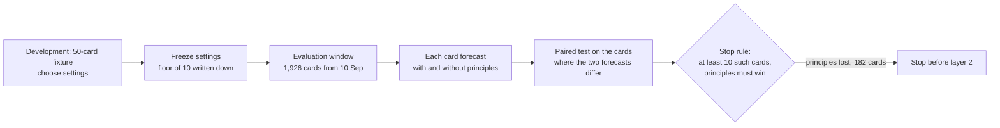

# Learned principles did not improve forecasts of one owner's answers: a negative result, its symptoms, and a test of the recommended-option explanation

**Status:** finished analysis, written 21 Nov 2026 for Rick's colleagues. Every figure comes from stored records, and each one names the script and the file it came from (section 10). No model was called to write this paper. The records and scripts are read-only inputs; nothing in the repository's code changed.

## 1. Abstract

We asked whether short written principles, learned from one person's earlier answers, make a language model better at forecasting that person's answers to two kinds of question cards: yes-or-no cards and multiple-choice cards. The test was frozen before it ran. It covered 1,926 real cards from 10 September 2026 onward. The same Haiku model forecast each card twice, once with the principles in front of it and once without. The stop rule, set beforehand, needed at least 10 cards on which the two forecasts disagreed.

**The principles lost.** The principles forecast was right alone on 67 cards and plain Haiku alone on 115 (182 disagreeing cards, exact McNemar p = 0.0005). Accuracy on all cards fell from 55.7% [95% Wilson interval 53.4, 57.9] to 53.2% [50.9, 55.4], a difference of -2.5 points (paired bootstrap 95% interval -3.9 to -1.1). The same direction held on Opus (-2.5 points, 20 against 68) and on a 400-card sample run again on four models, where principles lowered accuracy for Haiku, Opus, Sonnet and Fable alike (-4.5, -1.8, -6.2 and -8.2 points).

**Two symptoms explain most of it.**

1. *Misapplication.* One card family, "this agent is at its context ceiling, re-spin it now?", supplies 41 of the 48 net cards the principles lost on Haiku in run 2. Two retrieved principles, learned from a single answer of "no", told the models to refuse. The owner answered yes on 123 of the 127 such cards. With principles, Sonnet and Fable got 28 and 29 of 31 sample cards wrong; without principles, no model got any wrong.
2. *A ceiling set by the card itself.* A rule with no model at all (answer yes to a yes-or-no card, otherwise the recommended or first option) is right on 61.6% [59.4, 63.7] of cards. Plain Opus, the best model, is right on 61.1% [58.9, 63.2], and the difference to the rule is -0.5 points [-1.2, +0.2]. Plain Haiku, the principles forecast and the lookup engine all score below the rule.

**The recommended-option hypothesis is partly supported, and the part that holds is not the part stated.** A recommended option or card default exists on 95.5% of multiple-choice cards and 99.0% of yes-or-no cards. When the owner picks from the list, he picks the recommended option on 825 of 925 questions (89.2%), so the recommendation is chosen almost every time he chooses. But he types his own answer on 524 of the 1,483 questions that carry one recommendation (35.3%), and as a whole card the recommended option was chosen on only 50.1% [47.1, 53.1] of the 1,059 fully recommended multiple-choice cards. Every forecaster converges on it (95 to 98% agreement), and the decisive split confirms the ceiling: on cards where the owner followed the recommendation every model is right 84 to 98% of the time, and on cards where he departed every method is right 0 to 0.9% of the time. Of the 528 multiple-choice departures, 437 (82.8%) contain an answer the owner typed himself and 10 are cancelled cards; no option-picking method can match either under whole-card scoring. An archive cannot say whether the recommendation caused the choice or described it; section 7.7 names the experiment that could.

## 2. The question and why it mattered

Lupin shows its owner many cards that need an answer, and the owner answers them all as one person. A forecast of the answer lets the system draft it, pre-fill it or, with enough trust, answer for him. Before this study, the only forecaster that learned from history was a lookup engine: it finds similar earlier cards and copies the owner's answer, and abstains when it finds nothing close. It answers a minority of cards.

The proposal was to add a layer of learned *principles*. A model reads each of the owner's answers and writes down short rules such as "when X, he chooses Y", each with its reasons and the cards that support it. At forecast time the five principles nearest to the card are put in the prompt. The hope was that rules would generalise to cards the lookup engine could not match.

The proposal came with two further layers that depended on it: a reranker over principles (layer 2) and a best-of-three scheme for typed answers (layer 3). Building them is expensive, so the plan carried a stop rule: if principles did not beat the same model without them, stop before layer 2. This paper reports that test, and the pattern in how it failed, so that the lesson is usable by people who did not watch it happen.

## 3. Design

### 3.1 The forecasters

All forecasters see the same card and, where the system could rebuild one, up to three earlier questions from the same working session with the owner's answers (1,775 of the 1,926 cards had such a history). Nothing a forecaster sees was known to the system after the card was asked: principles and cases are rebuilt as of each card's ask time, with a replay lag of zero seconds.

| Plain name | What it is |
|---|---|
| Lookup engine | The existing engine: copy the answer of similar earlier cards, or abstain |
| Fixed rules | No model. Yes to a yes-or-no card; for a multiple-choice card the option marked recommended in each question, or the first option when none or several are marked. It ignores the card's own timeout default |
| Plain Haiku | Haiku 5.5 reads the card and its session history and forecasts the answer. The yardstick the stop rule names |
| Haiku with principles | The identical call with one more block in the prompt: the five stored principles nearest the card |
| Plain Opus and Opus with principles | The same two calls on Opus 5.5, because the owner asked whether Haiku is good enough |
| Sonnet and Fable, plain and with principles | The same two calls on Sonnet 5.5 and Fable 5.2, run only on a 400-card sample (section 4.2) |

Principles were written by Sonnet 5.5 from the owner's own answers made in the web interface, with a fixed 14-heading vocabulary, and stored with a rationale and linked evidence cards. The store started empty at the first attributed answer on 10 September and held 900 principles at the end of the run.

### 3.2 The freeze before the evaluation window

Every setting that could be tuned was frozen, with the plan's identity recorded, before the evaluation cards were first replayed. The development set was a separate 50-card fixture, which is where the join rule, neighbour count, retrieval size, replay lag and the heading vocabulary were chosen. The evaluation window is every yes-or-no and multiple-choice card asked at or after 2026-09-10 00:00 UTC that is not in the fixture: **1,926 cards (769 yes-or-no, 1,157 multiple choice)**.

| Frozen setting | Value |
|---|---|
| Window start | 2026-09-10 00:00 UTC |
| Heading vocabulary | 14 headings, version 2026.11.19 |
| Principle writer | Sonnet 5.5, timeout 180 s |
| Encoder | nomic-embed-text-v1.5, statement-and-rationale recipe |
| Neighbours shown to the writer / principles retrieved per card | 5 / 5 |
| Replay lag | 0 seconds |
| Baseline model / twin model | Haiku 5.5 / Opus 5.5 |
| Floor for a verdict | 10 disagreeing cards |

The principle store limit began at 500 and was raised to 5,000 after the store outgrew it at about card 850, so the run is not single-version (section 8).

### 3.3 The paired design and the statistics

The unit is the card. For every pair of forecasters we know, card by card, whether each was right. **A card with no forecast, or an unreadable one, counts as a miss**, which is how the plan's replay program charges an abstention. Accuracy therefore means right cards over all cards in the group; coverage (share of cards that received a forecast) and accuracy over answered cards are printed beside it everywhere.

For every accuracy we give a Wilson 95% interval. For every paired comparison we give the two counts of cards on which only one side was right, an exact two-sided McNemar test on those disagreeing cards (a two-sided binomial test of the smaller count against a fair coin), and a paired bootstrap 95% interval for the difference in accuracy (10,000 resamples of cards, numpy `default_rng` with seed 20261121, percentile interval). Scoring is the system's own and it is strict: a multiple-choice forecast is right only if every question of the card equals the forecast, so **an answer the owner typed instead of picking a listed option is always a miss**, for every forecaster that picks a listed option, and so is a cancelled card. The product also has a per-field comparison mode that excludes write-ins instead of charging them; the replay did not use it, and every accuracy in this paper is the whole-card figure. The stored right-or-wrong flags were re-scored independently by the reviewer for the sample and for run 2.

### 3.4 The stop rule, with its floor of 10, set before the run

Rick ruled on 19 November (about 20:36 UTC, "Wait below the floor (Recommended)") that the rule would read the disagreeing cards between the principles forecast and plain Haiku on the final window. Fewer than 10 such cards would be "not decisive", and the question would wait for more data. At 10 or more, if the principles forecast did not win, the rule fires: stop before layer 2 and keep plain Haiku. The floor of 10 was written into the plan before the first evaluation call (the run started 20 November, 23:55 UTC). The earlier wording, which fired when data was thin, was replaced on purpose.

The only frozen primary comparison is the principles forecast against plain Haiku. The five other pairings frozen in the same run are listed below; everything else in this paper was added after seeing the data and is labelled so. We did not correct for multiple comparisons. Where a result rests on a single post hoc comparison near the 0.05 line it is marked, and the one-question primary test is nowhere near that line.

## 4. Results

### 4.1 Run 2: 1,926 cards

The first two tables give each forecaster's accuracy, coverage and accuracy on answered cards. The lookup engine's headline accuracy is low because it answers only 38.5% of cards, and the table shows that beside its accuracy when it does answer (81.4%).

**All cards**

| Forecaster | Accuracy on all cards | Answered | Coverage | Accuracy on answered cards |
|---|---|---|---|---|
| Lookup engine | 31.3% [29.3, 33.4] (603/1926) | 741 | 38.5% | 81.4% [78.4, 84.0] (603/741) |
| Fixed rules | 61.6% [59.4, 63.7] (1186/1926) | 1926 | 100.0% | 61.6% [59.4, 63.7] (1186/1926) |
| Plain Haiku | 55.7% [53.4, 57.9] (1072/1926) | 1852 | 96.2% | 57.9% [55.6, 60.1] (1072/1852) |
| Haiku with principles | 53.2% [50.9, 55.4] (1024/1926) | 1836 | 95.3% | 55.8% [53.5, 58.0] (1024/1836) |
| Plain Opus | 61.1% [58.9, 63.2] (1176/1926) | 1908 | 99.1% | 61.6% [59.4, 63.8] (1176/1908) |
| Opus with principles | 58.6% [56.4, 60.7] (1128/1926) | 1905 | 98.9% | 59.2% [57.0, 61.4] (1128/1905) |

**Yes-or-no cards**

| Forecaster | Accuracy on all cards | Answered | Coverage | Accuracy on answered cards |
|---|---|---|---|---|
| Lookup engine | 74.4% [71.2, 77.3] (572/769) | 707 | 91.9% | 80.9% [77.8, 83.6] (572/707) |
| Fixed rules | 80.8% [77.8, 83.4] (621/769) | 769 | 100.0% | 80.8% [77.8, 83.4] (621/769) |
| Plain Haiku | 70.5% [67.2, 73.6] (542/769) | 769 | 100.0% | 70.5% [67.2, 73.6] (542/769) |
| Haiku with principles | 67.4% [64.0, 70.6] (518/769) | 769 | 100.0% | 67.4% [64.0, 70.6] (518/769) |
| Plain Opus | 79.7% [76.7, 82.4] (613/769) | 769 | 100.0% | 79.7% [76.7, 82.4] (613/769) |
| Opus with principles | 74.8% [71.6, 77.7] (575/769) | 769 | 100.0% | 74.8% [71.6, 77.7] (575/769) |

**Multiple-choice cards**

| Forecaster | Accuracy on all cards | Answered | Coverage | Accuracy on answered cards |
|---|---|---|---|---|
| Lookup engine | 2.7% [1.9, 3.8] (31/1157) | 34 | 2.9% | 91.2% [77.0, 97.0] (31/34) |
| Fixed rules | 48.8% [46.0, 51.7] (565/1157) | 1157 | 100.0% | 48.8% [46.0, 51.7] (565/1157) |
| Plain Haiku | 45.8% [43.0, 48.7] (530/1157) | 1083 | 93.6% | 48.9% [46.0, 51.9] (530/1083) |
| Haiku with principles | 43.7% [40.9, 46.6] (506/1157) | 1067 | 92.2% | 47.4% [44.4, 50.4] (506/1067) |
| Plain Opus | 48.7% [45.8, 51.5] (563/1157) | 1139 | 98.4% | 49.4% [46.5, 52.3] (563/1139) |
| Opus with principles | 47.8% [44.9, 50.7] (553/1157) | 1136 | 98.2% | 48.7% [45.8, 51.6] (553/1136) |

Frozen pairings, all cards (the stop rule reads the first row):

| Comparison (first minus second) | Cards | First only right | Second only right | Exact McNemar p | Difference in points [bootstrap 95%] |
|---|---|---|---|---|---|
| Haiku with principles minus Plain Haiku | 1926 | 67 | 115 | 0.0005 | -2.5 [-3.9, -1.1] |
| Haiku with principles minus Lookup engine | 1926 | 532 | 111 | <0.0001 | +21.9 [+19.5, +24.3] |
| Haiku with principles minus Fixed rules | 1926 | 20 | 182 | <0.0001 | -8.4 [-9.8, -7.0] |
| Plain Haiku minus Lookup engine | 1926 | 557 | 88 | <0.0001 | +24.4 [+22.0, +26.7] |
| Plain Opus minus Plain Haiku | 1926 | 122 | 18 | <0.0001 | +5.4 [+4.3, +6.6] |
| Opus with principles minus Haiku with principles | 1926 | 155 | 51 | <0.0001 | +5.4 [+3.9, +6.9] |

Yes-or-no cards only:

| Comparison (first minus second) | Cards | First only right | Second only right | Exact McNemar p | Difference in points [bootstrap 95%] |
|---|---|---|---|---|---|
| Haiku with principles minus Plain Haiku | 769 | 44 | 68 | 0.0293 | -3.1 [-5.7, -0.4] |
| Haiku with principles minus Lookup engine | 769 | 57 | 111 | <0.0001 | -7.0 [-10.3, -3.8] |
| Haiku with principles minus Fixed rules | 769 | 10 | 113 | <0.0001 | -13.4 [-16.1, -10.8] |
| Plain Haiku minus Lookup engine | 769 | 58 | 88 | 0.0161 | -3.9 [-7.0, -0.9] |
| Plain Opus minus Plain Haiku | 769 | 78 | 7 | <0.0001 | +9.2 [+7.0, +11.6] |
| Opus with principles minus Haiku with principles | 769 | 90 | 33 | <0.0001 | +7.4 [+4.7, +10.1] |

Multiple-choice cards only:

| Comparison (first minus second) | Cards | First only right | Second only right | Exact McNemar p | Difference in points [bootstrap 95%] |
|---|---|---|---|---|---|
| Haiku with principles minus Plain Haiku | 1157 | 23 | 47 | 0.0056 | -2.1 [-3.5, -0.7] |
| Haiku with principles minus Lookup engine | 1157 | 475 | 0 | <0.0001 | +41.1 [+38.2, +43.8] |
| Haiku with principles minus Fixed rules | 1157 | 10 | 69 | <0.0001 | -5.1 [-6.6, -3.6] |
| Plain Haiku minus Lookup engine | 1157 | 499 | 0 | <0.0001 | +43.1 [+40.3, +46.0] |
| Plain Opus minus Plain Haiku | 1157 | 44 | 11 | <0.0001 | +2.9 [+1.6, +4.1] |
| Opus with principles minus Haiku with principles | 1157 | 65 | 18 | <0.0001 | +4.1 [+2.6, +5.6] |

Pairings added after seeing the data (descriptive; not frozen). All cards, then yes-or-no, then multiple choice:

| Comparison (first minus second) | Cards | First only right | Second only right | Exact McNemar p | Difference in points [bootstrap 95%] |
|---|---|---|---|---|---|
| Plain Haiku minus Fixed rules | 1926 | 24 | 138 | <0.0001 | -5.9 [-7.2, -4.7] |
| Plain Opus minus Fixed rules | 1926 | 19 | 29 | 0.1934 | -0.5 [-1.2, +0.2] |
| Opus with principles minus Plain Opus | 1926 | 20 | 68 | <0.0001 | -2.5 [-3.4, -1.6] |
| Opus with principles minus Fixed rules | 1926 | 22 | 80 | <0.0001 | -3.0 [-4.0, -2.0] |
| Lookup engine minus Fixed rules | 1926 | 0 | 583 | <0.0001 | -30.3 [-32.3, -28.2] |

| Comparison (first minus second) | Cards | First only right | Second only right | Exact McNemar p | Difference in points [bootstrap 95%] |
|---|---|---|---|---|---|
| Plain Haiku minus Fixed rules | 769 | 12 | 91 | <0.0001 | -10.3 [-12.9, -7.8] |
| Plain Opus minus Fixed rules | 769 | 6 | 14 | 0.1153 | -1.0 [-2.2, +0.0] |
| Opus with principles minus Plain Opus | 769 | 8 | 46 | <0.0001 | -4.9 [-6.9, -3.1] |
| Opus with principles minus Fixed rules | 769 | 9 | 55 | <0.0001 | -6.0 [-8.1, -4.0] |
| Lookup engine minus Fixed rules | 769 | 0 | 49 | <0.0001 | -6.4 [-8.2, -4.7] |

| Comparison (first minus second) | Cards | First only right | Second only right | Exact McNemar p | Difference in points [bootstrap 95%] |
|---|---|---|---|---|---|
| Plain Haiku minus Fixed rules | 1157 | 12 | 47 | <0.0001 | -3.0 [-4.4, -1.7] |
| Plain Opus minus Fixed rules | 1157 | 13 | 15 | 0.8506 | -0.2 [-1.0, +0.7] |
| Opus with principles minus Plain Opus | 1157 | 12 | 22 | 0.1214 | -0.9 [-1.9, +0.1] |
| Opus with principles minus Fixed rules | 1157 | 13 | 25 | 0.0730 | -1.0 [-2.1, +0.0] |
| Lookup engine minus Fixed rules | 1157 | 0 | 534 | <0.0001 | -46.2 [-49.1, -43.3] |

Sensitivity to the way abstentions are charged, using only the cards on which both Haiku forecasts were readable:

| Comparison (first minus second) | Cards | First only right | Second only right | Exact McNemar p | Difference in points [bootstrap 95%] |
|---|---|---|---|---|---|
| Haiku with principles minus Plain Haiku, both readable (all) | 1794 | 48 | 87 | 0.0010 | -2.2 [-3.5, -0.9] |
| same, Yes/no | 769 | 44 | 68 | 0.0293 | -3.1 [-5.7, -0.4] |
| same, Multiple choice | 1025 | 4 | 19 | 0.0026 | -1.5 [-2.4, -0.6] |

**What these tables say.**

- The primary test fires decisively: 182 disagreeing cards against a floor of 10, principles forecast alone right on 67 and plain Haiku alone on 115. The loss is present in both card types (yes-or-no -3.1 points, 44 against 68; multiple choice -2.1 points, 23 against 47) and survives dropping the unreadable forecasts (-2.2 points, 48 against 87, p = 0.001).
- The same call on Opus shows the same sign: Opus with principles minus plain Opus is -2.5 points [-3.4, -1.6] (20 against 68). Principles lowered accuracy on both models; no stratum in this section shows a gain that the interval separates from zero (the one place principles help, an unconfirmed subgroup hint, is in section 7.4).
- Model strength matters more than principles: plain Opus minus plain Haiku is +5.4 points [+4.3, +6.6] (122 against 18).
- The rule with no model scores 61.6%, above plain Haiku (-5.9 points for Haiku, 24 against 138), above the principles forecast (-8.4 points, 20 against 182) and above the lookup engine on all cards. Plain Opus is indistinguishable from the rule (-0.5 points [-1.2, +0.2], 19 against 29, p = 0.19).
- Frozen pairings that name the lookup engine are dominated by coverage, not skill: the engine answers 38.5% of cards, so any forecaster that answers more wins "cards where only it was right". Section 6 compares like with like.

### 4.2 The four-model sample: 400 cards

After the stop-rule card, a 400-card sample (160 yes-or-no, 240 multiple choice) was drawn from run 2's cards with one random generator, seed 20261121, before any Sonnet or Fable call, and all eight with-and-without arms plus the lookup engine and the fixed rules were scored on it. Haiku and Opus are run 2's stored forecasts cut to the sample. Sonnet and Fable ran through run 2's own twin stage with the model id as the only change.

**All cards**

| Forecaster | Accuracy on all cards | Answered | Coverage | Accuracy on answered |
|---|---|---|---|---|
| Fixed rules | 59.8% [54.9, 64.4] (239/400) | 400 | 100.0% | 59.8% [54.9, 64.4] (239/400) |
| Lookup engine | 30.5% [26.2, 35.2] (122/400) | 152 | 38.0% | 80.3% [73.2, 85.8] (122/152) |
| Haiku plain | 53.8% [48.9, 58.6] (215/400) | 384 | 96.0% | 56.0% [51.0, 60.9] (215/384) |
| Haiku with principles | 49.2% [44.4, 54.1] (197/400) | 383 | 95.8% | 51.4% [46.4, 56.4] (197/383) |
| Opus plain | 58.8% [53.9, 63.5] (235/400) | 398 | 99.5% | 59.0% [54.1, 63.8] (235/398) |
| Opus with principles | 57.0% [52.1, 61.8] (228/400) | 399 | 99.8% | 57.1% [52.2, 61.9] (228/399) |
| Sonnet plain | 54.0% [49.1, 58.8] (216/400) | 368 | 92.0% | 58.7% [53.6, 63.6] (216/368) |
| Sonnet with principles | 47.8% [42.9, 52.6] (191/400) | 375 | 93.8% | 50.9% [45.9, 56.0] (191/375) |
| Fable plain | 59.0% [54.1, 63.7] (236/400) | 400 | 100.0% | 59.0% [54.1, 63.7] (236/400) |
| Fable with principles | 50.7% [45.9, 55.6] (203/400) | 399 | 99.8% | 50.9% [46.0, 55.8] (203/399) |

**Yes-or-no cards**

| Forecaster | Accuracy on all cards | Answered | Coverage | Accuracy on answered |
|---|---|---|---|---|
| Fixed rules | 80.6% [73.8, 86.0] (129/160) | 160 | 100.0% | 80.6% [73.8, 86.0] (129/160) |
| Lookup engine | 71.9% [64.5, 78.3] (115/160) | 143 | 89.4% | 80.4% [73.2, 86.1] (115/143) |
| Haiku plain | 69.4% [61.8, 76.0] (111/160) | 160 | 100.0% | 69.4% [61.8, 76.0] (111/160) |
| Haiku with principles | 60.6% [52.9, 67.9] (97/160) | 160 | 100.0% | 60.6% [52.9, 67.9] (97/160) |
| Opus plain | 77.5% [70.4, 83.3] (124/160) | 160 | 100.0% | 77.5% [70.4, 83.3] (124/160) |
| Opus with principles | 71.9% [64.5, 78.3] (115/160) | 160 | 100.0% | 71.9% [64.5, 78.3] (115/160) |
| Sonnet plain | 75.6% [68.4, 81.6] (121/160) | 160 | 100.0% | 75.6% [68.4, 81.6] (121/160) |
| Sonnet with principles | 56.9% [49.1, 64.3] (91/160) | 160 | 100.0% | 56.9% [49.1, 64.3] (91/160) |
| Fable plain | 77.5% [70.4, 83.3] (124/160) | 160 | 100.0% | 77.5% [70.4, 83.3] (124/160) |
| Fable with principles | 59.4% [51.6, 66.7] (95/160) | 160 | 100.0% | 59.4% [51.6, 66.7] (95/160) |

**Multiple-choice cards**

| Forecaster | Accuracy on all cards | Answered | Coverage | Accuracy on answered |
|---|---|---|---|---|
| Fixed rules | 45.8% [39.6, 52.2] (110/240) | 240 | 100.0% | 45.8% [39.6, 52.2] (110/240) |
| Lookup engine | 2.9% [1.4, 5.9] (7/240) | 9 | 3.8% | 77.8% [45.3, 93.7] (7/9) |
| Haiku plain | 43.3% [37.2, 49.7] (104/240) | 224 | 93.3% | 46.4% [40.0, 53.0] (104/224) |
| Haiku with principles | 41.7% [35.6, 48.0] (100/240) | 223 | 92.9% | 44.8% [38.5, 51.4] (100/223) |
| Opus plain | 46.2% [40.1, 52.6] (111/240) | 238 | 99.2% | 46.6% [40.4, 53.0] (111/238) |
| Opus with principles | 47.1% [40.9, 53.4] (113/240) | 239 | 99.6% | 47.3% [41.0, 53.6] (113/239) |
| Sonnet plain | 39.6% [33.6, 45.9] (95/240) | 208 | 86.7% | 45.7% [39.0, 52.5] (95/208) |
| Sonnet with principles | 41.7% [35.6, 48.0] (100/240) | 215 | 89.6% | 46.5% [40.0, 53.2] (100/215) |
| Fable plain | 46.7% [40.5, 53.0] (112/240) | 240 | 100.0% | 46.7% [40.5, 53.0] (112/240) |
| Fable with principles | 45.0% [38.8, 51.3] (108/240) | 239 | 99.6% | 45.2% [39.0, 51.5] (108/239) |

With principles minus plain, per model, all cards, then yes-or-no, then multiple choice:

| Comparison (first minus second) | Cards | First only right | Second only right | Exact McNemar p | Difference in points [bootstrap 95%] |
|---|---|---|---|---|---|
| Haiku with principles minus plain | 400 | 10 | 28 | 0.0051 | -4.5 [-7.5, -1.5] |
| Opus with principles minus plain | 400 | 3 | 10 | 0.0923 | -1.8 [-3.5, +0.0] |
| Sonnet with principles minus plain | 400 | 9 | 34 | 0.0002 | -6.2 [-9.5, -3.0] |
| Fable with principles minus plain | 400 | 3 | 36 | <0.0001 | -8.2 [-11.2, -5.5] |

| Comparison (first minus second) | Cards | First only right | Second only right | Exact McNemar p | Difference in points [bootstrap 95%] |
|---|---|---|---|---|---|
| Haiku with principles minus plain | 160 | 5 | 19 | 0.0066 | -8.8 [-15.0, -3.1] |
| Opus with principles minus plain | 160 | 0 | 9 | 0.0039 | -5.6 [-9.4, -2.5] |
| Sonnet with principles minus plain | 160 | 1 | 31 | <0.0001 | -18.8 [-25.0, -12.5] |
| Fable with principles minus plain | 160 | 1 | 30 | <0.0001 | -18.1 [-24.4, -11.9] |

| Comparison (first minus second) | Cards | First only right | Second only right | Exact McNemar p | Difference in points [bootstrap 95%] |
|---|---|---|---|---|---|
| Haiku with principles minus plain | 240 | 5 | 9 | 0.4240 | -1.7 [-5.0, +1.2] |
| Opus with principles minus plain | 240 | 3 | 1 | 0.6250 | +0.8 [-0.8, +2.5] |
| Sonnet with principles minus plain | 240 | 8 | 3 | 0.2266 | +2.1 [-0.4, +5.0] |
| Fable with principles minus plain | 240 | 2 | 6 | 0.2891 | -1.7 [-4.2, +0.4] |

Plain models against the fixed rules and each other (post hoc, descriptive):

| Comparison (first minus second) | Cards | First only right | Second only right | Exact McNemar p | Difference in points [bootstrap 95%] |
|---|---|---|---|---|---|
| Haiku plain minus Fixed rules | 400 | 3 | 27 | <0.0001 | -6.0 [-8.8, -3.5] |
| Opus plain minus Fixed rules | 400 | 4 | 8 | 0.3877 | -1.0 [-2.8, +0.8] |
| Sonnet plain minus Fixed rules | 400 | 2 | 25 | <0.0001 | -5.8 [-8.2, -3.2] |
| Fable plain minus Fixed rules | 400 | 3 | 6 | 0.5078 | -0.8 [-2.2, +0.8] |
| Opus plain minus Haiku plain | 400 | 23 | 3 | <0.0001 | +5.0 [+2.8, +7.5] |
| Fable plain minus Opus plain | 400 | 3 | 2 | 1.0000 | +0.2 [-0.8, +1.2] |
| Sonnet plain minus Haiku plain | 400 | 16 | 15 | 1.0000 | +0.2 [-2.5, +3.0] |
| Fable plain minus Haiku plain | 400 | 24 | 3 | <0.0001 | +5.2 [+2.8, +7.8] |

**What these tables say.**

- No model gains from principles. All four lose on all cards: Haiku -4.5 points, Opus -1.8, Sonnet -6.2, Fable -8.2. The losses are in yes-or-no cards (-8.8, -5.6, -18.8 and -18.1 points); in multiple-choice cards no interval excludes zero and the signs are mixed (-1.7, +0.8, +2.1, -1.7).
- The four plain models sit within 3.0 points of each other on accuracy over answered cards (56.0 to 59.0%). Over all cards, Opus and Fable (58.8% and 59.0%) lead Haiku and Sonnet (53.8% and 54.0%), and neither Opus nor Fable differs from the fixed rules (-1.0 and -0.8 points).
- The yes-or-no loss is largest on Sonnet and Fable (about 18 points) and smaller on Haiku and Opus (9 and 6). The next section shows where it comes from.

## 5. The misapplication case: the re-spin card

Under seven percent of the cards (127 of 1,926, 6.6%; 31 of the 400-card sample) are one question asked about many agents: "*[name]* is at their context ceiling. Re-spin *[name]* now?" Every one is yes-or-no, every one carries a card default of yes, and the owner answered yes on 123, no on 3 and "neither" on 1. The cut by this card was chosen after seeing the data and is a diagnostic, not a result.

### 5.1 What happened

On 11 September at 02:46 the owner answered "no" to one such card. The system wrote two principles from that single answer, stamped 02:46:25, which is the replay's stamp, four seconds after the card was asked. Quoted verbatim from the store (`preference_principles`), with their stored rationales:

> **Principle `4615b6f9`:** "Do not let an agent at its context ceiling re-spin itself with /clear by default, even when the owner is away; ask the owner first."
> Rationale: "The owner answered 'no' to a card that defaulted to YES if away, so he rejected the self-re-spin of mr radio. The answer gives no reason, so the scope of the refusal is uncertain. It may apply to all seats or only this one."

> **Principle `2668eeb4`:** "Do not treat 'defaults to YES if you are away' as consent for a seat re-spin; the owner wants to decide it himself."
> Rationale: "The 'no' overrides the card's away-default, which suggests the owner does not want agent lifecycle actions to proceed on a timeout."

Both rationales say the scope is uncertain, and both were stored with scope "global". They were retrieved for 120 and 119 of the 127 re-spin cards respectively (122 cards received at least one principle). The re-spin card is itself the question being put to the owner, so the principle's advice ("ask the owner first") is what the card does. The owner answered yes. Later evidence rows kept being attached to the same principles: in the final store, of the 23 evidence rows for the first principle that sit on re-spin cards, 19 are cards the owner answered yes (3 "no", 1 "neither"), and 16 of those 19 yes answers are stored with the relation "supports". We state these counts and make no claim about why the writer labelled them that way.

### 5.2 Damage in run 2

Run 2, accuracy on the 127 re-spin cards and on all other cards:

| Forecaster | Right on re-spin cards | Right on all other cards |
|---|---|---|
| Lookup engine | 92.1% [86.1, 95.7] (117/127) | 27.0% [25.0, 29.1] (486/1799) |
| Fixed rules | 96.9% [92.2, 98.8] (123/127) | 59.1% [56.8, 61.3] (1063/1799) |
| Plain Haiku | 96.9% [92.2, 98.8] (123/127) | 52.8% [50.4, 55.1] (949/1799) |
| Haiku with principles | 64.6% [55.9, 72.3] (82/127) | 52.4% [50.1, 54.7] (942/1799) |
| Plain Opus | 96.9% [92.2, 98.8] (123/127) | 58.5% [56.2, 60.8] (1053/1799) |
| Opus with principles | 70.9% [62.4, 78.1] (90/127) | 57.7% [55.4, 60.0] (1038/1799) |

With principles minus plain, re-spin cards against the rest:

| Comparison (first minus second) | Cards | First only right | Second only right | Exact McNemar p | Difference in points [bootstrap 95%] |
|---|---|---|---|---|---|
| Haiku, re-spin cards | 127 | 1 | 42 | <0.0001 | -32.3 [-40.9, -23.6] |
| Haiku, all other cards (1799) | 1799 | 66 | 73 | 0.6110 | -0.4 [-1.7, +0.9] |
| Haiku, all other yes/no cards | 642 | 43 | 26 | 0.0533 | +2.6 [+0.2, +5.1] |
| Opus, re-spin cards | 127 | 2 | 35 | <0.0001 | -26.0 [-33.9, -18.1] |
| Opus, all other cards (1799) | 1799 | 18 | 33 | 0.0489 | -0.8 [-1.6, -0.1] |
| Opus, all other yes/no cards | 642 | 6 | 11 | 0.3323 | -0.8 [-2.0, +0.5] |

What the forecasts said:

| Forecaster | said yes | said no | said neither/other | no forecast |
|---|---|---|---|---|
| Plain Haiku | 127 | 0 | 0 | 0 |
| Haiku with principles | 84 | 43 | 0 | 0 |
| Plain Opus | 127 | 0 | 0 | 0 |
| Opus with principles | 89 | 38 | 0 | 0 |

On the re-spin cards Haiku with principles lost 41 net cards (1 against 42) and Opus 33 (2 against 35). The overall net loss was 48 for each model, so the re-spin card carries 41 of Haiku's 48 and 33 of Opus's 48. On the other 1,799 cards Haiku with principles is statistically even with plain Haiku (-0.4 points [-1.7, +0.9], 66 against 73, p = 0.61). For Opus a small deficit remains (-0.8 points [-1.6, -0.1], 18 against 33, p = 0.049), which is borderline and not corrected for the many comparisons in this paper.

### 5.3 Per-model damage on the sample

| Model | Wrong without principles | Wrong with principles | Said no with principles | Exact McNemar p (with minus plain, re-spin cards) | Difference points [bootstrap] |
|---|---|---|---|---|---|
| Haiku | 0 of 31 | 12 of 31 | 12 | 0.0005 | -38.7 [-54.8, -22.6] |
| Opus | 0 of 31 | 8 of 31 | 8 | 0.0078 | -25.8 [-41.9, -9.7] |
| Sonnet | 0 of 31 | 28 of 31 | 28 | <0.0001 | -90.3 [-100.0, -77.4] |
| Fable | 0 of 31 | 29 of 31 | 29 | <0.0001 | -93.5 [-100.0, -83.9] |

Without principles no model got any of the 31 re-spin cards wrong. With principles the number of wrong forecasts was Haiku 12, Opus 8, Sonnet 28 and Fable 29 (of 31). Every wrong forecast was a "no". Sonnet and Fable acted on the retrieved principles on nearly every re-spin card; Haiku and Opus on fewer. We did not measure why. The sample's with-minus-plain differences recover once the 31 cards are removed:

| Comparison (first minus second) | Cards | First only right | Second only right | Exact McNemar p | Difference in points [bootstrap 95%] |
|---|---|---|---|---|---|
| Haiku with principles minus plain, 369 cards | 369 | 10 | 16 | 0.3269 | -1.6 [-4.3, +1.1] |
| Opus with principles minus plain, 369 cards | 369 | 3 | 2 | 1.0000 | +0.3 [-0.8, +1.4] |
| Sonnet with principles minus plain, 369 cards | 369 | 9 | 6 | 0.6072 | +0.8 [-1.1, +3.0] |
| Fable with principles minus plain, 369 cards | 369 | 3 | 7 | 0.3438 | -1.1 [-2.7, +0.5] |

With the re-spin cards out, no model's difference is distinguishable from zero (-1.6, +0.3, +0.8 and -1.1 points). **That is a statement about where the damage sits, not evidence that principles help elsewhere**: there is no positive effect anywhere in the data.

## 6. The lookup engine's selection effect

The engine answers 741 of 1,926 cards (38.5%; 707 of 769 yes-or-no cards and only 34 of 1,157 multiple-choice cards) and is right on 81.4% [78.4, 84.0] of them. That number is a property of which cards it answers, not of its skill. On exactly those 741 cards, here is every forecaster:

| Forecaster | On the engine's answered cards | On the engine's silent cards |
|---|---|---|
| Lookup engine | 81.4% [78.4, 84.0] (603/741) | not applicable (no forecast) |
| Fixed rules | 81.5% [78.6, 84.1] (604/741) | 49.1% [46.3, 52.0] (582/1185) |
| Plain Haiku | 71.0% [67.6, 74.1] (526/741) | 46.1% [43.3, 48.9] (546/1185) |
| Haiku with principles | 67.7% [64.3, 71.0] (502/741) | 44.1% [41.2, 46.9] (522/1185) |
| Plain Opus | 80.6% [77.6, 83.3] (597/741) | 48.9% [46.0, 51.7] (579/1185) |
| Opus with principles | 75.6% [72.4, 78.5] (560/741) | 47.9% [45.1, 50.8] (568/1185) |

Engine against each forecaster on the engine's own cards:

| Comparison (first minus second) | Cards | First only right | Second only right | Exact McNemar p | Difference in points [bootstrap 95%] |
|---|---|---|---|---|---|
| Lookup engine minus Fixed rules, 741 engine cards | 741 | 0 | 1 | 1.0000 | -0.1 [-0.4, +0.0] |
| Lookup engine minus Plain Haiku, 741 engine cards | 741 | 88 | 11 | <0.0001 | +10.4 [+7.8, +13.0] |
| Lookup engine minus Haiku with principles, 741 engine cards | 741 | 111 | 10 | <0.0001 | +13.6 [+10.9, +16.5] |
| Lookup engine minus Plain Opus, 741 engine cards | 741 | 12 | 6 | 0.2379 | +0.8 [-0.3, +1.9] |
| Lookup engine minus Opus with principles, 741 engine cards | 741 | 52 | 9 | <0.0001 | +5.8 [+3.8, +7.8] |

- **The fixed rules score 81.5% on the engine's cards; the engine scores 81.4%.** They disagree on one card (engine alone right 0, rule alone right 1). On the cards it chooses, the engine is a "yes" machine: 705 of its 707 yes-or-no forecasts were "yes", and on its 34 multiple-choice cards the engine and the fixed rules were right on the same cards (31 of 34 each).
- The engine beats plain Haiku on its own cards by +10.4 points [+7.8, +13.0] (88 against 11) and the principles forecast by +13.6 [+10.9, +16.5]. Against plain Opus it is level (+0.8 points [-0.3, +1.9], 12 against 6, p = 0.24). So the engine's "accuracy when it speaks" is better than the small model's and equal to the best model's and to a rule.
- **On the 1,185 cards the engine leaves alone, every forecaster is below 50%** (fixed rules 49.1%, plain Opus 48.9%, plain Haiku 46.1%, Haiku with principles 44.1%). The engine abstains on the hard cards, most of them multiple choice; this is selection, not skill. The fixed rules score 91.2% on the engine's 34 multiple-choice cards and 47.6% on the other 1,123.
- Engine first, then a model where the engine is silent, lands every combination between 58.4% and 61.5% on all cards, with the fixed rules as fallback on top.

| Combination | Accuracy on all cards |
|---|---|
| Engine, then Fixed rules | 61.5% [59.3, 63.7] (1185/1926) |
| Engine, then Plain Haiku | 59.7% [57.4, 61.8] (1149/1926) |
| Engine, then Haiku with principles | 58.4% [56.2, 60.6] (1125/1926) |
| Engine, then Plain Opus | 61.4% [59.2, 63.5] (1182/1926) |
| Engine, then Opus with principles | 60.8% [58.6, 63.0] (1171/1926) |

On the sample, the picture is the same. On the engine's 152 cards, without principles, the engine is right on 122 (80.3% [73.2, 85.8]), the fixed rules on 123, Opus and Fable on 119 each, Sonnet on 116 and Haiku on 106; with principles the models fall to 110 (Opus), 91 (Haiku), 89 (Fable) and 85 (Sonnet):

| Forecaster | Right on the engine's cards |
|---|---|
| Fixed rules | 80.9% [73.9, 86.4] (123/152) |
| Lookup engine | 80.3% [73.2, 85.8] (122/152) |
| Haiku plain | 69.7% [62.0, 76.5] (106/152) |
| Haiku with principles | 59.9% [51.9, 67.3] (91/152) |
| Opus plain | 78.3% [71.1, 84.1] (119/152) |
| Opus with principles | 72.4% [64.8, 78.9] (110/152) |
| Sonnet plain | 76.3% [69.0, 82.4] (116/152) |
| Sonnet with principles | 55.9% [48.0, 63.6] (85/152) |
| Fable plain | 78.3% [71.1, 84.1] (119/152) |
| Fable with principles | 58.6% [50.6, 66.1] (89/152) |

## 7. Rick's hypothesis, tested directly

> "I've long suspected that one of the reasons most of our efforts have not yielded results is simply because the recommendations, that is the default recommendation or the default value, is so good that it describes what the best way forward is such that it gets chosen all the time. So it's a bit like a self-fulfilling prophecy." (Rick, 21 Nov 2026)

The claim has three parts, tested in turn: (1) a recommended or default option is present and is chosen almost every time; (2) every forecaster therefore converges on it; (3) so the accuracy ceiling is set by the recommendation, and methods fail mainly where the owner departs from it.

**Definitions.** A multiple-choice card *has a recommendation* when a question carries exactly one option flagged recommended, by the flag or by the word in the option's label, which is how the fixed rules read it. A card is *fully recommended* when every question that offers options has one. A yes-or-no card has no recommended option but has a timeout *default* (yes or no), which we treat as its recommendation. The owner *followed* a fully recommended multiple-choice card if his answer was the recommended option in every question; on a yes-or-no card, if his answer equalled the default; otherwise he *departed*.

### 7.1 How many cards carry a recommended or default option

| Group | Cards | Of which with a recommended option or a card default | Share |
|---|---|---|---|
| Yes/no | 769 | 761 (card default yes 159, no 602; none 8) | 99.0% |
| Multiple choice, at least one field recommended | 1157 | 1105 | 95.5% |
| Multiple choice, every option field has exactly one recommended option | 1157 | 1059 | 91.5% |
| Multiple choice option fields | 1591 | 1483 with exactly one recommended | 93.2% |

Nearly every card has one: 99.0% of yes-or-no cards (but their default is "no" on 602 of 761 and "yes" on only 159) and 95.5% of multiple-choice cards.

### 7.2 How often the owner chose it

| Group | Cards | Chose it | Rate, Wilson 95% |
|---|---|---|---|
| Yes/no with a card default: answer equals the default | 761 | 188 | 24.7% [21.8, 27.9] (188/761) |
| Yes/no, card default is yes: answer equals the default | 159 | 155 | 97.5% [93.7, 99.0] (155/159) |
| Yes/no, card default is no: answer equals the default | 602 | 33 | 5.5% [3.9, 7.6] (33/602) |
| Yes/no, any card: answer is yes (regardless of default) | 769 | 621 | 80.8% [77.8, 83.4] (621/769) |
| Multiple choice, every field recommended: answered the recommended option in every field | 1059 | 531 | 50.1% [47.1, 53.1] (531/1059) |
| Multiple choice option fields with exactly one recommended: that option chosen | 1483 | 825 | 55.6% [53.1, 58.1] (825/1483) |

- **Multiple choice, when he picks from the list: almost always. As a whole card: half the time.** Of the 1,483 questions that carry exactly one recommended option, the owner typed his own answer on 524 (35.3%) and left 34 without an answer (27 questions on cancelled cards, 7 on four cards where he typed one free sentence); on the other 925 he picked a listed option, and picked the recommended one on 825 of them (89.2%). (Counting the 34 unanswered questions as picks from the list gives 825 of 959, 86.0%.) The 100 other picks were another listed option. On the 1,059 fully recommended cards, the owner followed in every question on 531 (50.1% [47.1, 53.1]); on the 612 of those cards with no typed answer and not cancelled he followed on 531 (86.8%). By month the whole-card rate is flat: 50.5% in September, 49.3% in October, 51.4% in November. Per question, counting a typed answer as a departure, the rate is 55.6% [53.1, 58.1].
- **Yes-or-no: the default is not the answer; "yes" is.** The owner answered yes on 80.8% [77.8, 83.4] of yes-or-no cards. Where the default is yes he agreed 97.5% [93.7, 99.0] of the time (155 of 159); where the default is no, which is the large majority (602 cards), he agreed only 5.5% [3.9, 7.6] of the time. The default has no information; the rule "say yes" is the strong one.
- The fixed rules were right on exactly the 531 multiple-choice cards the owner followed (0 cards of difference over the 1,059), so on those cards "the fixed rules were right" and "the recommendation was followed" are the same event.

### 7.3 Each forecaster's agreement with the recommendation

| Forecaster | MC: agrees with recommended | YN: agrees with card default | YN: said yes |
|---|---|---|---|
| Lookup engine | 100.0% [74.1, 100.0] (11/11) | 21.5% [18.7, 24.7] (151/701) | 99.7% [99.0, 99.9] (705/707) |
| Fixed rules | 100.0% [99.6, 100.0] (1059/1059) | 20.9% [18.2, 23.9] (159/761) | 100.0% [99.5, 100.0] (769/769) |
| Plain Haiku | 97.6% [96.4, 98.4] (970/994) | 37.7% [34.3, 41.2] (287/761) | 83.1% [80.3, 85.6] (639/769) |
| Haiku with principles | 95.0% [93.4, 96.2] (927/976) | 29.3% [26.2, 32.6] (223/761) | 80.5% [77.5, 83.1] (619/769) |
| Plain Opus | 98.1% [97.1, 98.8] (1022/1042) | 24.8% [21.9, 28.0] (189/761) | 96.1% [94.5, 97.3] (739/769) |
| Opus with principles | 95.8% [94.4, 96.8] (995/1039) | 21.2% [18.4, 24.2] (161/761) | 89.9% [87.5, 91.8] (691/769) |

Pairwise, how often two forecasters made the identical forecast (denominator: cards on which both made a forecast; over all 1,157 multiple-choice cards the figures are 88.2% for the fixed rules with Haiku, 93.3% for the fixed rules with Opus and 89.5% for Haiku with Opus):

| Pair | Yes/no | Multiple choice |
|---|---|---|
| Fixed rules and Plain Haiku | 83.1% [80.3, 85.6] (639/769) | 94.2% [92.6, 95.4] (1020/1083) |
| Fixed rules and Plain Opus | 96.1% [94.5, 97.3] (739/769) | 94.7% [93.3, 95.9] (1079/1139) |
| Plain Haiku and Plain Opus | 86.5% [83.9, 88.7] (665/769) | 96.4% [95.2, 97.4] (1031/1069) |
| Plain Haiku and Haiku with principles | 83.4% [80.6, 85.8] (641/769) | 95.2% [93.7, 96.4] (976/1025) |
| Plain Opus and Opus with principles | 92.5% [90.4, 94.1] (711/769) | 95.4% [94.0, 96.5] (1075/1127) |
| Fixed rules and Haiku with principles | 80.5% [77.5, 83.1] (619/769) | 91.6% [89.7, 93.1] (977/1067) |
| Fixed rules and Opus with principles | 89.9% [87.5, 91.8] (691/769) | 92.8% [91.1, 94.1] (1054/1136) |

**Convergence is real.** On multiple-choice cards the models forecast the recommended option on 95.0 to 98.1% of the fully recommended cards where they forecast at all, and the lookup engine and the fixed rules always do. Plain Opus and the fixed rules make the identical forecast on 94.7% of multiple-choice cards and 96.1% of yes-or-no cards; Haiku and Opus make the identical forecast on 96.4% of multiple-choice cards. The models read the "(recommended)" label in the card text and use it.

### 7.4 The decisive split

If every method fails mainly where the owner departs, the recommendation explains the ceiling. Each forecaster's accuracy where the owner followed and where he departed:

**Multiple choice, every question recommended** (531 followed, 528 departed)

| Forecaster | Accuracy where Rick followed | Accuracy where Rick departed | Share of the forecaster's misses that fall on departures |
|---|---|---|---|
| Lookup engine | 1.7% [0.9, 3.2] (9/531) | 0.0% [0.0, 0.7] (0/528) | 50.3% (528/1050) |
| Fixed rules | 100.0% [99.3, 100.0] (531/531) | 0.0% [0.0, 0.7] (0/528) | 100.0% (528/528) |
| Plain Haiku | 91.9% [89.3, 93.9] (488/531) | 0.2% [0.0, 1.1] (1/528) | 92.5% (527/570) |
| Haiku with principles | 87.6% [84.5, 90.1] (465/531) | 0.2% [0.0, 1.1] (1/528) | 88.9% (527/593) |
| Plain Opus | 97.6% [95.9, 98.6] (518/531) | 0.4% [0.1, 1.4] (2/528) | 97.6% (526/539) |
| Opus with principles | 95.5% [93.4, 96.9] (507/531) | 0.6% [0.2, 1.7] (3/528) | 95.6% (525/549) |

Principles against plain, within those strata:

| Comparison (first minus second) | Cards | First only right | Second only right | Exact McNemar p | Difference in points [bootstrap 95%] |
|---|---|---|---|---|---|
| Haiku with principles minus Plain Haiku, followed cards | 531 | 21 | 44 | 0.0059 | -4.3 [-7.3, -1.5] |
| Haiku with principles minus Plain Haiku, departed cards | 528 | 1 | 1 | 1.0000 | +0.0 [-0.6, +0.6] |
| Opus with principles minus Plain Opus, followed cards | 531 | 9 | 20 | 0.0614 | -2.1 [-4.0, -0.2] |
| Opus with principles minus Plain Opus, departed cards | 528 | 2 | 1 | 1.0000 | +0.2 [-0.4, +0.9] |
| Plain Opus minus Plain Haiku, followed cards | 531 | 40 | 10 | <0.0001 | +5.6 [+3.2, +8.3] |
| Plain Opus minus Plain Haiku, departed cards | 528 | 1 | 0 | 1.0000 | +0.2 [+0.0, +0.6] |

**Yes-or-no cards with a default** (188 followed, 573 departed)

| Forecaster | Accuracy where Rick followed | Accuracy where Rick departed | Share of the forecaster's misses that fall on departures |
|---|---|---|---|
| Lookup engine | 77.1% [70.6, 82.6] (145/188) | 73.5% [69.7, 76.9] (421/573) | 77.9% (152/195) |
| Fixed rules | 82.4% [76.4, 87.2] (155/188) | 79.9% [76.5, 83.0] (458/573) | 77.7% (115/148) |
| Plain Haiku | 88.3% [82.9, 92.1] (166/188) | 64.2% [60.2, 68.0] (368/573) | 90.3% (205/227) |
| Haiku with principles | 64.9% [57.8, 71.4] (122/188) | 67.7% [63.8, 71.4] (388/573) | 73.7% (185/251) |
| Plain Opus | 85.6% [79.9, 89.9] (161/188) | 77.5% [73.9, 80.7] (444/573) | 82.7% (129/156) |
| Opus with principles | 67.6% [60.6, 73.8] (127/188) | 76.8% [73.2, 80.1] (440/573) | 68.6% (133/194) |

| Comparison (first minus second) | Cards | First only right | Second only right | Exact McNemar p | Difference in points [bootstrap 95%] |
|---|---|---|---|---|---|
| Haiku with principles minus Plain Haiku, followed cards | 188 | 1 | 45 | <0.0001 | -23.4 [-29.8, -17.6] |
| Haiku with principles minus Plain Haiku, departed cards | 573 | 43 | 23 | 0.0187 | +3.5 [+0.7, +6.3] |
| Opus with principles minus Plain Opus, followed cards | 188 | 2 | 36 | <0.0001 | -18.1 [-23.9, -12.2] |
| Opus with principles minus Plain Opus, departed cards | 573 | 6 | 10 | 0.4545 | -0.7 [-2.1, +0.7] |
| Plain Opus minus Plain Haiku, followed cards | 188 | 1 | 6 | 0.1250 | -2.7 [-5.3, +0.0] |
| Plain Opus minus Plain Haiku, departed cards | 573 | 77 | 1 | <0.0001 | +13.3 [+10.5, +16.1] |

**Pooled, the cards where the recommendation points the same way as the fixed rules** (yes-or-no with a default of yes, plus fully recommended multiple choice; 686 followed, 532 departed)

| Forecaster | Accuracy where Rick followed | Accuracy where Rick departed | Share of the forecaster's misses that fall on departures |
|---|---|---|---|
| Lookup engine | 22.4% [19.5, 25.7] (154/686) | 0.0% [0.0, 0.7] (0/532) | 50.0% (532/1064) |
| Fixed rules | 100.0% [99.4, 100.0] (686/686) | 0.0% [0.0, 0.7] (0/532) | 100.0% (532/532) |
| Plain Haiku | 93.6% [91.5, 95.2] (642/686) | 0.2% [0.0, 1.1] (1/532) | 92.3% (531/575) |
| Haiku with principles | 84.3% [81.3, 86.8] (578/686) | 0.4% [0.1, 1.4] (2/532) | 83.1% (530/638) |
| Plain Opus | 98.1% [96.8, 98.9] (673/686) | 0.4% [0.1, 1.4] (2/532) | 97.6% (530/543) |
| Opus with principles | 91.4% [89.1, 93.3] (627/686) | 0.9% [0.4, 2.2] (5/532) | 89.9% (527/586) |

| Comparison (first minus second) | Cards | First only right | Second only right | Exact McNemar p | Difference in points [bootstrap 95%] |
|---|---|---|---|---|---|
| Haiku with principles minus Plain Haiku, followed cards | 686 | 22 | 86 | <0.0001 | -9.3 [-12.2, -6.4] |
| Haiku with principles minus Plain Haiku, departed cards | 532 | 2 | 1 | 1.0000 | +0.2 [-0.4, +0.9] |
| Opus with principles minus Plain Opus, followed cards | 686 | 9 | 55 | <0.0001 | -6.7 [-9.0, -4.5] |
| Opus with principles minus Plain Opus, departed cards | 532 | 4 | 1 | 0.3750 | +0.6 [-0.2, +1.5] |
| Plain Opus minus Plain Haiku, followed cards | 686 | 41 | 10 | <0.0001 | +4.5 [+2.6, +6.6] |
| Plain Opus minus Plain Haiku, departed cards | 532 | 1 | 0 | 1.0000 | +0.2 [+0.0, +0.6] |

**The split is as sharp as it could be.** In the pooled cards, plain Opus is right on 98.1% where the owner followed and 0.4% where he departed; plain Haiku 93.6% and 0.2%; the principles forecast 84.3% and 0.4%. On the 532 departed cards, across all six forecasters, the best any of them manages is 5 correct (Opus with principles). For the five forecasters that answer every card or nearly so, 83% to 100% of their misses fall on departures (the lookup engine, which abstains, 50%). Most of that room is unreachable by construction, though: 447 of the 528 multiple-choice departures (84.7%) are typed or cancelled cards that no option-picker can match under whole-card scoring, so the reachable room is the 81 cards where he picked another listed option (plus the yes-or-no departures), and there the methods got 0 to 3 of 81 (section 7.5).

**Principles against plain, in the same strata.** Where the owner followed, principles cost accuracy (pooled: -9.3 points for Haiku, 22 against 86; -6.7 for Opus, 9 against 55). Where he departed, the difference is nil (2 against 1 and 4 against 1). The principles forecast therefore did not earn anything in the very cards where a learned exception could have helped; it only lost on the cards the recommendation already got right.

**One unconfirmed hint.** In yes-or-no cards with a default of no where the owner departed (569 cards), Haiku with principles beat plain Haiku by +3.3 points (42 against 23, exact p = 0.025, interval +0.7 to +6.2), and on all 573 departed yes-or-no cards by +3.5 points (43 against 23, p = 0.019). Opus shows nothing of the kind (6 against 10, p = 0.45, on all departed yes-or-no cards). This is one of about twenty with-minus-plain subgroup cells in this section, found by looking; it does not survive a correction for twenty comparisons (0.05/20 = 0.0025). We report it because it is the only place in the data where principles help, not because it is established.

### 7.5 Who departs, and how

| Forecaster | Right on departed cards with a typed answer | Right on departed cards choosing only another listed option |
|---|---|---|
| Lookup engine | 0.0% [0.0, 0.9] (0/437) | 0.0% [0.0, 4.5] (0/81) |
| Fixed rules | 0.0% [0.0, 0.9] (0/437) | 0.0% [0.0, 4.5] (0/81) |
| Plain Haiku | 0.0% [0.0, 0.9] (0/437) | 1.2% [0.2, 6.7] (1/81) |
| Haiku with principles | 0.0% [0.0, 0.9] (0/437) | 1.2% [0.2, 6.7] (1/81) |
| Plain Opus | 0.0% [0.0, 0.9] (0/437) | 2.5% [0.7, 8.6] (2/81) |
| Opus with principles | 0.0% [0.0, 0.9] (0/437) | 3.7% [1.3, 10.3] (3/81) |

Of the 528 fully recommended multiple-choice cards where the owner departed, **437 (82.8%) contain at least one answer he typed himself instead of picking a listed option**, 10 are cancelled cards (stored with no answer), and on 81 he picked another listed option. Across all 1,157 multiple-choice cards, 473 (40.9%) have a typed answer and 17 are cancelled; the 17 cancelled cards are arguably not answers and could leave the window. Under whole-card scoring a write-in can never match a forecast, and no forecaster matched a single one (0 of 437); on the 81 cards where he chose another listed option, the best forecaster (Opus with principles) was right on 3. So for a method that picks among the listed options, the ceiling on these cards is 612 of 1,059 = 57.8% (the cards with neither a typed answer nor a cancellation), of which the recommendation alone delivers 50.1 points; the 81 other-listed-option cards (7.6%) are the only headroom a smarter picker could use. It is the typing, more than the recommendation's quality, that caps multiple-choice accuracy. A per-field scoring mode that excludes write-ins would raise every accuracy and is not what the stop rule used.

### 7.6 Verdict on the three parts

| Part of the hypothesis | Verdict | Evidence |
|---|---|---|
| A recommended or default option exists and is chosen almost every time | **Exists: yes. Chosen almost every time: yes when he picks from the list, no on whole cards.** | Present on 95.5% (multiple choice) and 99.0% (yes-or-no) of cards. Of 925 questions where he picked a listed option he picked the recommended one 825 times (89.2%), but he typed his own answer on 524 of 1,483 (35.3%), so whole cards follow the recommendation on 50.1%, flat over three months. On yes-or-no cards the default is followed 97.5% when it is yes and 5.5% when it is no, while "yes" is the answer 80.8% of the time |
| Every forecaster therefore converges on it | **Yes** | 95 to 98% agreement on multiple choice; Opus and the fixed rules identical on 94.7% (multiple choice) and 96.1% (yes-or-no) of cards; Opus indistinguishable from the rule on accuracy (-0.5 points, 19 against 29) |
| So the ceiling is set by the recommendation and methods fail where the owner departs | **Yes for the failure pattern, with a different cause for half of it** | Followed cards: every model 84 to 98% right; departed cards: 0 to 0.9% right, every method. Of the multiple-choice departures 82.8% contain typed answers and 1.9% are cancelled cards, all beyond any option-picker, not a sign that the recommendation was "so good" |

### 7.7 What an archive cannot separate, and the experiment that could

An archive shows what the owner chose when the recommendation was on the card. It cannot say which of three stories produced the 50% follow rate and the 97% agreement among forecasters:

1. *The recommendation caused the choice* (anchoring: he picks the labelled option because it is labelled).
2. *The recommendation described the choice* (the agent that wrote the card knows his habits, so its recommendation is usually what he wanted anyway).
3. *Something else caused both* (a stable preference for the cheap, low-risk action, which the card-writer and the owner both aim at).

Every statistic in this paper is the same under all three, and so is the self-fulfilling reading; the data tell us the *ceiling*, not the *cause*.

**An experiment that could separate them**, with the owner's consent and no change to what a card asks:

- *Randomise the label.* On a random half of multiple-choice cards, strip the word "recommended" from the option and keep everything else; on a further random slice, swap the label onto a pre-registered second-best option. Compare the rate at which the owner picks the originally recommended option across arms. A large drop when the label is removed and a large shift when it is swapped is anchoring (story 1). No change is story 2 or 3. To detect a 10-point drop in a rate of about 50% (two-sided 5% test, 80% power) takes about 390 cards per arm, roughly 780 cards, or about seven weeks at this archive's rate of about 115 multiple-choice cards a week.
- *A no-owner version, runnable at once on the archive.* Re-run the plain forecasters on the stored cards with the recommended label redacted. If accuracy among listed options collapses toward chance, the models were copying the label (convergence by reading), not predicting him. This tests part 2 of the hypothesis without touching the owner; it was not run for this paper because it needs model calls.

## 8. Threats to validity

| Threat | What it does to the result | What we did or did not do |
|---|---|---|
| **One owner** | Everything is about one person's answers; nothing here says principles would not help another person | None; stated |
| **The archive only** | Retrospective: forecasts were made after the fact. We did not measure whether the owner had seen a forecast before answering, which could make his answers resemble the lookup engine's | Not measured |
| **Mixed code versions** | Cards 1 to 1,000 ran first under one commit with a 500-principle limit, the rest under later commits with a 5,000 limit. Every forecast that failed on the limit was rerun under the final code; every other record was kept as first made. A second code change was accepted without a repeat equivalence run (the reviewer read its diff: it only deletes unrecorded limit failures at stage start) | Documented in the run's freeze history; not repeated |
| **Principles only from 10 September** | The store started empty at the first attributed answer, so early cards had few principles. The 900 principles at the end are the most the learner ever knew | Stated; no split by principle count was run |
| **The re-spin cut was chosen after seeing the data** | Its share of the loss (41 of 48) is a post hoc finding | Marked as a diagnostic; the primary test does not use it |
| **Open-ended cards were out of the window; typed answers inside multiple-choice cards were not** | The window held no open-ended cards by rule, so layer 3's own target, free text, was never tested. But 473 of the 1,157 multiple-choice cards contain an answer the owner typed instead of picking and 17 more are cancelled cards; all of these count as misses for every forecaster. A status note saying "no typed answers in the window" is true only of open-ended cards | Counted in section 7.5; scored as a miss |
| **Whole-card scoring is strict** | A multiple-choice card is right only if every question matches; partial credit would raise every accuracy | Not measured |
| **Cards are not independent** | Cards cluster in sessions and in time, so the Wilson and bootstrap intervals, which treat cards as independent, are probably too narrow | Not corrected; the primary result is far from the boundary (p = 0.0005) but the subgroup hints are not |
| **Many comparisons, one primary** | We printed dozens of paired tests; only one was the stop rule's. The unfrozen ones are descriptive | Marked; not corrected |
| **The sample was added after the stop-rule card** | Sonnet and Fable were not in the frozen design. The sample was drawn with a fixed seed before any call to them, and the reviewer reproduced the draw from run 2's ids | Seed stated |

## 9. What would have to be true for principles to help, and what we would try next

**What would have to be true.**

1. *There must be room above the recommendation.* On the evaluation cards the headroom for an option-picker is small: 81 multiple-choice cards where the owner picked another listed option (7.6% of the fully recommended cards), plus yes-or-no departures; the 437 typed and 10 cancelled departures are unreachable for an option-picker by construction. Plain Opus is already right on 97.6% of the cards where the rule is right (1,157 of 1,186) and on only 2.6% where the rule is wrong (19 of 740): the room above the rule is nearly empty for every model.
2. *Principles must apply only where they apply.* Two principles built from one "no" were retrieved for 120 of 127 cards, though the stored rationale itself says the scope was uncertain. A principle needs a condition that can be checked against the card (here, "when the agent has not yet been asked" or similar), and retrieval must test it, not just nearness in meaning.
3. *Evidence labels must agree with the principle.* In the final store, 19 of the 23 evidence rows for the re-spin principle that sit on re-spin cards are cards the owner answered yes, the opposite of the principle, and 16 of those are labelled as support. Until the writer's labels are audited, a principle's "established" status cannot be trusted.
4. *The test must be powered for a realistic gain.* The primary comparison had 182 disagreeing cards, a standard error of about 0.7 points on accuracy. A true gain of 2 points would have been detected about 80% of the time. A gain smaller than that is invisible to this archive, and also too small to justify two more layers.
5. *The right yardstick is the fixed rules.* The stop rule compared the principles forecast with plain Haiku. The stronger yardstick turned out to be the model-free rule, which beat plain Haiku by 5.9 points and the principles forecast by 8.4. A learner should be gated against the rule, not only against the model it extends.

**What we would try next, in order of cost.**

| Next step | Cost | What it would tell us |
|---|---|---|
| Re-run the plain forecasters with the recommended label redacted (section 7.7) | Model calls only, no new data | Whether the models copy the label or predict the owner |
| Audit the principle writer's relation labels against the answers, and require each principle to carry a checkable condition | One reviewer, no model calls for the audit | Whether the re-spin failure is one case or a class |
| Score only "departure cards" with a method that is allowed to depart: the target is the 81 other-listed-option cards plus yes-or-no departures, judged against the rule | No new data | Whether principles have a real niche, in the one place the hint in 7.4 points |
| Randomise the recommendation label for a few weeks (section 7.7) | Seven weeks of cards, the owner's consent | Whether the recommendation causes the choice |
| Test typed answers on their own, as the plan's third layer would, with a rubric rather than exact match | New design | Whether the 41% of multiple-choice cards with a typed answer are forecastable at all |

## 10. Reproducibility

Every figure in this paper was computed by a script in `io/tmp/principle-learner-briefs/paper-scripts/` (untracked, in the main checkout) from stored files, read-only, and the paper's tables were pasted in by an assembler (`build_paper.py` fills `paper-template.md` from `out/`) so that no pasted number was typed by hand. Run `bash run-all.sh <output.md>` to regenerate everything. `out/source-hashes.txt` holds the sha256 of every input file and the tool versions (Python 3.13.7, numpy 2.4.4, scipy 1.17.1); bootstrap seed 20261121, 10,000 resamples; Wilson intervals computed by hand from the standard formula and checked against the run report's own intervals (1,072 of 1,926 gives 0.5343 to 0.5786, identical).

| Paper section | Script | Output file |
|---|---|---|
| 4.1 run 2 accuracy, coverage, pairings, sensitivity | `run2_results.py` | `out/run2-results.md` |
| 4.2 four-model sample, engine's cards in the sample | `sample_results.py` | `out/sample-results.md` |
| 5 the re-spin card (run 2, sample, quoted principles and their evidence) | `respin_case.py` | `out/respin.md` |
| 5.2 net loss by card family (the six worst Haiku families are all re-spin variants) | `family_damage.py` | `out/family-damage.md` |
| 6 the lookup engine's selection effect | `engine_selection.py` | `out/engine.md` |
| 7 the recommended-option hypothesis, the decisive split, who departs how | `recommended_hypothesis.py` | `out/hypothesis.md` |
| Inputs and versions | `source_hashes.py` | `out/source-hashes.txt` |
| Shared loaders and statistics | `common.py` | (library) |

**Source files read.** Run 2: `io/phase4-archive-run-2/records.jsonl`, `twin-records.jsonl`, `archive.sqlite` (the stored cards, principles and evidence), `state.json` and `report.json`. Sample: `io/model-sample-run/sample.json`, `sonnet/twin-records.jsonl`, `fable/twin-records.jsonl`. The cards' own text, options and the owner's answers: `io/write-ups/online-preference-learning/2026.11.18-notification-asks-raw.jsonl`. Design and stop rule: the 19 Nov plan (`src/rnd/v0.2.4/2026.11.17-online-preference-learning-upgrades/2026.11.19-online-preference-learning-context-aware-plan-layers-0-to-3.md`, "Arms and isolation" and "Stop rule"). Reviews that recomputed run 2 and the sample independently: `io/tmp/principle-learner-briefs/review-run2-report.md` and `review-model-sample.md`.

**Where a stated figure comes from.** The 41-of-48 and 33-of-48 re-spin shares are the re-spin rows of `out/respin.md` against the all-card rows of `out/run2-results.md`. The 57.8% option-picker ceiling is 612/1,059 (1,059 less 437 typed and 10 cancelled) from `out/hypothesis.md` ("Who departs how"). The power figure in section 9 is arithmetic on the primary comparison's 182 disagreeing cards (standard error about sqrt(182)/1,926 = 0.7 points). The sample size of about 390 per arm in section 7.7 is the standard two-proportion formula, n = 2 x (1.96 + 0.84)^2 x 0.25 / 0.10^2 = 392; the weekly rate of about 115 multiple-choice cards is 1,157 cards over the window's ten weeks.

## 11. Addendum, 21 Nov 2026 evening: what the test could and could not see

Rick asked for this addendum after two read-only reviews on the evening of 21 Nov. The frozen result above is unchanged. This section states its scope.

**A yes-or-no card offers three answers, not two.** The owner can answer yes, no or neither. Any of the three can carry a comment that qualifies it.

**The test reduced every answer to fewer parts.**

1. Every model forecaster could answer only yes or no on a yes-or-no card. The prompt and parser accept nothing else.
2. So all 108 neither answers (14.0% of the 769 yes-or-no cards) were misses for every forecaster. Of those 108, 106 carry a comment.
3. Comments were stripped before scoring. 248 of the 769 yes-or-no answers carry one, so a qualified yes scored as a plain yes.
4. On multiple-choice cards, typed text in the Other box counted as a whole-card miss. Nothing compared it with the listed options.
5. A hand read of 40 typed answers found that about a quarter were the recommended option plus a comment. About two in five were a re-frame or a request for context. This is one reader's estimate.

**What still holds.** The principles forecast lost to plain Haiku, 67 against 115. Both were blind in the same way, so that paired count does not move. The stop rule fired as written. The re-spin misapplication in section 5 is a retrieval defect and stands.

**What was not shown.** That principles fail to improve forecasts of the owner's actual answers. Neither, qualified answers and re-frames were outside the test. The principle writer saw the comments, but the forecaster could not express them. That is a bias against the principles forecast, and its size is unmeasured. The fixed-rules ceiling in section 9 is a ceiling for picking yes or the recommended option only.

**The yes-or-no default is not the recommendation.** The yes-or-no tool defaults to no. On cards that default to no and state a direction, the written advice says yes 210 times and no 11 times, a rough text match. So the yes-or-no rows of section 7 measure the safe-fallback convention, not the advice.

**Next.** Rick decides on Monday 23 Nov whether to re-test under a design that forecasts all three answers and the qualifier. The previews are in `io/tmp/principle-learner-briefs/`: the yes, no and neither review, the review of the asking rules, and the explainer on test validity.
